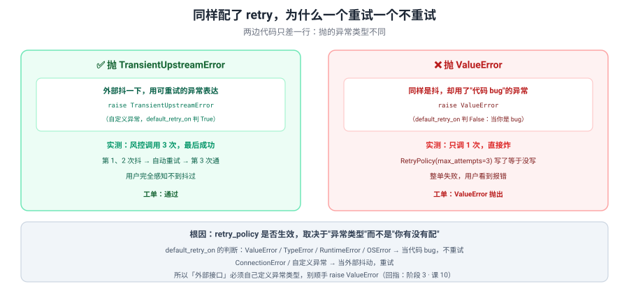

# 反例对照 · 会审批的退款工单系统

> 不是"错误示例"，而是**看起来能跑、实际很糟**的版本——只有这样才能教会"为什么最佳实践是最佳实践"。
> 下面每个反例**都能跑通 happy path**，问题只在异常场景才暴露。



---

## 反例 1：抖动时顺手 `raise ValueError`

**看起来能跑的版本**：

::: code-group

```python [Python]
def score_risk(state, config=None):
    deps = get_deps(config)
    try:
        score = deps.risk.score(state["order_id"], state["amount"])
    except Exception as e:
        # "统一转成 ValueError，简单点"
        raise ValueError(f"风控调用失败: {e}")
    return {"log": [f"风控评分: {score}"], "risk": score}
```

```typescript [TypeScript]
// ⚠️ 反例在 TS 侧**不会**复现 Python 的现象：TS 的默认 retryOn 是**黑名单**
//    （pregel/retry.js 的 DEFAULT_RETRY_ON_HANDLER），只有 name 是
//    "GraphValueError"、AbortError/Cancel*、带 4xx status、ECONNABORTED 才不重试，
//    **其余一律重试**。普通 Error 会老实重试满 maxAttempts 次。
async function scoreRisk(state: typeof RefundState.State, config?: any) {
  const deps = getDeps(config);
  try {
    const score = await deps.risk.score(state.order_id, state.amount);
    return { log: [`风控评分: ${score}`], risk: score };
  } catch (e) {
    // "统一转成 GraphValueError，简单点"——这样才会像 Python 的 ValueError 一样"不重试"
    throw new GraphValueError(`风控调用失败: ${(e as Error).message}`);
  }
}
```

:::


搭配的图配置：`add_node("score_risk", score_risk, retry_policy=RetryPolicy(max_attempts=3))`——**看起来重试配好了**。

**为什么糟**：

| # | 差异 | 后果 |
|:--:|------|------|
| 1 | `default_retry_on` 对 **ValueError 返回 False**（当代码 bug） | **配了 `max_attempts=3` 也只调 1 次**。实测：风控调用次数 = 1 |
| 2 | 失败**静默**——没有 warning 提示"重试被跳过了" | 你以为有韧性，实际第一下就炸，且没人发现 |
| 3 | 丢失了"这是外部抖动"的语义 | 上层无法区分"该重试"与"该放弃"，只能一律放弃 |

**正确做法**（`clients.py`）：定义 `TransientUpstreamError`（可重试）与 `PermanentUpstreamError`（不可重试）两类，外部故障只抛前者。**实测对照**：抛 `TransientUpstreamError` 时风控调用 3 次后成功。

> 回指：阶段 3 · 课 10。测试 `test_retry_does_not_work_for_value_error` 把这个反例钉死在测试里。
>
> 🇹🇸 **TS 侧这个反例会「反转」**：一旦配了 `retryPolicy` 而没写 `retryOn`，默认就是**黑名单**（`pregel/retry.js` 的 `DEFAULT_RETRY_ON_HANDLER`），只对 `name === "GraphValueError"`、`AbortError`/`Cancel*`、带 4xx `status`、`ECONNABORTED`、`insufficient_quota` 返回 false，**其余一律重试**。⚠️ 但**根本不配 `retryPolicy` 时一次都不会重试**（`resolvedRetryPolicy === void 0` 直接 break）——本反例之所以在 TS 侧"反转"，前提是它像 Python 那样显式配了 `maxAttempts`。所以：
> ① 抛普通 `Error` → **老实重试满 `maxAttempts` 次**（Python 是只试 1 次）。这条反例在 TS 侧不复现。
> ② 想复现「配了重试却不重试」的现象，要抛 `GraphValueError`（`@langchain/langgraph` 导出，实测 `new GraphValueError("x")` 的 `name` 就是 `"GraphValueError"`）——这也解释了为什么 TS 侧"随手包一层 `new Error(...)`"反而更危险：**它会被当成可重试错误**，把一次参数错误打成 N 次无效调用。
> ③ 默认还会往 **stdout** 打重试日志（`logWarning` 默认 `true`，用 `console.log`），Python 侧走 logging。

---

## 反例 2：退款节点不做幂等，直接重试

**看起来能跑的版本**：

::: code-group

```python [Python]
def do_refund(state, config=None):
    deps = get_deps(config)
    # 直接调，没有幂等键
    refund_id = deps.refund.refund(state["order_id"], state["amount"])
    return {"log": [f"已退款: {refund_id}"], "refund_id": refund_id}
```

```typescript [TypeScript]
async function doRefund(state: typeof RefundState.State, config?: any) {
  const deps = getDeps(config);
  // 直接调，没有幂等键
  const refundId = await deps.refund.refund(state.order_id, state.amount);
  return { log: [`已退款: ${refundId}`], refund_id: refundId };
}
```

:::


正常情况完全没问题——接口不抖就永远不会调第二次。

**为什么糟**：

| # | 差异 | 后果 |
|:--:|------|------|
| 1 | 重试会产生**第二笔真实退款** | 用户收到两笔钱，对账对不平，要人工追回 |
| 2 | 失败发生在"已扣款、回包丢失"时最致命 | 上游其实成功了，重试 = 重复打款 |
| 3 | 无法从存档点判断"到底退款成功没" | 排查时只能去翻支付渠道的对账单 |

**正确做法**（`nodes/flow.py`）：用 `_idempotency_key()`（`订单号+金额`）作幂等键。**实测**：退款接口收到 2 次调用，但两次 key 相同，只产生一个退款单 `RF-ORD-C-300.0`。

> 回指：阶段 3 · 课 10。测试 `test_refund_is_idempotent_under_retry` 断言"调用 2 次但幂等键只有 1 个"。
>
> 🇹🇸 **TS 侧差异**：坑的形态一样（重试 → 重复副作用），但触发概率**更高**——只要配了 `retryPolicy` 且没自定义 `retryOn`，TS 默认就是黑名单（见反例 1），普通异常都会重试满次数；反过来说，**漏配 `retryPolicy` 时反而一次都不重试**，这个"另一个极端"同样会导致业务预期落空。另外 `await` 漏写会变成"没打款却报成功"，比重复打款更难发现。

---

## 反例 3：不传 checkpointer，靠 interrupt 做审批

**看起来能跑的版本**：

::: code-group

```python [Python]
graph = build_graph()   # 不传 checkpointer
result = graph.invoke(state, config={"configurable": {"thread_id": "t1"}})
# 看到 result["decision"] == "待人工"，以为"人工审批"这步已经搞定
```

```typescript [TypeScript]
// ⚠️ TS 侧 compile() 选项是对象
const graph = buildGraph();   // 不传 checkpointer
const result = await graph.invoke(state, { configurable: { thread_id: "t1" } });
// 看到 result.decision === "待人工"，以为"人工审批"这步已经搞定
```

:::


**为什么糟**：

| # | 差异 | 后果 |
|:--:|------|------|
| 1 | `get_state()` 直接 `ValueError: No checkpointer set` | 你**查不到**这笔工单卡在哪、当前状态是什么 |
| 2 | `approve()`（resume）无法工作 | 人工点完"批准"，流程接不回去——审批功能等于没做 |
| 3 | `get_state_history()` 不可用 | 出事没法回放，只能靠日志猜 |

**正确做法**（`graph.py`）：`make_default_graph()` 默认挂 `InMemorySaver`；生产换 `SqliteSaver` / `PostgresSaver`。**实测**：挂了 checkpointer 后 `st.next == ("human_approve",)`，resume 后续跑出 `decision=通过`。

> 回指：阶段 3 · 课 8（"没有 checkpointer 是能停不能恢复"）+ 阶段 2 · 课 5。测试 `test_interrupt_requires_checkpointer_to_resume` 与 `test_human_approval_resume` 成对钉住。
>
> 🇹🇸 **TS 侧差异**：
> ① 报错文本不同：Python 是 `ValueError: No checkpointer set`；TS 侧 `getState` 在无 checkpointer 时抛的是另一段文本，**别按 Python 原文去 `except`**。
> ② `compile()` 选项是对象：`compile({ checkpointer: new MemorySaver() })`；TS 侧类名是 **`MemorySaver`**（`InMemorySaver` 在 TS 里不存在，实测导出列表里只有 `MemorySaver`）。
> ③ `getState()` / `getStateHistory()` 都是异步：`await graph.getState(cfg)`；`getStateHistory` 返回**异步迭代器**，只能 `for await`。

---

## 反例 4：把依赖塞进 State

**看起来能跑的版本**：

::: code-group

```python [Python]
class RefundState(TypedDict):
    ...
    risk_client: Any     # "顺手加个字段，节点里就能用"


def score_risk(state, config=None):
    score = state["risk_client"].score(...)   # 直接从 State 取
```

```typescript [TypeScript]
import { Annotation } from "@langchain/langgraph";

const RefundState = Annotation.Root({
  order_id: Annotation<string>({ reducer: (_p, n) => n, default: () => "" }),
  amount: Annotation<number>({ reducer: (_p, n) => n, default: () => 0 }),
  // "顺手加个字段，节点里就能用"
  // ⚠️ TS 侧还要给泛型，`any` 会让后续全部类型检查失效
  risk_client: Annotation<any>({ reducer: (_p, n) => n, default: () => undefined }),
});

async function scoreRisk(state: typeof RefundState.State) {
  const score = await state.risk_client.score(state.order_id, state.amount);  // 直接从 State 取
  return { risk: score };
}
```

:::


单测里手动构造 State 时确实能跑。

**为什么糟**：

| # | 差异 | 后果 |
|:--:|------|------|
| 1 | 走 `invoke(state, config)` 时**读不到** | 课 12 实测 `KeyError: 'model'`——State 是运行时输入，不是传参通道 |
| 2 | 连接对象会被写进 checkpoint | 序列化失败，或存档点里塞进一堆无用二进制 |
| 3 | State 契约被污染 | 看 State 定义分不清"业务数据"与"运行时依赖" |

**正确做法**（`deps.py`）：走 `config["configurable"]["deps"]`，节点签名写成 `(state, config)`。

> 回指：阶段 4 · 课 12 实测教训。
>
> 🇹🇸 **TS 侧差异**：`config` 是**第 2 个位置参数**，取依赖写 `config?.configurable?.deps`（多层可选链，因为 `config` 本身可能 `undefined`）。把客户端放进 State 的后果多一条：`Annotation<...>({ default: () => undefined })` 里塞连接对象，**checkpointer 序列化会在运行期抛错**，且报错信息指向序列化器而不是你的字段，很难定位。

---

## 反例 5：`log` 字段不用 reducer

**看起来能跑的版本**：

::: code-group

```python [Python]
class RefundState(TypedDict):
    log: list      # 没有 Annotated[list, add]


def validate(state, config=None):
    return {"log": ["校验通过"]}     # 想当然地以为是"追加"
```

```typescript [TypeScript]
import { Annotation } from "@langchain/langgraph";

const RefundState = Annotation.Root({
  // ⚠️ TS 侧这个反例的"写法"不一样，但**坑完全对应**：
  //    Python 是「不写 reducer → 默认覆盖」；TS 是「写 `(_p, n) => n` → 手工覆盖」。
  //    因为 TS 的 reducer 是必填项（省略会报 TS2345），所以没人能"忘了写"，
  //    真正的等价错误是**把覆盖 reducer 当成累加用**——本机实测：两个节点依次写
  //    ["A"]、["B"]，结果只剩 ["B"]；换成 `(a, b) => a.concat(b)` 才得到 ["A","B"]。
  log: Annotation<string[]>({ reducer: (_p, n) => n, default: () => [] }),
});

function validate(state: typeof RefundState.State) {
  return { log: ["校验通过"] };     // 想当然地以为是"追加"
}
```

:::


**为什么糟**：

| # | 差异 | 后果 |
|:--:|------|------|
| 1 | 默认语义是**覆盖**，不是追加 | 后一个节点返回 `{"log": [...]}` 会把前面的全抹掉 |
| 2 | 最终只剩最后一条 | 你拿不到完整链路，排查时"到底走过哪几步"全靠猜 |
| 3 | 不报错，静默丢数据 | 这是最坏的一类 bug——没有任何信号 |

**正确做法**（`state.py`）：`log: Annotated[list, add]`。**实测**：走完全流程 `len(log) == 5`，5 个节点各留一条。

> 回指：阶段 1 · 课 3（默认覆盖静默丢数据）。测试 `test_log_is_accumulated_not_overwritten` 断言条数 = 5。
>
> 🇹🇸 **TS 侧差异**：TS **不会**让你"忘了写 reducer"——`Annotation<string[]>({ default: () => [] })` 直接报 `TS2345: Property 'value' is missing`。等价错误变成"**写了个覆盖 reducer 当累加用**"：本机实测两个节点依次返回 `["A"]`、`["B"]`，`(_p, n) => n` 得 `["B"]`（只剩最后一条），`(a, b) => a.concat(b)` 得 `["A","B"]`。**表现与 Python 完全一样（静默丢数据），只是成因从"漏写"变成"写错"。**

---

## 反例 6：`config` 注解写成 `dict | None`

**看起来能跑的版本**：

::: code-group

```python [Python]
def validate(state: RefundState, config: dict | None = None) -> dict:
```

```typescript [TypeScript]
// ⚠️ TS 侧**没有**"按注解决定是否注入 config"的机制——config 永远是第 2 个位置参数，
//    所以 Python 那条 UserWarning（注解写成 `dict | None` 就警告）在 TS 侧**不存在**。
//    但等价风险换了个形态：漏写第 2 个参数、或在 Node 的 addNode 里把函数包了一层
//    `(s) => validate(s)`，就拿不到 deps，且 **tsc 不报错**（参数可省），运行期才炸。
async function validate(
  state: typeof RefundState.State,
  config: any,      // 省略这个参数 tsc 也能过（可选），但里面取 deps 就是 undefined
): Promise<Partial<typeof RefundState.State>> {
  return { log: ["校验通过"] };
}
```

:::


运行完全正常，只是多一条 `UserWarning`。

**为什么糟**：

| # | 差异 | 后果 |
|:--:|------|------|
| 1 | langgraph 内部按注解决定是否注入 config | 实测 `RunnableConfig \| None` 也**照样警告**（源码只认 `RunnableConfig` / `Optional[RunnableConfig]`，`_runnable.py:168`） |
| 2 | 警告刷屏，淹没真正重要的告警 | 跑一次刷 7 条，久了就没人看日志 |
| 3 | 若注解不对导致**不注入**，节点拿不到依赖 | 静默降级成默认假实现，测试通过但生产行为不同 |

**正确做法**：`config: Optional[RunnableConfig] = None`。**实测**：改成 `Optional` 后 `-W error` 下零警告跑通。
>
> 🇹🇸 **TS 侧无此问题**：TS 没有"按注解决定是否注入 config"的机制，`config` 永远是第 2 个位置参数，注解写成 `any` 也不会警告。**等价风险换了个形态**：漏写第 2 个参数、或在 `addNode` 里包一层 `(s) => validate(s)`，`tsc` 不报错（参数可省），运行期取 `config.configurable.deps` 才炸 `Cannot read properties of undefined`。

---

## 📊 六个反例的共同模式

| 反例 | 表面症状 | 真实类别 |
|:--:|---------|---------|
| 1 · ValueError | 重试不生效 | **静默失效**（配了不报错） |
| 2 · 不幂等 | 重复打款 | **只在异常时才炸** |
| 3 · 无 checkpointer | 审批接不回 | **能停不能恢复** |
| 4 · 依赖塞 State | KeyError | **契约污染** |
| 5 · 无 reducer | log 只剩一条 | **静默丢数据** |
| 6 · 注解写错 | UserWarning | **告警噪音** |

> 💡 六条里有 **4 条是"静默"的**——这正是为什么"能跑"不等于"对"。本项目的 16 项测试就是用来把这 4 条静默的钉成显式失败。

### TS 写法对照表

| Python | TypeScript | 注意 |
|--------|-----------|------|
| `raise ValueError(...)` 不重试 | 配了 `retryPolicy` 后默认**会**重试；要复现需 `throw new GraphValueError(...)`；完全不配则都不重试 | 黑名单 vs 白名单，语义相反 |
| `RetryPolicy(max_attempts=3)` | `{ retryPolicy: { maxAttempts: 3 } }` | 驼峰 |
| `InMemorySaver()` | `new MemorySaver()` | TS 无 `InMemorySaver` |
| `compile(checkpointer=cp)` | `compile({ checkpointer: cp })` | 选项对象 |
| `graph.get_state(cfg)` | `await graph.getState(cfg)` | 异步 |
| `get_state_history(cfg)` | `for await (const s of graph.getStateHistory(cfg))` | 异步迭代器 |
| `config["configurable"]["deps"]` | `config?.configurable?.deps` | 多层可选链 |
| `Annotated[list, add]` | `Annotation<string[]>({ reducer: (a, b) => a.concat(b), default: () => [] })` | reducer 必填 |
| `log: list`（默认覆盖） | `reducer: (_p, n) => n` | TS 省略 reducer 是**编译错误**，不是覆盖 |
| `config: Optional[RunnableConfig]` 警告 | TS 无此机制 | 等价风险：漏传第 2 参 |
