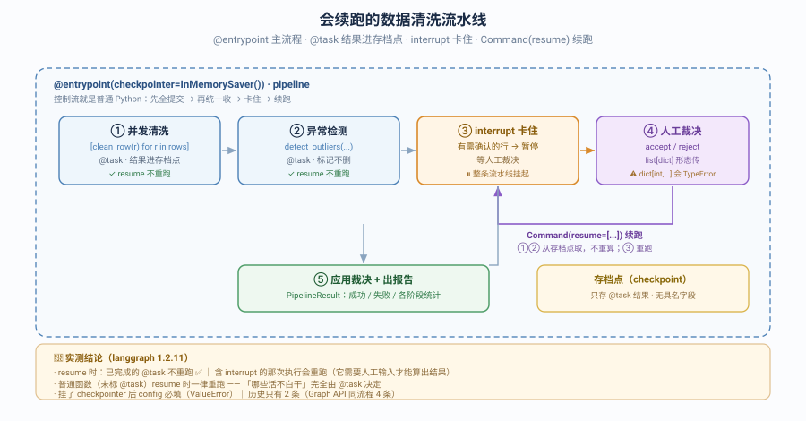

# 实战项目：会续跑的数据清洗流水线

> 所属课程：LangGraph 系统学习 ｜ 学习目标：动手实操 ｜ 预计耗时：3–4 小时
> ✅ 实测于 langgraph 1.2.11 / langgraph-checkpoint 4.2.0 / Python 3.12（`uv run` 隔离执行）
> ✅ 测试 **21 passed** ｜ 演示 **6 个场景全通过**

## 🎯 一句话需求

你手上有个**已经能跑的清洗脚本**：读一批脏数据，去空格、转类型、丢废字段、校验必填。现在要加两个能力——**遇到不确定的数据能停下来问人**，**人答复后能接着跑**（前面的活不能白干）。

**约束：不重写成图。** 用 Functional API 原地改造。

四个项目的分工：

| 项目 | API | 练什么 |
|------|-----|--------|
| 会审批的退款工单系统 | Graph | 一次任务怎么跑完、被卡住、再续跑 |
| 会记住和遗忘的客服助手 | Graph | 跨会话的东西放哪、怎么不写脏 |
| 会重试和降级的调研流水线 | Graph | 外部依赖不可靠时怎么不崩 |
| **会续跑的数据清洗流水线** | **Functional** | **已有脚本怎么最小成本加暂停和续跑** |

## ✅ 目标与非功能约束

**功能目标**：
1. 清洗一批数据：去空格 / 空值归一 / 类型转换 / 丢未知字段 / 必填校验
2. 不确定的数据**不猜**，标出来交人工裁决
3. 人工裁决后**续跑**，前面的清洗结果不重算
4. 出带阶段统计的报告

**非功能约束**：

| 类别 | 约束 | 落地在哪 |
|------|------|---------|
| **可恢复性** | 卡住后人工介入能续跑，不重复劳动 | `@task` 标注重活 |
| **数据安全** | 不确定的值**不静默填默认值** | `coerce_types` 抛 `Unclear` |
| **可观测** | 每个阶段处理/修复/失败数可查 | `StageReport` |
| **性能** | 逐行清洗并行而非串行 | 先全提交 `Future` 再统一收 |
| **可测性** | 无真实 IO，规则纯函数可单测 | `rules.py` 全纯函数 |

## 🗺️ 覆盖知识点地图

| 知识点 | 阶段 / 课 | 本项目用在何处 | 回指 |
|--------|----------|---------------|------|
| State 与 reducer | 阶段 1 · 课 3 | **刻意不用**——这正是选 Functional 的理由 | | [课 3](../../stages/1-%E4%BB%8Ecreate_agent%E5%88%B0StateGraph/lessons/03-Graph%20API%20%E7%AC%AC%E4%B8%80%E4%B8%AA%E5%9B%BE.md)
| 条件边与分支 | 阶段 1 · 课 3 | 用 `if` 替代条件边 | | [课 3](../../stages/1-%E4%BB%8Ecreate_agent%E5%88%B0StateGraph/lessons/03-Graph%20API%20%E7%AC%AC%E4%B8%80%E4%B8%AA%E5%9B%BE.md)
| Pregel 执行模型 | 阶段 2 · 课 4 | 并发靠"不急着取 `.result()`" | | [课 4](../../stages/2-%E6%89%A7%E8%A1%8C%E6%A8%A1%E5%9E%8B%E4%B8%8E%E7%8A%B6%E6%80%81%E6%8C%81%E4%B9%85%E5%8C%96/lessons/04-Pregel%20%E6%89%A7%E8%A1%8C%E6%A8%A1%E5%9E%8B.md)
| checkpoint 与 thread_id | 阶段 2 · 课 5 | `@entrypoint(checkpointer=...)` + 必传 config | | [课 5](../../stages/2-%E6%89%A7%E8%A1%8C%E6%A8%A1%E5%9E%8B%E4%B8%8E%E7%8A%B6%E6%80%81%E6%8C%81%E4%B9%85%E5%8C%96/lessons/05-Checkpointer%20%E7%9F%AD%E6%9C%9F%E8%AE%B0%E5%BF%86.md)
| Interrupts 人在环中 | 阶段 3 · 课 8 | `interrupt()` 卡住等裁决 | | [课 8](../../stages/3-%E5%8F%AF%E6%8E%A7%E6%80%A7%E4%B8%8E%E4%BA%BA%E5%9C%A8%E7%8E%AF%E4%B8%AD/lessons/08-Interrupts%20%E4%BA%BA%E5%9C%A8%E7%8E%AF%E4%B8%AD.md)
| Time-travel 回放 | 阶段 3 · 课 9 | `get_state_history` 只有 2 条（对比 Graph 的 4 条） | | [课 9](../../stages/3-%E5%8F%AF%E6%8E%A7%E6%80%A7%E4%B8%8E%E4%BA%BA%E5%9C%A8%E7%8E%AF%E4%B8%AD/lessons/09-Time-travel%20%E5%9B%9E%E6%94%BE%E4%B8%8E%E5%88%86%E5%8F%89.md)
| **@entrypoint / @task 模型** | 阶段 3 · 课 11 | 全流程用 Functional API | | [课 11](../../stages/3-%E5%8F%AF%E6%8E%A7%E6%80%A7%E4%B8%8E%E4%BA%BA%E5%9C%A8%E7%8E%AF%E4%B8%AD/lessons/11-Functional%20API%20%E4%B8%8E%E9%80%89%E5%9E%8B.md)
| **task 持久化语义** | 阶段 3 · 课 11 | 实测澄清：resume 不重跑 vs 重跑 | | [课 11](../../stages/3-%E5%8F%AF%E6%8E%A7%E6%80%A7%E4%B8%8E%E4%BA%BA%E5%9C%A8%E7%8E%AF%E4%B8%AD/lessons/11-Functional%20API%20%E4%B8%8E%E9%80%89%E5%9E%8B.md)
| **previous 参数** | 阶段 3 · 课 11 | `previous_runs` 累计 | | [课 11](../../stages/3-%E5%8F%AF%E6%8E%A7%E6%80%A7%E4%B8%8E%E4%BA%BA%E5%9C%A8%E7%8E%AF%E4%B8%AD/lessons/11-Functional%20API%20%E4%B8%8E%E9%80%89%E5%9E%8B.md)
| **两套 API 选型** | 阶段 3 · 课 11 | 本项目本身就是"选 Functional"的论据 | | [课 11](../../stages/3-%E5%8F%AF%E6%8E%A7%E6%80%A7%E4%B8%8E%E4%BA%BA%E5%9C%A8%E7%8E%AF%E4%B8%AD/lessons/11-Functional%20API%20%E4%B8%8E%E9%80%89%E5%9E%8B.md)
| 单元与集成测试 | 阶段 4 · 课 12 | 纯函数规则 + 确定性替身 | | [课 12](../../stages/4-%E5%B7%A5%E7%A8%8B%E5%8C%96%E4%B8%8E%E4%B8%8A%E7%BA%BF/lessons/12-Application%20structure%20%E4%B8%8E%E6%B5%8B%E8%AF%95.md)
| 部署契约 | 阶段 4 · 课 13 | `langgraph.json` | | [课 13](../../stages/4-%E5%B7%A5%E7%A8%8B%E5%8C%96%E4%B8%8E%E4%B8%8A%E7%BA%BF/lessons/13-Deployment%20%E4%B8%8E%20Observability.md)

**跨阶段校验**：覆盖 **4 个阶段**（1 / 2 / 3 / 4），门槛 ≥3 ✅

## 🔬 实测出的关键事实（比课 11 更精确）

### 1. 「@task 结果写进存档点」到底意味着什么

课 11 这句话容易读成"重跑会复用"。实测澄清：

| 场景 | 已完成的 `@task` | 含 `interrupt` 的那次执行 |
|------|-----------------|------------------------|
| **resume**（`Command(resume=...)`） | ✅ **不重跑**（复用存档） | ❌ **重跑** |
| **同 thread 再 invoke**（非 resume） | ❌ 重跑 | ❌ 重跑 |

👉 **"写进存档点"的价值在 resume 时体现，不是在同 thread 重跑时。** 同 thread 再 invoke 是全新一次执行，全部重来。

含 interrupt 的那次要重跑是**合理的**——它需要人工输入才能算出结果，没法复用。推论：**把 interrupt 前后的纯计算尽量放进 `@task`**，这样重跑的只有那一小段。

### 2. 普通函数（没标 `@task`）在 resume 时**也会重跑**

实测对照：`plain_step` resume 后跑了 2 次。

👉 **"哪些活不白干"完全由 `@task` 决定**，普通函数一律重来。所以判断标准是：**这段计算重跑一次贵不贵？贵就标 `@task`。**

### 3. `Command(resume=...)` 传 dict 会被当 interrupt-id 映射校验

这是本项目**撞得最狠**的一个坑。原先用 `{行id: 裁决}` 传，直接炸：

```
TypeError: expected string or bytes-like object, got 'int'
  at langgraph/pregel/_loop.py:912  in is_xxh3_128_hexdigest
```

框架检查 dict 的每个 key 是否为 32 位 hex（interrupt id），行 id 是 int 就崩。

👉 **正解：用 `list[dict]` 传**——`[{"id": 1, "decision": "accept"}]`，行 id 放在 value 里。

### 4. 挂了 checkpointer 后 config 必填

```python
flow.invoke(1)                                    # ❌ ValueError
flow.invoke(1, {"configurable": {"thread_id": "t1"}})   # ✅
```

Graph API 不传也能跑，Functional API 不行。

### 5. 历史只有 2 条（Graph API 同流程 4 条）

```
next=()             values=3
next=('pipeline',)  values=None
```

这是选 Functional 的**实质代价**：中间过程没有具名字段可 inspect / 逐格改。

## 🚀 运行方式

```bash
cd langchain/langgraph/projects/会续跑的数据清洗流水线/实现

# 1) 跑测试（21 项）
PYTHONPATH=. uv run --no-sync --project ../../../../langchain/playground \
  python -m pytest pipeline/tests/ -q
# 预期：21 passed

# 2) 跑演示（6 场景）
PYTHONPATH=. uv run --no-sync --project ../../../../langchain/playground python demo.py
```

## 📁 目录说明



| 路径 | 内容 |
|------|------|
| `实现/pipeline/models.py` | 数据模型（刻意无 State schema） |
| `实现/pipeline/rules.py` | 5 条纯函数清洗规则 |
| `实现/pipeline/flow.py` | `@entrypoint` + `@task` 流水线 |
| `实现/pipeline/tests/` | 三层测试（21 项） |
| `实现/demo.py` | 6 个场景 |
| [设计决策.md](设计决策.md) | 3 个权衡点 |
| [反例对照.md](反例对照.md) | "能跑但很糟"的版本 |
| [验收清单.md](验收清单.md) | 26 项自测 |

## 🎬 六个演示场景（实测输出）

| 场景 | 演示什么 | 实测结果 |
|:--:|---------|---------|
| 1 | 干净数据一路跑完 | 2 行全成功，无中断 |
| 2 | 脏数据卡住 | ⏸ 2 行待确认：行 1「age='abc' 非整数」、行 2「缺 name」 |
| 3 | **续跑裁决生效** | 3 行成功 1 失败 2，各阶段统计完整 |
| 4 | 拒绝路径 | 行 1/2 追加「人工判定：拒绝」 |
| 5 | **并发 vs 串行** | 并发 **0.30s** vs 串行 **0.60s**，快 2.0 倍 |
| 6 | Functional 的状态 | 历史**只有 2 条** |

## 🎓 本项目回答的核心问题：什么时候选 Functional API

课 11 的判据是"**中间过程要不要被单独看见和逐格修改**"。本项目是这条判据的实证：

- 清洗流程是**流水账**——你关心"这批洗出来什么样"，不关心"第 3 行的 city 字段在第几格"
- 控制流**直**——就是顺序执行 + 一个 if（有没有需确认的行）
- 已有脚本改造成本**最低**——不用把 for 循环翻译成节点和边

如果需求变成"运营要能在后台**单独重跑某一行**、**手动改某个字段的值**"，那就该换 Graph API。

## 📚 官方文档

- [Functional API · LangGraph](https://docs.langchain.com/oss/python/langgraph/functional-api) — `@entrypoint` / `@task`
- [Choosing between the APIs](https://docs.langchain.com/oss/python/langgraph/choosing-apis) — 选型判据
- [Interrupts · LangGraph](https://docs.langchain.com/oss/python/langgraph/interrupts) — 人在环中
