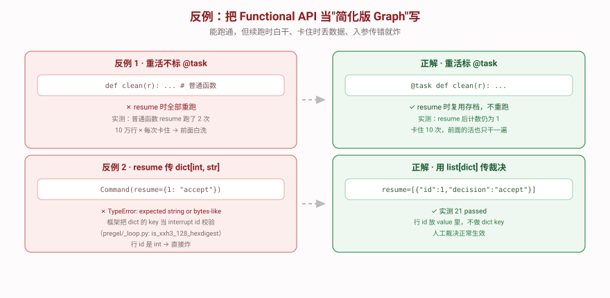

# 反例对照

> **看起来能跑但其实很糟**的版本。下面每一条都能通过最朴素的测试——但要等数据脏了、流程卡了才暴露。



---

## 反例 1：重活不标 `@task`

这是**最常见也最隐蔽**的错。代码完全正确，输出也正确——直到流程卡住一次。

```python
from langgraph.func import entrypoint
from langgraph.types import interrupt

def clean_row(r):          # ❌ 没标 @task，是普通函数
    print(f"   洗第 {r.id} 行（很贵）")
    return do_expensive_work(r)

@entrypoint(checkpointer=InMemorySaver())
def flow(batch):
    rows = [clean_row(r) for r in batch.rows]      # 洗完了
    needs = [r.id for r in rows if r.errors]
    if needs:
        interrupt({"rows": needs})                  # 卡住
    return summarize(rows)
```

**实测后果**：

```
第一次 invoke:  [副作用] clean_row 跑了第 1 次
resume:         [副作用] clean_row 跑了第 2 次   ← 白干一遍
```

### 对照正解

```python
@task                      # ✅ 标了 @task
def clean_row(r):
    return do_expensive_work(r)

@entrypoint(checkpointer=InMemorySaver())
def flow(batch):
    futures = [clean_row(r) for r in batch.rows]   # 先全提交
    rows = [f.result() for f in futures]           # 再统一收
    ...
```

```
第一次 invoke:  [副作用] clean_row 跑了第 1 次
resume:         （无输出 —— 复用存档，没重跑）✅
```

**为什么糟**：卡住 10 次，前面的活就干 10 遍。10 万行数据每次卡住就重洗 10 万行。

---

## 反例 2：`resume` 用 `dict[int, str]` 传裁决

**照着直觉写**就会犯——"我要告诉它第 1 行 accept、第 2 行 reject"，最自然的写法就是 dict。

```python
out = pipeline.invoke(batch, cfg)                       # 卡住了
ids = [r["id"] for r in out["__interrupt__"][0].value["rows"]]

# ❌ 看起来最自然
pipeline.invoke(Command(resume={1: "accept", 2: "reject"}), cfg)
```

**实测报错**：

```
TypeError: expected string or bytes-like object, got 'int'
  langgraph/pregel/_loop.py:912  in <genexpr>
    and all(is_xxh3_128_hexdigest(k) for k in resume)
  langgraph/pregel/_utils.py:291  in is_xxh3_128_hexdigest
    return bool(re.fullmatch(r"[0-9a-f]{32}", value))
```

### 为什么

框架**把 `resume` 的 dict 当成「interrupt id → 该 interrupt 的答案」的映射**，所以会检查每个 key 是不是 32 位十六进制。行 id 是 `1`、`2` 这种 int，直接炸。

### 正解

```python
# ✅ 用 list[dict]，行 id 放进 value
pipeline.invoke(
    Command(resume=[{"id": 1, "decision": "accept"},
                    {"id": 2, "decision": "reject"}]),
    cfg,
)
```

> 💡 如果真要按 interrupt id 分别答复（一个流程多个 interrupt 时），那 dict 的 key 就该用 `out["__interrupt__"][0].id` 那个 32 位串。

---

## 反例 3：不确定就填个默认值

```python
def coerce_types(row):
    for k, v in row.cleaned.items():
        if k in INT_FIELDS:
            try:
                row.cleaned[k] = int(v)
            except ValueError:
                row.cleaned[k] = 0          # ❌ 猜一个
    return row
```

**在"所有数据都干净"的测试里，这段代码是满分。**

### 为什么糟

| 问题 | 后果 |
|------|------|
| **无法追溯** | 下游看到 `age=0`，分不清是"真实年龄 0"还是"洗坏了填的" |
| **污染统计** | 平均年龄被一堆 0 拉低，报表错误且没人知道为什么 |
| **掩盖上游问题** | 源头数据格式错了，你静默兜住了，问题永远不会暴露 |

### 正解：不猜，抛出来

```python
except ValueError:
    raise Unclear(f"第 {row.id} 行字段 {k!r} 的值 {v!r} 不是合法整数")
```

实测效果：`行 1: ["[类型转换] 第 1 行字段 'age' 的值 'abc' 不是合法整数"]`——**错误信息说清了是哪一行、哪个字段、什么值、为什么**，人工一眼能判。

---

## 反例 4：串行调用 `.result()`

```python
@entrypoint(checkpointer=InMemorySaver())
def flow(batch):
    rows = [clean_row(r).result() for r in batch.rows]   # ❌ 立即取 = 串行
    return rows
```

**实测**：2 个 0.3s 任务 → 耗时 **0.60s**。

### 正解

```python
futures = [clean_row(r) for r in batch.rows]    # 先全提交
rows = [f.result() for f in futures]            # 再统一收
```

**实测**：同样 2 个任务 → **0.30s**，快 2 倍。

> 💡 这是 Functional API 版的 `Send` 扇出——**动态扇出就是列表推导**。
