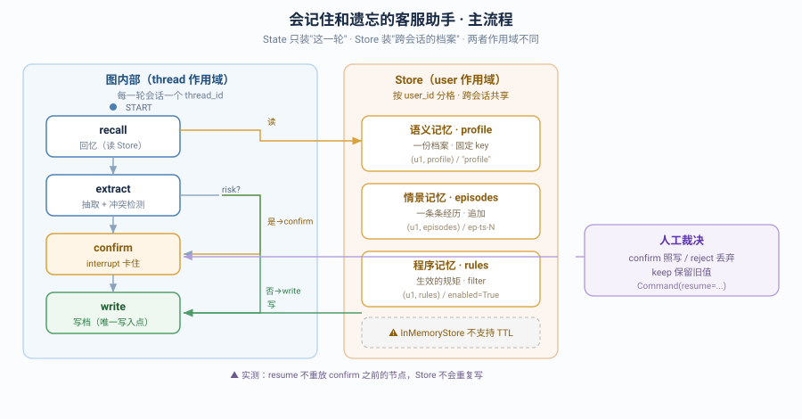

# 实战项目：会记住和遗忘的客服助手

> 所属课程：LangGraph 系统学习 ｜ 学习目标：动手实操 ｜ 预计耗时：3–4 小时
> ✅ 代码实测于 langgraph 1.2.11 / langgraph-checkpoint 4.2.0 / Python 3.12（`uv run` 隔离执行）
> ✅ 测试套件 **20 passed**（`python -m pytest memory_agent/tests/ -q`）
> ✅ 演示脚本 **6 个场景全通过**（`python demo.py`）

## 🎯 一句话需求

做一个**客服助手**：用户说的话里藏着偏好和规矩，助手要抽出来记住——**下周换个新会话还得记得**；新说法和旧档案打架时要**检测出冲突**并请您裁决；**涉及联系方式的高风险内容必须人工点头才写档**；拒绝了的就当没说过。

与第一个项目《会审批的退款工单系统》的分工：那个项目练的是**"一次任务怎么跑完又被卡住再续跑"**（流程控制），这个项目练的是**"跨会话的东西该放哪、怎么不写脏"**（记忆分层与治理）。

## ✅ 目标与非功能约束

**功能目标**：
1. 从对话里抽出偏好（语义）、经历（情景）、规矩（程序）三类事实
2. 跨会话记住：换 thread 后仍读得到
3. 冲突检测：新说法与旧档案不一致时拦下，不静默覆盖
4. 高风险事实（联系方式 / 投诉）走人工确认，可照写 / 丢弃 / 保留旧值

**非功能约束**：

| 类别 | 约束 | 落地在哪 |
|------|------|---------|
| **错误处理** | 抽取失败不能让整轮服务崩掉 | `nodes/flow.py` 的 `extract` 兜住异常返回空候选 |
| **安全 / 正确性** | 高风险事实未经确认不得写档 | `confirm` 节点 `interrupt()` + `route_after_extract` 条件边 |
| **可维护性** | 命名空间约定收在一处，换后端只改一处 | `store.py` 的 `MemStore` 门面 + `ns_*()` 函数 |
| **可观测** | 每一步干了什么可追溯、可回放 | `trace` 累加字段 + `service.history()` 存档点 |

## 🗺️ 覆盖知识点地图

> 跨阶段整合的证据，逐个回指课时。

| 知识点 | 所属阶段 / 课 | 本项目用在何处 | 回指 |
|--------|--------------|---------------|------|
| State 定义与 reducer（累加语义） | 阶段 1 · 课 3 | `state.py` 的 `trace: Annotated[list, add]` | [课 3](../../stages/1-%E4%BB%8Ecreate_agent%E5%88%B0StateGraph/lessons/03-Graph%20API%20%E7%AC%AC%E4%B8%80%E4%B8%AA%E5%9B%BE.md) |
| 条件边与分支 | 阶段 1 · 课 3 | `graph.py` 的 `route_after_extract`（risk? → confirm / write） | [课 3](../../stages/1-%E4%BB%8Ecreate_agent%E5%88%B0StateGraph/lessons/03-Graph%20API%20%E7%AC%AC%E4%B8%80%E4%B8%AA%E5%9B%BE.md) |
| workflow 与 agent 的分界 | 阶段 1 · 课 2 | 抽取走**规则**不 LLM（合规可解释、可复现） | [课 2](../../stages/1-%E4%BB%8Ecreate_agent%E5%88%B0StateGraph/lessons/02-LangGraph%E6%98%AF%E4%BB%80%E4%B9%88%EF%BC%88%E5%AE%9A%E4%BD%8D%E4%B8%8E%E5%BF%83%E6%99%BA%E6%A8%A1%E5%9E%8B%EF%BC%89.md) |
| checkpoint 与 thread_id | 阶段 2 · 课 5 | `compile(checkpointer=...)`；一轮会话一个 thread | [课 5](../../stages/2-%E6%89%A7%E8%A1%8C%E6%A8%A1%E5%9E%8B%E4%B8%8E%E7%8A%B6%E6%80%81%E6%8C%81%E4%B9%85%E5%8C%96/lessons/05-Checkpointer%20%E7%9F%AD%E6%9C%9F%E8%AE%B0%E5%BF%86.md) |
| **Store 与命名空间** | 阶段 2 · 课 6 | `store.py` 三类格子；`ns_profile/ ns_episode/ ns_rule` | [课 6](../../stages/2-%E6%89%A7%E8%A1%8C%E6%A8%A1%E5%9E%8B%E4%B8%8E%E7%8A%B6%E6%80%81%E6%8C%81%E4%B9%85%E5%8C%96/lessons/06-Store%20%E9%95%BF%E6%9C%9F%E8%AE%B0%E5%BF%86.md) |
| **长期记忆落地（语义/情景/程序）** | 阶段 2 · 课 6 | profile / episodes / rules 三格，各用各的写法 | [课 6](../../stages/2-%E6%89%A7%E8%A1%8C%E6%A8%A1%E5%9E%8B%E4%B8%8E%E7%8A%B6%E6%80%81%E6%8C%81%E4%B9%85%E5%8C%96/lessons/06-Store%20%E9%95%BF%E6%9C%9F%E8%AE%B0%E5%BF%86.md) |
| Streaming 流式输出 | 阶段 2 · 课 7 | `service.stream()`，`stream_mode="updates"` | [课 7](../../stages/2-%E6%89%A7%E8%A1%8C%E6%A8%A1%E5%9E%8B%E4%B8%8E%E7%8A%B6%E6%80%81%E6%8C%81%E4%B9%85%E5%8C%96/lessons/07-Streaming%20%E6%B5%81%E5%BC%8F%E8%BE%93%E5%87%BA.md) |
| Interrupts 人在环中 | 阶段 3 · 课 8 | `confirm` 用 `interrupt()`；`approve()` 用 `Command(resume=)` | [课 8](../../stages/3-%E5%8F%AF%E6%8E%A7%E6%80%A7%E4%B8%8E%E4%BA%BA%E5%9C%A8%E7%8E%AF%E4%B8%AD/lessons/08-Interrupts%20%E4%BA%BA%E5%9C%A8%E7%8E%AF%E4%B8%AD.md) |
| Time-travel 回放 | 阶段 3 · 课 9 | `service.history()`（实测 sess-2 有 **5 个存档点**） | [课 9](../../stages/3-%E5%8F%AF%E6%8E%A7%E6%80%A7%E4%B8%8E%E4%BA%BA%E5%9C%A8%E7%8E%AF%E4%B8%AD/lessons/09-Time-travel%20%E5%9B%9E%E6%94%BE%E4%B8%8E%E5%88%86%E5%8F%89.md) |
| 节点级错误处理 | 阶段 3 · 课 10 | `extract` 兜异常；`PermanentUpstream` 式分类思路 | [课 10](../../stages/3-%E5%8F%AF%E6%8E%A7%E6%80%A7%E4%B8%8E%E4%BA%BA%E5%9C%A8%E7%8E%AF%E4%B8%AD/lessons/10-Fault-tolerance%20%E4%B8%8E%20Subgraphs.md) |
| 项目结构与 langgraph.json | 阶段 4 · 课 12 | `langgraph.json` 的 `graphs.memory_agent` | [课 12](../../stages/4-%E5%B7%A5%E7%A8%8B%E5%8C%96%E4%B8%8E%E4%B8%8A%E7%BA%BF/lessons/12-Application%20structure%20%E4%B8%8E%E6%B5%8B%E8%AF%95.md) |
| 单元与集成测试（假服务） | 阶段 4 · 课 12 | `store.py` 的 `FakeStore` + 三层测试 20 项 | [课 12](../../stages/4-%E5%B7%A5%E7%A8%8B%E5%8C%96%E4%B8%8E%E4%B8%8A%E7%BA%BF/lessons/12-Application%20structure%20%E4%B8%8E%E6%B5%8B%E8%AF%95.md) |
| 部署契约 | 阶段 4 · 课 13 | `langgraph.json` 即 `/runs/stream` 的挂载契约 | [课 13](../../stages/4-%E5%B7%A5%E7%A8%8B%E5%8C%96%E4%B8%8E%E4%B8%8A%E7%BA%BF/lessons/13-Deployment%20%E4%B8%8E%20Observability.md) |

**跨阶段校验**：覆盖 **4 个阶段**（阶段 1 / 2 / 3 / 4），门槛 ≥3 ✅

## 🚀 运行方式

```bash
# 进入项目实现目录
cd langchain/langgraph/projects/会记住和遗忘的客服助手/实现

# 1) 跑测试（20 项）
PYTHONPATH=. uv run --no-sync --project ../../../../langchain/playground \
  python -m pytest memory_agent/tests/ -q
# 预期：20 passed

# 2) 跑演示（6 个场景）
PYTHONPATH=. uv run --no-sync --project ../../../../langchain/playground python demo.py
# 预期：偏好抽取 → 人工确认 → 写档 → 跨会话记住 → 冲突检出 → keep 保旧值 → 回放 + 流式
```

> ⚠️ **playground 实际路径是 `langchain/langchain/playground`**（不是 `langchain/playground`）——教程内其他文档写的旧路径需一并留意。

## 📁 目录说明



| 路径 | 内容 |
|------|------|
| `实现/memory_agent/state.py` | 状态定义（**不含用户档案**，trace 累加语义） |
| `实现/memory_agent/store.py` | `MemStore` 门面（命名空间 SSOT）+ `FakeStore` 测试替身 |
| `实现/memory_agent/extract.py` | 抽取规则 + 冲突检测（纯函数，可单测） |
| `实现/memory_agent/nodes/flow.py` | 4 个节点：recall / extract / confirm / write |
| `实现/memory_agent/graph.py` | 建图：条件边 + checkpointer + store 双注入 |
| `实现/memory_agent/service.py` | 服务层：chat / approve / stream / history / profile |
| `实现/memory_agent/tests/` | 三层测试（20 项） |
| `实现/demo.py` | 6 个场景演示 |
| `实现/langgraph.json` | 部署契约（`graphs.memory_agent`） |
| [设计决策.md](设计决策.md) | 3 个权衡点的完整论证 |
| [反例对照.md](反例对照.md) | "能跑但很糟"的版本 + 逐条对比 |
| [验收清单.md](验收清单.md) | 自测项，逐项勾选 |

## 🎬 六个演示场景（实测输出）

| 场景 | 演示什么 | 实测结果 |
|:--:|---------|---------|
| 1 | 高风险偏好被拦下 | `status=pend`，candidates=`[('prefers','邮件')]` |
| 2 | 人工确认后写档 | `reply=记下了：档案.prefers=邮件`，4 条 trace |
| 3 | **换会话还记得** | `sess-2` 读到 `profile={'prefers':'邮件'}` ✅ |
| 4 | 冲突检测 | `conflicts=[{field:prefers, old:邮件, new:短信}]` |
| 5 | keep 保留旧值 | 仍为 `{'prefers':'邮件'}`，回复"没有需要记住的新信息" |
| 6 | 回放 + 流式 | **5 个存档点**；流式事件 `recall → extract → write` |
| 验收 | 用户隔离 | `u1` 有档案，`u9` 为 `{}` ✅ |

## 🔑 本项目独有的实测结论

> 这几条是做项目过程中实测出来的，课里没有，值得单独记住。

1. **`InMemoryStore` 不支持 TTL**——`put(..., ttl=1)` 抛 `NotImplementedError`。签名里有 `ttl` 参数不代表能用，要看 `store.supports_ttl`（实测 `False`）。生产要 TTL 得换支持它的后端。
2. **`search` 默认只返回 10 条且不报错**——写 25 条只回来 10 条。要全量必须显式 `limit`。
3. **resume 不重放 interrupt 之前的节点**——实测 `store c` 在 resume 后仍是 `{n: 1}`，所以"抽取"节点里的 Store 写入是安全的，不会因人工确认而重复写。（这条决定了本项目的架构能不能成立）
4. **`put` 是整体覆盖，`patch_profile` 才是合并**——语义记忆是"一份档案"，直接 `put` 会把旧字段冲掉。
5. **不挂 `store=` 就在节点里用**——拿到的是 `None`，一调用就 `AttributeError`。

### 📚 官方文档

- [Memory（Store）· LangGraph](https://docs.langchain.com/oss/python/langgraph/memory) — 长期记忆概念与命名空间
- [Persistence · LangGraph](https://docs.langchain.com/oss/python/langgraph/persistence) — checkpointer 与 store 的分工
- [Interrupts · LangGraph](https://docs.langchain.com/oss/python/langgraph/interrupts) — 人在环中机制
