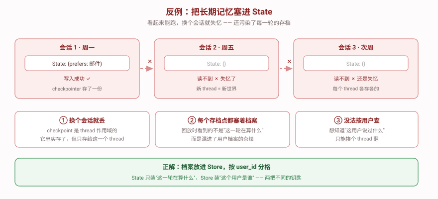

# 反例对照

> **看起来能跑但其实很糟**的版本。下面每一条都能通过最朴素的测试——但换个场景就暴露问题。



---

## 反例代码（能跑，且第一个场景的输出"看起来是对的"）

```python
from typing import Annotated
from langgraph.checkpoint.memory import InMemorySaver
from langgraph.graph import END, START, StateGraph
from operator import add
from typing_extensions import TypedDict


class BadState(TypedDict):
    user_id: str
    message: str
    profile: dict          # ❌ 把用户档案放在 State 里
    trace: Annotated[list, add]


def bad_node(state: BadState) -> dict:
    # ❌ 直接从 state 读档案，读完写回 state
    profile = state.get("profile", {})
    profile["prefers"] = "邮件"
    return {"profile": profile, "trace": ["wrote"]}


b = StateGraph(BadState)
b.add_node("n", bad_node)
b.add_edge(START, "n")
b.add_edge("n", END)
graph = b.compile(checkpointer=InMemorySaver())

# 会话 1：写
r1 = graph.invoke(
    {"user_id": "u1", "message": "我偏好邮件沟通", "profile": {}, "trace": []},
    {"configurable": {"thread_id": "sess-1"}},
)
print("sess-1:", r1["profile"])       # {'prefers': '邮件'}  ← 看着没问题

# 会话 2：换 thread 读
r2 = graph.invoke(
    {"user_id": "u1", "message": "在吗", "profile": {}, "trace": []},
    {"configurable": {"thread_id": "sess-2"}},
)
print("sess-2:", r2["profile"])       # {}  ← 失忆了
```

**第一个场景的输出是对的**，所以这个 bug 很容易在自测时溜过去。

---

## 逐条对比

| # | 反例 | 正解 | 为什么糟 |
|:--:|------|------|---------|
| 1 | `profile` 存在 `State` 里 | 存在 `Store` 里，按 `user_id` 分格 | State 是 **thread 作用域**。换会话就丢——checkpointer 忠实存了，但那是存给**这个 thread** 的。用户档案需要的是 **user 作用域**，这是两把不同的钥匙 |
| 2 | 抽取与写档在一个节点里 | 拆成 `recall` / `extract` / `confirm` / `write` 四个节点 | 一个节点干完所有事 = 没法在中间插人工确认，也没法单独回放"抽取"这一步。反例连"冲突检测"都没地方放 |
| 3 | 直接 `profile["prefers"] = ...` 覆盖 | `patch_profile` 合并 + 冲突检测 | 静默覆盖。用户上周说"邮件"、这周手滑说"短信"，旧值永久丢失且**没有任何记录**表明它存在过 |
| 4 | 没有风险分级，什么都直接写 | `risk` 标记 + 条件边 → 高风险走 `interrupt` | 联系方式、投诉这类内容未经确认就写档，写错了会影响后续所有回复。反例里连"要不要问一声"的选项都没有 |
| 5 | 命名空间字符串散落各处（本例甚至没有命名空间概念） | `ns_profile()` / `ns_episode()` / `ns_rule()` 收在一处 | 一旦要加"按租户隔离"或改分层方式，就得全局搜索字符串。改一处漏一处 = 数据写进错的格子 |
| 6 | `search` 不传 `limit` | 显式 `limit`（本项目 `episode_limit=20`） | `search` 默认只返回 **10 条且不报错**。经历攒到 11 条时，第 11 条静默消失——不抛异常、不告警，只是慢慢"忘事" |

---

## 反例 2：把 thread_id 当命名空间第一层

这是**用了 Store 但仍然错**的版本，比上面那个更隐蔽——因为它确实跨了会话写入，只是读的时候对不上。

```python
def node(state, *, store: BaseStore) -> dict:
    # ❌ 用 thread_id 当第一层
    ns = (state["thread_id"], "preferences")
    store.put(ns, "contact", {"prefers": "邮件"})
    return {}
```

**后果**：柜子按会话分格。每个会话一个自己的格子，新会话搜自己的格子 → `[]`。**长期记忆退化成短期记忆**，而且比不用 Store 的版本更迷惑——代码里明明"用了 Store"。

**正解**：`ns = (state["user_id"], "preferences")`，第一层永远是 **user 作用域的标识**。

---

## 反例 3：以为 TTL 存在

```python
store = InMemoryStore()
store.put(("u1", "profile"), "p", {"prefers": "邮件"}, ttl=3600)   # ❌ 直接抛错
```

实测报错原文：

```
NotImplementedError: TTL is not supported by InMemoryStore.
Use a store implementation that supports TTL or set ttl=None.
```

**为什么容易踩**：`BaseStore.put` 的签名里确实有 `ttl` 参数，类型提示也允许传。**签名存在 ≠ 实现支持**——要查 `store.supports_ttl`（`InMemoryStore` 实测为 `False`）。

**正解**：需要 TTL 就换支持它的后端；`InMemoryStore` 场景下"遗忘"只能靠**不写**（reject / keep 裁决）或**显式 delete**。
