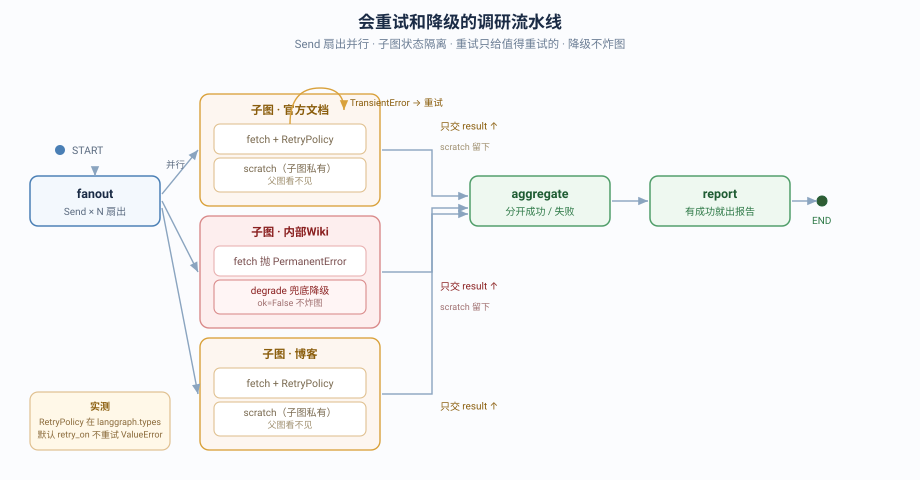

# 实战项目：会重试和降级的调研流水线

> 所属课程：LangGraph 系统学习 ｜ 学习目标：动手实操 ｜ 预计耗时：3–4 小时
> ✅ 实测于 langgraph 1.2.11 / langgraph-checkpoint 4.2.0 / Python 3.12（`uv run` 隔离执行）
> ✅ 测试 **16 passed** ｜ 演示 **6 个场景全通过**

## 🎯 一句话需求

做一条**调研流水线**：一个查询要问 N 个来源（文档 / GitHub / 博客…）。这些来源**随时会挂**——有的抖一下就好，有的彻底下线。流水线要：并行去查、**抖动的救回来、彻底挂的别白试**、挂了的**单独标记而不拖垮整条**，最后**有结果就出报告**。

三个项目的分工：

| 项目 | 练什么 |
|------|--------|
| 会审批的退款工单系统 | **一次任务**怎么跑完、被卡住、再续跑 |
| 会记住和遗忘的客服助手 | **跨会话的东西**放哪、怎么不写脏 |
| **会重试和降级的调研流水线** | **外部依赖不可靠时**怎么不崩、不慢、不白试 |

## ✅ 目标与非功能约束

**功能目标**：
1. 一个查询扇出到 N 个来源，并行调查
2. 抖动类失败自动重试，永久失败不重试
3. 单个来源失败不影响其他来源，降级处理
4. 汇总成功/失败，出带降级标注的报告

**非功能约束**：

| 类别 | 约束 | 落地在哪 |
|------|------|---------|
| **可用性** | 部分来源不可用仍要产出结果 | `aggregate` + `report` 的降级策略 |
| **错误处理** | 单来源失败不炸整条流水线 | 子图 `error_handler=degrade` |
| **性能** | N 个来源并行而非串行 | `fanout` 用 `Send` 扇出 |
| **信息隔离** | 子图中间产物不污染父图 | `SourceState.scratch` 父图未声明 |
| **可观测** | 每个来源成功/失败、重试次数可追溯 | `SourceResult` + `trace` 累加 |

## 🗺️ 覆盖知识点地图

| 知识点 | 阶段 / 课 | 本项目用在何处 | 回指 |
|--------|----------|---------------|------|
| State 与 reducer（累加） | 阶段 1 · 课 3 | `trace` / `results` 用 `Annotated[..., add]` | [课 3](../../stages/1-%E4%BB%8Ecreate_agent%E5%88%B0StateGraph/lessons/03-Graph%20API%20%E7%AC%AC%E4%B8%80%E4%B8%AA%E5%9B%BE.md) |
| 条件边与分支 | 阶段 1 · 课 3 | `fanout` 的条件边 + `Send` | [课 3](../../stages/1-%E4%BB%8Ecreate_agent%E5%88%B0StateGraph/lessons/03-Graph%20API%20%E7%AC%AC%E4%B8%80%E4%B8%AA%E5%9B%BE.md) |
| workflow 与 agent 分界 | 阶段 1 · 课 2 | 全静态图，来源清单由调用方给定 | [课 2](../../stages/1-%E4%BB%8Ecreate_agent%E5%88%B0StateGraph/lessons/02-LangGraph%E6%98%AF%E4%BB%80%E4%B9%88%EF%BC%88%E5%AE%9A%E4%BD%8D%E4%B8%8E%E5%BF%83%E6%99%BA%E6%A8%A1%E5%9E%8B%EF%BC%89.md) |
| **Pregel 执行模型 / Send 扇出** | 阶段 2 · 课 4 | `fanout` 返回 `list[Send]` | [课 4](../../stages/2-%E6%89%A7%E8%A1%8C%E6%A8%A1%E5%9E%8B%E4%B8%8E%E7%8A%B6%E6%80%81%E6%8C%81%E4%B9%85%E5%8C%96/lessons/04-Pregel%20%E6%89%A7%E8%A1%8C%E6%A8%A1%E5%9E%8B.md) |
| checkpoint 与 thread_id | 阶段 2 · 课 5 | `compile(checkpointer=InMemorySaver())` | [课 5](../../stages/2-%E6%89%A7%E8%A1%8C%E6%A8%A1%E5%9E%8B%E4%B8%8E%E7%8A%B6%E6%80%81%E6%8C%81%E4%B9%85%E5%8C%96/lessons/05-Checkpointer%20%E7%9F%AD%E6%9C%9F%E8%AE%B0%E5%BF%86.md) |
| Streaming 流式 | 阶段 2 · 课 7 | 事件可见性（子图需 `subgraphs=True`） | [课 7](../../stages/2-%E6%89%A7%E8%A1%8C%E6%A8%A1%E5%9E%8B%E4%B8%8E%E7%8A%B6%E6%80%81%E6%8C%81%E4%B9%85%E5%8C%96/lessons/07-Streaming%20%E6%B5%81%E5%BC%8F%E8%BE%93%E5%87%BA.md) |
| **节点级重试 / 错误处理** | 阶段 3 · 课 10 | `RetryPolicy(retry_on=TransientError)` + `error_handler` | [课 10](../../stages/3-%E5%8F%AF%E6%8E%A7%E6%80%A7%E4%B8%8E%E4%BA%BA%E5%9C%A8%E7%8E%AF%E4%B8%AD/lessons/10-Fault-tolerance%20%E4%B8%8E%20Subgraphs.md) |
| **子图与状态隔离** | 阶段 3 · 课 10 | 每个来源一个子图，`scratch` 不外泄 | [课 10](../../stages/3-%E5%8F%AF%E6%8E%A7%E6%80%A7%E4%B8%8E%E4%BA%BA%E5%9C%A8%E7%8E%AF%E4%B8%AD/lessons/10-Fault-tolerance%20%E4%B8%8E%20Subgraphs.md) |
| 项目结构与 langgraph.json | 阶段 4 · 课 12 | `graphs.research_agent` | [课 12](../../stages/4-%E5%B7%A5%E7%A8%8B%E5%8C%96%E4%B8%8E%E4%B8%8A%E7%BA%BF/lessons/12-Application%20structure%20%E4%B8%8E%E6%B5%8B%E8%AF%95.md) |
| 单元与集成测试（替身） | 阶段 4 · 课 12 | `FlakySource` / `DeadSource` 确定性替身 | [课 12](../../stages/4-%E5%B7%A5%E7%A8%8B%E5%8C%96%E4%B8%8E%E4%B8%8A%E7%BA%BF/lessons/12-Application%20structure%20%E4%B8%8E%E6%B5%8B%E8%AF%95.md) |
| 项目结构与 langgraph.json | 阶段 4 · 课 12 | `graphs.research_agent` | [课 12](../../stages/4-%E5%B7%A5%E7%A8%8B%E5%8C%96%E4%B8%8E%E4%B8%8A%E7%BA%BF/lessons/12-Application%20structure%20%E4%B8%8E%E6%B5%8B%E8%AF%95.md) |

**跨阶段校验**：覆盖 **4 个阶段**（1 / 2 / 3 / 4），门槛 ≥3 ✅

## 🔬 本项目实测出的三个硬事实（课里没有）

> 这三条是做项目时撞出来的，比代码本身更值得记住。

### 1. `RetryPolicy` 在 `langgraph.types`，不在 `langgraph.pregel`

```python
from langgraph.pregel import RetryPolicy   # ❌ ImportError
from langgraph.types import RetryPolicy    # ✅
```

### 2. 默认 `retry_on` 对 `ValueError` **不重试**

实测：配了 `max_attempts=4`，抛 `ValueError` 时**只尝试 1 次**就抛出。默认 `retry_on` 是一组特定异常，业务异常不在其中。

👉 推论：**必须自定义 `retry_on`**。否则"该重试的没重试"（业务异常被漏掉）或"不该重试的白重试"（默认策略把 404 也重试一遍）。

### 3. `error_handler` 只接受 **1 个参数**，且收到的是 **state 不是异常**

这是最反直觉的一条。实测三种签名：

| 签名 | 结果 |
|------|------|
| `def h(state)` | ✅ 通过 |
| `def h(state, error)` | ❌ `TypeError: missing 1 required positional argument: 'error'` |
| `def h(error)` | ✅ 通过，但打印出来是 `{'out': []}` —— **是 state 本身** |

源码印证（`pregel/_algo.py` 的 `prepare_node_error_handler_task`）：函数签名里有 `failed_error: BaseException`，但它**只用于内部判断，不传给 handler**；handler 拿到的是 `failed_task.input`。

👉 推论：**想记录错误信息，只能在节点内部 try/except 自己存**。本项目 `fetch` 用 `fetch.last_error = e` 把异常递给 `degrade`。这个写法不优雅，但它是 1.2.11 下的可行解。

## 🚀 运行方式

```bash
cd langchain/langgraph/projects/会重试和降级的调研流水线/实现

# 1) 跑测试（16 项）
PYTHONPATH=. uv run --no-sync --project ../../../../langchain/playground \
  python -m pytest research_agent/tests/ -q
# 预期：16 passed

# 2) 跑演示（6 场景）
PYTHONPATH=. uv run --no-sync --project ../../../../langchain/playground python demo.py
```

## 📁 目录说明



| 路径 | 内容 |
|------|------|
| `实现/research_agent/state.py` | 父子两套 State（隔离的关键） |
| `实现/research_agent/sources.py` | 可注入来源 + `TransientError`/`PermanentError` 分类 |
| `实现/research_agent/subgraph.py` | 来源子图：重试 + 降级 |
| `实现/research_agent/graph.py` | 父图：扇出 → 汇总 → 报告 |
| `实现/research_agent/tests/` | 三层测试（16 项） |
| `实现/demo.py` | 6 个场景 |
| [设计决策.md](设计决策.md) | 3 个权衡点 |
| [反例对照.md](反例对照.md) | "能跑但很糟"的版本 |
| [验收清单.md](验收清单.md) | 22 项自测 |

## 🎬 六个演示场景（实测输出）

| 场景 | 演示什么 | 实测结果 |
|:--:|---------|---------|
| 1 | 全正常 → 扇出并行 | 覆盖 **3/3**，5 条 trace |
| 2 | **部分挂了仍出报告** | 成功 `[官方文档, 博客]`，降级 `[内部Wiki]` |
| 3 | **抖动重试生效** | 调用 **3 次**（前 2 次抖动），最终成功 |
| 4 | 永久失败不白试 | `ok=False`，`PermanentError: 404 不存在`，重试 0 次 |
| 5 | 全挂不崩 | "全部 2 个来源都不可用：A, B" |
| 6 | **子图隔离** | 父图字段无 `scratch` ✅ |

### 📚 官方文档

- [Fault tolerance · LangGraph](https://docs.langchain.com/oss/python/langgraph/use-graph-api) — RetryPolicy 与 error_handler
- [Subgraphs · LangGraph](https://docs.langchain.com/oss/python/langgraph/use-subgraphs) — 子图与状态隔离
- [Send · LangGraph](https://docs.langchain.com/oss/python/langgraph/use-graph-api#send) — 动态扇出
