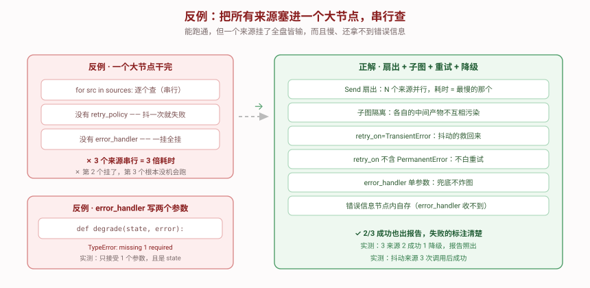

# 反例对照

> **看起来能跑但其实很糟**的版本。下面每一条都能通过最朴素的测试——但要等外部依赖出问题时才暴露。



---

## 反例代码（三个来源都正常时，输出完全正确）

::: code-group

```python [Python]
from typing import Annotated
from langgraph.graph import END, START, StateGraph
from operator import add
from typing_extensions import TypedDict


class BadState(TypedDict):
    query: str
    sources: list
    report: str
    trace: Annotated[list, add]


def bad_fetch_all(state: BadState) -> dict:
    """❌ 一个大节点：串行查所有来源，不重试，不兜底。"""
    results = []
    for src in state["sources"]:
        # 没有 retry_policy，没有 try/except
        data = fetch(src, state["query"])      # 任一来源抛异常 → 整条崩
        results.append(data)
    return {"report": "\n".join(results), "trace": ["done"]}


b = StateGraph(BadState)
b.add_node("all", bad_fetch_all)
b.add_edge(START, "all")
b.add_edge("all", END)
graph = b.compile()

# 三个来源都正常 → 输出正确 ✅
graph.invoke({"query": "q", "sources": ["A", "B", "C"], "report": "", "trace": []})
```

```typescript [TypeScript]
import { Annotation, StateGraph, START, END } from "@langchain/langgraph";

const BadState = Annotation.Root({
  query: Annotation<string>({ reducer: (_p, n) => n, default: () => "" }),
  sources: Annotation<string[]>({ reducer: (_p, n) => n, default: () => [] }),
  report: Annotation<string>({ reducer: (_p, n) => n, default: () => "" }),
  trace: Annotation<string[]>({ reducer: (a, b) => a.concat(b), default: () => [] }),
});

// ❌ 一个大节点：串行查所有来源，不重试，不兜底
async function badFetchAll(state: typeof BadState.State) {
  const results: string[] = [];
  for (const src of state.sources) {
    // 没有 retryPolicy，没有 try/catch
    const data = await fetchSource(src, state.query);   // 任一来源抛异常 → 整条崩
    results.push(data);
  }
  return { report: results.join("\n"), trace: ["done"] };
}

const b = new StateGraph(BadState)
  .addNode("all", badFetchAll)
  .addEdge(START, "all")
  .addEdge("all", END);
const graph = b.compile();

// 三个来源都正常 → 输出正确 ✅
await graph.invoke({ query: "q", sources: ["A", "B", "C"], report: "", trace: [] });
```

:::


**在"一切都正常"的测试里，这段代码是满分。** 问题全部藏在失败路径上。

> 🇹🇸 **TS 侧差异**：三处，其中两处会把结论反过来。
> ① **不配 `retryPolicy` = 一次都不重试**。源码 `pregel/retry.js` 里 `if (resolvedRetryPolicy === void 0) break;` 直接跳出重试循环。本机实测：普通 `Error`、带 `status: 404`、带 `status: 500` 三种异常各跑一次，**都只调用 1 次**。所以反例 1"没重试"的现象两侧一致；但下面表格第 6 条"依赖默认 `retry_on`"在 TS 侧**没有对应物**——默认根本不存在。
> ② **挂载位置只有两个**：`addNode(name, fn, { retryPolicy })` 或 `.setNodeDefaults({ retryPolicy })`。写进 `compile({ retryPolicy })` 会同时踩两个坑——`tsc` 报 `TS2353: 'retryPolicy' does not exist in type ...`，而 `tsx` 直接跑时只当它是普通对象字段**静默忽略**（本机实测：那里写 `maxAttempts: 4`，节点仍然只调 1 次）。
> ③ 配了 `retryPolicy` 之后，默认 `retryOn` 是**黑名单**（`DEFAULT_RETRY_ON_HANDLER`），不是白名单：只有 `name === "GraphValueError"`、`AbortError` / 消息以 `Cancel` 开头、`status` 命中 `[400,401,402,403,404,405,406,407,409]`、`code === "ECONNABORTED"`、`error.code === "insufficient_quota"` 才不重试，其余全部重试。实测同一份 `maxAttempts: 4` 配置：普通 `Error` → 4 次，HTTP 500 → 4 次，HTTP 404 → 1 次，`GraphValueError` → 1 次。

---

## 逐条对比

| # | 反例 | 正解 | 为什么糟 |
|:--:|------|------|---------|
| 1 | `for src in sources:` 串行 | `Send` 扇出并行 | N 个来源 = **N 倍耗时**。3 个来源各 1 秒，串行 3 秒、并行 1 秒。来源越多差距越离谱 |
| 2 | 一个大节点查完所有 | 每个来源一个子图 | **没有隔离**。第 2 个来源抛异常，第 3 个**根本没机会跑**——已经查到的数据也全丢了 |
| 3 | 没有 `retry_policy` | `RetryPolicy(retry_on=TransientError)` | 网络抖一下就永久失败。这类失败**再试一次大概率就好**，却直接放弃了 |
| 4 | 没有 `error_handler` | `error_handler=degrade` | 一个来源挂 → **整条流水线异常**。用户什么都拿不到 |
| 5 | 中间产物和结论混在一个 State | 父子两套 State，`scratch` 不外泄 | 子图的调试信息（重试了几次、原始报错）混进父图，**父图 State 越来越臃肿**，且来源之间互相可见 |
| 6 | （隐含）依赖默认 `retry_on` | 显式 `retry_on=TransientError` | 实测**默认策略对 `ValueError` 不重试**。你以为配了 `max_attempts=4` 就会重试 4 次，实际可能只试 1 次 |

---

## 反例 2：`error_handler` 写成两个参数

这是**照着直觉写**就会犯的错——大多数框架的异常回调都是 `(state, error)` 或 `(error)` 形式。

::: code-group

```python [Python]
def degrade(state: SourceState, error: Exception) -> dict:   # ❌
    return {"result": {"ok": False, "error": str(error)}}

builder.add_node("fetch", fetch, error_handler=degrade)
```

```typescript [TypeScript]
// ⚠️ TS 侧 errorHandler 的签名是 **(state, error, config?)** —— 与 Python 的"单参数且拿到 state"完全不同。
//    写两个参数在 TS 里是**合法**的，而且第 2 个参数真能拿到异常（但被 NodeError 包了一层）。
function degrade(state: typeof SourceState.State, error: unknown) {
  // 实测：error 的形状是 `{ node: "fetch", error: <原始异常> }`
  const real = (error as any)?.error ?? error;
  return { result: { ok: false, error: String((real as Error)?.message ?? real) } };
}

builder.addNode("fetch", fetchSource, { errorHandler: degrade });
```

:::


**实测报错**：

```
TypeError: build_source_subgraph.<locals>.degrade() missing 1 required
positional argument: 'error'
During task with name '__error_handler__fetch'
```

> 🇹🇸 **TS 侧不会报这个错**——这恰恰是更危险的地方。`errorHandler` 的真实调用点（`graph/state.js` 的 `_createDefaultErrorHandlerSpec`）是 `userHandler(state, nodeError, config)`，**三个参数都真的传了进去**。所以写 `(state, error)` 在 TS 里既合法、又能拿到异常，只是它被包了一层 `NodeError { node, error }`。本机实测（节点抛 `Error("boom-404")`）：
> `stateKeys: ["q","result"]`、`errKeys: ["node","error"]`、`innerMsg: "boom-404"`、`hasConfig: true`。
> 想拿原始异常必须解包：`const real = (error as any)?.error ?? error;`——直接 `String(error)` 会得到带壳的文本。

### 改成单参数就对了——但还有第二个坑

::: code-group

```python [Python]
def degrade(payload) -> dict:      # ✅ 能跑
    print(type(payload), payload)
    return {...}
```

```typescript [TypeScript]
function degrade(payload: typeof SourceState.State) {   // ✅ 单参数也合法
  console.log(payload);                                  // ← 拿到的是失败节点的 state，不是异常
  return { result: { ok: false, error: "unknown" } };
}
```

:::


打印出来是：

```
dict {'out': []}
```

**`payload` 是失败节点的 state，不是异常对象。** 源码 `pregel/_algo.py` 的 `prepare_node_error_handler_task` 印证：函数签名虽有 `failed_error: BaseException`，但它只用于内部判断，**不传给 handler**。

> 🇹🇸 **TS 侧这一条与 Python 一致**：只写一个参数时，第 1 参就是失败节点的 state（实测 `stateKeys: ["q","result"]`），拿不到异常。区别在于 TS **允许**你多写第 2、3 个参数去拿 `NodeError` 和 `config`，Python 多写一个就直接 `TypeError`。换句话说：Python 是"想拿拿不到"，TS 是"能拿到但要先解包"。

👉 **想记录错误信息，只能在节点内部 try/except 自己存**（见 `subgraph.py` 的 `fetch.last_error`）。

---

## 反例 3：把所有错误都重试

::: code-group

```python [Python]
# ❌ 看起来"更保险"，实际在浪费调用
RetryPolicy(max_attempts=4, retry_on=Exception)
```

```typescript [TypeScript]
// ❌ 看起来"更保险"，实际在浪费调用
// ⚠️ TS 侧的 `retryOn` **只接受函数**，传 `Error` 构造器是类型错误（要求
//    `(e: unknown) => boolean`）。写成 `() => true` 是唯一的"全重试"写法。
//    本机实测：404 + `retryOn: () => true` → 调 4 次；同一份配置**去掉 retryOn**
//    （走默认黑名单）→ 只调 1 次。所以这个反例在 TS 侧必须显式写死才复现。
{
  retryPolicy: { maxAttempts: 4, retryOn: () => true },
}
```

:::


**后果**：来源返回 404（资源不存在）时，重试 4 次得到 4 个一样的 404。

- **浪费 3 次调用**（对按次计费的 API 就是钱）
- **拖长响应时间**：`initial_interval=0.5, backoff_factor=2` → 0.5s + 1s + 2s = **多等 3.5 秒**，最后还是失败
- **放大故障**：下游已经在报 404 了，你还连打 4 次

**正解**：`retry_on=TransientError`，把 404 这类 `PermanentError` 排除在外。实测：永久失败来源**重试 0 次**直接降级。

---

## TS 写法对照表

| Python | TypeScript | 注意 |
|--------|-----------|------|
| `RetryPolicy(max_attempts=4)` | `addNode(name, fn, { retryPolicy: { maxAttempts: 4 } })` | 只能挂 `addNode` 或 `setNodeDefaults` |
| （无对应） | `compile({ retryPolicy })` | **不存在**：`tsc` 报 `TS2353`，`tsx` 运行期静默忽略 |
| 不配 `retry_policy` → 默认策略仍生效 | 不配 `retryPolicy` → **完全不重试** | 实测三种异常都只调 1 次 |
| 默认 `retry_on` 是白名单（只认网络类） | 配了 policy 后默认 `retryOn` 是**黑名单**（几乎全重试） | 方向相反 |
| `retry_on=TransientError` | `retryOn: (e) => e instanceof TransientError` | TS 只收函数，不收异常类 |
| 想"排除 404"要自己写判断 | 默认黑名单已含 404/401/403/409 | 想要"连 404 也重试"才写 `() => true` |
| `error_handler=fn`（单参，收 state） | `errorHandler: (state, error, config) => ...` | 三参全传；Python 写两参直接 TypeError |
| 异常只能自己存进 state | 异常在 `NodeError { node, error }` | 原始异常在 `.error`，实测 `innerMsg: "boom-404"` |
| `initial_interval=0.5`（秒） | `initialInterval: 500`（毫秒） | 差 1000 倍 |
| `max_attempts=4` | `maxAttempts: 4` | 含第一次，实测 4 次 |
| 无 | `jitter: true`（默认） | 每次在 base 上再叠 0~1s 随机 |
| 无 | `logWarning: true`（默认） | 用 `console.log` 打到 stdout |
