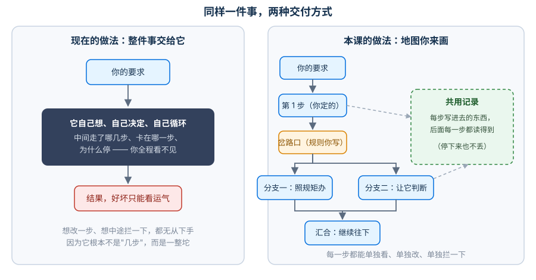
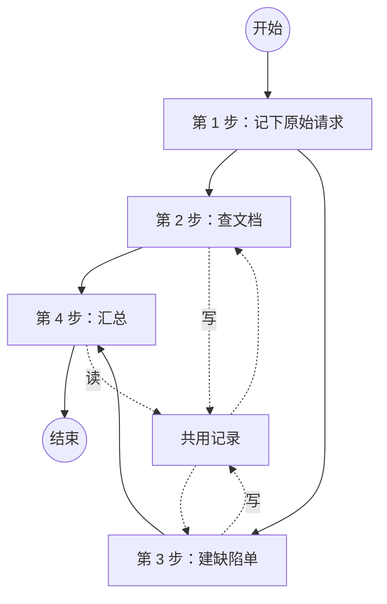
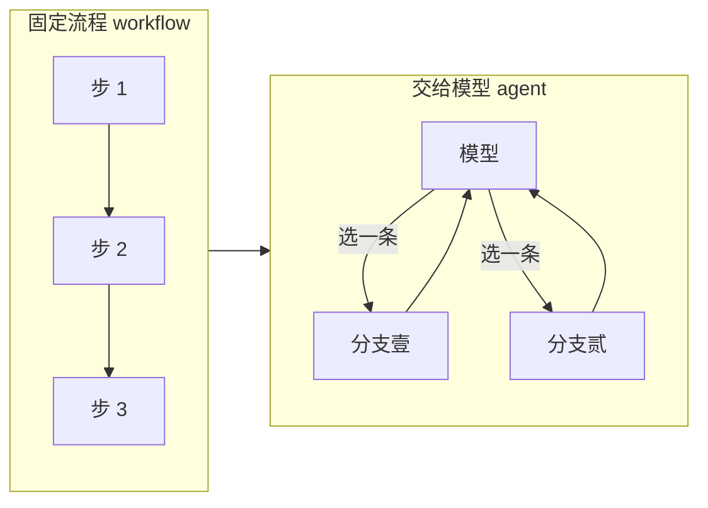
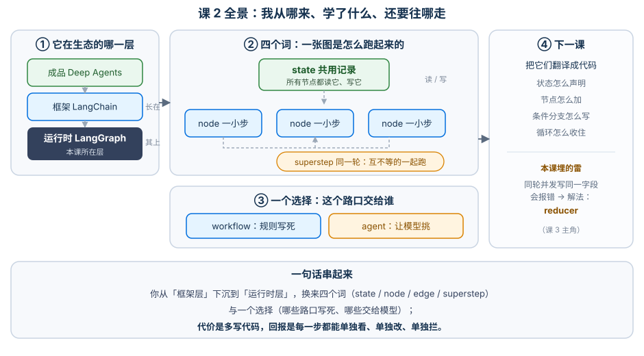

# 课 2：LangGraph 是什么（定位与心智模型）

> 所属阶段：阶段 1《从 create_agent 到 StateGraph》｜ 水平：进阶 ｜ 本课知识点：LangGraph 在生态中的位置、用图思考（state / node / edge / superstep）、workflow 与 agent 的分界
> 故事情节：主角（一次运行）第一次意识到——循环不在自己手里，出了问题既看不见也拦不住
> 📖 结论已按官方文档核对（核对于 2026-10 ｜ 来源：LangGraph overview / Thinking in LangGraph / Workflows and agents / Runtimes, frameworks, and harnesses）

## 🎯 本课目标

- 说清 LangGraph 与 LangChain `create_agent` 的分工，判断什么情况下该"下沉"到 LangGraph
- 用 state / node / edge / superstep 四个词讲明白一个 agent 是怎么跑起来的
- 判断一个需求该写成固定流程（workflow）还是交给模型决定（agent）

---

## 第一幕：起源与场景引入

你在 `../langchain/` 课程里已经跑通了不少 agent：`create_agent` 一行就能拿到一个会调工具、会自己循环的 agent。它确实好用——直到你遇到下面这种事。

**场景**：你负责公司内部"客服工单助手"。第一版很顺利：用户提问，agent 查文档、回答案，几个 demo 下来大家鼓掌。

然后上线第一周，来了三件事：

1. 财务同事问："它说客户符合退款条件，依据是啥？"——你答不上来，因为中间走了哪几步你根本没记录。
2. 运维同事问："它刚才调了十次同一个接口，为什么？"——你答不上来，因为循环在框架里，你没写。
3. 老板问："能不能在它'真的要退款'之前，先让人工看一眼？"——你愣住了，因为流程是一整坨，你找不到"退款前"这个位置。

> 🎬 **场景**：一个能跑但改不动、看不清、拦不住的 agent，卡在了上线之后的第一个星期。

> 📌 **一句话本质**：把"整件事交给它自己安排"变成"你来画路线图，它只在你指定的路口自己决定"。
>
> ⚖️ **处境对照**：不画这张图，你能很快拿到一个能跑的 demo，但事后追问"它为什么这么做"时**一个字都答不上来**——第一幕那三个问题（依据是什么 / 为什么调了十次 / 能不能先让人看一眼）会**三个都卡住**；画了这张图，你要多写几十行代码、多花半天把流程拆开，换来的是**每一步都能单独看、单独改、单独拦**——三个问题分别对应官方的 streaming、persistence（含 time-travel）、human-in-the-loop，它们不是三个功能，而是"你画了图"之后的同一件事的三种用法。
>
> ⏳ 置信度：低（"几十行 / 半天"为按同类工作量给出的经验量级，非实测统计；真实成本随流程复杂度波动，请按自己的项目估算）

---

## 第二幕：认知冲突

回到场景里的第三个问题——"退款前让人看一眼"。

你翻了 `create_agent` 的参数，发现它能配工具、配提示词、配中间件，但**没有一个地方能让你说"在执行到这一步的时候停一下"**。不是参数没找对，是**抽象层次不对**：`create_agent` 给你的是"一个已经装好的循环"，它把"下一步干什么"这件事封装起来了。

封装带来方便，也带来代价：**循环一旦被封装，"在某一步暂停""回看某一步""改判某一步"就都无从下手**——因为它们都需要"步"这个概念单独存在。

> ❓ **问题**：想要"能暂停、能回看、能改判"，就得先有"步"。那"步"从哪来？答案很朴素：**你自己把它拆出来。**

---

## 第三幕：层层揭示

### 一眼全局图（进入细节前先看一眼）



> 看图：左边是把整件事交给它——中间是个黑盒，你只管给要求和拿结果；右边是你来画路线图——每一步都是你写的一小段代码，步骤之间靠一份**共用记录**传递东西，到岔路口时按你写的规则（或让模型）选一条路走。差别在于：**右边每一步都单独存在，所以能单独看、单独改、单独拦。**

### 本课地图（分几步走）

| 步 | 这一步要解决什么（人话） | 对应知识点 |
|:--:|------------------------|-----------|
| 1 | 先搞清楚"我到底该用哪一层"，别拿锤子找钉子 | 知识点 1：LangGraph 在生态中的位置 |
| 2 | 学会把一件事拆成"几步 + 一份共用记录" | 知识点 2：用图思考（state / node / edge / superstep） |
| 3 | 知道哪些路口该写死规则、哪些该交给模型 | 知识点 3：workflow 与 agent 的分界 |

---

### 知识点 1：LangGraph 在生态中的位置

> 🧭 第 1/3 步｜承接：上面那个"改不动、看不清、拦不住"的困境 → 本步：先看清这个生态到底分几层、各自管什么，再决定该动哪一层
> 本知识点关键点：LangChain 与 LangGraph 的分层 / create_agent 建立在 LangGraph 之上 / 什么情况下该下沉

#### 一句话定义

LangChain 生态里，**框架（framework）、运行时（runtime）、成品（harness）**是三层东西，LangGraph 是中间那层——**运行时**。

#### 直觉建立（类比）

类比造车与开车：LangChain 是**驾驶培训 + 车型目录**（教你怎么开、给你现成的车型），LangGraph 是**底盘和发动机**（真正跑起来的那套机械），Deep Agents 是**已经造好的房车**（连冰箱和床都装好了）。

你平时开着现成车型就够了（用 `create_agent`）；只有当你想改悬挂、改传动、想让车能停在半坡上再起步时，才需要打开发动机盖——**那是 LangGraph 这一层的事**。

> 💡 **类比的边界**：车厂的"底盘"和"车型"是两家公司做的，而 LangChain 生态里**框架是长在运行时上的**——官方原话是 "LangChain 1.0 is built on top of LangGraph"。所以你用 `create_agent` 时其实一直在跑 LangGraph，只是没直接操作它。

#### 核心原理

官方对三层的定义（核对于 2026-10）：

| 层 | 官方说法 | 它给你什么 | 什么时候用 | 这一层的产品 |
|---|---|---|---|---|
| **成品 / 脚手架**（Agent harness） | opinionated, batteries-included | 现成的规划能力、子 agent、文件工具、上下文管理 | 想要更自主的 agent、面对复杂非确定性任务 | Deep Agents SDK、Claude Agent SDK |
| **框架**（Agent framework） | Abstractions + Integrations | 模型 / 工具 / agent 循环的标准抽象 | 想快速起步、统一团队写法 | **LangChain**、Vercel AI SDK、OpenAI Agents SDK |
| **运行时**（Agent runtime） | Durable execution、Streaming、HITL、Persistence | 持久化执行、流式、人在环中、细粒度控制 | 要底层控制、要长跑的有状态流程 | **LangGraph**、Temporal、Ingest |

> 看图：从上往下是"越用越省心但越不自由"，从下往上是"越自由但越要自己写"。**LangChain 在 LangGraph 之上**——你在 `../langchain/` 学的 `create_agent`，底层跑的就是这张图。

**下沉信号（什么时候该用 LangGraph）**，官方给了四条，我按场景翻译一下：

| 官方条件 | 翻译成人话（对应第一幕场景） |
|---|---|
| 需要对编排有细粒度、底层控制 | "这个循环我自己写，框架默认那个我不满意" |
| 需要长跑的、有状态的执行 | "工单可能挂三天等人批，不能一重启就没了" |
| 要混合固定步骤和模型决策步骤 | "一半是死的业务规则，一半才需要模型判断" |
| 需要生产级的部署设施 | "要上线、要持久、要能恢复" |

反过来说，**只是想快速做个 agent、或团队想统一写法** → 官方明确建议留在 LangChain 层，不必下沉。

#### 示例演示：看一眼 `create_agent` 底下那张图

不必理解细节，只要确认"它确实是图"就够了：

```python
from langchain.agents import create_agent

# 你在 ../langchain/ 课程里写的那一行
agent = create_agent(model=..., tools=[...])

# 它返回的是一个"已编译的图"，所以能画出结构、也能当图来跑
print(agent.get_graph())
```

> ⚠️ 未实测（本机 playground 未配置模型 provider，`create_agent` 需真实 model 实例才能构造）：上例仅示意"返回的是图对象"这一点，**具体类名请以你本机实际打印为准**。这一点的事实依据是官方表述 "LangChain 1.0 is built on top of LangGraph"（核对于 2026-10）。

#### 常见误区

1. **"LangGraph 是 LangChain 的替代品，学了就不用 LangChain 了"**——错。两者是上下层：LangGraph 只管编排，**不提供模型 / 工具的抽象**（官方原话："LangGraph does not abstract prompts or architecture"）。实际写法通常是**用 LangChain 拿模型和工具，用 LangGraph 编排**。
2. **"用 LangGraph 就必须用 LangChain"**——也错。官方明确说"you don't need to use LangChain to use LangGraph"，只是文档里习惯搭配使用。

#### 一句话记住

**LangChain 管"有什么可用"，LangGraph 管"先干什么后干什么"，Deep Agents 管"连这些都给你装好了"。**

#### 🗣️ 行话对照

- **Agent runtime（智能体运行时）**：就是本课说的"底盘那一层"——负责持久执行、流式、人在环中；在哪遇到：官方对比页 [Runtimes, frameworks, and harnesses](https://docs.langchain.com/oss/python/concepts/products) 的 "Runtime" 列。
- **Durable execution（持久执行）**："跑一半挂了也能从断点接着跑"——就是第一幕"工单挂三天"那个诉求的行话；在哪遇到：官方 [Persistence](https://docs.langchain.com/oss/python/langgraph/persistence) 页、LangGraph 首页 Core benefits 列表。
- **HITL（Human-in-the-loop，人在环中）**："关键步骤让人看一眼再继续"——第一幕老板那个问题；在哪遇到：官方 [Interrupts](https://docs.langchain.com/oss/python/langgraph/interrupts) 页。

> 三者官方没有定名中文译法，上表中文为**本文自拟、非通用译名**，检索时用英文。

#### 官方文档

- [LangGraph overview](https://docs.langchain.com/oss/python/langgraph/overview)
- [Runtimes, frameworks, and harnesses](https://docs.langchain.com/oss/python/concepts/products)

---

### 知识点 2：用图思考（state / node / edge / superstep）

> 🧭 第 2/3 步｜承接：知道该动哪一层了 → 本步：学会把一件事拆成"几步 + 一份共用记录"，这是画图的基本功
> 本知识点关键点：四件套各自的职责 / 与"线性脚本"的对照 / 为什么状态是共享的

#### 一句话定义

用 LangGraph 写 agent = 把流程拆成**若干步（node）**，规定**谁接谁（edge）**，让它们通过**一份共用记录（state）**传递信息；执行时，没有依赖关系的步会被放进**同一轮（superstep）**一起跑。

#### 直觉建立（类比）

想象一群人在办一个业务窗口，**桌上摊着一本共同的记录本**：

- 每个人（**节点**）只干一件事，干完就在记录本（**状态**）上添几笔；
- 谁接在谁后面（**边**）是事先排好的；
- 如果两个人互不等对方的东西，前台会**同时叫号**，让他们一起办（**同一轮**）；
- 下一轮的人拿起记录本时，上面已经有前面所有人写的字。

关键在这个本子：**它不是谁递给谁的，是摊在桌上的、所有人共用的**。这就是"共享状态"和"函数之间传参数"的本质差别。

> 💡 **类比的边界**：真实机制里没有"同时办"这种事——Python 里它们是并发任务，同一轮内**不允许两个人往同一栏里写字**（这正是下面误区 1 的报错来源）。另外，每一轮结束后本子会被**整体存一份快照**（checkpoint），这是课 5 的主角，这里先知道有这回事。

#### 核心原理



> 看图：四个方框是四步，`第 2 步` 和 `第 3 步` 都接在 `第 1 步` 后面、互不等对方，所以它们**在同一轮**里跑；虚线是它们跟"共用记录"的读写关系——前一步写进去的，后一步都读得到。

**四件套的职责**：

| 件套 | 一句话 | 在代码里长什么样 | 它不负责什么 |
|---|---|---|---|
| **state（状态）** | 所有人共用的记录本 | 一个 `TypedDict` / dataclass | 不负责格式化提示词（官方建议存原始数据，提示词在节点里现拼） |
| **node（节点）** | 干一件事的小函数 | `def xxx(state) -> dict` | 不负责决定"下一个是谁"（那是边的事，除非用 `Command`） |
| **edge（边）** | 规定谁接谁 | `add_edge` / `add_conditional_edges` | 不传数据（数据一律走 state） |
| **superstep（超级步）** | 一轮：本轮能跑的步一起跑 | 执行时自动划分，你不写 | 不是"并行保证"——同一轮只是"可以一起跑" |

**为什么状态必须是共享的？** 因为这是"能暂停、能回看、能改判"的物理前提：状态集中在一处 → 才能整体存快照 → 才能回到某一轮 → 才能在某一轮前插入人工确认。**如果每步只是把参数递给下一步，就没有"一个全体状态"可以存。**

#### 示例演示

下面这个脚本不调任何模型，纯粹看"步"和"共用记录"是怎么工作的（代码见 `本课 4.1`，这里先给结构）：

```python
from typing_extensions import TypedDict
from langgraph.graph import StateGraph, START, END

class State(TypedDict):
    note: str      # 第 1 步写
    doc: str       # 分支一写
    ticket: str    # 分支二写

# 每个节点：读 state，返回"要更新哪些字段"
def step_a(s: State) -> dict:
    return {"note": "原始请求：导出 PDF 报错"}
```

#### 常见误区

1. **同一轮里两个节点写同一个字段 → 直接报错**。这是我实测撞出来的（本机 langgraph 1.2.11）：

```
langgraph.errors.InvalidUpdateError: At key 'log': Can receive only one value per step.
Use an Annotated key to handle multiple values.
For troubleshooting, visit: https://docs.langchain.com/oss/python/langgraph/errors/INVALID_CONCURRENT_GRAPH_UPDATE
```

> 两个分支同时往 `log` 写，运行时不知道该留哪个。**这不是 bug，是保护**：它逼你显式声明"这个字段要累加"（用 `Annotated` + reducer），而这正是课 3 的核心内容。
2. **把"节点"当成"函数抽取"来用**——节点不只是复用代码，它是**可被单独观测、单独重试、单独暂停**的执行单位。抽成普通函数就失去了这些。
3. **往 state 里塞已经拼好的提示词**——官方明确建议 state 存**原始数据**，提示词在节点里现拼。原因是：同一份数据不同节点要用不同格式拼，改提示词不该动状态结构。

#### 一句话记住

**节点是一小步，边规定谁接谁，状态是摊在桌上的共用记录本，同一轮 = 互不等的步一起跑。**

#### 🗣️ 行话对照

| 本课说法（人话） | 行业标准叫法 | 典型配置 / 在哪遇到 | 代价 |
|---|---|---|---|
| 共用记录本 | **state**（State）· 社区常译"状态" | `class State(TypedDict)` / `StateGraph(State)`；官方 [Graph API](https://docs.langchain.com/oss/python/langgraph/graph-api) | 所有节点都能看到全部字段，靠约定而非封装隔离 |
| 一小步 | **node**（Node）· 社区常译"节点" | `graph.add_node("name", fn)`；报错里出现节点名 | 节点太碎会让图读不懂，太粗则失去可观测性 |
| 谁接谁 | **edge**（Edge）· 社区常译"边" | `add_edge` / `add_conditional_edges`；`draw_ascii()` 画出来的连线 | 边只管走向，不传数据 |
| 一轮 | **superstep**（Superstep）· 社区常译"超级步" | 官方 [LangGraph runtime](https://docs.langchain.com/oss/python/langgraph/pregel) 页；`stream_mode="updates"` 的一批输出 | 同一轮内并发写同一字段会报错，须用 reducer 声明 |

> 四个术语的中文均为**社区常用译法，官方未在中文文档定名**，官方页面一律用英文；检索用英文。

#### 官方文档

- [Thinking in LangGraph](https://docs.langchain.com/oss/python/langgraph/thinking-in-langgraph)
- [Graph API overview](https://docs.langchain.com/oss/python/langgraph/graph-api)

---

### 知识点 3：workflow 与 agent 的分界

> 🧭 第 3/3 步｜承接：会拆步骤了 → 本步：决定哪些路口写死规则、哪些交给模型——这是画图时最常做的选择
> 本知识点关键点：固定流程 vs 模型决策 / 选型判据 / 两者可以混在同一张图里

#### 一句话定义

官方一句话划界：**流程预定好代码路径、按固定顺序执行的是 workflow；由模型自己决定过程与工具使用、动态变化的是 agent。**

#### 直觉建立（类比）

**workflow 像流水线**：传送带怎么走、每个工位干什么，是设计时定死的，产品换一批没关系，路线不变。

**agent 像出租车**：你只说去哪，走哪条路、要不要绕开拥堵，司机（模型）当场决定。

现实里绝大多数业务是**混合的**：从接单到出库是流水线，但"这个客户该不该退款"得由人（或模型）判断。LangGraph 的主打能力恰恰是这个混合——官方原话："mix deterministic, hand-coded steps with LLM-driven agentic steps in the same graph"。

> 💡 **类比的边界**：出租车司机至少不会凭空编一条路出来，模型会。所以"让模型决定"这一步必须配护栏（重试、超时、人工兜底），这是阶段 3 的内容。

#### 核心原理



> 看图：左边是"路怎么走写死了"，右边是"模型每次回来重新选一条，可能绕回去再来一轮"。真实项目里两者常连在同一张图上。

**选型判据**（把官方表述翻成可执行的判断）：

| 问自己 | 答"是"→ 走 workflow | 答"是"→ 走 agent |
|---|---|---|
| 这条路线上有几步、先后顺序，我能现在就写清楚吗？ | ✅ | |
| 下一步是什么，得看了内容才知道吗？ | | ✅ |
| 这个环节出错的代价高到必须可预测、可审计吗？ | ✅ | |
| 需要它自己决定"还要不要再查一次"吗？ | | ✅ |

**这张表里没有对错，只有代价**：workflow 可预测但僵化；agent 灵活但每次跑的路径可能不一样，排障难度上一个量级。

**混用是常态，不是妥协**：官方把"在同一张图里混合确定性与智能体步骤"列为 LangGraph 的核心优势——**该死的流程就写死，该活的判断才交给模型**，这本身就是一种设计能力。

#### 示例演示

同一个需求（`../langchain/` 课里那个会查文档的助手）的两种写法对比，实测输出见 4.1 第三段。

```python
# 写法 A：固定流程——不管输入是什么，走过的路都一样
wf.add_edge(START, "one")
wf.add_edge("one", "two")

# 写法 B：交给模型——返回什么，就走哪条路
ag.add_conditional_edges("model", lambda s: s["route"])
```

#### 常见误区

1. **"agent 更高级，所以都要做成 agent"**——最常见的过度设计。能写死的路径写死，出问题你能复现；一旦交给模型，同样的输入可能走出不同的路。
2. **"workflow 就不是 agent 了"**——官方把两者放在同一页讲，用的是同一套图 API，只是边的类型不同（固定边 vs 条件边）。**它们不是两个框架，是同一张图上的两种边。**

#### 一句话记住

**能写死的写死，写不死的才交给模型——一张图上两种边并存才是常态。**

#### 🗣️ 行话对照

| 本课说法（人话） | 行业标准叫法 | 典型配置 / 在哪遇到 | 代价 |
|---|---|---|---|
| 路径写死 | **workflow**（工作流） | `add_edge` 固定边；官方 [Workflows and agents](https://docs.langchain.com/oss/python/langgraph/workflows-agents) 页前半 | 僵化：需求一变就要改图 |
| 让模型挑路 | **agent**（智能体） | `add_conditional_edges`；官方同页后半 | 非确定性：同输入可能不同路径，排障更难 |
| 确定性步骤 + 智能体步骤混写 | **mix deterministic and agentic steps** | 官方 overview 的 Core benefits 第一条 | 需要你判断边界在哪，判错就两头不讨好 |

> 中文"工作流""智能体"为**社区常用译法，官方未定名**；"混合确定性与智能体步骤"为**本文自拟、非通用译名**。

#### 官方文档

- [Workflows and agents](https://docs.langchain.com/oss/python/langgraph/workflows-agents)

---

## 第四幕：实操验证

### 4.1 机制验证

> ✅ 实测于 langgraph 1.2.11 / Python 3.12（在 `../langchain/playground` 以 `uv run` 隔离执行，未污染全局环境）

**验证一：一次运行被切成一轮一轮，状态在轮与轮之间累积**

```python
# 四个节点：a 之后同时接 b、c，最后都汇到 d
for i, chunk in enumerate(app.stream({"note": "", "doc": "", "ticket": ""}, stream_mode="updates"), 1):
    print(f"第 {i} 轮 ->", chunk)
```

实测输出：

```
第 1 轮 -> {'a': {'note': '原始请求：导出 PDF 报错'}}
第 2 轮 -> {'b': {'doc': '查到文档：PDF 导出需开启字体嵌入'}}
第 3 轮 -> {'c': {'ticket': '已建缺陷单 BUG-1024'}}
第 4 轮 -> {'d': {'note': '原始请求：导出 PDF 报错 | 汇总：查到文档：PDF 导出需开启字体嵌入 / 已建缺陷单 BUG-1024'}}
```

> ⚠️ **注意这个反直觉的地方**：`b` 和 `c` 明明没有依赖关系，却各自占了"一轮"的输出。这不是它们串行了——`stream_mode="updates"` 是**每完成一个节点就吐一次**，所以并行节点会分成两条输出。**要看"是不是同一轮"，得看下面的耗时。**

**验证二：两个分支到底是不是同一轮？用秒表证明**

```python
# b、c 各 sleep(1.0)，分别写不同字段
t0 = time.time(); app.invoke({...}); print(f"{time.time() - t0:.2f} 秒")
```

实测输出：

```
两个各睡 1 秒的分支，总耗时 = 1.00 秒
若串行 ≈ 2 秒；若同一轮并行 ≈ 1 秒 -> 并行（同一轮）
```

**验证三：固定流程 vs 交给模型，路径真的会变**

实测输出：

```
=== 固定流程：不管输入是什么，路径都一样 ===
  '今天天气怎样' -> 今天天气怎样 ->A ->B
  '怎么退款' -> 怎么退款 ->A ->B
=== 让它自己决定：路径随输入变 ===
  '今天天气怎样' -> route='answer' | 今天天气怎样 ->直接回答
  '怎么退款' -> route='search' | 怎么退款 ->查了一下
```

> ✅ **回扣场景**：回头看第一幕那三件事——"它依据什么"（现在每一步都是独立节点，能单独记录）、"为什么调了十次"（循环是你画的边，看得见）、"退款前让人看一眼"（"退款前"现在是一个真实存在的位置，课 8 就在这里插 `interrupt`）。**三件事的解法其实是同一件事：把一整坨拆成几步。**

### 4.2 应用实战

> 本课为原理铺垫课，**不配应用实战**（无"基础 → 问题 → 综合"的演进空间）。从课 3 起每课配一篇，见 📚 [应用实战索引](../../../应用实战/INDEX.md)。

---

## 第五幕：体系收束

本课把"整件事交给它"换成了"你来画地图"，得到了四个词：**state（共用记录）、node（一小步）、edge（谁接谁）、superstep（一轮）**，以及一个选择了：**哪些路口写死（workflow）、哪些交给模型（agent）**。

现在你已经能回答第一幕的三个问题——但要真正落地，还需要把它们翻译成代码：

> 📍 **全局定位**：本课是阶段 1 的地基。四个词里你已经理解了"是什么"，**"怎么定义"**是下一课的事。
> 🔗 **下一步**：课 3《Graph API 第一个图》——把今天这张手绘图写成真正的 `StateGraph`：状态怎么声明、节点怎么加、条件分支怎么写、循环怎么收住。届时会撞上本课埋的那颗雷：**同一轮并发写同一字段怎么办**（答案：reducer）。

---

## 🐞 常见误区

1. **"学会 LangGraph 就不用 LangChain 了"**——两者是上下层，LangGraph 不提供模型 / 工具抽象，实战里通常一起用。
2. **"同一轮 = 并行执行保证"**——同一轮只表示"没有依赖关系、可以一起跑"；实测证明它确实并发（验证二），但**同一轮内并发写同一字段会直接报错**，必须靠 reducer 声明。
3. **"agent 比 workflow 高级，能 agent 就 agent"**——能写死的写死，交给模型意味着放弃可复现性。混用才是官方推荐形态。

### ⏳ 与过时说法对照（写前核对有差异时才有，≤3 行）

| 旧说法（网上过时教程 / 训练知识里的说法） | 官方文档现状 | 来源 |
|---|---|---|
| "LangGraph 是独立于 LangChain 的图编排库" | 官方现按 **runtime / framework / harness** 三层定位，明确 "LangChain 1.0 is built on top of LangGraph"（核对于 2026-10） | [Runtimes, frameworks, and harnesses](https://docs.langchain.com/oss/python/concepts/products) |
| "`create_react_agent` 是 LangGraph 的标准入口" | v1 起该入口已废弃，让位给 LangChain 的 `create_agent`（核对于 2026-10） | [What's new in LangGraph v1](https://docs.langchain.com/oss/python/releases/langgraph-v1) |

## 一图总结



> 看图：左边是三层的定位（你从 LangChain 那层往 LangGraph 这层下沉），中间是四个词——状态在中间被所有节点读写，边上决定走向，同一轮收纳互不依赖的节点，右边是 workflow / agent 这个选择。**一图总结与课首那张图的区别**：课首那张给没学过的人看（为什么需要），这张给刚学完的你复习（讲了什么）。

## 课后小测

**Q1**：两个节点都接在同一个节点后面、彼此没有依赖关系，它们会怎么执行？
- A. 按代码里 `add_edge` 的先后顺序串行
- B. 被放进同一轮（superstep）一起跑
- C. 运行时随机挑一个先跑
- D. 报错，因为一个节点不能有两个后继

<details><summary>答案与解析</summary>

**答案：B**。没有依赖关系的节点会被放入同一轮并行执行——实测两个各睡 1 秒的分支总耗时 1.00 秒。易混点：A 看起来对，因为 `stream_mode="updates"` 会把它们分成两条输出，但**输出顺序 ≠ 执行顺序**。

</details>

**Q2**：下面哪种情况**最应该**从 `create_agent` 下沉到 LangGraph？
- A. 想快速做个 demo 验证想法
- B. 团队想统一 agent 的写法
- C. 需要在"真正扣款"这一步之前强制人工确认
- D. 想换一个模型 provider

<details><summary>答案与解析</summary>

**答案：C**。人工确认需要"步"这个单位单独存在，而 `create_agent` 把循环封装起来了。A、B 官方明确建议留在 LangChain 层；D 换 provider 跟编排层无关。

</details>

**Q3**：同一轮里两个节点同时更新 state 的同一个字段，会发生什么？
- A. 后写的覆盖先写的
- B. 抛出 `InvalidUpdateError`，提示用 `Annotated` 声明
- C. 两个值被自动合并成列表
- D. 静默丢弃其中一个

<details><summary>答案与解析</summary>

**答案：B**。实测真实报错：`At key 'log': Can receive only one value per step. Use an Annotated key to handle multiple values.`——这是运行时的保护机制，**解法（reducer）是下一课的核心**。选 A 的人多半是被普通 Python 字典的行为带偏了。

</details>

---

## 🚀 下一批接力提示词

> 学完本批后，**复制下面这段文字发给 AI**，即可无缝进入下一批（无需重新描述上下文）：

```
继续学 LangGraph。我的学习档案在 langchain/langgraph/00-学习档案.md，
刚学完阶段 1《从 create_agent 到 StateGraph》的课 2《LangGraph 是什么（定位与心智模型）》
知识点「LangGraph 在生态中的位置 / 用图思考 / workflow 与 agent 的分界」，
请按大纲继续讲解课 3《Graph API 第一个图》的知识点。
```

## 🧭 课程导航

- 上一课：[课 1 环境准备](01-环境准备.md)
- 返回 [课程目录](../../../02-课程目录.md)
- 下一课：[课 3 Graph API 第一个图](03-Graph API 第一个图.md)
