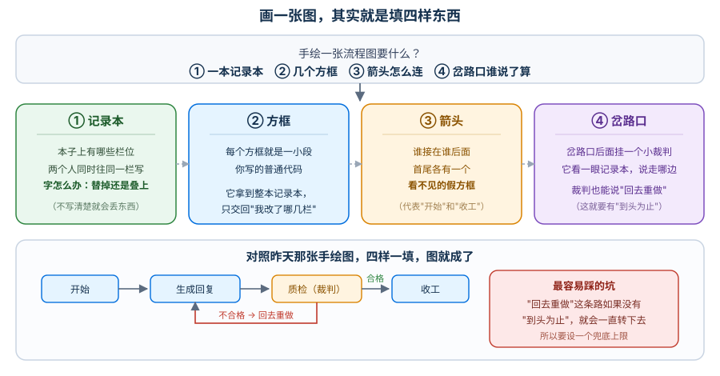
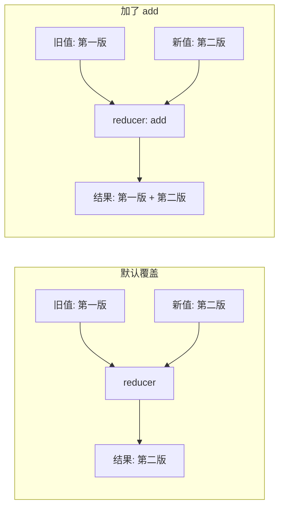
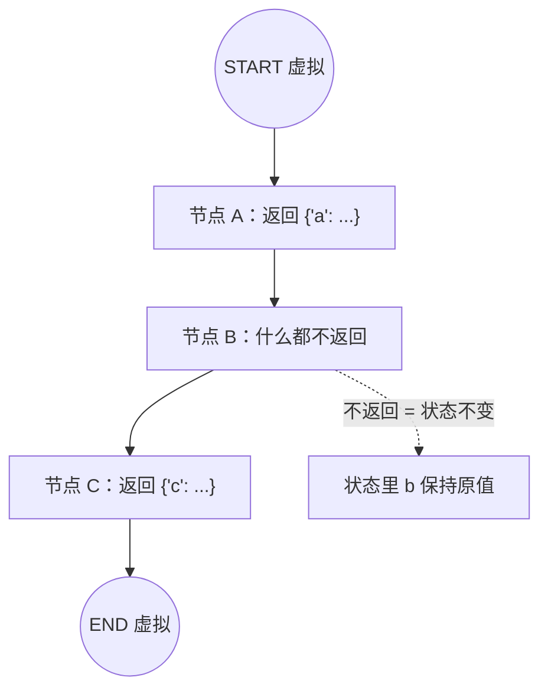
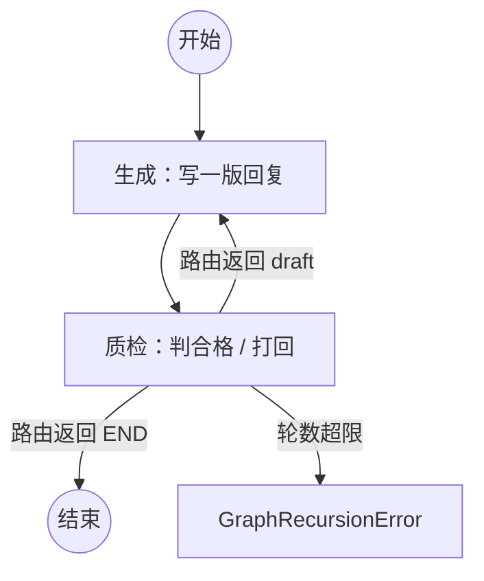
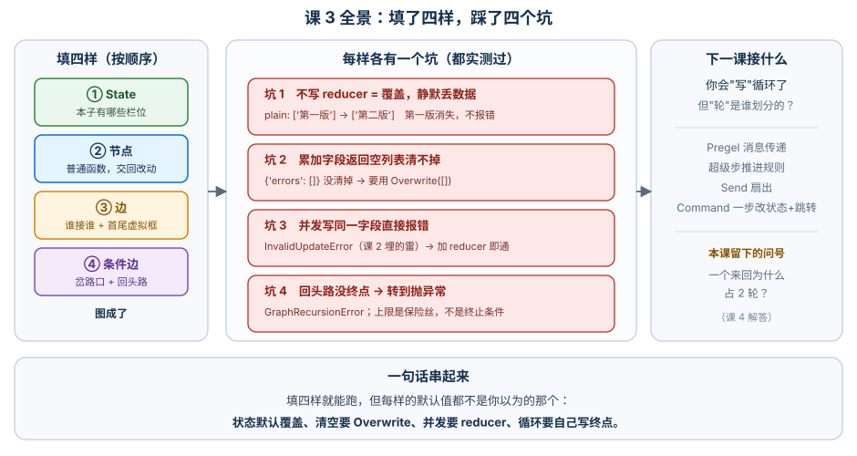

# 课 3：Graph API 第一个图

> 所属阶段：阶段 1《从 create_agent 到 StateGraph》｜ 水平：进阶 ｜ 本课知识点：State 的定义与 reducer、节点与边、条件边与循环
> 故事情节：故事主线「把方向盘拿回来」的第二章——亲手把控制流写出来
> 📖 结论已按官方文档核对（核对于 2026-10 ｜ 来源：LangGraph Graph API overview / Use the Graph API）

## 🎯 本课目标

- 用 `StateGraph` 写出第一个图：定义状态、加节点、连边、跑通
- 说清 reducer 是什么、默认覆盖会怎样"吃掉"状态，以及并发写冲突为什么是保护
- 写出带条件分支与循环的流转，并用 `recursion_limit` 兜住跑不完的循环

---

## 第一幕：起源与场景引入

上一课你接受了一个判断：要能暂停、能回看、能拦，就得自己把流程拆成几步。今天动手。

**场景**：公司客服助手升级。旧版是"一次通过"——用户问，助手答，结束。上线后质检同事提了个意见：

> "有些回答明显不合格就直接发出去了。能不能**自己先检查一遍，不合格就重写，合格才发**？"

你一想，这不难：加个质检节点，不合格就跳回生成节点。可真动手时卡在三个地方：

1. 生成节点每次都返回一个新版本的回复，**上一版要不要留着？** 留着的话，状态里那个字段该怎么更新才不会互相覆盖？
2. 质检节点返回"通过 / 打回"之后，**怎么决定下一步走哪条路？** 固定边显然不行。
3. 万一质检永远打回（比如提示词写错了，永远判不合格），**这个循环会转到什么时候？** 会不会把服务转挂？

> 🎬 **场景**：一个"不合格就重写"的质检循环，卡在了状态怎么更新、下一步怎么选、循环怎么停这三件事上。

> 📌 **一句话本质**：把"画在纸上的流程图"变成"能跑的代码"——你只要填四样东西：**本子上有哪些栏位、几个方框、箭头怎么连、岔路口谁说了算**。
>
> ⚖️ **处境对照**：不填这四样（继续用 `create_agent`），你写不了"不合格回退"这种带回路的流程，**质检只能放在人这一侧**；填了这四样，代价是要自己声明每个字段"新值到底替掉旧的还是叠加上去"——**声明错了会静默丢数据**（本课 4.1 验证 A 实测：`plain` 字段从 `['第一版']` 变成 `['第二版']`，第一版凭空消失），但换来的是循环、分支、回退全都由你说了算。

---

## 第二幕：认知冲突

先从第一个卡点开始。你很自然地写下这样的状态：

```python
class State(TypedDict):
    draft: str      # 当前这版回复
    history: list   # 每次改的版本都记下来
```

然后生成节点返回 `{"history": ["第2版"]}`，你期待 `history` 变成 `["第1版", "第2版"]`——结果它变成了 `["第2版"]`。**第一版没了，不报错，不打招呼。**

更奇怪的是：当两个分支**同时**往同一个字段写时，LangGraph 却**立刻报错**了（这就是课 2 埋的那颗雷）。

> ❓ **问题**：同样是"写同一个字段"，为什么串行时静默覆盖、并发时却报错？——因为 LangGraph 对"新值怎么落到旧值上"这件事有明确规则，只是**这条规则默认是"替掉"，而你可能以为是"叠上"**。

---

## 第三幕：层层揭示

### 一眼全局图（进入细节前先看一眼）



> 看图：上面一行是手绘流程图也要的四样东西（记录本 / 方框 / 箭头 / 岔路口），下面一行是它们在本课场景里的样子——包含一条"不合格 → 回去重做"的回头路。右边红框是这套东西最容易踩的坑：**回头路必须有"到头为止"**。

### 本课地图（分几步走）

| 步 | 这一步要解决什么（人话） | 对应知识点 |
|:--:|------------------------|-----------|
| 1 | 先定本子上有哪些栏位，以及"新值替掉旧的还是叠上去" | 知识点 1：State 的定义与 reducer |
| 2 | 再画方框、连箭头，搞清楚首尾那两个看不见的框 | 知识点 2：节点与边 |
| 3 | 最后管岔路口：合格的放行、不合格的回退，还得给它一个上限 | 知识点 3：条件边与循环 |

---

### 知识点 1：State 的定义与 reducer

> 🧭 第 1/3 步｜承接：第二幕"第一版凭空消失" → 本步：搞清状态字段的更新规则由谁定，以及怎么改成你要的
> 本知识点关键点：TypedDict 与 dataclass 两种写法 / reducer 是什么 / 默认覆盖带来的"状态消失"坑

#### 一句话定义

**State 是图的共享数据结构**，每个字段各带一个 **reducer**——一个"怎么把新值合到旧值上"的函数；不写 reducer，默认就是**直接替掉**。

#### 直觉建立（类比）

把状态想成一张**报销单**，每栏都有填写规则：

- 有些栏（比如"当前处理人"）是**覆盖式**的——新的人签上来，旧名字就被划掉；
- 有些栏（比如"审批意见"）是**累积式**的——每个人往上贴一张便签，前面的都还在。

LangGraph 的残酷之处在于：**默认所有栏都是覆盖式的**。你以为"审批意见"会累积，其实它一直在被划掉重写——**而且不报错**，因为从它的角度看，你确实给了新值。

> 💡 **类比的边界**：真实机制里，reducer 是一个**二元函数** `reducer(旧值, 新值) -> 新值`，每个字段独立；默认 reducer 直接丢弃旧值返回新值。另外"覆盖"确实有合法用途（比如"当前这版回复"就该覆盖），**不是所有字段都该累加**。

#### 核心原理

官方文档的写法（核对于 2026-10）：

| 写法 | 什么时候用 | 节点里怎么读 |
|---|---|---|
| **`TypedDict`** | 默认、首选 | `state["foo"]`（就是 dict） |
| **`dataclass`** | 需要字段**默认值** | `state.foo`（是对象，**不能** `state["foo"]`） |
| **Pydantic `BaseModel`** | 需要**递归数据校验**（性能低于前两者） | `state.foo` |

```python
# TypedDict：默认值？没有。输入没给的字段，节点就读不到（实测 KeyError）
class State(TypedDict):
    n: int
    tags: list[str]

# dataclass：默认值？有。不传输入也能跑（实测 invoke({}) -> {'n': 1}）
@dataclass
class State:
    n: int = 0
    tags: list[str] = field(default_factory=list)
```

> ⚠️ **换写法会改访问方式**：实测 `dataclass` 状态传进节点的是 `DCState(n=0, tags=[])` 对象，用 `state["n"]` 会报 `TypeError: 'DCState' object is not subscriptable`，必须写成 `state.n`。**这是从 TypedDict 切到 dataclass 时最常见的报错。**

> ⚠️ 官方还有一条：**高层 `create_agent` 不支持 Pydantic 状态**——所以从 `../langchain/` 过来的同学，别在这里用 Pydantic 当状态。

**reducer 怎么声明**：用 `Annotated[类型, reducer函数]`。官方给的例子是 `operator.add`：

```python
from operator import add
from typing import Annotated
from typing_extensions import TypedDict

class State(TypedDict):
    foo: int                          # 无 reducer：默认覆盖
    bar: Annotated[list[str], add]    # 有 reducer：累加
```

官方还给了 reducer 的精确语义——**它是个二元函数，左参数是状态里的旧值，右参数是节点返回的新值**：

```python
new_value = reducer(left=current_state[key], right=node_update[key])
```



> 看图：同一个"节点返回新值"的动作，左边 reducer 丢弃旧值、右边 reducer 把两者加起来。**差别全在你声明字段时那一个 `Annotated`。**

#### 示例演示

实测（本机 langgraph 1.2.11，见 4.1 验证 A）：

```python
class State(TypedDict):
    plain: list[str]                      # 默认：覆盖
    history: Annotated[list[str], add]    # 累加

# 两个节点各写一次
{'plain': ['第二版'], 'history': ['第一版', '第二版']}
```

#### 常见误区

1. **"reducer 是可选的优化，不写也行"**——错。不写 = 明确选择了"覆盖"。**这是本课最常见的数据丢失来源**：想累积历史的字段忘了加 reducer，跑起来一切正常，只是历史永远是最后一条。
2. **"加了累加 reducer，返回空列表就能清空"**——**这是官方专门点名的高频误解**。累加 reducer 把右参数**合并**进左参数，返回 `[]` 等于"合并了一个空列表"，旧值全留着。实测：

```python
# node A 返回 {"errors": ["第一次不合格"]}
# node B 返回 {"errors": []}
{'errors': ['第一次不合格']}   # 没清掉！
```

官方给的解法是包一层 `Overwrite`（实测有效）：`return {"errors": Overwrite([])}` → `{'errors': []}`。

3. **"并发写同一字段报错是设计缺陷"**——不，是保护。加 reducer 后就通了（实测：`{'log': ['分支一', '分支二']}`，详见 4.1 验证 B）。**它逼你显式回答"两个值怎么合"，而不是让运行时偷偷帮你决定。**

#### 一句话记住

**不写 reducer 就是"覆盖"；想累积就 `Annotated[list, add]`；想清空别返回空值，用 `Overwrite`。**

#### 🗣️ 行话对照

| 本课说法（人话） | 行业标准叫法 | 典型配置 / 在哪遇到 | 代价 |
|---|---|---|---|
| 本子上有哪些栏位 | **state schema**（状态模式）· 社区常译"状态结构" | `class State(TypedDict)`；官方 Graph API「Schema」节 | 默认输入与输出同结构，字段多了要额外拆 input/output schema |
| "新值替掉还是叠上" | **reducer**（归约函数）· 社区常译"归约器" | `Annotated[list[str], add]`；报错信息里 `Use an Annotated key` 就是让你加这个 | 忘了加 = 静默丢数据；加了 = 清空变难（要 `Overwrite`） |
| 绕过累加直接覆盖 | **Overwrite**（覆盖类型） | `from langgraph.types import Overwrite`；官方 [Bypass reducers with Overwrite](https://docs.langchain.com/oss/python/langgraph/use-graph-api#bypass-reducers-with-overwrite) | 属于进阶用法，初学容易滥用成"到处 Overwrite"，等于退回默认值语义 |

> 三者中文均为**社区常用译法 / 本文自拟，官方未定名中文**，检索用英文。

#### 官方文档

- [Graph API overview（State / Reducers）](https://docs.langchain.com/oss/python/langgraph/graph-api)
- [Use the Graph API（Overwrite / 多 schema）](https://docs.langchain.com/oss/python/langgraph/use-graph-api)

---

### 知识点 2：节点与边

> 🧭 第 2/3 步｜承接：本子定好了 → 本步：把方框和箭头画上去，搞清楚首尾那两个看不见的框
> 本知识点关键点：节点本质是函数 / 返回值即状态更新 / START 与 END 是虚拟节点

#### 一句话定义

**节点就是普通 Python 函数**（收状态、返回要更新的字段），**边决定下一个跑谁**；`START` 和 `END` 是两个**虚拟节点**，分别代表"把输入送进图"和"到此为止"。

#### 直觉建立（类比）

节点像一个**工位**：工人拿到整本记录本（不只是交给他的那页），干完活只在便签上写"我改了第 3 栏和第 7 栏"，把便签贴回去——**他不需要抄写整本，也不需要知道下一个工位是谁**。

`START` 和 `END` 则像**工厂的大门和出货口**：它们不是工位（没人干活），但你画流程图时必须有它们，不然不知道从哪进、到哪算完。

> 💡 **类比的边界**：真实节点还能额外收 `config` 和 `runtime` 两个参数（分别拿 `thread_id` 等配置、拿 store 等运行时能力），这是课 5 之后的事。另外节点**不返回任何东西也是合法的**——表示"我只做副作用，不改状态"。

#### 核心原理



> 看图：`START` / `END` 画成圆形，是虚拟节点；节点 B 什么都不返回，所以状态里对应字段保持原值——**"没返回"不等于"出错"**。

**三条要点**：

| 要点 | 说明 |
|---|---|
| 节点本质 | Python 函数（同步或异步），后台被包成 `RunnableLambda` |
| 返回值语义 | 返回**部分更新**即可（dict），不必返回整个 State |
| 不传名字 | `builder.add_node(my_node)` → 节点名默认等于函数名 |

**START / END 是虚拟节点**——实测把图的节点清单打出来，它们确实混在里面：

```python
sorted(app.get_graph().nodes)
# ['A', 'B', '__end__', '__start__', 'named_by_fn']
```

而且 `END` 这个常量**本身就是字符串 `'__end__'`**：

```python
>>> END
'__end__'
```

> 💡 这意味着 `add_edge("n", END)` 和 `add_edge("n", "__end__")` 是等价的——**但请永远用 `END` 常量**，写字符串会在 LangGraph 改内部约定时静默失效。

#### 示例演示

实测（见 4.1 验证二）：

```
第 1 轮 -> {'A': {'a': '由节点 A 写入'}}
第 2 轮 -> {'B': None}                          # B 什么都不返回
第 3 轮 -> {'named_by_fn': {'c': '由 named_by_fn 写入'}}
最终状态 -> {'a': '由节点 A 写入', 'b': '', 'c': '由 named_by_fn 写入'}
```

> 注意 `b` 始终是初始值 `''`——**没有任何节点写过它**。

#### 常见误区

1. **"节点要返回完整的 State"**——不必，也不该。返回**只含你改动的字段**的字典即可；返回整份 State 会把别人的改动一起写回去（覆盖语义下容易造成回退）。
2. **"节点返回 None 会报错"**——不会。实测 `{'B': None}`，状态不变。**"只做副作用"的节点（发通知、写日志）就该这么写。**
3. **"一个节点只能有一个后继"**——错。`add_edge` 可以调多次，一个节点接多个后继，这些后继会在**同一轮**跑（课 2 已实测）。

#### 一句话记住

**节点是函数，返回"我改了哪几栏"；START / END 是虚拟节点，管"从哪进、到哪完"。**

#### 🗣️ 行话对照

| 本课说法（人话） | 行业标准叫法 | 典型配置 / 在哪遇到 | 代价 |
|---|---|---|---|
| 方框 / 工位 | **node**（节点） | `builder.add_node("name", fn)`；`stream` 输出的 key 就是节点名 | 后台被包成 `RunnableLambda`，栈会多一层 |
| 箭头 | **edge**（边） | `add_edge` / `add_conditional_edges` | 只管走向，不传数据 |
| 大门 / 出货口 | **START / END**（起止虚拟节点）· 常量值为 `'__start__'` / `'__end__'` | `from langgraph.graph import START, END` | 写字符串等价但脆弱，务必用常量 |

> 中文均为社区常用译法，官方未定名中文。

#### 官方文档

- [Graph API overview（Nodes / START / END）](https://docs.langchain.com/oss/python/langgraph/graph-api)

---

### 知识点 3：条件边与循环

> 🧭 第 3/3 步｜承接：方框和箭头有了 → 本步：让岔路口会判、让不合格的能回退，并给它一个上限
> 本知识点关键点：add_conditional_edges 的路由函数 / 回到自己的边 / recursion_limit 兜底 —— **机制层见课 4，本课只预告**

#### 一句话定义

**条件边**是在岔路口挂一个**路由函数**：它读状态、返回"下一步去哪"；返回值指回前面的节点就形成**循环**；`recursion_limit` 是防跑飞的兜底上限。

#### 直觉建立（类比）

质检员站在传送带旁，每件产品过来看一眼：合格的放行，不合格的**推回上一个工位重做**。

这里有个现实问题：**如果这批产品永远修不好，传送带就永远转下去。** 所以工厂一定会加一条硬规矩——"同一件最多返工 5 次，超过就报警"。

`recursion_limit` 就是这条硬规矩。它不是"终止条件"，是**终止条件的保险丝**——**真正该写的是"什么时候算合格/算放弃"，`recursion_limit` 只负责在你写漏了的时候不让服务被拖死。**

> 💡 **类比的边界**：真实机制里 `recursion_limit` 数的是**轮（superstep）数**，不是"返工次数"，两者不是一个数（实测见下）。另外它超限抛的是 `GraphRecursionError`，**属于异常而非正常结束**——生产上要靠日志发现，别让它悄悄发生。

#### 核心原理



> 看图：同一条边（质检 → ?）由路由函数的返回值决定去向——返回 `END` 收工、返回 `"draft"` 就回到了生成节点形成循环；第三条是超限保护。

**路由函数怎么写**：

```python
def route(state: State) -> str:
    if state["verdict"] == "通过":
        return END                     # 也可以返回 "end_node" 节点名
    if len(state["rounds"]) >= 3:
        return END                     # 放弃：超过 3 轮就不改了
    return "draft"                     # 回到生成节点 = 循环

builder.add_conditional_edges("check", route)
```

> 关键点：路由函数**返回的是节点名（或 `END`）**，不是布尔值。想扇出到多个节点、返回列表，那是课 4 的内容。

**`recursion_limit` 数的是几轮？** 我实测数了一遍（死循环图，故意不写终止条件）：

| `recursion_limit` | 实际跑了几轮后报错 |
|:--:|:--:|
| 3 | 3 轮 |
| 4 | 4 轮 |
| 5 | 5 轮 |
| 6 | 6 轮 |
| 8 | 8 轮 |

> 即：**上限设成 N，就跑满 N 轮抛错**。注意这个"轮"是 superstep，所以**一个"生成 + 质检"的来回要占 2 轮**——实测一个跑 3 版的质检循环总共用了 **6 轮**。

**默认值到底是多少？** 网上教程普遍说是 **25**，但我实测不是——不传 `recursion_limit` 的死循环图跑了 **10007 轮**才抛错：

```
跑了 10007 轮后 GraphRecursionError: Recursion limit of 10007 reached without hitting a stop condition.
```

翻本机安装包的源码坐实了这一点：

```python
# langgraph/_internal/_config.py
DEFAULT_RECURSION_LIMIT = int(getenv("LANGGRAPH_DEFAULT_RECURSION_LIMIT", "10007"))
```

> ⚠️ **所以别拿 25 当默认值**：旧资料里的 25 已不适用于当前版本（本机 1.2.11），而且这个值**能用环境变量 `LANGGRAPH_DEFAULT_RECURSION_LIMIT` 覆盖**。更重要的是——**默认值再大也救不了没写终止条件的循环**：跑一万轮意味着你的服务卡了一万轮才失败。

#### 示例演示

实测（见 4.1 验证三）：

```python
# 情况一：写了终止条件
{'draft': '第3版回复', 'rounds': ['生成第1版', '生成第2版', '生成第3版'], 'verdict': '通过'}

# 情况二：故意不写终止条件
GraphRecursionError: Recursion limit of 6 reached without hitting a stop condition.
You can increase the limit by setting the `recursion_limit` config key.
```

#### 常见误区

1. **"有了 `recursion_limit` 就不用写终止条件了"**——**最危险的想法**。`recursion_limit` 触发时抛的是异常，你的用户拿到的是一次失败的请求，而不是一个"尽力了"的结果。正确的做法是：**先写清楚"什么情况算放弃"，再让 `recursion_limit` 当保险丝。**
2. **"路由函数返回 True/False"**——错，要返回**目标节点名**或 `END`。
3. **"`recursion_limit` 就是最多循环几次"**——不精确。它数的是 superstep 轮数，一个来回通常占 2 轮以上（上面实测：3 个来回 = 6 轮）。

#### 一句话记住

**路由函数返回"下一步是谁"；指回前面的节点就是循环；循环必须有终点，`recursion_limit` 只是保险丝。**

#### 🗣️ 行话对照

| 本课说法（人话） | 行业标准叫法 | 典型配置 / 在哪遇到 | 代价 |
|---|---|---|---|
| 岔路口的小裁判 | **routing function**（路由函数）· 社区常译"路由函数" | `add_conditional_edges("check", route)`；官方 [Conditional edges](https://docs.langchain.com/oss/python/langgraph/graph-api#conditional-edges) | 返回值写错（布尔 / 不存在的节点名）会直接报错 |
| 回去重做 | **cycle / loop**（循环） | 路由函数返回上游节点名 | 必须有终止条件，否则靠异常兜底 |
| 最多转几圈的硬规矩 | **recursion_limit**（递归上限）· 默认 25 | `graph.invoke(..., {"recursion_limit": 50})` | 数的是轮不是次；超限抛 `GraphRecursionError`，属失败而非正常结束 |

> 中文均为社区常用译法 / 本文自拟，官方未定名中文。

#### 官方文档

- [Graph API overview（Conditional edges / Cycles）](https://docs.langchain.com/oss/python/langgraph/graph-api)
- [LangGraph errors: GRAPH_RECURSION_LIMIT](https://docs.langchain.com/oss/python/langgraph/errors/GRAPH_RECURSION_LIMIT)

---

## 第四幕：实操验证

### 4.1 机制验证

> ✅ 实测于 langgraph 1.2.11 / Python 3.12（在 `../langchain/playground` 以 `uv run` 隔离执行）

**验证一：默认覆盖 vs reducer 累加（同一份代码，只差一个 `Annotated`）**

```python
class State(TypedDict):
    plain: list[str]                      # 默认 reducer：覆盖
    history: Annotated[list[str], add]    # 自定义 reducer：累加

# n1 返回 {"plain": ["第一版"], "history": ["第一版"]}
# n2 返回 {"plain": ["第二版"], "history": ["第二版"]}
```

实测输出：

```
{'plain': ['第二版'], 'history': ['第一版', '第二版']}
```

> ⚠️ **`plain` 的第一版消失了，没有任何报错**——这就是"默认覆盖"的代价。

**验证二：课 2 埋的雷，在这里被拆掉**

```
# 两个分支并发写同一字段，无 reducer：
InvalidUpdateError: At key 'log': Can receive only one value per step. Use an Annotated key to handle multiple values.

# 加上 Annotated[list[str], add] 之后：
加了 reducer 之后： {'log': ['分支一', '分支二']}
```

**验证三：reducer 字段能不能清空**

```
返回空列表想清空 -> {'errors': ['第一次不合格']}      # 没清掉
用 Overwrite 清空 -> {'errors': []}                  # 清掉了
```

**验证四：节点返回 None、START/END 是虚拟节点**

```
第 1 轮 -> {'A': {'a': '由节点 A 写入'}}
第 2 轮 -> {'B': None}
第 3 轮 -> {'named_by_fn': {'c': '由 named_by_fn 写入'}}
最终状态 -> {'a': '由节点 A 写入', 'b': '', 'c': '由 named_by_fn 写入'}
节点清单 -> ['A', 'B', '__end__', '__start__', 'named_by_fn']
END 的值 -> '__end__'
```

**验证五：质检循环 + recursion_limit 兜底**

```
# 有终止条件（第 3 版合格）
{'draft': '第3版回复', 'rounds': ['生成第1版', '生成第2版', '生成第3版'], 'verdict': '通过'}

# 故意不写终止条件
GraphRecursionError: Recursion limit of 6 reached without hitting a stop condition.
```

> ✅ **回扣场景**：第一幕的三个卡点全部解决——① 版本历史用 `Annotated[list, add]` 累加，不再丢；② 合格/打回用 `add_conditional_edges` 的路由函数选路；③ 跑不完的循环由"第 3 版放弃"兜住，`recursion_limit` 当最后一道保险丝。**质检同事要的那个循环，现在真的跑起来了。**

### 4.2 应用实战

🎯 [练一练：应用实战 03「把一次通过的客服流程改成带质检回退的循环」](../../../应用实战/03-Graph API 第一个图.md)

> 基础 → 问题 → 综合两跳：先跑通"一次通过"，再发现"劣质回答直接发出去了"，最后加质检 + 回退 + 放弃上限。

---

## 第五幕：体系收束

今天你亲手把一张流程图写成了代码，填了四样东西：**State（本子有哪些栏位）、节点（方框）、边（箭头）、条件边（岔路口谁说了算）**。

其中最该记住的一条是：**状态字段的更新规则是你声明出来的，不是猜出来的**——不写 `Annotated` 就是"覆盖"，写错了会静默丢数据；反过来，并发写冲突的报错恰恰是在提醒你"这里需要你表态"。

但今天有一件事是**故意没讲透的**：

> 📍 **全局定位**：你已经会"写"一个带循环的图了，但**它内部是怎么一轮一轮推进的**——循环为什么能停、并行是怎么判定的、`recursion_limit` 数的"轮"到底由谁划分——这些是**机制层**，今天只给了结论。
> 🔗 **下一步**：课 4《Pregel 执行模型》——把"轮"这件事彻底讲清：Pregel 的消息传递机制、超级步的推进规则、`Send` 扇出，以及 `Command` 如何一步同时改状态和跳转。课 3 里"一个来回占 2 轮"这个实测现象，会在那里得到完整解释。

---

## 🐞 常见误区

1. **"不写 reducer 就是没 reducer"**——不写 = 明确选了"覆盖"。想累积必须 `Annotated[list, add]`。
2. **"累加字段返回 `[]` 就清空了"**——清空不了，要用 `Overwrite([])`（官方点名的高频误解）。
3. **"有 `recursion_limit` 就不用写终止条件"**——超限是抛异常，用户拿到的是失败。**先写终止条件，再让上限当保险丝。**
4. **"`recursion_limit` = 最多循环几次"**——数的是 superstep 轮数；实测 3 个来回 = 6 轮。

### ⏳ 与过时说法对照（写前核对有差异时才有，≤3 行）

| 旧说法（网上过时教程 / 训练知识里的说法） | 官方文档现状 | 来源 |
|---|---|---|
| 循环上限靠自己加计数器，`recursion_limit` 只是调试用 | 官方把 `recursion_limit` 作为**正式兜底**写进执行模型，超限抛 `GraphRecursionError` 并给出独立错误码页（核对于 2026-10） | [GRAPH_RECURSION_LIMIT](https://docs.langchain.com/oss/python/langgraph/errors/GRAPH_RECURSION_LIMIT) |
| reducer 只能用官方内置的那几个 | reducer 是**任意二元函数** `(left, right) -> new`，官方明确给出自定义函数写法（核对于 2026-10） | [Graph API - Reducers](https://docs.langchain.com/oss/python/langgraph/graph-api#reducers) |
| "`recursion_limit` 默认 25" | 本机 langgraph **1.2.11** 实测默认跑了 **10007 轮**才超限；源码 `DEFAULT_RECURSION_LIMIT = int(getenv("LANGGRAPH_DEFAULT_RECURSION_LIMIT", "10007"))`（实测于 2026-10） | 本机 `langgraph/_internal/_config.py` |

## 一图总结



> 看图：左边是填四样东西的顺序，中间是每样东西对应的一个"坑"（红）——这四条就是本课最该带走的；右边是下一课要接的"轮"的机制。**一图总结与课首那张图的区别**：课首那张给没学过的人看（画一张图要什么），这张给刚学完的你复习（填的时候会踩什么坑）。

## 课后小测

**Q1**：状态字段 `history: list[str]` 没加 reducer，节点依次返回 `["A"]`、`["B"]`，最终值是？
- A. `["A", "B"]`
- B. `["B"]`
- C. 报错，提示要加 `Annotated`
- D. `[["A"], ["B"]]`

<details><summary>答案与解析</summary>

**答案：B**。默认 reducer 丢弃旧值、保留新值，所以是 `["B"]`，**且不报错**。C 是并发写（同一轮两个节点写同一字段）才会发生的——串行覆盖是静默的，这才是最危险的地方。

</details>

**Q2**：累加字段 `errors: Annotated[list[str], add]` 现在值是 `["bad"]`，节点返回 `{"errors": []}`，结果是？
- A. `[]`，清空了
- B. `["bad"]`，没清空
- C. 报错
- D. `["bad", []]`

<details><summary>答案与解析</summary>

**答案：B**。官方专门点名这个误解：累加 reducer 是**合并**语义，`[]` 合并进去等于没动。要清空得用 `Overwrite([])`（实测有效）。

</details>

**Q3**：一个"生成 → 质检 → 不合格回退"的循环，设 `recursion_limit=25`，大约能来回几次？
- A. 25 次
- B. 12 次左右
- C. 50 次
- D. 不确定，因为上限默认就够大

<details><summary>答案与解析</summary>

**答案：B**。`recursion_limit` 数的是 superstep **轮**数，一个"生成 + 质检"的来回占 **2 轮**（实测：3 个来回 = 6 轮），所以 25 轮约 12 个来回。

顺带纠正一个流传很广的说法：**`recursion_limit` 的默认值不是 25**——本机 1.2.11 实测不设上限时跑了 **10007 轮**才抛错，源码里写的是 `int(getenv("LANGGRAPH_DEFAULT_RECURSION_LIMIT", "10007"))`。默认值大不等于安全：跑一万轮才失败，比跑 25 轮就失败更糟。

</details>

---

## 🚀 下一批接力提示词

> 学完本批后，**复制下面这段文字发给 AI**，即可无缝进入下一批：

```
继续学 LangGraph。我的学习档案在 langchain/langgraph/00-学习档案.md，
刚学完阶段 1《从 create_agent 到 StateGraph》的课 3《Graph API 第一个图》
知识点「State 的定义与 reducer / 节点与边 / 条件边与循环」，
请按大纲继续讲解课 4《Pregel 执行模型》的知识点。
```

## 🧭 课程导航

- 上一课：[课 2 LangGraph 是什么（定位与心智模型）](02-LangGraph是什么（定位与心智模型）.md)
- 返回 [课程目录](../../../02-课程目录.md)
- 下一课：[课 4 Pregel 执行模型](../../2-执行模型与状态持久化/lessons/04-Pregel 执行模型.md)
- 🎯 练一练：应用实战 03（见 4.2）
