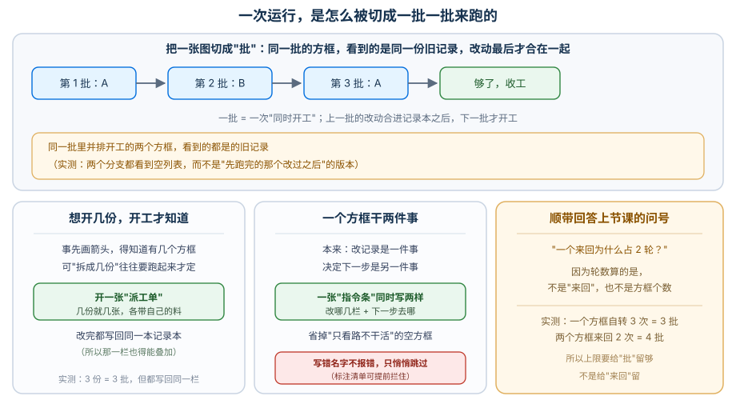
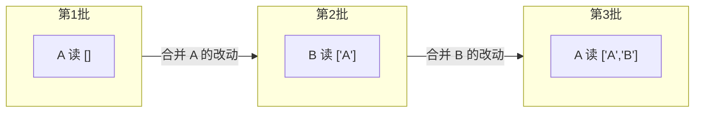
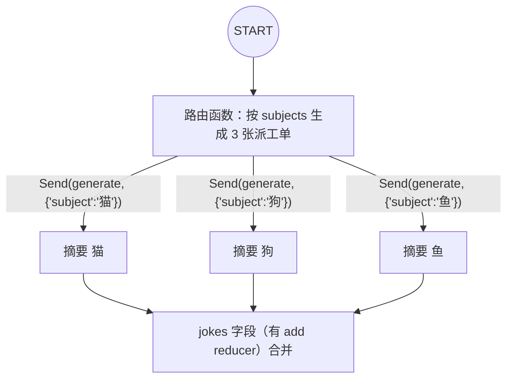
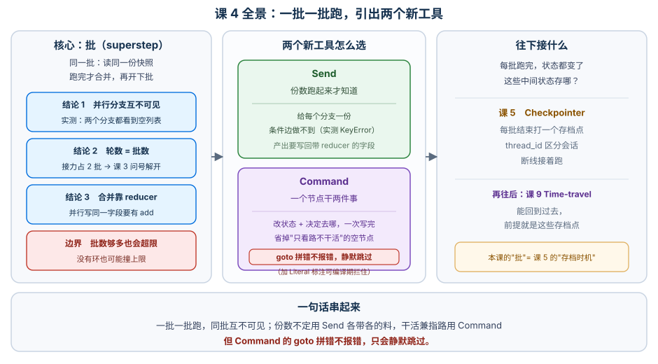

# 课 4：Pregel 执行模型

> 所属阶段：阶段 2《执行模型与状态持久化》｜ 水平：进阶 ｜ 本课知识点：超级步执行模型、Send 动态扇出、Command 与状态更新 / 跳转
> 故事情节：故事主线「让它记住和说出来」的第二章——先弄懂它怎么跑，后面才能讲暂停、回看与流式
> 📖 结论已按官方文档与本机源码核对（核对于 2026-10 ｜ 来源：LangGraph Graph API overview / Use the Graph API）

## 🎯 本课目标

- 说清一次 `invoke` 底层如何被切成"批"逐个执行，以及**为什么一个来回占 2 轮**（课 3 留下的问号）
- 用 `Send` 做运行时才知道份数的动态扇出，并说清条件边为什么做不到
- 用 `Command` 在一个节点里同时改状态和决定跳转，并知道它的**静默失败**陷阱

---

## 第一幕：起源与场景引入

课 3 结尾你写出了第一个带质检回退的图，跑通了。但你留下了一个没解开的问号：

> "我数了一下，`recursion_limit=6` 只够跑 3 个来回——**一个来回为什么占 2 轮？**"

今天把这个问号解开，同时解决两个新需求。

**场景**：客服助手又升级了。这次要一次处理**用户上传的三份文档**，各自摘要后合并成一份报告。你立刻遇到三个新情况：

1. **三份只是这次的情况**——下次可能是 1 份，也可能是 20 份。你在**画图的那一刻**根本不知道要开几个分支。
2. 你写的质检节点现在要干两件事：**判断合不合格**（决定下一步）**和记录判定结果**（改状态）。按课 3 的写法，你得把它拆成两个节点——一个只干活的质检节点，加一个只看路由的空节点。**这很别扭**。
3. 你开始担心一件事：既然是"一批一批"跑，**同一批里并排开工的两个分支，看到的是同一份状态吗？**

> 🎬 **场景**：要处理份数在运行前才知道的文档，还要让一个节点同时干活和指路——课 3 那套"事先画好箭头"的写法不够用了。

> 📌 **一句话本质**：LangGraph 不是"一个节点接一个节点"地跑，而是**一批一批（superstep）地跑**——同一批的节点并排开工、看到同一份旧状态，全部跑完后改动才合到一起，然后才开下一批。
>
> ⚖️ **处境对照**：不知道这个模型，你会以为后跑的分支能看到先跑分支的改动（实测：**不能**，两个分支都看到空列表），从而写出依赖执行顺序的错代码，且这种 bug 时好时坏；知道了，你就能理解为什么会撞上 `InvalidUpdateError`、为什么循环上限要按"批"来算、以及 `Send` 和 `Command` 各自解决什么问题——**代价是你要接受一个反直觉的事实：同一批里，谁先跑完对结果没影响，因为它们读的是同一份快照。**

---

## 第二幕：认知冲突

先做个实验。课 3 里那个官方 loop 例子，你把每个节点"看到了什么"打出来：

```
Node A sees []
Node B sees ['A']
Node A sees ['A', 'B']
Node B sees ['A', 'B', 'A']
```

注意第二行：**B 看到的是 `['A']`**——A 的改动已经生效了。这说明 A 和 B 不是同时跑的。

那什么时候才会"同时跑"？看这个：两个分支都从 START 出发——

```
fan1 启动时看到 []
fan2 启动时看到 []          # 也是空！
join 看到 ['fan1', 'fan2']  # 两个改动都在了
```

> ❓ **问题**：同样是"两个节点"，为什么 A→B 是**接力**（B 看到 A 的改动），而 fan1/fan2 是**并排**（都看到空）？——决定这件事的不是你画了几条边，而是**它们落在第几批**。

---

## 第三幕：层层揭示

### 一眼全局图（进入细节前先看一眼）



> 看图：上面那条流水线是"批"的节奏——一批跑完、改动合并、才开下一批；下面三块是今天要学的三件事：批数怎么算（顺带解开课 3 的问号）、份数不定怎么开分支、一个方框怎么同时干两件事。

### 本课地图（分几步走）

| 步 | 这一步要解决什么（人话） | 对应知识点 |
|:--:|------------------------|-----------|
| 1 | "批"是什么、怎么切、谁和谁并排 | 知识点 1：超级步执行模型 |
| 2 | 份数跑起来才知道，怎么开分支 | 知识点 2：Send 动态扇出 |
| 3 | 一个节点同时干活和指路 | 知识点 3：Command |

---

### 知识点 1：超级步执行模型

> 🧭 第 1/3 步｜承接：第二幕"接力还是并排" → 本步：搞清切批规则，并解开课 3 的问号
> 本知识点关键点：Pregel 渊源 / 一个 superstep 做什么 / 节点并行与状态合并 / **终止条件——承接课 3 的循环预告**

#### 一句话定义

**超级步（superstep）是一次执行的"一批"**：同一批的节点**并行**执行、读取**同一份状态快照**，全部完成后它们的改动才按 reducer 合并进状态，然后进入下一批。

#### 直觉建立（类比）

想象一个**多人协作的共享文档**，但有条铁律：**每轮所有人同时编辑自己面前那份"这一轮开始时的副本"，这轮结束才统一合并。**

- 你在第 3 轮看到的，一定是第 2 轮**合并之后**的文档；
- 同一轮里，坐在你旁边的同事改了什么，**你这轮看不到**；
- 所以谁先写完、谁后写完，对结果**没有影响**。

> 💡 **类比的边界**：真实机制里并行是靠线程池/异步任务实现的，"合并"靠的是课 3 学的 reducer。另外**同一批里两个节点写同一个字段**（且没有 reducer）会直接报错——正是课 3 撞过的 `InvalidUpdateError`。

#### 核心原理

**Pregel 这个名字哪来的**：来自 Google 2010 年的大规模图处理论文，核心思想是"以顶点为中心、按超步同步推进"。LangGraph 借用了**同步超步 + 消息传递**这个结构：节点通过"通道（channel）"通信，一批写、下批读。

官方的说法（核对于 2026-10）：*条件边的返回值会被当作下一步要发送到的节点名（或节点名列表），**这些节点会在下一个 superstep 中并行运行**。*



```mermaid
flowchart LR
    subgraph 同一批（并行）
        F1["fan1 读 []"]
        F2["fan2 读 []"]
    end
    F1 -->|"合并"| J["join 读 ['fan1','fan2']"]
    F2 -->|"合并"| J
```

> 看图：左边是接力（每批一个节点，所以能看到上一批的改动）；右边是并排（同一批，读同一份快照）。**区别只在"是不是同一批"。**

**一个 superstep 里发生什么**：

| 阶段 | 做什么 |
|---|---|
| 1. 读 | 本批所有节点读**本批开始时**的状态快照 |
| 2. 跑 | 节点并行执行（同步节点走线程池，异步走 asyncio） |
| 3. 写 | 收集所有返回值，按各字段的 reducer 合并 |
| 4. 判定 | 根据边/路由决定下一批跑谁；无人可跑则结束 |

> 📍 **回扣课 3**：课 3 说"`recursion_limit` 是保险丝"，机制层就在这里——**它数的正是这个"批"**。

#### 示例演示：解开课 3 的问号

课 3 留下的问题是"一个 draft→check 来回为什么占 2 轮"。实测：

::: code-group

```python [Python]
# 两个节点来回
第 1 轮 -> {'draft': {'n': 1}}
第 2 轮 -> {'check': None}
第 3 轮 -> {'draft': {'n': 2}}
第 4 轮 -> {'check': None}

# 对照：只有一个节点自转
第 1 轮 -> {'solo': {'n': 1}}
第 2 轮 -> {'solo': {'n': 2}}
第 3 轮 -> {'solo': {'n': 3}}
```

```typescript [TypeScript]
// 两个节点来回
// 第 1 轮 -> {"generate":{"n":1}}
// 第 2 轮 -> {"check":{}}
// 第 3 轮 -> {"generate":{"n":2}}
// 第 4 轮 -> {"check":{}}

// 对照：只有一个节点自转
// 第 1 轮 -> {"solo":{"n":1}}
// 第 2 轮 -> {"solo":{"n":2}}
// 第 3 轮 -> {"solo":{"n":3}}
```

:::

> 📌 **TS 侧读数差异**：Python 里"节点无返回"显示为 `None`，TS 侧显示为 `{}`（空对象）。**轮次结构完全相同**——这是本课的核心结论，两侧一致。

> ✅ **答案**：因为 `draft` 和 `check` 是**接力**关系（check 要读 draft 的产出），所以它们落在**不同的批**——一个来回 naturally 占 2 批。而单节点自转时，一次自转 = 1 批。
>
> **所以轮数 = 批数 = 节点被执行的批次数量**，既不是节点个数，也不是循环次数。**课 3 那个"3 个来回 = 6 轮"的现象，到这里就解释完了。**

#### 常见误区

1. **"后跑的分支能看到先跑分支的改动"**——只在它们是**接力**关系时成立。同一批的分支读的是同一份快照（实测：fan1/fan2 都看到空列表）。**依赖执行顺序的代码是错的，而且会时好时坏。**
2. **"并行 = 更快，所以尽量并行"**——并行节点写同一字段需要 reducer（课 3 已证），且并行度受线程池限制。**正确性优先于速度。**
3. **"图没有环就不会超 recursion_limit"**——错。批数够多一样会超（比如一条 30 个节点的直线图配上默认上限）。

#### 一句话记住

**一批里的节点读同一份快照、互不看见；批与批之间才接力。`recursion_limit` 数的就是批。**

#### 🗣️ 行话对照

| 本课说法（人话） | 行业标准叫法 | 典型配置 / 在哪遇到 | 代价 |
|---|---|---|---|
| 一批 / 一轮 | **superstep**（超级步）· 官方文档也写 super-step | 官方 Graph API「Graphs」节；`recursion_limit` 数的是它 | 概念来自 Google Pregel 论文，初学容易和"节点执行次数"混淆 |
| 并排开工 | **parallel node execution**（并行执行） | 同一 superstep 内的多个任务 | 写同一字段需 reducer，否则 `InvalidUpdateError` |
| 合并 | **apply writes / channel update**（通道写入） | `langgraph/pregel/_algo.py` 的 `apply_writes` | 合并规则由各字段 reducer 决定 |
| 这套跑法 | **Pregel**（以 Google 论文命名的执行引擎）· `PregelLoop` / `PregelRunner` | 报错栈里常见 `langgraph/pregel/main.py` | 名字与图算法同源，容易误以为要懂图计算 |

> 中文均为社区常用译法 / 本文自拟，官方未定名中文，检索用英文。

#### 官方文档

- [Graph API overview（Graphs / super-step）](https://docs.langchain.com/oss/python/langgraph/graph-api) ｜ [TS 版](https://docs.langchain.com/oss/javascript/langgraph/graph-api)
- [Use the Graph API（Create and control loops）](https://docs.langchain.com/oss/python/langgraph/use-graph-api) ｜ [TS 版](https://docs.langchain.com/oss/javascript/langgraph/use-graph-api)

---

### 知识点 2：Send 动态扇出

> 🧭 第 2/3 步｜承接：批的模型清楚了 → 本步：解决"份数跑起来才知道"的分支
> 本知识点关键点：为什么条件边不够用 / Send 的语义 / map-reduce 形态

#### 一句话定义

**`Send` 让你在运行时动态决定"要开几个分支、每个分支带什么状态"**——条件边只能指定"去哪个节点"，`Send` 能额外给每个分支一份**独立的状态**。

#### 直觉建立（类比）

回到第一幕的场景：三份文档要各做一份摘要。

- **用条件边**：你只能说"去摘要节点"——但所有分支拿到的是**同一份共享状态**，摘要节点不知道自己该处理哪一份。
- **用 `Send`**：相当于你开了**三张派工单**，每张单子上写着"这份处理第 1 份文档"，工人各干各的，最后都把结果交回**同一个汇总栏**。

> 💡 **类比的边界**：真实 `Send` 是 `Send(节点名, 该分支的状态字典)`，通常在**条件边函数里返回一个 Send 列表**。另外分支之间是**并行**的（同一批），且它们的返回值必须能合并回共享状态——所以接收结果的那个字段**多半要有 reducer**（课 3 的 `operator.add`）。

#### 核心原理



> 看图：同一个节点 `generate` 被开了三份，每份拿到的状态**只有自己的 subject**；三份的产出都写回同一个带 reducer 的字段。

::: code-group

```python [Python]
from langgraph.types import Send

def continue_to_jokes(state: OverallState):
    return [Send("generate_joke", {"subject": s}) for s in state["subjects"]]

builder.add_conditional_edges(START, continue_to_jokes)
```

```typescript [TypeScript]
import { Send } from "@langchain/langgraph";

const continueToJokes = (state: typeof OverallState.State) =>
  state.subjects.map((s) => new Send("generate_joke", { subject: s }));

builder.addConditionalEdges(START, continueToJokes);
```

:::

> ⚠️ **TS 侧必须 `new Send(...)`**：Python 的 `Send` 是可调用类（`Send(...)` 即构造），TS 的 `Send` 是 class，必须写 `new Send(node, state)`。传第二个参数时它是**该节点收到的状态**，只含你给的字段——这正是 map-reduce 的关键。

官方的说法（核对于 2026-10）：*节点和边默认都是事先定义好的、操作同一份共享状态；但有些情况下边的数量事先未知、且你需要同时存在不同版本的 State——典型例子就是 map-reduce。`Send` 接受两个参数：节点名，和传给该节点的状态。*

#### 示例演示

实测（见 4.1 验证四）：

```
generate_joke 收到 state = {'subject': '猫'}
generate_joke 收到 state = {'subject': '狗'}
generate_joke 收到 state = {'subject': '鱼'}
结果: {'subjects': ['猫','狗','鱼'], 'jokes': ['关于猫的笑话','关于狗的笑话','关于鱼的笑话']}
```

**对照：条件边为什么做不到**——同样一个节点，改成只返回节点名的条件边：

```
generate_joke 收到 state = {'subjects': ['猫','狗','鱼'], 'jokes': []}
KeyError: 'subject'
```

> ⚠️ 节点拿到的是**整份共享状态**，根本没有 `'subject'` 这个键。**这就是条件边做不到、必须用 `Send` 的原因**——条件边只能选"去哪"，不能给分支"带料"。

#### 常见误区

1. **"`Send` 就是并行的条件边"**——关键差别在**能给每个分支独立状态**，而不只是并行。
2. **"分支结果会自动汇总"**——不会。`Send` 只负责"开工"，结果要靠各分支写回共享状态，**接收字段必须有 reducer**（否则又撞 `InvalidUpdateError`）。
3. **"`Send` 的分支一定在同一批"**——实测三份分成了 3 轮输出（每份一个 chunk），但它们是**并行提交的**；不要依赖输出顺序。

#### 一句话记住

**份数不定、各带各的料 → 用 `Send`；只选"去哪个节点" → 用条件边。**

#### 🗣️ 行话对照

| 本课说法（人话） | 行业标准叫法 | 典型配置 / 在哪遇到 | 代价 |
|---|---|---|---|
| 派工单 | **Send**（发送原语）· `langgraph.types.Send` | `Send(节点名, 分支状态)`；条件边函数返回 `list[Send]` | 只能用于条件边，普通边里返回会被忽略 |
| 先散后收 | **map-reduce**（映射-归约） | 官方 [Map-reduce and the Send API](https://docs.langchain.com/oss/python/langgraph/use-graph-api#map-reduce-and-the-send-api) | 归约侧字段必须有 reducer，否则报错 |
| 编号 / 身份 | **task id** | 每个 Send 分支有独立 task id | 分支数很多时需注意资源占用 |

> 中文均为社区常用译法，官方未定名中文。

#### 官方文档

- [Graph API overview（Send）](https://docs.langchain.com/oss/python/langgraph/graph-api#send) ｜ [TS 版](https://docs.langchain.com/oss/javascript/langgraph/graph-api#send)
- [Use the Graph API（Map-reduce and the Send API）](https://docs.langchain.com/oss/python/langgraph/use-graph-api#map-reduce-and-the-send-api) ｜ [TS 版](https://docs.langchain.com/oss/javascript/langgraph/use-graph-api#map-reduce-and-the-send-api)

---

### 知识点 3：Command 与状态更新 / 跳转

> 🧭 第 3/3 步｜承接：分支问题解决了 → 本步：让一个节点同时干活和指路
> 本知识点关键点：返回值即更新 / Command 的 goto / 与条件边的分工

#### 一句话定义

**`Command` 让一个节点同时返回状态更新和下一条要去的节点**——把"干活"和"指路"合并到一个函数里，省掉只看路由的空节点。

#### 直觉建立（类比）

课 3 的写法里，质检要两个节点：一个质检节点（写判定结果）+ 一个路由函数（看结果决定去向）。像**两个人工位，其中一个只负责看一眼然后指路，自己什么都不生产**。

`Command` 相当于给工人一张**指令条**，上面有两栏：「我改了什么」和「下一个交给谁」。一个工位一次填完。

> 💡 **类比的边界**：`Command` 实际有四个参数：`update`（状态更新）、`goto`（跳转）、`graph`（跨父图，课 10 子图）、`resume`（配合 interrupt，课 8）。本课只学前两个。

#### 核心原理

::: code-group

```python [Python]
from langgraph.types import Command

def node_a(state: State) -> Command[Literal["node_b", END]]:
    if 该收工了:
        return Command(update={"foo": "收工"}, goto=END)
    return Command(update={"foo": "去b"}, goto="node_b")
```

```typescript [TypeScript]
import { Command } from "@langchain/langgraph";

const nodeA = (state: typeof State.State): Command => {
  if (该收工了) return new Command({ update: { foo: "收工" }, goto: END });
  return new Command({ update: { foo: "去b" }, goto: "node_b" });
};

// ⚠️ 关键差异：TS 还必须在 addNode 里声明可达目标，否则编译期报错
builder.addNode("node_a", nodeA, { ends: ["node_b"] });
```

:::

官方的说法（核对于 2026-10）：*`Command` 是一个 versatile primitive，接受四个参数；**如果你想把状态更新和路由合并在一个函数里，用 `Command` 而不是条件边**。*

**与条件边的分工**：

| | 能改状态 | 能决定去向 | 用在哪 |
|---|:--:|:--:|---|
| 节点返回值 | ✅ | ❌ | 只干活 |
| 条件边 | ❌ | ✅ | 只看状态指路 |
| **`Command`** | ✅ | ✅ | **干活 + 指路** |

#### 示例演示

实测（见 4.1 验证五）：

```
第 1 轮 -> {'node_a': {'foo': '去b', 'path': ['a']}}
第 2 轮 -> {'node_b': {'foo': 'b改过', 'path': ['a','b']}}
第 3 轮 -> {'node_a': {'foo': '收工', 'path': ['a','b','a:收工']}}
最终: {'foo': '收工', 'path': ['a', 'b', 'a:收工']}
```

> ✅ 一个 `node_a` 同时改了状态**又**决定了去 `node_b` 还是 `END`——课 3 里那种"空路由节点"不需要了。

#### ⚠️ 一个实测发现的坑：goto 写错不报错

这是本课**最该记住的一条**，而且**两侧行为完全不同**：

::: code-group

```python [Python]
# 节点实际叫 "real"，这里拼成了 "Real"
Command(update={"foo": "starter"}, goto="Real")
```

```typescript [TypeScript]
// 节点实际叫 "real"，这里拼成了 "Real"
new Command({ update: { foo: "starter" }, goto: "Real" });
```

:::

Python 侧实测结果：

```
结果: {'foo': 'starter'}          # 没有报错！目标节点根本没跑
```

只在 stderr 里留了一行 warning：

```
Task starter with path ('__pregel_pull', 'starter') wrote to unknown channel
branch:to:Real, ignoring it.
```

对照正常写法的 `goto="real"`：目标节点正常执行。

> ⚠️ **Python 侧**：`Command` 的 `goto` 写错节点名时会**静默跳过**，状态更新生效、流程提前结束，**你在 `invoke` 的返回值里看不出任何异常**。排查时记得看 stderr。
>
> 🛡️ **TS 侧不会静默**：`addNode(name, fn, { ends: ["目标"] })` 声明的目标若与实际 `goto` 不一致或指向不存在的节点，**编译期直接抛 `UnreachableNodeError`**。实测把 `ends` 漏写时报：
>
> ```
> UnreachableNodeError: Node `node_b` is not reachable.
> ```
>
> 同样的错在两侧的代价差别很大：Python 是"运行完才发现结果不对"，TS 是"根本跑不起来"。**TS 的严格在这里是优势，但也意味着教程里的 `ends` 不能省。**

**但有个实测发现的好消息**：Python 侧给返回值加上 `Literal[...]` 标注后，写错的节点名会在**编译时**就被抓住：

::: code-group

```python [Python]
# 函数签名里标注合法目标
def node_with_literal(s: State) -> Command[Literal["ghost", END]]:
    return Command(update={"foo": "x"}, goto=END)
```

```typescript [TypeScript]
// TS 用 ends 声明合法目标（无 Literal 等价物）
builder.addNode("node_with_literal", (s) => {
  return new Command({ update: { foo: "x" }, goto: END });
}, { ends: ["ghost"] });
```

:::

> 📌 **机制不同，效果趋同**：Python 靠**返回类型标注**（`Literal`）让类型检查器发现非法目标；TS 靠**节点注册时声明**（`ends`）让图构建器发现不可达节点。**TS 侧没有 `Literal` 的运行期等价物，`ends` 就是它的替代品**——漏写 `ends` 会导致误报"不可达"，写错目标名则直接报错。

实测：

```
ValueError: Found edge ending at unknown node `ghost`
```

而不加 `Literal` 标注的同一个 goto，编译通过、运行时静默跳过（对照实测：`{'foo': 'x'}`）。

> ✅ **所以 `Command[Literal[...]]` 不是装饰性的类型提示，它是一条真正生效的编译期护栏。** 官方示例里都带这个标注，现在知道原因了——**写 `Command` 时请务必带上它。**

#### 常见误区

1. **"`Command` 更高级，应该全面替代条件边"**——不该。纯路由逻辑（不改状态）用条件边更清晰；`Command` 适合"干活的同时决定去向"。
2. **"`goto` 写错会报错"**——默认**不会**（上面实测），会静默跳过。但加上 `Command[Literal[...]]` 标注后，编译期就会抛 `ValueError`。
3. **"`Command` 和 `Send` 是一回事"**——不是。`Command` 是"一个节点 → 一个去处"，`Send` 是"一个节点 → 多个带独立状态的分支"。两者可以配合，但语义不同。

#### 一句话记住

**干活 + 指路写在一起用 `Command`；goto 拼错默认静默跳过，带上 `Command[Literal[...]]` 才能拦住。**

#### 🗣️ 行话对照

| 本课说法（人话） | 行业标准叫法 | 典型配置 / 在哪遇到 | 代价 |
|---|---|---|---|
| 指令条 | **Command**（命令原语）· `langgraph.types.Command` | `Command(update=..., goto=...)`；节点返回值 | goto 非法时静默失败 |
| 改了什么 | **update**（状态更新） | 等价于节点返回 dict | 与 goto 同时发生，顺序上先应用 update |
| 下一步去哪 | **goto**（跳转） | `goto="node_b"` 或 `goto=END` | 非法节点名不报错 |
| 合法去向清单 | **Literal 类型标注** | `-> Command[Literal["b", END]]` | **编译期真校验**：实测写错节点名直接 `ValueError` |

> 中文均为社区常用译法，官方未定名中文。

#### 官方文档

- [Graph API overview（Command）](https://docs.langchain.com/oss/python/langgraph/graph-api#command) ｜ [TS 版](https://docs.langchain.com/oss/javascript/langgraph/graph-api#command)
- [Use the Graph API（Combine control flow and state updates）](https://docs.langchain.com/oss/python/langgraph/use-graph-api#combine-control-flow-and-state-updates-with-command) ｜ [TS 版](https://docs.langchain.com/oss/javascript/langgraph/use-graph-api#combine-control-flow-and-state-updates-with-command)

---

## 第四幕：实操验证

### 4.1 机制验证

> ✅ 实测于 langgraph 1.2.11 / Python 3.12（在 `../langchain/playground` 以 `uv run` 隔离执行）

**验证一：官方 loop 例子——接力时看到的是什么**

```
Node A sees []
Node B sees ['A']
Node A sees ['A', 'B']
Node B sees ['A', 'B', 'A']
```

> ✅ 接力关系下，后一批能看到前一批的改动。

**验证二：同一批的并行分支——看到的是同一份快照**

```
fan1 启动时看到 []
fan2 启动时看到 []                  # 也是空
join 看到 ['fan1', 'fan2']          # 两个改动都在了
```

> ⚠️ **两个分支都看到空列表**——证明它们读的是同一份快照，而不是"先跑完的那个改过之后"的版本。

**验证三：解开课 3 的问号——批数怎么算**

```
两个节点来回：  第1轮 draft / 第2轮 check / 第3轮 draft / 第4轮 check
单节点自转：    第1轮 solo  / 第2轮 solo  / 第3轮 solo
```

> ✅ **轮数 = 批数**。接力占 2 批/来回，所以课 3 的"3 个来回 = 6 轮"解释完毕。

**验证四：`Send` 扇出 vs 条件边**

```
Send：  三个分支各收到 {'subject': '猫'} / {'狗'} / {'鱼'}
        结果 jokes = ['关于猫的笑话', '关于狗的笑话', '关于鱼的笑话']
条件边：节点收到整份共享状态 -> KeyError: 'subject'
```

**验证五：`Command` 的 update + goto**

```
第 1 轮 -> {'node_a': {'foo': '去b', 'path': ['a']}}
第 2 轮 -> {'node_b': {'foo': 'b改过', ...}}
第 3 轮 -> {'node_a': {'foo': '收工', ...}}
```

**验证六：`Command` 的 goto 写错（本课最该记住的一条）**

```
goto="Real"（实际节点叫 real）-> 结果 {'foo': 'starter'}，目标节点没跑，无异常
stderr 仅有一行：wrote to unknown channel branch:to:Real, ignoring it.
goto="real" -> 目标节点正常执行
```

> ✅ **回扣场景**：第一幕的三个情况全部解决——① 份数不定用 `Send`；② 质检节点用 `Command` 一次完成"记录判定 + 决定去向"，不用再拆空路由节点；③ 并行分支读同一份快照的疑问，由验证二给出实证。**三份文档的并行摘要，现在做得了。**

### 4.2 应用实战

🎯 [练一练：应用实战 04「三份文档并行摘要后合并」](../../../应用实战/04-Pregel 执行模型.md)

> 基础 → 问题 → 综合两跳：先跑固定三份，再发现份数不定与状态串台，最后用 `Send` + `Command` 收口。

### 4.3 源码解析

🔬 [源码解析 04：一次 invoke 在 Pregel 里走过的路](../../../源码解析/04-Pregel 执行模型.md)

> 从 `Pregel.invoke` 到 `PregelLoop.tick`、`apply_writes`、`prepare_next_tasks`——把"批"这个概念落到真实代码行上。

---

## 第五幕：体系收束

今天把"它到底怎么跑"这件事讲清了。三句话带走：

1. **一批一批跑**：同一批读同一份快照、互不看见；批与批之间才接力。
2. **份数不定用 `Send`**，它给每个分支一份独立状态——这是条件边给不了的。
3. **干活 + 指路用 `Command`**，但它的 `goto` 拼错**默认静默跳过**——带上 `Command[Literal[...]]` 标注才能在编译期拦住。

顺带把课 3 的问号解开了：**轮数 = 批数**，所以"一个来回占 2 轮"是因为两个节点是接力关系。

现在你知道了它怎么跑，但有个问题随之而来：

> 📍 **全局定位**：每一批跑完，状态都变了——**这些中间状态存在哪？能不能停在中途、下次接着跑？** 这正是"记住"这件事的第一层。
> 🔗 **下一步**：课 5《Checkpointer 短期记忆》——`checkpoint` 与 `thread_id`、后端选型、断点续跑。今天讲的"批"，在课 5 会变成"每个批结束都打一个存档点"，那也是课 9《Time-travel 回放与分叉》能回到过去的前提。

---

## 🐞 常见误区

1. **"并行分支能看到彼此的改动"**——不能，同一批读同一份快照（实测 fan1/fan2 都看到空）。
2. **"`Send` 就是并行的条件边"**——关键在能给每个分支**独立状态**（实测条件边会 `KeyError: 'subject'`）。
3. **"`Command` 的 goto 写错会报错"**——**不会**，静默跳过，只在 stderr 留一行 warning。
4. **"没有环就不会超 recursion_limit"**——错，批数够多一样会超。

### ⏳ 与过时说法对照（写前核对有差异时才有，≤3 行）

| 旧说法（网上过时教程 / 训练知识里的说法） | 官方文档现状 | 来源 |
|---|---|---|
| `Send` 只能从节点函数里返回 | 官方明确 `Send` 从**条件边**（conditional edges）返回，这是它的标准用法（核对于 2026-10） | [Graph API - Send](https://docs.langchain.com/oss/python/langgraph/graph-api#send) |
| 并行节点会按返回顺序依次看到更新 | 官方文档明确：路由返回的多个节点**在下一个 superstep 中并行运行**，共享本批开始时的快照（核对于 2026-10） | [Graph API - Conditional edges](https://docs.langchain.com/oss/python/langgraph/graph-api#conditional-edges) |

## 一图总结



> 看图：左边是"批"的规则与它带来的三条结论，中间是 `Send` / `Command` 的分工，右边是课 5 要接的存档点。**一图总结与课首那张图的区别**：课首那张给没学过的人看（一次运行怎么被切批），这张给刚学完的你复习（批的规则引出了什么结论、两个新工具怎么选）。

## 课后小测

**Q1**：同一批并行执行的两个节点，各自读到的状态是？
- A. 先跑完那个的更新后的状态
- B. 本批开始时的同一份快照
- C. 上一批结束时的状态，但互相可见
- D. 不确定，取决于线程调度

<details><summary>答案与解析</summary>

**答案：B**。同一 superstep 的节点读**本批开始时**的状态快照，彼此的改动在本批内不可见（实测 fan1/fan2 都看到空列表）。D 是常见误解——正因为与调度无关，结果才可复现。

</details>

**Q2**：要让 N 份（N 运行时才知道）文档各做一份摘要，最合适的是？
- A. 条件边返回节点名
- B. 条件边返回 N 个节点名
- C. 条件边返回 `list[Send]`
- D. 用 `Command` 的 goto

<details><summary>答案与解析</summary>

**答案：C**。只有 `Send` 能给每个分支**独立的状态**（实测：条件边版本节点收到整份共享状态，直接 `KeyError: 'subject'`）。B 只能指定节点，传不了"这份处理第几份文档"。

</details>

**Q3**：`Command(goto="Real")`，但实际节点叫 `real`，会发生什么？
- A. 抛 `ValueError` 提示节点不存在
- B. 静默跳过，状态更新仍然生效，无异常
- C. 自动大小写纠正后跳转
- D. 图编译时报错

<details><summary>答案与解析</summary>

**答案：B**。实测结果 `{'foo': 'starter'}`，目标节点没执行、`invoke` 正常返回，只在 stderr 留一行 `wrote to unknown channel branch:to:Real, ignoring it.`。这是本课最容易埋雷的地方——**用 `Literal[...]` 标注合法目标，并留意 stderr**。

</details>

---

## 🚀 下一批接力提示词

> 学完本批后，**复制下面这段文字发给 AI**，即可无缝进入下一批：

```
继续学 LangGraph。我的学习档案在 langchain/langgraph/00-学习档案.md，
刚学完阶段 2《执行模型与状态持久化》的课 4《Pregel 执行模型》
知识点「超级步执行模型 / Send 动态扇出 / Command 与状态更新、跳转」，
请按大纲继续讲解课 5《Checkpointer 短期记忆》的知识点。
```

## 🧭 课程导航

- 上一课：[课 3 Graph API 第一个图](../../1-从create_agent到StateGraph/lessons/03-Graph API 第一个图.md)
- 返回 [课程目录](../../../02-课程目录.md)
- 下一课：[课 5 Checkpointer 短期记忆](05-Checkpointer 短期记忆.md)
- 🎯 练一练：应用实战 04（见 4.2）
- 🔬 源码解析 04（见 4.3）
