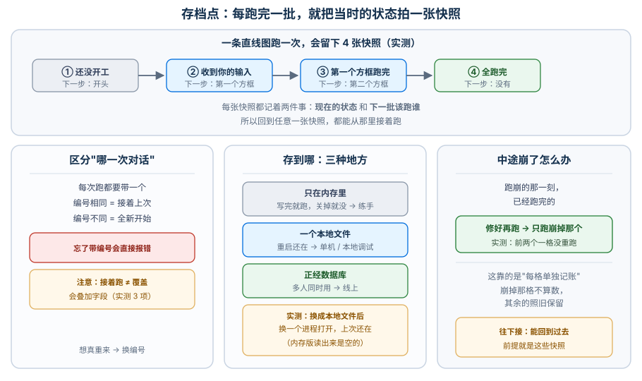
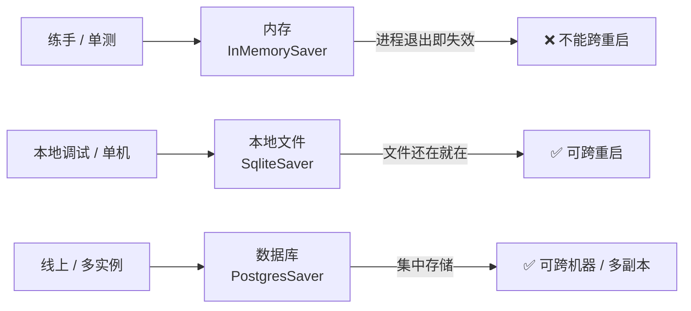
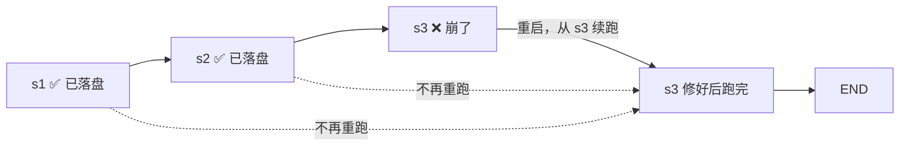
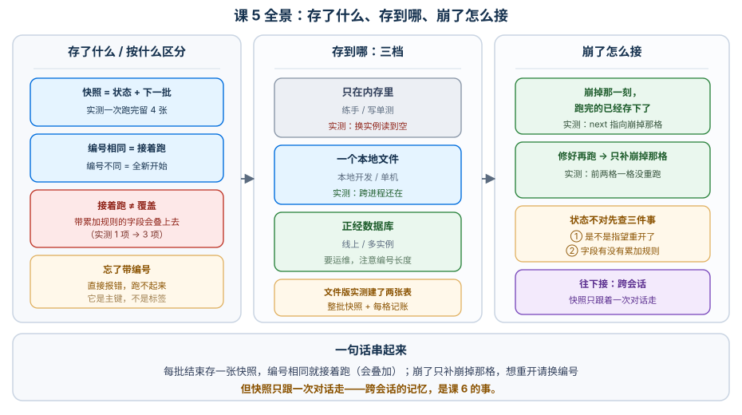

# 课 5：Checkpointer 短期记忆

> 所属阶段：阶段 2《执行模型与状态持久化》｜ 水平：进阶 ｜ 本课知识点：checkpoint 与 thread_id / checkpointer 后端选型 / 断点续跑与状态恢复
> 故事情节：故事主线「让它记住和说出来」的第二章——图终于不会一停就失忆
> 📖 结论已按官方文档与本机源码核对（核对于 2026-10 ｜ 来源：LangGraph Persistence / Checkpointers）

## 🎯 本课目标

- 说清**一个 checkpoint 里到底存了什么**、为什么它正好落在"批"的边界上
- 理解 `thread_id` 就是会话身份，以及**同一个 thread 再跑一次为什么会叠加**
- 能按场景选后端（内存 / 本地文件 / 数据库），并会排查"恢复后状态不对"

---

## 第一幕：起源与场景引入

课 4 结尾留了个话头：

> "每一批跑完，状态都变了——**这些中间状态存在哪？能不能停在中途、下次接着跑？**"

今天就是把这句话变成代码。

**场景**：客服助手上线了，但用户开始抱怨三件事：

1. **"它不记得我上一句说了什么。"**——你用的是 `create_agent` 之外的裸图，每次 `invoke` 都是全新的。
2. **"两个人同时用，回答串了。"**——张三问的退款政策，李四那边也看到了。
3. **"跑到一半程序崩了，重跑又要从头来过。"**——前 8 个文档都摘要完了，第 9 个挂了，重跑又得把前 8 个再做一遍。

这三个问题，其实是**同一个问题**：图没有"记住"的能力。

> 🎬 **场景**：用户抱怨失忆、串台、崩了要重来——三个投诉，一个病根：状态没有落盘。

> 📌 **一句话本质**：**checkpointer 在每批（superstep）结束时把当时的状态拍一张快照存起来，用 `thread_id` 区分"是哪一次对话"**——有了快照就能续跑、能回放、能隔离，课 4 讲的"批"在这里变成了"存档时机"。
>
> ⚖️ **处境对照**：不知道这层，你的图一停就失忆，多用户会串台，崩溃只能从头再来，而且你会以为"再 `invoke` 一次是重新开始"（实测：**不是**，它是接着跑，字段会叠加）；知道了，你能用一行 `compile(checkpointer=...)` 换来断点续跑、多会话隔离，并为课 8 人在回路、课 9 时光旅行铺路——**代价是多一个必须每次传的 `thread_id`（实测：忘了传直接 `ValueError`），以及一个反直觉的叠加语义要记住。**

---

## 第二幕：认知冲突

先做个实验。你写了个最简单的图，连跑两次，**第二次还传了一份"新起点"的初始值**：

::: code-group

```python [Python]
{"log": [], "last": ""}                    # 第 1 次
{"log": ["新起点"], "last": "新起点"}        # 第 2 次，我以为会重新开始
```

```typescript [TypeScript]
// 第 1 次：{ log: [], last: "" }
// 第 2 次（我以为会重新开始）：{ log: ["新起点"], last: "新起点" }
```

:::

结果：

```
第 1 次: {'log': ['跑了一次'], 'last': '本次结果'}
第 2 次: {'log': ['跑了一次', '新起点', '跑了一次'], 'last': '本次结果'}
```

> ❓ **问题**：我明明传了"新起点"，为什么 `log` 变成了 **3 项**，而且中间还夹着我传的那个"新起点"？——**"再跑一次"到底是什么意思？**

---

## 第三幕：层层揭示

### 一眼全局图（进入细节前先看一眼）



> 看图：上面那条是官方例子实测出来的 **4 张快照**——每张都记着"现在的状态"和"下一批该跑谁"；下面三块是今天的三件事：怎么区分对话、往哪存、崩了怎么办。

### 本课地图（分几步走）

| 步 | 这一步要解决什么（人话） | 对应知识点 |
|:--:|------------------------|-----------|
| 1 | 快照里存了什么、怎么区分"哪一次对话" | 知识点 1：checkpoint 与 thread_id |
| 2 | 往哪存：内存 / 本地文件 / 数据库怎么选 | 知识点 2：checkpointer 后端选型 |
| 3 | 崩了怎么接着跑；恢复后状态不对怎么查 | 知识点 3：断点续跑与状态恢复 |

---

### 知识点 1：checkpoint 与 thread_id

> 🧭 第 1/3 步｜承接：第二幕"再跑一次是什么意思" → 本步：搞清快照内容与会话身份
> 本知识点关键点：checkpoint 存了什么 / thread_id 即会话身份 / 通过 config 传入

#### 一句话定义

**checkpoint 是"某一批结束时"的状态快照**，它记着两件事：**当时的状态值**和**下一批该跑谁**；`thread_id` 是这份快照属于哪一次对话的**主键**。

#### 直觉建立（类比）

把它想成**游戏的存档**：

- **存档点**不是随时都能存，而是**每过一关**（每批结束）存一次；
- 每个存档记着"你现在有多少血、身上有什么装备"（状态）+ "下一关是哪一关"（下一批）；
- **存档格子按"玩家编号"分开**——你的存档和别人的互不相干，这就是 `thread_id`。

> 💡 **类比的边界**：真实机制里存档是**自动**的（不用你手动按），且除了"整批快照"还有**每个节点单独的记账**（pending writes，知识点 3 会讲）。另外同一个格子再玩一次是**接着上次的存档继续**，不是新开一局——这正是第二幕那个反直觉现象的根源。

#### 核心原理

官方的说法（核对于 2026-10）：*checkpointer 在每个 super-step 保存图状态的快照，组织成 **threads**；`thread_id` 是 checkpointer 存取 checkpoint 的**主键**——没有它就无法保存状态、也无法在 interrupt 后恢复。*

**一次 invoke 会留下几个 checkpoint？** 官方那个 `START -> A -> B -> END` 的例子，实测：

```
共 4 个
[1] values={'bar': []}               next=('__start__',)
[2] values={'foo': '', 'bar': []}     next=('node_a',)
[3] values={'foo': 'a', 'bar': ['a']} next=('node_b',)
[4] values={'foo': 'b', 'bar': ['a','b']} next=()
```

> 📍 **回扣课 4**：课 4 说"批"是执行单位——**这里 checkpoint 正好落在批的边界上**。官方原话：*"A super-step is a single 'tick' of the graph... there are separate super-steps for the input, node A, and node B — producing a checkpoint after each one."* 两课在这里对上了。

**`StateSnapshot` 里有什么**（本机源码 `langgraph/types.py:683`，`NamedTuple` 共 8 个字段）：

| 字段 | 是什么 |
|---|---|
| `values` | 当前各通道的值（就是状态） |
| `next` | 下一批要执行的节点名元组 |
| `config` / `parent_config` | 取这个快照用的配置 / 上一个快照的配置 |
| `metadata` | 元数据（如 step、来源、写入方） |
| `created_at` | 创建时间 |
| `tasks` | 这一批要执行的任务（若已尝试过，可能带 error） |
| `interrupts` | 本步挂起的中断（课 8 会讲） |

> 💡 `parent_config` 这条链，正是课 9 时光旅行能"往回走"的结构基础。

**怎么传 `thread_id`**：放在 `configurable` 里。

::: code-group

```python [Python]
from langgraph.checkpoint.memory import InMemorySaver

graph = builder.compile(checkpointer=InMemorySaver())
config = {"configurable": {"thread_id": "user-123"}}
graph.invoke({"messages": [...]}, config)
```

```typescript [TypeScript]
import { MemorySaver } from "@langchain/langgraph";

const graph = builder.compile({ checkpointer: new MemorySaver() });
const config = { configurable: { thread_id: "user-123" } };
await graph.invoke({ messages: [...] }, config);
```

:::

> ⚠️ **两侧类名与参数形态都不同**：Python 是 `InMemorySaver`（从 `langgraph.checkpoint.memory` 导入）、`compile(checkpointer=...)` 关键字参数；TS 是 **`MemorySaver`**（直接从 `@langchain/langgraph` 导入）、`compile({ checkpointer })` **对象参数**。写在 `configurable` 里的键名 `thread_id` 两侧一致（下划线，不是驼峰）。

实测：忘了传会直接报错——

```
ValueError: Checkpointer requires one or more of the following
'configurable' keys: thread_id, checkpoint_ns, checkpoint_id
```

#### 示例演示：thread_id 真的是"会话身份"吗

```
alice 第 1 次 -> ['跑了一次']
alice 第 2 次 -> ['跑了一次', '跑了一次']     # 累加了
bob   第 1 次 -> ['跑了一次']                # 全新，没受 alice 影响
alice 第 3 次 -> ['跑了一次', '跑了一次', '跑了一次']   # 之前的还在
```

> ✅ **编号相同 = 接着上次；编号不同 = 全新开始。** 这就是多用户隔离。

#### 常见误区

1. **"同一个 thread 再 invoke 是重新开始"**——**错，是接着跑**（上面实测）。想真重来就换 `thread_id`。
2. **"checkpoint 每个节点一个"**——不完全。官方文档区分了**整批快照**（super-step 边界，可回放）和**每节点记账**（task 级，只用于容错）。
3. **"`thread_id` 只是个可选标签"**——它是**主键**，不传直接报错。

#### 一句话记住

**checkpoint = 批结束时的快照（状态 + 下一批）；`thread_id` = 这条快照属于哪次对话，不传就报错。**

#### 🗣️ 行话对照

| 本课说法（人话） | 行业标准叫法 | 典型配置 / 在哪遇到 | 代价 |
|---|---|---|---|
| 存档点 / 快照 | **checkpoint**（检查点）· `StateSnapshot` | `compile(checkpointer=...)`；`get_state_history(config)` | 每批一个，量可能很大，需配后端清理策略 |
| 会话编号 | **thread_id**（线程 ID）· `configurable.thread_id` | `{"configurable": {"thread_id": "1"}}` | **必填主键**，不传 `ValueError`；PostgresSaver 下过长会报错 |
| 一次对话 / 一串快照 | **thread**（线程） | 官方文档 "Threads" 节 | 与操作系统线程无关，别混 |
| 下一批该跑谁 | **next**（下一节点） | `StateSnapshot.next: tuple[str, ...]` | 为 `()` 表示已结束 |
| 子图归属 | **checkpoint_ns**（命名空间） | `""` = 父图；`"node:uuid"` = 子图 | 课 10 子图会用到 |

> 中文均为社区常用译法 / 本文自拟，官方未定名中文，检索用英文。

#### 官方文档

- [Persistence（总览与 checkpointer vs store）](https://docs.langchain.com/oss/python/langgraph/persistence)
- [Checkpointers（Threads / Checkpoints / Super-steps）](https://docs.langchain.com/oss/python/langgraph/checkpointers)

---

### 知识点 2：checkpointer 后端选型

> 🧭 第 2/3 步｜承接：知道快照是什么了 → 本步：决定往哪存
> 本知识点关键点：InMemorySaver / SqliteSaver / PostgresSaver 的取舍 / 官方集成页

#### 一句话定义

**后端决定快照"能活多久、谁能看见"**：内存 = 进程内临时，本地文件 = 单机持久，数据库 = 生产级共享。

#### 直觉建立（类比）

三种**记笔记的地方**：

- **脑子里的草稿**（内存）：随手记、随手丢，一觉醒来全没了；
- **桌上的便签本**（SQLite 文件）：写完放着，明天来还在，但只有你桌上这一本；
- **共享网盘**（Postgres）：团队都能看、都在改，但得先搭服务、管账号。

> 💡 **类比的边界**：真实选型还牵扯并发写入、清理策略、事务语义，以及官方提示的 **Agent Server 会自动接管持久化**（用它就不用自己配）。另外 PostgreSQL 后端还有一条已知的坑：`thread_id` 过长会报错（官方 Troubleshooting 有专门一节）。

#### 核心原理



> 看图：三档不是"好坏"之分，而是**存活范围**不同——从"进程内"到"单机"到"跨机器"。

| 后端 | 活多久 | 谁看得见 | 适合 | 不适合 |
|---|---|---|---|---|
| **InMemorySaver** | 进程内 | 只这一个进程 | 练手、写单测、Notebook | 任何要"重启还在"的场合 |
| **SqliteSaver** | 文件在就在 | 单机 | 本地开发、桌面应用、单机服务 | 多副本 / 多机部署 |
| **PostgresSaver** | 数据库里 | 所有连上它的实例 | 生产、多实例、需要并发 | 本地随手试 |

#### 示例演示：内存 vs 本地文件，实测差在哪

**内存版**：换一个 saver 实例（相当于重启进程）再读——

```
实例1 存完: {'log': ['跑了一次']}
实例2 读到: {}          # 空
```

**本地文件版**：换成 `SqliteSaver`，用**两个独立进程**先后打开同一个 db 文件——

```
进程 1 写入: ['跑了一次']
进程 2 读取: ['跑了一次', '跑了一次']     # 上次的还在！
```

数据库里实际建了两张表：

```
表: ['checkpoints', 'writes']
```

> ✅ **两张表正好对应知识点 1 说的两种记录**：`checkpoints` 存整批快照，`writes` 存每个节点的产出（pending writes）。官方文档也提到 `checkpoint_writes` 表——**结构和语义在源码与文档里对得上。**

#### 常见误区

1. **"`InMemorySaver` 也有持久化的效果"**——没有，进程一退就没（实测读出来是 `{}`）。
2. **"SQLite 够用就不用 Postgres"**——只要你有**多个实例**同时服务（哪怕两个副本），SQLite 就会出问题。
3. **"后端会自动清理旧快照"**——不会。生产环境要自己规划保留策略与归档。

#### 一句话记住

**练手内存、单机文件、生产数据库——差别就是"能活多久、谁能看见"。**

#### 🗣️ 行话对照

| 本课说法（人话） | 行业标准叫法 | 典型配置 / 在哪遇到 | 代价 |
|---|---|---|---|
| 存内存里 | **InMemorySaver** · `langgraph.checkpoint.memory` | `InMemorySaver()` | 进程退出即丢失 |
| 存本地文件 | **SqliteSaver** · `langgraph.checkpoint.sqlite` | 需装 `langgraph-checkpoint-sqlite` | 单机，多实例不安全 |
| 存数据库 | **PostgresSaver** · `langgraph.checkpoint.postgres` | 需装 `langgraph-checkpoint-postgres` | 要运维 DB；`thread_id` 过长会报错 |
| 每张快照一份 | **checkpoints 表** | SQLite / Postgres 均建此表 | 无清理会持续增长 |

> 中文均为社区常用译法，官方未定名中文。

#### 官方文档

- [Persistence - Quickstart（compile 时传 checkpointer / store）](https://docs.langchain.com/oss/python/langgraph/persistence)
- [Checkpointer integrations（官方后端集成清单）](https://docs.langchain.com/oss/python/langgraph/checkpointers)

---

### 知识点 3：断点续跑与状态恢复

> 🧭 第 3/3 步｜承接：存下来了 → 本步：崩了怎么接，以及恢复后状态不对怎么查
> 本知识点关键点：中断后如何 resume / 同一 thread 继续 / **恢复后状态不预期的排查**

#### 一句话定义

**因为每批结束都有快照、每个节点的产出单独记账，所以崩了之后可以从"崩掉的那批"重新跑，已经成功的节点不会重跑。**

#### 直觉建立（类比）

回到游戏的存档：**你打到第 9 关时断电了**。重启后你从**第 9 关的存档**开始，不是从第 1 关——前面 8 关不用重打。

> 💡 **类比的边界**：真实机制里"崩掉的那一批"如果还有**其他节点已经成功跑完**，它们的产出也已经落盘了（`writes` 表），重跑时**只补跑失败的那个**——这是官方说的 **pending writes** 恢复。

#### 核心原理

官方的说法（核对于 2026-10）：*当某个节点在 super-step 中途失败时，LangGraph 会保存同批其他**成功节点**的 pending checkpoint writes；你从该 super-step 恢复时，**不会重跑那些成功的节点**。*



> 看图：s1、s2 的产出在崩溃时**已经存下来了**，重跑只补 s3。

#### 示例演示：实测崩溃与恢复

```
=== 第 1 次：s3 崩了 ===
RuntimeError: s3 崩了
实际调用过的节点: ['s1', 's2', 's3']

=== 崩了之后，checkpoint 里留下什么？===
values: {'steps': ['s1', 's2'], 'done': False}
next: ('s3',)

=== 修好 s3 之后重跑 ===
这次只调用了: ['s3_fixed']
结果: {'steps': ['s1', 's2', 's3修好了'], 'done': False}
```

> ✅ **s1、s2 一格没重跑**，直接从 s3 接上，且最终 `steps` 是完整的三项。

#### ⚠️ 深度：恢复后状态不对，怎么查

这是 rehearsal 里标了 🟡 的高频排障场景。按"先看什么"排序：

**排查 1：你是不是指望"再 invoke 一次 = 重新开始"？**（最高发）

实测（第二幕那个现象的完整版）：

```
第 1 次: {'log': ['跑了一次'], 'last': '本次结果'}
第 2 次（传了新初始值）: {'log': ['跑了一次', '新起点', '跑了一次'], 'last': '本次结果'}
```

**发生了什么**：第 2 次的入参**不是覆盖**，而是被 reducer **合并**进已有状态——所以 `log` 变成 3 项，还夹着你传的那个"新起点"。

| 字段类型 | 第二次 `invoke` 时会怎样 | 实测 |
|---|---|---|
| 带 reducer（如 `operator.add`） | **累加上去** | `['跑了一次','新起点','跑了一次']` |
| 不带 reducer | 被本节点的返回值**覆盖** | `last='本次结果'` |

> ✅ **想真正从头开始 → 换 `thread_id`**（实测：换编号后是 `['新起点','跑了一次']`）。

**排查 2：字段没有 reducer，被"最后一次写入"盖掉了**

课 3 说过：**没有 reducer 的字段，后写覆盖先写**。这一点在 checkpoint 恢复后同样成立——你以为是累加，其实是覆盖。

**排查 3：你改了 State 结构，但读的是旧快照**

State 加了字段或改了类型后，老 `thread_id` 里的快照还是旧结构。**排查期请换一个新 `thread_id`**，排除"读到历史数据"的干扰。

**排查 4：用 `get_state_history` 看看到底存了什么**

::: code-group

```python [Python]
for s in graph.get_state_history(config):
    print(s.values, s.next, s.metadata.get("step"))
```

```typescript [TypeScript]
for await (const s of await graph.getStateHistory(config)) {
  console.log(s.values, s.next, s.metadata?.step);
}
```

:::

> ⚠️ **TS 侧 `getStateHistory` 返回的是异步迭代器**，要 `for await` 且外层还要 `await`——两个 `await` 分工不同：里层等"取到迭代器"，`for await` 等"逐个取快照"。另 `metadata` 在 TS 类型上是可选的，用 `?.` 访问。

> 💡 **这是最有用的一步**：与其猜，不如把存档点逐个打出来。课 9 会把它系统化。

#### 常见误区

1. **"崩了要整图重跑"**——不用，成功的节点不会重跑（实测只调了 `s3_fixed`）。
2. **"再 invoke 就是重新开始"**——**不是**，是接着跑（见排查 1）。
3. **"重跑时传 `None` 会清空状态"**——不会。`invoke(None, config)` 的语义是"**沿用这个 thread 的现有状态继续**"，这正是断点续跑的正确用法。

#### 一句话记住

**崩了从崩掉那批续跑，成功的节点不重来；想重开请换 `thread_id`，别指望再 invoke 一次会自动清空。**

#### 🗣️ 行话对照

| 本课说法（人话） | 行业标准叫法 | 典型配置 / 在哪遇到 | 代价 |
|---|---|---|---|
| 记着上一批到哪了 | **resume**（恢复执行） | `graph.invoke(None, config)` | 传 `None` 表示沿用现有状态 |
| 崩掉那格不算数 | **pending writes**（待定写入） | `writes` 表；官方 "Pending writes" 节 | 只有同批成功节点的写入会被保留 |
| 看看存了啥 | **get_state_history** | `graph.get_state_history(config)` | 返回 `StateSnapshot` 迭代器 |
| 当前状态 | **get_state** | `graph.get_state(config)` | 返回 `StateSnapshot` |
| 存档能扛住崩溃 | **fault tolerance**（容错） | 官方 checkpointer 四大用途之一 | 依赖后端真实落盘 |

> 中文均为社区常用译法，官方未定名中文。

#### 官方文档

- [Checkpointers - Pending writes](https://docs.langchain.com/oss/python/langgraph/checkpointers#pending-writes)
- [Use time-travel（快照链与回放）](https://docs.langchain.com/oss/python/langgraph/use-time-travel)

---

## 第四幕：实操验证

### 4.1 机制验证

> ✅ 实测于 langgraph 1.2.11 / Python 3.12（在 `../langchain/playground` 以 `uv run` 隔离执行；SQLite 跨进程项另装 `langgraph-checkpoint-sqlite`）

**验证一：官方例子到底留下几个 checkpoint**

```
共 4 个
[1] values={'bar': []}                next=('__start__',)
[2] values={'foo': '', 'bar': []}      next=('node_a',)
[3] values={'foo': 'a', 'bar': ['a']}  next=('node_b',)
[4] values={'foo': 'b', 'bar': ['a','b']} next=()
```

> ✅ **与官方文档逐条一致**，且证实"每批一个快照"。

**验证二：`thread_id` 是不是会话身份**

```
alice 第 2 次: ['跑了一次', '跑了一次']
bob   第 1 次: ['跑了一次']
alice 第 3 次: ['跑了一次', '跑了一次', '跑了一次']
不传 thread_id -> ValueError: Checkpointer requires one or more of ...
```

**验证三：InMemorySaver 的边界**

```
实例1 存完: {'log': ['跑了一次']}
实例2 读到: {}
```

**验证四：SQLite 跨进程仍在（两个独立进程）**

```
进程 1: ['跑了一次']
进程 2: ['跑了一次', '跑了一次']
表: ['checkpoints', 'writes']
```

**验证五：崩溃与续跑**

```
实际调用过的节点: ['s1', 's2', 's3']              # s3 崩了
崩溃后 values={'steps': ['s1','s2']}  next=('s3',)
修好重跑只调用 ['s3_fixed']，结果 ['s1','s2','s3修好了']
```

> ✅ **s1、s2 一格没重跑**，直接从 s3 接上，且最终 `steps` 是完整的三项。
>
> 💡 另一组实测（实战 05）还显示：**崩溃时同批已成功节点的产出也已在盘上**——`record` 跑完、`answer` 崩掉时，`history` 里那条消息**已经存下来了**。

**验证六：恢复后状态不对（第二幕现象的完整版）**

```
第 1 次: {'log': ['跑了一次'], 'last': '本次结果'}
第 2 次: {'log': ['跑了一次', '新起点', '跑了一次'], 'last': '本次结果'}
换 thread_id: {'log': ['新起点', '跑了一次'], 'last': '本次结果'}
```

> ✅ **回扣场景**：第一幕三个投诉全部解决——① 失忆 → 挂 checkpointer，同一 `thread_id` 会接着跑；② 串台 → 不同用户用不同 `thread_id`（实测 alice / bob 互不干扰）；③ 崩了重来 → 从崩掉那批续跑（实测 s1/s2 没重跑）。**客服助手现在记得住、不串台、崩了能接上。**

### 4.2 应用实战

🎯 [练一练：应用实战 05「客服会话记住上下文」](../../../应用实战/05-Checkpointer 短期记忆.md)

> 基础 → 问题 → 综合两跳：先单会话记住上文，再发现多用户串台与崩溃重来，最后用 SQLite 落盘 + 断点续跑收口。

### 4.3 源码解析

🔬 [源码解析 05：checkpoint 是怎么被写进去的](../../../源码解析/05-Checkpointer 短期记忆.md)

> 从 `StateSnapshot` 的 8 个字段到 `checkpoints` / `writes` 两张表，把"存档"落到真实代码行上。

---

## 第五幕：体系收束

今天让图"记住"了。三句话带走：

1. **每批结束存一张快照**，内容是"状态 + 下一批该跑谁"。
2. **`thread_id` 是主键**，相同 = 接着跑（会叠加），不同 = 全新，不传直接报错。
3. **崩了从崩掉那批续跑**，成功的节点不重来。

但有个限制已经露出来了：

> 📍 **全局定位**：checkpoint 是**跟着 thread 走的**——甲会话里记住的东西，乙会话看不到。可"用户说他偏好邮件沟通"这种事，理应**跨会话一直有效**。
> 🔗 **下一步**：课 6《Store 长期记忆》——`Store` 与命名空间、跨 thread 的记忆读写，以及它和 checkpointer 的分工（官方那张对照表已经把两者划得很清楚了）。

顺带预告：**这些快照链，正是课 9《Time-travel 回放与分叉》能回到过去重跑的前提**——`parent_config` 那根链到时候会派上大用场。

---

## 🐞 常见误区

1. **"同一个 thread 再 invoke 是重新开始"**——错，是**叠加**（实测 `log` 变 3 项）。
2. **"`InMemorySaver` 能跨重启"**——不能（实测换实例读到 `{}`）。
3. **"崩了要整图重跑"**——不用，成功的节点不重来（实测只补跑 `s3`）。
4. **"`thread_id` 可选"**——是主键，不传 `ValueError`。

### ⏳ 与过时说法对照（写前核对有差异时才有，≤3 行）

| 旧说法（网上过时教程 / 训练知识里的说法） | 官方文档现状 | 来源 |
|---|---|---|
| `MemorySaver` 是标准叫法 | 官方 Persistence 快速上手统一用 **`InMemorySaver`**（`langgraph.checkpoint.memory`），`MemorySaver` 为旧名（核对于 2026-10） | [Persistence](https://docs.langchain.com/oss/python/langgraph/persistence) |
| checkpoint 每个节点存一个 | 官方明确区分 **super-step 级快照**（可回放）与 **task 级 writes**（仅容错），只有前者能用于 time travel（核对于 2026-10） | [Checkpointers - Super-steps](https://docs.langchain.com/oss/python/langgraph/checkpointers#super-steps) |

## 一图总结



> 看图：左边是"存了什么、按什么区分"，中间是三档后端，右边是崩了怎么接与往下接什么。**一图总结与课首那张图的区别**：课首那张给没学过的人看（快照长什么样），这张给刚学完的你复习（快照引出的语义、选型和恢复）。

## 课后小测

**Q1**：同一个 `thread_id` 连续 `invoke` 两次，第二次传入的初始值会怎样？
- A. 完全覆盖，从新值开始
- B. 按 reducer 合并进已有状态
- C. 被忽略，只用旧状态
- D. 报错，因为 thread 已存在

<details><summary>答案与解析</summary>

**答案：B**。实测 `{'log': ['跑了一次','新起点','跑了一次']}`——新值被 `operator.add` 合并进历史，而不是覆盖。D 不成立，重复 invoke 是正常用法。想真正重来请换 `thread_id`。

</details>

**Q2**：图在 s3 节点崩溃，s1、s2 已成功。修好后重跑，会发生什么？
- A. s1、s2、s3 全部重跑
- B. 只跑 s3，s1/s2 的产出从存档恢复
- C. 从 s1 开始但跳过 s2
- D. 无法恢复，必须换 thread_id

<details><summary>答案与解析</summary>

**答案：B**。实测：崩溃后 `values={'steps':['s1','s2']}`、`next=('s3',)`；修好重跑只调用了 `s3_fixed`，最终 `['s1','s2','s3修好了']`。这就是官方说的 **pending writes** 恢复。

</details>

**Q3**：生产环境多实例部署，应该用哪个后端？
- A. `InMemorySaver`
- B. `SqliteSaver`
- C. `PostgresSaver`
- D. 不挂 checkpointer

<details><summary>答案与解析</summary>

**答案：C**。多实例需要**共享**存储：内存版进程一退就没（实测读到 `{}`），SQLite 是单机文件、多副本会出问题。官方也提示 PostgresSaver 下 `thread_id` 过长会报错，需注意。

</details>

---

## 🚀 下一批接力提示词

> 学完本批后，**复制下面这段文字发给 AI**，即可无缝进入下一批：

```
继续学 LangGraph。我的学习档案在 langchain/langgraph/00-学习档案.md，
刚学完阶段 2《执行模型与状态持久化》的课 5《Checkpointer 短期记忆》
知识点「checkpoint 与 thread_id / checkpointer 后端选型 / 断点续跑与状态恢复」，
请按大纲继续讲解课 6《Store 长期记忆》的知识点。
```

## 🧭 课程导航

- 上一课：[课 4 Pregel 执行模型](04-Pregel 执行模型.md)
- 返回 [课程目录](../../../02-课程目录.md)
- 下一课：[课 6 Store 长期记忆](06-Store 长期记忆.md)
- 🎯 练一练：应用实战 05（见 4.2）
- 🔬 源码解析 05（见 4.3）
