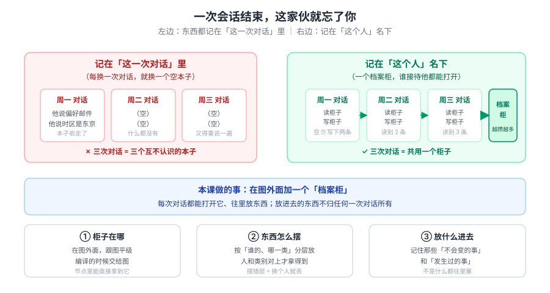
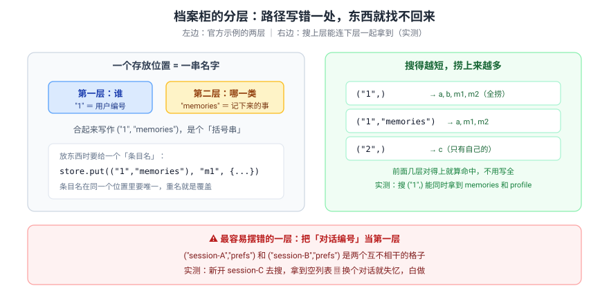
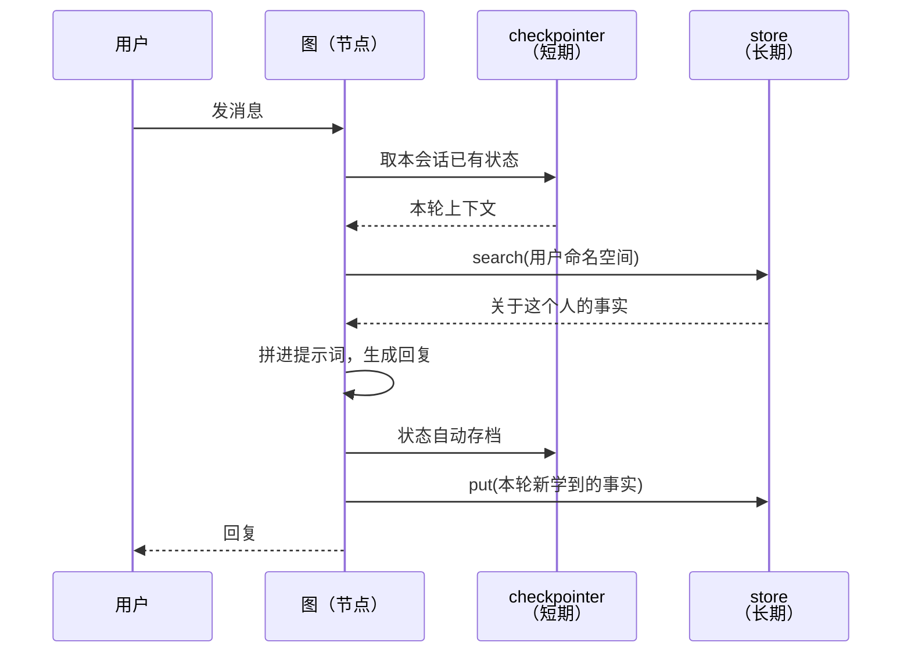
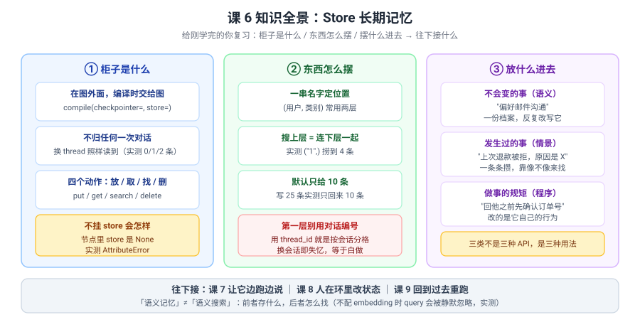

# 课 6：Store 长期记忆

> 所属阶段：阶段 2《执行模型与状态持久化》｜ 水平：进阶 ｜ 本课知识点：Store 与命名空间 / 长期记忆落地（语义 / 情景）
> 故事情节：故事主线「让它记住和说出来」的第三章——这次不是记住这一轮，是记住这个人
> 📖 结论已按官方文档核对（核对于 2026-10 ｜ 来源：LangGraph Stores / Persistence / Memory 三页 + 本机 langgraph 1.2.11 源码与实测）

## 🎯 本课目标

- 说清 **Store 和 checkpointer 到底差在哪**，以及为什么"只挂 checkpointer"是最常见的架构错
- 会用 `namespace` 组织长期记忆，并避开"把 thread_id 当第一层"这个高频坑
- 能按语义 / 情景 / 程序三类设计"该记什么、什么时候记"

---

## 第一幕：起源与场景引入

课 5 结尾留了个限制：

> "checkpoint 是**跟着 thread 走的**——甲会话里记住的东西，乙会话看不到。"

今天就把这句话解决掉。

**场景**：客服助手已经能记住上下文了，但用户还是不满意——

1. **"我上周就说过我偏好邮件沟通，它今天又问了一遍。"**——上周是 `thread_id="monday"`，今天是 `thread_id="friday"`，两个互不相干的世界。
2. **"它不知道我是老客户，每次都当新人。"**——用户的等级、历史工单、退款记录，全都不在图里。
3. **"客服 A 接待过我，换成客服 B 就一问三不知。"**——记忆绑在某个会话上，没有绑在"人"上。

这三个投诉还是**同一个问题**：**记忆的"主人"搞错了**——记在了"这一次对话"名下，而不是"这个人"名下。

> 🎬 **场景**：三个投诉一个病根——记忆绑在对话上，没绑在人上。

> 📌 **一句话本质**：**Store 是一个活在"图外面"的键值仓库，按 `namespace`（一串名字，如 `(用户, 类别)`）分格，任何 thread 都能按命名空间读写**——把记忆的归属从"这一次对话"改成"这个人"。
>
> ⚖️ **处境对照**：不知道这层，你会把用户偏好塞进 State（实测：换会话读到 `{}`，等于没存），或者把 `thread_id` 当命名空间第一层（实测：新会话搜到 `[]`，白做）；知道了，你能用 `compile(store=...)` 一行换来跨会话个性化，官方原话点出的四类长期记忆（用户偏好 / 积累的知识 / 应当长期存活的事实）都能落地——**代价是：它不会自动写**（checkpointer 每次状态更新自动存，Store 必须你显式 `put`），且**默认 `search` 只返回 10 条**（实测写 25 条只回来 10 条，漏数据还不报错）。

---

## 第二幕：认知冲突

你信心满满地把用户偏好存进了 State——课 5 不是说了吗，状态会被持久化！

::: code-group

```python [Python]
# 会话 1：写入
g.invoke({"user_id": "1", "profile": {}}, {"configurable": {"thread_id": "sess-1"}})
#  -> profile = {'lang': 'Python'}       ✅ 存进去了

# 会话 2：换个 thread 读
g.invoke({"user_id": "1", "profile": {}}, {"configurable": {"thread_id": "sess-2"}})
#  -> profile = {}                       ❌ 空的！
```

```typescript [TypeScript]
// 会话 1：写入
await g.invoke({ user_id: "1", profile: {} }, { configurable: { thread_id: "sess-1" } });
//  -> profile = { lang: 'Python' }       ✅ 存进去了

// 会话 2：换个 thread 读
await g.invoke({ user_id: "1", profile: {} }, { configurable: { thread_id: "sess-2" } });
//  -> profile = {}                       ❌ 空的！
```

:::

> ❓ **问题**：状态**确实**被持久化了（课 5 讲的没错），可为什么换个会话就全没了？——**"持久化"和"跨会话可见"是两件事吗？**

---

## 第三幕：层层揭示

### 一眼全局图（进入细节前先看一眼）



> 看图：左边是**记在"这一次对话"里**——三个本子互不认识，换一个就失忆；右边是**记在"这个人"名下**——三次对话共用右边那个绿色档案柜，越攒越多。**本课要做的事，就是在图外面加一个柜子。**

### 本课地图（分几步走）

| 步 | 这一步要解决什么（人话） | 对应知识点 |
|:--:|------------------------|-----------|
| 1 | 柜子在哪、怎么拿到它、它跟课 5 的存档有什么不一样 | 知识点 1：Store 与命名空间 |
| 2 | 该往柜子里放什么、什么时候放、放进去怎么找 | 知识点 2：长期记忆落地（语义 / 情景） |

---

### 知识点 1：Store 与命名空间

> 🧭 第 1/2 步｜承接：第二幕"持久化了却读不到" → 本步：在图外面另开一个柜子
> 本知识点关键点：Store 与 checkpointer 的分工 / namespace 是元组 / put / get / search / delete / 节点里怎么拿到 store

#### 一句话定义

**Store（长期记忆仓库）是独立于图状态的键值存储，按 `namespace`（元组形式的一串名字）分格组织；它不属于任何 thread，所以任何 thread、任何一次运行都能读写。**

> 📍 **回扣课 5**：课 5 的 checkpointer 是"**这次会话跑到哪**"，它是"**这个人是谁**"。阶段概览里那句"前者管这次会话、后者管这个用户，混用是高频错误"，就是本知识点的全部内容。

#### 直觉建立（类比）

把它想成**公司前台的档案柜**：

- **档案柜不属于任何一通电话**——它是公司的固定资产，谁接待都能打开；
- 柜子按**"哪个客户 + 哪一类材料"**分层放：`(客户名, "合同")`、`(客户名, "投诉记录")`；
- 你往里放材料要**自己动手**（`put`），柜子不会自动把你桌上东西收走；
- 找的时候可以**只说客户名**，那一格下面所有类别的材料都给你。

> 💡 **类比的边界**：真实机制里 ① 命名空间**不限两层**，可以是任意长度、表达任意含义（官方文档原话："The namespace can be any length and represent anything, does not have to be user specific"）；② 找的时候除了"按位置找"，还能**按内容相似度找**——但那需要额外配一个"翻译器"（embedding），本课验证三会看到不配会怎样；③ 柜子里的东西**不会自动过期**，也不会自动清理。

#### 核心原理

**先看官方那张分工表**（核对于 2026-10，LangGraph Persistence 页）：

| | **checkpointer**（课 5） | **store**（本课） |
|---|---|---|
| **作用范围** | 单个 thread 内 | 跨 thread、跨会话 |
| **存什么** | 图的完整状态（每步快照） | 任意键值数据（你想记什么就记什么） |
| **谁写** | **自动**——每次状态更新都存 | **手动**——你显式调 `put` |
| **典型用途** | 中断后恢复、本轮对话上下文 | 用户偏好、学到的事实、历史摘要 |
| **怎么取** | `get_state` / `get_state_history` | `get` / `search` |

> 💡 **一句话记住这张表**：**checkpointer 存"执行到哪了"，store 存"你是谁"。**

**四个动作**：

::: code-group

```python [Python]
from langgraph.store.memory import InMemoryStore

store = InMemoryStore()
ns = ("1", "memories")                      # namespace：元组，这里是 (用户, 类别)

store.put(ns, "m1", {"food_preference": "I like pizza"})   # 放
item = store.get(ns, "m1")                                  # 取一条
items = store.search(ns)                                    # 找一片
store.delete(ns, "m1")                                      # 删
```

```typescript [TypeScript]
import { InMemoryStore } from "@langchain/langgraph";

const store = new InMemoryStore();
const ns = ["1", "memories"];               // namespace：数组，这里是 [用户, 类别]

await store.put(ns, "m1", { food_preference: "I like pizza" });  // 放
const item = await store.get(ns, "m1");                           // 取一条
const items = await store.search(ns);                             // 找一片
await store.delete(ns, "m1");                                     // 删
```

:::

> ⚠️ **命名空间形态不同（实测）**：Python 用**元组** `("1", "memories")`，TS 用**数组** `["1", "memories"]`。TS 侧四个方法**全部返回 Promise**，四个 `await` 都不能省。`get` 返回的是 `{ value, key, namespace, createdAt, updatedAt }` 包装对象，取内容要 `.value`。</parameter>

`search` 的完整签名（本机 `langgraph/store/base/__init__.py`，`BaseStore` 抽象基类）：

::: code-group

```python [Python]
search(self, namespace_prefix, /, *, query=None, filter=None,
       limit=10, offset=0, refresh_ttl=None) -> list[SearchItem]
```

```typescript [TypeScript]
search(namespacePrefix: string[], options?: {
  query?: string; filter?: Record<string, unknown>;
  limit?: number; offset?: number;
}): Promise<SearchItem[]>
```

:::

> **TS 侧没有 `refresh_ttl`**：TTL 刷新是 Python 侧 Store 后端的特性，TS 侧的 `search` 选项里没有这个字段（`@langchain/langgraph` 1.5.1 类型声明实测）。其余参数（`query` / `filter` / `limit` / `offset`）都有，且都收在一个 options 对象里，而不是关键字参数。

> ⚠️ **`limit` 默认是 10**——这是本课最容易埋雷的一个默认值。实测写入 25 条后不带参数 `search`，**只回来 10 条，且不报错**：
>
> ```
> 共写入 25 条，不带 limit 拿到: 10 条
> 带 limit=100 拿到: 25 条
> ```

**`namespace` 是"前缀匹配"的**——搜上层能连下层一起捞上来。实测：

```
写入：("1","memories") 下 m1/m2/a ；("1","profile") 下 b ；("2","memories") 下 c

search(("1",))             -> ['a', 'b', 'm1', 'm2']      # 两个类别都来了
search(("1","memories"))   -> ['a', 'm1', 'm2']
search(("2",))             -> ['c']                        # 别人的拿不到
list_namespaces()          -> [('1','memories'), ('1','profile'), ('2','memories')]
```



> 看图：左边是官方示例的两层结构（谁 + 哪一类），右边是前缀搜索的效果——**写得越短捞得越多**；底部红框是高频坑：把"对话编号"当第一层，等于按会话分格，换个会话就失忆。

**怎么把 store 交给图**：两个位置——`compile` 时传，节点里用**仅限关键字参数**接。

::: code-group

```python [Python]
from langgraph.store.base import BaseStore

def node(state, *, store: BaseStore):        # ← 注意这个 * 和类型标注
    store.put((state["user_id"], "memories"), "k", {"fact": "..."})
    return {...}

graph = builder.compile(checkpointer=InMemorySaver(), store=store)
```

```typescript [TypeScript]
import { MemorySaver, InMemoryStore, type LangGraphRunnableConfig } from "@langchain/langgraph";

// TS 侧没有"关键字参数注入"这回事：store 挂在节点第二个参数（config）的 store 字段上
const node = async (state: typeof State.State, config: LangGraphRunnableConfig) => {
  const store = config.store!;                       // ← 从 config 上取，不是函数签名里声明
  await store.put([state.user_id, "memories"], "k", { fact: "..." });
  return {};
};

const graph = builder
  .addNode("node", node)
  .compile({ checkpointer: new MemorySaver(), store: new InMemoryStore() });
```

:::

实测三种写法：

| 写法 | 实测结果 |
|---|---|
| `def node(state, *, store: BaseStore)` | ✅ 拿到 `InMemoryStore` |
| `def node(state, runtime: Runtime)` → `runtime.store` | ✅ 拿到 `InMemoryStore` |
| `config["configurable"]["store"]` | ❌ 是 `None`（别这么取） |

> 🇹🇸 **TS 侧对应关系（实测于 `@langchain/langgraph` 1.5.1）**：节点第二个参数上确实带着 `store` 字段（实测该参数的全部键：`tags, metadata, recursionLimit, configurable, signal, writer, interrupt, control, store, runName, executionInfo`），所以 `config.store` 可用；另一种等价写法是从包内导入 `getStore()`——**两者都拿到同一个包装后的 `AsyncBatchedStore`**。但 `config.configurable.store` 是 `undefined`，与 Python 侧"别从 configurable 里取"的结论一致。

> ⚠️ **只挂 checkpointer 不挂 store 会怎样**：节点里 `store` 是 `None`，一用就 `AttributeError: 'NoneType' object has no attribute 'search'`（实测）。**这不是"降级成空 store"，是直接拿到 `None`。**

#### 示例演示：跨 thread 真的共享吗

同一个 `user_id`，连开三个 thread（模拟周一 / 周二 / 周三）：

```
thread=session-A: 读到 0 条长期记忆  []
thread=session-B: 读到 1 条长期记忆  ['来自 thread 的问候 #1']
thread=session-C: 读到 2 条长期记忆  ['来自 thread 的问候 #1', '来自 thread 的问候 #2']

--- 换个 user_id（namespace 不同）---
user=2 thread=session-D: 读到 0 条长期记忆  []
```

> ✅ **长期记忆跨 thread 累积（0 → 1 → 2），短期记忆每个 thread 各自独立**——这就是"柜子不归任何一次对话"的实测证据。

同时挂两个的时候，两者各管各的（实测）：

```
thread=A: 读到的长期=[]              自己的短期=['本轮']
thread=B: 读到的长期=['事实1']        自己的短期=['本轮']
thread=C: 读到的长期=['事实1','事实2'] 自己的短期=['本轮']
```

> ✅ **长期跨 thread 累积，短期每个 thread 都只有自己的 `['本轮']`**——一张输出同时看清两套记忆的作用域。

#### 🐞 两个高频坑（都是实测撞出来的）

**坑 1：把 `thread_id` 当命名空间第一层**

::: code-group

```python [Python]
store.put(("session-A", "prefs"), "lang", {"v": "Python"})   # ❌
store.put(("session-B", "prefs"), "lang", {"v": "Go"})
```

```typescript [TypeScript]
await store.put(["session-A", "prefs"], "lang", { v: "Python" });   // ❌
await store.put(["session-B", "prefs"], "lang", { v: "Go" });
```

:::

实测：新开 session-C 去搜 `("session-C","prefs")` → `[]`。**换成 thread 就失忆，等于把长期记忆退化成了短期记忆**——官方与社区一致的点名坑。

**坑 2：把长期记忆塞进 State**

第二幕那个现象：State 里的 `profile` 换 thread 就读不到了。实测：

```
同 thread 两次: {'lang': 'Go'} -> {'lang': 'Go'}   # 同 thread 内保持
换 thread 读:   {}                                  # 拿不到
```

> ✅ **State 是"这一轮在算什么"，不是"这个人是谁"**。想跨会话就放 Store。

#### 常见误区

1. **"挂了 checkpointer 就等于有长期记忆"**——不是。checkpointer 是 thread 内的，跨会话拿不到。
2. **"Store 会自动记录对话"**——不会。**必须你显式 `put`**（官方原话点出的关键差别）。
3. **"namespace 只能用两层 / 必须是用户"**——任意长度、任意含义，官方明确说了不必是用户特定的。
4. **"search 会返回全部"**——默认 `limit=10`，超了静默截断。

#### 一句话记住

**Store 活在图外面，按（谁，哪一类）分格，任何会话都能读写；checkpointer 存"跑到哪"，Store 存"你是谁"——别把 `thread_id` 放进命名空间第一层。**

#### 🗣️ 行话对照

| 本课说法（人话） | 行业标准叫法 | 典型配置 / 在哪遇到 | 代价 |
|---|---|---|---|
| 图外面的档案柜 | **Store**（长期记忆存储）· `BaseStore` | `compile(store=...)`；节点 `*, store: BaseStore` | 不挂则节点里是 `None`（实测 `AttributeError`） |
| 分层位置 / 一串名字 | **namespace**（命名空间）· `tuple[str, ...]` | `("user_id", "memories")`；`search` 按前缀匹配 | **用 thread_id 当首层 = 退化成短期记忆** |
| 放 / 取 / 找 / 删 | **put / get / search / delete** | `store.put(ns, key, value)` | 必须手动写；`search` 默认 `limit=10` 会截断 |
| 看看有哪些格子 | **list_namespaces** / TS `listNamespaces` | Python `store.list_namespaces(prefix=..., max_depth=...)`；TS `store.listNamespaces({ prefix, maxDepth })` | 默认 `limit=100`；`maxDepth` 只到该深度的前缀（实测 `maxDepth:1` 返回 `[["1"],["2"],["u"]]`） |
| 按内容像不像找 | **semantic search**（语义搜索） | `search(ns, query="...")`，需 `InMemoryStore(index={...})` | 不配 embedding 时 **query 被静默忽略**（实测） |
| 一条记录 | **Item** · `SearchItem` | 含 `namespace` / `key` / `value` / `created_at` / `updated_at` | — |

> 中文均为社区常用译法 / 本文自拟，官方未定名中文，检索用英文。

#### 官方文档

- [Stores（官方 Store 页：基本用法 / 命名空间 / 语义搜索）](https://docs.langchain.com/oss/python/langgraph/stores)
- [Stores · JavaScript（TS 版同页，命名空间用数组、方法全异步）](https://docs.langchain.com/oss/javascript/langgraph/stores)
- [Persistence（checkpointer vs store 对照表）](https://docs.langchain.com/oss/python/langgraph/persistence)
- [Persistence · JavaScript](https://docs.langchain.com/oss/javascript/langgraph/persistence)
- [Memory（长期记忆三类与写入时机）](https://docs.langchain.com/oss/python/langgraph/memory)
- [Memory · JavaScript](https://docs.langchain.com/oss/javascript/langgraph/memory)

---

### 知识点 2：长期记忆落地（语义 / 情景）

> 🧭 第 2/2 步｜承接：柜子会用了 → 本步：该往里放什么、什么时候放
> 本知识点关键点：语义 / 情景 / 程序三类 / 热路径 vs 后台写入 / 与短期记忆协作

#### 一句话定义

**长期记忆按"存的是什么"分三类：语义（事实）、情景（经历）、程序（规矩）；它们不是三种 API，而是同一个 Store 的三种用法——差别在"记什么"和"什么时候记"。**

#### 直觉建立（类比）

还是那个档案柜，但柜子有三个抽屉：

- **第一个抽屉放"关于他的事"**——名字、偏好、时区、职位。**改了要更新，不能新旧并存**。
- **第二个抽屉放"发生过什么"**——哪天投诉过、上次怎么解决的。**一条条往里加，越多越好，靠"像不像"来找**。
- **第三个抽屉放"我该怎么做"**——"回答他之前先确认订单号"。**改的是它自己的行为方式**。

> 💡 **类比的边界**：真实实现里三个抽屉**没有任何一个框架级开关**，官方只给了分类框架（CoALA 论文的映射），具体怎么组织完全由你设计。另外"程序性记忆"在 LangGraph 里通常落在**提示词 / 代码**里而不是 Store 里——它是"模式（pattern）"而非"原语（primitive）"。

#### 核心原理

官方的分类（核对于 2026-10，LangGraph Memory 页，源自 CoALA 论文的映射）：

| 类型 | 存什么 | 人类例子 | 智能体例子 | 怎么存 |
|---|---|---|---|---|
| **语义记忆**<br/>（Semantic） | **事实** | 学校里学到的知识 | 关于用户的事实 | 一份持续更新的"档案"（JSON），或一条条记录 |
| **情景记忆**<br/>（Episodic） | **经历** | 我做过的事 | 智能体过去的行为 | 一条条事件，靠相似度检索 |
| **程序性记忆**<br/>（Procedural） | **规矩** | 本能、运动技能 | 智能体的系统提示 | 提示词 / 代码，可"反思"后自我更新 |

> ⚠️ **官方特别强调的一个混淆点**：**"语义记忆" ≠ "语义搜索"**。前者是心理学术语，指**存什么**（事实与知识）；后者是**检索技术**，指按含义（通常是向量）找相似内容。两者名字像，完全不是一回事。
>
> 实测佐证——**不配 embedding 就传 `query`，它不报错，而是被静默忽略**：
>
> ```
> store = InMemoryStore()                       # 没配 index
> store.search(("1","memories"), query="food")
> # -> 照常返回全部 3 条，query 完全没起作用
> ```
>
> ✅ 这不是 bug，是设计：`InMemoryStore` 没配 `index` 时只能做**前缀匹配**，向量检索需要 `InMemoryStore(index={"dims": 1536, "embed": "..."})`。**坑在于它不报错**——你以为在做语义搜索，其实在全量返回。

**什么时候写**：官方给了两条路，各有代价。

| | **热路径写入**（hot path） | **后台写入**（background） |
|---|---|---|
| 时机 | 主流程里，回复用户之前顺手记 | 对话结束后，异步任务慢慢提炼 |
| 好处 | 即时可用、逻辑透明 | **不增加主流程延迟** |
| 代价 | **增加延迟与复杂度**（智能体要一边干活一边想"这个该不该记"） | 需要设计触发时机，记忆不是立刻生效 |

> 💡 课 10 讲子图与容错时，你会看到后台写入通常落成**另一个图 / 另一个任务**——这是阶段 3 的内容，这里先知道有这条路。

**与短期记忆怎么协作**：一次典型的带记忆对话是这个循环——



> 看图：**短期在"续上下文"，长期在"补人设"**——两条线并行，互不干扰，缺一个都不完整。

#### 示例演示：三类记忆在同一个柜子里怎么摆

::: code-group

```python [Python]
# 语义：关于这个人的事实——一份档案，反复改写
store.put(("u1", "profile"), "profile", {
    "name": "小王", "prefers": "邮件沟通", "timezone": "Asia/Shanghai"
})

# 情景：发生过的事——一条条往里加，key 用时间/事件 id
store.put(("u1", "episodes"), "2026-10-08-refund", {
    "event": "申请退款被拒", "reason": "超过 7 天无理由期限"
})

# 程序：做事的规矩——通常落在提示词里
store.put(("u1", "rules"), "greeting", {
    "rule": "回复前先确认订单号"
})
```

```typescript [TypeScript]
// 语义：关于这个人的事实——一份档案，反复改写
await store.put(["u1", "profile"], "profile", {
  name: "小王", prefers: "邮件沟通", timezone: "Asia/Shanghai",
});

// 情景：发生过的事——一条条往里加，key 用时间/事件 id
await store.put(["u1", "episodes"], "2026-10-08-refund", {
  event: "申请退款被拒", reason: "超过 7 天无理由期限",
});

// 程序：做事的规矩——通常落在提示词里
await store.put(["u1", "rules"], "greeting", {
  rule: "回复前先确认订单号",
});
```

:::

取的时候各取各的格子：

::: code-group

```python [Python]
profile  = store.get(("u1", "profile"), "profile")         # 点名取一条
episodes = store.search(("u1", "episodes"), limit=20)      # 捞一批（注意 limit）
rules    = store.search(("u1", "rules"), filter={"enabled": True})   # 按字段过滤
```

```typescript [TypeScript]
const profile  = await store.get(["u1", "profile"], "profile");        // 点名取一条
const episodes = await store.search(["u1", "episodes"], { limit: 20 }); // 捞一批（注意 limit）
const rules    = await store.search(["u1", "rules"], { filter: { enabled: true } }); // 按字段过滤
```

:::

> ⚠️ **TS 侧的取值形态（实测）**：`get` 返回 `{ value, key, namespace, createdAt, updatedAt }` 包装对象，取内容要 `profile?.value`；`search` 返回 `SearchItem[]`，取内容要 `items.map(i => i.value)`。四个方法全部返回 `Promise`，`await` 一个都不能省。

实测 `filter` 的效果：

```
filter kind=preference: ['a']
无 filter            : ['a', 'b']
```

> ✅ `filter` 是按 value 里的字段做精确匹配——**这是在不配 embedding 时，唯一能"按条件捞"的手段**。

#### ⚠️ 深度：改一条记忆时，同 key 再 put 会怎样

实测：

::: code-group

```python [Python]
store.put(("u","m"), "k0", {"i": 0})
store.put(("u","m"), "k0", {"i": 999, "edited": True})
store.get(("u","m"), "k0").value   # -> {'i': 999, 'edited': True}
```

```typescript [TypeScript]
await store.put(["u", "m"], "k0", { i: 0 });
await store.put(["u", "m"], "k0", { i: 999, edited: true });
(await store.get(["u", "m"], "k0"))?.value;   // -> { i: 999, edited: true }
```

:::

> ⚠️ **TS 侧 `put` 返回 `void`**（`Promise<void>`，实测打印为 `undefined`），不像 Python 侧那样能顺手拿到写入结果——要确认写得对不对，得自己再 `get` 一次。

> ✅ **同 key 再 `put` = 整条覆盖**，不是合并。这正好符合"语义记忆是"**一份持续更新的档案**"的用法——官方原话：更新档案时要**把旧档案传进去，让模型生成新档案**（或生成 JSON Patch），而不是无脑追加。
>
> ⚠️ 反面：**情景记忆千万别用同一个 key**，否则新事件会把旧事件盖掉。所以情景记忆的 key 通常带时间戳或事件 id。

#### 常见误区

1. **"三类记忆是三种 API"**——不是，是同一个 Store 的三种用法（组织方式不同）。
2. **"语义记忆 = 语义搜索"**——官方点名的混淆点（见上文加粗说明）。
3. **"配了 `query` 就是在做向量检索"**——**不配 embedding 时 `query` 被静默忽略**（实测）。
4. **"情景记忆也用固定 key 反复 put"**——会互相覆盖，应用时间戳 / 事件 id。
5. **"Store 会自动清理旧记忆"**——不会，两侧都没有 TTL 可用：Python 的 `InMemoryStore` 抛 `NotImplementedError: TTL is not supported by InMemoryStore`；TS 的 `put(namespace, key, value, index?)` **签名里根本没有 ttl 参数**（第 4 个参数是 `index`，类型为 `false | string[]`，写 `{ ttl: 60 }` 会直接类型报错），硬塞进去也不生效——实测传 `{ ttl: 0.02 }`（约 1.2 秒）后等 2.5 秒，`get` 照样取得到。

#### 一句话记住

**语义记事实（一份档案反复改）、情景记经历（一条条加，别用同一个 key）、程序记规矩（落在提示词）；写记忆要么热路径要么后台，别指望 Store 自动帮你记。**

#### 🗣️ 行话对照

| 本课说法（人话） | 行业标准叫法 | 典型配置 / 在哪遇到 | 代价 |
|---|---|---|---|
| 记关于他的事实 | **semantic memory**（语义记忆） | 一份 JSON 档案；`store.put(ns, "profile", {...})` | 更新要传旧档案，否则丢信息 |
| 记发生过的事 | **episodic memory**（情景记忆） | 事件集合；key 带时间戳；靠相似度检索 | key 重复会**整条覆盖** |
| 记做事的规矩 | **procedural memory**（程序性记忆） | 系统提示词 / 代码 | 写错了会**污染所有后续会话** |
| 边干活边记 | **hot path**（热路径写入） | 节点里直接 `put` | 增加主流程延迟与复杂度 |
| 事后慢慢提炼 | **background**（后台写入） | 异步任务 / 另一个图 | 记忆不即时生效 |
| 按含义找 | **semantic search**（语义搜索） | Python `InMemoryStore(index={"dims":…, "embed":…})`；TS `new InMemoryStore({ index: { dims, embeddings } })` | 不配则 `query` 被忽略（不报错） |

> 中文均为社区常用译法，官方未定名中文。

#### 官方文档

- [Memory（三类记忆 + 写入时机）](https://docs.langchain.com/oss/python/langgraph/memory)
- [Memory · JavaScript](https://docs.langchain.com/oss/javascript/langgraph/memory)
- [Stores - Semantic search（配 embedding 才能向量检索）](https://docs.langchain.com/oss/python/langgraph/stores)
- [Stores · JavaScript（`InMemoryStore({ index: { dims, embeddings } })`）](https://docs.langchain.com/oss/javascript/langgraph/stores)

---

## 第四幕：实操验证

### 4.1 机制验证

> ✅ 实测于 langgraph 1.2.11 / Python 3.12（在 `../langchain/playground` 以 `uv run` 隔离执行）

**验证一：Store 不挂图也能用（官方 basic usage 复现）**

```
get: Item(namespace=['1','memories'], key='m1',
          value={'food_preference': 'I like pizza'},
          created_at='2026-10-15T02:04:42...', updated_at='...')
search: [('m1', 'I like pizza'), ('m2', 'I like sushi')]
```

> ✅ 与官方文档逐条一致，`Item` 上带着 `namespace / key / value / created_at / updated_at` 五个字段。

**验证二：namespace 是前缀匹配（搜上层能连下层一起捞）**

```
search(('1',))              -> ['a', 'b', 'm1', 'm2']
search(('1','memories'))    -> ['a', 'm1', 'm2']
search(('2',))              -> ['c']
list_namespaces()           -> [('1','memories'), ('1','profile'), ('2','memories')]
```

**验证三：不配 embedding 就传 query —— 不报错，被静默忽略**

```
store = InMemoryStore()                      # 没配 index
store.search(('1','memories'), query="food")
-> [('m1', {...}), ('m2', {...}), ('a', {...})]     # 全量返回，query 没起作用
```

> ⚠️ **这是本课最该记住的一条**：你以为在做语义搜索，其实在做全量列表。

**验证四：Store 跨 thread 共享，checkpointer 不共享**

```
thread=session-A: 读到 0 条长期记忆  []
thread=session-B: 读到 1 条长期记忆  ['来自 thread 的问候 #1']
thread=session-C: 读到 2 条长期记忆  ['来自 thread 的问候 #1', '来自 thread 的问候 #2']
user=2 thread=session-D: 读到 0 条长期记忆  []
```

> ✅ **回扣第一幕三个投诉**：① 上周说过今天又问 → 长期记忆跨 thread 累积；② 不认识老客户 → 用户的档案存在 `(user_id, profile)` 里，任何会话都能读；③ 换客服就不认识 → 记忆绑在 `user_id` 而非 thread 上。

**验证五：只挂 checkpointer 不挂 store**

```
AttributeError: 'NoneType' object has no attribute 'search'
```

**验证六：`limit` 默认 10 会静默截断**

```
共写入 25 条，不带 limit 拿到: 10 条
带 limit=100 拿到: 25 条
offset=10 limit=10 -> ['k10','k11','k12', ...]
```

**验证七：同 key 再 put = 整条覆盖；delete 后取到 None**

```
同 key 再 put 后 get: {'i': 999, 'edited': True}
delete 后 get: None
```

**验证八：`filter` 按 value 字段精确过滤**

```
filter kind=preference: ['a']
无 filter            : ['a', 'b']
```

**验证九：三种拿 store 的写法**

```
kwarg store=   -> InMemoryStore          ✅ 推荐
runtime=       -> InMemoryStore          ✅ 可用
config=        -> None                   ❌ 取不到
```

**验证十：把长期记忆塞进 State（错误做法）**

```
同 thread 两次: {'lang': 'Go'} -> {'lang': 'Go'}   # 同 thread 内保持
换 thread 读:   {}                                  # 拿不到
```

**验证十一：InMemoryStore 不支持 TTL**

```
NotImplementedError: TTL is not supported by InMemoryStore.
Use a store implementation that supports TTL or set ttl=None.
```

**验证十二：两者同时在，各管各的**

```
thread=A: 读到的长期=[]               自己的短期=['本轮']
thread=B: 读到的长期=['事实1']         自己的短期=['本轮']
thread=C: 读到的长期=['事实1','事实2']  自己的短期=['本轮']
```

> ✅ **长期跨 thread 累积，短期每 thread 各一份**——一张输出看清两套记忆的作用域。

#### 🇹🇸 TS 侧实测（`playground-ts/06-store.ts`，`@langchain/langgraph` 1.5.1）

跑 `npm run l06` 得到的关键输出（与上面 Python 侧逐条对齐）：

```
get: {"value":{"food_preference":"I like pizza"},"key":"m1",
      "namespace":["1","memories"],"createdAt":"...","updatedAt":"..."}
search: ['m1={"food_preference":"I like pizza"}', 'm2={"food_preference":"I like sushi"}']

thread=session-A: 本轮=["本轮读到 0 条"] 长期共 1 条
thread=session-B: 本轮=["本轮读到 1 条"] 长期共 2 条
thread=session-C: 本轮=["本轮读到 2 条"] 长期共 3 条
user=2 thread=session-D: ["本轮读到 0 条"]

新会话搜 session-C: 0 条                      # 坑 1 复现
filter kind=preference: ['a'] / 无 filter: ['a', 'b']
写 25 条，不带 limit: 10  带 limit=100: 25     # 默认 limit 同样是 10
无 query: ['q1','q2'] / query='pizza': ['q1','q2']   # query 同样被静默忽略
同 key 再 put: {"i":999,"edited":true} / delete 后 get: null
不挂 store 时 config.store: undefined
直接使用报错: Cannot read properties of undefined (reading 'get')
```

> ✅ **两侧行为一致的五条**：命名空间前缀匹配、`search` 默认 `limit=10`、`query` 不配 embedding 被静默忽略、同 key 覆盖、delete 后取 `null`。
>
> ⚠️ **两侧写法/表现不同的四条**：① 命名空间 Python 元组 / TS 数组；② 节点取 store 的入口 Python 关键字参数 / TS `config.store` 或 `getStore()`；③ TS 的 `get` 返回包装对象（Python 的 `Item` 也是对象，但 TS 要 `.value` 才拿到业务内容）；④ 不挂 store 时的报错文本不同——Python 是 `AttributeError: 'NoneType' object has no attribute 'search'`，TS 是 `Cannot read properties of undefined (reading 'get')`（本质同一个病）。

### 4.2 应用实战

🎯 [练一练：应用实战 06「客服记住老客户偏好」](../../../应用实战/06-Store 长期记忆.md)

> 基础 → 问题 → 综合三跳：先让偏好跨会话不丢，再撞上命名空间选错与记忆污染，最后三类记忆分层 + 热路径写入收口。

---

## 第五幕：体系收束

今天把记忆的"主人"换对了。三句话带走：

1. **checkpointer 存"跑到哪了"，Store 存"你是谁"**——前者 thread 内自动存，后者跨 thread 手动写。
2. **namespace 用 `(用户, 类别)`**，别把 `thread_id` 放第一层；`search` 默认只给 10 条，别被静默截断。
3. **语义记事实、情景记经历、程序记规矩**——三类是同一个柜子的三种用法，不是三种 API。

> 📍 **全局定位**：阶段 2 的"记住"这一半讲完了（课 5 短期 + 课 6 长期），下一半是"说出来"。
> 🔗 **下一步**：课 7《Streaming 流式输出》——四种流模式（values / updates / messages / custom）与事件流，回答"跑的时候能不能边跑边吐"。

顺带埋两个伏笔：**热路径写入**会增加延迟，而**流式输出**正好能把这段延迟"摊开"给用户看——两课在体验上是对搭档。另外，课 6 里"后台写入"这条路，要到课 10 讲子图时才有干净的实现方式。

---

## 🐞 常见误区

1. **"挂了 checkpointer 就有长期记忆"**——不是，checkpointer 是 thread 内的（实测换 thread 读到 `{}`）。
2. **"Store 会自动记录对话"**——不会，必须显式 `put`。
3. **"namespace 第一层用 thread_id 也行"**——**不行**（实测新会话搜到 `[]`），等于退化成短期记忆。
4. **"search 返回全部"**——默认 `limit=10`，超了静默截断（实测 25 条只回 10 条）。
5. **"传了 query 就是语义搜索"**——不配 embedding 时被**静默忽略**（实测全量返回）。
6. **"语义记忆 = 语义搜索"**——官方点名的混淆点：前者存什么，后者怎么找。

### ⏳ 与过时说法对照（写前核对有差异时才有，≤3 行）

| 旧说法（网上过时教程 / 训练知识里的说法） | 官方文档现状 | 来源 |
|---|---|---|
| `MemorySaver` / 老版 store 命名 | 官方统一用 **`InMemoryStore`**（`langgraph.store.memory`）；checkpointer 侧是 `InMemorySaver`（核对于 2026-10） | [Stores](https://docs.langchain.com/oss/python/langgraph/stores) |
| 官方示例用 `uuid.uuid4()` 生成记忆 id | 官方已改为 **`uuid7()`**（2026-10-08 官方 docs 仓库提交；v7 带时间序，便于排序） | [langchain-ai/docs stores.mdx](https://github.com/langchain-ai/docs/blob/main/src/oss/langgraph/stores.mdx) |
| Store 的 `search` 返回全部匹配项 | 签名明确 **`limit: int = 10`**；实测写 25 条只回 10 条 | 本机 `langgraph/store/base/__init__.py` |

## 一图总结



> 看图：左边是柜子本身（在哪、四个动作、不挂会怎样），中间是怎么摆（前缀匹配、默认 10 条、别用 thread_id），右边是放什么（三类记忆）。**与课首那张图的区别**：课首那张给没学过的人看"为什么要柜子"，这张给刚学完的你复习"柜子怎么用"。

## 课后小测

**Q1**：用户周一说"我偏好邮件沟通"（thread_id="monday"），周五新开 thread_id="friday" 的会话。怎么让周五的会话知道这个偏好？
- A. 用同一个 thread_id
- B. 把偏好写进 State 的字段
- C. 用 Store，命名空间用 `(user_id, "preferences")`
- D. 用 Store，命名空间用 `(thread_id, "preferences")`

<details><summary>答案与解析</summary>

**答案：C**。A 违背"新会话"的前提；B 实测换 thread 读到 `{}`；**D 是官方点名的高频坑**——用 `thread_id` 当第一层等于按会话分格，实测新会话搜到 `[]`，退化成短期记忆。

</details>

**Q2**：你往 Store 里写了 25 条记忆，`store.search(ns)` 只返回 10 条，为什么？
- A. Store 最多只能存 10 条
- B. `search` 的 `limit` 默认是 10
- C. 命名空间写错了
- D. 记忆被 TTL 清掉了

<details><summary>答案与解析</summary>

**答案：B**。`search` 签名是 `limit: int = 10`，不带参数时静默截断——实测写 25 条只回 10 条，带 `limit=100` 才拿全 25 条。A 错（能存更多），D 错（`InMemoryStore` 根本不支持 TTL，实测抛 `NotImplementedError`）。

</details>

**Q3**：关于"语义记忆"和"语义搜索"，下列说法正确的是？
- A. 语义记忆就是用向量找相似内容
- B. 二者是同一个概念的不同叫法
- C. 语义记忆指"存的是事实"，语义搜索指"按含义检索"
- D. 不配 embedding 时 `query` 参数会报错

<details><summary>答案与解析</summary>

**答案：C**。官方明确区分二者（Memory 页有专门提示）。**D 错且是本课最危险的一条**——实测不配 `index` 时传 `query` **不报错**，而是被静默忽略、全量返回，你会误以为语义搜索生效了。

</details>

---

## 🚀 下一批接力提示词

> 学完本批后，**复制下面这段文字发给 AI**，即可无缝进入下一批：

```
继续学 LangGraph。我的学习档案在 langchain/langgraph/00-学习档案.md，
刚学完阶段 2《执行模型与状态持久化》的课 6《Store 长期记忆》
知识点「Store 与命名空间 / 长期记忆落地（语义 / 情景）」，
请按大纲继续讲解课 7《Streaming 流式输出》的知识点。
```

## 🧭 课程导航

- 上一课：[课 5 Checkpointer 短期记忆](05-Checkpointer 短期记忆.md)
- 返回 [课程目录](../../../02-课程目录.md)
- 下一课：[课 7 Streaming 流式输出](07-Streaming 流式输出.md)
- 🎯 练一练：应用实战 06（见 4.2）
