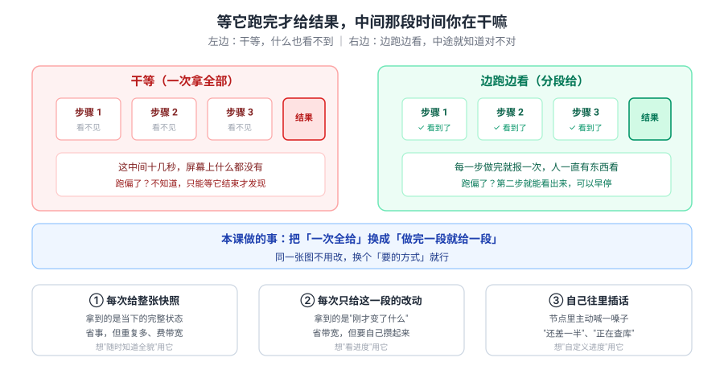
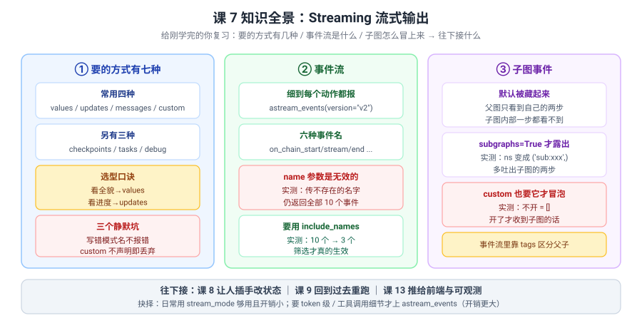

# 课 7：Streaming 流式输出

> 所属阶段：阶段 2《执行模型与状态持久化》｜ 水平：进阶 ｜ 本课知识点：流模式 / 事件流与子图事件
> 故事情节：故事主线「让它记住和说出来」的第四章——记住之后，让它边跑边说
> 📖 结论已按官方文档核对（核对于 2026-10 ｜ 来源：LangGraph Streaming / Event streaming / Custom stream channels 三页 + 本机 langgraph 1.2.11 源码与实测）

## 🎯 本课目标

- 说清 **七种流模式各自的形状和代价**，能按场景选（不是"越多越好"）
- 会用 `astream_events` 订阅细粒度事件，并知道 **`name` 筛选为什么没用、该用什么**
- 理解**子图事件默认不可见**，以及 `subgraphs=True` 打开后到底多吐了什么

---

## 第一幕：起源与场景引入

课 6 结尾留了个伏笔：

> "热路径写入会增加延迟，而流式输出正好能把这段延迟'摊开'给用户看。"

今天就是兑现那句话。

**场景**：助手已经能记住你了，但用户的抱怨换了个方向——

1. **"点下去要等十几秒，中间屏幕全白，我以为它死了。"**——`invoke` 只在最后返回，中间什么都没有。
2. **"我想看它写到哪了，结果只能等最终答案。"**——三个节点串起来的流程，过程完全不可见。
3. **"它在查库还是在想？能不能显示个进度？"**——你需要在节点里主动"喊一嗓子"，而不是等它自然结束。

这三个抱怨还是**同一个问题**：**执行过程对用户是黑盒**——只有"没开始"和"已完成"两个状态。

> 🎬 **场景**：三个抱怨一个病根——中间那段时间是黑的。

> 📌 **一句话本质**：**`stream` 把"一次返回全部"换成"每完成一步就吐一段"；`stream_mode` 决定吐的是什么形状**——图不用改，换个参数就从黑盒变直播。
>
> ⚖️ **处境对照**：不知道这层，你只能用 `invoke` 干等（实测只拿到终态 `{'q':'x','a':'流式输出的回答'}`），跑偏了要等全跑完才发现；知道了，你能用 `stream_mode="updates"` 逐节点看进度、用 `custom` 自定义进度条、用 `stream_mode="debug"` 拿到每个任务的入参和结果——**代价是：选错模式会静默出错**（实测写错模式名不报错、无输出；`custom` 不声明就丢弃数据且不报错；`messages` 在没有大模型调用时一条都不吐），而且本机源码里其实是**七种**模式，不是网上常说的四种。

---

## 第二幕：认知冲突

你以为流式输出就是"把 `invoke` 换成 `stream`"，于是写下：

::: code-group

```python [Python]
for chunk in graph.stream({"topic": "A"}, stream_mode="messages"):
    print(chunk)
```

```typescript [TypeScript]
for await (const chunk of await graph.stream({ topic: "A" }, { streamMode: "messages" })) {
  console.log(chunk);
}
```

:::

结果——**一个 chunk 都没有**，循环体一次没进。

> ❓ **问题**：图明明正常跑完了（`invoke` 有结果），为什么 `stream` 什么都不吐？——**"流式"和"我关心的那种流式"是一回事吗？**

---

## 第三幕：层层揭示

### 一眼全局图（进入细节前先看一眼）



> 看图：左边是**干等**——三步全跑完才给结果，中间屏幕上什么都没有，跑偏了也不知道；右边是**边跑边看**——每步做完就报一次，第二步跑偏你就能看出来。**同一张图，换个"要的方式"就行。**

### 本课地图（分几步走）

| 步 | 这一步要解决什么（人话） | 对应知识点 |
|:--:|------------------------|-----------|
| 1 | 有哪几种"要的方式"，各自吐什么形状、什么代价 | 知识点 1：流模式 |
| 2 | 想细到"每个动作"怎么办，子图里的动静怎么冒上来 | 知识点 2：事件流与子图事件 |

---

### 知识点 1：流模式

> 🧭 第 1/2 步｜承接：第二幕"换了 stream 却什么都不吐" → 本步：先搞清有几种"要的方式"
> 本知识点关键点：values / updates / messages / custom 四主模式 / 另有 checkpoints / tasks / debug / 选型对照 / 多模式同时开

#### 一句话定义

**流模式（`stream_mode`）决定 `stream` 每次吐出的数据形状**：是完整状态、是增量改动、是逐字 token，还是节点里自己写的话——**共七种，图本身一行都不用改。**

#### 直觉建立（类比）

把它想成**装修时跟工长的沟通方式**：

- **"每做完一道工序，把整套房子的现状拍给我"** → `values`（全量，重复多但不用自己拼）
- **"每做完一道工序，只告诉我这次改了什么"** → `updates`（增量，省流量但要自己攒）
- **"师傅一边干活一边把心里话说给我听"** → `messages`（逐字，只有模型"说话"时才有）
- **"我跟工长约好几个暗号，他到某个节点就喊一声"** → `custom`（自定义）

> 💡 **类比的边界**：真实机制里 ① 模式可以**一次开好几个**（传列表，输出变 `(模式, 数据)` 元组）；② "心里话"**只有大模型真的在流式生成时才有**——纯计算节点一句话都不会说；③ 暗号**必须先约定**（声明 `custom`），否则喊了也没人听，而且**不报错**。

#### 核心原理

先看官方文档列出的全部模式（核对于 2026-10，本机源码 `Pregel.stream` 的 docstring 与官方 Streaming 页一致）：

| 模式 | 官方说法（译） | 吐出什么 | 实测形状 |
|---|---|---|---|
| **`values`** | 每步之后发出状态里的全部值 | 完整状态快照 | `{'draft':'', 'review':''}` → `{'draft':'草稿','review':''}` → ... |
| **`updates`** | 只发节点 / 任务名与它们返回的更新 | `{节点名: 更新}` | `{'draft': {'draft': '草稿-A'}}` |
| **`custom`** | 用 `StreamWriter` 从节点内发出的自定义数据 | 你写的任意数据 | `{'progress': 0.5, 'msg': '一半'}` |
| **`messages`** | 逐 token 发出 LLM 消息与元数据 | `(LLM token, 元数据)` 二元组 | 无 LLM 时 **0 条** |
| **`checkpoints`** | 每次创建 checkpoint 时发事件 | 与 `get_state()` 同格式 | 实测 3 次（需挂 checkpointer） |
| **`tasks`** | 任务开始与结束时发事件，含结果与错误 | 任务字典 | `start` / `result` 成对 |
| **`debug`** | 每步发出尽可能详细的调试事件 | task / task_result 交替 | 含 `input` / `result` / `error` |

> ⚠️ **网上常说"四种流模式"，本机源码里是七种**。`checkpoints` / `tasks` / `debug` 日常用不上，但排障时 `debug` 特别好用——它能看到**每个任务的入参和返回值**。

**四个主模式怎么选**：

| 你想干什么 | 用哪个 | 为什么 |
|---|---|---|
| 随时知道"现在全貌是什么" | `values` | 每个 chunk 都是完整状态，不用自己拼 |
| 看进度 / 渲染"做到第几步" | `updates` | 增量，省带宽，且**并行节点会分开吐** |
| 让模型逐字往外蹦 | `messages` | 专为 token 级设计 |
| 自定义进度、中间提示 | `custom` | 节点里 `get_stream_writer()` 主动写 |

**`values` vs `updates` 实测对照**（同一张两节点图）：

```
values（每步全量，含初始状态，共 节点数+1 个）：
  [0] {'topic':'A', 'draft':'',     'review':''}
  [1] {'topic':'A', 'draft':'草稿-A','review':''}
  [2] {'topic':'A', 'draft':'草稿-A','review':'审阅-草稿-A'}

updates（只给改动，一个节点一个）：
  [0] {'draft':  {'draft':  '草稿-A'}}
  [1] {'review': {'review': '审阅-草稿-A'}}
```

> ✅ **`values` 会把输入状态也吐一次**（实测 2 个节点 → 3 个 chunk），这是阶段概览里说"选错直接影响前端渲染与带宽"的具体含义：状态越大、节点越多，`values` 的重复传输越夸张。

**并行节点时差异最明显**（实测两个并行节点 a / b）：

```
values（同一步合并后只吐一次）：
  {'merged': []}
  {'merged': ['A', 'B']}

updates（同一步两个节点分开吐）：
  {'a': {'merged': ['A']}}
  {'b': {'merged': ['B']}}
```

> ✅ 这正是课 4 讲的"并行分支读同一份快照、写各自更新"在流式上的投影——**`updates` 能看清谁写了什么，`values` 只能看到合并后的结果**。

**一次开多个模式**（实测）：

::: code-group

```python [Python]
for mode, chunk in g.stream(inp, stream_mode=["updates", "values"]):
    print(mode, chunk)
```

```typescript [TypeScript]
for await (const [mode, chunk] of await g.stream(inp, { streamMode: ["updates", "values"] })) {
  console.log(mode, chunk);
}
```

:::

```
('values',  {'topic':'A','draft':'','review':''})
('updates', {'draft':  {'draft': '草稿-A'}})
('values',  {'topic':'A','draft':'草稿-A','review':''})
('updates', {'review': {'review':'审阅-草稿-A'}})
('values',  {'topic':'A','draft':'草稿-A','review':'审阅-草稿-A'})
```

> ✅ 输出变成 `(模式, 数据)` 元组，顺序是**交错的**（不是先把一种吐完再吐另一种）。

**`custom` 怎么用**：

::: code-group

```python [Python]
from langgraph.config import get_stream_writer

def node(state):
    w = get_stream_writer()
    w({"progress": 0.1, "msg": "开始"})
    w({"progress": 0.5, "msg": "一半"})
    w({"progress": 1.0, "msg": "完成"})
    return {"out": "done"}
```

```typescript [TypeScript]
import { getWriter } from "@langchain/langgraph";

const node = (state: typeof State.State) => {
  const w = getWriter();
  w({ progress: 0.1, msg: "开始" });
  w({ progress: 0.5, msg: "一半" });
  w({ progress: 1.0, msg: "完成" });
  return { out: "done" };
};
```

:::

必须声明 `stream_mode="custom"` 才能收到。

> 🇹🇸 **TS 侧两个等价的取 writer 方式（实测）**：包内导入 `getWriter()`，或从节点第二个参数 `config.writer` 取——两条路都能把数据发出去。**但注意 Python 用 `get_stream_writer`、TS 用 `getWriter`**，名字不一样，直接照抄 Python 名字会 `ImportError`/`undefined is not a function`。

#### 🐞 三个静默坑（全是实测撞出来的）

**坑 1：写错模式名不报错**

::: code-group

```python [Python]
list(g.stream({"out": ""}, stream_mode="不存在的模式"))   # -> [] 静默无输出
```

```typescript [TypeScript]
const out = [];
for await (const c of await g.stream({ out: "" }, { streamMode: "不存在的模式" as any })) out.push(c);
console.log(out.length);   // -> 0，同样静默无输出
```

:::

**坑 2：`custom` 不声明就丢弃**

::: code-group

```python [Python]
stream_mode="values"  -> [{'out':''}, {'out':'done'}]      # 自定义数据没了
stream_mode="custom"  -> [{'隐藏信息': '你看不到我'}]        # 要这样才收得到
```

```typescript [TypeScript]
// streamMode: "values"  -> [{ out: "" }, { out: "done" }]       自定义数据没了
// streamMode: "custom"  -> [{ 隐藏信息: "你看不到我" }]           要这样才收得到
```

:::

**坑 3：`messages` 在没有大模型调用时一条都不吐**

```
纯节点（无 LLM）stream_mode='messages' 拿到 0 个 chunk
```

> ✅ 这就是第二幕那个"换了 stream 却什么都不吐"的答案——**你的图没有大模型在流式生成，`messages` 自然没东西可吐**。

#### 常见误区

1. **"流式就是把 invoke 换成 stream"**——还要选对 `stream_mode`，否则可能什么都不吐。
2. **"流模式只有四种"**——本机源码是七种（多 `checkpoints` / `tasks` / `debug`）。
3. **"`values` 更省"**——恰恰相反，`values` 每次重发全量，`updates` 才是省带宽的。
4. **"`custom` 写了就能收到"**——不声明 `"custom"` 就静默丢弃。

#### 一句话记住

**看全貌用 `values`、看进度用 `updates`、要 token 用 `messages`、自定义用 `custom`；排障时 `debug` 能看入参和结果——写错模式名不报错，`custom` 不声明就丢。**

#### 🗣️ 行话对照

| 本课说法（人话） | 行业标准叫法 | 典型配置 / 在哪遇到 | 代价 |
|---|---|---|---|
| 每步给整张快照 | **stream_mode="values"** | `graph.stream(inp, stream_mode="values")` | 全量重发，节点数+1 个 chunk，费带宽 |
| 只给这次的改动 | **stream_mode="updates"** | `stream_mode="updates"` | 要自己攒成全量；并行节点分开吐 |
| 模型逐字往外蹦 | **stream_mode="messages"** | `stream_mode="messages"` | 无 LLM 调用 = 0 条 |
| 节点里自己喊话 | **stream_mode="custom"** + `StreamWriter` | `get_stream_writer()` | 不声明即**静默丢弃** |
| 存档时发事件 | **stream_mode="checkpoints"** | 需挂 checkpointer | 格式同 `get_state()` |
| 任务起止发事件 | **stream_mode="tasks"** | `stream_mode="tasks"` | start / result 成对 |
| 最详细的调试流 | **stream_mode="debug"** | `stream_mode="debug"` | 数据量大，别上生产 |
| 一次要多种 | **多模式列表** | `stream_mode=["updates","values"]` | 输出变 `(mode, data)` 元组且交错 |

> 中文均为社区常用译法 / 本文自拟，官方未定名中文，检索用英文。

#### 官方文档

- [Streaming（官方流模式总览）](https://docs.langchain.com/oss/python/langgraph/streaming)
- [Streaming · JavaScript（`streamMode` 驼峰、`for await` 迭代）](https://docs.langchain.com/oss/javascript/langgraph/streaming)
- [Event streaming（事件流）](https://docs.langchain.com/oss/python/langgraph/event-streaming)
- [Event streaming · JavaScript（`streamEvents`）](https://docs.langchain.com/oss/javascript/langgraph/event-streaming)
- [Custom stream channels（前端消费 custom 数据）](https://docs.langchain.com/oss/python/langgraph/frontend/custom-stream-channels)

---

### 知识点 2：事件流与子图事件

> 🧭 第 2/2 步｜承接：四种主模式够用 → 本步：想细到"每个动作"怎么办，子图里的动静怎么上来
> 本知识点关键点：astream_events / 六种事件名 / name 无效要用 include_names / subgraphs=True / custom 冒泡

#### 一句话定义

**`astream_events` 是比流模式更细的订阅口——它把"节点开始 / 流式输出 / 节点结束 / 工具调用 / 模型 token"等每个动作都发一个事件；子图的事件默认不可见，要 `subgraphs=True` 才冒泡上来。**

#### 直觉建立（类比）

如果流模式是**工长每完成一道工序给你打电话**，那事件流就是**你在工地上装了摄像头**——

- 谁进门了（`on_chain_start`）、谁在搬东西（`on_chain_stream`）、谁干完了（`on_chain_end`），全都能看到；
- 摄像头还能装到**分包商的工地里**（子图），但**默认只拍你自己的地盘**。

> 💡 **类比的边界**：真实机制里 ① 摄像头有**开销**——事件数量远多于流模式 chunk（实测 2 节点图：流模式 2 个 chunk，事件流 10 个事件）；② 筛选**不是靠"名字"那个参数**，实测 `name=` 完全无效；③ 子图摄像头的开关是 `subgraphs=True`，且它影响的不只是事件流，**连 `custom` 数据也要靠它才能冒泡**。

#### 核心原理

**基本用法**：

::: code-group

```python [Python]
async for event in graph.astream_events(input, version="v2"):
    print(event["event"], event.get("name"))
```

```typescript [TypeScript]
for await (const event of graph.streamEvents(input, { version: "v2" })) {
  console.log(event.event, event.name);
}
```

:::

> 🇹🇸 **方法名差异（实测）**：Python 是 `astream_events`，TS 是 **`streamEvents`**（同步得到异步迭代器，不用 `await` 方法本身）。误写成 `astreamEvents` 会直接 `TypeError: g.astreamEvents is not a function`。另外 TS 的事件对象字段是 `event.event` / `event.name` / `event.tags` / `event.data`（点号访问），不是 Python 的字典下标。
>
> ⚠️ **两侧事件条数不同**：同一张两节点图，Python 实测 6 个事件，TS 实测 **10 个**（多出 `__start__` 节点的 start/end 与两次 `on_chain_stream`）。**别把事件条数当断言指标**，按事件名筛选才是稳的。

实测（两节点图）共 6 个事件：

```
on_chain_start    name=LangGraph
on_chain_start    name=n
on_chain_stream   name=n
on_chain_end      name=n
on_chain_stream   name=LangGraph
on_chain_end      name=LangGraph
```

> ✅ **注意 `LangGraph` 这个 name**——它是父级链的名字，节点事件都嵌在它里面。

**常见的事件名**（按对象分）：

| 对象 | 开始 | 流式 | 结束 |
|---|---|---|---|
| 链 / 节点 | `on_chain_start` | `on_chain_stream` | `on_chain_end` |
| 大模型 | `on_chat_model_start` | `on_chat_model_stream` | `on_chat_model_end` |
| 工具 | `on_tool_start` | `on_tool_stream` | `on_tool_end` |
| 检索器 | `on_retriever_start` | — | `on_retriever_end` |

**⚠️ 筛选要用 `include_names`，不是 `name`**（实测，这是本课最反直觉的一条）：

```
{}                                   -> 10 个事件, names=['LangGraph','alpha','beta']
{'name': 'alpha'}                    -> 10 个事件, names=['LangGraph','alpha','beta']   ← 没生效！
{'name': '不存在的名字'}                -> 10 个事件, names=['LangGraph','alpha','beta']   ← 也不报错！
{'include_names': ['alpha']}         -> 3  个事件, names=['alpha']                      ← 这个才有效
{'include_types': ['chain']}         -> 10 个事件                                        ← 也无效
```

> ✅ **`name=` 传什么都没用，连传一个不存在的名字都照样返回全部 10 个事件，且不报错。** 要筛选必须用 `include_names`（列表）。同理 `include_types` 实测也无效——**最稳的做法是自己按 `event["event"]` 和 `event.get("name")` 在循环里过滤**。

**子图事件怎么冒泡**：

子图默认**完全不可见**——父图只看得到自己节点的起止（实测：父图 `values` 只吐 2 个 chunk）。

::: code-group

```python [Python]
# 默认：子图内部一步都看不到
for c in pg.stream({"text": "起"}, stream_mode="values"):
    print(c)                     # {'text':'起'}  ->  {'text':'起+子图'}

# subgraphs=True：多吐出子图内部的步骤
for ns, c in pg.stream({"text": "起"}, stream_mode="values", subgraphs=True):
    print(ns, c)
```

```typescript [TypeScript]
// 默认：子图内部一步都看不到
for await (const c of await pg.stream({ text: "起" }, { streamMode: "values" })) {
  console.log(c);                // { text: '起' }  ->  { text: '起+子图' }
}

// subgraphs: true：多吐出子图内部的步骤，输出变成 [命名空间, 数据]
for await (const [ns, c] of await pg.stream({ text: "起" }, { streamMode: "values", subgraphs: true })) {
  console.log(ns, c);
}
```

:::

```
ns=()                                              {'text': '起'}
ns=('pn:819f7b11-...',)                            {'text': '起'}
ns=('pn:819f7b11-...',)                            {'text': '起+子图'}
ns=()                                              {'text': '起+子图'}
```

> ✅ 开了 `subgraphs=True` 后，输出变成 `(命名空间, 数据)` 元组，`ns` 里那个 `节点名:uuid` 就是子图的路径。**父图的两步还在，中间多了子图自己的两步。**

**⚠️ 三种组合的输出元组长度不一样**（实测，这是本课最容易写错解包的地方）：

| 怎么调 | 吐出什么 | 示例 |
|---|---|---|
| 只开多模式 | `(模式, 数据)` | `('updates', {'n1': {...}})` |
| 只开 `subgraphs` | `(命名空间, 数据)` | `(('n2:uuid',), {'sn': {...}})` |
| **两个都开** | **`(命名空间, 模式, 数据)`** | `((), 'custom', {'p': 1})` |

::: code-group

```python [Python]
# 两个都开 → 三元组
for ns, mode, data in graph.stream(inp, stream_mode=["updates", "custom"], subgraphs=True):
    ...
```

```typescript [TypeScript]
// 两个都开 → 也是三元组（数组形式）
for await (const [ns, mode, data] of await graph.stream(inp, {
  streamMode: ["updates", "custom"],
  subgraphs: true,
})) {
  // ...
}
```

:::

> ⚠️ 写成 `for mode, data in ...` 会直接 **`ValueError: too many values to unpack (expected 2)`**；TS 侧对应报错是解构拿到 `undefined` 而不是抛错，**更难发现**——所以宁可多打一行 `console.log` 对着长度确认。
>
> 🇹🇸 **TS 侧元组的真实形状（实测）**：`subgraphs: true` 时是**数组** `[命名空间数组, 数据]`，命名空间是 `string[]` 不是元组，主图为空数组 `[]`（不是 Python 的 `()`）。两个都开时是 `[["call_sub:uuid"], "updates", { inner: {...} }]`。

**⚠️ `custom` 数据也要靠 `subgraphs=True` 才能冒泡**（Python 侧实测，这条最容易踩）：

```
父图 stream(custom)                -> []                                    ← 收不到！
父图 stream(custom, subgraphs=True) -> [(('sub:e7f15ac1-...',), {'来自':'子图内部','进度':50})]
```

> ✅ 子图节点里 `get_stream_writer()` 写的数据，**父图默认收不到**，必须开 `subgraphs=True`。

> 🇹🇸 **TS 侧这里和 Python 不一样（实测，容易误判）**：TS 不开 `subgraphs` 也能收到子图的 `custom` 数据——`streamMode: "custom"` 直接拿到 `{ 来自: '子图内部', 进度: 50 }`（1 条）；开了 `subgraphs: true` 则变成 `[["sub:uuid"], { 来自: '子图内部', 进度: 50 }]`，**多的是"它从哪个子图来的"这条路径信息，不是数据本身**。所以：Python 侧 `subgraphs=True` 是"能不能收到"的开关，TS 侧它是"要不要知道来源"的开关。跨语言照抄代码时这条最容易出现"TS 能跑、Python 收不到"的错觉。

**事件流里怎么区分父子**：靠 `tags`。实测：

```
on_chain_start  name='LangGraph'  tags=[]
on_chain_start  name='pn'         tags=['graph:step:1']
on_chain_start  name='LangGraph'  tags=['seq:step:1']      ← 子图那层
on_chain_start  name='sn'         tags=['graph:step:1']    ← 子图内部节点
```

> ✅ 子图里的节点带 `seq:step:*` 标签，父图节点带 `graph:step:*`——**这就是在事件流里分辨"这个事件来自哪一层"的依据。**

#### 示例演示：什么时候该用哪个

::: code-group

```python [Python]
# 场景 A：只想看"做到第几步" → 流模式够了，开销小
for chunk in graph.stream(inp, stream_mode="updates"):
    print(list(chunk.keys())[0], "完成")

# 场景 B：要 token 级输出 / 工具调用细节 → 上事件流
async for ev in graph.astream_events(inp, version="v2"):
    if ev["event"] == "on_chat_model_stream":
        print(ev["data"]["chunk"].content, end="", flush=True)

# 场景 C：图里有子图，想看子图内部 → 必须 subgraphs=True
for ns, chunk in graph.stream(inp, stream_mode="updates", subgraphs=True):
    print(f"[{'/'.join(n.split(':')[0] for n in ns) or '主图'}]", chunk)
```

```typescript [TypeScript]
// 场景 A：只想看"做到第几步" → 流模式够了，开销小
for await (const chunk of await graph.stream(inp, { streamMode: "updates" })) {
  console.log(Object.keys(chunk)[0], "完成");
}

// 场景 B：要 token 级输出 / 工具调用细节 → 上事件流
for await (const ev of graph.streamEvents(inp, { version: "v2" })) {
  if (ev.event === "on_chat_model_stream") {
    process.stdout.write(ev.data.chunk.content as string);
  }
}

// 场景 C：图里有子图，想看子图内部 → 必须 subgraphs: true
for await (const [ns, chunk] of await graph.stream(inp, { streamMode: "updates", subgraphs: true })) {
  const path = ns.map((n) => n.split(":")[0]).join("/") || "主图";
  console.log(`[${path}]`, chunk);
}
```

:::

> 🇹🇸 **筛选参数的位置（实测，TS 侧最容易放错）**：`includeNames` / `includeTypes` 属于 **`streamEvents` 的第三个参数**（`streamOptions`），不是第二个 options 对象里的字段。放进第二个参数**不报错、也不生效**——实测 10 个事件一个不少；放第三个参数才对：`includeNames: ["draft_node"]` → 2 个事件（该节点的 start + end），`includeNames: ["不存在"]` → 0 个。
>
> ⚠️ **但 `includeTypes` 的语义两侧也要当心**：实测 TS 传 `includeTypes: ["chain"]` 仍是 10 个（链/节点都算 chain），传 `["llm"]` 才是 0 个——**它不是"只留某个节点"，而是按 LangChain 的回调对象类型筛**。Python 侧实测 `include_types: ["chain"]` 同样无效（也是 10 个）。**所以最稳的仍是自己在循环里按 `event` 和 `name` 过滤。**

#### ⚠️ 深度：`version` 参数会改变 `stream` 的输出结构

不只是 `astream_events`，**`stream` 也接受 `version`**（实测）：

```
version='v2'（默认）: [{'type':'values','ns':(),'data':{'merged':[]},'interrupts':()}, ...]
version='v1'        : [{'merged': []}, {'merged': ['A']}]
```

> ✅ **`v1` 吐裸数据，`v2` 吐带 `type` / `ns` / `data` / `interrupts` 的结构化字典。** 老教程常见 `for state in graph.stream(...)` 直接当字典用，那是 `v1` 的写法——**`v2` 下要取 `chunk["data"]`**。

> 🇹🇸 **TS 侧这条不成立（实测）**：TS 的 `stream()` 只吐裸数据，`version` 选项对它**没有任何影响**——传 `"v1"`、传 `"v2"`、完全不传，三次输出逐字节相同（都是 `{"v":1}`）。`version` 在 TS 侧只对 `streamEvents` 有意义（`"v1" | "v2"`，1.5.1 类型声明实测）。**所以"v2 要取 chunk.data"这句话只适用于 Python 侧的 `stream`。**

#### 常见误区

1. **"事件流比流模式好，都用它"**——事件流事件数远多于 chunk（实测 2 节点：2 vs 10），开销更大。日常用流模式够了。
2. **"`astream_events(name="xxx")` 能筛选"**——**实测完全无效**，要用 `include_names`（也已实测有效）。
3. **"子图事件会自动冒泡"**——不会，要 `subgraphs=True`；`custom` 数据同理。
4. **"`v1` 和 `v2` 只是版本号区别"**——输出**结构**不同，`v2` 多了 `type` / `ns` 等包装层。

#### 一句话记住

**事件流细到每个动作、但事件更多开销更大；筛选要用 `include_names`（`name=` 无效且不报错）；子图的一切动静——包括 `custom` 数据——都要 `subgraphs=True` 才冒得上来。**

#### 🗣️ 行话对照

| 本课说法（人话） | 行业标准叫法 | 典型配置 / 在哪遇到 | 代价 |
|---|---|---|---|
| 装摄像头看每个动作 | **astream_events** | `graph.astream_events(inp, version="v2")` | 事件数远多于 chunk（2 vs 10），开销大 |
| 事件种类 | **on_chain_* / on_chat_model_* / on_tool_*** | `event["event"]` | 要自己按类型过滤 |
| 按名字筛选 | **include_names** | `astream_events(..., include_names=["alpha"])` | `name=` **无效且不报错** |
| 让子图露出来 | **subgraphs=True** | `graph.stream(..., subgraphs=True)` | 输出变 `(ns, data)` 元组 |
| 子图路径 | **namespace（事件流）** | `ns=('pn:uuid',)` | 每层带 `节点名:uuid` |
| 输出结构版本 | **version="v1" / "v2"** | `stream(..., version="v2")` | v1 裸数据；v2 带 `type`/`ns`/`data` |

> 中文均为社区常用译法，官方未定名中文。

#### 官方文档

- [Event streaming（事件流与子图）](https://docs.langchain.com/oss/python/langgraph/event-streaming)
- [Event streaming · JavaScript（`streamEvents` + `includeNames` 第三参数）](https://docs.langchain.com/oss/javascript/langgraph/event-streaming)
- [Streaming（流模式与 version）](https://docs.langchain.com/oss/python/langgraph/streaming)
- [Streaming · JavaScript](https://docs.langchain.com/oss/javascript/langgraph/streaming)

---

## 第四幕：实操验证

### 4.1 机制验证

> ✅ 实测于 langgraph 1.2.11 / Python 3.12（在 `../langchain/playground` 以 `uv run` 隔离执行）

**验证一：四种主模式的输出形状**

```
values : [0] {'topic':'A','draft':'','review':''}
         [1] {'topic':'A','draft':'草稿-A','review':''}
         [2] {'topic':'A','draft':'草稿-A','review':'审阅-草稿-A'}
updates: [0] {'draft': {'draft':'草稿-A'}}
         [1] {'review':{'review':'审阅-草稿-A'}}
debug  : [0] type=task        payload_keys=['id','name','input','triggers']
         [1] type=task_result payload_keys=['id','name','error','result','interrupts']
```

**验证二：`values` 全量 vs `updates` 增量**（见知识点 1 对照，此处略）

**验证三：多模式同时开 → 输出 `(mode, data)` 元组且交错**（见知识点 1）

**验证四：`custom` 模式**

```
stream_mode='custom': {'progress': 0.1, 'msg': '开始'}
                      {'progress': 0.5, 'msg': '一半'}
                      {'progress': 1.0, 'msg': '完成'}
```

**验证五：`messages` 无 LLM 时一条不吐**

```
纯节点（无 LLM）stream_mode='messages' 拿到 0 个 chunk
```

> ✅ **回扣第二幕**：这就是"换了 stream 却什么都不吐"的答案。

**验证六：另两种模式**

```
checkpoints: 3 次（需挂 checkpointer）
tasks      : [0] name=n type=start  [1] name=n type=result
```

**验证七：事件流**

```
共 6 个事件：on_chain_start(LangGraph) → on_chain_start(n) → on_chain_stream(n)
            → on_chain_end(n) → on_chain_stream(LangGraph) → on_chain_end(LangGraph)
```

**验证八：子图事件默认不可见**

```
默认         : {'text':'起'}  ->  {'text':'起+子图'}
subgraphs=True: ns=() {'text':'起'}
                ns=('pn:819f7b11-...',) {'text':'起'}
                ns=('pn:819f7b11-...',) {'text':'起+子图'}
                ns=() {'text':'起+子图'}
```

**验证九：并行节点在两种模式下的差异**

```
values : {'merged': []}          ->  {'merged': ['A','B']}
updates: {'a': {'merged':['A']}}  ->  {'b': {'merged':['B']}}
```

**验证十：`name` 筛选无效（本课最反直觉）**

```
{}                           -> 10 个事件
{'name':'alpha'}             -> 10 个事件   ← 没生效
{'name':'不存在的名字'}         -> 10 个事件   ← 也不报错
{'include_names':['alpha']}  -> 3  个事件   ← 这个才有效
{'include_types':['chain']}  -> 10 个事件   ← 无效
```

**验证十一：`custom` 跨子图冒泡**

```
父图 stream(custom)                 -> []                       ← 收不到
父图 stream(custom, subgraphs=True) -> [(('sub:e7f15ac1-...',), {'来自':'子图内部','进度':50})]
```

**验证十二：`invoke` 只有终态**

```
invoke 返回值: {'q':'x','a':'流式输出的回答'}
```

**验证十三：`custom` 不声明即丢弃**

```
stream_mode='values' -> [{'out':''},{'out':'done'}]        # 自定义数据没了
stream_mode='custom' -> [{'隐藏信息':'你看不到我'}]
```

**验证十四：`version` 改变输出结构**

```
version='v2': [{'type':'values','ns':(),'data':{'merged':[]},'interrupts':()}, ...]
version='v1': [{'merged':[]}, {'merged':['A']}]
```

**验证十五：`debug` 能看到入参和结果**（排障价值）

```
task       : name=d triggers=('branch:to:d',) input={'n':0,'log':[]}
task_result: name=d result={'n':1} error=None
```

**验证十六：写错模式名静默无输出**

::: code-group

```python [Python]
list(g.stream({"out": ""}, stream_mode="不存在的模式"))   # -> []
```

```typescript [TypeScript]
// 实测：0 条输出，不抛错
const out: unknown[] = [];
for await (const c of await g.stream({ out: "" }, { streamMode: "不存在的模式" as any })) out.push(c);
```

:::

**验证十七：`values` 会把输入状态也吐一次**

```
共 3 个 chunk（2 个节点 + 1 个初始）
```

#### 🇹🇸 TS 侧实测（`playground-ts/07-streaming.ts`，`@langchain/langgraph` 1.5.1）

跑 `npm run l07` 的关键输出：

```
values : [0] {"draft":"草稿-A","review":""}          # 输入非空时会多这一条初态
         [1] {"draft":"草稿-A","review":"审阅-草稿-A"}
updates: {"draft_node":{"draft":"草稿-A"}}
         {"review_node":{"review":"审阅-草稿-A"}}
多模式 : updates:{...} / values:{...} / updates:{...} / values:{...}   交错输出 [mode, data]
custom : values 下只剩 {"draft":"done","review":""}（自定义数据被丢）
         custom 下 {"progress":0.1,...} / 0.5 / 1.0
messages: 无大模型 → 0 条
checkpoints: 4 次           # Python 侧实测 3 次，TS 多一次终态存档
tasks  : draft_node start/result → review_node start/result
debug  : checkpoint ×4 与 task/task_result 交替
写错模式名: 0 条，不报错
事件流 : 10 个事件（Python 侧 6 个）
includeNames 放第三参数 → 2 个；放第二参数 → 10 个（不生效也不报错）
子图默认 : {"text":"起"} / {"text":"起+子图"}
subgraphs: [] {...} / ["call_sub:uuid",] {...} / ["call_sub:uuid",] {...} / [] {...}
custom 跨子图: 默认就能收到 {"来自":"子图内部","进度":50}；开 subgraphs 变成 [["sub:uuid"], {...}]
stream 的 version: v1 与 v2 输出逐字节相同
```

> ✅ **两侧一致的五条**：`values` 全量（输入非空时多一条初态）、`updates` 只给改动、多模式输出交错、`custom` 不声明即丢、`messages` 无 LLM 时 0 条、写错模式名静默无输出。
>
> ⚠️ **两侧不同的五条（都已写进上文对应小节）**：① 事件流方法名 `astream_events` / `streamEvents`，事件数 6 vs 10；② 事件对象取字段：Python 字典下标 `event["event"]`，TS 属性 `event.event`；③ `subgraphs` 的元组形态：Python `(ns, data)` 与空命名空间 `()`，TS `[ns, data]` 与空数组 `[]`；④ `custom` 跨子图：Python 需 `subgraphs=True` 才收得到，TS 默认就收得到（`subgraphs` 只补来源路径）；⑤ `version` 只影响 Python 的 `stream`，TS 的 `stream` 不吃这个参数（只对 `streamEvents` 有意义）。

### 4.2 应用实战

🎯 [练一练：应用实战 07「把黑盒客服改成边跑边说」](../../../应用实战/07-Streaming 流式输出.md)

> 基础 → 问题 → 综合三跳：先让过程可见，再撞上 `custom` 丢弃与子图不可见，最后多模式分工 + 前端消费收口。

---

## 第五幕：体系收束

今天把执行过程从黑盒变直播。三句话带走：

1. **流模式有七种不是四种**，常用 `values`（全貌）/ `updates`（进度）/ `messages`（token）/ `custom`（自定义）；`debug` 排障好用。
2. **选错模式会静默出错**——写错名字不报错、`custom` 不声明就丢、`messages` 无 LLM 时零输出。
3. **事件流更细但更贵**，筛选要用 `include_names`（`name=` 无效）；子图的一切动静都要 `subgraphs=True`。

> 📍 **全局定位**：阶段 2 到此收官——课 4/5/6 讲"怎么跑、怎么记"，课 7 讲"怎么让人看见"。
> 🔗 **下一步**：阶段 3 课 8《Interrupts 人在环中》——`interrupt` 的中断机制与审批流，从"看见"进化到"插手"。

顺带埋两个伏笔：**课 8 的 `interrupt` 事件也会出现在流里**（`interrupts` 字段，`v2` 结构里已经有了），到时候你会看到"暂停"和"流式"是同一套机制的两面；**课 13 部署**时，这些流会经由 SSE 推给前端——本课验证的模式选择，直接决定那时候前端好不好写。

---

## 🐞 常见误区

1. **"流式就是把 invoke 换成 stream"**——还要选对 `stream_mode`。
2. **"流模式只有四种"**——本机源码是七种。
3. **"`values` 更省带宽"**——相反，它每次重发全量。
4. **"`custom` 写了就能收到"**——不声明 `"custom"` 静默丢弃。
5. **"`astream_events(name=...)` 能筛选"**——**实测无效且不报错**，用 `include_names`。
6. **"子图事件会自动冒泡"**——要 `subgraphs=True`，`custom` 数据同样。

### ⏳ 与过时说法对照（写前核对有差异时才有，≤3 行）

| 旧说法（网上过时教程 / 训练知识里的说法） | 官方文档 / 本机现状 | 来源 |
|---|---|---|
| "LangGraph 有四种流模式" | 本机 `Pregel.stream` docstring 列出 **7 种**（多 `checkpoints` / `tasks` / `debug`）；官方 Streaming 页同步 | 本机 `langgraph/pregel/__init__.py` + [Streaming](https://docs.langchain.com/oss/python/langgraph/streaming) |
| `astream_events(name="node")` 可按节点筛选 | 实测**完全无效**（传不存在的名字仍返回全部 10 个事件）；**`include_names` 才有效**（10 → 3） | 实测 + [Event streaming](https://docs.langchain.com/oss/python/langgraph/event-streaming) |
| `for state in graph.stream(...)` 直接当字典用 | 那是 `version="v1"` 的写法；**默认 `v2` 吐的是带 `type`/`ns`/`data` 的包装字典** | 实测 `version='v1'` vs `'v2'` 输出对照 |
| TS 侧照抄 `astreamEvents` / `stream_mode` / `subgraphs=True` | TS 是 **`streamEvents`** + `streamMode` / `subgraphs`（驼峰属性和布尔值）；写错方法名直接 `TypeError: g.astreamEvents is not a function`（实测） | 本机 `@langchain/langgraph` 1.5.1 `pregel/index.d.ts` |

## 一图总结



> 看图：左边是七种"要的方式"与选型口诀，中间是事件流（`name` 无效的坑 + 正确做法），右边是子图（`subgraphs=True` 才露出）。**与课首那张图的区别**：课首那张给没学过的人看"为什么要边跑边说"，这张给刚学完的你复习"有哪几种说法、怎么选"。

## 课后小测

**Q1**：你的图有三个节点串起来，你想在前端显示"正在处理第 2 步"。选哪个模式最合适？
- A. `values`
- B. `updates`
- C. `messages`
- D. `debug`

<details><summary>答案与解析</summary>

**答案：B**。`updates` 每完成一个节点吐一次 `{节点名: 更新}`，天然对应"第几步完成"。A 会重发全量状态（3 节点 = 4 个 chunk，含初始），带宽浪费；C 只在有大模型流式生成时才有内容（实测纯节点 0 条）；D 信息过多，是排障用的。

</details>

**Q2**：你在节点里用 `get_stream_writer()` 写了进度，但用 `stream_mode="values"` 收不到。为什么？
- A. 写数据的代码有 bug
- B. 必须显式声明 `stream_mode="custom"`，否则数据被静默丢弃
- C. `values` 模式下 writer 不可用
- D. 进度数据太大被截断了

<details><summary>答案与解析</summary>

**答案：B**。实测：不声明 `custom` 时拿到的是 `[{'out':''},{'out':'done'}]`，自定义数据**静默消失且不报错**——这是本课三个静默坑之一。C 错（writer 依然可调用，只是数据没人收）。

</details>

**Q3**：关于事件流筛选，下列说法正确的是？
- A. `astream_events(name="alpha")` 可以只拿到 alpha 节点的事件
- B. 传错名字会抛 `ValueError`
- C. `include_names=["alpha"]` 才真正生效（实测 10 → 3 个事件）
- D. `include_types=["chain"]` 能按类型过滤

<details><summary>答案与解析</summary>

**答案：C**。实测：`name="alpha"` 返回 10 个事件（与不筛选一样），`name="不存在的名字"` **也返回 10 个且不报错**；`include_names=["alpha"]` 才降到 3 个。D 错——`include_types` 实测同样无效。**最稳的做法是自己按 `event["event"]` 在循环里过滤。**

</details>

---

## 🚀 下一批接力提示词

> 学完本批后，**复制下面这段文字发给 AI**，即可无缝进入下一批：

```
继续学 LangGraph。我的学习档案在 langchain/langgraph/00-学习档案.md，
刚学完阶段 2《执行模型与状态持久化》的课 7《Streaming 流式输出》
知识点「流模式 / 事件流与子图事件」，
请按大纲继续讲解课 8《Interrupts 人在环中》的知识点。
```

## 🧭 课程导航

- 上一课：[课 6 Store 长期记忆](06-Store 长期记忆.md)
- 返回 [课程目录](../../../02-课程目录.md)
- 下一课：课 8 Interrupts 人在环中（阶段 3）
- 🎯 练一练：应用实战 07（见 4.2）
