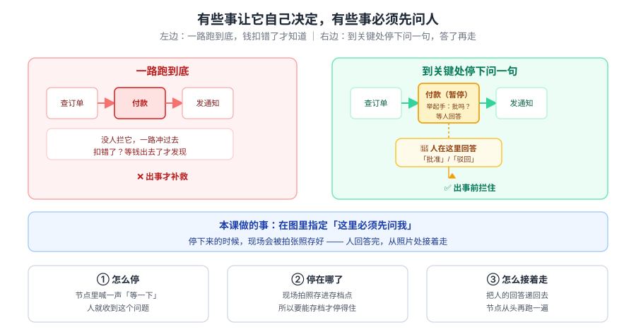
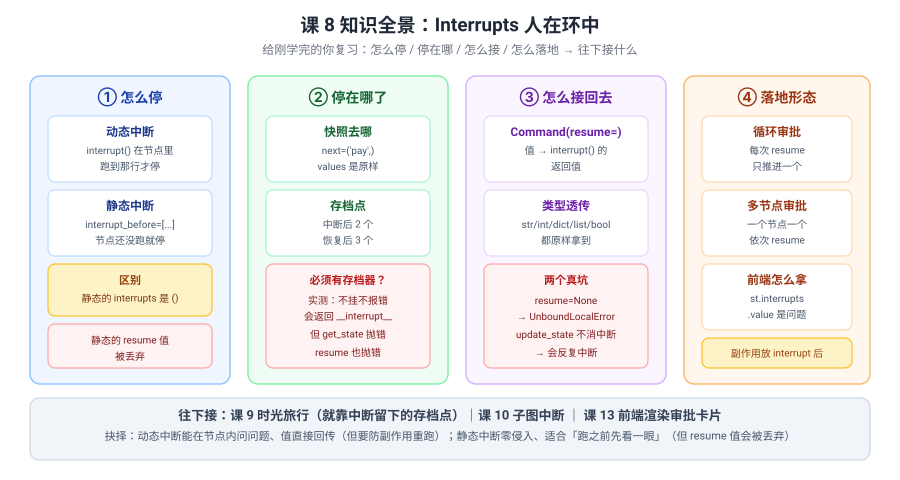

# 课 8：Interrupts 人在环中

> 所属阶段：阶段 3《可控性与人在环中》｜ 水平：进阶 ｜ 本课知识点：interrupt 的中断机制 / 审批流落地
> 故事情节：故事主线「敢让它上生产」的第一章——先学会在关键处按下暂停键
> 📖 结论已按官方文档核对（核对于 2026-10 ｜ 来源：LangGraph Interrupts 官方文档 + 本机 langgraph 1.2.11 源码与实测）

## 🎯 本课目标

- 说清 **`interrupt()` 到底怎么把执行停下来**，以及**停下来那一刻存了什么**
- 会用 `Command(resume=...)` 把人的回答接回状态，能落地**循环审批**和**多节点审批**
- 知道**动态中断与静态中断的区别**，以及"必须有 checkpointer"这句话的准确含义

---

## 第一幕：起源与场景引入

课 7 结尾留了个伏笔：

> "课 8 的 `interrupt` 事件也会出现在流里（`interrupts` 字段，`v2` 结构里已经有了），到时候你会看到'暂停'和'流式'是同一套机制的两面。"

今天就是兑现那句话。

**场景**：助手已经能记住你、能边跑边说了。但一上生产，新的恐惧来了：

1. **"它自作主张给客户退款了，金额还错了。"**——高风险动作没有人在中间把关。
2. **"我想在它付款前看一眼，可它一路跑到底。"**——流程里根本没有"让人看一眼"这个位置。
3. **"审批要过三道人，怎么写？"**——一个审批点你会了，多个审批点、一个节点里多个审批点，怎么编排？

这三个恐惧还是**同一个问题**：**执行过程没有"停下来等人"的能力**——图只能一路跑到 END。

> 🎬 **场景**：三个恐惧一个病根——图缺一个暂停键。

> 📌 **一句话本质**：**`interrupt()` 在节点内抛出一个特殊异常让图暂停，并把"卡在哪 + 当时的状态"存进 checkpoint；人回答后 `Command(resume=...)` 带着值回来，节点从头重跑、这次 `interrupt()` 返回那个值**——不是"半途续跑"，是"带着答案重跑"。
>
> ⚖️ **处境对照**：不知道这层，你的图只能一路跑到底（高风险动作无人把关），或者自己写一堆 `if pending: return` 的伪暂停逻辑；知道了，你能在任意节点内问人问题、把回答直接拿回代码里用——**代价是三条硬约束**：① **节点整体重跑**，`interrupt()` 之前的代码每次恢复都会再执行一遍（实测节点执行了 2 次，扣款/发短信这类副作用必须放 `interrupt()` 之后）；② **必须有 checkpointer 才能恢复**（Python 不挂时 `get_state` 抛 `ValueError: No checkpointer set`、`resume` 抛 `RuntimeError`；**TS 不挂时 `interrupt()` 当场抛 `No checkpointer set`**）；③ **`resume` 不能用空值**（Python 传 `None` 会撞 `UnboundLocalError` 的框架 bug；**TS 的 `""` / `0` / `false` / `null` 全报 `Received empty Command input`**）。

---

## 第二幕：认知冲突

你给付款节点加了审批，恢复之后信心满满地检查：

::: code-group

```python [Python]
def pay(state):
    charge(state["amount"])          # 扣款
    ans = interrupt("批准吗？")
    return {"approved": ans}

# 第一次：中断
graph.invoke({"amount": 100}, config=cfg)
# 人批准后：恢复
graph.invoke(Command(resume="批准"), config=cfg)
```

```typescript [TypeScript]
const pay = async (state: typeof State.State) => {
  await charge(state.amount); // 扣款
  const ans = interrupt("批准吗？");
  return { approved: ans as string };
};

// 第一次：中断
await graph.invoke({ amount: 100 }, cfg);
// 人批准后：恢复
await graph.invoke(new Command({ resume: "批准" }), cfg);
```

:::

然后你发现——**钱被扣了两次**。

> ❓ **问题**：人只批准了一次，为什么扣款执行了两次？——**"恢复"到底是接着跑，还是重新跑？**

---

## 第三幕：层层揭示

### 一眼全局图（进入细节前先看一眼）



> 看图：左边**一路跑到底**——付款节点没人拦，钱扣错了才知道；右边**到关键处停下问一句**——付款节点举起手等人回答，答了再往下走。**差别不是流程变了，是付款那一步多了一个"暂停 + 等人"的能力。**

### 本课地图（分几步走）

| 步 | 这一步要解决什么（人话） | 对应知识点 |
|:--:|------------------------|-----------|
| 1 | 怎么停下来、停下来那一刻存了什么 | 知识点 1：interrupt 的中断机制 |
| 2 | 人的回答怎么接回去、多个审批点怎么编排 | 知识点 2：审批流落地 |

---

### 知识点 1：interrupt 的中断机制

> 🧭 第 1/2 步｜承接：第二幕"钱被扣了两次" → 本步：先搞清"停下来"到底发生了什么
> 本知识点关键点：interrupt() 如何暂停 / 状态快照去哪了 / **为什么必须有 checkpointer**（准确含义）/ 静态 vs 动态

#### 一句话定义

**`interrupt(value)` 在节点内抛出一个特殊异常（`GraphInterrupt`），图接住它、把"下一个要跑的节点 + 当时的状态"存进 checkpoint，然后暂停返回；`value` 会成为前端看到的问题内容。**

#### 直觉建立（类比）

把它想成**银行柜员办业务**：

- 柜员办到一半发现需要主管授权，于是**在便签上写下"卡在哪一步、桌上有哪些材料"**，把便签夹进档案（存快照），然后**停下等你**；
- 你把授权码给他，他**不是从"问你"那句接着说**，而是**从这一步开头重新办一遍**——但这次看到便签上已经有授权码，就直接通过了。

> 💡 **类比的边界**：真实机制里 ① 柜员重跑时会**把"问你"之前所有动作都重做一遍**（这就是钱被扣两次的原因）；② 便签夹进档案**必须有档案柜**（checkpointer）——Python 侧"停下"这个动作本身没有档案柜也能做，只是停完就再也回不来了，**而 TS 侧没有档案柜连停都停不了（当场抛 `No checkpointer set`）**；③ 授权码的**类型不受限**（实测 str/int/dict/list/bool 都原样拿到），但**不能是空值**：Python 传 `None` 撞框架 bug，TS 传 `""` / `0` / `false` / `null` 都被判为空输入。

#### 核心原理

**最小可运行例子**：

::: code-group

```python [Python]
from langgraph.checkpoint.memory import InMemorySaver
from langgraph.graph import END, START, StateGraph
from langgraph.types import Command, interrupt
from typing_extensions import TypedDict


class State(TypedDict):
    amount: int
    approved: str


def pay(state: State):
    answer = interrupt({"问": f"要付 {state['amount']} 元，批准吗？"})   # ← 停在这里
    return {"approved": str(answer)}                                     # ← 这行还没跑


builder = StateGraph(State)
builder.add_node("pay", pay)
builder.add_edge(START, "pay")
builder.add_edge("pay", END)
graph = builder.compile(checkpointer=InMemorySaver())     # ← 必须有

cfg = {"configurable": {"thread_id": "t1"}}
result = graph.invoke({"amount": 100, "approved": ""}, config=cfg)
```

```typescript [TypeScript]
import {
  Annotation,
  Command,
  END,
  MemorySaver,
  START,
  StateGraph,
  interrupt,
} from "@langchain/langgraph";

const State = Annotation.Root({
  amount: Annotation<number>({ reducer: (_p, n) => n, default: () => 0 }),
  approved: Annotation<string>({ reducer: (_p, n) => n, default: () => "" }),
});

const pay = (state: typeof State.State) => {
  const answer = interrupt({ 问: `要付 ${state.amount} 元，批准吗？` }); // ← 停在这里
  return { approved: String(answer) };                                  // ← 这行还没跑
};

const graph = new StateGraph(State)
  .addNode("pay", pay)
  .addEdge(START, "pay")
  .addEdge("pay", END)
  .compile({ checkpointer: new MemorySaver() }); // ← 必须有

const cfg = { configurable: { thread_id: "t1" } };
const result = await graph.invoke({ amount: 100, approved: "" }, cfg);
```

:::

实测返回：

```
{'amount': 100, 'approved': '',
 '__interrupt__': [Interrupt(value={'问': '要付 100 元，批准吗？'},
                             id='0e14aa7357cbd56bd29443f262c815fc')]}
```

**停下来那一刻，快照长这样**（实测 `get_state`）：

```
next   = ('pay',)                     # 卡在哪个节点
values = {'amount': 100, 'approved': ''}   # 状态还是原样
tasks  = [('pay', (Interrupt(value={'问': '要付 100 元，批准吗？'}, id='0e14...'),))]
```

> ⚠️ **关键**：`values` 里 `approved` 还是空的——**因为节点的 `return` 根本没执行到**。中断不是"跑了一半存起来"，是**"整个节点作废，下次重跑"**。

**存档点历史**（实测 `get_state_history`，新 → 旧）：

```
next=()             values={'approved': 'ok', 'tries': 1}
next=('pay',)       values={'approved': '',    'tries': 0}     ← 中断点
next=('__start__',) values={}
```

> ✅ 中断后 2 个 checkpoint，恢复后 3 个。**这个历史就是课 9 时光旅行的原料。**

#### 🔴 "必须有 checkpointer" 的准确含义（实测纠正常见说法）

网上常说"没有 checkpointer，`interrupt()` 会报错"。**两边实测都不是这样，但结果不同**：

::: code-group

```python [Python]
g_nocp = builder.compile()          # 故意不挂
r = g_nocp.invoke({"amount": 100, "approved": ""})
print(r)
```

```typescript [TypeScript]
const gNoCp = builder.compile(); // 故意不挂
const r = await gNoCp.invoke({ amount: 100, approved: "" });
console.log(r);
```

:::

Python 侧**不报错**，正常返回：

```
{'amount': 100, 'approved': '',
 '__interrupt__': [Interrupt(value={'问': '要付 100 元，批准吗？'}, id='3b11f2f8...')]}
```

但接下来全崩：

```
get_state()            -> ValueError: No checkpointer set
Command(resume="OK")   -> RuntimeError: Cannot use Command(resume=...) without checkpointer
```

> 🇹🇸 **TS 侧不一样（实测）**：`interrupt()` 在 TS 里**当场抛错**，连"停住"都做不到——
> `Error: No checkpointer set`（`lc_error_code: MISSING_CHECKPOINTER`，源码 `dist/graph/interrupt.ts`）。也就是说 Python 的"能停不能恢复"在 TS 里退化成"根本不能停"。

> ✅ **准确说法**：Python 侧 `interrupt()` **能停**，但没有 checkpointer 就存不下快照、因而**无法恢复**——停下来的那一刻就是永别；TypeScript 侧**直接抛错**。**两边生产上都必须挂 checkpointer。**

#### 动态中断 vs 静态中断

| | 动态中断 `interrupt()` | 静态中断 `interrupt_before=[...]` |
|---|---|---|
| 写在哪 | 节点函数内部 | `compile()` 参数 |
| 什么时候停 | 跑到那行才停 | 节点**还没跑**就停 |
| 中断题面 | 有内容（问题） | **空列表 / 空元组** |
| `resume` 值去向 | → `interrupt()` 的返回值 | **被丢弃** |
| 恢复方式 | `Command(resume=...)` | `invoke(None)` 直接放行 |

实测静态中断：

::: code-group

```python [Python]
g = builder.compile(checkpointer=InMemorySaver(), interrupt_before=["step2"])
g.invoke({"out": ""}, config=cfg)     # -> {'out': '1'}
st = g.get_state(cfg)
# next = ('step2',)    values = {'out': '1'}    interrupts = ()
g.invoke(None, config=cfg)            # -> {'out': '12'}  直接放行
```

```typescript [TypeScript]
const g = builder.compile({
  checkpointer: new MemorySaver(),
  interruptBefore: ["step2"], // ← TS 用驼峰命名
});
await g.invoke({ out: "" }, cfg); // -> { out: "1", __interrupt__: [] }
const st = await g.getState(cfg);
// st.next = ["step2"]  st.values = { out: "1" }  st.tasks[0].interrupts = []
await g.invoke(null, cfg); // -> { out: "12" }  直接放行
```

:::

> ✅ **怎么选**：想在节点内**问具体问题、拿到回答** → 用动态；只想**"跑之前先看一眼"、不需要回传值** → 用静态（零侵入）。
> ⚠️ **TS 命名差异**：Python 是 `interrupt_before` 蛇形，TS 是 `interruptBefore` 驼峰；静态中断时 TS 的 `__interrupt__` 是**空数组** `[]`（不是缺字段），题面在 `tasks[0].interrupts` 里同样为空。

#### 🐞 三个静默/硬错误（全是实测撞出来的）

**坑 1：副作用重跑**（第二幕的答案）

```
[第 1 次] 副作用发生 ...做一些事（假设是查库/扣款）...
--- resume ---
[第 2 次] 副作用发生 ...做一些事（假设是查库/扣款）...
节点总共执行了 2 次
```

> ✅ **这就是"钱被扣两次"的原因**。铁律：**扣款、发短信、写数据库这类副作用必须放在 `interrupt()` 之后。**

**坑 2：`update_state` 不消中断，会反复中断**

::: code-group

```python [Python]
g.update_state(cfg, {"approved": "改1"})
g.invoke(None, config=cfg)      # -> 又中断一次！
```

```typescript [TypeScript]
await g.updateState(cfg, { approved: "改1" });
await g.invoke(null, cfg); // -> 又中断一次！
```

:::

```
第 1 轮 update_state + invoke(None) -> 又中断了 1 次
第 2 轮 update_state + invoke(None) -> 又中断了 1 次
第 3 轮 update_state + invoke(None) -> 又中断了 1 次
```

> ✅ **正解**：动态中断要用 `Command(resume=...)`，不是 `update_state` + `invoke(None)`——后者会无限循环。TS 侧行为完全一致（`updateState` → `invoke(null)` 连续 3 轮都重新中断）。

**坑 3：`resume` 传假值会被拒（两侧表现不同）**

::: code-group

```python [Python]
graph.invoke(Command(resume=None), config=cfg)
# -> UnboundLocalError: cannot access local variable 'resume_is_map'
#    at langgraph/pregel/_loop.py:927
```

```typescript [TypeScript]
await graph.invoke(new Command({ resume: null }), cfg);
// -> 报错: Received empty Command input
//    （pregel/loop.js 的 EmptyInputError；"" / 0 / false 同样被拒）
```

:::

> ⚠️ **Python 侧**：这是 **langgraph 自身的代码缺陷**（`_loop.py` 的 `_first` 方法里 `resume_is_map` 未初始化）。**规避：不要传 `None`，用 `""` 或 `False` 之类的哨兵值。**
>
> ⚠️ **TS 侧（实测，重要差异）**：`""`、`0`、`false`、`null` **四个假值全部报 `Received empty Command input`**。判定源码在 `dist/pregel/loop.js`：先算 `hasResume = command.resume != null`，若最终写集为空就抛 `EmptyInputError`。**所以 Python 那句"用 `""` 或 `False` 做哨兵"的规避建议在 TS 不成立**，要改用非空值，例如 `{ ok: true }` 或 `"skip"`。

#### 常见误区

1. **"恢复是从中断处接着跑"**——错，**节点整体重跑**。
2. **"没有 checkpointer 会报错"**——分语言：Python **能停但无法恢复**；TS **当场抛错**。
3. **"`update_state` 能填审批结果"**——错，**不消中断，会反复中断**。
4. **"副作用放哪都一样"**——错，`interrupt()` 之前的会重跑。

#### 一句话记住

**`interrupt()` 抛异常让图暂停并存档；恢复时节点从头重跑、`interrupt()` 返回人的回答；副作用必须放在 `interrupt()` 之后，且必须有 checkpointer 才能恢复。**

#### 🗣️ 行话对照

| 本课说法（人话） | 行业标准叫法 | 典型配置 / 在哪遇到 | 代价 |
|---|---|---|---|
| 节点里喊"等一下" | **interrupt()** | `from langgraph.types import interrupt` / `import { interrupt } from "@langchain/langgraph"` | 之前的代码会重跑 |
| 存现场快照 | **checkpoint** | `compile(checkpointer=InMemorySaver())` / `.compile({ checkpointer: new MemorySaver() })` | 不挂则无法恢复 |
| 把人的回答递回去 | **Command(resume=...)** | `Command(resume="批准")` / `new Command({ resume: "批准" })` | 必须带同一个 `thread_id`；TS 不能用假值 |
| 跑之前先看一眼 | **interrupt_before / interruptBefore** | `compile(interrupt_before=["step2"])` / `.compile({ interruptBefore: ["step2"] })` | `resume` 值被丢弃 |
| 卡在哪个节点 | **`state.next`** | `graph.getState(cfg).next` | Python 元组 / TS 数组 |
| 前端拿到的问题 | **`state.tasks[].interrupts`** | Python 走 `st.interrupts`；TS 走 `st.tasks[0].interrupts` | 静态中断时为空 |
| 暂停用的异常 | **GraphInterrupt** | `langgraph.errors.GraphInterrupt` | 框架内部用，一般不自己接 |

> 中文均为社区常用译法 / 本文自拟，官方未定名中文，检索用英文。

#### 官方文档

- [Interrupts（Python）](https://docs.langchain.com/oss/python/langgraph/interrupts)
- [Interrupts（TypeScript）](https://docs.langchain.com/oss/javascript/langgraph/interrupts)
- [Capabilities（能力与定位总览）](https://docs.langchain.com/oss/python/langgraph/topics/capabilities)

---

### 知识点 2：审批流落地

> 🧭 第 2/2 步｜承接：单节点中断会了 → 本步：循环审批、多节点审批怎么编排，前端怎么消费
> 本知识点关键点：Command(resume=) 把值送到哪里 / 循环内多次中断 / 多节点依次中断 / 前端渲染

#### 一句话定义

**`Command(resume=...)` 的值会成为 `interrupt()` 的返回值**——你传什么类型就拿回什么类型；一个节点里多次 `interrupt()` 需要**多次 resume**，多个节点各中断一次则需要**依次 resume**。

#### 直觉建立（类比）

把它想成**过三道安检**：

- 每道安检员问你一个问题，**你答一个，过一道**；
- 三道就是三个安检员，**依次**问，不能一次答三个；
- 你答的话**原样**传给对应那个安检员——说数字他就收到数字，说一段话他就收到一段话。

> 💡 **类比的边界**：真实机制里 ① 同一个节点里的循环，**每次 resume 只推进一个**（实测 A/B/C 三次才走完）；② 前面已经答过的**会被记住**，重跑时不再问（答案存在 checkpoint 里）；③ **不能传空值**（Python 传 `None` 撞框架 bug；TS 的 `""` / `0` / `false` / `null` 全被拒）。

#### 核心原理

**`resume` 值的类型透传**（实测）：

```
resume='字符串'    -> str=字符串                    TS: out="字符串" kind=string
resume=123        -> int=123                       TS: out=123     kind=number
resume={'a': 1}   -> dict={'a': 1}                 TS: out={"a":1} kind=object
resume=['x', 'y'] -> list=['x', 'y']               TS: out=["x","y"] kind=array
resume=True       -> bool=True                     TS: out=true    kind=boolean
resume=None       -> UnboundLocalError（框架 bug）  TS: Received empty Command input
```

> ✅ **传什么拿回什么**，所以可以直接传结构化审批结果：

::: code-group

```python [Python]
Command(resume={"decision": "approved", "by": "张三", "comment": "金额核对无误"})
```

```typescript [TypeScript]
new Command({
  resume: { decision: "approved", by: "张三", comment: "金额核对无误" },
});
```

:::

**形态一：同一个节点里循环审批**（一个节点问多次）

::: code-group

```python [Python]
def loop_node(state):
    done = list(state.get("done", []))
    for it in state["items"]:
        ans = interrupt(f"处理 {it}?")        # ← 每个 item 问一次
        done.append(f"{it}:{ans}")
    return {"done": done}
```

```typescript [TypeScript]
const loopNode = (state: typeof State.State) => {
  const done: string[] = [];
  for (const it of state.items) {
    const ans = interrupt(`处理 ${it}?`); // ← 每个 item 问一次
    done.push(`${it}:${ans}`);
  }
  return { done };
};
```

:::

实测（items = A/B/C）：

```
第 1 次中断: ['处理 A?']
第 2 次中断: ['处理 B?']   累计: []
第 3 次中断: ['处理 C?']   累计: []
第 4 次（结束）: {'items': ['A','B','C'], 'done': ['A:yes', 'B:no', 'C:maybe']}
```

> ⚠️ 注意前几次 `done` 都是 `[]`——**因为节点没跑完，`return` 没执行**。只有最后一次才一次性写入。这印证了知识点 1 的"整体重跑"。TS 侧实测输出完全一致。

**形态二：多个节点各中断一次**（依次 resume）

::: code-group

```python [Python]
def n1(state):
    a = interrupt("第一步审批")
    return {"log": [f"n1:{a}"]}

def n2(state):
    a = interrupt("第二步审批")
    return {"log": state.get("log", []) + [f"n2:{a}"]}
```

```typescript [TypeScript]
const n1 = () => {
  const a = interrupt("第一步审批");
  return { log: [`n1:${a}`] };
};

const n2 = () => {
  const a = interrupt("第二步审批");
  return { log: [`n2:${a}`] };
};
```

:::

实测：

```
第 1 次: interrupts=['第一步审批'] log=[]
第 2 次: interrupts=['第二步审批'] log=['n1:r1']
第 3 次: interrupts=[]           log=['n1:r1', 'n2:r2']   -> 结束
```

> ✅ **一个节点一个 interrupt，resume 次数 = 节点数**。`log` 逐步累积，能看到审批进度。

**前端怎么消费**（接课 7 的流式）：

::: code-group

```python [Python]
# 动态中断：updates 流里直接带 __interrupt__
for chunk in graph.stream(inp, config=cfg, stream_mode="updates"):
    print(chunk)
# -> {'__interrupt__': (Interrupt(value={'问': '要付 50 元，批准吗？'}, id='...'),)}

# values 流的 interrupts 字段（v2 结构）
for chunk in graph.stream(inp, config=cfg, stream_mode="values", version="v2"):
    print(chunk["interrupts"])
# -> ()                                   ← 第一个 chunk
# -> (Interrupt(value={...}, id='...'),)  ← 中断那个 chunk
```

```typescript [TypeScript]
// 动态中断：updates 流里直接带 __interrupt__
for await (const chunk of await graph.stream(inp, {
  ...cfg,
  streamMode: "updates",
})) {
  console.log(chunk);
}
// -> { "__interrupt__": [{ id: "...", value: { 问: "要付 50 元，批准吗？" } }] }

// values 流：中断那个 chunk 的键就是 __interrupt__
for await (const chunk of await graph.stream(inp, {
  ...cfg,
  streamMode: "values",
})) {
  console.log(Object.keys(chunk)); // -> ["amount","approved"] 然后 ["__interrupt__"]
}
```

:::

> ✅ **这兑现了课 7 埋的伏笔**：中断只是流里的一个特殊 chunk。**"流式"和"暂停"确实是同一套机制的两面**。
> ⚠️ **TS 差异（实测）**：TS 的 `values` 流**没有** `interrupts` 字段（`version` 对 `stream` 无效），中断出现在一个**只含 `__interrupt__` 键**的 chunk 里。Python 的 `chunk["interrupts"]` 写法在 TS 拿不到东西。

**完整的人机交互循环**：

::: code-group

```python [Python]
cfg = {"configurable": {"thread_id": "order-123"}}

# 1. 启动，跑到审批点停下
result = graph.invoke({"amount": 500}, config=cfg)

# 2. 前端渲染审批卡片
while result.get("__interrupt__"):
    question = result["__interrupt__"][0].value     # 给用户看的问题
    answer = ask_human(question)                    # 你的 UI 逻辑
    result = graph.invoke(Command(resume=answer), config=cfg)   # 3. 带回答回来

print("最终状态:", result)
```

```typescript [TypeScript]
const cfg = { configurable: { thread_id: "order-123" } };

// 1. 启动，跑到审批点停下
let result: any = await graph.invoke({ amount: 500 }, cfg);

// 2. 前端渲染审批卡片
while (result.__interrupt__?.length) {
  const question = result.__interrupt__[0].value; // 给用户看的问题
  const answer = await askHuman(question);        // 你的 UI 逻辑
  result = await graph.invoke(new Command({ resume: answer }), cfg); // 3. 带回答回来
}

console.log("最终状态:", result);
```

:::

> ⚠️ **`thread_id` 必须一致**——中断和恢复是两条独立的 `invoke` 调用，靠 `thread_id` 找到同一个存档。

#### ⚠️ 深度：`Command(resume=)` 和 `update` 一起用会怎样

::: code-group

```python [Python]
graph.invoke(Command(resume="通过", update={"tries": 99}), config=cfg)
# -> {'approved': '通过', 'tries': 100}
```

```typescript [TypeScript]
await graph.invoke(new Command({ resume: "通过", update: { tries: 99 } }), cfg);
// -> { approved: "通过", tries: 100 }
```

:::

> ✅ **`update` 先应用**（tries=99），**然后节点重跑**，`tries` 被节点的 `return {"tries": state.tries + 1}` 覆盖成 100。两侧实测一致。
> 💡 这个 `update` 参数在课 4 学过——注意它和 `resume` 的执行次序。

#### 常见误区

1. **"一次 resume 能答完所有审批"**——错，一个 interrupt 一次 resume。
2. **"循环里答过的会再问一遍"**——不会，已答的被记住（重跑时跳过）。
3. **"`update_state` 能代替 resume"**——错，会反复中断。
4. **"resume 只能传字符串"**——实测任意类型（除 `None`）。

#### 一句话记住

**`Command(resume=...)` 的值就是 `interrupt()` 的返回值，类型原样透传；一个 interrupt 一次 resume，循环几次就 resume 几次，多节点就依次 resume。**

#### 🗣️ 行话对照

| 本课说法（人话） | 行业标准叫法 | 典型配置 / 在哪遇到 | 代价 |
|---|---|---|---|
| 把回答递回去 | **Command(resume=...)** | `Command(resume={...})` / `new Command({ resume: {...} })` | Python 不能传 `None`；TS 四个假值全被拒 |
| 一次答一个 | **resume 与 interrupt 一一对应** | 循环内多次 `interrupt()` | 要 resume N 次 |
| 前端渲染审批卡片 | **`__interrupt__[0].value`** | 流式 `updates` chunk 里 | 静态中断时为空 |
| 靠什么找回存档 | **thread_id** | `{ configurable: { thread_id: "..." } }` | 忘传/传错则恢复失败 |
| 边改状态边恢复 | **Command(resume=, update=)** | `Command(resume="通过", update={...})` | `update` 先应用，可能被覆盖 |

> 中文均为社区常用译法。

#### 官方文档

- [Interrupts（Python）](https://docs.langchain.com/oss/python/langgraph/interrupts)
- [Interrupts（TypeScript）](https://docs.langchain.com/oss/javascript/langgraph/interrupts)
- [Capabilities（能力与定位总览）](https://docs.langchain.com/oss/python/langgraph/topics/capabilities)

---

## 第四幕：实操验证

### 4.1 机制验证

> ✅ Python 侧实测于 langgraph 1.2.11 / Python 3.12（在 `../langchain/playground` 以 `uv run` 隔离执行）；TypeScript 侧实测于 `@langchain/langgraph` 1.5.x / Node 22（在 `playground-ts` 以 `npm run l08` 执行）

**验证一：没有 checkpointer 时**

```
invoke 返回: {'amount':100,'approved':'', '__interrupt__': [Interrupt(...)]}   ← 不报错
get_state  -> ValueError: No checkpointer set
resume     -> RuntimeError: Cannot use Command(resume=...) without checkpointer
```

**验证二：中断时的快照**

```
next   = ('pay',)
values = {'amount': 100, 'approved': ''}      ← return 没执行，状态原样
tasks  = [('pay', (Interrupt(value={...}),))]
```

**验证三：`__interrupt__` 结构**

```
st.interrupts = (Interrupt(value={'问': '要付 100 元，批准吗？'}, id='0e14...'),)
type: <class 'langgraph.types.Interrupt'>
.value = {'问': '要付 100 元，批准吗？'}
```

**验证四：`Command(resume=)` 的去向**

```
恢复后返回: {'amount': 100, 'approved': '批准'}
```

**验证五：节点执行了几次**

```
第一次 invoke: [节点 a 开始执行]
第二次 resume: [节点 a 开始执行]     ← 又打了一次
```

**验证六：副作用重跑（关键）**

```
[节点执行第 1 次] 副作用发生
--- resume ---
[节点执行第 2 次] 副作用发生
节点总共执行了 2 次
```

**验证七：流里能看到 interrupt**

```
updates 流: {'__interrupt__': (Interrupt(value={...}),)}
values 流 : type=values interrupts=()          ← 第一个
            type=values interrupts=(Interrupt(...),)   ← 中断那个
```

**验证八：循环内多次 interrupt**

```
第 1 次中断: ['处理 A?']
第 2 次中断: ['处理 B?']
第 3 次中断: ['处理 C?']
第 4 次（结束）: done=['A:yes','B:no','C:maybe']
```

**验证九：多节点依次中断**

```
第 1 次: ['第一步审批'] log=[]
第 2 次: ['第二步审批'] log=['n1:r1']
第 3 次: []            log=['n1:r1','n2:r2']  -> 结束
```

**验证十：静态中断**

```
interrupt_before=['step2'] -> {'out': '1'}
next = ('step2',)  values = {'out': '1'}  interrupts = ()
invoke(None) -> {'out': '12'}
```

**验证十一：`update_state` 不消中断**

```
第 1 轮 update_state + invoke(None) -> 又中断了 1 次
第 2 轮 update_state + invoke(None) -> 又中断了 1 次
第 3 轮 update_state + invoke(None) -> 又中断了 1 次
```

**验证十二：resume 类型透传**

```
'字符串' -> str=字符串 ｜ 123 -> int=123 ｜ {'a':1} -> dict ｜ ['x','y'] -> list ｜ True -> bool
None     -> UnboundLocalError（langgraph _loop.py:927 缺陷）
```

**验证十三：resume 一个没中断的线程**

```
{'__interrupt__': [Interrupt(value='批准?', id='...')]}    ← 不报错，正常开始并中断
```

**验证十四：中断期间状态是否"冻结"**

```
中断时 values = {'before': '初始值', 'after': ''}   ← after 没变
next = ('n',)
```

**验证十五：checkpoint 数量与历史**

```
中断后 2 个，恢复后 3 个
next=()             values={'approved':'ok','tries':1}
next=('pay',)       values={'approved':'','tries':0}
next=('__start__',) values={}
```

**验证十六：`Command(resume=, update=)` 同用**

```
Command(resume="通过", update={"tries": 99}) -> {'approved': '通过', 'tries': 100}
```

#### 🇹🇸 TS 侧实测（`playground-ts/08-interrupts.ts`，`@langchain/langgraph` 1.5.x）

> 运行：`cd langchain/langgraph/playground-ts && npm run l08`（16 项验证逐条打印，脚本末尾输出"全部验证跑完"）

关键输出（原样摘录）：

```
1) invoke 返回: {"amount":100,"approved":"","__interrupt__":[{"id":"42df...","value":{"问":"要付 100 元，批准吗？"}}]}
   __interrupt__ 是数组: true
2) getState.next   = ["pay"]   (注意：TS 是数组，Python 是元组)
   getState.interrupts = undefined   ← TS 没有这个顶层字段
   StateSnapshot 的键 = values,next,tasks,metadata,config,createdAt,parentConfig
   真正的题面在 tasks[0].interrupts = [{"id":"42df...","value":{"问":"要付 100 元，批准吗？"}}]
3) checkpoint 条数（中断后）: 2
4) resume 前节点执行次数: 1
5) resume 后返回: {"amount":100,"approved":"批准"}
   节点执行次数: 2   ← 变成 2，证明整体重跑
6) 不挂 checkpointer 直接抛: No checkpointer set
```

```
验证八 静态中断：第一次 invoke {"out":"1","__interrupt__":[]} ／ next=["step2"] ／ tasks[0].interrupts=[]
          invoke(null) 放行: {"out":"12"}
验证九 updateState：3 轮全部 又中断: true
验证十 updates 流: {"__interrupt__":[{"id":"a3ae...","value":"批准吗？"}]}
        values 流: keys = out → 然后 keys = __interrupt__
验证十一 resume: 字符串/number/object/array/boolean 均原样拿回；"" 、0 、false 、null 全部 报错 Received empty Command input
验证十二 循环：["处理 A?"] → ["处理 B?"] → ["处理 C?"] → done=["A:yes","B:no","C:maybe"]
验证十三 多节点：["第一步审批"] log=[] → ["第二步审批"] log=["n1:r1"] → 结束 log=["n1:r1","n2:r2"]
验证十四 resume 未启动线程：返回 {"approved":"","tries":0}，无 __interrupt__，之后 next=[]
验证十五 resume+update: {"approved":"通过","tries":100}
验证十六 恢复后历史 3 条：next=[] → next=["pay"] → next=["__start__"]
```

**与 Python 一致的 7 点**

1. 节点整体重跑：`resume` 前后节点执行次数 1 → 2，副作用执行两遍。
2. 中断时状态冻结：`return` 未执行，`values` 保持进入时的样子。
3. `update_state`（TS 为 `updateState`）不消中断，连着 3 轮都重新中断。
4. 循环内多次 `interrupt()`：3 个 item 就要 3 次 resume，中途 `done` 一直是 `[]`。
5. 多节点依次中断：`log` 逐步累积。
6. `Command(resume=, update=)`：`update` 先应用，再被节点 `return` 覆盖（99 → 100）。
7. `resume` 类型原样透传：字符串 / 数字 / 对象 / 数组 / 布尔。

**与 Python 不同的 6 点（务必注意）**

1. **不挂 checkpointer 的处理相反**：Python 能停但后续 `get_state` / `resume` 才报错；TS **在 `interrupt()` 当场抛** `No checkpointer set`（`lc_error_code: MISSING_CHECKPOINTER`），根本停不下来。
2. **快照字段不同**：Python 有顶层 `st.interrupts`；TS 的 `StateSnapshot` 键只有 `values,next,tasks,metadata,config,createdAt,parentConfig`，题面必须从 `st.tasks[0].interrupts` 取。
3. **`next` 类型不同**：Python 是元组 `('pay',)`，TS 是数组 `["pay"]`。
4. **假值 `resume` 全被拒**：Python 只需避开 `None`（并可用 `""` / `False` 兜底）；TS 的 `""` / `0` / `false` / `null` 全部报 `Received empty Command input`，必须用非空值（如 `{ ok: true }`）。
5. **`values` 流没有 `interrupts` 字段**：Python 可用 `chunk["interrupts"]`；TS 是独立一个只含 `__interrupt__` 的 chunk，`version` 对 `stream` 也不起作用。
6. **`resume` 一个未启动线程**：Python 会正常开始并中断（返回 `__interrupt__`）；TS 直接返回初始状态 `{"approved":"","tries":0}`，节点不执行、无 `__interrupt__`、`next` 为空。

### 4.2 应用实战

🎯 [练一练：应用实战 08「给退款流程加三道审批」](../../../应用实战/08-Interrupts 人在环中.md)

> 基础 → 问题 → 综合三跳：先单点审批，再撞上副作用重跑与 `update_state` 死循环，最后多道审批 + 副作用归位收口。

### 4.3 源码解析

🔬 [深挖：源码解析 08「interrupt() 抛出后执行流怎么被接住与恢复」](../../../源码解析/08-Interrupts 人在环中.md)

> 从 `interrupt()` 抛异常 → Pregel 循环接住 → 写 checkpoint → `Command(resume=)` 回灌，逐层跟到源码。

---

## 第五幕：体系收束

今天给图装上了暂停键。三句话带走：

1. **`interrupt()` 抛异常暂停 + 存快照**，恢复时**节点整体重跑**、`interrupt()` 返回人的回答——不是半途续跑。
2. **必须有 checkpointer 才能恢复**（Python 不挂能停但 `get_state` / `resume` 会抛错；**TS 不挂直接抛 `No checkpointer set`**）；**副作用必须放 `interrupt()` 之后**，否则恢复一次重复执行一次。
3. **一个 interrupt 一次 resume**，循环 N 次就 resume N 次；`update_state`（TS `updateState`）**不消中断**，用了会反复中断。
4. **看中断题面的字段两侧不同**：Python 用 `st.interrupts`，TS 用 `st.tasks[0].interrupts`；**TS 的 `resume` 不能传 `""` / `0` / `false` / `null`**，会报 `Received empty Command input`。

> 📍 **全局定位**：阶段 3 开篇——课 4/5/6 讲"怎么跑、怎么记"，课 7 讲"怎么让人看见"，课 8 起讲"**怎么让人插手**"。
> 🔗 **下一步**：课 9《Time-travel 回放与分叉》——用本课留下的 checkpoint 历史回到过去重跑。

顺带埋两个伏笔：**本课验证十五那个 checkpoint 历史**（`next=('pay',)` 那条）**就是课 9 时光旅行的原料**——中断和恢复天然产生了"可回到的过去"；**课 10 子图**里 `interrupt()` 的行为会更复杂（子图中断要不要冒泡到父图），到时候你会发现它和课 7 的 `subgraphs=True` 是同一类问题。

---

## 🐞 常见误区

1. **"恢复是从中断处接着跑"**——错，**节点整体重跑**。
2. **"没有 checkpointer 会报错"**——要分语言：Python **能停但无法恢复**；TS **在 `interrupt()` 当场抛 `No checkpointer set`**。两种情况下生产都必须挂。
3. **"副作用放哪都一样"**——错，`interrupt()` 之前的会重跑（实测扣款执行 2 次）。
4. **"`update_state` 能填审批结果"**——错，**不消中断，会反复中断**。
5. **"一次 resume 答完所有审批"**——错，一个 interrupt 一次 resume。
6. **"resume 只能传字符串"**——实测任意非空类型（Python 传 `None` 撞框架 bug；TS 四个假值全被拒）。

### ⏳ 与过时说法对照（写前核对有差异时才有，≤3 行）

| 旧说法（网上过时教程 / 训练知识里的说法） | 官方文档 / 本机现状 | 来源 |
|---|---|---|
| "没有 checkpointer，`interrupt()` 会直接报错" | Python 侧实测**不报错**：正常返回 `__interrupt__`；但 `get_state` 抛 `ValueError: No checkpointer set`、`Command(resume=)` 抛 `RuntimeError` —— **能停不能恢复**。**TS 侧确实直接报错**（`No checkpointer set`），这条旧说法只对 TS 成立 | 实测（langgraph 1.2.11 / `@langchain/langgraph` 1.5.x）+ [Interrupts](https://docs.langchain.com/oss/python/langgraph/interrupts) |
| "恢复时从 `interrupt()` 那行接着往下执行" | 实测**节点从头重跑**：`interrupt()` 前的副作用执行了 2 次；中断时 `values` 保持原样（节点 `return` 未执行），两侧一致 | 实测验证五 / 验证六 |
| `Command(resume=None)` 可表示"无回答"；Python 教程建议用 `""` / `False` 做哨兵 | Python：`None` 抛 **`UnboundLocalError`**（`langgraph/pregel/_loop.py:927`）；**TS：`""` / `0` / `false` / `null` 全部报 `Received empty Command input`**，Python 的哨兵建议在 TS 失效 | 实测（两侧） |
| `state.interrupts` 可直接取中断题面 | Python 有顶层 `st.interrupts`；**TS 的 `StateSnapshot` 没有该字段**，必须读 `st.tasks[0].interrupts` | 实测（TS 侧 `Object.keys(st)`） |

## 一图总结



> 看图：四列——怎么停（动态 / 静态）、停在哪（快照 + 存档）、怎么接（resume 与两个真坑）、落地形态（循环 / 多节点 / 前端）。**与课首那张图的区别**：课首那张给没学过的人看"为什么要停下问人"，这张给刚学完的你复习"停下来发生了什么、怎么接回去"。

## 课后小测

**Q1**：付款节点里 `charge()` 在 `interrupt()` 之前，人批准后恢复一次。钱被扣了几次？
- A. 1 次（从中断处接着跑）
- B. 2 次（节点整体重跑）
- C. 0 次（中断时已回滚）
- D. 取决于 checkpointer

<details><summary>答案与解析</summary>

**答案：B**。实测节点执行了 2 次、`charge()` 打印了 2 遍。恢复不是"从 `interrupt()` 那行接着跑"，而是**节点从头重跑**，`interrupt()` 这次返回人的回答。所以**副作用必须放在 `interrupt()` 之后**。

</details>

**Q2**：不挂 checkpointer 时调用 `interrupt()`，会发生什么？
- A. 直接抛 `ValueError`
- B. 正常返回 `__interrupt__`，但无法 `get_state` / `resume`
- C. 图继续执行到 END
- D. 静默丢弃中断

<details><summary>答案与解析</summary>

**答案：B（Python）**。实测：不挂时 `invoke` 正常返回带 `__interrupt__` 的结果；但 `get_state` 抛 `ValueError: No checkpointer set`、`Command(resume=)` 抛 `RuntimeError: Cannot use Command(resume=...) without checkpointer`。**能停不能恢复。**

> 🇹🇸 **TS 侧答案是 A**：`interrupt()` 当场抛 `No checkpointer set`（`lc_error_code: MISSING_CHECKPOINTER`），连停都停不下来。这题在两种语言里答案不同，别背串了。

</details>

**Q3**：你用 `graph.update_state(cfg, {"approved": "同意"})` 填了审批结果，然后 `graph.invoke(None, config=cfg)`。会怎样？
- A. 审批通过，流程继续到 END
- B. 又中断一次，且可以无限重复
- C. 抛 `ValueError`
- D. 状态被写入但节点不重跑

<details><summary>答案与解析</summary>

**答案：B**。实测连续 3 轮 `update_state` + `invoke(None)`，**每轮都又中断一次**。`update_state` 不会消掉中断标记，`invoke(None)` 会让节点重跑并再次调用 `interrupt()`。**正解是 `Command(resume=...)`。**

</details>

---

## 🚀 下一批接力提示词

> 学完本批后，**复制下面这段文字发给 AI**，即可无缝进入下一批：

```
继续学 LangGraph。我的学习档案在 langchain/langgraph/00-学习档案.md，
刚学完阶段 3《可控性与人在环中》的课 8《Interrupts 人在环中》
知识点「interrupt 的中断机制 / 审批流落地」，
请按大纲继续讲解课 9《Time-travel 回放与分叉》的知识点。
```

## 🧭 课程导航

- 上一课：[课 7 Streaming 流式输出](../../2-执行模型与状态持久化/lessons/07-Streaming 流式输出.md)
- 返回 [课程目录](../../../02-课程目录.md)
- 下一课：[课 9 Time-travel 回放与分叉](09-Time-travel 回放与分叉.md)
- 🎯 练一练：应用实战 08（见 4.2）
- 🔬 源码解析：08（见 4.3）
