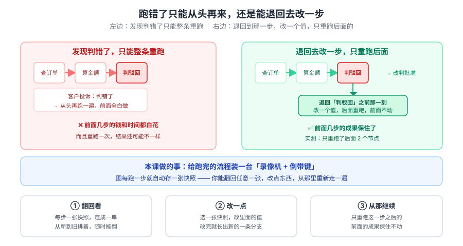
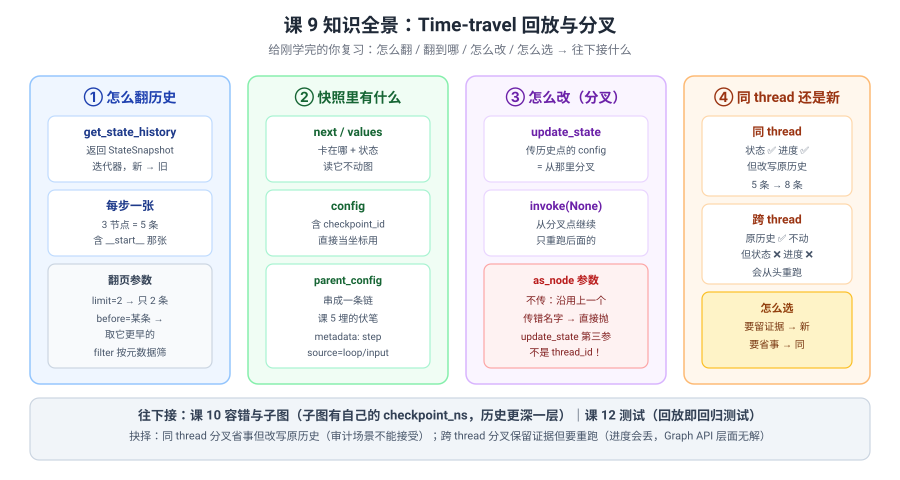

# 课 9：Time-travel 回放与分叉

> 所属阶段：阶段 3《可控性与人在环中》｜ 水平：进阶 ｜ 本课知识点：历史回放 / 分叉重跑
> 故事情节：故事主线「敢让它上生产」的第二章——先学会在关键处按下暂停键（课 8），现在学会倒带
> 📖 结论已按官方文档核对（核对于 2026-10 ｜ 来源：LangGraph Use time-travel 官方文档 + 本机 langgraph 1.2.11 源码与实测）

## 🎯 本课目标

- 说清 **`get_state_history` 拿到的是什么**，以及**那串快照是怎么被 `parent_config` 串起来的**
- 会用 `update_state(历史点)` **从任意一步分叉重跑**，并判断**同 thread 还是跨 thread**
- 知道**跨 thread 分叉会丢状态和进度**这个反直觉事实，以及为什么

---

## 第一幕：起源与场景引入

课 8 结尾留了个伏笔：

> "**本课验证十五那个 checkpoint 历史**（`next=('pay',)` 那条）**就是课 9 时光旅行的原料**——中断和恢复天然产生了'可回到的过去'。"

今天兑现它。

**场景**：退款流程上了审批，跑得挺好。然后事故来了：

1. **"客户投诉判错了，我只能把整条流程重跑一遍。"**——前面查订单、算金额全白做，重跑还可能结果不一样。
2. **"我想看看它当时到底为什么判驳回，可什么都看不到了。"**——执行完只剩最终状态，中间过程蒸发了。
3. **"我想试试'如果当时批了会怎样'，但一改就把原记录冲掉了。"**——改判和留证据不能兼得。

这三个恐惧还是**同一个问题**：**执行过程跑完就没了**——图只能往前，不能回头。

> 🎬 **场景**：三个恐惧一个病根——跑完的过程没有被保留下来，只能重来。

> 📌 **一句话本质**：**图每执行一个超级步就自动存一张 `StateSnapshot`（`next` + `values` + `config` + `parent_config`），这些快照靠 `parent_config` 串成链；你把某张快照的 `config` 传给 `update_state` 改状态，就从这个点长出一条新分支，`invoke(None)` 只重跑它之后的节点**——不是"倒带重放"，是**"从过去某个点另起一条时间线"**。
>
> ⚖️ **处境对照**：不知道这层，出事了只能整条重跑（前面的工作全废、结果还可能不一致），或者自己维护一份"过程日志"再手工重建状态；知道了，你能翻回任意一步看清当时发生了什么、改一个值、只重跑后面的——**代价是三条硬约束**：① **只有挂了 checkpointer 才有历史**（不挂时 `get_state_history` 抛 `ValueError: No checkpointer set`、`update_state` 抛 `ValueError: No checkpointer set`）；② **同 thread 分叉会改写原历史**（实测 5 条 → 8 条，原执行记录被新分支淹没）；③ **跨 thread 分叉状态带不走**（实测新 thread 的 `values` 只剩 `{'decision':'批准'}`，`log` 丢了，`next` 回到 `('s1',)` 从头跑）。

---

## 第二幕：认知冲突

客户投诉判错了，你想"回到判驳回之前，把决定改成批准，只重跑判定那步"。于是你写：

```python
# 找历史点，改状态，从那里继续
old = list(graph.get_state_history(cfg))[2]
fork = {"configurable": {**old.config["configurable"], "thread_id": "new-thread"}}   # 换个 thread 保存证据
graph.update_state(fork, {"decision": "批准"})
result = graph.invoke(None, config=fork)
print(result["log"])
```

你以为会得到 `['s1', 's2', 's3:批准']`（只重跑 s3）。

**实际得到**：

```
['s1', 's2', 's3:批准']
```

看起来对了？但打印一下中间状态：

```
新 thread 状态: next=('s1',)   values={'decision': '批准'}
```

> ❓ **问题**：`log` 里的 `s1` 去哪了？`next` 怎么回到了 `('s1',)`？——**换了个 thread，"进度"为什么带不过去？**

---

## 第三幕：层层揭示

### 一眼全局图（进入细节前先看一眼）



> 看图：左边**发现判错了只能整条重跑**——前面查订单、算金额全白做；右边**退回去改一步**——退回"判驳回"之前那一刻，改一个值，只重跑后面。**差别不是流程变了，是多了一台"录像机 + 倒带键"。**

### 本课地图（分几步走）

| 步 | 这一步要解决什么（人话） | 对应知识点 |
|:--:|------------------------|-----------|
| 1 | 怎么翻回看、翻出来的东西长什么样 | 知识点 1：历史回放 |
| 2 | 怎么改一个值、从那里重跑，同 thread 还是新 thread | 知识点 2：分叉重跑 |

---

### 知识点 1：历史回放

> 🧭 第 1/2 步｜承接：第二幕"换个 thread 就没了" → 本步：先搞清历史里到底存了什么
> 本知识点关键点：get_state_history 拿到什么 / 逐步回看的方式 / 与 checkpoint 的依赖关系

#### 一句话定义

**`graph.get_state_history(config)` 返回一个 `StateSnapshot` 迭代器，从新到旧；每个超级步一张快照，靠 `parent_config` 串成一条链——`snapshot.config` 就是这步的"坐标"，可以直接拿去 `get_state` 或 `update_state`。**

#### 直觉建立（类比）

把它想成**监控录像**：

- 每走一步，摄像头自动拍一张照片（**快照**），照片背面写着"这是第几步、上一步照片在哪"（`metadata.step` / `parent_config`）；
- 照片按时间倒着摞成一叠（**从新到旧**），最底下那张是"还没开始"（`next=('__start__',)`）；
- 你抽出任意一张，就能**看清那一刻桌上有什么**（`values`）**和下一步要做啥**（`next`）——但**看照片不会改变现实**（`get_state` 是只读的）。

> 💡 **类比的边界**：真实机制里 ① 照片不止"每步一张"，**输入也算一张**（`source=input`，`step=-1`）；② 每张照片有个唯一编号 `checkpoint_id`，**这才是分叉时真正的坐标**；③ 录像**必须开着**（checkpointer），没开就没有照片（实测 `get_state_history` 直接抛 `ValueError: No checkpointer set`）。

#### 核心原理

**最小可运行例子**（3 节点线性图）：

```python
from langgraph.checkpoint.memory import InMemorySaver
from langgraph.graph import END, START, StateGraph
from typing_extensions import TypedDict


class S(TypedDict):
    log: list
    amount: int
    decision: str


b = StateGraph(S)
b.add_node("s1", lambda s: {"log": s.get("log", []) + ["s1:查订单"]})
b.add_node("s2", lambda s: {"log": s.get("log", []) + [f"s2:判定={s['amount']>1000}"]})
b.add_node("s3", lambda s: {"log": s.get("log", []) + [f"s3:{s.get('decision')}"]})
b.add_edge(START, "s1"); b.add_edge("s1", "s2"); b.add_edge("s2", "s3"); b.add_edge("s3", END)

graph = b.compile(checkpointer=InMemorySaver())
cfg = {"configurable": {"thread_id": "tt1"}}
graph.invoke({"log": [], "amount": 5000, "decision": "驳回"}, config=cfg)

for s in graph.get_state_history(cfg):
    print(s.next, s.values)
```

实测输出（**5 条**，新 → 旧）：

```
[0] next=()             values={'log': ['s1:查订单','s2:判定=True','s3:驳回'], 'amount':5000, 'decision':'驳回'}
[1] next=('s3',)        values={'log': ['s1:查订单','s2:判定=True'], 'amount':5000, 'decision':'驳回'}
[2] next=('s2',)        values={'log': ['s1:查订单'], 'amount':5000, 'decision':'驳回'}
[3] next=('s1',)        values={'log': [], 'amount':5000, 'decision':'驳回'}
[4] next=('__start__',) values={}
```

> ⚠️ **3 个节点却存了 5 条**——多出来的是 ① `s3` 跑完那张（`next=()`）和 ② 输入那张（`next=('__start__',)`）。

#### 快照里到底有哪些字段

`StateSnapshot` 的完整字段（源码 `langgraph/pregel/types.py`）：

| 字段 | 是什么 | 实测值 |
|---|---|---|
| `values` | 那一刻的状态 | `{'log': [...], 'amount': 5000, ...}` |
| `next` | 接下来要跑哪个节点 | `('s2',)` |
| `config` | **这步的坐标**（含 `checkpoint_id`） | `{'configurable': {'thread_id':'tt1','checkpoint_ns':'','checkpoint_id':'1f1c8495-...'}}` |
| `parent_config` | 上一步的坐标（串成链） | `{'configurable': {'checkpoint_id':'1f1c8495-8852-...'}}` |
| `metadata` | 这步的元信息 | `{'source':'loop','step':3,'writes':None,'parents':{}}` |
| `created_at` | 时间戳 | `2026-10-15T03:35:30.320715+00:00` |
| `tasks` | 待执行任务 | `()` |
| `interrupts` | 中断信息（课 8） | `()` |

**`parent_config` 那根链**（实测）：

```
[0] 5b8af05f  parent=8374d0b1  next=()
[1] 8374d0b1  parent=0612fd19  next=('c',)
[2] 0612fd19  parent=42ac96d0  next=('b',)
```

> ✅ 这就是课 5 埋的伏笔——"**`parent_config` 这条链，正是课 9 时光旅行能'往回走'的结构基础**"。今天它派上用场了。

**`source` 字段的两个值**（实测）：

- `source='loop'`——正常执行的一步（`step` 从 0 开始）
- `source='input'`——输入那张（`step=-1`）

#### 只读地"回到过去"

```python
old = list(graph.get_state_history(cfg))[2]
snap = graph.get_state(old.config)
print(snap.next, snap.values)
```

实测：

```
next=('s2',)   values={'log': ['s1:查订单'], 'amount': 5000, 'decision': '驳回'}
```

> ✅ **读历史不会改变图**——打完这句，最新状态仍是 `next=()`。
> 💡 这就是"回放"的第一层：**看清当时发生了什么**，用于排障和审计。

#### 翻页参数

```python
graph.get_state_history(cfg, *, filter=None, before=None, limit=None)
```

实测（历史 6 条）：

```
默认                 -> 6 条
limit=2              -> 2 条: ['s2', '()']
before=第1条的config -> 4 条: ['s3', 's2', 's1', '__start__']
```

> ✅ `limit` 控制条数，`before` 从某条**更早**的开始取（不含它自己）。历史很长时用这两个翻页。

#### 🔴 没有 checkpointer 就没有历史（实测）

```python
g_nocp = b.compile()
list(g_nocp.get_state_history(cfg))                # ValueError: No checkpointer set
g_nocp.update_state(cfg, {"decision": "x"})        # ValueError: No checkpointer set
```

> ✅ 课 8 说"interrupt 能停不能恢复"，课 9 更彻底：**time-travel 干脆不存在**。阶段 2 先学 checkpointer 的原因就在这。

#### 🐞 一个静默陷阱：手工拼 `checkpoint_id` 不校验

```python
fake = {"configurable": {"thread_id": "o", "checkpoint_id": "不存在的id"}}
graph.get_state(fake)     # -> {}   （不报错！）
```

> ⚠️ 拼错 `checkpoint_id` **不报错**，返回空状态 `{}`——你会以为"回到原点了"。**所以分叉一定要用 `get_state_history` 返回的 `config`，不要手工拼。**

#### 常见误区

1. **"历史条数 = 节点数"**——错，实测 3 节点 5 条（多"跑完"和"输入"两张）。
2. **"`get_state(历史点)` 会把图倒回去"**——错，**只读**，图不动。
3. **"历史是从旧到新"**——错，**从新到旧**（`limit=2` 拿到的是最新的两条）。
4. **"不挂 checkpointer 也能看历史"**——错，直接 `ValueError`。

#### 一句话记住

**每个超级步一张快照、`parent_config` 串成链；`get_state_history` 从新到旧给你，`snapshot.config` 是那一步的坐标——但读它不会改变图。**

#### 🗣️ 行话对照

| 本课说法（人话） | 行业标准叫法 | 典型配置 / 在哪遇到 | 代价 |
|---|---|---|---|
| 每步拍的照片 | **StateSnapshot** | `get_state_history(config)` 的返回元素 | 量大，需后端清理策略 |
| 翻回看 | **get_state_history** | `graph.get_state_history(cfg, limit=10)` | 不挂 checkpointer 直接抛错 |
| 上一步照片在哪 | **parent_config** | `snapshot.parent_config` | 最后一张是 `None` |
| 照片编号 | **checkpoint_id** | `snapshot.config['configurable']['checkpoint_id']` | 手工拼错不报错，返回 `{}` |
| 第几步 | **metadata['step']** | `snapshot.metadata` | 输入那张是 `-1` |
| 只读回看 | **get_state(历史 config)** | `graph.get_state(old.config)` | 不改变图 |

> 中文均为社区常用译法 / 本文自拟，官方未定名中文，检索用英文。

#### 官方文档

- [Use time-travel（快照链与回放）](https://docs.langchain.com/oss/python/langgraph/use-time-travel)
- [Checkpointers（存档后端）](https://docs.langchain.com/oss/python/langgraph/checkpointers)

---

### 知识点 2：分叉重跑

> 🧭 第 2/2 步｜承接：会翻历史了 → 本步：改一个值从那里重跑，以及同 thread / 跨 thread 的取舍
> 本知识点关键点：从历史某点 fork / update_state 改状态 / 新 thread 还是复用原 thread 的取舍

#### 一句话定义

**把历史快照的 `config` 传给 `update_state` 并改状态，就从这个点长出一条新分支；`invoke(None, config=fork_config)` 会从 `next` 指向的节点继续，只重跑它之后的节点。**

#### 直觉建立（类比）

把它想成**写 Word 文档时的"另存为分支"**：

- 你在第 3 段发现写错了，于是**回到第 3 段之前**（历史快照），**改几个字**（`update_state`）；
- 改完 Word 会问你：**覆盖原文件，还是另存一份？**
  - **覆盖**（同 thread）：新内容接在原历史后面，但**原稿没了**；
  - **另存**（跨 thread）：原稿留着，但新文件是**从零开始的新文档**——你只把"改的那几个字"带过去了，**前面的段落得重新写**。

> 💡 **类比的边界**：真实机制里 ① "另存"时**连正文都可能带不全**——实测只带了 `update_state` 进去的那一项，`log` 整个丢了；② "覆盖"时原稿**不是真的删除**，而是被新分支挤到历史深处（实测 6 条历史里还能翻到）；③ **进度（`next`）在跨 thread 时一定回到起点**，Graph API 层面没法带过去。

#### 核心原理

**形态一：同 thread 分叉**（状态和进度都保留）

```python
old = list(graph.get_state_history(cfg))[2]      # next=('s2',) 那张
fork_cfg = graph.update_state(old.config, {"decision": "批准"})
print(graph.get_state(fork_cfg).next, graph.get_state(fork_cfg).values)
```

实测：

```
next=('s2',)   values={'log': ['s1:查订单'], 'decision': '批准'}
```

> ✅ **`log` 保住了，`next` 还停在 `s2`**——这就是"回到过去改一个值"。

继续跑：

```python
result = graph.invoke(None, config=fork_cfg)
print(result["log"])
```

实测：

```
['s1:查订单', 's2:判定=True', 's3:批准']
```

**哪些节点被重跑了？**（用计数器实测）：

```
首次执行调用: ['a', 'b', 'c']
分叉点 next=('b',)
分叉后调用:   ['b', 'c']      ← 只有分叉点之后的被重跑
```

> ✅ **`a` 没重跑**——前面几步的成果保住了。这就是本课最实在的价值。

**代价：原历史被改写**

```
分叉前 5 条 -> 分叉后 6 条（再跑完 -> 8 条）
```

分叉后的历史（新 → 旧）：

```
[0] next=('s2',)        log=['s1:查订单']              ← 新增的分叉点
[1] next=()             log=['s1:查订单','s2:判定=True','s3:驳回']   ← 原执行被挤下去了
[2] next=('s3',)        log=['s1:查订单','s2:判定=True']
...
```

> ⚠️ **原执行那串还在**，但"最新"已经是新分支了。**审计场景下这是不可接受的**——你改写了事故现场。

---

**形态二：跨 thread 分叉**（第二幕的答案）

```python
old = list(graph.get_state_history(cfg))[2]
fork_cfg = {"configurable": {**old.config["configurable"], "thread_id": "fork1"}}
graph.update_state(fork_cfg, {"decision": "批准"})
```

实测对比（**这是本课最强反直觉点**）：

| | 同 thread | 跨 thread |
|---|---|---|
| `next` | `('s2',)` ✅ 保住 | `('s1',)` ❌ 回到起点 |
| `values` | `{'log':['s1'], 'decision':'批准'}` ✅ 完整 | `{'decision':'批准'}` ❌ **`log` 丢了** |
| 原历史 | ❌ 被改写（5 → 8 条） | ✅ 完好（仍是 `s3:驳回`） |
| 重跑范围 | 只跑 `s2`/`s3` | 从头跑 `s1`/`s2`/`s3` |

> ❓ **为什么会这样？**
>
> 因为 `update_state` 是按 `config` 找存档的。你换了 `thread_id`，但 `checkpoint_id` 还是旧 thread 的——**新 thread 里根本没有这个存档**。实测：

```python
graph.get_state(fork_cfg)     # -> {}  next=()     空状态！
```

> 所以 `update_state` 是在**一个空状态上**做更新，结果自然只剩你塞进去的那一项，`next` 也只能是起点。

**那怎么正确跨 thread 分叉？**——先整体搬 `values`：

```python
new_thread = {"configurable": {"thread_id": "fk2"}}
graph.update_state(new_thread, old.values)                  # ① 先把历史状态整体搬过去
graph.update_state(new_thread, {"decision": "批准"})        # ② 再改要改的
```

实测：

```
搬 values 后: next=('s1',) values={'log': ['s1'], 'decision': '驳回'}
再改 decision: values={'log': ['s1'], 'decision': '批准'}
跑完: ['s1', 's1', 's2', 's3:批准']
```

> ✅ **状态带过去了**（`log` 在），但注意两个问题：
> 1. **`next` 仍是 `('s1',)`**——进度**带不过去**，一定从头跑；
> 2. 输出 `['s1', 's1', ...]`——**`s1` 出现了两次**！因为搬过去的 `log` 里已经有 `s1`，重跑又追加一次。

> 🔑 **结论：Graph API 层面，跨 thread 分叉 = "状态能带，进度不能带"。** 想要"原历史不动 + 不重跑"，`update_state` 做不到。

#### `as_node` 参数

```python
graph.update_state(config, values, as_node=None, task_id=None)
```

| 用法 | 效果（实测） |
|---|---|
| 不传 `as_node` | 沿用"上一个更新状态的节点"；有歧义时会抛错 |
| `as_node="s2"` | 明确声明"这次更新来自 s2" |

> ⚠️ **第三参数是 `as_node`，不是 thread_id**——初学时很容易写成 `update_state(old.config, values, new_thread)`，实测直接 `TypeError: unhashable type: 'dict'`。
> ⚠️ `as_node` 传了不存在的节点名会抛错（源码 `if as_node not in self.nodes`）。

#### 分叉 + interrupt（回扣课 8）

课 8 的中断点也在历史里，可以回到它重新决定：

```
中断时历史 2 条:
  next=('p',)        interrupts=['付500?']      ← 这个点可以回
  next=('__start__',) interrupts=[]
恢复后 3 条:
  next=()            approved='批准'
  next=('p',)        approved=''
```

> ✅ **中断和恢复天然产生了"可回到的过去"**——课 8 埋的伏笔在这里闭合了。

#### 🔴 一个更深的反直觉：分叉改的是"依据"，不是"结论"

实战 09 里撞出来的：从 `判定` 之前分叉，把 `decision` 改成"批准"，重跑后——

```
改判后结果: [..., '判定:驳回', '通知:驳回']
最终决定: 驳回
```

**改了半天，还是驳回。** 因为跨 thread 分叉 `next` 回到起点重跑，`判定` 节点读 `risk=0.9`、按自己的规则**又把 `decision` 算回"驳回"**——你手工塞的结论被下游节点覆盖了。

> 🔑 **关键认识**：**分叉改的是输入，不是输出。** 想改变某个节点的产出，要改它读的那个字段，而不是它写的那个字段。
>
> 但这里还有一层。只改 `risk` 仍然不够——因为跨 thread 分叉 `next` 回到起点重跑，`算风险` 会按 `amount=5000` **把 `risk` 重新算回 0.9**。实测改 `amount` 才真正生效：

```python
graph.update_state(fork, {"amount": 500, "risk": 0.1})   # ← 改最上游依据
# -> 最终决定: 批准
```

> 💡 **判据**：改完之后问一句——**从分叉点往后的每个节点，还会不会把你改的字段重新算一遍？** 会，就继续往上找，直到找到那个不会被重算的字段。
> 💡 同 thread 分叉也一样——只不过程度轻一些（分叉点之后的节点仍会重跑并重算）。

#### 怎么选（决策表）

| 你的场景 | 选哪个 | 理由 |
|---|---|---|
| 调试、试"如果当时改了会怎样" | **同 thread** | 状态和进度都带，最省事 |
| 客户投诉改判、要留事故现场 | **跨 thread** | 原历史不动（但会重跑，且要手工搬 values） |
| 审计要求"原始执行不可篡改" | **跨 thread + 只读归档** | 同 thread 会改写历史 |
| 想省掉重跑成本又要留证据 | **Graph API 做不到** | 需自己用 checkpointer API 复制存档 |

#### 常见误区

1. **"换 thread 分叉只是换个地方存"**——错，**状态和进度都会丢**，会从头跑。
2. **"`update_state` 第三参数是 thread_id"**——错，是 **`as_node`**，传 dict 直接 `TypeError`。
3. **"同 thread 分叉会删掉原历史"**——不是删除，是被挤到历史深处（还能翻到），但"最新"变了。
4. **"分叉后所有节点都会重跑"**——错，**只重跑 `next` 之后的**（实测 `a` 没重跑）。

#### 一句话记住

**同 thread 分叉状态和进度都带、但改写原历史；跨 thread 分叉原历史不动、但状态要手工搬且进度一定丢（从头跑）；分叉后只重跑分叉点之后的节点。**

#### 🗣️ 行话对照

| 本课说法（人话） | 行业标准叫法 | 典型配置 / 在哪遇到 | 代价 |
|---|---|---|---|
| 从过去某点另起一条 | **fork / 分叉** | `update_state(历史 config, {...})` | 同 thread 会改写原历史 |
| 改几个字 | **update_state** | `graph.update_state(cfg, values, as_node="s2")` | 第三参是 `as_node` 不是 thread |
| 从那继续跑 | **invoke(None, config=fork)** | `graph.invoke(None, config=fork_cfg)` | 只重跑 next 之后的 |
| 声明这次更新来自谁 | **as_node** | `update_state(cfg, v, as_node="s2")` | 传错节点名抛错 |
| 另存一份 | **换 thread_id** | `{"configurable": {"thread_id": "fork1"}}` | 状态和进度都丢 |

> 中文均为社区常用译法。

#### 官方文档

- [Use time-travel（分叉重跑）](https://docs.langchain.com/oss/python/langgraph/use-time-travel)
- [Checkpointers（存档后端）](https://docs.langchain.com/oss/python/langgraph/checkpointers)

---

## 第四幕：实操验证

### 4.1 机制验证

> ✅ 实测于 langgraph 1.2.11 / Python 3.12（在 `../langchain/playground` 以 `uv run` 隔离执行）

**验证一：历史条数与内容**（3 节点线性图，5 条）

```
[0] next=()             log=['s1:查订单','s2:判定=True','s3:驳回']   step=3 source=loop
[1] next=('s3',)        log=['s1:查订单','s2:判定=True']             step=2 source=loop
[2] next=('s2',)        log=['s1:查订单']                            step=1 source=loop
[3] next=('s1',)        log=[]                                       step=0 source=loop
[4] next=('__start__',) values={}                                    step=-1 source=input
```

**验证二：只读回看**

```
get_state(old.config) -> next=('s2',) values={'log': ['s1:查订单'], ...}
当前最新仍是: next=()          ← 图没动
```

**验证三：同 thread 分叉**

```
分叉前最新: () log 3 项
update_state 返回: {'configurable': {'thread_id':'tt1', 'checkpoint_id':'1f1c8495-8856-...'}}
现在最新: ('s2',) log=['s1:查订单']     ← 回到过去了
```

**验证四：分叉后历史变长**

```
分叉前 5 条 -> 分叉后 6 条
[0] next=('s2',) log=['s1:查订单']                        ← 新分支
[1] next=()      log=['s1:查订单','s2:判定=True','s3:驳回']  ← 原执行被挤下去
```

**验证五：从分叉点继续跑**

```
结果: ['s1:查订单', 's2:判定=True', 's3:批准']
```

**验证六：分叉后的 thread 状态**

```
原 thread 最新: ['s1:查订单', 's2:判定=True', 's3:批准']     ← 已被改写
历史条数: 8
```

**验证七：跨 thread 分叉（第二幕的答案）**

```
历史点: next=('s2',) values={'log': ['s1'], 'decision': '驳回'}
新 thread: next=('s1',) values={'decision': '批准'}          ← log 丢了！
新 thread 里查旧 checkpoint_id: {} next=()                   ← 存档不存在
```

**验证八：跨 thread 正确写法（先搬 values）**

```
搬 values 后: next=('s1',) values={'log': ['s1'], 'decision': '驳回'}
再改 decision: values={'log': ['s1'], 'decision': '批准'}
跑完: ['s1', 's1', 's2', 's3:批准']                          ← s1 出现两次
```

**验证九：`as_node` 参数**

```
as_node='s2'   -> next=('s2',) log=['s1:查订单']
不传 as_node   -> next=('s2',) log=['s1:查订单']
（本例无歧义，两者相同；有歧义时不传会抛错）
```

**验证十：没有 checkpointer**

```
get_state_history -> ValueError: No checkpointer set
update_state      -> ValueError: No checkpointer set
```

**验证十一：手工拼 checkpoint_id**

```
checkpoint_id='不存在的id' -> get_state 返回 {}   ← 不报错！
```

**验证十二：翻页参数**

```
默认 6 条
limit=2 -> 2 条
before=第1条 -> 4 条
```

**验证十三：重跑范围（计数器）**

```
首次执行调用: ['a', 'b', 'c']
分叉点 next=('b',)
分叉后调用:   ['b', 'c']          ← a 没重跑
```

**验证十四：中间节点重跑**

```
回到 next=('s2',) 的状态
改 amount 后: next=('s2',) amount=9999
从 s2 重跑: ['s1', 's2', 's3:驳回']     ← s2 用新 amount 重算，s1 不重跑
```

**验证十五：分叉后再分叉**

```
第 1 次分叉 -> v2
第 2 次分叉 -> v3
历史条数: 5 -> 7      ← 树状增长
```

**验证十六：分叉 + interrupt**

```
中断时历史 2 条:
  next=('p',) interrupts=['付500?']
恢复后 3 条:
  next=()     approved='批准'
  next=('p',) approved=''
```

### 4.2 应用实战

🎯 [练一练：应用实战 09「客户投诉后改判，还要留住事故现场」](../../../应用实战/09-Time-travel 回放与分叉.md)

> 基础 → 问题 → 综合三跳：先回放看清"当时为什么判驳回"，再撞上跨 thread 分叉丢状态，最后用同/跨 thread 组合 + only 重跑收口。

---

## 第五幕：体系收束

今天给图装上了倒带键。三句话带走：

1. **每个超级步一张快照、`parent_config` 串成链**；`get_state_history` 从新到旧，3 节点会有 5 条（多"跑完"和"输入"）。
2. **同 thread 分叉状态和进度都带、只重跑后面的**，但**改写原历史**（5 → 8 条）——审计场景不能接受。
3. **跨 thread 分叉原历史不动，但状态要手工搬、进度一定丢**（`next` 回到起点，从头跑）——Graph API 层面无解。

> 📍 **全局定位**：阶段 3 第二章——课 8 让图能"停下等人"，课 9 让图能"回头改判"。**两者都长在 checkpoint 上**（阶段 2 的铺垫在这里收口）。
> 🔗 **下一步**：课 10《Fault-tolerance 与 Subgraphs》——子图有自己的 `checkpoint_ns`（实测主图是 `''`），历史会再深一层。

顺带埋个伏笔：**"回放即回归测试"**——课 12 讲测试时你会发现，本课这套"翻历史 + 从某点重跑"正是**给 agent 写集成测试**最自然的素材：把一次真实执行的快照存下来，改一个输入重跑，对比结果。

---

## 🐞 常见误区

1. **"历史条数 = 节点数"**——错，实测 3 节点 5 条。
2. **"`get_state(历史点)` 会把图倒回去"**——错，**只读**。
3. **"换 thread 分叉只是换个地方存"**——错，**状态和进度都丢**。
4. **"`update_state` 第三参数是 thread_id"**——错，是 **`as_node`**，传 dict 直接 `TypeError`。
5. **"同 thread 分叉会删掉原历史"**——不是删除，是被挤到深处（还能翻到）。
6. **"分叉后所有节点都重跑"**——错，**只重跑 `next` 之后的**。
7. **"不挂 checkpointer 也能看历史"**——错，直接 `ValueError`。
8. **"手工拼 checkpoint_id 会报错"**——错，**不报错**，返回 `{}`（最危险的一种）。
9. **"分叉就是把结果字段改成想要的值"**——错，**改的是依据不是结论**；且要改到不会被后续节点重算的那一层（实测改 `decision` 和 `risk` 都无效，改 `amount` 才生效）。

### ⏳ 与过时说法对照（写前核对有差异时才有，≤3 行）

| 旧说法（网上过时教程 / 训练知识里的说法） | 官方文档 / 本机现状 | 来源 |
|---|---|---|
| "换 thread_id 再 `update_state` 就是安全分叉，状态会跟着过去" | 实测**状态丢失**：新 thread `values` 只剩 update 进去的项（`log` 整个没了），`next` 回到 `('s1',)` 从头跑——因为新 thread 里不存在那个 `checkpoint_id`（实测 `get_state` 返回 `{}`） | 实测（langgraph 1.2.11）+ [Use time-travel](https://docs.langchain.com/oss/python/langgraph/use-time-travel) |
| "`get_state_history` 返回的是节点列表，条数等于节点数" | 实测 **3 节点 5 条**：多出"跑完那张"（`next=()`）与"输入那张"（`next=('__start__',)`，`step=-1`、`source=input`） | 实测验证一 |
| `update_state(config, values, new_thread_config)` 可跨 thread 分叉 | 第三参实为 **`as_node: str | None`**；传 dict 直接 `TypeError: unhashable type: 'dict'` | 实测 + `pregel/main.py:2524` 签名 |

## 一图总结



> 看图：四列——怎么翻（history + 翻页参数）、翻出来什么（next/values/config/parent）、怎么改（update_state + invoke）、同 thread 还是新（取舍对照）。**与课首那张图的区别**：课首那张给没学过的人看"为什么要能退回去"，这张给刚学完的你复习"退回去的机制和代价"。

## 课后小测

**Q1**：3 个节点的线性图跑完，`get_state_history` 会返回几条？
- A. 3 条
- B. 4 条
- C. 5 条
- D. 取决于节点是否并行

<details><summary>答案与解析</summary>

**答案：C**。实测 5 条：3 个节点各一张之外，多出**"跑完那张"**（`next=()`）和**"输入那张"**（`next=('__start__',)`，`step=-1`、`source=input`）。

</details>

**Q2**：你想改判但必须留住原始执行记录做审计，于是换了 `thread_id` 再 `update_state`。会发生什么？
- A. 状态完整带过去，只重跑后面的
- B. 状态丢了，只剩 update 进去的项，且从头重跑
- C. 抛 `ValueError` 提示 thread 不存在
- D. 原 thread 也被一起改写

<details><summary>答案与解析</summary>

**答案：B**。实测新 thread 的 `values` 只剩 `{'decision':'批准'}`（`log` 整个没了），`next` 回到 `('s1',)`——因为换了 `thread_id` 后那个 `checkpoint_id` 在新 thread 里不存在（`get_state` 返回 `{}`），`update_state` 是在空状态上做的。**原 thread 确实完好（这是唯一的好处），但要手工搬 values，且进度一定丢。**

</details>

**Q3**：从历史点 `next=('b',)` 分叉后 `invoke(None)`，哪些节点会重跑？
- A. 全部节点
- B. 只有 `b` 和 `c`
- C. 只有 `c`
- D. 一个都不跑，直接返回

<details><summary>答案与解析</summary>

**答案：B**。用计数器实测：首次执行 `['a','b','c']`，分叉后 `['b','c']`——**`a` 没重跑**。分叉点 `next` 指向 `b`，所以从 `b` 开始，只重跑它之后的节点。**这正是 time-travel 省成本的地方。**

</details>

---

## 🚀 下一批接力提示词

> 学完本批后，**复制下面这段文字发给 AI**，即可无缝进入下一批：

```
继续学 LangGraph。我的学习档案在 langchain/langgraph/00-学习档案.md，
刚学完阶段 3《可控性与人在环中》的课 9《Time-travel 回放与分叉》
知识点「历史回放 / 分叉重跑」，
请按大纲继续讲解课 10《Fault-tolerance 与 Subgraphs》的知识点。
```

## 🧭 课程导航

- 上一课：[课 8 Interrupts 人在环中](08-Interrupts 人在环中.md)
- 返回 [课程目录](../../../02-课程目录.md)
- 下一课：[课 10 Fault-tolerance 与 Subgraphs](10-Fault-tolerance 与 Subgraphs.md)
- 🎯 练一练：应用实战 09（见 4.2）
