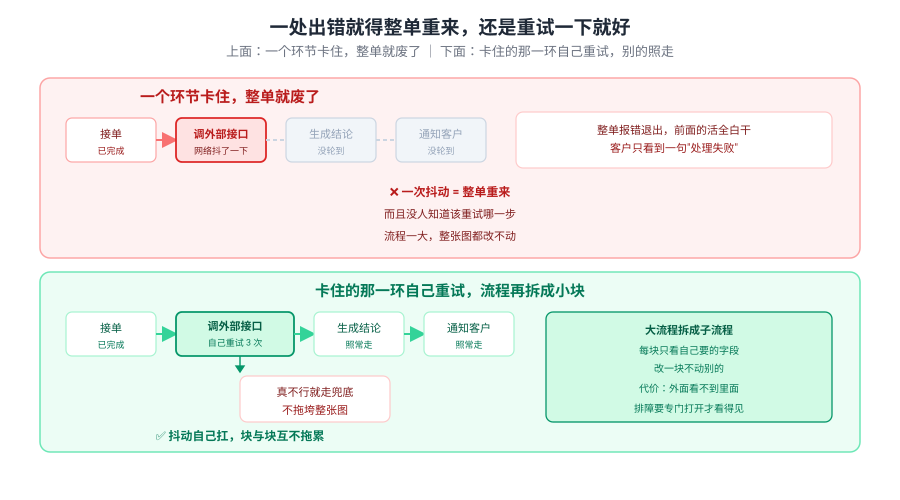
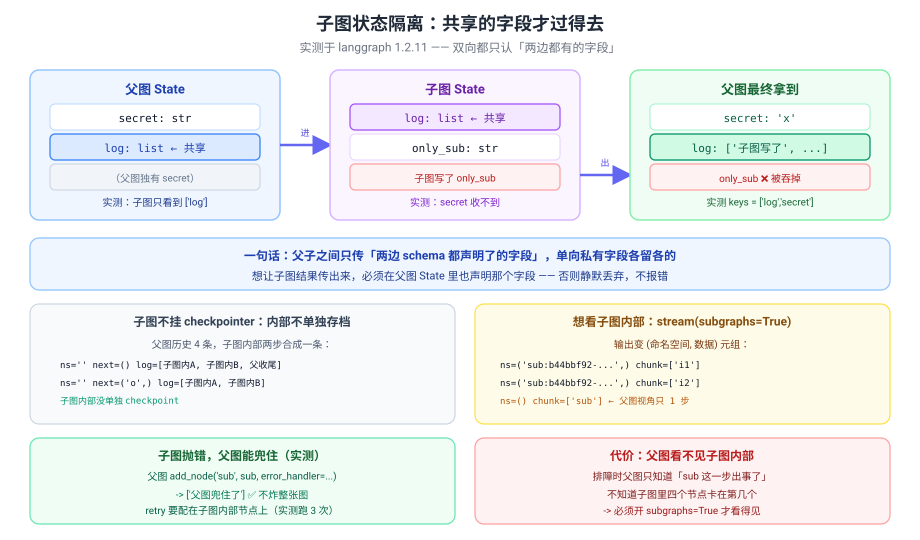
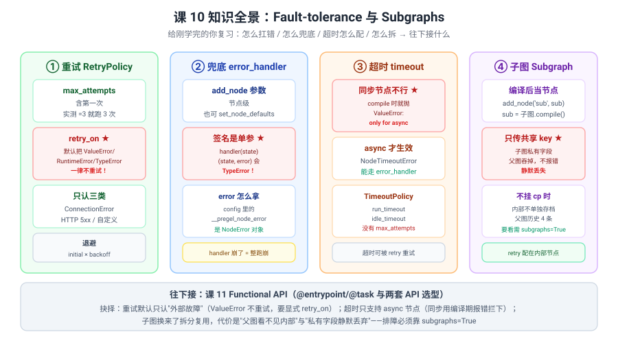

# 课 10：Fault-tolerance 与 Subgraphs

> 所属阶段：阶段 3《可控性与人在环中》｜ 水平：进阶 ｜ 本课知识点：节点级容错 / 子图与状态隔离
> 故事情节：故事主线「敢让它上生产」的第三章——会暂停会回放了，还得不怕错、能拆开
> 📖 结论已按官方文档核对（核对于 2026-10 ｜ 来源：LangGraph Fault tolerance / Subgraphs 官方文档 + 本机 langgraph 1.2.11 源码与实测）

## 🎯 本课目标

- 会给单个节点配 **超时 / 重试 / 错误处理**，让一个节点失败不炸掉整张图
- 会用 **子图** 拆分复杂流程，并说清 **状态隔离** 到底隔离了什么、**排障代价** 在哪

---

## 第一幕：起源与场景引入

课 9 结尾留了个伏笔：

> "**子图有自己的 `checkpoint_ns`**（实测主图是 `''`），历史会再深一层。"

今天兑现它——顺带解决一个更急的问题。

**场景**：流程上了生产，然后事故来了：

1. **"外部接口抖了一下，整单就报错退出了，前面的活全白干。"**——一次网络抖动 = 整单重来。
2. **"我想给它加个重试，可配了 `RetryPolicy` 它一次都不重试。"**——配置写了，行为没变。
3. **"流程越来越长，改一个节点要动整张图，谁都不敢碰。"**——单体图改不动了。

这三个恐惧分两类：**前两个是"扛不住错"**，**第三个是"拆不开"**。

> 🎬 **场景**：前两个是容错问题（一次抖动不该整单废掉），第三个是结构问题（大图改不动）。

> 📌 **一句话本质**：**容错靠 `add_node` 的三个 per-node 参数（`/`）：`retry_policy` 决定"失败了再试几次"、`error_handler` 决定"试完了还不行就走兜底"、`timeout` 决定"多久算不行"——三者可以按节点单独配，也可以用 `set_node_defaults` 全图默认；子图则是**把编译好的图当节点挂上去**，父子之间**只传两边 schema 都声明了的字段**。
>
> ⚖️ **处境对照**：不知道这层，错误会直接冒泡炸掉整跑（前面的状态白算），或者你自己写 try/except 把重试逻辑和业务逻辑混在一起；知道了，一个节点的抖动在节点内就被消化掉——**代价是三条硬约束**：① **默认 `retry_on` 把 `ValueError`/`RuntimeError`/`TypeError` 一律视为"代码 bug"不重试**（配了 `max_attempts=3` 也只跑 1 次）；② **`error_handler` 的签名是 `(state)` 单参数**，写成 `(state, error)` 直接 `TypeError`；③ **同步节点配 `timeout` 在 `compile()` 阶段就抛 `ValueError`**——只有 async 节点才支持。

---

## 第二幕：认知冲突

外部接口抖动，你给它配了重试：

```python
from langgraph.types import RetryPolicy

def call_api(state):
    raise ValueError("接口超时了")          # 模拟外部故障

builder.add_node("call_api", call_api, retry_policy=RetryPolicy(max_attempts=3))
graph = builder.compile()
graph.invoke({"log": [], "n": 0})
```

你以为会重试 3 次。**实际**：

```
ValueError: 接口超时了
节点实际执行次数: 1        ← 一次都没重试！
```

**接着你给同步节点配超时**：

```python
builder.add_node("slow", slow_node, timeout=0.5)
builder.compile()          # ← 这里就炸了
```

```
ValueError: Node timeouts are only supported for async nodes because
sync Python execution cannot be safely cancelled in-process. Node 'b' is sync.
```

> ❓ **问题**：**配置明明写了，为什么重试不生效？为什么超时连编译都过不去？**

---

## 第三幕：层层揭示

### 一眼全局图（进入细节前先看一眼）



> 看图：上面**一个环节卡住，整单就废了**——前面接单的活全白干，后面两步没轮到；下面**卡住的那一环自己重试**，别的照走，真不行再走兜底。**右边那块是第三幕第二半：大流程拆成子流程，代价是外面看不到里面。**

### 本课地图（分几步走）

| 步 | 这一步要解决什么（人话） | 对应知识点 |
|:--:|------------------------|-----------|
| 1 | 一个节点失败了，怎么让它自己重试 / 兜底 / 别拖太久 | 知识点 1：节点级超时 / 重试 / 错误处理 |
| 2 | 流程太大改不动，怎么拆，拆完的代价是什么 | 知识点 2：子图与状态隔离 |

---

### 知识点 1：节点级超时 / 重试 / 错误处理

> 🧭 第 1/2 步｜承接：第二幕"配了不生效" → 本步：搞清三个参数各自的语义与硬约束
> 本知识点关键点：per-node 配置怎么给 / RetryPolicy 的策略项 / 错误处理器与兜底分支

#### 一句话定义

**`add_node` 直接接受 `retry_policy` / `error_handler` / `timeout` 三个参数（也可 `set_node_defaults` 全图默认），节点级配置覆盖全局默认；三者组合成"失败先重试 → 试完还不行走兜底 → 太久算失败"这一条容错链。**

#### 直觉建立（类比）

把它想成**快递站点**：

- **重试**（`RetryPolicy`）：快递员第一次上门没人，他会**再试几次**（`max_attempts`），每次**隔得越久**（`initial_interval` × `backoff_factor`）；
- **兜底**（`error_handler`）：试完还不行，就**放快递柜**——不叫整单作废；
- **超时**（`timeout`）：等太久（比如超过 30 秒）就算这次失败。

> 💡 **类比的边界**：真实机制里 ① 快递员**挑单**——默认的 `retry_on` 只认"外部故障"（`ConnectionError`、HTTP 5xx、不认识的自定义异常），**你抛 `ValueError` 他看都不看就放弃**（认为是收件人地址写错了，再送也没用）；② 兜底员**只收包裹不收异常**——`handler` 拿到的**只有 state**，错误要从 `config` 里翻；③ 超时员**只管异步任务**——同步的他管不了（Python 掐不干净），索性在 `compile()` 就告诉你"这个我接不了"。

#### 核心原理

**三个参数的位置**（源码 `langgraph/graph/state.py:677`）：

```python
builder.add_node(
    "call_api", call_api,
    retry_policy=RetryPolicy(...),     # 失败了再试几次
    error_handler=my_fallback,         # 试完还不行就走它
    timeout=5.0,                       # 太久算失败
)
```

或者全图默认（`set_node_defaults`），节点级覆盖全局：

```python
builder.set_node_defaults(retry_policy=RetryPolicy(max_attempts=3))
builder.add_node("b", node_b, retry_policy=RetryPolicy(max_attempts=2))   # 覆盖
```

实测：**全局 5、节点级 2 → 实际执行 2 次**（节点级生效）。

---

##### `RetryPolicy` 的六个字段

```python
RetryPolicy(
    initial_interval=0.5,      # 第一次重试前等多久（秒）
    backoff_factor=2.0,        # 每次等待 × 几倍
    max_interval=128.0,        # 等待上限
    max_attempts=3,            # 最多跑几次（含第一次）
    jitter=True,               # 是否加随机抖动
    retry_on=default_retry_on, # 哪些异常才重试
)
```

**`max_attempts` 含第一次**（实测）：

```
max_attempts=1 -> 实际执行 1 次
max_attempts=2 -> 实际执行 2 次
max_attempts=3 -> 实际执行 3 次
```

**退避间隔**（实测，`jitter=False` 时精确）：

```
initial=0.3 backoff=2 -> 实测间隔 ['0.30s', '0.60s', '1.20s']
```

> ⚠️ **`jitter` 默认 `True`**，所以实测间隔会抖：`['0.50s', '0.92s', '1.34s']`。想验证退避公式要显式关掉。

---

##### 🔴 默认 `retry_on` 才是第二幕的答案

源码 `langgraph/_internal/_retry.py:1`：

```python
def default_retry_on(exc: Exception) -> bool:
    if isinstance(exc, ConnectionError):
        return True
    if isinstance(exc, httpx.HTTPStatusError):
        return 500 <= exc.response.status_code < 600
    if isinstance(exc, requests.HTTPError):
        return 500 <= exc.response.status_code < 600 if exc.response else True
    if isinstance(exc, (ValueError, TypeError, ArithmeticError, ImportError,
                        LookupError, NameError, SyntaxError, RuntimeError,
                        ReferenceError, StopIteration, StopAsyncIteration, OSError)):
        return False          # ← 一律不重试
    return True               # ← 不认识的异常反而重试
```

实测对照表：

| 抛的异常 | 默认重试吗 |
|---|---|
| `ValueError('x')` | ❌ 不重试 |
| `RuntimeError('x')` | ❌ 不重试 |
| `TypeError('x')` | ❌ 不重试 |
| `KeyError('x')` | ❌ 不重试 |
| `OSError('x')` | ❌ 不重试 |
| `ConnectionError('x')` | ✅ 重试 |
| 自定义 `NetError('x')` | ✅ 重试（不认识 → `True`） |

> 🔑 **设计意图**：`ValueError` 这类通常是**代码写错了**（参数类型不对、逻辑 bug），重试一百次也一样错；`ConnectionError` 是**外部抖动**，重试试试可能就好了。
> ⚠️ **反直觉**：**不认识的异常反而会重试**（末尾 `return True`）。所以自定义异常默认就是"可重试"的。

**想让 `ValueError` 也重试？显式指定**：

```python
RetryPolicy(max_attempts=4, retry_on=ValueError)                    # 指定类型
RetryPolicy(max_attempts=5, retry_on=lambda e: "可重试" in str(e))   # 用函数判断
```

实测：`retry_on=ValueError` 后，抛 `ValueError` 的节点执行了 3 次后成功。

**重试用尽后**：抛**原始异常**（不是包装异常）。实测 `NetError: 永远失败`。

---

##### `error_handler`：兜底不炸图

```python
def handler(state):                    # ← 只有一个参数！
    return {"log": state.get("log", []) + [f"兜底"], "n": -1}

builder.add_node("b", risky, retry_policy=RetryPolicy(max_attempts=2),
                 error_handler=handler)
```

实测：

```
handler 收到 state={'log': ['ok'], 'n': 1}
结果: ['ok', '兜底1']  n=-1
节点 b 执行 3 次        ← 先重试，用尽后才走 handler
```

> ⚠️ **签名是 `(state)` 单参数**——写成 `(state, error)` 实测直接 `TypeError: h3() missing 1 required positional argument: 'error'`。
> 💡 **参数名不重要**（实测叫 `x` 也能收到），因为它是按位置传的。

**那怎么拿到错误？**——从 `config` 里翻：

```python
def handler(state, config):
    err = config.get("configurable", {}).get("__pregel_node_error")
    print(type(err).__name__, err)
    return {...}
```

实测：

```
config 里的 error: NodeError: NodeError(node='b', error=NetError('崩了'))
```

> ✅ 是个 `NodeError` 对象，带 `node`（哪个节点）和 `error`（原始异常）。

> ⚠️ **handler 自己崩了 = 整跑崩**（源码注释：`handler failures fail the run`）。实测 handler 抛 `RuntimeError` 直接冒出去。

##### 🔴 兜底会截断流程（实战里撞出来的）

`error_handler` 返回一个普通 dict 时，**流程不会继续走原来的边**：

```
结果: ['查库存:有货', '调风控:兜底放行']      ← 没有"出结论"和"通知"！
```

要让它继续往下走，得返回 `Command(goto=...)`：

```python
def handler(state):
    return Command(goto="出结论", update={"log": [...], "risk": 0.5})
```

实测：

```
Command(goto='出结论') -> ['查库存:有货', '调风控:兜底放行', '出结论:通过', '通知:通过']
```

> 🔑 **判据**：兜底返回 **普通 dict** → 流程到此为止；返回 **`Command(goto=...)`** → 跳到指定节点继续。

---

##### `timeout`：只支持 async

```python
builder.add_node("b", sync_slow_node, timeout=0.4)
builder.compile()
```

实测 **`compile()` 阶段就抛错**：

```
ValueError: Node timeouts are only supported for async nodes because
sync Python execution cannot be safely cancelled in-process. Node 'b' is sync.
```

> 🔑 **原因**：同步 Python 代码没法在进程内安全取消。官方索性在编译期拦下，而不是运行时静默失效。

**async 节点才生效**：

```python
async def async_slow(state):
    await asyncio.sleep(2)
    return {...}

builder.add_node("b", async_slow, timeout=0.4, error_handler=handler)
```

实测：

```
handler 收到 state={'log': [], 'n': 0}
结果: ['超时兜底']  耗时 0.40s
```

> ✅ **超时能触发 `error_handler`**——所以它和兜底是串在一条链上的。

`TimeoutPolicy` 只有三个字段（实测）：

```
['run_timeout', 'idle_timeout', 'refresh_on']
```

- `run_timeout`：从开始到结束的总时长上限
- `idle_timeout`：**没有进展**多久算超时（实测比 `run_timeout` 先触发）
- `refresh_on`：什么事件算"有进展"

> ⚠️ **`TimeoutPolicy` 没有 `max_attempts`**——传了直接 `TypeError: unexpected keyword argument`。
> 💡 **超时会被 `RetryPolicy` 重试**：实测 `timeout=0.3` + `RetryPolicy(max_attempts=3)` → 节点执行 3 次，耗时 1.35s。所以超时和重试是**叠乘**的，配的时候要算总时长。

#### 常见误区

1. **"配了 `retry_policy` 就会重试"**——错，**默认 `retry_on` 不认 `ValueError`/`RuntimeError`**。
2. **"`max_attempts=3` = 失败后重试 3 次"**——错，**含第一次**，总共最多跑 3 次。
3. **"`error_handler(state, error)`"**——错，**单参数**，两参数直接 `TypeError`。
4. **"同步节点也能配 timeout"**——错，**`compile()` 就抛 `ValueError`**。
5. **"`TimeoutPolicy` 有 `max_attempts`"**——错，只有三个字段，传了 `TypeError`。

#### 一句话记住

**`retry_policy` 挑异常（默认不认 ValueError）、`error_handler` 只收 state（签名单参）、`timeout` 只认 async（同步在编译期就拦）；三者按"重试 → 兜底"串成一条链。**

#### 🗣️ 行话对照

| 本课说法（人话） | 行业标准叫法 | 典型配置 / 在哪遇到 | 代价 |
|---|---|---|---|
| 失败再试几次 | **RetryPolicy** | `add_node(..., retry_policy=RetryPolicy(max_attempts=3))` | 默认不认 ValueError |
| 挑哪些异常重试 | **retry_on** | `retry_on=ValueError` / `retry_on=fn` | 默认只认外部故障 |
| 隔多久再试 | **initial_interval / backoff_factor** | `RetryPolicy(initial_interval=0.5, backoff_factor=2)` | `jitter` 默认 True 会抖 |
| 试完还不行走兜底 | **error_handler** | `add_node(..., error_handler=fn)` | 签名 `(state)`，两参数 TypeError |
| 太久算失败 | **timeout / TimeoutPolicy** | `add_node(..., timeout=5.0)` | 同步节点 compile 即抛错 |
| 全图默认 | **set_node_defaults** | `builder.set_node_defaults(retry_policy=...)` | 节点级覆盖全局 |
| 错误对象 | **NodeError** | `config['configurable']['__pregel_node_error']` | 藏在 config 里，不在参数位 |

> 中文均为社区常用译法 / 本文自拟，官方未定名中文，检索用英文。

#### 官方文档

- [Fault tolerance（容错配置）](https://docs.langchain.com/oss/python/langgraph/fault-tolerance)
- [Graph API overview（add_node 参数）](https://docs.langchain.com/oss/python/langgraph/graph-api)

---

### 知识点 2：子图与状态隔离

> 🧭 第 2/2 步｜承接：一个节点的错能扛住了 → 本步：流程太大改不动，怎么拆
> 本知识点关键点：子图编译后如何挂载 / 父子状态如何传递 / 事件冒泡与"父图看不见子图内部"的调试代价

#### 一句话定义

**把 `sub_builder.compile()` 的结果当普通节点 `add_node("sub", sub)` 挂到父图上；父子之间只传递两边 State schema 都声明了的字段，单向私有字段各自保留、互不干扰。**

#### 直觉建立（类比）

把它想成**公司里的部门**：

- 一个部门内部怎么分工、有几个人、墙上贴什么报表，**其他部门管不着也看不见**（状态隔离）；
- 部门之间只通过**规定好的对接表**传递信息（共享字段）；
- 部门内部的八卦（私有字段）**传不出去**——不是被拦下报错，是**根本没人接收**。

> 💡 **类比的边界**：真实机制里 ① **"对接表"是双向的**——父图有 `secret` 但子图没声明，子图**也收不到**（实测子图只看到 `['log']`）；② **私有字段是静默丢弃**，不报错不警告（实测 `only_sub` 直接消失）；③ 部门**没有独立档案室**时不单独存档——子图不挂 checkpointer 时，它的内部步骤**不会在父图历史里单列**（实测父图历史 4 条，子图内部 2 步合成 1 步）。

#### 核心原理

**挂载方式**：

```python
sub = sub_builder.compile()          # 先编译
builder.add_node("sub", sub)         # 当普通节点挂上去
```

**状态传递：只传共享 key**

```python
class Outer(TypedDict):     # 父图
    secret: str
    log: list

class Inner(TypedDict):     # 子图
    log: list               # ← 只有 log 是共享的
```

实测：

```
父图有 secret -> ["子图看到的 keys=['log']"]      ← 子图收不到 secret
```

**反向一样**：子图写了 `only_sub`，父图 schema 没声明——

```
父图最终结果 keys: ['log', 'secret']
🔑 only_sub 被父图 schema 吞掉了 —— 静默丢弃，不报错
```

> ⚠️ **这是最阴的坑**：不报错、不警告，字段就这么消失了。**想让子图结果传出来，必须在父图 State 里也声明那个字段。**

#### 事件冒泡与排障代价

课 7 讲过：子图事件默认不可见，要 `subgraphs=True`。本课从**存档**角度再看一遍。



> 看图：父子之间只传"两边都声明了的字段"（`log`），两边的私有字段（`secret` / `only_sub`）各自留着。**下面两块是代价**：子图不挂 checkpointer 时内部不单独存档，要看必须开 `subgraphs=True`。

**子图不挂 checkpointer**——父图历史里看不到子图内部：

```
ns=''  next=()        log=['子图内 foo=A', '子图内第二步', '父收尾']
ns=''  next=('o',)    log=['子图内 foo=A', '子图内第二步']
ns=''  next=('sub',)  log=[]
ns=''  next=('__start__',) log=None
```

> ⚠️ **子图内部两个节点合成了一条**——父图只看到"sub 这一步做完了"。**排障时你不知道卡在子图第几个节点。**

**开 `subgraphs=True` 才看得到内部**（课 7 已验证，本课从 ns 角度复核）：

```
ns=('sub:b44bbf92-80ba-34bc-1fc0-2b4dc00f01e1',)  chunk=['i1']
ns=('sub:b44bbf92-80ba-34bc-1fc0-2b4dc00f01e1',)  chunk=['i2']
ns=()                                             chunk=['sub']
ns=()                                             chunk=['o']
```

> ✅ **课 9 埋的 `checkpoint_ns` 伏笔在这里兑现**：子图的命名空间是 `节点名:uuid`（主图是空串 `''`）。
> 🔑 但注意：**`get_state_history` 里全是 `ns=''`**——命名空间只在 `stream(subgraphs=True)` 里才显形。

**给子图单独挂 checkpointer**（`compile(checkpointer=True)`）：

实测父图历史仍是 `ns=''` 三条，且**子图自己查 `get_state_history` 返回 0 条**——子图不能脱离父图独立回溯。

#### 容错在子图上怎么用

**子图内部抛错，父图能兜住**（实测）：

```python
builder.add_node("sub", sub, error_handler=parent_handler)
# -> ['父图兜住了']   ✅ 不炸整张图
```

**也可以兜在子图内部**（实测）：

```python
sub_builder.add_node("i", risky, error_handler=inner_handler)
# -> ['子图内兜底']
```

> ✅ **两层都能兜**，选哪层取决于"这个兜底是子图的局部策略还是父图的全局策略"。

**`retry_policy` 要配在子图内部节点上**（实测）：

```python
sub_builder.add_node("i", flaky, retry_policy=RetryPolicy(max_attempts=3))
# 子图内部节点执行 3 次
```

> ⚠️ 配在父图的 `add_node("sub", ...)` 上，管不到子图内部的具体节点。

#### 常见误区

1. **"子图能看到父图所有字段"**——错，**只传两边都声明的**（实测子图只看到 `['log']`）。
2. **"子图私有字段传不出来会报错"**——错，**静默丢弃**，不报错。
3. **"子图内部每步都有独立 checkpoint"**——错，不挂 checkpointer 时**内部不单独存档**。
4. **"子图挂在父图上就能给它配重试"**——错，**要配在子图内部节点上**。

#### 一句话记住

**子图 = 编译好的图当节点挂上去；父子只传共享字段（私有的静默丢弃），不挂 checkpointer 时内部不单独存档——排障必须靠 `subgraphs=True`。**

#### 🗣️ 行话对照

| 本课说法（人话） | 行业标准叫法 | 典型配置 / 在哪遇到 | 代价 |
|---|---|---|---|
| 把图当节点挂 | **Subgraph** | `add_node("sub", sub.compile())` | 父图看不见内部 |
| 只传两边都有的 | **共享 key / state schema** | 父子 TypedDict 都声明的字段 | 私有字段静默丢失 |
| 子图的命名空间 | **checkpoint_ns** | `ns=('sub:uuid',)` | 只在 `subgraphs=True` 显形 |
| 子图单独存档 | **compile(checkpointer=...)** | `sub.compile(checkpointer=True)` | 仍不能独立回溯 |
| 让子图显形 | **subgraphs=True** | `graph.stream(..., subgraphs=True)` | 输出变 `(ns, data)` 元组 |

> 中文均为社区常用译法。

#### 官方文档

- [Subgraphs（子图与状态隔离）](https://docs.langchain.com/oss/python/langgraph/use-subgraphs)
- [Fault tolerance（容错）](https://docs.langchain.com/oss/python/langgraph/fault-tolerance)

---

## 第四幕：实操验证

### 4.1 机制验证

> ✅ 实测于 langgraph 1.2.11 / Python 3.12（在 `../langchain/playground` 以 `uv run` 隔离执行）

**验证一：默认 `retry_on` 的异常对照表**

```
ValueError('x')        -> ❌不重试
RuntimeError('x')      -> ❌不重试
TypeError('x')         -> ❌不重试
KeyError('x')          -> ❌不重试
OSError('x')           -> ❌不重试
ConnectionError('x')   -> ✅重试
自定义 NetError('x')   -> ✅重试
```

**验证二：默认配置下抛 ValueError，配了 retry 也不重试**

```
invoke -> ValueError: 临时故障
实际执行 1 次   <- max_attempts=3 但只跑了 1 次！
```

**验证三：抛自定义异常 NetError —— 默认就重试**

```
结果: ['ok', 'b成功', 'ok']
实际执行 3 次   <- 第 3 次成功
```

**验证四：抛 ConnectionError —— 默认重试**

```
结果: ['ok', 'b重连成功', 'ok']
实际执行 2 次
```

**验证五：`retry_on=ValueError` 显式指定**

```
结果: ['ok', 'b成功', 'ok']
实际执行 3 次
```

**验证六：`retry_on` 用函数**

```
结果: ['ok', '成功', 'ok']
实际执行 3 次
```

**验证七：retry 用尽后抛原始异常**

```
invoke -> NetError: 永远失败
实际执行 3 次
```

**验证八：`max_attempts` 含第一次**

```
max_attempts=1 -> 1 次
max_attempts=2 -> 2 次
max_attempts=3 -> 3 次
```

**验证九：退避间隔（jitter=False）**

```
总耗时 2.10s (4 次尝试 = 3 次间隔)
实测间隔: ['0.30s', '0.60s', '1.20s']
期望: initial=0.3 backoff=2 -> 0.30s, 0.60s, 1.20s
```

**验证十：jitter 默认 True 会抖**

```
jitter 默认(True) 实测间隔: ['0.50s', '0.92s', '1.34s']
```

**验证十一：`error_handler` 单参数**

```
h1 收到 state={'log': ['ok'], 'n': 1}
结果: ['ok', '兜底1']  n=-1
```

**验证十二：error 从 config 拿**

```
config 里的 error: NodeError: NodeError(node='b', error=NetError('崩了'))
```

**验证十三：两参数 (state, error) 报错**

```
两参数 -> TypeError: h3() missing 1 required positional argument: 'error'
```

**验证十四：参数名不重要**

```
参数名叫 x 也能收到: {'log': ['ok'], 'n': 1}
```

**验证十五：error_handler + retry**

```
h1 收到 state={'log': ['ok'], 'n': 1}
结果: ['ok', '兜底1']
节点 b 执行 3 次          <- 先重试，用尽后才走 handler
```

**验证十六：handler 自己抛错**

```
handler 抛错 -> RuntimeError: handler 自己也崩了
```

**验证十七：`set_node_defaults` 全图默认**

```
全局默认 retry -> ['ok', 'b成功']
节点 b 执行 3 次
```

**验证十八：节点级覆盖全局**

```
全局 max_attempts=5，节点级 =2 -> 实际 2 次
```

**验证十九：同步节点配 timeout，compile 就抛**

```
compile -> ValueError: Node timeouts are only supported for async nodes
           because sync Python execution cannot be safely cancelled in-process.
```

**验证二十：async 节点 timeout 生效**

```
ainvoke -> NodeTimeoutError: Node 'b' exceeded its run timeout of 0.400s (elapsed: 0.401s).
           耗时 0.40s
```

**验证二十一：超时触发 error_handler**

```
handler 收到 state={'log': [], 'n': 0}
结果: ['超时兜底']  耗时 0.40s
```

**验证二十二：TimeoutPolicy 只有三个字段**

```
TimeoutPolicy: ['run_timeout', 'idle_timeout', 'refresh_on']
传 max_attempts -> TypeError: unexpected keyword argument 'max_attempts'
```

**验证二十三：idle_timeout 比 run_timeout 先触发**

```
TimeoutPolicy(run_timeout=0.3, idle_timeout=0.15)
-> NodeTimeoutError: exceeded its idle timeout of 0.150s
   耗时 0.15s（不是 0.30s）
```

**验证二十四：超时 + retry 会叠乘**

```
timeout=0.3 + RetryPolicy(max_attempts=3)
节点 b 执行 3 次  耗时 1.35s
```

**验证二十五：子图不挂 checkpointer，父图历史**

```
ns=''  next=()        log=['子图内 foo=A', '子图内第二步', '父收尾']
ns=''  next=('o',)    log=['子图内 foo=A', '子图内第二步']
ns=''  next=('sub',)  log=[]
ns=''  next=('__start__',) log=None
（子图内部两步合成一条）
```

**验证二十六：`subgraphs=True` 下的 ns**

```
ns=('sub:b44bbf92-80ba-34bc-1fc0-2b4dc00f01e1',)  chunk=['i1']
ns=('sub:b44bbf92-80ba-34bc-1fc0-2b4dc00f01e1',)  chunk=['i2']
ns=()  chunk=['sub']
ns=()  chunk=['o']
```

**验证二十七：父图私有字段子图收不到**

```
父图有 secret -> ["子图看到的 keys=['log']"]
```

**验证二十八：子图私有字段父图吞掉**

```
父图最终结果 keys: ['log', 'secret']
父图 log: ['子图写了', "父 keys=['log', 'secret']"]
（only_sub 静默消失）
```

**验证二十九：子图抛错，父图 error_handler 兜住**

```
父图 error_handler -> ['父图兜住了']
```

**验证三十：error_handler 放子图内部也行**

```
子图内 error_handler -> ['子图内兜底']
```

**验证三十一：retry 配在子图内部节点**

```
子图内部节点执行 3 次
```

### 4.2 应用实战

🎯 [练一练：应用实战 10「外部接口抖了就整单失败，还不能拖垮别的环节」](../../../应用实战/10-Fault-tolerance 与 Subgraphs.md)

> 基础 → 问题 → 综合三跳：先让调用节点自己重试，再撞上"ValueError 不重试"和"同步节点配不了超时"，最后重试 + 兜底 + 子图拆分收口。

---

## 第五幕：体系收束

今天给图装上了"抗压 + 可拆"两件事。三句话带走：

1. **重试挑异常**——默认 `retry_on` 把 `ValueError`/`RuntimeError`/`TypeError` 当代码 bug 不重试，只有 `ConnectionError`、HTTP 5xx、不认识的自定义异常才试；`max_attempts` 含第一次。
2. **兜底和超时串在一条链上**——`error_handler` 签名是 `(state)` 单参数（error 在 config 里），超时触发后会走它；**同步节点配 `timeout` 在 `compile()` 就抛错**。
3. **子图换来了拆分复用，代价是"看不见"**——父子只传共享字段（私有的静默丢弃），不挂 checkpointer 时内部不单独存档，排障必须 `subgraphs=True`。

> 📍 **全局定位**：阶段 3 第三章——课 8 能暂停、课 9 能回放、课 10 能扛错能拆开。**容错是"节点内消化"，子图是"结构上隔离"**，两条路互补。
> 🔗 **下一步**：课 11《Functional API 与选型》——`@entrypoint` / `@task` 是另一套心智模型，以及两套 API 怎么选。

顺带埋个伏笔：**"子图 + 容错"正是多智能体的地基**——课 11 之后进入阶段 4，你会发现多智能体编排本质上就是"多个子图 + 各自的容错策略 + 一个协调者"。

---

## 🐞 常见误区

1. **"配了 `retry_policy` 就会重试"**——错，默认 `retry_on` **不认 `ValueError`**。
2. **"`max_attempts=3` = 失败后重试 3 次"**——错，**含第一次**。
3. **"`error_handler(state, error)`"**——错，**单参数**，两参数 `TypeError`。
4. **"同步节点也能配 timeout"**——错，**`compile()` 就抛 `ValueError`**。
5. **"`TimeoutPolicy` 有 `max_attempts`"**——错，传了 `TypeError`。
6. **"子图能看到父图所有字段"**——错，**只传两边都声明的**。
7. **"子图私有字段传不出来会报错"**——错，**静默丢弃**。
8. **"子图内部每步都有独立 checkpoint"**——错，不挂 checkpointer 时**不单独存档**。
9. **"容错配置挂在父图的子图节点上就行"**——错，**retry 要配在子图内部节点上**（error_handler 两层都行）。
10. **"超时和重试各管各的"**——错，**叠乘**：`timeout=0.3` + `max_attempts=3` → 最坏 0.9s+。
11. **"兜底完流程会接着往下走"**——错，**返回普通 dict 会截断流程**；要 `Command(goto=...)` 才能续上。

### ⏳ 与过时说法对照（写前核对有差异时才有，≤3 行）

| 旧说法（网上过时教程 / 训练知识里的说法） | 官方文档 / 本机现状 | 来源 |
|---|---|---|
| "`add_node(..., retry_policy=RetryPolicy(max_attempts=3))` 就会对任何异常重试 3 次" | 实测抛 `ValueError` **只执行 1 次**：默认 `retry_on=default_retry_on` 对 ValueError/TypeError/RuntimeError/OSError 等**返回 False**；仅 ConnectionError、HTTP 5xx、不认识的自定义异常才重试 | 实测 + `_internal/_retry.py:1` |
| "`error_handler` 签名是 `(state, error)` 两个参数" | 实测两参数 → `TypeError: handler() missing 1 required positional argument: 'error'`；正确是 `(state)` 单参，error 从 `config['configurable']['__pregel_node_error']` 取（是个 `NodeError`） | 实测 + `_algo.py:1110` |
| "给任意节点加 `timeout=秒数` 即可限制执行时长" | 实测**同步节点在 `compile()` 阶段**抛 `ValueError: Node timeouts are only supported for async nodes`；async 节点才抛 `NodeTimeoutError` 并可触发 `error_handler` | 实测 + `_utils.py:137` |

## 一图总结



> 看图：四列——重试（含 ★ 的 `retry_on` 默认行为）、兜底（含 ★ 的单参签名）、超时（含 ★ 的同步限制）、子图（含 ★ 的静默丢弃）。**与课首那张图的区别**：课首那张给没学过的人看"为什么要能扛错能拆"，这张给刚学完的你复习"三个参数各自的硬约束"。

## 课后小测

**Q1**：节点抛 `ValueError`，配了 `RetryPolicy(max_attempts=3)`，会执行几次？
- A. 1 次
- B. 3 次
- C. 4 次
- D. 取决于 backoff_factor

<details><summary>答案与解析</summary>

**答案：A**。默认的 `retry_on=default_retry_on` 对 `ValueError` **返回 False**（源码把它列在"代码 bug"那一组），所以一次都不重试。想要重试必须显式 `retry_on=ValueError`，或者抛 `ConnectionError` / 自定义异常（默认会重试）。

</details>

**Q2**：`error_handler` 想拿到原始异常，正确的做法是？
- A. `def handler(state, error)` 两个参数
- B. `def handler(state)` 单参数，从 `config['configurable']['__pregel_node_error']` 取
- C. 抛出的异常会自动塞进 state
- D. 用全局 `sys.exc_info()`

<details><summary>答案与解析</summary>

**答案：B**。实测两参数写法直接 `TypeError: h3() missing 1 required positional argument: 'error'`——error **不走参数位**。正确是单参数收 state，异常从 `config` 里翻，拿到的是 `NodeError(node='b', error=NetError('崩了'))`。参数名叫什么都行（按位置传）。

</details>

**Q3**：子图里写了一个父图 State 没声明的字段，会怎样？
- A. 抛 TypeError 提示字段不存在
- B. 静默丢弃，父图拿不到
- C. 自动加到父图 State 里
- D. 运行时警告但不影响

<details><summary>答案与解析</summary>

**答案：B**。实测父图最终结果 `keys = ['log', 'secret']`，子图写的 `only_sub` **直接消失**，没有任何报错或警告。这是最阴的坑——**想让子图结果传出来，必须在父图 State 里也声明那个字段**。反向同理：父图的 `secret` 子图没声明也收不到（实测子图只看到 `['log']`）。

</details>

---

## 🚀 下一批接力提示词

> 学完本批后，**复制下面这段文字发给 AI**，即可无缝进入下一批：

```
继续学 LangGraph。我的学习档案在 langchain/langgraph/00-学习档案.md，
刚学完阶段 3《可控性与人在环中》的课 10《Fault-tolerance 与 Subgraphs》
知识点「节点级超时 / 重试 / 错误处理 / 子图与状态隔离」，
请按大纲继续讲解课 11《Functional API 与选型》的知识点。
```

## 🧭 课程导航

- 上一课：[课 9 Time-travel 回放与分叉](09-Time-travel 回放与分叉.md)
- 返回 [课程目录](../../../02-课程目录.md)
- 下一课：[课 11 Functional API 与选型](11-Functional API 与选型.md)
- 🎯 练一练：应用实战 10（见 4.2）
