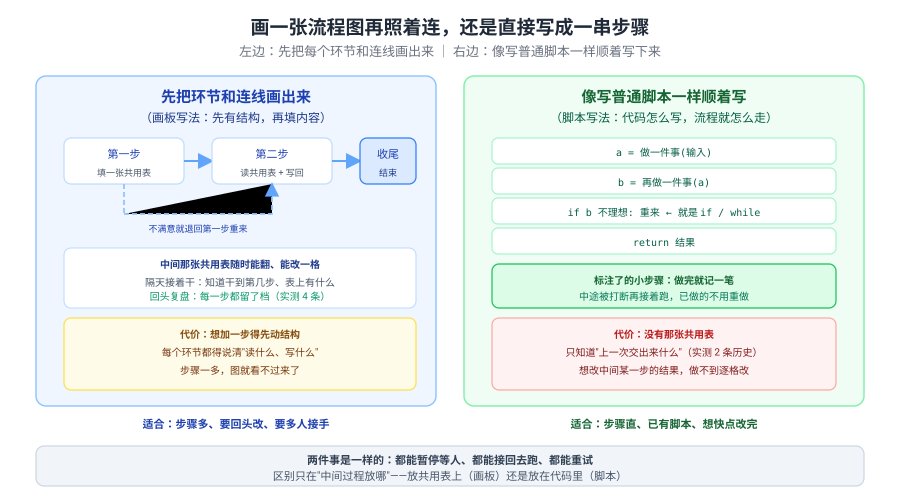
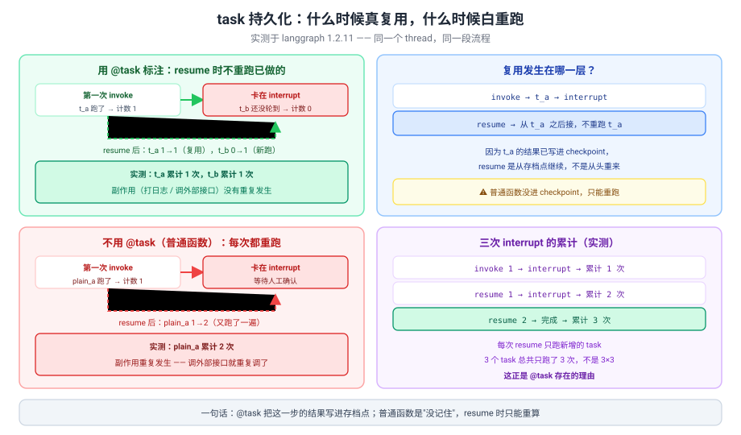
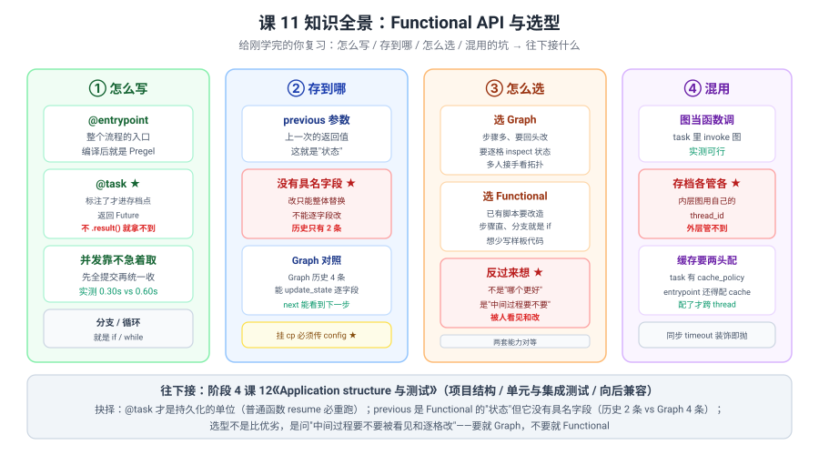

# 课 11：Functional API 与选型

> 所属阶段：阶段 3《可控性与人在环中》｜ 水平：进阶 ｜ 本课知识点：@entrypoint / @task 模型 / 两套 API 选型
> 故事情节：故事主线「敢让它上生产」的第四章——同样是编排，还有另一种写法，什么时候该换
> 📖 结论已按官方文档核对（核对于 2026-10 ｜ 来源：LangGraph Functional API / Choosing between APIs 官方文档 + 本机 langgraph 1.2.11 源码与实测）

## 🎯 本课目标

- 掌握 **Functional API**（`@entrypoint` / `@task`）的心智模型与持久化语义
- 能在 **Graph API 与 Functional API 之间做出有依据的选型**

---

## 第一幕：起源与场景引入

课 10 结尾留了个话头：

> "子图 + 容错正是多智能体的地基——课 11 之后进入阶段 4。"

在进阶段 4 之前，先把**另一套写法**讲完。

**场景**：你接手了一个已有的 Python 脚本，流程是直的：读数据 → 清洗 → 调模型 → 写回。现在要加"中途暂停等人确认"和"崩了能续跑"。

你翻开课 3 学的 Graph API，开始拆：

1. **"就四个步骤，我得先定义 State、再 add_node 四次、再 add_edge 五次……"**——样板比业务还多。
2. **"分支就是个 if，为什么非要写路由函数 + 条件边？"**——控制流被拆成了图的拓扑。
3. **"同事看我的代码，得先看懂图结构才知道在干什么。"**——脚本的可读性没了。

这三个抱怨指向同一件事：**Graph API 要求你先把控制流"画"出来，而有些流程本来就是直的。**

> 🎬 **场景**：前两个是样板负担，第三个是表达力错配——不是图不好，是这个流程不需要图。

> 📌 **一句话本质**：**Functional API 用 `@entrypoint` 把整个流程包成一个可持久化的入口、用 `@task` 标注"这一步的结果要写进存档点"；控制流就是普通的 `if` / `while` / 函数调用，不需要 State、节点和边。它和 Graph API **底层是同一个 Pregel 引擎**，中断、回放、重试、流式全都一样能用。**
>
> ⚖️ **处境对照**：不知道这层，你只能把直流程硬拆成图（样板比业务多），或者自己写 try/except + 状态落盘（重造轮子且和生态脱节）；知道了，一个已有脚本加两个装饰器就有了 checkpoint 和人在环中——**代价是三条**：① **没有具名的中间状态**——只有 `previous`（上一次的返回值），实测历史只有 **2 条**（同样两步的 Graph API 是 **4 条**），不能像 Graph API 那样逐字段 `update_state`；② **`@task` 才进存档点**，普通函数在 resume 时**必然重跑**（实测 `plain_a` 从 1 次变 2 次）；③ **挂了 checkpointer 就必须传 `config`**，不传直接 `ValueError`（Graph API 不传也能跑）。

---

## 第二幕：认知冲突

你把课 8 的 interrupt 搬过来，想在"清洗"之后暂停：

```python
from langgraph.func import entrypoint, task
from langgraph.types import interrupt

@task
def load(x):
    return x + 1

@entrypoint(checkpointer=InMemorySaver())
def flow(x):
    a = load(x).result()
    ans = interrupt({"question": "继续吗", "a": a})
    b = transform(a)          # ← 这个函数没加 @task
    return {"a": a, "b": b, "ans": ans}
```

跑起来，`resume` 之后你数了一下日志——**`transform` 之前的步骤被重跑了一遍**。

更怪的是，你只是想先跑通看看：

```python
flow.invoke(1)          # ← 没传 config
```

结果：

```
ValueError: Checkpointer requires one or more of the following
'configurable' keys: thread_id, checkpoint_ns, checkpoint_id
```

> ❓ **问题**：**同样是"暂停再恢复"，为什么 Graph API 不会重跑前面的节点，这里却会？为什么连 `config` 都成了必填？**

---

## 第三幕：层层揭示

### 一眼全局图（进入细节前先看一眼）



> 看图：左边**先把环节和连线画出来**（中间那张共用表随时能翻、能改一格），右边**像写普通脚本一样顺着写**（分支就是 `if`）。**两件事是一样的**——都能暂停等人、都能接回去跑；区别只在"中间过程放哪"。

### 本课地图（分几步走）

| 步 | 这一步要解决什么（人话） | 对应知识点 |
|:--:|------------------------|-----------|
| 1 | 不画图怎么写？哪些东西会被"记住" | 知识点 1：@entrypoint / @task 模型 |
| 2 | 什么时候该用哪套？能混着用吗 | 知识点 2：两套 API 选型 |

---

### 知识点 1：@entrypoint / @task 模型

> 🧭 第 1/2 步｜承接：第二幕"为什么 resume 会重跑" → 本步：搞清持久化的单位是什么
> 本知识点关键点：函数式心智模型 / task 的持久化语义 / 与 Graph API 节点的对照

#### 一句话定义

**`@entrypoint` 把整个流程编译成一个 Pregel 对象（和 Graph API 编译产物同类）；`@task` 标注的函数其结果会写进存档点，返回的是 `Future`——调用后不立即 `.result()` 就能并发。**

#### 直觉建立（类比）

把它想成**做菜**：

- **`@entrypoint`** = 这道菜的"主流程"，你从头到尾怎么做；
- **`@task`** = **做完一步就把半成品放进冰箱**——下次接着做时不用从头切菜；
- **普通函数** = 没放进冰箱，**下次得重切一遍**。

> 💡 **类比的边界**：真实机制里 ① 放进冰箱的**时机是"这一步做完"**，不是"整道菜做完"；② **只有标了 `@task` 的才放**，你自己写的普通函数**不会自动放**——这是第二幕"为什么重跑"的答案；③ 从冰箱拿出来的前提是**有冰箱**——没挂 checkpointer 就什么都没存，而且 **Functional API 挂了 checkpointer 就强要求你传 `config`**（Graph API 不传也能跑）。

#### 核心原理

**最小形态**：

```python
from langgraph.checkpoint.memory import InMemorySaver
from langgraph.func import entrypoint, task


@task
def add_one(x: int) -> int:
    return x + 1


@entrypoint(checkpointer=InMemorySaver())
def flow(x: int) -> int:
    a = add_one(x).result()
    b = add_one(a).result()
    return b


print(flow.invoke(1, {"configurable": {"thread_id": "t1"}}))     # -> 3
```

> ⚠️ **`config` 是必填的**（挂了 checkpointer 时）。不传直接 `ValueError`，而 Graph API 不传也能跑。

**`@entrypoint` 编译出来是什么**——实测：

```
entrypoint 对象类型: Pregel
有 invoke: True      有 stream: True
有 get_state: True   有 update_state: True   有 get_state_history: True
```

> 🔑 **和 Graph API 是同一个东西**。所以课 4–课 10 学到的**全部能力都能用**：interrupt、time-travel、retry、流式、子图。

**并发靠"不急着取"**（实测）：

```python
@entrypoint(checkpointer=InMemorySaver())
def parallel(x: int) -> int:
    f1 = slow_add(x)          # 0.3s
    f2 = slow_add(x + 10)     # 0.3s
    return f1.result() + f2.result()   # 先全提交，再统一收
```

```
并发两个 0.3s task -> 14  耗时 0.30s
串行（立即 .result()） -> 14  耗时 0.60s
```

> 💡 对照课 4 的 `Send`：**Functional API 的动态扇出就是列表推导**——`[work(i) for i in items]` 先全部提交，再 `[f.result() for f in futs]` 统一收。实测 `f8([1,2,3]) -> {'results': [10, 20, 30]}`。

---

##### 🔑 task 的持久化语义（第二幕的答案）

这是本课**最重要**的一点。实测对照：

```python
@task
def t_a(x):
    print(f"[副作用] t_a 真的跑了")
    return x + 1

@entrypoint(checkpointer=InMemorySaver())
def flow(x):
    a = t_a(x).result()
    ans = interrupt({"question": "继续吗"})
    b = t_b(a).result()
    return {...}
```

实测输出：

```
第一次:  [副作用] t_a 真的跑了，输入 1    t_a=1  t_b=0
resume:  [副作用] t_b 真的跑了，输入 2    t_a=1  t_b=1   ← t_a 没重跑！
```

**对照：不用 `@task` 的普通函数**

```
第一次:  [副作用] plain_a 真的跑了   执行 1 次
resume:  [副作用] plain_a 真的跑了   执行 2 次   ← 又跑了一遍
```



> 看图：上面 `@task` 版 resume 时 `t_a` 保持 1 次；下面普通函数版 `plain_a` 从 1 变 2。**右边是三次 interrupt 的累计**：3 个 task 只跑了 3 次，不是 3×3。

**三次 interrupt 的累计**（实测）：

```
invoke 1:  interrupt -> 累计 1 次
resume 1:  interrupt -> 累计 2 次
resume 2:  完成      -> 累计 3 次
```

> 🔑 **每次 resume 只跑新增的 task**——3 个 task 总共只跑 3 次，不是 3×3。
> ⚠️ **这个价值只在"会中断/会重跑"时才体现**。如果你一次跑完不中断，task 和普通函数没区别——实测同 thread 再 `invoke` 一次，`task` 执行次数从 1 变 2（**没有自动复用**）。

> 💡 **纠正一个常见误解**：不要把 `@task` 当成"缓存"。它不缓存——**它是"把结果写进存档点"**，只有在从存档点恢复（resume / 崩溃续跑）时才体现价值。想真缓存要用 `cache_policy`（见下）。

---

##### `previous` 参数：Functional API 的"状态"

```python
@entrypoint(checkpointer=InMemorySaver())
def f10(x, previous=None):
    prev = previous or 0
    return prev + x
```

实测：

```
第1次 invoke(10): 10
第2次 invoke(5) : 15       <- previous 就是上次的返回值
```

**对照 Graph API**（同样"累加"语义）：

```
Graph API 第1次 (total=0, inc=10): 10
Graph API 第2次 (inc=5)          : 5       <- 没有 reducer 就是覆盖
```

> 🔑 **同一件事两套写法结果不同**：Functional 的 `previous` 天然是"上一次的结果"，Graph API 要靠 reducer 才累加。**但 `previous` 是个整体值，不是具名字段。**

---

##### 三个装饰参数（课 10 的结论直接迁移）

```python
@task(retry_policy=RetryPolicy(max_attempts=3))
@task(cache_policy=CachePolicy(ttl=60))
@task(timeout=0.3)          # 同步 task 装饰时就抛错
```

**`retry_policy`**——课 10 的 `default_retry_on` 完全适用（实测）：

```
NetError + max_attempts=3 -> 执行 3 次后成功
ValueError                -> 执行 1 次（默认不重试）
```

**`cache_policy`**——**要两头配**（实测）：

```
A) task 有 cache_policy，entrypoint 没配 cache -> 同 thread 再来，执行 2 次（没缓存）
B) task 有 + entrypoint 配了 cache           -> 同 thread 1 次，新 thread 也 1 次
```

> 🔑 **`cache_policy` 必须配 `entrypoint(cache=...)` 才生效**，而且**缓存是跨 thread 的**。

**`timeout`**——比 Graph API **更早**报错（实测）：

```
@task(timeout=0.3) 同步 -> ValueError: Node timeouts are only supported for async nodes...
```

> ⚠️ **Graph API 是 `compile()` 时才抛，Functional API 是装饰器求值那一刻就抛**——你连函数都定义不出来。

#### 常见误区

1. **"`@task` 会缓存结果"**——错，**它只把结果写进存档点**；不中断时同 thread 再跑照样重算。
2. **"普通函数也会被记住"**——错，**只有 `@task` 进存档点**，普通函数 resume 必重跑。
3. **"`config` 可传可不传"**——错，挂了 checkpointer **必传**，不传 `ValueError`。
4. **"`cache_policy` 单独配就行"**——错，**还要 `entrypoint(cache=...)`**。
5. **"同步 task 能配 timeout"**——错，**装饰时就抛 ValueError**。

#### 一句话记住

**`@task` 是持久化的单位（普通函数 resume 必重跑）；`previous` 是 Functional 的"状态"但没有具名字段；三个装饰参数与 Graph API 语义一致，只是 timeout 报错更早。**

#### 🗣️ 行话对照

| 本课说法（人话） | 行业标准叫法 | 典型配置 / 在哪遇到 | 代价 |
|---|---|---|---|
| 整个流程的入口 | **@entrypoint** | `@entrypoint(checkpointer=...)` | 挂了 cp 必须传 config |
| 放进冰箱的那一步 | **@task** | `@task` + `.result()` | 不标注就不持久化 |
| 拿结果 | **Future.result()** | `fut = t(x); fut.result()` | 不调就丢弃 |
| 上一次的结果 | **previous** | `def f(x, previous=None)` | 整体值，无具名字段 |
| 真缓存 | **cache_policy** | `@task(cache_policy=CachePolicy(ttl=60))` | 还得配 `entrypoint(cache=)` |
| 并发 | **先提交后收** | `[t(i) for i in xs]` 再统一 `.result()` | 立即 result 就串行 |
| 编译产物 | **Pregel** | 同 Graph API | — |

> 中文均为社区常用译法 / 本文自拟。

#### 官方文档

- [Functional API](https://docs.langchain.com/oss/python/langgraph/functional-api)
- [Use the Functional API](https://docs.langchain.com/oss/python/langgraph/use-functional-api)

---

### 知识点 2：两套 API 选型

> 🧭 第 2/2 步｜承接：会写了 → 本步：什么时候该用哪套、能不能混用
> 本知识点关键点：官方选型判据 / 状态可见性的取舍 / 混用边界与坑

#### 一句话定义

**两套 API 底层是同一个 Pregel 引擎，能力对等；选型不是比优劣，而是问"中间过程要不要被单独看见和逐格修改"——要就 Graph API，不要就 Functional API。**

#### 直觉建立（类比）

把它想成**记笔记的两种方式**：

- **Graph API** = 用一张**结构化的表格**，每个格子有名字（字段），谁都能翻到第几格、改其中一格；
- **Functional API** = 用**流水账**，只记"上一轮交出来什么"，中间怎么算的不单独留档。

> 💡 **类比的边界**：真实机制里 ① 流水账**不是完全没记**——`@task` 的结果进了存档点，只是**没有具名格子**（你不能说"把 `risk` 改成 0.5"）；② 表格的**格子要预先定义**（State schema），加一格要改结构；③ 两者**可以混着用**——账本里可以夹一张表格（task 里调已编译的图），但那张表格**有自己的账本**（内层图用自己的 thread_id）。

#### 核心原理

**实测对照：同样两步流程的"可见性"**

| 维度 | Graph API（2 节点） | Functional API（2 task） |
|---|---|---|
| `get_state().values` | `{'log': ['step1','step2']}` | `{'a': 2}` |
| 历史条数 | **4 条** | **2 条** |
| 历史内容 | `() / ('step2',) / ('step1',) / ('__start__',)` | `() / ('f1',)` |
| 能逐字段改 | ✅ `update_state({'v': 100})` | ⚠️ 只能整体替换返回值 |

> 🔑 **Functional API 只有 entrypoint 一层存档**——task 的结果进了 checkpoint，但**不在历史里单列**。这是它最实质的代价。

**控制流写法对照**：

| 控制流 | Graph API | Functional API |
|---|---|---|
| 分支 | `add_conditional_edges(路由函数)` | `if / else`（就是普通代码） |
| 循环 | 边回指 + 条件边 | `while` |
| 动态扇出 | `Send` | 列表推导 + 并发 task |

实测：

```
Functional f4(20) -> {'kind': '大', 'msg': '走大单流程'}
Functional f4(5)  -> {'kind': '小', 'msg': '走小单流程'}
Functional while 循环 -> {'v': 5}
f8([1,2,3]) -> {'results': [10, 20, 30]}
```

#### 选型判据

**选 Graph API 的信号**：

- 步骤多、拓扑复杂，**需要看结构才能理解**
- **需要逐字段 inspect 和修改中间状态**（time-travel 改某一格）
- 多人协作，**图拓扑是最好的文档**
- 要用 `Send` 做复杂的动态扇出与聚合

**选 Functional API 的信号**：

- **已有脚本要加持久化 / 人在环中**（改造成本最低）
- 控制流**直**，分支就是 `if`、循环就是 `while`
- 不想维护 State schema 的样板
- 团队更熟悉普通 Python

> 🔑 **一句话判据**：**中间过程要不要被人看见和逐格改**——要就 Graph，不要就 Functional。
> 💡 **两者能力对等**：interrupt、time-travel、retry、流式、缓存**全都一样能用**（本课实测逐项验证）。

#### 混用边界

**可以混**：把已编译的图当普通函数在 task 里调（实测）：

```python
@task
def call_graph(x):
    return g.invoke({"v": x}, {"configurable": {"thread_id": f"gg{x}"}})["v"]

@entrypoint(checkpointer=InMemorySaver())
def outer(x):
    return call_graph(x).result() + 1
# -> 12
```

> ⚠️ **三个坑**（实战里逐个撞出来的）：
> 1. **内层图的入参契约是它自己的 State schema**——外层传 `x=1`，内层收到的是 `{"v": 1}`；**字段名对不上就静默取默认值**（实战实测外层传 `{"v": x}` 得到 `1` 而不是期望的 `11`）。
> 2. **内层图用自己的 `thread_id`**——存档各管各的，**外层的 time-travel 管不到内层**（实战实测两次调用结果相同，因为内层状态被覆盖）。
> 3. **缓存两头配**——`task(cache_policy=...)` 还要 `entrypoint(cache=...)`。
>
> 💡 **调试要分层**：外层只看到 entrypoint 一层，内层的事得查内层的 thread。

#### 常见误区

1. **"Functional API 是'简化版'，能力少一些"**——错，**同一个 Pregel 引擎**，interrupt / 回放 / 重试 / 流式全都有。
2. **"选一个就只能用到底"**——错，**可以混用**（图当函数调）。
3. **"混用后 time-travel 能覆盖内层图"**——错，**内层图有独立 thread**。
4. **"Functional 没有状态"**——不准确，**有 `previous`**，只是没有具名字段。

#### 一句话记住

**能力对等，差别在"中间过程放哪"——放具名的 State（Graph）还是放 `previous` 整体值（Functional）；可以混用，但存档和缓存各管各的。**

#### 🗣️ 行话对照

| 本课说法（人话） | 行业标准叫法 | 在哪遇到 | 代价 |
|---|---|---|---|
| 画板写法 | **Graph API / StateGraph** | 课 3 起一直在用 | 样板多、加步要动结构 |
| 脚本写法 | **Functional API** | `@entrypoint` / `@task` | 没有具名中间状态 |
| 怎么选 | **choosing between APIs** | 官方 apis 分区 | 看"中间过程要不要可见" |
| 混着用 | **interop** | task 里 `g.invoke(...)` | 存档各管各 |
| 历史条数 | **state history depth** | `get_state_history` | Functional 只有 2 条 |

#### 官方文档

- [Choosing between the APIs](https://docs.langchain.com/oss/python/langgraph/choosing-apis)
- [Functional API](https://docs.langchain.com/oss/python/langgraph/functional-api)

---

## 第四幕：实操验证

### 4.1 机制验证

> ✅ 实测于 langgraph 1.2.11 / Python 3.12（在 `../langchain/playground` 以 `uv run` 隔离执行）

**验证一：最小 entrypoint / task**

```
flow.invoke(1, config) -> 3
```

**验证二：不挂 checkpointer 也能跑**

```
无 checkpointer -> 2
```

**验证三：task 并发**

```
并发两个 0.3s task -> 14  耗时 0.30s
```

**验证四：串行对照（立即 .result()）**

```
串行 -> 14  耗时 0.60s
```

**验证五：同 thread 再 invoke，task 会不会复用**

```
第一次: 20   task 执行 1 次
同 thread 再 invoke: 20   task 执行 2 次     <- 不复用！
```

**验证六：同 thread 重放（全部重算）**

```
第一次 -> RuntimeError    task 累计 2 次
重放   -> RuntimeError    task 累计 4 次
```

**验证七：返回值可以是 dict 或普通值**

```
返回 dict -> {'out': 6}
返回 int  -> 6
```

**验证八：entrypoint 的能力面**

```
entrypoint 对象类型: Pregel
有 invoke / stream / get_state / update_state / get_state_history: 全 True
```

**验证九：stream 的粒度**

```
stream_mode=updates:
  {'t9': 6}
  {'t9': 18}
  {'f9': {'r': 18}}
stream_mode=values:
  {'r': 18}
```

**验证十：get_state_history 只有两层**

```
历史 2 条:
  next=()        values={'r': 18}
  next=('f9',)   values=None
```

**验证十一：task 的 retry_policy**

```
结果: 5    task 执行 3 次
```

**验证十二：ValueError 不重试（课 10 结论迁移）**

```
抛错 ValueError: 代码bug    task 执行 1 次
```

**验证十三：挂 checkpointer 不传 config**

```
ValueError: Checkpointer requires one or more of the following
'configurable' keys: thread_id, checkpoint_ns, checkpoint_id
```

**验证十四：task 持久化（interrupt + resume）**

```
第一次: [副作用] t_a 真的跑了    t_a=1  t_b=0
resume: [副作用] t_b 真的跑了    t_a=1  t_b=1     <- t_a 复用
```

**验证十五：普通函数对照（必重跑）**

```
第一次: plain_a 执行 1 次
resume: plain_a 执行 2 次
```

**验证十六：三次 interrupt 的累计**

```
invoke 1 -> interrupt  累计 1
resume 1 -> interrupt  累计 2
resume 2 -> 完成       累计 3
```

**验证十七：cache_policy 两头配**

```
A) task 有 / entrypoint 无 cache: 同 thread 执行 2 次（没缓存）
B) task 有 + entrypoint 有 cache: 同 thread 1 次，新 thread 也 1 次
```

**验证十八：同步 task 配 timeout**

```
@task(timeout=0.3) 同步 -> ValueError: Node timeouts are only supported for async nodes
```

**验证十九：async task + timeout**

```
NodeTimeoutError: Node 'slow_async' exceeded its run timeout of 0.300s  耗时 0.30s
```

**验证二十：previous 参数**

```
第1次 invoke(10): 10
第2次 invoke(5) : 15
```

**验证二十一：Graph API 同操作对照**

```
Graph API 第1次: 10
Graph API 第2次: 5        <- 没有 reducer 就是覆盖
```

**验证二十二：entrypoint 嵌套 entrypoint**

```
outer(5) -> 11
```

**验证二十三：task 返回的是 Future**

```
调用后未 result 时: type=Future
属性: ['add_done_callback','cancel','cancelled','done','exception','result','running','set_exception']
```

**验证二十四：不调 .result()**

```
-> {'done': True}       <- 结果被丢弃，不报错
```

**验证二十五：状态可见性对照**

```
Graph API get_state: values={'log': ['step1','step2']}   next=()
Functional get_state: values={'a': 2}                    next=()
```

**验证二十六：历史条数**

```
Graph API（2 节点）  历史 4 条: ['()', "('step2',)", "('step1',)", "('__start__',)"]
Functional（2 task） 历史 2 条: ['()', "('f1',)"]
```

**验证二十七：逐字段改 vs 整体替换**

```
Graph: update_state 后 {'v': 100}          <- 逐字段
Functional: update_state 后 {'v': 100}     <- 整体替换返回值
```

**验证二十八：混用（图当函数调）**

```
entrypoint -> task -> 已编译图 -> 12
```

**验证二十九：interrupt 与 resume（与课 8 一致）**

```
invoke -> {'__interrupt__': [Interrupt(value={'q':'确认','a':2}, ...)]}
resume -> {'a': 2, 'b': 4, 'ans': 'ok'}
```

**验证三十：不挂 checkpointer 时 interrupt（课 8 结论迁移）**

```
无 checkpointer invoke -> {'__interrupt__': [...]}     <- 能停
get_state -> ValueError: No checkpointer set           <- 不能恢复
```

### 4.2 应用实战

🎯 [练一练：应用实战 11「已有脚本想加暂停和断点续跑，要不要重写成图」](../../../应用实战/11-Functional API 与选型.md)

> 基础 → 问题 → 综合三跳：先用两个装饰器给已有脚本加上 checkpoint，再撞上"普通函数 resume 必重跑"和"没有具名状态"，最后用 `@task` + `previous` 收口并给出选型结论。

---

## 第五幕：体系收束

阶段 3 到这一课收官。三句话带走：

1. **`@task` 才是持久化的单位**——普通函数在 resume 时必然重跑；但 `@task` 不是缓存，不中断时同 thread 再跑照样重算。
2. **`previous` 是 Functional 的"状态"，但它没有具名字段**——历史只有 2 条（Graph 是 4 条），不能逐字段改。
3. **选型不是比优劣，是问"中间过程要不要被看见和逐格改"**——要就 Graph，不要就 Functional；两套能力对等，还能混用。

> 📍 **全局定位**：阶段 3 四课走完了一条完整的线——课 8 能暂停（interrupt）、课 9 能回放（time-travel）、课 10 能扛错能拆（retry / 子图）、课 11 知道**还有另一种写法**。这四件事全部长在 **checkpoint** 上（阶段 2 的铺垫在此全部收口）。
> 🔗 **下一步**：阶段 4 课 12《Application structure 与测试》——项目结构、`langgraph.json`、单元与集成测试、向后兼容。

顺带把课 10 埋的伏笔接上：**多智能体 = 多个子图 + 各自的容错策略 + 一个协调者**。进入阶段 4 后你会看到，协调者既可以用 Graph API 画出来，也可以用 Functional API 写成脚本——**本课正是为了让你到时候有得选**。

---

## 🐞 常见误区

1. **"`@task` 会缓存结果"**——错，**只写进存档点**；不中断时同 thread 再跑照样重算。
2. **"普通函数也会被记住"**——错，**只有 `@task` 进存档点**。
3. **"挂了 checkpointer 也可以不传 config"**——错，**必传**，不传 `ValueError`。
4. **"`cache_policy` 单独配就行"**——错，**还要 `entrypoint(cache=...)`**。
5. **"同步 task 能配 timeout"**——错，**装饰时就抛 ValueError**。
6. **"Functional API 是简化版，能力少"**——错，**同一个 Pregel 引擎**。
7. **"Functional 没有状态"**——不准确，**有 `previous`**，只是没有具名字段。
8. **"混用后 time-travel 能覆盖内层图"**——错，**内层图有独立 thread**。
9. **"task 不调 `.result()` 会报错"**——错，**静默丢弃**（实测返回 `{'done': True}`）。
10. **"两套 API 只能二选一"**——错，**可以混用**（图当函数调）。

### ⏳ 与过时说法对照（写前核对有差异时才有，≤3 行）

| 旧说法（网上过时教程 / 训练知识里的说法） | 官方文档 / 本机现状 | 来源 |
|---|---|---|
| "`@task` 的结果会被自动缓存，重复调用直接复用" | 实测同 thread 再 `invoke` 一次，task **执行 2 次**（未复用）；复用只在**从存档点恢复**（resume / 崩溃续跑）时发生，语义是"写进 checkpoint"而非缓存 | 实测 + Functional API 文档 |
| "Functional API 和 Graph API 是两套独立实现，能力不对等" | 实测 `type(entrypoint(...)).__name__ == 'Pregel'`，`invoke/stream/get_state/update_state/get_state_history` 全有；interrupt、resume、retry、timeout 逐项实测通过 | 实测 + choosing-apis 文档 |
| "给同步 `@task` 加 `timeout` 参数即可限制时长" | 实测**装饰器求值那一刻**就抛 `ValueError: Node timeouts are only supported for async nodes`（比 Graph API 的 `compile()` 阶段更早）；async task 才抛 `NodeTimeoutError` | 实测 + `langgraph/func/__init__.py:239` |

## 一图总结



> 看图：四列——怎么写（`@entrypoint` / `@task` / 并发）、存到哪（`previous` / 没有具名字段 / Graph 对照）、怎么选（两套判据）、混用（三个坑）。**与课首那张图的区别**：课首那张给没学过的人看"画板 vs 脚本"，这张给刚学完的你复习"持久化的单位和选型的判据"。

## 课后小测

**Q1**：entrypoint 里有个普通函数（没加 `@task`），`interrupt` 后 `resume`，它会怎样？
- A. 复用上次的结果
- B. 重新执行一遍
- C. 抛异常提示未标注
- D. 被跳过

<details><summary>答案与解析</summary>

**答案：B**。实测 `plain_a` 从 1 次变 2 次——**没标 `@task` 就不进存档点**，resume 是从存档点继续，普通函数只能重算。对照 `@task` 版实测 `t_a` 保持 1 次。这正是第二幕"为什么 resume 会重跑"的答案。

</details>

**Q2**：Functional API 挂了 checkpointer，下面哪种调用会报错？
- A. `flow.invoke(1, {"configurable": {"thread_id": "t1"}})`
- B. `flow.invoke(1)`
- C. `await flow.ainvoke(1, {"configurable": {"thread_id": "t1"}})`
- D. `flow.stream(1, {"configurable": {"thread_id": "t1"}})`

<details><summary>答案与解析</summary>

**答案：B**。实测抛 `ValueError: Checkpointer requires one or more of the following 'configurable' keys: thread_id, checkpoint_ns, checkpoint_id`。而 Graph API 不传 config 也能跑（只是不存档）——**这是两套 API 在易用性上的一个重要差别**，Functional API 要求更严格。

</details>

**Q3**：两段代码都做"累加"，`previous` 版第二次得 15，Graph API 版第二次得 5，为什么？
- A. Functional API 的 checkpointer 更强
- B. `previous` 天然就是上一次的返回值，Graph API 没有 reducer 就是覆盖
- C. Graph API 的 State 写错了
- D. 两次调用的 thread_id 不同

<details><summary>答案与解析</summary>

**答案：B**。实测：`previous` 版第 1 次 10、第 2 次 15（10+5）；Graph API 版第 1 次 10、第 2 次 5（`{'total':..., 'inc':5}` 没配 reducer 就把 `total` 覆盖成 5 或直接是 5）。**Functional 的"状态"就是上一次的返回值整体**，Graph API 要靠 reducer 才累加——这也解释了为什么 Functional 不能"逐字段改"。

</details>

---

## 🚀 下一批接力提示词

> 学完本批后，**复制下面这段文字发给 AI**，即可无缝进入下一批（阶段 3 已全部完成）：

```
继续学 LangGraph。我的学习档案在 langchain/langgraph/00-学习档案.md，
刚学完阶段 3《可控性与人在环中》的课 11《Functional API 与选型》
知识点「@entrypoint / @task 模型 / 两套 API 选型」，
阶段 3 已全部完成，请按大纲进入阶段 4《工程化与上线》
讲解课 12《Application structure 与测试》的知识点。
```

## 🧭 课程导航

- 上一课：[课 10 Fault-tolerance 与 Subgraphs](10-Fault-tolerance 与 Subgraphs.md)
- 返回 [课程目录](../../../02-课程目录.md)
- 下一课：[课 12 Application structure 与测试](../../4-工程化与上线/lessons/12-Application structure 与测试.md)
- 🎯 练一练：应用实战 11（见 4.2）
