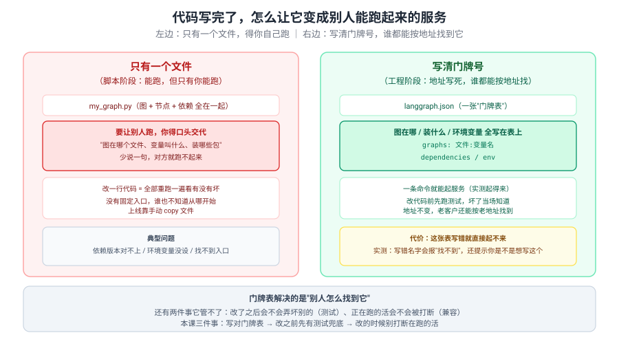
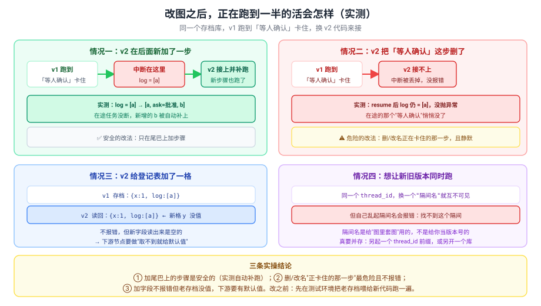
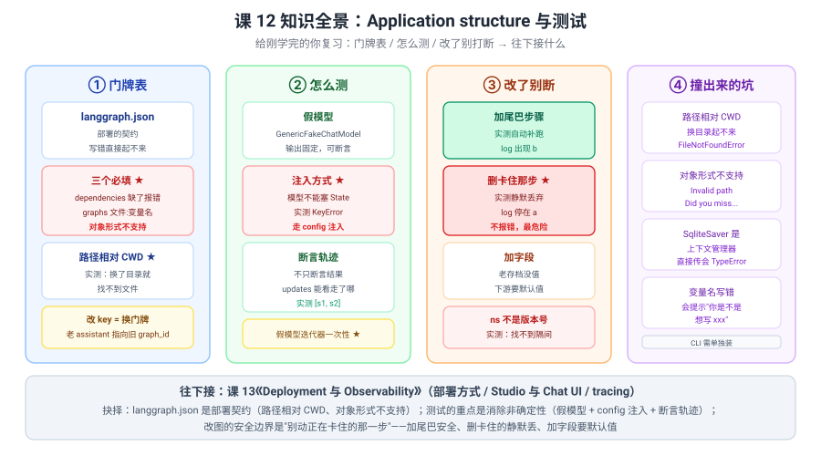

# 课 12：Application structure 与测试

> 所属阶段：阶段 4《工程化与上线》｜ 水平：进阶 ｜ 本课知识点：项目结构与 langgraph.json / 单元与集成测试 / 向后兼容与灰度
> 故事情节：故事主线「搬到生产环境」的第一章——从脚本到工程
> 📖 结论已按官方文档核对（核对于 2026-10 ｜ 来源：LangGraph Application structure / Test / Backward compatibility 官方文档 + 本机 langgraph 1.2.11 / langgraph-cli 0.4.35 / langgraph-api 0.16.0 实测）

## 🎯 本课目标

- 按官方约定组织 LangGraph 项目，**写对 `langgraph.json`**
- 给图写单元与集成测试，**消除非确定性**
- 改图代码时**不断掉在途任务**

---

## 第一幕：起源与场景引入

课 11 结尾，你学会了两套 API，也知道怎么选。现在阶段 3 收官，**图能跑了，能停能续能扛错**。

**场景**：你的图要在团队里上线了。第一天就遇到三件事：

1. **"我把代码发给同事，他跑不起来。"**——你说"图在 `graph.py` 里"，他说"哪个变量？要装什么包？环境变量呢？"——**全是口头交代**。
2. **"我改了一行提示词，怎么知道有没有弄坏别的？"**——没有测试，只能手动点一遍，而 agent 每次输出还不一样。
3. **"我刚改完代码部署，有个正在等审批的任务就废了。"**——改结构把在途任务打断了。

这三个抱怨指向同一件事：**图能跑 ≠ 能上线**。中间隔着"工程化"这一层。

> 🎬 **场景**：第一个是缺契约（别人不知道怎么跑），第二个是缺测试（改了不敢确定），第三个是缺兼容（改了会打断）——**三个都是"从脚本到工程"的必修课**。

> 📌 **一句话本质**：**LangGraph 把"部署契约"外化成 `langgraph.json` 一个文件——图在哪（`graphs`）、装什么（`dependencies`）、环境变量（`env`）都写在这里；而测试与向后兼容是它的两翼：测试消除 agent 的非确定性，向后兼容保证改结构不断掉在途任务。**
>
> ⚖️ **处境对照**：不知道这层，你只能口头交代怎么跑、手动点一遍验证、深夜停机发布；知道了，一条命令起服务、改代码前有测试兜底、改结构能挑安全的改法——**代价是三条**：① **`langgraph.json` 写错就直接起不来**，实测缺 `dependencies` 报 `No dependencies found in config`、变量名写错报 `Could not find graph 'xxx'`；② **`graphs` 路径是相对当前工作目录（CWD）解析的**，实测换成别的目录启动就 `FileNotFoundError`；③ **`graphs` 的值不支持对象形式**（`{"path":..., "variable":...}`），实测报 `Invalid path ... Did you miss a variable name?`。

---

## 第二幕：认知冲突

你照着印象写了 `langgraph.json`，然后从项目目录启动：

```json
{
  "dependencies": ["."],
  "graphs": { "my_agent": "./src/my_agent/graph.py:graph" }
}
```

**第一次**（在 `playground/` 目录下启动）：

```
error  Graph 'my_agent' failed to load: FileNotFoundError:
       [Errno 2] No such file or directory:
       '/root/learning/langchain/langchain/playground/src/my_agent/graph.py'
```

**第二次**（换成对象形式，你觉得更清楚）：

```json
"graphs": { "my_agent": { "path": "./src/my_agent/graph.py", "variable": "graph" } }
```

```
ValueError: Invalid path '{'path': './src/my_agent/graph.py', 'variable': 'graph'}'
for graph 'my_agent'. Did you miss a variable name?
```

然后你想给图写测试，把假模型塞进 State：

```python
g.invoke({"messages": [], "model": fake})     # → KeyError: 'model'
```

> ❓ **问题**：**明明路径写对了、配置也写了，为什么换个目录就找不到文件？为什么"更清楚"的对象写法反而不认？为什么模型塞进 State 读不到？**

---

## 第三幕：层层揭示

### 一眼全局图（进入细节前先看一眼）



> 看图：左边**只有一个文件**（靠口头交代），右边**写清门牌号**（地址写死，谁都能找）。**门牌表解决的是"别人怎么找到它"**——还有两件事它管不了：改了会不会弄坏别的（测试）、正在跑的活会不会被打断（兼容）。

### 本课地图（分几步走）

| 步 | 这一步要解决什么（人话） | 对应知识点 |
|:--:|------------------------|-----------|
| 1 | 怎么让别人按地址找到我的图 | 知识点 1：项目结构与 langgraph.json |
| 2 | 改了怎么知道没弄坏 | 知识点 2：单元与集成测试 |
| 3 | 改的时候别打断正在跑的活 | 知识点 3：向后兼容与灰度 |

---

### 知识点 1：项目结构与 langgraph.json

> 🧭 第 1/3 步｜承接：第二幕"换个目录就找不到" → 本步：搞清这个配置文件到底是什么
> 本知识点关键点：官方目录约定 / 配置字段 / 依赖与环境变量

#### 一句话定义

**`langgraph.json` 是 LangGraph 项目的部署契约：声明图的位置（`graphs`）、Python 依赖（`dependencies`）与环境变量（`env`）；CLI 与云平台都读这一个文件来加载你的图。**

#### 直觉建立（类比）

把它想成**门牌表**：

- **`graphs`** = "几号楼几零几住着谁"——图在哪个文件、变量叫什么；
- **`dependencies`** = "这栋楼要通什么水电"——要装哪些包；
- **`env`** = "进门密码"——环境变量。

> 💡 **类比的边界**：真实机制里 ① 门牌号（`graphs` 的 key）**就是部署后的 `graph_id`**，改名等于换门牌，老客户按老地址找不到你；② 水电（`dependencies`）**缺了直接不让开工**（实测 `No dependencies found in config`）；③ 地址是**相对你现在站的位置（CWD）看的**，不是相对门牌表放的位置——这是第二幕第一个报错的根源。

#### 核心原理

**官方推荐的最小结构**：

```
my-app/
├── langgraph.json          # 部署契约
├── .env                    # 环境变量（可选）
├── pyproject.toml          # 依赖声明
└── src/my_agent/
    ├── __init__.py
    └── graph.py            # 导出 graph 变量
```

**最小可用配置**（实测起得来）：

```json
{
  "dependencies": ["."],
  "graphs": { "my_agent": "./src/my_agent/graph.py:graph" }
}
```

> ⚠️ **两个必填**：`dependencies` 和 `graphs` 缺一不可。

**实测启动成功**（langgraph-cli 0.4.35 / langgraph-api 0.16.0）：

```
🚀 API: http://127.0.0.1:8123
🎨 Studio UI: https://smith.langchain.com/studio/?baseUrl=http://127.0.0.1:8123
```

```
curl http://127.0.0.1:8123/ok            -> {"ok":true,"services":{}}
POST /assistants/search                  -> [{"graph_id":"my_agent","name":"my_agent","version":1}]
/openapi.json                            -> title: LangSmith Deployment, paths 数: 50
```

> 🔑 **`graphs` 的 key 就是 `graph_id`**——部署后 assistant 的 `graph_id` 与之一致（实测 `"graph_id":"my_agent"`）。

##### 三个字段的真实行为（实测）

| 字段 | 实测行为 |
|---|---|
| `dependencies: ["."]` | 缺了 → `Error: No dependencies found in config. Consider using uv-based source management:` |
| `graphs: "路径:变量名"` | 变量名写错 → `ValueError: Could not find graph 'notgraph' in '...'. Did you mean to use one of the following? - ...:graph` |
| `graphs: {...}` 对象形式 | **不支持** → `ValueError: Invalid path '{'path': ...}'. Did you miss a variable name?` |

> 💡 **好消息**：变量名写错时报错**很友好**——它会把你文件里所有可导出的候选列出来（实测提示 `b` 和 `graph` 两个）。
> ⚠️ **路径是相对 CWD 解析的**（第二幕第一个报错）——所以**必须从项目根目录启动**，或者用 `--config` 指到配置文件的同时也 `cd` 过去。

##### `env` 字段

```json
{ "env": ".env" }                    # 从 .env 文件读
{ "env": { "API_KEY": "xxx" } }      # 或者直接写键值对
```

> ⚠️ 直接把密钥写进 `langgraph.json` 意味着它会进版本库——**生产用 `.env` + 平台侧的密钥管理**。

#### 常见误区

1. **"`graphs` 路径是相对 `langgraph.json` 所在目录"**——错，**相对 CWD**，实测换目录就 `FileNotFoundError`。
2. **"`graphs` 可以用对象形式写得更清楚"**——错，**不支持**，实测 `Invalid path ... Did you miss a variable name?`。
3. **"`dependencies` 可以省略"**——错，实测直接 `No dependencies found in config`。
4. **"改 `graphs` 的 key 无所谓"**——错，**key 就是 `graph_id`**，改名后老的 assistant 仍指向旧 id。
5. **"装了 langgraph 就有 CLI"**——错，**CLI 是独立包** `langgraph-cli`（实测需 `uv run --with "langgraph-cli[inmem]"`）。

#### 一句话记住

**`langgraph.json` 是部署契约：`dependencies` + `graphs` 必填，路径相对 CWD，值只认 `"文件:变量名"` 字符串，key 就是 `graph_id`。**

#### 🗣️ 行话对照

| 本课说法（人话） | 行业标准叫法 | 典型配置 / 在哪遇到 | 代价 |
|---|---|---|---|
| 门牌表 | **langgraph.json** | 项目根目录 | 写错直接起不来 |
| 图在哪 | **graphs** | `{"名字": "./路径/文件.py:变量名"}` | 不支持对象形式 |
| 要装什么 | **dependencies** | `["."]` 或 `["./src"]` | 缺了报错 |
| 进门密码 | **env** | `".env"` 或 `{"K":"V"}` | 写死会进版本库 |
| 门牌号 | **graph_id** | `langgraph.json` 的 key | 改名=换 id |
| 一条命令起服务 | **langgraph dev** | `langgraph-cli[inmem]` | CLI 要单独装 |
| 服务 | **LangGraph API server** | langgraph-api 0.16.0 | — |

#### 官方文档

- [Application structure](https://docs.langchain.com/oss/python/langgraph/application-structure.md)

---

### 知识点 2：单元与集成测试

> 🧭 第 2/3 步｜承接：会写配置了 → 本步：改了怎么知道没弄坏
> 本知识点关键点：假模型替换 / 断言轨迹 / 消除非确定性

#### 一句话定义

**agent 测试的头号敌人是非确定性；标准解法是三件套——用假模型（如 `GenericFakeChatModel`）替掉真实 LLM、把依赖通过 `config["configurable"]` 注入、断言"走了哪些节点"而不只是断言最终结果。**

#### 直觉建立（类比）

把它想成**考试要有标准答案**：

- **假模型** = 用**标准答题卡**代替真人答题——每次答案一样；
- **注入** = 考试时**发下去**的笔，不是学生自己带的；
- **断言轨迹** = 不只看最后得分，**还看解题步骤**。

> 💡 **类比的边界**：真实机制里 ① 答题卡（`GenericFakeChatModel(messages=iter([...]))`）**是一次性的**——实测第二次调用抛 `RuntimeError: generator raised StopIteration`，每轮测试要重新构造；② 笔**不能塞进 State**（实测 `KeyError: 'model'`），必须走 `config`；③ 解题步骤可以**不埋桩**就看——用 `stream_mode="updates"`（实测得到 `['s1','s2']`）。

#### 核心原理

##### 为什么模型不能塞进 State（第二幕第三问）

```python
g.invoke({"messages": [], "model": fake})     # → KeyError: 'model'
```

> 🔑 **State 是 schema，不是传参袋**——没在 State 里声明的键，节点读不到。这是 LangGraph 的设计（状态要可序列化、可存档），不是 bug。

**正确做法：`config` 注入**

```python
from langchain_core.language_models.fake_chat_models import GenericFakeChatModel
from langchain_core.messages import AIMessage


def llm_node(s, config):                       # ← 第二参数接 config
    model = config["configurable"]["model"]    # ← 从这里取
    resp = model.invoke(s.get("messages", []))
    return {"messages": list(s.get("messages", [])) + [resp]}


fake = GenericFakeChatModel(messages=iter([AIMessage(content="固定回复")]))
r = g.invoke({"messages": []}, {"configurable": {"model": fake}})
```

实测：

```
用假模型 -> ['固定回复']
```

> ✅ **输出完全确定**，可以写断言。
> ⚠️ **迭代器一次性**：第二次用同一个 `fake` 抛 `RuntimeError: generator raised StopIteration`——**每个测试用例重新构造**。

##### 断言轨迹，不只断言结果

```python
trace = []

def s1(s): trace.append("s1"); return {"v": s.get("v", 0) + 1}
def s2(s): trace.append("s2"); return {"v": s.get("v", 0) * 10}
def route(s):
    trace.append("route")
    return "s2" if s.get("v", 0) > 0 else END
```

实测：

```
结果: {'v': 10}
轨迹: ['s1', 'route', 's2']
```

**不埋桩的写法**（更推荐）：

```python
steps = [list(c.keys())[0] for c in g2.stream({"v": 0}, stream_mode="updates")]
# -> ['s1', 's2']
```

> 🔑 **只看结果 `{'v': 10}` 你不知道走了哪条分支；看轨迹才知道**。路由逻辑的回归测试尤其需要它。

##### 测 interrupt

```python
r = g3.invoke({"v": 0}, config=cfg)
assert "__interrupt__" in r                    # 断言"停下来"
r2 = g3.invoke(Command(resume="批准"), config=cfg)
```

实测：

```
invoke -> {'v': 1, '__interrupt__': [Interrupt(value={'question': '批准吗', 'v': 1}, ...)]}
有 __interrupt__: True
resume -> {'v': 1}
```

> 💡 **断言点有两个**：`__interrupt__` 存在（确实停了）+ resume 后值正确（确实接上了）。

##### 非确定性长什么样

```python
outs = [g4.invoke({"v": 0})["v"] for _ in range(10)]
# -> [1, 1, 3, 3, 3, 2, 1, 1, 3, 2]
```

> ❌ **这种图没法写断言**——必须消随机性。

##### cassette 回放（外部 API）

```python
mode = "record"   # 第一次真调，把结果记进 cassette
mode = "replay"   # 之后从 cassette 取，不碰外部
```

实测：

```
record 模式 -> {'temp': 26, 'cond': '晴'}
replay 模式 -> {'temp': 26, 'cond': '晴'}
```

> 💡 官方推荐 `pytest-recording` / `vcrpy`；核心思想就这一句：**第一次录，之后放**。

#### 常见误区

1. **"把模型塞进 State 传进去"**——错，**`KeyError`**，要走 `config["configurable"]`。
2. **"假模型可以复用"**——错，`iter([...])` **一次性**，实测第二次抛 `RuntimeError`。
3. **"断言最终输出就够了"**——不够，**路由分支看不出来**，要断言轨迹。
4. **"测试用真 LLM 更真实"**——**又慢又不稳定**，且花钱，CI 里必挂。
5. **"外部 API 用 mock 就行"**——mock 要自己维护返回值，**cassette 更省事且更真实**。

#### 一句话记住

**三件套：假模型（每轮重建）+ `config` 注入 + 断言轨迹（`stream_mode="updates"`）；非确定性不消除就写不了断言。**

#### 🗣️ 行话对照

| 本课说法（人话） | 行业标准叫法 | 典型配置 | 代价 |
|---|---|---|---|
| 标准答题卡 | **GenericFakeChatModel** | `messages=iter([AIMessage(...)])` | 一次性 |
| 发下去的笔 | **config 注入** | `config["configurable"]["model"]` | 要改节点签名 |
| 看解题步骤 | **断言轨迹** | `stream_mode="updates"` | — |
| 录下来回放 | **cassette / vcrpy** | `pytest-recording` | 要维护录制文件 |
| 单元测试 | **unit test** | 只测单个节点 | — |
| 集成测试 | **integration test** | 测整图 | 要消随机性 |

#### 官方文档

- [Test](https://docs.langchain.com/oss/python/langgraph/test.md)

---

### 知识点 3：向后兼容与灰度

> 🧭 第 3/3 步｜承接：有测试了 → 本步：改的时候别打断正在跑的活
> 本知识点关键点：在途任务不中断 / 版本并存 / 命名空间

#### 一句话定义

**改图的安全边界：加"尾巴上的步骤"是安全的（新步骤会被自动补跑）；删或改名"正在卡住的那一步"最危险（中断被静默丢弃，不报错）；加 State 字段不报错但老存档没值，下游要有默认值。**

#### 直觉建立（类比）

把它想成**装修时不能拆承重墙**：

- **加尾巴上的步骤** = 在走廊尽头**再加一间房**（还会自己走一遍）——不影响已经走到一半的人；
- **删掉正在卡住的那一步** = 把人家**正站着的那块地板拆了**——人没了，还不报错；
- **加字段** = **新房间还没放家具**——不塌，但进去是空的。

> 💡 **类比的边界**：真实机制里 ① "再加一间房"**会被自动走一遍**（实测 log 从 `['a']` 变成 `['a', 'ask=批准', 'b']`）；② "拆地板"是**静默的**——实测 resume 后 log 仍是 `[a]`，**没有任何异常**；③ "空房间"读出来**不是 None 而是整个字段缺失**，下游 `s["y"]` 会 `KeyError`，所以要用 `.get()`。

#### 核心原理



##### 四种改法的实测

| 改法 | 实测结果 | 安全吗 |
|---|---|---|
| **尾巴上加一步** | `log: ['a'] → ['a', 'ask=批准', 'b']`（新步骤自动补跑） | ✅ 安全 |
| **删掉正在卡住的那步** | `log` 仍是 `['a']`，resume **不报错**，中断消失 | ❌ **最危险（静默）** |
| **State 加字段** | v2 读老存档得到 `{x:1, log:[a]}`，新字段 `y` 无值 | ⚠️ 要默认值 |
| **换 `checkpoint_ns` 当版本号** | `ValueError: Subgraph v2 not found` | ❌ 不能这么用 |

> 🔑 **加节点是安全的**——v1 卡在 interrupt，v2 代码 resume 后**新加的 `b` 也被执行了**（实测 log 从 `['a']` 变成 `['a', 'ask=批准', 'b']`）。
> 🔴 **删节点是静默的**——这是本课最需要记住的一条：**没有异常、没有警告，那个"等人确认"就这么没了**。

**删节点实测对照**：

```
有 ask 的版本跑到中断: {'x': 1, 'log': ['a'], '__interrupt__': [...]}
无 ask 的版本 resume -> {'x': 1, 'log': ['a']}        ← 中断没了，没报错
```

##### 灰度与版本并存

**不能拿 `checkpoint_ns` 当版本号**（实测）：

```python
c_b = {"configurable": {"thread_id": "shared", "checkpoint_ns": "v2"}}
g.get_state(c_b)     # -> ValueError: Subgraph v2 not found
```

> 🔑 **`checkpoint_ns` 是给"图里套图"（子图）用的**，不是给你当版本号的——传一个不存在的 ns，它按"找子图"去查，查不到就抛错。

**可行的并存方式**：

- **另起 `thread_id` 前缀**（如 `v2-{user_id}`）——最简单；
- **另开一个存档库**——彻底隔离；
- **`langgraph.json` 里同时声明新旧两个 key**——新旧 graph_id 并存，流量按 key 切换（改 key 等于换门牌，老 assistant 仍指向旧 id，正好可以并存）。

##### 官方给的安全改法清单

- ✅ **加节点 / 加边**（在已有流程之后）
- ✅ **加 State 字段**（配好默认值）
- ⚠️ **删节点 / 改名**——先确认没有在途任务卡在那一步
- ❌ **改 State 字段的类型 / 语义**——老存档的值可能不兼容

#### 常见误区

1. **"删掉一个节点，在途任务会报错提醒我"**——错，**静默丢弃**（实测 log 停在 `[a]`）。
2. **"加 State 字段后老存档会带默认值"**——错，**老存档里没有这一格**，读出来是缺失。
3. **"`checkpoint_ns` 可以当版本号用"**——错，实测 `Subgraph v2 not found`。
4. **"改 `graphs` 的 key 会迁移老任务"**——错，**key 就是 `graph_id`**，老 assistant 指向旧 id。
5. **"加节点在途任务不会跑到新节点"**——错，实测**新节点会被补跑**。

#### 一句话记住

**加尾巴安全、删卡住的那步最危险且静默、加字段要默认值；`checkpoint_ns` 是子图用的，别当版本号。**

#### 🗣️ 行话对照

| 本课说法（人话） | 行业标准叫法 | 在哪遇到 | 代价 |
|---|---|---|---|
| 正在跑到一半的活 | **in-flight run** | 卡在 interrupt / 长任务 | 改结构最易断 |
| 加尾巴的步骤 | **additive change** | 加节点 / 加边 | 安全 |
| 拆承重墙 | **breaking change** | 删/改名节点 | 静默丢中断 |
| 老存档 | **existing checkpoint** | 生产库里的历史 thread | 加字段没值 |
| 隔间名 | **checkpoint_ns** | 子图隔离 | 不是版本号 |
| 门牌号 | **graph_id** | `langgraph.json` 的 key | 改名=新 id |
| 同时跑新旧 | **version coexistence** | 双 key / 前缀 / 分库 | 要多维护一份 |

#### 官方文档

- [Backward compatibility](https://docs.langchain.com/oss/python/langgraph/backward-compatibility.md)

---

## 第四幕：实操验证

> ✅ 实测于 langgraph 1.2.11 / langgraph-cli 0.4.35 / langgraph-api 0.16.0 / pytest 9.1.1 / Python 3.12（在 `../langchain/playground` 以 `uv run` 隔离执行）
> ⚠️ **`langgraph.testing` 模块不存在**（实测 `ModuleNotFoundError`）——官方测试页讲的是模式与工具组合，不是一个可 import 的测试框架。

### 4.1 机制验证

**验证一：最小 `langgraph.json`**

```json
{
  "dependencies": ["."],
  "graphs": { "my_agent": "./src/my_agent/graph.py:graph" }
}
```

**验证二：CLI 可用**

```
langgraph dev --help 退出码: 0
Usage: langgraph dev [OPTIONS]  🏃‍♀️‍➡️ Run LangGraph API server in development mode...
```

**验证三：从别的目录启动（路径相对 CWD）**

```
error  Graph 'my_agent' failed to load: FileNotFoundError:
       [Errno 2] No such file or directory:
       '/root/learning/langchain/langchain/playground/src/my_agent/graph.py'
```

**验证四：从项目根启动成功**

```
🚀 API: http://127.0.0.1:8123
🎨 Studio UI: https://smith.langchain.com/studio/?baseUrl=http://127.0.0.1:8123
📚 API Docs: http://127.0.0.1:8123/docs
```

**验证五：服务端点**

```
GET  /ok                    -> {"ok":true,"services":{}}
POST /assistants/search     -> [{"graph_id":"my_agent","name":"my_agent","version":1}]
GET  /openapi.json          -> title: LangSmith Deployment, paths 数: 50
```

**验证六：缺 `dependencies`**

```
退出码: 2
Error: No dependencies found in config. Consider using uv-based source management:
```

**验证七：变量名写错**

```
ValueError: Could not find graph 'notgraph' in './src/my_agent/graph.py'. Please check that:
1. The file exports a variable named 'notgraph'
2. The variable name in your config matches the export name
Did you mean to use one of the following?
	- ./src/my_agent/graph.py:b
	- ./src/my_agent/graph.py:graph
```

**验证八：对象形式**

```
ValueError: Invalid path '{'path': './src/my_agent/graph.py', 'variable': 'graph'}'
for graph 'my_agent'. Did you miss a variable name?
```

**验证九：CLI 不在 langgraph 包里**

```
uv run --with langgraph langgraph --version
  -> error: Failed to spawn: `langgraph`  Caused by: No such file or directory

uv run --with "langgraph-cli[inmem]" langgraph --version
  -> LangGraph CLI, version 0.4.35
```

**验证十：`langgraph.testing` 不存在**

```
langgraph.testing -> ModuleNotFoundError: No module named 'langgraph.testing'
```

**验证零：模型塞进 State**

```
把 model 放进 State -> KeyError: 'model'
```

**验证十一：假模型 + config 注入**

```
用假模型 -> ['固定回复']
```

**验证十二：假模型迭代器一次性**

```
第二次抛错 RuntimeError: generator raised StopIteration
```

**验证十三：断言轨迹（埋桩）**

```
结果: {'v': 10}
轨迹: ['s1', 'route', 's2']
```

**验证十四：断言轨迹（不埋桩）**

```
updates 轨迹: ['s1', 's2']
```

**验证十五：测 interrupt**

```
invoke -> {'v': 1, '__interrupt__': [Interrupt(value={'question': '批准吗', 'v': 1}, ...)]}
有 __interrupt__: True
resume -> {'v': 1}
```

**验证十六：非确定性**

```
10 次 invoke 结果: [1, 1, 3, 3, 3, 2, 1, 1, 3, 2]
```

**验证十七：cassette 回放**

```
record 模式 -> {'temp': 26, 'cond': '晴'}
replay 模式 -> {'temp': 26, 'cond': '晴'}
```

**验证十八：加节点（v2 补跑）**

```
v1 invoke -> {'x': 1, 'log': ['a'], '__interrupt__': [...]}
v2 resume -> {'x': 1, 'log': ['a', 'ask=批准', 'b']}            ← b 被补跑
```

**验证十九：删节点（静默）**

```
有 ask 的版本跑到中断: {'x': 1, 'log': ['a'], '__interrupt__': [...]}
无 ask 的版本 resume -> {'x': 1, 'log': ['a']}                  ← 中断消失，没报错
```

**验证二十：State 加字段**

```
v1 跑一轮: {'x': 1, 'log': ['a']}
v2 读老 thread -> {'x': 1, 'log': ['a']}                        ← 新字段 y 没值
```

**验证二十一：`checkpoint_ns` 当版本号**

```
回读默认 ns: {'x': 1, 'log': ['a', 'a']}
回读 ns=v2 : ValueError: Subgraph v2 not found
```

**验证二十二：`SqliteSaver.from_conn_string` 是上下文管理器**

```
TypeError: Invalid checkpointer provided. Expected an instance of `BaseCheckpointSaver`,
`True`, `False`, or `None`. Received _GeneratorContextManager.
```

**验证二十三：`State(dict)` 类注解不生效**

```
v1 图跑一轮: None          ← 用 class State(dict) 且字段未声明时读出空
```

> 💡 用 `TypedDict` + `Annotated` 才拿到干净的 `{'x': 1, 'log': [...]}`，建议项目里一律用 TypedDict。

### 4.2 本课实操

> 本课的实操由**结课综合实战项目**承接（跨阶段整合），不单配应用实战。

---

## 第五幕：体系收束

三句话带走：

1. **`langgraph.json` 是部署契约**——`dependencies` + `graphs` 必填，路径相对 CWD，值只认 `"文件:变量名"`，key 就是 `graph_id`。
2. **测试的重点是消除非确定性**——假模型（每轮重建）+ `config` 注入 + 断言轨迹；`langgraph.testing` 并不存在，官方讲的是模式。
3. **改图的安全边界是"别动正在卡住的那一步"**——加尾巴安全（还会自动补跑）、删卡住的**静默丢失**、加字段要默认值。

> 📍 **全局定位**：阶段 4 是"搬到生产环境"。课 12 解决**上线前**（契约 + 测试 + 兼容），课 13 解决**上线时与上线后**（部署方式 + Studio/Chat UI + tracing）。
> 🔗 **下一步**：课 13《Deployment 与 Observability》——云部署 vs 自托管、Studio 与 Agent Chat UI、LangSmith 接入。

回扣阶段 2：**课 9 的 time-travel 在这里有了新用途**——老存档喂给新代码跑一遍，就是最贴近生产的兼容性测试。也回扣课 5：**checkpointer 选什么后端，直接决定了你能不能做灰度**（分库 / 分前缀都依赖它）。

---

## 🐞 常见误区

1. **"`graphs` 路径相对 `langgraph.json` 所在目录"**——错，**相对 CWD**。
2. **"`graphs` 支持对象形式"**——错，**只认字符串**。
3. **"`dependencies` 可省略"**——错，实测直接报错。
4. **"改 `graphs` key 无所谓"**——错，**key 就是 `graph_id`**。
5. **"装了 langgraph 就有 CLI"**——错，要单独装 `langgraph-cli`。
6. **"有 `langgraph.testing` 这个模块"**——错，**不存在**。
7. **"模型可以塞进 State 传"**——错，**`KeyError`**，走 `config`。
8. **"假模型能复用"**——错，**迭代器一次性**。
9. **"断言最终输出就够"**——不够，要**断言轨迹**。
10. **"删节点会有报错"**——错，**静默丢弃中断**。
11. **"`checkpoint_ns` 可以当版本号"**——错，`Subgraph not found`。

### ⏳ 与过时说法对照（写前核对有差异时才有，≤3 行）

| 旧说法（网上过时教程 / 训练知识里的说法） | 官方文档 / 本机现状 | 来源 |
|---|---|---|
| "`langgraph.json` 的 `graphs` 可以写成 `{"path": "...", "variable": "..."}` 对象" | 实测**不支持**——报 `ValueError: Invalid path '{'path': ...}'. Did you miss a variable name?`；本机 langgraph-api 0.16.0 只接受 `"文件:变量名"` 字符串 | 实测 + application-structure 文档 |
| "装 langgraph 就能用 `langgraph dev`" | 实测 `Failed to spawn: langgraph: No such file or directory`；CLI 在独立包 `langgraph-cli`（本机 0.4.35），需 `uv run --with "langgraph-cli[inmem]"` | 实测 + 官方安装页 |
| "`langgraph.testing` 提供测试工具" | 实测 `ModuleNotFoundError: No module named 'langgraph.testing'`；官方测试页讲的是**模式**（假模型 / 断言 / cassette），不是可 import 的框架 | 实测 + test 文档 |

## 一图总结



> 看图：四列——门牌表（三个必填 / 路径相对 CWD / 对象形式不支持）、怎么测（假模型 / config 注入 / 断言轨迹）、改了别断（加尾巴安全 / 删卡住的静默 / 加字段没值）、撞出来的坑。**与课首那张图的区别**：课首给没学过的人看"脚本 vs 工程"，这张给刚学完的你复习"契约 + 测试 + 兼容"三条线。

## 课后小测

**Q1**：`langgraph.json` 里 `graphs` 的路径是相对于什么解析的？
- A. 相对 `langgraph.json` 所在目录
- B. 相对当前工作目录（CWD）
- C. 相对 Python 包根目录
- D. 相对项目 `src/`

<details><summary>答案与解析</summary>

**答案：B**。实测从 `playground/` 目录启动时报 `FileNotFoundError: '/root/.../playground/src/my_agent/graph.py'`——它把路径拼到了 CWD 上，而不是配置文件所在目录。**所以必须从项目根目录启动**（或用 `--config` 指定配置文件的同时 `cd` 过去）。

</details>

**Q2**：你想给图写测试，把假模型塞进 State 传进去，会发生什么？
- A. 正常运行，节点能取到
- B. `KeyError: 'model'`
- C. 静默变成 None
- D. 编译期报错

<details><summary>答案与解析</summary>

**答案：B**。实测 `KeyError: 'model'`。**State 是 schema 不是传参袋**——没在 State 里声明的键节点读不到。正确做法是用 `config["configurable"]["model"]` 注入，节点签名写成 `def node(s, config)`。

</details>

**Q3**：v1 的图卡在 interrupt，你部署了 v2——v2 删掉了那个 interrupt 节点。resume 会怎样？
- A. 抛异常提醒你结构变了
- B. 正常继续，中断被静默丢弃
- C. 回到起点重跑
- D. 报 `Subgraph not found`

<details><summary>答案与解析</summary>

**答案：B**。实测 `resume -> {'x': 1, 'log': ['a']}`——**没有任何异常**，那个"等人确认"就这么没了。这是本课最危险的一条：**删/改名正在卡住的那一步是静默的**。对照之下，在尾巴上**加**节点是安全的（实测 log 变成 `['a', 'ask=批准', 'b']`，新步骤被自动补跑）。

</details>

---

## 🚀 下一批接力提示词

> 学完本批后，**复制下面这段文字发给 AI**，即可无缝进入下一批：

```
继续学 LangGraph。我的学习档案在 langchain/langgraph/00-学习档案.md，
刚学完阶段 4《工程化与上线》的课 12《Application structure 与测试》
知识点「项目结构与 langgraph.json / 单元与集成测试 / 向后兼容与灰度」，
请按大纲继续讲解课 13《Deployment 与 Observability》的知识点。
```

## 🧭 课程导航

- 上一课：[课 11 Functional API 与选型](../../3-可控性与人在环中/lessons/11-Functional API 与选型.md)
- 返回 [课程目录](../../../02-课程目录.md)
- 下一课：[课 13 Deployment 与 Observability](13-Deployment 与 Observability.md)
