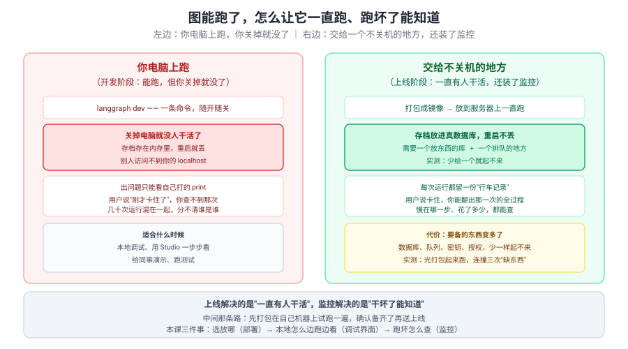
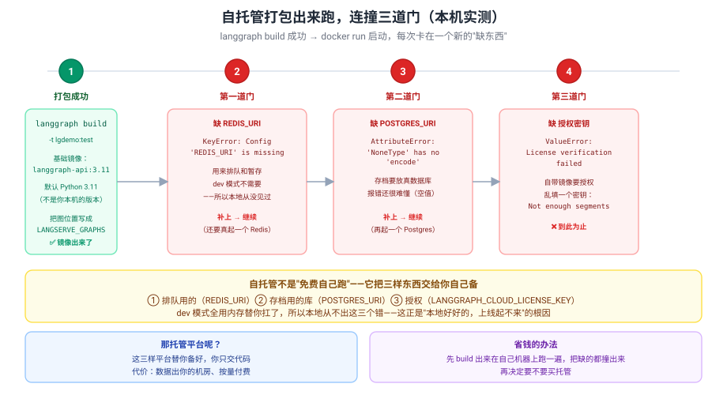
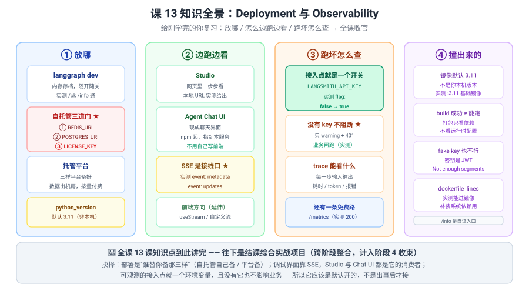

# 课 13：Deployment 与 Observability

> 所属阶段：阶段 4《工程化与上线》｜ 水平：进阶 ｜ 本课知识点：部署方式 / Studio 与 Agent Chat UI / observability 接入
> 故事情节：故事主线「搬到生产环境」的第二章，也是**全课程知识点的收束**——跑起来了，还得看得见
> 📖 结论已按官方文档核对（核对于 2026-10 ｜ 来源：LangGraph Deployment / Studio / Agent Chat UI / LangSmith Observability 官方文档 + 本机 langgraph 1.2.11 / langgraph-cli 0.4.35 / langgraph-api 0.16.0 / Docker 29.4.1 / langsmith 0.12.4 实测；TypeScript 侧 @langchain/langgraph 1.5.1 / @langchain/langgraph-cli 1.5.4 + langgraph-api 0.16.1 实测）

## 🎯 本课目标

- 选对部署方式，**知道自托管要备哪三样**
- 用 Studio 本地调试、用 Agent Chat UI 快速接界面
- 接入 tracing，**跑坏了能查到那一次**

---

## 第一幕：起源与场景引入

课 12 结尾，`langgraph.json` 写对了，测试也有了，`langgraph dev`（TypeScript 侧是 `langgraphjs dev`）一条命令就起服务。**你在自己电脑上一切正常**。

然后上线第一天：

1. **"我关了电脑，用户就用不了了。"**——`langgraph dev` 是**内存存档、随开随关**的开发服务器，不是生产服务。
2. **"用户说刚才卡住了，我查不到那一次。"**——没有 tracing，几十次运行混在一起，你只能问"大概几点"。
3. **"我想给业务方看个界面，还得自己写前端？"**——其实有现成的。

这三个问题指向最后一层：**能跑 ≠ 一直能跑 ≠ 跑坏了能知道**。

> 🎬 **场景**：第一个是**部署**（放哪），第二个是**可观测**（怎么查），第三个是**界面**（让人能用）——**课 12 让图可被找到，本课让它一直活着且看得见**。

> 📌 **一句话本质**：**部署的本质是"谁替你备那三样东西"——排队用的（Redis）、存档用的库（Postgres）、授权（License Key）；自托管要自己备（实测连撞三道门才起得来），托管平台替你备（代价是数据出机房）；而界面与 tracing 都挂在同一个东西上：服务端那套 HTTP + SSE 接口。**
>
> ⚖️ **处境对照**：不知道这层，你只能本地跑着给人演示、出事靠 print、临时学前端；知道了，一条命令打包成镜像、Studio 里一步步看、Chat UI 直接接上、出事翻 trace——**代价是三条**：① **`langgraph build` 成功 ≠ 能跑起来**，实测打包只校验依赖，**运行时配置（Redis/Postgres/License）一个都不校**，起容器连撞三次；② **镜像默认不是你的本机版本**——Python 侧基础镜像是 `langchain/langgraph-api:3.11`（默认 Python 3.11，装了 3.12-only 的依赖会在构建期或启动期炸），TypeScript 侧是 `langchain/langgraphjs-api:20`（默认 Node 20）；③ **自托管不是"免费自己跑"**，实测没有 `LANGGRAPH_CLOUD_LICENSE_KEY` 直接 `License verification failed`，乱填一个密钥报 `Not enough segments`（它是 JWT）。

---

## 第二幕：认知冲突

你信心满满地打包：

::: code-group
```bash [Python]
langgraph build -t my-agent:test
```

```bash [TypeScript]
npx @langchain/langgraph-cli build -t my-agent:test
```
:::

输出一片绿色：

```
#16 naming to docker.io/library/lgdemo:test done
#16 DONE 0.5s
```

**镜像出来了！** 你马上跑起来：

::: code-group
```bash [Python]
docker run --rm -p 8234:8000 lgdemo:test
```

```bash [TypeScript]
docker run --rm -p 8234:8000 lgdemo-ts:test
```
:::

**第一次**：

```
KeyError: "Config 'REDIS_URI' is missing, and has no default."
```

补上 Redis URI 再跑。

**第二次**：

```
File "/storage/langgraph_runtime_postgres/database.py", line 190, in _connection_kwargs
AttributeError: 'NoneType' object has no attribute 'encode'
```

**第三次**（补齐两个 URI 后）：

```
ValueError: License verification failed. Please ensure proper configuration:
- For production, configure the LANGGRAPH_CLOUD_LICENSE_KEY environment variable
  with your LangGraph Cloud license key.
```

你随手填了个 `fake-key-for-test`：

```
jwt.exceptions.DecodeError: Not enough segments
```

> ❓ **问题**：**明明 `langgraph build` 成功了，为什么跑不起来？为什么本地 `langgraph dev` 从没出过这三个错？为什么乱填的密钥还被识别成"格式不对"？**（TypeScript 侧把 `langgraph` 换成 `langgraphjs`，结论完全相同——实测报错文本逐字一致。）

---

## 第三幕：层层揭示

### 一眼全局图（进入细节前先看一眼）



> 看图：左边**你电脑上跑**（关掉就没了、存档在内存、出问题只能看 print），右边**交给不关机的地方**（一直有人干活 + 装了监控）。**中间那条路**：先打包在自己机器上试跑一遍，把缺的都撞出来再送上线。

### 本课地图（分几步走）

| 步 | 这一步要解决什么（人话） | 对应知识点 |
|:--:|------------------------|-----------|
| 1 | 图放哪，谁来替我备那些东西 | 知识点 1：部署方式 |
| 2 | 怎么在网页里一步步看、怎么接界面 | 知识点 2：Studio 与 Agent Chat UI |
| 3 | 跑坏了怎么查到那一次 | 知识点 3：observability 接入 |

---

### 知识点 1：部署方式

> 🧭 第 1/3 步｜承接：第二幕"build 成功却跑不起来" → 本步：搞清部署到底在选什么
> 本知识点关键点：云部署 vs 自托管 / 服务器配置要点 / 前端接线

#### 一句话定义

**部署方式的取舍，本质是"谁来备那三样东西"：排队用的 Redis、存档用的 Postgres、授权用的 License Key。自托管三样全自己备，托管平台三样全替你备。**

#### 直觉建立（类比）

把它想成**开餐馆**：

- **自己开店（自托管）** = 自己找铺面、自己买冰箱（存档）、自己请人排队叫号（队列）、自己办执照（授权）；
- **进美食城（托管平台）** = 铺面、冰箱、叫号、执照**美食城全包**，你只管带菜谱（代码）来。

> 💡 **类比的边界**：真实机制里 ① 冰箱**不是可选的**——实测没有 `POSTGRES_URI` 直接起不来，且报错很难懂（`'NoneType' object has no attribute 'encode'`）；② 执照**也不是"自己跑就不用办"**——实测没有 License Key 直接 `License verification failed`，**自托管同样要授权**；③ 你在家试做（`langgraph dev`）**这些全免**——内存当冰箱、内存当队列、不要执照，所以本地从不出这三个错。

#### 核心原理



##### 三档部署方式对照

| 方式 | 命令 | 存档 | 要备什么 | 适合 |
|---|---|---|---|---|
| **本地开发** | `langgraph dev` / `langgraphjs dev` | 内存 | 无 | 调试、演示、跑测试 |
| **自托管** | `langgraph build` / `langgraphjs build` + `docker run` | Postgres | **Redis + Postgres + License** | 数据不能出机房 |
| **云托管** | 平台接 GitHub 或 CLI 推 | 平台管 | 无（平台备） | 最快上线、不想运维 |

##### 实测：`build` 只校依赖，不校运行时配置

**构建成功**（关键日志）：

```
+ docker pull langchain/langgraph-api:3.11
ENV LANGSERVE_GRAPHS='{"my_agent": "/deps/outer-lgdev-3qgexjcp/src/src/my_agent/graph.py:graph"}'
WORKDIR /deps/outer-lgdev-3qgexjcp/src
#16 naming to docker.io/library/lgdemo:test done
```

> 🔑 三个事实：① 基础镜像 **`langchain/langgraph-api:3.11`**——**默认 Python 3.11**，不是你本机的版本；② 图位置被写成环境变量 **`LANGSERVE_GRAPHS`**；③ 构建日志里**没有任何关于 Redis / Postgres / License 的校验**——这就是第二幕三连撞的根因。

##### 三道门的真实报错（按顺序）

::: code-group
```bash [Python]
docker run --rm lgdemo:test
# ① KeyError: "Config 'REDIS_URI' is missing, and has no default."

docker run --rm -e REDIS_URI="..." lgdemo:test
# ② AttributeError: 'NoneType' object has no attribute 'encode'   ← 其实是 POSTGRES_URI 没给

docker run --rm -e REDIS_URI="..." -e POSTGRES_URI="..." lgdemo:test
# ③ ValueError: License verification failed.
#    - For production, configure the LANGGRAPH_CLOUD_LICENSE_KEY environment variable

docker run --rm -e ... -e LANGGRAPH_CLOUD_LICENSE_KEY="fake-key-for-test" lgdemo:test
#    jwt.exceptions.DecodeError: Not enough segments     ← 它是 JWT，乱填会被识别
```

```bash [TypeScript]
docker run --rm lgdemo-ts:test
# ① KeyError: "Config 'REDIS_URI' is missing, and has no default."

docker run --rm -e REDIS_URI="..." lgdemo-ts:test
# ② AttributeError: 'NoneType' object has no attribute 'encode'   ← 同样是 POSTGRES_URI 没给

docker run --rm -e REDIS_URI="..." -e POSTGRES_URI="..." lgdemo-ts:test
# ③ ValueError: License verification failed.  ← 报错文本与 Python 侧逐字相同

docker run --rm -e ... -e LANGGRAPH_CLOUD_LICENSE_KEY="fake-key-for-test" lgdemo-ts:test
#    jwt.exceptions.DecodeError: Not enough segments     ← TS 镜像里跑的服务端也是 Python
```
:::

> 💡 **报错②最坑**：它不说"缺 POSTGRES_URI"，只说 `'NoneType' object has no attribute 'encode'`——因为 URI 是 `None` 被拿去解析了。
> 🔴 **自托管同样要授权**：这一点常被误解成"自己跑就免费"。

##### `langgraph.json` 里还有课 12 没讲的字段

::: code-group
```json [Python]
{
  "dependencies": ["."],
  "graphs": { "my_agent": "./src/my_agent/graph.py:graph" },
  "python_version": "3.12",
  "dockerfile_lines": ["RUN echo 'custom line' > /tmp/custom.txt"]
}
```

```json [TypeScript]
{
  "node_version": "20",
  "dependencies": ["."],
  "graphs": { "my_agent": "./src/graph.ts:graph" },
  "dockerfile_lines": ["RUN echo 'custom line' > /tmp/custom.txt"]
}
```
:::

**实测**：

```
3.12: Pulling from langchain/langgraph-api
#5 [ 1/12] FROM docker.io/langchain/langgraph-api:3.12@sha256:c38accbd...
```

> ✅ `python_version` 生效——**基础镜像换成了 `:3.12`**。
> ✅ `dockerfile_lines` 实测**进了镜像**（用它补装系统依赖）。
> ⚠️ **默认值是 3.11**——你本机跑 3.12 的代码，打出来默认是 3.11 环境。

##### 前端接线：服务就是一套 HTTP + SSE

实测真实 run（SSE 格式）：

```
event: metadata
data: {"run_id":"01a13e56-3069-77d1-a67e-1e3cb188cdc7","attempt":1}

event: updates
data: {"n1":null}
```

> 🔑 **这就是前端的接线口**——`POST /runs/stream` 返回 SSE，`event:` 是模式名，`data:` 是内容。Studio 和 Chat UI 都是它的消费者。

#### 常见误区

1. **"`langgraph build` 成功就能跑"**——错，**只校依赖不校运行时配置**，实测连撞三道门。
2. **"自托管不用授权"**——错，实测 `License verification failed`，**要 `LANGGRAPH_CLOUD_LICENSE_KEY`**。
3. **"镜像用我本机的版本"**——错。Python 侧默认 **3.11**（基础镜像 `langchain/langgraph-api:3.11`）；TypeScript 侧默认 **Node 20**（`langchain/langgraphjs-api:20`），且 `node_version` 只认字符串 `"20"` / `"22"`，写数字 `20` 会被 Zod 拒绝。
4. **"乱填个 License Key 能绕过"**——错，它是 **JWT**，实测 `Not enough segments`。
5. **"dev 和生产的差别只是端口"**——错，**存档后端完全不同**（内存 vs Postgres），这是最大差别。
6. **"`REDIS_URI` 报错会明确说缺它"**——只对①成立；②的 Postgres 报错是 `'NoneType' ... 'encode'`，**看不出缺什么**。这条**两侧一模一样**（TS 镜像里跑的服务端仍是 Python）。
7. **"`python_version` 在 TS 侧也能用"**——错，**被静默忽略**：不报错、也不生效，基础镜像还是 `:20`。TS 侧的版本键是 `node_version`。

#### 一句话记住

**部署选的是"谁备那三样"：Redis（排队）+ Postgres（存档）+ License（授权）；`build` 只校依赖，运行时配置一个都不校。**

#### 🗣️ 行话对照

| 本课说法（人话） | 行业标准叫法 | 在哪遇到 | 代价 |
|---|---|---|---|
| 自己开店 | **self-hosted（自托管）** | `langgraph build` + `docker run` | 三样自己备 |
| 进美食城 | **LangGraph Cloud / 托管** | 平台接仓库 | 数据出机房 |
| 在家试做 | **local dev server** | `langgraph dev` | 内存存档，会丢 |
| 排队叫号 | **Redis（队列）** | `REDIS_URI` | 缺了起不来 |
| 冰箱 | **Postgres（存档）** | `POSTGRES_URI` | 缺了报错难懂 |
| 执照 | **LANGGRAPH_CLOUD_LICENSE_KEY** | 自托管也要 | JWT，不能乱填 |
| 版本声明 | **`python_version`** / **`node_version`** | `langgraph.json` | Python 数字符串版本号，TS 只认 `"20"`/`"22"` |
| 打包 | **langgraph build** / `langgraphjs build` | 出 Docker 镜像 | 只校依赖 |
| 接线口 | **HTTP + SSE（/runs/stream）** | 前端都靠它 | 要按 SSE 解析 |

#### 官方文档

- [Deployment（Python）](https://docs.langchain.com/oss/python/langgraph/deploy.md)
- [Deployment（TypeScript）](https://docs.langchain.com/oss/javascript/langgraph/deploy.md)

---

### 知识点 2：Studio 与 Agent Chat UI

> 🧭 第 2/3 步｜承接：知道放哪了 → 本步：怎么在网页里看、怎么接界面
> 本知识点关键点：`langgraph dev` 本地调试 / 现成聊天界面 / 前端方向为延伸

#### 一句话定义

**Studio 与 Agent Chat UI 都不是独立的东西——它们是服务端那套 HTTP + SSE 接口的现成消费者；`langgraph dev` 起好服务，Studio 就能一步步看，Chat UI 就能直接聊。**

#### 直觉建立（类比）

把它想成**电视和遥控器**：

- **服务端** = 电视台（播出信号），
- **Studio** = **带进度条的播放器**（你能拖、能看每一步），
- **Chat UI** = **普通遥控器**（只能换台、只能聊）。

> 💡 **类比的边界**：真实机制里 ① 信号就是 **SSE**（实测 `event: metadata` / `event: updates`），所以**任何能读 SSE 的前端都能接**，不止这两个；② Studio 官方是**云端的 Web IDE**，本地 `langgraph dev` 会**打印一个把本地地址带上去的 URL**；③ Chat UI 是**独立 npm 应用**，要另起进程并指到你本地服务的地址。

#### 核心原理

##### 实测：`langgraph dev` 给出的入口

```
🚀 API: http://127.0.0.1:8123
🎨 Studio UI: https://smith.langchain.com/studio/?baseUrl=http://127.0.0.1:8123
📚 API Docs: http://127.0.0.1:8123/docs
```

> 🔑 **Studio URL 里带着 `baseUrl=http://127.0.0.1:8123`**——云端 IDE 通过它连回你本地服务。

##### 实测：服务的自证入口 `/info`

::: code-group
```json [Python]
{"version":"0.16.0","langgraph_py_version":"1.2.11",
 "flags":{"assistants":true,"crons":true,"langsmith":false,...},
 "host":{"kind":"self-hosted","project_id":null,...}}
```

```json [TypeScript]
{"version":"1.5.4","langgraph_js_version":"1.5.1","context":"js",
 "flags":{"assistants":true,"crons":false,"langsmith":false,
          "langsmith_tracing_replicas":true}}
```
:::

> 🔑 **字段名两侧不同**：Python 有 `langgraph_py_version` 与 `host`；TS 只有 `langgraph_js_version` 与 `context: "js"`，**没有 `host`**。`crons` 在 TS dev 模式下是 `false`。

> 💡 **`/info` 是判断"服务到底起来没、接了什么"的第一手证据**——比看日志快。

##### 实测：assistant 与 graph_id 的关系

::: code-group
```json [Python]
[{"assistant_id":"eac7a2dc-...","graph_id":"my_agent","name":"my_agent",
  "metadata":{"created_by":"system"},...}]
```

```json [TypeScript]
[{"assistant_id":"eac7a2dc-f2ac-5973-91d0-f90689344d99","version":1,
  "config":{},"context":{},"created_at":"2026-10-19T08:18:18.554Z",
  "updated_at":"2026-10-19T08:18:18.554Z","graph_id":"my_agent",
  "metadata":{"created_by":"system"},"name":"my_agent","description":null}]
```
:::

> 💡 TS 侧多出 `version`、`config`、`context`、`description`，时间字段是 **ISO 字符串**（`created_at`），字段名仍是下划线风格。

> 🔑 印证课 12：**`graph_id` 就是 `langgraph.json` 里的 key**；assistant 是它的一个具名版本（`created_by: system` 表示自动创建）。

##### SSE 的真实格式（前端接线必看）

```
event: metadata
data: {"run_id":"01a13e56-3069-77d1-a67e-1e3cb188cdc7","attempt":1}

event: updates
data: {"n1":null}
```

> ⚠️ **`event:` 行是流模式名**，`data:` 行是内容，中间空一行分隔——这是标准 SSE 格式，不是普通 JSON。
> 💡 对应课 7：你在 Python 里选的 `stream_mode=["updates"]`，到这里就是 `event: updates`。

##### 三种用法的定位

| 工具 | 起法 | 适合谁 | 实测证据 |
|---|---|---|---|
| **Studio** | `langgraph dev` 后点给出的 URL | 开发调试（看每一步状态） | URL 带 `baseUrl=` 回连本地 |
| **Agent Chat UI** | 独立 npm 应用，指到本地服务 | 给业务方看效果 | 消费同一套 SSE |
| **自己写前端** | `useStream` / 自定义流 | 要定制 UI | 见官方 frontend 三页（延伸） |

> ⚠️ **前端方向（`/frontend/*` 三页）本课不展开**——大纲已把它归为延伸方向。

#### 常见误区

1. **"Studio 要单独安装"**——不用，**`langgraph dev` 起服务后点它给出的 URL**。
2. **"Chat UI 是 LangGraph 的一部分"**——不是，**独立 npm 应用**，要另起并指到你服务地址。
3. **"SSE 返回的是 JSON"**——不是，是 **`event:` / `data:` 文本流**，要按 SSE 解析。
4. **"`/docs` 只有文档"**——Python 侧它同时是**端点自测台**，实测返回 200；**TypeScript 侧 `/docs` 直接 404**，`/openapi.json`、`/metrics` 也全都没有，TS 侧能用的自证入口只剩 `/ok` 与 `/info`。
5. **"assistant_id 和 graph_id 是一回事"**——不是，**`graph_id` 是你配置的 key，assistant 是它的具名版本**。

#### 一句话记住

**Studio 和 Chat UI 都是 SSE 的消费者：`dev` 起服务 → 点给出的 Studio URL 调试；Chat UI 另起指过来；自己写前端就按 `event:`/`data:` 解析。**

#### 🗣️ 行话对照

| 本课说法（人话） | 行业标准叫法 | 在哪遇到 | 代价 |
|---|---|---|---|
| 带进度条的播放器 | **LangSmith Studio** | 云端 Web IDE | 要连回本地 |
| 普通遥控器 | **Agent Chat UI** | 独立 npm 应用 | 要另起进程 |
| 播出信号 | **SSE（Server-Sent Events）** | `POST /runs/stream` | 要按格式解析 |
| 自证入口 | **`/info`** | 判断服务状态 | — |
| 端点自测台 | **`/docs`（OpenAPI）** | 浏览器直接试 | **TS 侧 404，不存在** |
| 具名版本 | **assistant** | `/assistants/search` | 与 graph_id 不同 |

#### 官方文档

- [LangSmith Studio](https://docs.langchain.com/oss/python/langgraph/studio.md)
- [Agent Chat UI](https://docs.langchain.com/oss/python/langgraph/ui.md)
- [Frontend overview](https://docs.langchain.com/oss/python/langgraph/frontend/overview.md)（延伸）
- [Deployment（TypeScript）](https://docs.langchain.com/oss/javascript/langgraph/deploy.md)

---

### 知识点 3：observability 接入

> 🧭 第 3/3 步｜承接：能看能聊了 → 本步：跑坏了怎么查到那一次
> 本知识点关键点：LangSmith 接入点 / trace 能看什么 / 与 streaming、checkpoint 的交叉

#### 一句话定义

**LangGraph 的 observability 接入点就是一个环境变量 `LANGSMITH_API_KEY`——设了它，服务端的 `langsmith` flag 就从 `false` 变 `true`；且实测没有它也不阻断业务（只 warning + 401），所以它应该是默认开的，而不是出事后才接。**

#### 直觉建立（类比）

把它想成**行车记录仪**：

- **tracing** = 每次出车都录一段，**出了事能翻出来看**；
- **trace** = 那一段录像，里面有**每步输入、输出、耗时、花的钱**；
- **没装** = 出了事只能靠回忆（"大概几点、好像很慢"）。

> 💡 **类比的边界**：真实机制里 ① 记录仪**不装车也能开**——实测没 key 时 `invoke` **照样成功**，只是往上报 401 失败；② 开关是**服务端级别的**，看 `/info` 的 `flags.langsmith` 就知道开没开；③ 除了 LangSmith，**还有一条不花钱的路**：`/metrics`（Prometheus 格式，实测 200）。

#### 核心原理

##### 实测：接入点就是一个环境变量

**未设 key**：

::: code-group
```json [Python]
"flags":{...,"langsmith":false,...}
```

```json [TypeScript]
"flags":{"assistants":true,"crons":false,"langsmith":false,"langsmith_tracing_replicas":true}
```
:::


**设了 `LANGSMITH_API_KEY` 重启**：

::: code-group
```json [Python]
"flags":{...,"langsmith":true,...}
```

```json [TypeScript]
"flags":{"assistants":true,"crons":false,"langsmith":true,"langsmith_tracing_replicas":true}
```
:::


> 🔑 **就这一个开关**——`false → true`，实测可复现。这是本课最"便宜"的实操。

##### 实测：没有 key 不阻断业务

```
LangSmithMissingAPIKeyWarning: API key must be provided when using hosted LangSmith API
Failed to multipart ingest runs: LangSmithAuthError: Authentication failed ...
  HTTPError('401 Client Error: Unauthorized ...')
invoke 成功: hi
```

> ✅ **最后一行是关键**：**业务照跑**。上报失败只是警告 + 401，不影响用户。
> ⚠️ 反过来说——**你以为接上了，其实一直 401** 也是可能的，所以要用 `/info` 自证。

##### trace 能看到什么

| 能看到 | 说明 |
|---|---|
| 每一步的输入/输出 | 对应课 7 的 streaming，但是**事后可翻** |
| 每一步耗时 | 定位慢在哪一步 |
| token 与成本 | 一次运行花了多少 |
| 报错与堆栈 | 失败了看哪一步炸的 |
| 同一个 thread 的多次运行 | 对应课 5 的 `thread_id`，串成一条线 |

> 💡 **trace 与 checkpoint 是互补的**：checkpoint 让你**回到那个状态重跑**（课 9），trace 让你**知道当时发生了什么**。排障时通常先用 trace 定位，再用 time-travel 复现。

##### 还有一条免费的路：`/metrics`

```
GET /metrics -> 200
# HELP python_gc_objects_collected_total Objects collected during gc
# TYPE python_gc_objects_collected_total counter
python_gc_objects_collected_total{generation="0"} 1359.0
```

> 🔑 **不用 LangSmith 也有指标**——服务端内置了 OTel/Prometheus 导出（启动日志里能看到 `OTel metrics reporter initialized ... backends=['prometheus']`）。接 Grafana 就能看。

##### 与 streaming 的交叉（回扣课 7）

| | streaming（课 7） | tracing（本课） |
|---|---|---|
| 时机 | **跑的时候** | **跑完之后** |
| 给谁看 | 用户（边跑边看） | 你（事后排查） |
| 传输 | SSE `event: updates` | 上报到 LangSmith |
| 粒度 | 你选的 stream_mode | 全量（含 LLM 调用细节） |

#### 常见误区

1. **"接 tracing 要改代码"**——不用，**一个环境变量**（实测 flag 直接翻转）。
2. **"没 key 会跑不起来"**——错，**业务照跑**，只是上报 401（实测 `invoke 成功: hi`）。
3. **"设了 key 就一定接上了"**——要**用 `/info` 自证**，否则可能一直 401 你也不知道。
4. **"只有 LangSmith 一条路"**——Python 侧错，**`/metrics` 是内置的**（实测 200）；**TypeScript 侧这条路没有**，`/metrics` 实测 404，要指标得自己接。
5. **"tracing 能替代 checkpoint"**——不能，**trace 只读，checkpoint 能让你重跑**（课 9）。

#### 一句话记住

**接入点就是 `LANGSMITH_API_KEY`（`/info` 的 `langsmith` flag 可自证），没它也不影响业务——所以默认就开；另有 `/metrics` 这条免费路。**

#### 🗣️ 行话对照

| 本课说法（人话） | 行业标准叫法 | 在哪遇到 | 代价 |
|---|---|---|---|
| 行车记录仪 | **tracing / observability** | `LANGSMITH_API_KEY` | — |
| 那一段录像 | **trace / run** | LangSmith 后台 | — |
| 开关 | **`flags.langsmith`** | `GET /info` | 可自证 |
| 免费指标 | **`/metrics`（Prometheus / OTel）** | 服务端内置 | 要自己接看板；**TS 侧 404** |
| 事后翻 | **trace** | 排障 | 只读 |
| 回去重跑 | **checkpoint + time-travel** | 课 5 / 课 9 | 可改可执行 |

#### 官方文档

- [LangSmith Observability（Python）](https://docs.langchain.com/oss/python/langgraph/observability.md)
- [LangSmith Observability（TypeScript）](https://docs.langchain.com/oss/javascript/langgraph/observability.md)

---

## 第四幕：实操验证

> ✅ 实测于 langgraph 1.2.11 / langgraph-cli 0.4.35 / langgraph-api 0.16.0 / Docker 29.4.1（Server 29.4.1）/ langsmith 0.12.4 / Python 3.12
> ⚠️ 自托管部分为**本机真实构建 + 真实起容器**，非纸面推演。

### 4.1 机制验证

**验证一：`langgraph build` 成功**

```
#16 exporting manifest list sha256:33aee1bc8d08... done
#16 naming to docker.io/library/lgdemo:test done
#16 DONE 0.5s
```

**验证二：构建日志里的三个关键事实**

```
+ docker pull langchain/langgraph-api:3.11          ← 默认 Python 3.11
ENV LANGSERVE_GRAPHS='{"my_agent": "/deps/outer-lgdev-3qgexjcp/src/src/my_agent/graph.py:graph"}'
WORKDIR /deps/outer-lgdev-3qgexjcp/src
```

> 🔑 **构建日志里没有任何 Redis / Postgres / License 的校验**。

**验证三：第一道门 —— 缺 REDIS_URI**

```
KeyError: "Config 'REDIS_URI' is missing, and has no default."
```

**验证四：第二道门 —— 缺 POSTGRES_URI（报错难懂）**

```
File "/storage/langgraph_runtime_postgres/database.py", line 190, in _connection_kwargs
File "/usr/local/lib/python3.11/site-packages/psycopg/conninfo.py", line 101, in _parse_conninfo
AttributeError: 'NoneType' object has no attribute 'encode'
```

**验证五：第三道门 —— 缺 License Key**

```
ValueError: License verification failed. Please ensure proper configuration:
- For local development, set a valid LANGSMITH_API_KEY for an account with LangGraph Cloud access
- For production, configure the LANGGRAPH_CLOUD_LICENSE_KEY environment variable
```

**验证六：乱填密钥（它是 JWT）**

```
jwt.exceptions.DecodeError: Not enough segments
```

**验证七：`python_version: "3.12"` 生效**

```
3.12: Pulling from langchain/langgraph-api
FROM docker.io/langchain/langgraph-api:3.12@sha256:c38accbd2d2381...
```

**验证八：`dockerfile_lines` 进镜像**

```
RUN echo 'custom line' > /tmp/custom.txt     ← 写进 Dockerfile 并执行
```

**验证九：`langgraph dev` 给出的入口**

```
🚀 API: http://127.0.0.1:8123
🎨 Studio UI: https://smith.langchain.com/studio/?baseUrl=http://127.0.0.1:8123
📚 API Docs: http://127.0.0.1:8123/docs
```

**验证十：`/ok` 与 `/docs`**

```
GET /ok    -> {"ok":true,"services":{}}
GET /docs  -> 200
```

**验证十一：`/info`（未接 tracing）**

::: code-group
```json [Python]
{"version":"0.16.0","langgraph_py_version":"1.2.11",
 "flags":{"assistants":true,"crons":true,"langsmith":false,
          "langsmith_tracing_replicas":true,"langsmith_tracing_session_on_runs":true},
 "host":{"kind":"self-hosted","project_id":null,...}}
```

```json [TypeScript]
{"version":"1.5.4","langgraph_js_version":"1.5.1","context":"js",
 "flags":{"assistants":true,"crons":false,"langsmith":false,
          "langsmith_tracing_replicas":true}}
```
:::


**验证十二：`/info`（设了 `LANGSMITH_API_KEY` 后）**

::: code-group
```json [Python]
"flags":{"assistants":true,"crons":true,"langsmith":true,...}
```

```json [TypeScript]
"flags":{"assistants":true,"crons":false,"langsmith":true,"langsmith_tracing_replicas":true}
```
:::


> 🔑 **`langsmith`: `false` → `true`**——就这一个开关。

**验证十三：assistant 与 graph_id**

::: code-group
```json [Python]
[{"assistant_id":"eac7a2dc-f2ac-5973-91d0-f90689344d99","graph_id":"my_agent",
  "name":"my_agent","metadata":{"created_by":"system"},...}]
```

```json [TypeScript]
[{"assistant_id":"eac7a2dc-f2ac-5973-91d0-f90689344d99","version":1,
  "config":{},"context":{},"created_at":"2026-10-19T08:18:18.554Z",
  "updated_at":"2026-10-19T08:18:18.554Z","graph_id":"my_agent",
  "metadata":{"created_by":"system"},"name":"my_agent","description":null}]
```
:::


**验证十四：SSE 真实格式**

```
event: metadata
data: {"run_id":"01a13e56-3069-77d1-a67e-1e3cb188cdc7","attempt":1}

event: updates
data: {"n1":null}
```

**验证十五：没有 key 不阻断业务**

```
LangSmithMissingAPIKeyWarning: API key must be provided when using hosted LangSmith API
Failed to multipart ingest runs: LangSmithAuthError: ... 401 Client Error: Unauthorized
invoke 成功: hi
```

**验证十六：`/metrics` 免费指标**

```
GET /metrics -> 200
# HELP python_gc_objects_collected_total Objects collected during gc
python_gc_objects_collected_total{generation="0"} 1359.0
```

**验证十七：启动日志里的指标后端**

```
OTel metrics reporter initialized   backends=['prometheus']   metric_prefix=lg_api_
No license key or control plane API key set, skipping metadata loop   api_variant=local_dev
```

> 💡 第二行解释了为什么 **`langgraph dev` 不需要 License**：`api_variant=local_dev` 直接跳过。

**验证十八：dev 模式的存档后端**

```
Starting queue with shared loop          langgraph_runtime_inmem.queue
Starting 1 background workers            langgraph_runtime_inmem.queue
```

> 🔑 **`inmem`**——内存队列，与生产的 Postgres/Redis 完全不同。这是"本地好好的，上线起不来"的根因。

#### 🇹🇸 TS 侧实测（`playground-ts/13-deployment.ts`，`@langchain/langgraph-cli` 1.5.4 + `@langchain/langgraph` 1.5.1）

上面十八段验证全部是 Python 侧。下面这一段是**同一套部署链路在 TypeScript 侧的实测**，用 `npm run l13` 可直接复现。

**T0：`langgraphjs dev` 的启动横幅**

```
Welcome to LangGraph.js

- 🚀 API: http://localhost:8191
- 🎨 Studio UI: https://smith.langchain.com/studio?baseUrl=http://localhost:8191

This in-memory server is designed for development and testing.
For production use, please use LangSmith Deployment.
```

> 🔑 三点差异：① Studio URL 少了中间的斜杠（`/studio?baseUrl=` vs Python 的 `/studio/?baseUrl=`）；② **没有 `📚 API Docs:` 那一行**——因为 `/docs` 在 TS 侧不存在（见 T7）；③ 多了 `This in-memory server is designed for development and testing.` 这段提示。

**T1：`dockerfile` 子命令的默认契约（不写 `node_version`）**

```
FROM langchain/langgraphjs-api:20
ADD . /deps/lgjs-l13-SgeTGj
ENV LANGSERVE_GRAPHS='{"my_agent":"./graph.ts:graph"}'
WORKDIR /deps/lgjs-l13-SgeTGj
RUN npm i
RUN (test ! -f /api/langgraph_api/js/build.mts && echo "Prebuild script not found, skipping") || tsx /api/langgraph_api/js/build.mts
```

> 🔑 三点：① 基础镜像换成 **`langchain/langgraphjs-api:20`**（默认 **Node 20**，不是 Python 3.11）；② `LANGSERVE_GRAPHS` 换成 `.ts` 路径，**其他一字不差**；③ 多出 `npm i` 与 `tsx /api/langgraph_api/js/build.mts` 两步预构建。

**T2：`node_version` 只认字符串 `"20"` / `"22"`**

```
node_version="22" -> 通过 | FROM langchain/langgraphjs-api:22
node_version=20   -> 被拒 | "expected": "20"
node_version="18" -> 被拒 | "expected": "20"
```

> ⚠️ 写成数字 `20` 也不行——Zod 认的是**字符串字面量**。`"18"` 同样被拒。

**T3：`python_version` 在 TS 侧被静默忽略**

```
带 python_version 仍成功: true
基础镜像 = FROM langchain/langgraphjs-api:20
```

> ⚠️ 不报错、也不生效——**别把 Python 的键照搬过来**，它会安安静静地失效。

**T4～T6：`dependencies` 可省、`dockerfile_lines` 位置、导出名不校验**

```
dependencies 省略 -> 成功: true | 首行 = FROM langchain/langgraphjs-api:20
dockerfile_lines -> 自定义行在第 2 行，ADD 在第 3 行
graphs 导出名写错 -> dockerfile 仍生成: true
```

> 🔑 三件事：① **TS 侧不强制 `dependencies`**（Python 侧省略直接报错）；② `dockerfile_lines` 插在 `ADD` **之前**，适合在装依赖前补系统包；③ **导出名对不对 CLI 不管**，校验只到「字符串格式」，错了要等服务启动才炸。

**T7：内嵌服务的端点是这套差异的最大来源**

```
GET /ok             -> 200 {"ok":true}
GET /info           -> 200 {"version":"1.5.4","langgraph_js_version":"1.5.1","context":"js",
                            "flags":{"assistants":true,"crons":false,"langsmith":false,
                                     "langsmith_tracing_replicas":true}}
GET /docs           -> 404
GET /openapi.json   -> 404
GET /metrics        -> 404
POST /runs/stream   -> 200
  event: metadata
  data: {"run_id":"01a1535b-...","attempt":1}

  event: updates
  data: {"n1":{"n":1}}
```

> 🔴 **`/docs`、`/openapi.json`、`/metrics` 在 TS 侧全部 404**。Python 侧引以为证的三条"自证入口"在这里都不存在；能用的只剩 `/ok`、`/info`、`/runs/stream`。`/ok` 也只返回 `{"ok":true}`，**没有 `services` 字段**。

**T8：`/info` 的 `langsmith` flag 同样能翻转**

```
未设 key: "flags":{...,"langsmith":false,...}
设了 key: "flags":{...,"langsmith":true,...}
```

> ✅ 这一条**两侧一致**——`LANGSMITH_API_KEY` 在 TS 侧同样是唯一开关。但注意假 key 会在日志里留 `Failed to get organization ID ... 403`，**服务照常起来**，与 Python 侧的「只 warning + 401」是同一个性子。

**T9：TS 镜像启动同样撞那三道门**

```
docker run --rm lgdemo-ts:test
# → KeyError: "Config 'REDIS_URI' is missing, and has no default."

docker run --rm -e REDIS_URI="..." lgdemo-ts:test
# → AttributeError: 'NoneType' object has no attribute 'encode'

docker run --rm -e REDIS_URI="..." -e POSTGRES_URI="..." lgdemo-ts:test
# → ValueError: License verification failed. ...

docker run --rm ... -e LANGGRAPH_CLOUD_LICENSE_KEY="fake-key-for-test" lgdemo-ts:test
# → jwt.exceptions.DecodeError: Not enough segments
```

> 🔑 **报错文本与 Python 侧逐字相同**。原因在 T1 的镜像结构里：`langgraphjs-api` 换的只是外层 Node 运行环境，**里面的服务端仍是 `/api/langgraph_api`（Python）**，所以 Redis/Postgres/License 三道门一个都没少。

##### 两侧一致的 5 条

| # | 事实 | 证据 |
|---|---|---|
| 1 | `build` 成功 ≠ 能跑，运行时配置一个都不校 | T9 三连撞 |
| 2 | 自托管同样要 License，乱填被识别成 JWT | `Not enough segments`（两侧同文本） |
| 3 | `dockerfile_lines` 会进镜像并执行 | T5 |
| 4 | `LANGSMITH_API_KEY` 是 tracing 的唯一开关，`/info` 可自证 | T8 |
| 5 | 前端接线口都是 `POST /runs/stream` 的 SSE，`event:` 是模式名 | 两段 SSE 格式一致 |

##### 两侧不同的 8 条

| # | 维度 | Python | TypeScript |
|---|---|---|---|
| 1 | 基础镜像 | `langchain/langgraph-api:3.11` | `langchain/langgraphjs-api:20` |
| 2 | 版本键 | `python_version`，默认 `3.11` | `node_version`，只认 `"20"`/`"22"`，默认 `"20"` |
| 3 | 版本键类型 | 字符串 | **必须字符串**，数字 `20` 被 Zod 拒 |
| 4 | `dependencies` | 必填 | **可省** |
| 5 | CLI 包名 / 命令 | `langgraph-cli` / `langgraph` | `@langchain/langgraph-cli` / `langgraphjs` |
| 6 | `/docs`、`/openapi.json`、`/metrics` | 200 | **404（全无）** |
| 7 | `/ok` 响应 | `{"ok":true,"services":{}}` | `{"ok":true}`（**无 `services`**） |
| 8 | `/info` 字段 | 有 `langgraph_py_version`、`host` | 只有 `langgraph_js_version`、`context:"js"`，**无 `host`** |

> ⚠️ 还有一个坑不在表里但很要命：**`langgraphjs` 配置校验失败时退出码仍是 0**，报错打在 stdout 且不产出文件。写脚本判断成败只能看「文件有没有生成」，不能看退出码。

**移植检查清单（Python → TypeScript）**

1. `python_version` 换成 `node_version`，值必须是 `"20"` 或 `"22"` 的**字符串**。
2. `graphs` 的值从 `xxx.py:graph` 换成 `xxx.ts:graph`。
3. CLI 换成 `npx @langchain/langgraph-cli`，所有子命令前加 `langgraphjs`（或直接用 `npx` 调）。
4. 别指望 `/docs`、`/metrics`——要在 TS 侧做健康检查，只用 `/ok` 与 `/info`。
5. 基础镜像里仍是 Python 服务端，**Redis/Postgres/License 三样照旧要备**。

### 4.2 本课实操

> 本课的实操由**结课综合实战项目**承接（跨阶段整合），不单配应用实战。

---

## 第五幕：体系收束

三句话带走：

1. **部署选的是"谁备那三样"**——Redis + Postgres + License；`build` 只校依赖，运行时配置一个都不校（Python / TypeScript 两侧一致）。
2. **Studio 和 Chat UI 都是 SSE 的消费者**——`dev` 起服务，点给出的 URL 就能调试；`/info` 是判断服务状态的第一手证据（TS 侧只剩它和 `/ok`，`/docs` 没有）。
3. **observability 的接入点就是一个环境变量**——`/info` 的 `langsmith` flag 可自证（两侧都能翻转），且没它也不影响业务，所以默认就该开。

> 📍 **全局定位**：🎉 **全课程 13 课知识点到此讲完**。
> 🔗 **下一步**：结课综合实战项目（跨阶段整合，计入阶段 4 收束）。

回扣前面三课：**课 12 的 `langgraph.json` 在这里变成了 `LANGSERVE_GRAPHS` 环境变量**（实测）——它就是部署契约的运行时形态；**课 7 的 streaming 在这里变成了 SSE 的 `event:` 行**（实测 `event: updates`）；**课 5 的 checkpointer 在这里换成了真 Postgres**（实测 `langgraph_runtime_postgres`），而 `langgraph dev` 用的是 `inmem`。

也回扣课 9：trace 与 checkpoint 是排障的**两条互补路**——trace 只读、让你知道当时发生了什么；checkpoint + time-travel 可改可执行、让你回到那个状态重跑。

---

## 🐞 常见误区

1. **"`langgraph build` 成功就能跑"**——错，只校依赖不校运行时配置。
2. **"自托管不用授权"**——错，要 `LANGGRAPH_CLOUD_LICENSE_KEY`。
3. **"镜像用我本机的版本"**——错，Python 默认 **3.11**、TypeScript 默认 **Node 20**。
4. **"乱填 License Key 能绕过"**——错，是 **JWT**（`Not enough segments`）。
5. **"dev 和生产的差别只是端口"**——错，存档后端不同（`inmem` vs Postgres）。
6. **"缺 Postgres 会明确报错"**——错，`'NoneType' object has no attribute 'encode'`。
7. **"Studio 要单独安装"**——不用，`dev` 后点给出的 URL。
8. **"Chat UI 是 LangGraph 的一部分"**——不是，独立 npm 应用。
9. **"SSE 返回的是 JSON"**——不是，是 `event:` / `data:` 文本流（两侧格式一致）。
10. **"assistant_id = graph_id"**——不是，graph_id 是配置的 key，assistant 是具名版本。
11. **"接 tracing 要改代码"**——不用，一个环境变量。
12. **"没 key 会跑不起来"**——错，业务照跑（只 401）。
13. **"只有 LangSmith 一条路"**——Python 侧错，`/metrics` 内置；**TS 侧 `/metrics` 404**，这条路不存在。
14. **"tracing 能替代 checkpoint"**——不能，trace 只读。

### ⏳ 与过时说法对照（写前核对有差异时才有，≤3 行）

| 旧说法（网上过时教程 / 训练知识里的说法） | 官方文档 / 本机现状 | 来源 |
|---|---|---|
| "自托管就是把开源版自己跑起来，不用授权" | 实测**没有 `LANGGRAPH_CLOUD_LICENSE_KEY` 直接 `License verification failed`**；`langgraph build` 用的基础镜像是 `langchain/langgraph-api`（`api_variant=licensed`），乱填密钥报 `Not enough segments`（JWT） | 实测 + deploy 文档 |
| "`langgraph build` 成功 = 镜像能跑" | 实测**打包只校依赖**；起容器连撞 `REDIS_URI` / `POSTGRES_URI` / License 三道门，且第二道报错为 `'NoneType' object has no attribute 'encode'`，看不出缺什么 | 实测 |
| "打出来的镜像和你本机 Python 版本一致" | 实测默认 **`langchain/langgraph-api:3.11`**（`python_version` 默认 3.11）；配 `"python_version": "3.12"` 后基础镜像才换成 `:3.12`。TS 侧同理：默认 **`langchain/langgraphjs-api:20`**，`node_version` 只认 `"20"`/`"22"` | 实测（`langgraph build --help` 亦注明默认 3.11；`langgraphjs dockerfile` 实测默认 `:20`） |

## 一图总结



> 看图：四列——放哪（三档对照 / 三道门 / python_version 默认 3.11）、边跑边看（Studio / Chat UI / SSE 接线口）、跑坏怎么查（一个开关 / 不阻断 / trace 看什么 / `/metrics`）、撞出来的。**与课首那张图的区别**：课首给没学过的人看"本地跑 vs 上线+监控"，这张给刚学完的你复习"部署 + 界面 + 可观测"三条线。

## 课后小测

**Q1**：`langgraph build` 构建成功了，`docker run` 却起不来。最可能的原因是？
- A. 代码有语法错误
- B. 缺运行时配置（Redis / Postgres / License）
- C. `langgraph.json` 的 `graphs` 写错了
- D. 端口被占用

<details><summary>答案与解析</summary>

**答案：B**。实测构建日志里**只有依赖安装与 `LANGSERVE_GRAPHS` 注入，没有任何 Redis/Postgres/License 校验**。起容器后连撞三道门：`KeyError: 'REDIS_URI' is missing` → `AttributeError: 'NoneType' ... 'encode'`（其实是缺 POSTGRES_URI）→ `License verification failed`。**A 和 C 会让构建直接失败**（课 12 已实测），不会等到 `docker run`。

</details>

**Q2**：你想确认服务到底有没有接上 tracing，最快的方法是？
- A. 看有没有报错
- B. 问 LangSmith 客服
- C. `GET /info` 看 `flags.langsmith`
- D. 跑一次看输出

<details><summary>答案与解析</summary>

**答案：C**。实测设 `LANGSMITH_API_KEY` 前 `flags.langsmith` 是 `false`，设了重启后是 `true`——**一个字段就能自证**。特别注意：**A 和 D 都不可靠**，因为实测没有 key 时业务**照样成功**（`invoke 成功: hi`），只在日志里 warning + 401——你很可能一直以为接上了。

</details>

**Q3**：关于自托管，下面哪句是对的？
- A. 自托管是开源的，不用授权
- B. 镜像默认用你本机的 Python 版本
- C. 自托管要自己备 Redis + Postgres + License Key
- D. `langgraph dev` 和生产的差别只有端口

<details><summary>答案与解析</summary>

**答案：C**。实测三道门分别是 `REDIS_URI`、`POSTGRES_URI`、`LANGGRAPH_CLOUD_LICENSE_KEY`，且**乱填密钥会被识别**（`jwt.DecodeError: Not enough segments`，它是 JWT）。**A 错**：实测 `License verification failed`；**B 错**：默认 3.11（基础镜像 `langchain/langgraph-api:3.11`）；**D 错**：`dev` 用 `langgraph_runtime_inmem.queue`（内存），生产用 Postgres/Redis，这是"本地好好的上线起不来"的根因。

</details>

---

## 🚀 下一批接力提示词

> 🎉 **全课程 13 课知识点已讲完**。学完本课后，**复制下面这段文字发给 AI**，即可进入结课综合实战项目：

```
继续学 LangGraph。我的学习档案在 langchain/langgraph/00-学习档案.md，
刚学完阶段 4《工程化与上线》的课 13《Deployment 与 Observability》
知识点「部署方式 / Studio 与 Agent Chat UI / observability 接入」，
全课程 13 课知识点已讲完，请开始结课综合实战项目（跨阶段整合，计入阶段 4 收束）。
```

## 🧭 课程导航

- 上一课：[课 12 Application structure 与测试](12-Application structure 与测试.md)
- 返回 [课程目录](../../../02-课程目录.md)
- 下一课：🎉 课程知识已讲完——接下来做 [结课综合实战项目](../../../02-课程目录.md)
