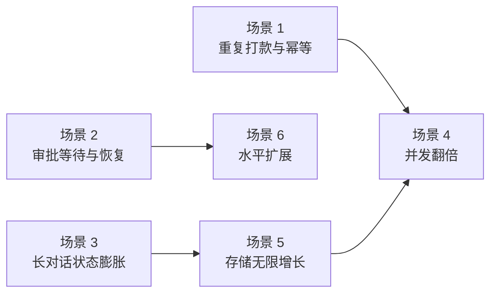

# LangGraph 场景解法库

> **设计态**：每道题先想后看——给你一个"新要求来了"的场景，**先自己想方案**，再展开解法谱系（含代价 + 按题定制的效果对比）→ 关键代码 → 非本栈替代路线 → 推荐路径。
> 每个解法各配一张机制图（画清核心逻辑 + **标出失效点 / 代价**）。
> 配套：[08-实战经验.md](../08-实战经验.md)（为什么）｜ [09-排障速查手册.md](../09-排障速查手册.md)（出错了怎么办）
> 基线 `langgraph 1.2.11`｜生成于 2026-10-15

## 怎么用

1. 挑一个场景，先读「🔒 先自己想 30 秒」，自己给出方案
2. 展开看解法谱系（多个方案 + 各自代价 + **它会在哪失效**）
3. 对照「推荐路径」，回头看你方案的差距在哪

> **先想后看，能力才长出来。** 直接翻答案 = 白看。

## 场景清单

> 两类并重：经典设计题 3 个 + 规模压力题 3 个。

| # | 场景 | 类型 | 覆盖知识点 | 链接 |
|---|------|------|-----------|------|
| 01 | 重复打款与幂等 | 经典设计题 | 课 10 RetryPolicy · 课 5 checkpoint · 课 8 interrupt | [场景 1](场景-01-重复打款与幂等.md) |
| 02 | 审批等待与恢复 | 经典设计题 | 课 8 interrupt · 课 5 checkpoint · 课 12 测试 | [场景 2](场景-02-审批等待与恢复.md) |
| 03 | 长对话状态膨胀 | 经典设计题 | 课 5 checkpoint · 课 6 Store · 课 9 time-travel | [场景 3](场景-03-长对话状态膨胀.md) |
| 04 | 并发翻倍连接池耗尽 | 规模压力题 | 课 5 后端选型 · 课 13 部署 | [场景 4](场景-04-并发翻倍连接池耗尽.md) |
| 05 | 检查点存储无限增长 | 规模压力题 | 课 5 checkpoint · 课 13 部署 | [场景 5](场景-05-检查点存储无限增长.md) |
| 06 | 水平扩展无状态化 | 规模压力题 | 课 13 部署 · 课 5 后端选型 | [场景 6](场景-06-水平扩展无状态化.md) |

## 场景之间的关系

> 看图：场景 1/2/3 是**正确性**问题（做错了会赔钱），场景 4/5/6 是**规模**问题（量大了才炸）。
> 建议顺序：先 1→2→3（做对），再 5→4→6（做大）。
> 场景 3 与场景 5 有因果——state 膨胀正是存储爆炸的主要来源。
