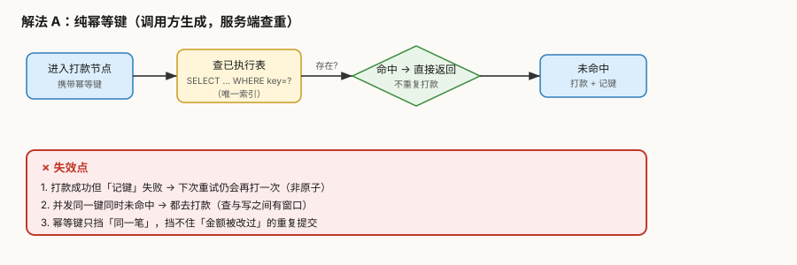
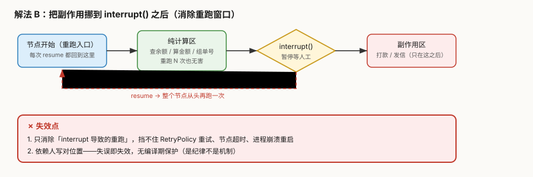
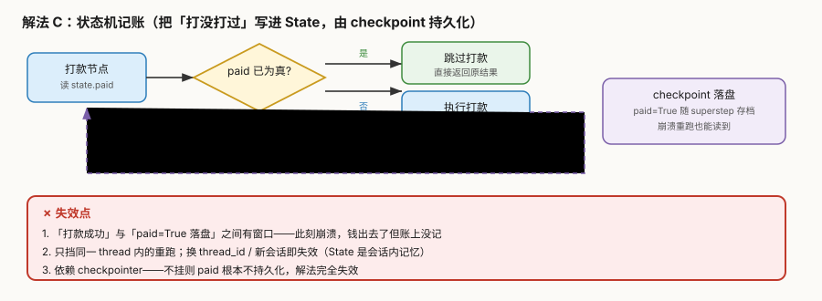

# 场景 1：重复打款与幂等（经典设计题）

**场景描述**：退款工单系统上线第二周，财务对账发现**同一笔订单被打款两次**。日志显示：该笔工单的 `refund` 节点**执行了 2 次**——一次是人工审批后 `Command(resume=...)` 恢复触发的，另一次是上游 `RetryPolicy` 重试触发的。两笔都成功了，金额、订单号完全一致。外部支付网关**没有做幂等**，它照单全收。

> 这是 agent 系统最贵的一类 bug：**不报错、不崩溃，只是钱少了。**

**🔒 先自己想 30 秒**：第一反应是"在打款前加个 if 判断"？那判断依据放哪儿——内存变量、数据库、还是 State？如果进程在"判断完"和"打款成功"之间崩了呢？

<details><summary>💡 提示（分层 / 分维度想）</summary>

- **重跑来源有几种**：`interrupt()` 恢复、节点重试、进程崩溃重启、用户重复提交——你的方案能挡住哪几种？挡不住哪几种？
- **判据存哪儿**：内存（进程重启就没了）／ State（换会话就没了）／ 外部存储（最可靠但要自己保证原子性）——三者的失效边界分别是什么？
- **"查"和"写"之间的窗口**：先查有没有打过、没有就打——两个并发请求同时查到"没打过"，会怎样？
- **谁来保证**：应用侧还是支付网关侧？如果网关支持幂等键，你还需要自己记账吗？

</details>

<details><summary>📖 展开解法</summary>

### 解法一览

> 效果维度按本题定制：**挡住的重复来源**（能防几种重跑）／**并发安全**（能否挡住同时到达）／**实现复杂度**。

| 解法 | 挡住的重复来源 | 并发安全 | 实现复杂度 | 代价 | 适用边界 |
|------|--------------|---------|-----------|------|---------|
| **A. 纯幂等键**（调用方生成 + 服务端查重） | 全部（重试／恢复／崩溃／重复提交） | 强（依赖唯一索引） | 中 | 需外部存储 + 要处理"记账失败" | 外部接口支持或自建去重表时首选 |
| **B. 副作用挪到 `interrupt()` 之后** | 仅 `interrupt` 恢复 | 无 | **低** | 挡不住重试／崩溃；靠人守纪律 | 所有含人工审批的节点**必做**（地基） |
| **C. 状态机记账**（`paid` 写进 State） | 同一 thread 内的重跑 | 弱 | 低 | 换 thread 即失效；依赖 checkpointer | 单会话流程、快速起量 |
| **D. 网关侧幂等**（若支持） | 全部 | 强 | **最低** | 完全依赖供应商能力 | 支付网关支持幂等键时**优先** |

> **B 不是 A 的替代品，是 A 的地基**——B 消除最容易发生的一类重跑，A 兜住剩下的。

### 各解法详解

#### 解法 A：纯幂等键（调用方生成，服务端查重）

核心思路：把"这一笔的唯一标识"在**发起前就定死**，每次打款前先查这张表，命中就直接返回上次结果。



读图：蓝色是正常路径（查重 → 未命中 → 打款 → 记账）；**红框标出三个失效点**——打款成功但记账失败、并发同时未命中、以及幂等键挡不住"金额被改过"的重复提交。

::: code-group

```python [Python]
# 幂等键 = 业务标识 + 金额（金额变了就是另一笔）
def make_idem_key(order_id: str, amount: int) -> str:
    return f"{order_id}:{amount}"

def refund_node(state, config):
    key = make_idem_key(state["order_id"], state["amount"])

    # ① 先查：已执行过就直接返回上次结果（不重复打款）
    row = idem_table.get(key)
    if row:
        return {"paid": True, "txn_id": row["txn_id"], "log": ["命中幂等键，跳过打款"]}

    # ② 未命中才真的打款
    txn = gateway.refund(state["order_id"], state["amount"])

    # ③ 记账：与打款「尽量」原子（见下方代价）
    idem_table.put(key, {"txn_id": txn.id}, unique=True)
    return {"paid": True, "txn_id": txn.id}
```

```typescript [TypeScript]
// 幂等键 = 业务标识 + 金额（金额变了就是另一笔）
function makeIdemKey(orderId: string, amount: number): string {
  return `${orderId}:${amount}`;
}

async function refundNode(state: RefundState) {
  const key = makeIdemKey(state.order_id, state.amount);

  // ① 先查：已执行过就直接返回上次结果（不重复打款）
  const row = await idemTable.get(key);
  if (row) {
    return { paid: true, txn_id: row.txn_id, log: ["命中幂等键，跳过打款"] };
  }

  // ② 未命中才真的打款
  const txn = await gateway.refund(state.order_id, state.amount);

  // ③ 记账：与打款「尽量」原子（见下方代价）
  // ⚠️ TS 侧「唯一约束」要由存储实现自己保证：这里显式传 unique 选项，
  //    冲突时抛错，失败方回读即可（不要靠应用层 if）
  await idemTable.put(key, { txn_id: txn.id }, { unique: true });
  return { paid: true, txn_id: txn.id };
}
```

:::


> **代价与坑**：
> ① **"打款成功但记账失败"是最致命的窗口**——第二次照样打。缓解：把打款与记账放进同一个数据库事务（但跨系统调用无法真原子，只能靠对账兜底）。
-> ② **并发同时未命中**——靠唯一索引把并发打成"一个成功、其余冲突失败"，失败方回读即可；**不要靠应用层 if**。
> ③ 幂等键**必须含金额**，否则"改了金额再提交"会命中旧键。
>
> 🇹🇸 **TS 侧差异**：
> ① TS 生态里**没有 LangGraph 自带去重表**——`idemTable` 要你自己接（`pg` / Prisma / Redis 皆可），上面代码里的 `put(key, value, { unique: true })` 是**自定义封装的接口形状**，不是某个官方 API；有的实现是"抛唯一约束冲突异常"，有的返回 `null`，接之前先看该库文档。
> ② 幂等表读写都是 **`await`**——Python 侧同步 sqlite 可以直接读，TS 侧最常用的驱动全是异步，漏写 `await` 会拿到 `Promise` 对象当"命中"判断（永远为真 → **全部跳过打款**，比重复打款更难发现）。
> ③ `idemTable.get(key)` 返回 `undefined` 而非 `None`，`if (row)` 判断等价，但 `row?.txn_id` 与 `row["txn_id"]` 二选一，别在 `undefined` 上直接下标。

#### 解法 B：把副作用挪到 `interrupt()` 之后

核心思路：`interrupt()` 不是"从断点续跑"，而是**"带着答案把整个节点重跑一遍"**（课 8 实测：节点执行 2 次）。所以——**`interrupt()` 之前必须是纯计算**。



读图：绿色区是纯计算（重跑无害），**红色虚线是 resume 时回到节点开头的重跑路径**；副作用必须放在黄色 `interrupt()` **之后**，否则每次恢复都会再执行一次。

::: code-group

```python [Python]
def approve_and_refund(state):
    # ✅ 纯计算区：查余额、算金额、组单号——重跑 N 次都无害
    amount = calc_refund(state["order_id"])

    # ⛔ 分界线：之前绝不能放扣款 / 发信 / 写库
    decision = interrupt({"question": f"批准退款 {amount} 元？"})

    # ✅ 副作用区：只在这里做不可重复的事
    if decision == "approve":
        txn = gateway.refund(state["order_id"], amount)   # 打款
        notify(state["user_id"], "已退款")                 # 发信
    return {"decision": decision, "amount": amount}
```

```typescript [TypeScript]
async function approveAndRefund(state: RefundState) {
  // ✅ 纯计算区：查余额、算金额、组单号——重跑 N 次都无害
  const amount = calcRefund(state.order_id);

  // ⛔ 分界线：之前绝不能放扣款 / 发信 / 写库
  // ⚠️ 与 Python 的 `decision = interrupt({...})` 等价，但 TS 的 interrupt 有
  //    **两个泛型参数**：`interrupt<I, R>` — I 是传入值的类型，R 是 resume 回来的类型。
  //    只写一个 `interrupt<string>` 会被当成 I，编译直接报
  //    `Argument of type '{ question: string; }' is not assignable to parameter of type 'string'`
  const decision = interrupt<{ question: string }, string>({
    question: `批准退款 ${amount} 元？`,
  });

  // ✅ 副作用区：只在这里做不可重复的事
  if (decision === "approve") {
    const txn = await gateway.refund(state.order_id, amount);   // 打款
    await notify(state.user_id, "已退款");                      // 发信
  }
  return { decision, amount };
}
```

:::


> **代价与坑**：
> ① 这条**只挡 `interrupt` 恢复**，挡不住 `RetryPolicy` 重试、节点超时、进程崩溃重启（那些还得靠 A）。
> ② 它是**纪律不是机制**——写错了没有任何编译期提示，只能靠代码评审。建议直接写进团队评审清单。
>
> 🇹🇸 **TS 侧差异**：
> ① `interrupt()` 在 TS 里是**双泛型 `interrupt<I, R>`**：I 是传进去的值（如 `{ question: string }`），R 是 resume 回来的值（如 `string`）。**只写一个泛型会编译报错**（实测 `interrupt<string>({...})` → `TS2345: Argument of type '{ question: string; }' is not assignable to parameter of type 'string'`），两个都不写则 R 退化为 `any`，把 `decision` 和 `"approve"` 比较时写错字符串（`"aprove"`）**编译期不报错**。Python 侧靠 `Literal` 标注或人工核对。
> ② 副作用函数（`gateway.refund` / `notify`）在 TS 侧都是 `Promise`——**漏 `await` 等于没打款就返回成功**，且 TS 只在开了 `no-floating-promises` 类 lint 规则时才提示，`tsc` 本身不管。
> ③ 这一条本身与语言无关（重跑语义在两侧一致，课 8 实测 TS 同样执行 2 次），**差异只在"编译器帮不帮你挡"**。

#### 解法 C：状态机记账（把 `paid` 写进 State）

核心思路：把"这笔打过了"变成** State 里的一个字段**，随 checkpoint 持久化——重跑时先读它。



读图：紫色虚线是 `paid=True` 随 superstep 落盘的路径；**红框标出三个失效点**——打款与落盘之间的窗口、换 thread 即失效、以及不挂 checkpointer 就完全不成立。

::: code-group

```python [Python]
class State(TypedDict):
    order_id: str
    amount: int
    paid: bool          # 幂等判据，随 checkpoint 持久化
    txn_id: str | None

def refund_node(state):
    if state.get("paid"):                     # 重跑时读得到
        return {"log": ["已打款，跳过"]}
    txn = gateway.refund(state["order_id"], state["amount"])
    return {"paid": True, "txn_id": txn.id}   # 本 superstep 结束时落盘
```

```typescript [TypeScript]
import { Annotation } from "@langchain/langgraph";

const RefundState = Annotation.Root({
  order_id: Annotation<string>({ reducer: (_p, n) => n, default: () => "" }),
  amount: Annotation<number>({ reducer: (_p, n) => n, default: () => 0 }),
  // 幂等判据，随 checkpoint 持久化
  // ⚠️ TS 侧每个字段都必须给 reducer（Python 的 TypedDict 只写类型即可）；
  //    default 可选，但省略后「本轮没写的字段」会沿用上一次的值 —— 这里想「默认 false」就显式给
  paid: Annotation<boolean>({ reducer: (_p, n) => n, default: () => false }),
  txn_id: Annotation<string | null>({ reducer: (_p, n) => n, default: () => null }),
  // Python 原片段省略了 log 字段（片段级示例）；TS 侧严格模式要求字段先声明，
  // 否则 `return { log: [...] }` 过不了 tsc —— 这里补上并保持同为 LastValue
  log: Annotation<string[]>({ reducer: (_p, n) => n, default: () => [] }),
});

async function refundNode(state: typeof RefundState.State) {
  if (state.paid) {                          // 重跑时读得到
    return { log: ["已打款，跳过"] };
  }
  const txn = await gateway.refund(state.order_id, state.amount);
  return { paid: true, txn_id: txn.id };     // 本 superstep 结束时落盘
}
```

:::


> **代价与坑**：
> ① **"打款成功"与"`paid=True` 落盘"之间仍有窗口**——此刻崩溃，钱出去了账上没记。
> ② **State 是会话内记忆**（课 6）——换 `thread_id` 或新会话，`paid` 读不到，解法失效。
> ③ **完全依赖 checkpointer**——不挂的话 `paid` 根本不持久化。
>
> 🇹🇸 **TS 侧差异**：
> ① `paid` 这类字段在 TS 里是 `Annotation<boolean>({ reducer: (_p, n) => n, default: () => false })`——**`reducer` 必填**（只写 `default` 会报 `TS2345: Property 'value' is missing`）；`default` 是**可选**的，但省略后「本轮没写的字段」会沿用上一次的值（本机实测：字段首轮写 `['x']`、再 invoke 时不传它，仍读回 `['x']`；**不挂 checkpointer 时同样如此**，故这不是存档点行为，而是通道内的「上次值」机制）。Python 的 `TypedDict` 只写 `paid: bool` 就够。
> ② **"这一轮没写的字段"会沿用上一次的值**（与是否挂 checkpointer 无关）——这正是本解法想要的（重跑读回 `paid: true`），但同一个机制在别的场景是坑：若你想"每轮显式重置"，必须在输入里把字段写全，否则拿到的不是"空值"而是"上次的值"。
> ③ `txn_id` 用 `Annotation<string | null>`，`default: () => null`——TS 的严格模式下 `undefined` 与 `null` 是两种类型，映射 Python 的 `str | None` 要用 `null`。

#### 解法 D：网关侧幂等（若支付网关支持）

核心思路：把幂等责任**推给供应商**——每次请求带上幂等键，网关保证同键只执行一次。

> 本解法**无图**，原因：纯静态契约说明（供应商能力 + 参数传递），无组件交互、无先后顺序、无配置生效路径可画——符合豁免条件。

::: code-group

```python [Python]
# 若网关支持（如 Stripe 的 Idempotency-Key 头）
txn = gateway.refund(
    state["order_id"], state["amount"],
    headers={"Idempotency-Key": make_idem_key(state["order_id"], state["amount"])},
)
# 网关保证：同 key 重复请求返回首次结果，不重复扣款
```

```typescript [TypeScript]
// 若网关支持（如 Stripe 的 Idempotency-Key 头）
// ⚠️ Python 是把 headers 当关键字参数传；TS 侧取决于网关 SDK，
//    常见形态是第三参 options，也可能是 `{ headers: {...} }` 直接并入请求配置
const txn = await gateway.refund(state.order_id, state.amount, {
  headers: { "Idempotency-Key": makeIdemKey(state.order_id, state.amount) },
});
// 网关保证：同 key 重复请求返回首次结果，不重复扣款
```

:::


> **代价与坑**：
> ① **完全依赖供应商**——不同网关语义不同（有的 24 小时过期、有的只保证 1 小时、有的对失败请求也记账），**必须逐家核对文档**。
> ② 幂等键的**有效期**是隐藏坑：过期后同样会重复打款。
>
> 🇹🇸 **TS 侧差异**：Python 侧把 `headers=` 当关键字参数传，**TS 侧没有统一的"关键字参数"概念**——具体形状完全取决于网关 SDK：Stripe 的 Node SDK 是 `stripe.refunds.create(params, { idempotencyKey })`（驼峰选项，不是 HTTP 头），而直接用 `fetch` 时才是 `headers: { "Idempotency-Key": ... }`。**照抄 Python 的 `headers=` 到 TS 通常编译不过**，务必按目标 SDK 的 README 核对。

### 替代路线（非 LangGraph 技术栈）

| 路线 | 做法 | 与本课程解法的差异 |
|------|------|------------------|
| **Temporal / Cadence** | 工作流引擎原生保证 activity 幂等 + 自动重试，副作用由引擎托管 | 引擎层解决，**不需要你自己记账**；代价是要引入一整套引擎与运维 |
| **消息队列 + 消费者幂等**（Kafka / RabbitMQ） | 打款请求入队，消费者按 `key` 去重（如 Kafka 的幂等生产者 + 事务） | 把幂等下沉到**基础设施层**；LangGraph 侧只负责发消息，节点天然无副作用 |
| **数据库约束兜底** | 给 `refunds` 表加 `(order_id, amount)` 唯一索引，靠数据库拒绝重复插入 | 最土但最可靠——**任何应用层方案都该配一条数据库唯一约束兜底** |
| **Saga / TCC 补偿** | 不做预防，改为事后补偿：重复打款后自动发起冲正 | 适合**无法预防**的场景（跨行转账）；代价是要实现一整套补偿逻辑 |

### 推荐路径（递进，不是一次全上）

1. **先做 B**（零成本，改代码位置即可）——消除最高频的 `interrupt` 重跑
2. **加数据库唯一约束**（10 分钟）——给所有方案兜底，无论你选哪条
3. **上 A**（幂等键 + 去重表）——挡住剩余全部来源
4. **若网关支持 D**——用它替换 A 的去重表，简化架构
5. **C 作为补充**而非主力：适合"同一会话内防手抖重提交"，不要指望它防崩溃

> **不要跳过第 2 步**——应用层方案都有窗口，数据库约束是唯一真正原子的那道防线。

### 知识点挂钩

| 知识点 | 回指 |
|--------|------|
| `interrupt()` 是"带着答案重跑"而非"断点续跑" | 阶段 3 · [课 8](../stages/3-可控性与人在环中/lessons/08-Interrupts%20人在环中.md) |
| `RetryPolicy` 默认不重试 `ValueError`，须自定义异常 | 阶段 3 · [课 10](../stages/3-可控性与人在环中/lessons/10-Fault-tolerance%20与%20Subgraphs.md) |
| checkpoint 每个 superstep 落盘，State 是会话内记忆 | 阶段 2 · [课 5](../stages/2-执行模型与状态持久化/lessons/05-Checkpointer%20短期记忆.md) |
| Store 才是跨会话记忆（本场景未用，但要知道边界） | 阶段 2 · [课 6](../stages/2-执行模型与状态持久化/lessons/06-Store%20长期记忆.md) |
| 假模型走 `config["configurable"]` 注入，才能测这类分支 | 阶段 4 · [课 12](../stages/4-工程化与上线/lessons/12-Application%20structure%20与测试.md) |

> 本项目里的落地：[结课项目 · 设计决策（幂等键）](../projects/会审批的退款工单系统/设计决策.md)

### 不适用边界

- **查询类 / 只读节点**——重跑无害，加幂等是过度设计
- **本身就幂等的写操作**（如 `UPDATE ... SET status='paid' WHERE id=?`）——重复执行结果一致，无需额外幂等
- **已由数据库唯一约束唯一兜底的场景**——若约束已覆盖全部重复路径，不必再叠一层应用幂等（但**必须确认覆盖全**）
- **对延迟极敏感且确认无重跑路径**——但"确认无重跑路径"这个前提通常站不住

### TS 写法对照表

| Python | TypeScript | 注意 |
|--------|-----------|------|
| `def make_idem_key(order_id: str, amount: int) -> str` | `function makeIdemKey(orderId: string, amount: number): string` | 命名 snake → camel |
| `idem_table.get(key)` | `await idemTable.get(key)` | 异步，漏 `await` 会把 `Promise` 当命中 |
| `idem_table.put(key, {...}, unique=True)` | `await idemTable.put(key, {...}, { unique: true })` | **非官方 API**，自定义封装形状 |
| `gateway.refund(...)`（同步或异步视 SDK） | `await gateway.refund(...)` | 漏 `await` = 没打款却报成功 |
| `decision = interrupt({...})` | `const decision = interrupt<I, R>({...})` | **双泛型**，只写一个报 TS2345 |
| `class State(TypedDict): paid: bool` | `Annotation<boolean>({ reducer, default })` | `reducer` 必填，`default` 可选但会带出旧值 |
| `txn_id: str \| None` | `Annotation<string \| null>` | 用 `null` 不用 `undefined` |
| `headers={"Idempotency-Key": ...}` | 取决于 SDK（Stripe 是 `idempotencyKey` 选项） | 照抄 Python 通常编译不过 |

> **本场景四条提醒在 TS 侧是否还成立**：
> ① 「`interrupt()` 之前必须是纯计算」→ ✅ 完全成立，TS 侧节点同样整体重跑。
> ② 「幂等键必须含金额」→ ✅ 业务规则，与语言无关。
> ③ 「不要靠应用层 if 挡并发，要靠唯一索引」→ ✅ 成立，但 TS 侧要自己选存储并确认其唯一约束行为（抛错 / 返回 null 两种流派）。
> ④ 「B 是 A 的地基」→ ✅ 成立。

</details>

---

## 相关故障模式（想懂为什么）

- 故障模式 5《断点续跑后，副作用执行了两次》→ [08-实战经验.md](../08-实战经验.md)
- 故障模式 6《配了重试，却一次都没重试》→ [08-实战经验.md](../08-实战经验.md)
- 故障模式 2《串行不报错，数据却静默丢失》→ [08-实战经验.md](../08-实战经验.md)
