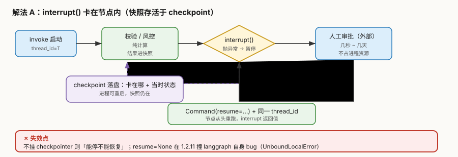
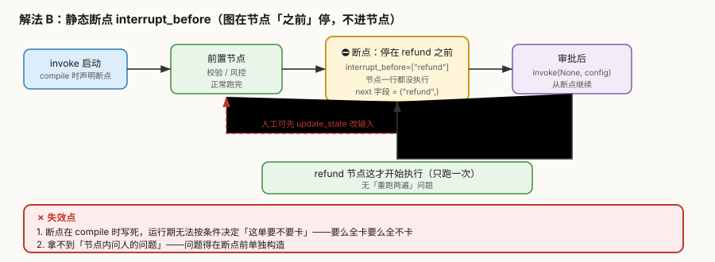
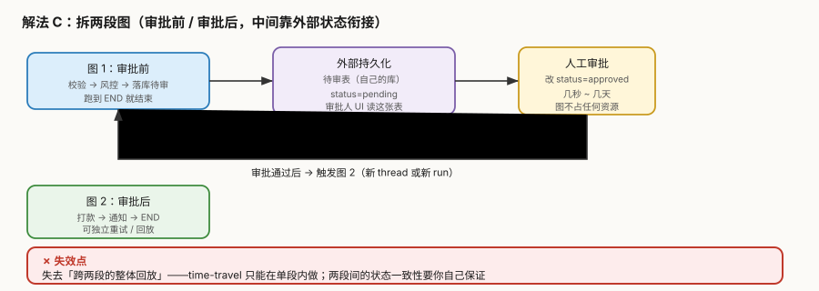

# 场景 2：审批等待与恢复（经典设计题）

**场景描述**：工单系统要求**超过 5000 元的退款必须人工审批**。审批人是个业务同事，可能**几秒就点**，也可能**出差三天后才点**。同时要求：① 审批等待期间**不能占着进程资源**；② 审批人点完之后要能**接着当时的数据继续走**；③ 任何时刻重启服务，**待审批的工单不能丢**。

> 矛盾点：LangGraph 的图是"跑起来才有状态"的，而审批是一个**异步的、可能极慢的外部事件**。

**🔒 先自己想 30 秒**：第一反应是"起个后台线程 sleep 等审批"？如果同时有 1 万个待审工单呢？如果服务在等待期间重启了呢？状态放进程内存、放 State、还是放你自己的库？

<details><summary>💡 提示（分层 / 分维度想）</summary>

- **"暂停"到底是谁在暂停**：是图在跑但卡住了，还是图已经跑完结束了？两者对资源的占用差多少？
- **状态活在哪儿**：checkpoint（LangGraph 管）／你自己的业务表（你管）——谁能扛住"服务重启 + 三天后恢复"？
- **恢复时怎么接着走**：靠什么定位到"当时走到哪一步"？
- **如果审批需要看中间结果**：暂停点能拿到节点内部的变量吗？还是只能拿到 State？

</details>

<details><summary>📖 展开解法</summary>

### 解法一览

> 效果维度按本题定制：**等待期资源占用**／**能扛多久**（服务重启后是否还在）／**整体可回放性**。

| 解法 | 等待期资源占用 | 能扛多久 | 整体可回放性 | 实现复杂度 | 代价 | 适用边界 |
|------|--------------|---------|------------|-----------|------|---------|
| **A. `interrupt()` 卡在节点内** | 零（图已暂停） | 永久（在 checkpoint） | **强**（整条链可回放） | 低 | 必须有 checkpointer；节点会重跑 | 绝大多数场景**首选** |
| **B. 静态断点 `interrupt_before`** | 零 | 永久 | 强 | **最低** | 断点 compile 时写死，不能按条件决定 | 所有实例都要卡、且想改输入再放行 |
| **C. 拆两段图** | 零（图已结束） | 永久（在你的库） | **弱**（只能分段回放） | 高 | 两段间一致性自己保证 | 审批极慢（天级）或审批系统完全独立 |
| **D. 外部编排**（队列 / Temporal） | 零 | 永久 | 中等 | **最高** | 引入整套基础设施 | 已有工作流引擎、或审批跨系统 |

### 各解法详解

#### 解法 A：`interrupt()` 卡在节点内

核心思路：在节点内部调用 `interrupt()` 抛异常暂停，把"卡在哪 + 当时状态"存进 checkpoint；人回答后用 `Command(resume=...)` 带着值回来，**节点从头重跑**，这次 `interrupt()` 返回那个值。



读图：绿色是暂停前已完成的纯计算，**紫色虚线是 checkpoint 落盘路径**（这是"能扛住重启"的关键）；人审批完从右下绕回来触发重跑。**红框标出失效点**：不挂 checkpointer 则"能停不能恢复"。

::: code-group

```python [Python]
from langgraph.types import interrupt, Command

def human_approve(state):
    amount = calc_refund(state["order_id"])          # 纯计算：重跑无害
    if amount <= 5000:                                # 可按条件决定要不要卡
        return {"decision": "auto"}

    decision = interrupt({                            # 卡在这儿
        "question": f"批准退款 {amount} 元？",
        "order_id": state["order_id"],
    })
    return {"decision": decision}

# 恢复：同 thread_id + Command(resume=...)
app.invoke(Command(resume="approve"),
           {"configurable": {"thread_id": tid}})
```

```typescript [TypeScript]
import { interrupt, Command } from "@langchain/langgraph";

async function humanApprove(state: typeof OrderState.State) {
  const amount = calcRefund(state.order_id);         // 纯计算：重跑无害
  if (amount <= 5000) {                              // 可按条件决定要不要卡
    return { decision: "auto" };
  }

  // ⚠️ TS 是**双泛型** interrupt<I, R>：I = 传出去的值，R = resume 回来的值
  const decision = interrupt<
    { question: string; order_id: string },
    string
  >({
    question: `批准退款 ${amount} 元？`,
    order_id: state.order_id,
  });
  return { decision };
}

// 恢复：同 thread_id + new Command({ resume: ... })
await app.invoke(new Command({ resume: "approve" }), {
  configurable: { thread_id: tid },
});
```

:::


> **代价与坑**：
> ① **必须挂 checkpointer**，否则 `get_state` 抛 `ValueError: No checkpointer set`、`resume` 抛 `RuntimeError`——**能停不能恢复**。
> ② **节点整体重跑**（课 8 实测执行 2 次）——`interrupt()` 之前不能有副作用（见[场景 1](场景-01-重复打款与幂等.md)）。
> ③ 1.2.11 实测：`resume=None` 会撞 langgraph 自身的 `UnboundLocalError` bug——**恢复值不要传 None**。
>
> 🇹🇸 **TS 侧差异**：
> ① `Command` 必须 `new`：`new Command({ resume: "approve" })`。漏 `new` 会抛 `TypeError: Class constructor Command cannot be invoked without 'new'`（课 11 实测）。
> ② `interrupt` 是**双泛型** `interrupt<I, R>`，I 是传出去的值、R 是 resume 回来的值。只写 `interrupt<string>` 编译报 `TS2345`（场景 1 已实测）。
> ③ TS 侧 `resume: undefined` 与 Python 的 `None` 不是一回事——TS 的 `Command` 判断的是 `"resume" in obj`，传 `{ resume: undefined }` 仍算"给了恢复值"，不会触发那条 `UnboundLocalError`；但要恢复成"空值"请显式给 `null` 或业务占位串，别指望 `undefined`。

#### 解法 B：静态断点 `interrupt_before`

核心思路：在 `compile()` 时声明"跑到这个节点**之前**就停"，节点一行都不执行。放行时用 `invoke(None, config)` 继续。



读图：黄色断点在 `refund` **之前**——节点根本没进入；**红色虚线是人工先改输入再放行**的路径（这是本解法独有的优势）。**红框标出失效点**：断点写死、不能按条件决定。

::: code-group

```python [Python]
app = graph.compile(
    checkpointer=cp,
    interrupt_before=["refund"],        # compile 时写死
)

# 第一次：跑到 refund 之前停住
app.invoke(inp, config)
print(app.get_state(config).next)       # ("refund",)

# 人工可先改输入再放行
app.update_state(config, {"amount": 4999})

# 放行（节点这才开始执行，只跑一次）
app.invoke(None, config)
```

```typescript [TypeScript]
const app = graph.compile({
  checkpointer: cp,
  interruptBefore: ["refund"],        // compile 时写死
});

const config = { configurable: { thread_id: tid } };

// 第一次：跑到 refund 之前停住
await app.invoke(inp, config);
const snap = await app.getState(config);
console.log(snap.next);               // ["refund"]（Python 是 ("refund",) 元组）

// 人工可先改输入再放行
await app.updateState(config, { amount: 4999 });

// 放行（节点这才开始执行，只跑一次）
// ⚠️ TS 的 invoke 首参签名是 `InputType | CommandType | null`，传 null 合法
await app.invoke(null, config);
```

:::


> **代价与坑**：
> ① **断点在 compile 时写死**——无法在运行期按"这单金额超不超 5000"决定卡不卡，要么全卡要么全不卡。
> ② 拿不到"节点内问人的问题"——问题内容得在断点之前单独构造好放进 State。
>
> 🇹🇸 **TS 侧差异**：
> ① 选项名是 **`interruptBefore`（驼峰）**，且值必须是**节点名数组** `["refund"]`（不是 `Set`，也不是 `"refund"` 单串）。
> ② `getState()` 是**异步**：必须 `await app.getState(config)`；返回的 `next` 是**数组** `["refund"]`，不像 Python 是元组 `("refund",)`——但空的时候两边都表现为"空"，`snap.next.length` 比真值判断更稳。
> ③ 放行传 `null`：TS 的 `invoke` 签名是 `invoke(input: InputType | CommandType | null, options?)`，**`null` 是合法的**（实测无报错）；传 `undefined` 则等价于"没传参数"，若图有必填字段会被当成缺输入。
> ④ **`next` 的语义要分清**（本机实测）：`interrupt()` 暂停后 `next` 是 **`["approve"]`——即节点自身**（因为它要被重跑一遍）；`interruptBefore` 暂停后 `next` 才是 **`["refund"]`——下一个待执行节点**。看到 `next` 指回自己就说明是「节点内中断」，不是「断点」。

#### 解法 C：拆两段图

核心思路：不做"暂停"，改成**跑完就结束**——图 1 把待审工单写进你自己的业务表，审批人改表里状态，触发图 2 继续执行。



读图：两段图各自独立跑完到 END，中间靠**紫色外部表**衔接；审批可以等三天，图完全不占资源。**红框标出失效点**：跨两段的整体回放能力丢失。

::: code-group

```python [Python]
# 图 1：审批前
def submit_for_review(state):
    amount = calc_refund(state["order_id"])
    pending_table.insert({                 # 写你自己的库，不是 State
        "order_id": state["order_id"],
        "amount": amount, "status": "pending",
    })
    return {"status": "pending"}           # 图 1 跑完结束

# 审批人改 status → 触发图 2
def refund_node(state):                    # 图 2：审批后
    txn = gateway.refund(state["order_id"], state["amount"])
    return {"txn_id": txn.id}
```

```typescript [TypeScript]
// 图 1：审批前
async function submitForReview(state: typeof OrderState.State) {
  const amount = calcRefund(state.order_id);
  await pendingTable.insert({              // 写你自己的库，不是 State
    order_id: state.order_id,
    amount,
    status: "pending",
  });
  return { status: "pending" };            // 图 1 跑完结束
}

// 审批人改 status → 触发图 2
async function refundNode(state: typeof OrderState.State) {   // 图 2：审批后
  const txn = await gateway.refund(state.order_id, state.amount);
  return { txn_id: txn.id };
}
```

:::


> **代价与坑**：
> ① **失去整体回放**——time-travel 只能在单段内做，"这单从提交到打款的全过程"要你自己拼。
> ② **两段间一致性自己保证**——图 2 失败了要自己处理重试、补偿，LangGraph 不再帮你兜。
> ③ 审批人 UI 要读**你的表**而不是 LangGraph 的 checkpoint，多一套对接。
>
> 🇹🇸 **TS 侧差异**：这一条**与语言无关**——拆两段图的代价（失去整体回放、两段间一致性自管）在 TS 侧完全一样。唯一区别是写法：`pendingTable.insert(...)` 这类库调用全是 `Promise`，漏 `await` 会让"写表"变成"发出去就不管了"，图 1 已返回 END 而表里还没数据。

#### 解法 D：外部编排（队列 / 工作流引擎）

> 本解法**无图**，原因：纯架构选型说明（引入外部系统），本场景内无 LangGraph 侧组件交互可画——符合豁免条件。

把"等待审批"交给专门的系统：LangGraph 只负责"提交待审"和"执行已批"两段计算，中间的等待与超时由 Temporal / Celery + 队列托管。

> **代价与坑**：引入一整套基础设施与运维成本；只有当审批链路**跨多个系统**（不止你这一个服务）时才划算。

### 替代路线（非 LangGraph 技术栈）

| 路线 | 做法 | 与本课程解法的差异 |
|------|------|------------------|
| **Temporal** | signal / workflow 原生支持"等一个外部事件"，可等数天，`await workflow.wait_condition(...)` | 等待是一等公民，**不需要把状态塞进图**；代价是整套引擎 |
| **Camunda / Flowable**（BPMN） | 用户任务（User Task）节点原生就是人工审批，自带待办列表、超时、会签 | 审批 UI 与流程引擎一体；适合**审批流本身很复杂**（会签 / 或签 / 加签） |
| **消息队列 + 状态机**（Kafka / SQS） | 待审消息入队，审批服务消费后发"已批"消息，下游消费执行 | 最灵活、最解耦；代价是顺序、去重、补偿全都自己写 |
| **数据库轮询** | 定时任务扫 `status=approved` 的表 | 最土；延迟取决于轮询间隔，**不推荐但确实有人用** |

### 推荐路径（递进）

1. **先用 A**（`interrupt()` 卡节点内）——零额外组件，回放能力最强
2. **需要"审批前改输入"时叠 B**（`interrupt_before`）——两者不冲突，可并存
3. **审批真的要等天级、或审批系统完全独立**，才考虑 C（拆两段）
4. **审批流本身变复杂**（会签 / 加签 / 委托）→ 别硬撑，换 BPMN 引擎（替代路线）

> ⚠️ **A 与 C 不是"哪个更好"，而是"状态归谁管"**：A 让 LangGraph 管，C 让你自己的库管。
> 选 C 的真实理由通常不是技术，而是**"审批人本来就在另一个系统里干活"**。

### 知识点挂钩

| 知识点 | 回指 |
|--------|------|
| `interrupt()` 机制、`Command(resume=...)`、节点重跑语义 | 阶段 3 · [课 8](../stages/3-可控性与人在环中/lessons/08-Interrupts%20人在环中.md) |
| checkpoint 存"卡在哪 + 当时状态"，是能扛重启的关键 | 阶段 2 · [课 5](../stages/2-执行模型与状态持久化/lessons/05-Checkpointer%20短期记忆.md) |
| 时间旅行回放（A 独有的整体回放优势） | 阶段 3 · [课 9](../stages/3-可控性与人在环中/lessons/09-Time-travel%20回放与分叉.md) |
| 用假模型/假审批测这类分支（走 `config["configurable"]`） | 阶段 4 · [课 12](../stages/4-工程化与上线/lessons/12-Application%20structure%20与测试.md) |
| 项目里的实际选择（A + 幂等键） | [结课项目 · 设计决策](../projects/会审批的退款工单系统/设计决策.md) |

### 不适用边界

- **不需要人工参与的图**——加暂停点纯属自找麻烦
- **审批必须在毫秒内完成**（如风控实时拦截）——`interrupt` 的持久化写入有开销，应改为同步规则判断
- **审批人就在同一进程内**（如 CLI 交互）——直接 `input()` 比绕一圈 checkpoint 简单得多
- **解法 C 不适用于需要"从提交到打款全过程回放"的合规场景**（回放能力被切断）

### TS 写法对照表

| Python | TypeScript | 注意 |
|--------|-----------|------|
| `from langgraph.types import interrupt, Command` | `import { interrupt, Command } from "@langchain/langgraph"` | 同一个包导出 |
| `interrupt({...})` | `interrupt<I, R>({...})` | **双泛型**，只写一个报 TS2345 |
| `Command(resume="approve")` | `new Command({ resume: "approve" })` | 必须 `new` |
| `compile(interrupt_before=["refund"])` | `compile({ interruptBefore: ["refund"] })` | 驼峰 + 数组 |
| `app.get_state(config).next` → `("refund",)` | `(await app.getState(config)).next` → `["refund"]` | 异步 + 数组；`interrupt` 后指回节点自身 |
| `app.update_state(config, {...})` | `await app.updateState(config, {...})` | 异步 |
| `app.invoke(None, config)` | `await app.invoke(null, config)` | `null` 合法（签名含 `\| null`） |

> **本场景四条提醒在 TS 侧是否还成立**：
> ① 「必须挂 checkpointer，否则能停不能恢复」→ ✅ 成立（TS 报错文本不同，见课 5）。
> ② 「节点整体重跑，`interrupt()` 之前不能有副作用」→ ✅ 成立（课 8 实测 TS 同样执行 2 次）。
> ③ 「`resume=None` 有 bug」→ ❌ 不成立（TS 无该 bug），但别用 `undefined` 表达"空恢复值"。
> ④ 「断点写死，不能按条件决定」→ ✅ 成立。

</details>

---

## 相关故障模式（想懂为什么）

- 故障模式 5《断点续跑后，副作用执行了两次》→ [08-实战经验.md](../08-实战经验.md)
- 故障模式 4《加了 checkpointer，update_state 改了却不生效》→ [08-实战经验.md](../08-实战经验.md)
