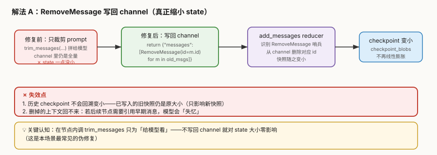
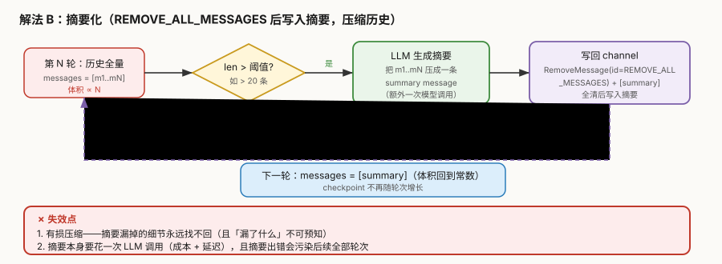
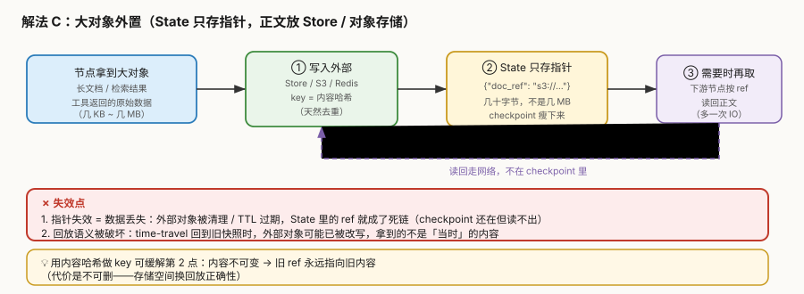

# 场景 3：长对话状态膨胀（经典设计题）

**场景描述**：客服 agent 上线一个月后出问题：**同一会话聊得越久越慢**。第 3 轮响应 800ms，第 30 轮变成 12 秒。查数据库发现 `checkpoint_blobs` 表**一个月涨到 400GB**，还在直线上升；备份窗口从 20 分钟拖到 6 小时。

> 关键线索：**短会话一直很快，只有长会话慢**。这说明不是并发问题，是**单条 state 在膨胀**。

**🔒 先自己想 30 秒**：第一反应是"在节点里把历史裁短再喂给模型"？——**这个修复是无效的**，为什么？真正的体积增长发生在哪儿？

<details><summary>💡 提示（分层 / 分维度想）</summary>

- **"给模型看的内容"和"存进 checkpoint 的内容"是同一份吗**？在节点里裁剪 prompt，影响的是哪一个？
- **为什么是 O(n²)**：如果每步都把整个消息历史完整序列化一遍，n 步下来总字节数是多少？
- **哪些字段在涨**：只有消息？还是工具返回的原始结果、检索回来的长文档也在 State 里？
- **能不能不存**：有些内容是不是**根本不必进 State**（只需要指针）？

</details>

<details><summary>📖 展开解法</summary>

### 解法一览

> 效果维度按本题定制：**state 体积**（能否真正缩小）／**信息保真度**（有损还是无损）／**实现复杂度**。

| 解法 | state 体积 | 信息保真度 | 实现复杂度 | 代价 | 适用边界 |
|------|-----------|-----------|-----------|------|---------|
| **A. `RemoveMessage` 写回 channel** | **真缩小** | 无损（按需删） | 低 | 删掉的回不来；旧快照不变小 | 明确知道哪些消息可以丢 |
| **B. 摘要化**（`REMOVE_ALL_MESSAGES` + 摘要） | **真缩小**（回到常数） | **有损** | 中 | 漏了什么不可预知；额外 LLM 调用 | 超长会话、只要"大意" |
| **C. 大对象外置**（State 只存指针） | **真缩小**（最彻底） | 无损（若用内容哈希） | 中 | 多一次 IO；破坏回放语义 | 工具返回 / 检索结果 / 长文档 |
| **D. 伪修复：只裁剪 prompt** | **一点没小** | — | 极低 | **无效修复**，只是自我安慰 | 无（这是反例，不是解法） |

> **D 是本场景最大的陷阱**——它看起来在解决问题，实际对 state 大小零影响。

### 各解法详解

#### 解法 A：`RemoveMessage` 写回 channel

核心思路：**必须把"删除"这个动作写回 channel**，让 reducer 真的把消息从 state 里拿掉——而不是只在节点内部裁剪后喂给模型。



读图：左边红色是**无效做法**（只裁剪 prompt，channel 不变）；绿色是**有效做法**（返回 `RemoveMessage` 让 reducer 真的删）。**红框标出失效点**：旧快照不会回溯变小；删掉的上下文找不回。

::: code-group

```python [Python]
from langchain_core.messages import RemoveMessage

def trim_node(state):
    msgs = state["messages"]
    if len(msgs) <= 10:
        return {}

    # ✅ 关键：把「删除」作为返回值写回 channel（不是只在本地裁剪）
    return {"messages": [RemoveMessage(id=m.id) for m in msgs[:-10]]}

# ❌ 伪修复（对比）：只在本节点拼 prompt，channel 一点没变
def trim_node_wrong(state):
    trimmed = trim_messages(state["messages"], max_tokens=1000)
    out = llm.invoke(trimmed)          # 模型看的是短的
    return {"answer": out}             # 但 state["messages"] 仍是全量 → 快照照涨
```

```typescript [TypeScript]
import { RemoveMessage, trimMessages } from "@langchain/core/messages";
import { MessagesAnnotation } from "@langchain/langgraph";

// ⚠️⚠️ TS 侧最关键的差异：RemoveMessage **只有 channel 用 messagesStateReducer 时才生效**。
// 若像前面几个场景那样写 `Annotation<any[]>({ reducer: (a, b) => a.concat(b) })`，
// RemoveMessage 会被当成「一条新消息」**追加**进数组——实测 10 条删 4 条 → 变成 16 条。
// 所以这里直接用 MessagesAnnotation（它内置 messagesStateReducer）；
// 要加自定义字段就用 Annotation.Root + messagesStateReducer 显式当 reducer。
const graph = new StateGraph(MessagesAnnotation /* 或 Annotation.Root({ messages: Annotation({ reducer: messagesStateReducer }) }) */)
  .addNode("trim", trimNode)
  .compile({ checkpointer: cp });

async function trimNode(state: typeof MessagesAnnotation.State) {
  const msgs = state.messages;
  if (msgs.length <= 10) {
    return {};
  }

  // ✅ 关键：把「删除」作为返回值写回 channel（不是只在本地裁剪）
  return { messages: msgs.slice(0, -10).map((m) => new RemoveMessage({ id: m.id! })) };
}

// ❌ 伪修复（对比）：只在本节点拼 prompt，channel 一点没变
async function trimNodeWrong(state: typeof MessagesAnnotation.State) {
  const trimmed = await trimMessages(state.messages, {
    maxTokens: 1000,
    // ⚠️ TS 的 tokenCounter 是**必填**（Python 侧由模型提供）；缺了会抛
    //    `Cannot use 'in' operator to search for 'getNumTokens' in undefined`
    tokenCounter: (ms) => ms.reduce((n, m) => n + String(m.content).length, 0),
    strategy: "last",
  });
  const out = await llm.invoke(trimmed);   // 模型看的是短的
  return { answer: out };                  // 但 state.messages 仍是全量 → 快照照涨
}
```

:::


> **代价与坑**：
> ① **已写入的旧 checkpoint 不会回溯变小**——本解法只影响**新**快照，历史 400GB 要靠[场景 5](场景-05-检查点存储无限增长.md) 的保留策略清。
> ② **删掉的上下文回不来**——如果后面某个节点要引用早期消息，模型会"失忆"。
>
> 🇹🇸 **TS 侧差异（本场景最容易踩的一条）**：
> ① `RemoveMessage` **只在 channel 用 `messagesStateReducer` 时才被识别为"删除"**。若沿用前面场景那种 `Annotation<any[]>({ reducer: (a, b) => a.concat(b) })`，它会被当成**一条新消息追加**——本机实测「10 条删 4 条」结果变成 **16 条**（`m0..m9,m0..m5`），而且不报错。用 `MessagesAnnotation` 或用 `Annotation.Root({ messages: Annotation({ reducer: messagesStateReducer }) })` 才正确（实测 10 → 4）。
> ② `RemoveMessage` 类从 **`@langchain/core/messages`** 导入；`@langchain/langgraph` 只再导出 `REMOVE_ALL_MESSAGES` 常量，不导出这个类。
> ③ `trimMessages` 在 TS 是 **`async`**，且 `tokenCounter` **必填**（Python 侧可由模型自带）。缺了会抛 `TypeError: Cannot use 'in' operator to search for 'getNumTokens' in undefined`，不是"用默认分词器"。

#### 解法 B：摘要化（压缩历史）

核心思路：超过阈值就用 LLM 把历史压成一条摘要，然后用 `REMOVE_ALL_MESSAGES` 清空原消息、写入摘要——**state 体积回到常数**。



读图：超过阈值 → LLM 生成摘要 → 用 `REMOVE_ALL_MESSAGES` 全清后写入摘要（**紫色虚线**回到下一轮）。**红框标出失效点**：有损不可恢复；摘要本身要花一次调用。

::: code-group

```python [Python]
from langchain_core.messages import RemoveMessage, REMOVE_ALL_MESSAGES

def summarize_node(state):
    msgs = state["messages"]
    if len(msgs) <= 20:
        return {}

    summary = llm.invoke([                      # 额外一次 LLM 调用
        *msgs,
        HumanMessage("把以上对话压缩成一段摘要，保留关键事实与待办"),
    ])

    # 全清 + 写入摘要（顺序不能反）
    return {"messages": [
        RemoveMessage(id=REMOVE_ALL_MESSAGES),
        HumanMessage(content=f"【历史摘要】{summary.content}"),
    ]}
```

```typescript [TypeScript]
// ⚠️ REMOVE_ALL_MESSAGES 是 @langchain/langgraph 的导出（@langchain/core/messages 里没有，
//    实测为 undefined）；它的实际值是字符串 "__remove_all__"。
// ⚠️ 同样要求 channel 是 messagesStateReducer（MessagesAnnotation 已内置）
import { REMOVE_ALL_MESSAGES, MessagesAnnotation } from "@langchain/langgraph";
import { RemoveMessage, HumanMessage } from "@langchain/core/messages";

async function summarizeNode(state: typeof MessagesAnnotation.State) {
  const msgs = state.messages;
  if (msgs.length <= 20) {
    return {};
  }

  const summary = await llm.invoke([              // 额外一次 LLM 调用
    ...msgs,
    new HumanMessage("把以上对话压缩成一段摘要，保留关键事实与待办"),
  ]);

  // 全清 + 写入摘要（顺序不能反）
  return {
    messages: [
      new RemoveMessage({ id: REMOVE_ALL_MESSAGES }),
      new HumanMessage({ content: `【历史摘要】${summary.content}` }),
    ],
  };
}
```

:::


> **代价与坑**：
> ① **有损且不可预知**——摘要漏掉什么你不知道，直到某个客户投诉"它怎么忘了我的订单号"。
> ② **摘要出错会污染后续全部轮次**——一个错误事实会被当作既有上下文反复引用。
> ③ 每次摘要是一次 LLM 调用（成本 + 延迟），阈值设太低会频繁触发。
>
> 🇹🇸 **TS 侧差异**：
> ① `REMOVE_ALL_MESSAGES` 从 **`@langchain/langgraph`** 导入（不是 core），实测值是字符串 `"__remove_all__"`；core 侧同名导出为 `undefined`，**导入错了要到运行时才炸**。
> ② 用法是 `new RemoveMessage({ id: REMOVE_ALL_MESSAGES })`——必须 `new`，且 id 用常量。实测 `MessagesAnnotation` 下全清后条数 = 0，随后写入的摘要成为唯一消息。
> ③ 「顺序不能反」在 TS 侧尤其重要：同一数组里 `RemoveMessage` 必须排在摘要消息**之前**，reducer 按序处理；反了就是"先写摘要再全清"，摘要一起没了。

#### 解法 C：大对象外置（State 只存指针）

核心思路：**大块内容根本不进 State**——写进 Store / S3 / Redis，State 里只留一个引用（几十字节）。



读图：大对象写外部 → State 只存 `doc_ref` → 下游按需取回（紫色虚线）。**红框标出失效点**：指针失效即数据丢失；回放时外部内容可能已被改写。

::: code-group

```python [Python]
def retrieve_node(state, *, store):
    docs = retriever.invoke(state["query"])       # 可能是几 MB

    # ① 写外部（key 用内容哈希 → 天然去重 + 不可变）
    key = hashlib.sha256(dumps(docs)).hexdigest()
    store.put(("docs",), key, {"content": docs})

    # ② State 只存指针
    return {"doc_ref": key, "doc_count": len(docs)}

def answer_node(state, *, store):
    docs = store.get(("docs",), state["doc_ref"]).value["content"]   # ③ 按需取回
    return {"answer": llm.invoke([*docs, HumanMessage(state["query"])])}
```

```typescript [TypeScript]
import { createHash } from "node:crypto";

// ⚠️ TS 侧 store 不在节点签名的关键字参数里，而是节点第 2 参的 `config.store`
//    （等价写法是 `getStore()`；`config.configurable.store` 两侧都是 undefined）
async function retrieveNode(state: typeof RagState.State, config: any) {
  const store = config.store;                          // ⚠️ TS 从节点第 2 参取 store
  const docs = await retriever.invoke(state.query);    // 可能是几 MB

  // ① 写外部（key 用内容哈希 → 天然去重 + 不可变）
  const key = createHash("sha256").update(JSON.stringify(docs)).digest("hex");
  await store.put(["docs"], key, { content: docs });

  // ② State 只存指针
  return { doc_ref: key, doc_count: docs.length };
}

async function answerNode(state: typeof RagState.State, config: any) {
  const store = config.store;
  // ③ 按需取回：get 返回 `{ value, key, namespace, createdAt, updatedAt }` 包装对象，
  //    业务内容在 .value；取不到时整个对象是 null（TS 侧不是抛异常）
  const row = await store.get(["docs"], state.doc_ref);
  const docs = row!.value.content;
  return { answer: await llm.invoke([...docs, new HumanMessage(state.query)]) };
}
```

:::


> **代价与坑**：
> ① **指针失效 = 数据丢失**——外部对象被清理或 TTL 过期，State 里的 ref 变死链。
> ② **破坏回放语义**——time-travel 回旧快照时，外部内容可能已被改写，拿到的不是"当时"的内容。
> ③ **缓解法**：用**内容哈希**做 key（内容不可变）→ 旧 ref 永远指向旧内容，代价是不能删。
>
> 🇹🇸 **TS 侧差异**：
> ① 节点取 store 的入口不同：Python 是 `def retrieve_node(state, *, store)`；TS 是**节点第 2 参** `config.store`（等价 `getStore()`）——`config.configurable.store` 两侧都是 `undefined`，别从那取。
> ② `store.get()` 返回**包装对象** `{ value, key, namespace, createdAt, updatedAt }`，业务内容在 `.value`；`createdAt` 实测是 `Date` 实例。取不到时返回 `null`（不是抛异常），所以要么 `!` 要么判空。
> ③ `store.put()` 返回 `void`——别指望像 Python 那样顺手拿回写入结果。
> ④ 内容哈希用 `node:crypto` 的 `createHash("sha256")`；对 `docs` 直接哈希前要先 `JSON.stringify`，且**键序会影响结果**——若 docs 来自不同来源，建议先规范化字段顺序再哈希，否则"同内容不同键序"会算出两个 key、去重失效。

#### 解法 D：伪修复——只裁剪 prompt（**反例**）

> 本解法**无图**，原因：它是无效路径的对照说明，无机制可画——符合豁免条件。

::: code-group

```python [Python]
# ❌ 看起来在解决问题，实际对 state 大小零影响
def node(state):
    short = trim_messages(state["messages"], max_tokens=1000)
    return {"answer": llm.invoke(short)}
```

```typescript [TypeScript]
// ❌ 看起来在解决问题，实际对 state 大小零影响
async function node(state: typeof MessagesAnnotation.State) {
  const short = await trimMessages(state.messages, {
    maxTokens: 1000,
    tokenCounter: (ms) => ms.reduce((n, m) => n + String(m.content).length, 0),
  });
  return { answer: await llm.invoke(short) };
}
```

:::


**为什么无效**：`trim_messages` 只在节点内造了一个短列表给模型看，**`state["messages"]` 本身没变**。superstep 结束时 checkpointer 序列化的仍是**完整的 messages channel**。

> 💡 判别口诀：**问一句"这个值 return 回去了吗"**——没 return 回 channel 的裁剪，都是自我安慰。
>
> 🇹🇸 **TS 侧补充**：TS 侧还有第二个判别点——**"return 回去了，但 channel 认得这个删除指令吗"**。普通 `concat` reducer 下 `RemoveMessage` 会被追加而不是删除，看起来"return 了"却越删越多。所以 TS 侧口诀是两句：**返回了吗 + reducer 是 messagesStateReducer 吗**。

### 替代路线（非 LangGraph 技术栈）

| 路线 | 做法 | 与本课程解法的差异 |
|------|------|------------------|
| **LangGraph 内置 Summarization 中间件** | 框架层提供摘要化中间件 | 开箱即用；但**要确认它是否写回 channel**（只改 prompt 的中间件同样无效） |
| **外部会话存储 + 按需加载**（Redis） | 会话历史存 Redis，State 只留当前窗口，历史按轮次懒加载 | 与解法 C 同思路，但**由外部系统托管 TTL**，不占 checkpoint；代价是多一套存储要运维 |
| **向量化历史检索** | 不存全文，把历史消息入库做向量检索，需要时按语义取回 top-k | 从"存全量"变成"按需召回"，**体积真正可控**；代价是召回不准等于丢信息 |
| **对话分会话（thread 拆分）** | 超过 N 轮强制开新 thread，把摘要带过去 | 最粗暴但有效——**用产品手段规避技术问题**；代价是用户感觉"换了个客服" |

### 推荐路径（递进）

1. **先做 C**（大对象外置）——工具返回、检索结果这类**本来就不该进 State**的东西先挪走，收益最大、风险最低
2. **再做 A**（`RemoveMessage` 按窗口删）——对明确可丢的中间消息（如工具调用的原始回包）下手
3. **长会话场景叠 B**（摘要化）——注意阈值别太低，且摘要里**必须保留业务关键字段**（订单号、金额、用户诉求）
4. **最后才考虑"开新 thread"**——这是产品妥协，不是技术胜利
5. **无论做哪一步，都要配[场景 5](场景-05-检查点存储无限增长.md) 的保留策略**——历史数据不会自己变小

> ⚠️ **排序理由**：C 和 A 都是无损的，B 是有损的。**先无损后损**。
> 别一上来就摘要化——那是把"数据太大"的问题换成"数据不准"的问题。

### 知识点挂钩

| 知识点 | 回指 |
|--------|------|
| checkpoint 每 superstep 存整批快照，State 全量序列化 | 阶段 2 · [课 5](../stages/2-执行模型与状态持久化/lessons/05-Checkpointer%20短期记忆.md) |
| Store 是跨会话键值仓库（本场景用作外置存储） | 阶段 2 · [课 6](../stages/2-执行模型与状态持久化/lessons/06-Store%20长期记忆.md) |
| reducer 决定"新值怎么落到旧值上"（为什么必须 return 才生效） | 阶段 1 · [课 3](../stages/1-从create_agent到StateGraph/lessons/03-Graph%20API%20第一个图.md) |
| 回放依赖快照完整性（外置方案会削弱这点） | 阶段 3 · [课 9](../stages/3-可控性与人在环中/lessons/09-Time-travel%20回放与分叉.md) |
| 存储增长与保留策略（本场景的下一步） | [场景 5](场景-05-检查点存储无限增长.md) |

### 不适用边界

- **会话天然很短**（几轮就结束）——为它做外置/摘要是过度设计
- **合规要求"完整保留原始对话不可删改"**——解法 A/B 都会破坏这一点；此时只能走 C（外置 + 内容哈希不可变）
- **需要完整回放每一次工具调用原始回包**——C 的外置方案会让回放依赖外部系统可用性
- **解法 B（摘要）不适用于金融 / 医疗等"一个数字都不能错"的场景**——有损压缩风险不可接受

### TS 写法对照表

| Python | TypeScript | 注意 |
|--------|-----------|------|
| `from langchain_core.messages import RemoveMessage` | `from "@langchain/core/messages"` | 类在 core，不在 langgraph |
| `from langchain_core.messages import REMOVE_ALL_MESSAGES` | `from "@langchain/langgraph"` | **反过来**：常量在 langgraph |
| `RemoveMessage(id=m.id)` | `new RemoveMessage({ id: m.id! })` | 必须 `new`，参数是对象 |
| `messages: Annotated[list, add_messages]` | `MessagesAnnotation` / `messagesStateReducer` | 否则删除指令被当追加（10→16） |
| `trim_messages(state["messages"], max_tokens=1000)` | `await trimMessages(state.messages, { maxTokens, tokenCounter })` | 异步 + `tokenCounter` 必填 |
| `def node(state, *, store)` | `node(state, config)` 取 `config.store` | 不在关键字参数里 |
| `store.get(ns, key).value` | `(await store.get(ns, key))!.value` | 返回包装对象，可能为 null |
| `hashlib.sha256(dumps(docs)).hexdigest()` | `createHash("sha256").update(JSON.stringify(docs)).digest("hex")` | 注意键序 |

> **本场景四条提醒在 TS 侧是否还成立**：
> ① 「只裁 prompt 不影响 state」→ ✅ 成立，TS 侧同理。
> ② 「必须 return 回 channel」→ ✅ 成立，且 TS 还多一道"reducer 要认得删除指令"。
> ③ 「先无损后损」→ ✅ 成立（排序理由与语言无关）。
> ④ 「旧快照不会回溯变小」→ ✅ 成立。

</details>

---

## 相关故障模式（想懂为什么）

- 故障模式 2《串行不报错，数据却静默丢失》→ [08-实战经验.md](../08-实战经验.md)
- 故障模式 8《并发上来后 Postgres 连接池耗尽》→ [08-实战经验.md](../08-实战经验.md)
