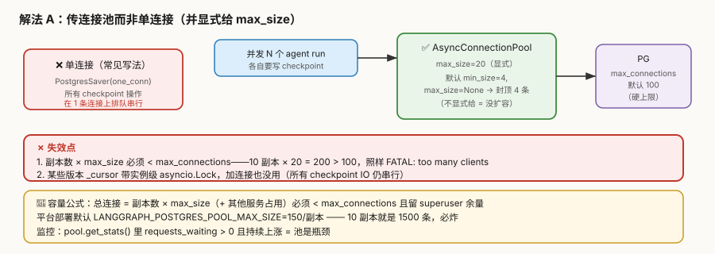
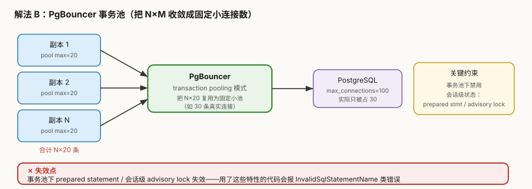
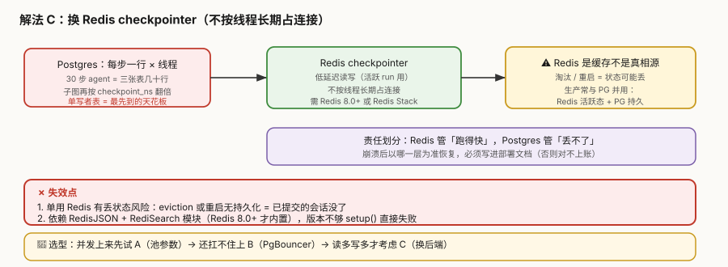

# 场景 4：并发翻倍连接池耗尽（规模压力题）

**场景描述**：agent 服务从每天 500 并发涨到 5000。压测发现：**加到某个并发点，响应时间突然从 800ms 悬崖式涨到 30 秒**，而且**再加副本也不缓解**。Postgres 日志刷 `FATAL: sorry, too many clients already`；应用侧报 `psycopg_pool.PoolTimeout: couldn't get a connection after 30.00 sec`。

> 反直觉点：**加机器反而更糟**——因为每加一个副本，就多一份连接池去抢那 100 个名额。

**🔒 先自己想 30 秒**：第一反应是"`max_connections` 调大到 2000"？——**这个方向是错的**，为什么？真实瓶颈是"并发数"还是"连接数"？一个 30 步的 agent 到底要写多少次 checkpoint？

<details><summary>💡 提示（分层 / 分维度想）</summary>

- **一次 run 写多少**：30 步的 agent 是写 1 行还是几十行？子图呢？——把"并发数"换算成"连接需求"再算总量。
- **连接被谁占着**：是 checkpoint 写完就还（borrow-and-return），还是**整个 run 期间一直占着**？后者通常是 ORM 的请求级事务干的。
- **加副本为什么无效甚至更糟**：副本数 × 池大小 vs `max_connections`，这个不等式怎么配平？
- **是不是非得用 Postgres**：checkpoint 的读写特征是什么？有没有更匹配的存储？

</details>

<details><summary>📖 展开解法</summary>

### 解法一览

> 效果维度按本题定制：**能扛的并发倍数**／**改动成本**／**运维复杂度**。

| 解法 | 能扛的并发倍数 | 改动成本 | 运维复杂度 | 代价 | 适用边界 |
|------|--------------|---------|-----------|------|---------|
| **A. 传连接池 + 显式 `max_size`** | 2–5× | **低** | 低 | 仍受 `max_connections` 硬顶 | **必做的第一步** |
| **B. PgBouncer 事务池** | 10×+ | 中 | 中 | 事务池下禁用会话级特性 | 副本多、连接算不平 |
| **C. 换 Redis checkpointer** | 读多场景显著 | 中 | 中 | 单用有丢状态风险；需 Redis 8.0+ | 活跃 run 读写密集 |
| **D. 调大 `max_connections`**（伪解法） | 短暂 | 极低 | 低 | **只是把爆炸点推后** | 无（这是反例） |

> **D 是最常见的错误方向**——它不改变"每个连接都要内存"的事实，只是延后 OOM。

### 各解法详解

#### 解法 A：传连接池而非单连接，并显式给 `max_size`

核心思路：**psycopg 池默认是 `min_size=4`、`max_size=None`**——`max_size=None` 意味着封顶就是 `min_size`，即**只有 4 条连接**。传单连接则更糟：所有 checkpoint 操作在一条连接上串行。



读图：红色是单连接（全部排队），绿色是连接池（并行）；**关键在 `max_size` 必须显式给**——不写等于没扩容。**红框标出失效点**：副本 × max_size 必须小于 `max_connections`；某些版本带实例级锁，加连接也没用。

::: code-group

```python [Python]
from psycopg_pool import AsyncConnectionPool
from langgraph.checkpoint.postgres.aio import AsyncPostgresSaver

# ✅ 传池，并显式设 max_size（默认是 4，不写等于没扩容）
pool = AsyncConnectionPool(conninfo=DB_URI, max_size=20, timeout=30)
saver = AsyncPostgresSaver(pool)
await saver.setup()                       # 每个库跑一次，否则首次部署静默失败

app = graph.compile(checkpointer=saver)
```

```typescript [TypeScript]
import { PostgresSaver } from "@langchain/langgraph-checkpoint-postgres";
import pg from "pg";

// ✅ 显式给 pool 上限（node-postgres 的默认 max 是 10；Python psycopg 池默认 max_size=None→4）
//    两边的默认值不同，但"必须显式配"这条结论一致
const pool = new pg.Pool({
  connectionString: DB_URI,
  max: 20,                    // 对应 Python 的 max_size
  idleTimeoutMillis: 30_000,  // 对应 timeout，单位毫秒
  connectionTimeoutMillis: 30_000,
});

const saver = new PostgresSaver(pool);
await saver.setup();          // 每个库跑一次，否则首次部署静默失败

const app = graph.compile({ checkpointer: saver });
```

:::


::: code-group

```python [Python]
# 监控：requests_waiting > 0 且持续上涨 = 池是瓶颈，不是数据库慢
print(pool.get_stats())
```

```typescript [TypeScript]
// 监控：waitingCount > 0 且持续上涨 = 池是瓶颈，不是数据库慢
// ⚠️ 字段名与 Python 的 pool.get_stats() 不同：
//    totalCount / idleCount / waitingCount（Python 是 pool_size / pool_available / requests_waiting）
console.log({
  total: pool.totalCount,
  idle: pool.idleCount,
  waiting: pool.waitingCount,
});
```

:::


```sql [SQL（两侧通用 · 仅基础设施）]
SELECT state, count(*) FROM pg_stat_activity GROUP BY 1;
-- idle in transaction 多 → ORM 在整个 run 上占着连接（要拆掉）
-- idle 多 → 池太小（调 max_size）
```

> **代价与坑**：
> ① **副本数 × `max_size` 必须 < `max_connections`**——10 副本 × 20 = 200 > 100，照样 `FATAL`。
> ② **绝不让数据库事务跨越 LLM 调用**——Web 框架在 run 外面开请求级事务，会让连接被占满整个模型延迟。
> ③ 某些版本的 `AsyncPostgresSaver._cursor` 带**实例级 `asyncio.Lock`**，此时加连接也没用（需升级版本）。
>
> 🇹🇸 **TS 侧差异**：
> ① 包不同：`@langchain/langgraph-checkpoint-postgres` 的 `PostgresSaver`，底层是 **`node-postgres`（`pg`）**，不是 psycopg。所以"传池"传的是 `pg.Pool` 实例，**池的默认值也不同**：`pg.Pool` 的 `max` 默认 **10**，Python psycopg 池 `max_size` 默认 `None`（等价于 `min_size=4`）。**两边都必须显式配**，但"不配时剩几条"不能互相套用。
> ② 构造有两种：`PostgresSaver.fromConnString(uri, opts)`（内部自己建池，适合快速验证）与 `new PostgresSaver(pool, undefined, { schema })`（接你自己的池，生产用这个——第二个参数是 `serde`，通常传 `undefined`）。
> ③ `setup()` 必须 `await`；**它是幂等的**，但只能在有写权限的库上跑一次。
> ④ 无 `get_stats()`：`pg.Pool` 只暴露 `totalCount` / `idleCount` / `waitingCount` 三个计数属性，没有 Python 那种一次性快照方法。
> ⑤ 运行时限制：`PostgresSaver` 走原始 TCP（`net`/`tls`），**Cloudflare Workers 这类无 TCP 的运行时下 `setup()` 会直接挂住**（官方 README 明示），要改用 Hyperdrive。

#### 解法 B：PgBouncer 事务池

核心思路：在应用与 PG 之间加一层连接池器，把"N 副本 × M 连接"**收敛成固定的少量真实连接**。



读图：左侧 N 个副本各自 20 条 → 中间 PgBouncer 收敛 → 右侧 PG 只被占 30 条。**红框标出失效点**：事务池下 prepared statement / 会话级 advisory lock 失效。

```ini [INI（两侧通用 · 仅基础设施）]
; pgbouncer.ini
[databases]
langgraph = host=pg-primary port=5432 dbname=langgraph

[pgbouncer]
pool_mode = transaction      ; 关键：事务池，不是会话池
max_client_conn = 1000
default_pool_size = 30       ; 真实打到 PG 的连接数
```

> **代价与坑**：
> ① **事务池下会话级特性失效**——prepared statement、会话级 advisory lock、`SET` 会串味（报 `InvalidSqlStatementName` 类错误）。
> ② 多一层要运维（虽然很轻）；连接池器本身也可能成为单点，需高可用部署。
>
> 🇹🇸 **TS 侧说明**：`pgbouncer.ini` 是**数据库中间件的配置**，与客户端语言无关，TS 侧照用同一份文件——所以这里不做"TS 版"，只标注它是基础设施配置。唯一要改的是连接串指向 PgBouncer（`postgresql://...:6432/...`），以及确认 `pg` 驱动没开 `statement_timeout` 之类依赖会话的设置（事务池下会串味）。

#### 解法 C：换 Redis checkpointer

核心思路：checkpoint 的读写特征（活跃 run 高频读、写完短期有效）**更像缓存而非账本**——用 Redis 扛活跃读写。



读图：左侧是 Postgres 的"每步一行"压力源；中间换成 Redis；**但右侧黄色警示是关键**——Redis 是缓存不是真相源。**红框标出失效点**：单用有丢状态风险；依赖 Redis 8.0+ 模块。

::: code-group

```python [Python]
from langgraph.checkpoint.redis import AsyncRedisSaver      # 需 langgraph-checkpoint-redis

async with AsyncRedisSaver.from_conn_string(REDIS_URI) as saver:
    await saver.setup()               # Redis 8.0+ 才内置 RedisJSON/RediSearch
    app = graph.compile(checkpointer=saver)
```

```typescript [TypeScript]
import { RedisSaver } from "@langchain/langgraph-checkpoint-redis";

// ⚠️ TS 侧 fromUrl 是 async，且第 2 参可直接带 TTL（Python 侧 AsyncRedisSaver 无此入参）
const saver = await RedisSaver.fromUrl(REDIS_URI, {
  defaultTTL: 60,       // 分钟
  refreshOnRead: true,
});
// 索引由 fromUrl() 自动创建（对应 Python 的 await saver.setup()）
const app = graph.compile({ checkpointer: saver });
```

:::


> **代价与坑**：
> ① **Redis 是缓存不是真相源**——eviction 或重启无持久化 = 已提交会话丢失。生产常与 PG 并用（Redis 活跃态 + PG 持久），**并写清崩溃后以哪层为准**。
> ② 依赖 **RedisJSON + RediSearch**（Redis 8.0+ 内置，7.x 需 Redis Stack），版本不够 `setup()` 直接失败。
>
> 🇹🇸 **TS 侧差异**：
> ① 包名 `@langchain/langgraph-checkpoint-redis`，类名 `RedisSaver`（不是 `AsyncRedisSaver`——TS 全是异步，不需要 Async 前缀区分）。
> ② 入口是 **`await RedisSaver.fromUrl(uri, ttlConfig?)`**：`fromUrl` 本身是 async，且**索引在 fromUrl 里自动创建**，没有单独的 `setup()`。
> ③ TS 侧 `RedisSaver` **原生支持 TTL**（`{ defaultTTL: 60, refreshOnRead: true }`，单位分钟）——这一点比 Python 侧更省事，可部分替代场景 5 的手写清理任务；但 `refreshOnRead` 会让"活跃会话永不过期"，容量规划要按活跃量算。
> ④ 另有 `ShallowRedisSaver`（`@langchain/langgraph-checkpoint-redis/shallow`）：**每个 thread 只留最新一个 checkpoint**，内存更省但**直接砍掉 time-travel 能力**，选之前想清楚。
> ⑤ 同样是原始 TCP，Cloudflare Workers 下会挂住（官方 README 明示）。

#### 解法 D：调大 `max_connections`（**反例**）

> 本解法**无图**，原因：纯参数调整的对照说明，无机制可画——符合豁免条件。

```sql [SQL（两侧通用 · 仅基础设施）]
ALTER SYSTEM SET max_connections = 2000; SELECT pg_reload_conf();
```

> 🇹🇸 **两侧通用**：这条反例与客户端语言无关，TS 侧同样成立。

**为什么是反例**：PG 每个连接都要 5–10MB 共享内存。2000 条 = 10–20GB 只用于连接管理，且**连接越多上下文切换越重**，最终不是 OOM 就是整体变慢。它**把爆炸点推后，没有消除**。

> 💡 判别：**能算出"副本数 × 池大小 < max_connections"才叫配置；只会往上调数字叫赌运气。**

### 替代路线（非 LangGraph 技术栈）

| 路线 | 做法 | 与本课程解法的差异 |
|------|------|------------------|
| **托管 PG（RDS / Cloud SQL）** | 云厂商托管，连接上限与内存一起扩，自带监控 | **不用自己算容量**；代价是成本与云绑定 |
| **分片（按 thread_id 分库）** | 按 `thread_id` 哈希把会话分散到多个 PG 实例 | 突破单写者天花板；代价是**跨片查询与运维复杂度陡增** |
| **异步落盘（`durability="async"`）** | checkpoint 与下一步并发写，不等落盘返回 | 降低单次写入等待；代价是崩溃时可能丢最后一步（课 5 的 durability 参数） |
| **LangGraph Platform** | 托管层替你管池与容量 | 最省心；代价是数据出机房 + 按节点执行计费 |

### 推荐路径（递进）

1. **先做 A**（池参数 + 显式 `max_size`）——零架构改动，先确认瓶颈真在池
2. **拆掉"跨越 LLM 调用的事务"**——这是 A 里最容易被忽略、收益却最大的一条
3. **上 B（PgBouncer）**——副本多、连接算不平时的标准答案
4. **读多写多才考虑 C**（Redis），且**必须与持久层并用**
5. **别走 D**——调大 `max_connections` 只在你**已经算清楚容量**的前提下作为配套，不能作为解法

> **第一步永远是量**：`pool.get_stats()` 与 `pg_stat_activity` 先定位"是池的问题还是数据库慢"。
> 两者症状很像（都是变慢），但修法完全不同。

### 知识点挂钩

| 知识点 | 回指 |
|--------|------|
| checkpointer 后端三档（内存 / SQLite / Postgres）与选型 | 阶段 2 · [课 5](../stages/2-执行模型与状态持久化/lessons/05-Checkpointer%20短期记忆.md) |
| 自托管要自己备 Redis / Postgres / License（三道门） | 阶段 4 · [课 13](../stages/4-工程化与上线/lessons/13-Deployment%20与%20Observability.md) |
| `langgraph.json` 与部署形态 | 阶段 4 · [课 12](../stages/4-工程化与上线/lessons/12-Application%20structure%20与测试.md) |
| 子图会在独立 `checkpoint_ns` 下再翻一倍写入量 | 阶段 3 · [课 10](../stages/3-可控性与人在环中/lessons/10-Fault-tolerance%20与%20Subgraphs.md) |
| 写入量与保留策略（连接之外的另一半问题） | [场景 5](场景-05-检查点存储无限增长.md) |

### 不适用边界

- **单机原型 / 本地 CLI**——SQLite 或内存即可，连接池是过早优化
- **并发本来就低（< 10）**——A 都不必做，默认参数够用
- **解法 C 不适用于合规要求"状态不可丢"的场景**——除非同时接持久层
- **解法 B 不适用于强依赖 prepared statement / advisory lock 的代码**——先改代码再上事务池

### TS 写法对照表

| Python | TypeScript | 注意 |
|--------|-----------|------|
| `psycopg_pool.AsyncConnectionPool(conninfo, max_size=20)` | `new pg.Pool({ connectionString, max: 20 })` | 默认值不同：psycopg `max_size=None`(→4) / `pg` `max=10` |
| `AsyncPostgresSaver(pool)` | `new PostgresSaver(pool, undefined, { schema })` | 第 2 参是 serde |
| `AsyncPostgresSaver.from_conn_string(uri)` | `PostgresSaver.fromConnString(uri, opts)` | 内部自建池 |
| `await saver.setup()` | `await saver.setup()` | 一致，幂等 |
| `pool.get_stats()` → `requests_waiting` | `pool.waitingCount` | 无快照方法，三个计数分开读 |
| `AsyncRedisSaver.from_conn_string(uri)` + `setup()` | `await RedisSaver.fromUrl(uri, ttl?)` | 无 `setup()`，索引自动建 |
| — | `RedisSaver` 原生 `{ defaultTTL, refreshOnRead }` | TS 独有能力（分钟） |
| `pgbouncer.ini` / `ALTER SYSTEM` | 同一份（基础设施） | 与语言无关，不做"TS 版" |

> **本场景四条提醒在 TS 侧是否还成立**：
> ① 「传池 + 显式 max_size」→ ✅ 成立，但默认值要按各自驱动算。
> ② 「副本 × 池大小 < max_connections」→ ✅ 成立，与语言无关。
> ③ 「别让事务跨 LLM 调用」→ ✅ 成立（Node 侧常见反例：把整段 `await graph.invoke()` 包在 Prisma `$transaction` 里）。
> ④ 「加机器反而更糟」→ ✅ 成立。

</details>

---

## 相关故障模式（想懂为什么）

- 故障模式 8《并发上来后 Postgres 连接池耗尽》→ [08-实战经验.md](../08-实战经验.md)
