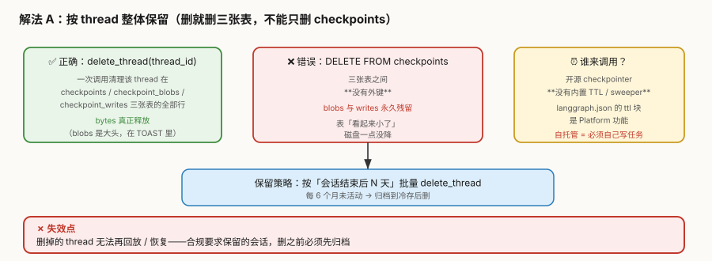
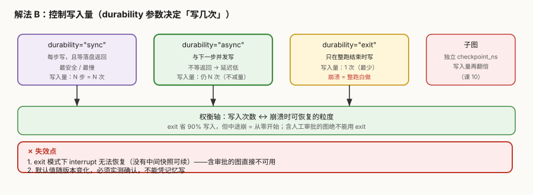
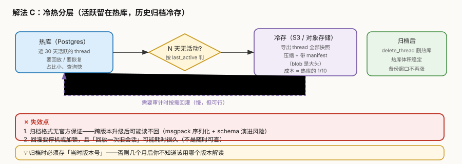

# 场景 5：检查点存储无限增长（规模压力题）

**场景描述**：agent 上线三个月，`checkpoint_blobs` 表涨到 **400GB 且直线上升**，从没下来过。直接后果：**备份窗口从 20 分钟拖到 6 小时**，已经挤占其他业务的备份时段。没人能说清"哪些数据可以安全删除"。

> 关键认知：**开源 checkpointer 没有内置 TTL，也没有清理任务**。`langgraph.json` 里的 `ttl` 配置块是 **LangGraph Platform 的功能**，自托管跑 `PostgresSaver` 时**根本没有 sweeper**。

**🔒 先自己想 30 秒**：第一反应是"`DELETE FROM checkpoints WHERE created_at < ...`"？——**这个 SQL 会留下什么**？为什么删完表"看起来小了"但磁盘一点没降？

<details><summary>💡 提示（分层 / 分维度想）</summary>

- **三张表的关系**：`checkpoints` / `checkpoint_blobs` / `checkpoint_writes`——它们之间有外键吗？没有外键意味着什么？
- **删之前先想**：删掉的 thread 还能回放吗？合规要求保留多久？
- **除了"删"，能不能"少写"**：一次 30 步的 run 到底写了多少次？有没有参数能减少写入？
- **冷热是否要分开**：三个月前的会话，真的需要和今天的放在同一个库里吗？

</details>

<details><summary>📖 展开解法</summary>

### 解法一览

> 效果维度按本题定制：**是否真释放磁盘**／**能否保留回放能力**／**运维负担**。

| 解法 | 是否真释放磁盘 | 保留回放能力 | 运维负担 | 代价 | 适用边界 |
|------|--------------|------------|---------|------|---------|
| **A. 按 thread 整体保留**（`delete_thread`） | **是** | 删掉即失去 | 中（要自己写任务） | 删前必须归档 | **必做**，所有自托管场景 |
| **B. 控制写入量**（`durability` 参数） | 减少增长 | 取决于档位 | **低** | `exit` 档崩溃即白做 | 写入量大、可容忍丢最后一步 |
| **C. 冷热分层**（归档冷存） | **是**（热库变小） | 冷存可回灌（慢） | **高** | 归档格式无官方保证 | 合规要长期保留 |
| **D. 手工 `DELETE FROM checkpoints`**（伪解法） | **否**（残留孤儿） | 部分 | 低 | **留下永久垃圾** | 无（这是反例） |

### 各解法详解

#### 解法 A：按 thread 整体保留（删就删三张表）

核心思路：用官方的 `delete_thread(thread_id)` **一次清干净三张表**；定时按"会话结束后 N 天"批量调用。



读图：绿色是正确做法（一次清三张表）；**红色是致命错误**——三张表**没有外键**，`DELETE FROM checkpoints` 会让 blobs 与 writes 永久残留。**黄色提醒**：开源版没有 sweeper，必须自己写任务调用。

```python
# ✅ 整体删除（会清理三张表）
await saver.delete_thread(thread_id)

# 定时任务的骨架（自托管必须自己写）
async def retention_sweep(saver, days=180):
    for tid in await list_threads_idle_since(days):   # 自己维护活跃时间
        await archive_to_cold(tid)                    # 先归档（见解法 C）
        await saver.delete_thread(tid)                # 再删
```

```sql
-- 排查：哪个 channel 最占空间（blobs 几乎总是最大）
SELECT channel, count(*) AS rows,
       pg_size_pretty(sum(octet_length(blob))::bigint) AS bytes
FROM checkpoint_blobs GROUP BY 1
ORDER BY sum(octet_length(blob)) DESC NULLS LAST LIMIT 20;
```

> **代价与坑**：
> ① **删掉的 thread 无法再回放 / 恢复**——合规要保留的必须先归档再删。
> ② **没有 sweeper，得自己写任务**——且要保证任务失败可重试、删前已归档（否则数据永久丢失）。
> ③ `delete_thread` 在较新版本才有；老版本要自己按三张表删（**务必三张都删**）。

#### 解法 B：控制写入量（`durability` 参数）

核心思路：不删，而是**少写**——`durability` 决定"一个 superstep 结束时是否落盘、是否等待"。



读图：三档对比（`sync` 每步等落盘 / `async` 并发写 / `exit` 只在结束写一次）；**子图会在独立 `checkpoint_ns` 下让写入量再翻倍**。**红框标出失效点**：`exit` 下 interrupt 无法恢复。

```python
# 三档（默认值随版本变化，必须实测确认）
app.stream(inp, config, durability="sync")    # 每步写 + 等返回：最安全最慢
app.stream(inp, config, durability="async")   # 并发写，不等返回：延迟低
app.stream(inp, config, durability="exit")    # 只在整跑结束写一次：写入量最少
```

> **代价与坑**：
> ① **`exit` 模式下 `interrupt()` 无法恢复**——没有中间快照可续（含[人工审批](场景-02-审批等待与恢复.md)的图**绝对不能用**）。
> ② `async` **不减少写入量**，只是不等返回（省延迟不省空间）——别指望它解决存储问题。
> ③ 子图会用独立 `checkpoint_ns` 再翻一倍（课 10），估算容量时必须算进去。
> ⏳ **置信度：中**——`durability` 参数与默认值随版本演进，本条依据联网核查，**未在本机 1.2.11 逐档实测**；启用前请实测确认当前版本行为。

#### 解法 C：冷热分层（归档冷存）

核心思路：活跃会话留热库，历史会话**导出到对象存储**后从热库删除——需要审计时再回灌。



读图：热库 → 判定 N 天无活动 → 导出冷存（S3）→ 回删热库（紫色虚线为按需回灌）。**红框标出失效点**：归档格式无官方保证，跨版本可能读不回。

```python
async def archive_to_cold(tid: str):
    snaps = [s async for s in app.aget_state_history({"configurable": {"thread_id": tid}})]
    payload = {
        "schema_version": "1.0",          # 必须存：否则将来不知道怎么解读
        "langgraph_version": "1.2.11",    # 同上
        "thread_id": tid,
        "snapshots": [s.values for s in snaps],
    }
    s3.put_object(Bucket=BUCKET, Key=f"archive/{tid}.json.gz",
                  Body=gzip.dumps(dumps(payload)))
```

> **代价与坑**：
> ① **归档格式无官方保证**——msgpack 序列化 + schema 演进，跨大版本升级后可能读不回。
> ② **回灌慢且要停机或加锁**——"随时可查"是做不到的，只能"能查但很慢"。
> ③ 归档必须**带上当时的版本号**，否则几个月后无法解读。

#### 解法 D：手工 `DELETE FROM checkpoints`（**反例**）

> 本解法**无图**，原因：纯错误操作的对照说明，无机制可画——符合豁免条件。

```sql
DELETE FROM checkpoints WHERE thread_id = 'xxx';   -- ❌
```

**为什么是反例**：三张表之间**没有外键**。`checkpoint_blobs`（字节大头，多落在 TOAST）与 `checkpoint_writes` 会**永久残留**——表行数看起来降了，`pg_total_relation_size` 一点没动。

> 💡 判别：**删之前先量 `pg_total_relation_size`，删之后再量一次**——没降就是删错了。

### 替代路线（非 LangGraph 技术栈）

| 路线 | 做法 | 与本课程解法的差异 |
|------|------|------------------|
| **LangGraph Platform 的 `ttl` 配置** | `langgraph.json` 里配 `ttl: {strategy, sweep_interval_minutes, default_ttl}` | **官方自动清理**，不用自己写任务；代价是要用 Platform（自托管无此功能） |
| **表分区（PG native partitioning）** | 按月分区，清理时 `DROP PARTITION` 整个月 | 删除瞬间完成、无 VACUUM 压力；代价是**要改造表结构**，且需 PG 原生分区支持 |
| **TimescaleDB  hypertable** | 用时序库存 checkpoint，自带 retention policy | 保留策略开箱即用；代价是多一个扩展与运维 |
| **只存最终态** | 不存中间快照，业务库自己留一份"结果" | 最省；代价是**彻底失去回放与 time-travel**（LangGraph 的核心卖点之一） |

### 推荐路径（递进）

1. **先量清楚**——跑 `pg_total_relation_size` 与 channel 级 SQL，确认大头在 `checkpoint_blobs` 的哪个 channel
2. **做[场景 3](场景-03-长对话状态膨胀.md)**——**先止血源头**（state 本身别那么大），再谈清理；顺序反了会一直清一直涨
3. **上 A**（`delete_thread` + 定时保留任务）——这是自托管的**必需品**，不是优化项
4. **合规要求长期保留 → 叠 C**（归档冷存），删前归档
5. **写入量确实过大且能容忍丢最后一步 → 考虑 B 的 `async`**（但别用 `exit`）

> ⚠️ **顺序不能反**：**先缩 state（场景 3），再谈保留（本场景）**。
> state 不缩，清理任务就会变成"一直删一直涨"的西西弗斯。

### 知识点挂钩

| 知识点 | 回指 |
|--------|------|
| checkpoint 每 superstep 存整批快照（写入量来源） | 阶段 2 · [课 5](../stages/2-执行模型与状态持久化/lessons/05-Checkpointer%20短期记忆.md) |
| 子图独立 `checkpoint_ns`（写入量翻倍） | 阶段 3 · [课 10](../stages/3-可控性与人在环中/lessons/10-Fault-tolerance%20与%20Subgraphs.md) |
| 回放依赖快照（删了就不能 time-travel） | 阶段 3 · [课 9](../stages/3-可控性与人在环中/lessons/09-Time-travel%20回放与分叉.md) |
| 自托管运维责任（无 sweeper 是其中一环） | 阶段 4 · [课 13](../stages/4-工程化与上线/lessons/13-Deployment%20与%20Observability.md) |
| state 体积是存储增长的根源 | [场景 3](场景-03-长对话状态膨胀.md) |

### 不适用边界

- **短期原型 / 本地开发**——数据量根本到不了需要保留策略的规模
- **合规要求"永久完整保留且随时可查"**——解法 C 的回灌很慢，解法 A 直接违反；此时应走分区（替代路线）而非删除
- **解法 B 的 `exit` 档不适用于任何含 `interrupt()` 的图**（审批、人在环中一律排除）
- **还没做场景 3 就先做本场景**——源头不缩，清理无效

</details>

---

## 相关故障模式（想懂为什么）

- 故障模式 2《串行不报错，数据却静默丢失》→ [08-实战经验.md](../08-实战经验.md)
- 故障模式 8《并发上来后 Postgres 连接池耗尽》→ [08-实战经验.md](../08-实战经验.md)
