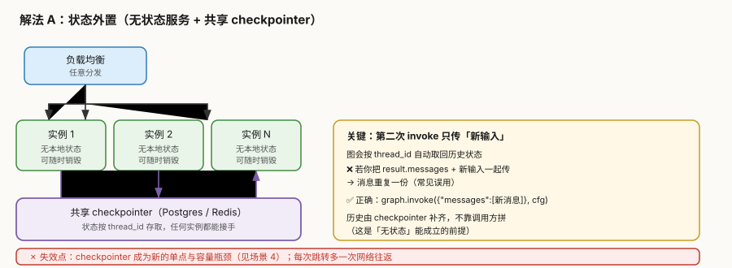
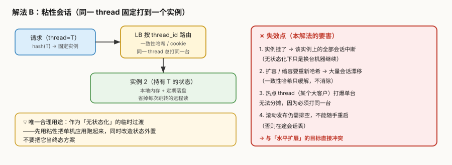
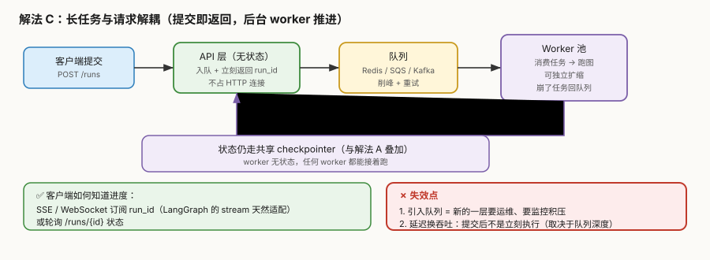

# 场景 6：水平扩展无状态化（规模压力题）

**场景描述**：agent 服务要支持**滚动发布不停机**和**按负载自动扩缩容**。当前是单机部署，会话状态在进程内存里——**一重启所有在途会话全丢**，扩容也无从谈起（新实例不认识老会话）。目标：跑 20 个实例，任意实例挂掉，上面的会话能**被别的实例无缝接手**。

> 矛盾点：LangGraph 的"会话"天然是有状态的，而水平扩展要求**服务无状态**。

**🔒 先自己想 30 秒**：第一反应是"用负载均衡把同一会话固定打到同一台"？——如果这个办法真好用，为什么业界主流是"无状态服务"而不是"粘性会话"？固定路由有什么致命问题？

<details><summary>💡 提示（分层 / 分维度想）</summary>

- **状态到底有几种**：图的状态（State/checkpoint）、进程内存里的对象、HTTP 连接——哪些必须外置，哪些本来就该无状态？
- **"接手"需要什么**：新实例要恢复一个会话，最少需要什么信息？（提示：课 5 的那个必传参数）
- **第二次 invoke 该传什么**：是把历史消息拼好传进去，还是只传新消息？传错了会怎样？
- **如果一次 run 要跑 10 分钟**：HTTP 连接要一直挂着吗？超时怎么办？

</details>

<details><summary>📖 展开解法</summary>

### 解法一览

> 效果维度按本题定制：**能否任意扩缩**／**实例故障影响面**／**改动成本**。

| 解法 | 能否任意扩缩 | 实例故障影响面 | 改动成本 | 代价 | 适用边界 |
|------|------------|--------------|---------|------|---------|
| **A. 状态外置**（无状态服务 + 共享 checkpointer） | **是** | **零**（别的实例接手） | 中 | 每次跳转多一次网络往返 | **标准答案**，首选 |
| **B. 粘性会话**（按 thread 路由） | 受限 | **大**（该实例会话全断） | **低** | 扩缩容要重哈希、热点无法分摊 | 仅作**过渡**，不作终态 |
| **C. 长任务与请求解耦**（队列 + worker） | **是**（worker 独立扩） | 零（任务回队列） | 高 | 多一层队列要运维 | run 耗时长（分钟级） |
| **D. 单机纵向扩容**（换更大的机器） | 否 | **全部** | 极低 | 有上限、发布必停机 | 原型 / 内部工具 |

### 各解法详解

#### 解法 A：状态外置（无状态服务 + 共享 checkpointer）

核心思路：**实例不持有任何会话状态**，全部状态按 `thread_id` 存在共享 checkpointer——任何实例都能接手任何会话。



读图：三个实例都无本地状态，全部通过紫色连线读写共享 checkpointer；**右侧黄色块是关键认知**——第二次 invoke **只传新输入**，历史由 checkpointer 自动补齐。**红框标出失效点**：checkpointer 成为新单点与瓶颈（即[场景 4](场景-04-并发翻倍连接池耗尽.md)）。

::: code-group

```python [Python]
# ① 启动时建一次池，全进程复用（不要每请求建）
async def lifespan(app):
    pool = AsyncConnectionPool(conninfo=DB_URI, max_size=20)
    saver = AsyncPostgresSaver(pool)
    await saver.setup()                          # 每个库跑一次
    app.state.agent = graph.compile(checkpointer=saver)
    yield

# ② 只传新输入——历史由 checkpointer 按 thread_id 取回
cfg = {"configurable": {"thread_id": "conversation_456"}}
await agent.ainvoke({"messages": [{"role": "user", "content": "你好"}]}, cfg)

# ❌ 常见误用：把历史拼好再传 → 消息重复一份
await agent.ainvoke({"messages": result.messages + [new_msg]}, cfg)   # 错

# ✅ 正确：只传新的
await agent.ainvoke({"messages": [new_msg]}, cfg)
```

```typescript [TypeScript]
import { PostgresSaver } from "@langchain/langgraph-checkpoint-postgres";
import pg from "pg";

// ① 启动时建一次池，全进程复用（不要每请求建）
//    ⚠️ TS 侧没有 lifespan 钩子，通常在模块初始化（或 NestJS 的 onModuleInit）里建
const pool = new pg.Pool({ connectionString: DB_URI, max: 20 });
const saver = new PostgresSaver(pool);
await saver.setup();                          // 每个库跑一次

const agent = graph.compile({ checkpointer: saver });

// ② 只传新输入——历史由 checkpointer 按 thread_id 取回
const cfg = { configurable: { thread_id: "conversation_456" } };
await agent.invoke({ messages: [new HumanMessage("你好")] }, cfg);

// ❌ 常见误用：把历史拼好再传 → 消息重复一份
await agent.invoke({ messages: [...result.messages, newMsg] }, cfg);   // 错

// ✅ 正确：只传新的
await agent.invoke({ messages: [newMsg] }, cfg);
```

:::


> **代价与坑**：
> ① **每次节点跳转 = 一次网络往返**到 checkpointer——6 节点一转实测 3.5–8s，这是无状态化的固有成本。
> ② **checkpointer 成为新的单点与容量瓶颈**——必须同时解决[场景 4](场景-04-并发翻倍连接池耗尽.md)（连接池）与[场景 5](场景-05-检查点存储无限增长.md)（存储增长）。
> ③ 必须保证 `.setup()` 在建库时跑过——否则首次部署**静默失败**（表不存在）。
>
> 🇹🇸 **TS 侧差异**：
> ① 包是 `@langchain/langgraph-checkpoint-postgres`，构造 `new PostgresSaver(pool)`；池是 **`pg.Pool`**（默认 `max=10`），不是 psycopg 的 `AsyncConnectionPool`。
> ② **没有 `lifespan` 钩子**——TS 生态里没有 FastAPI 那种生命周期约定，池要在模块初始化（或框架的 `onModuleInit`）时建一次，并用单例导出；**别在请求处理函数里 `new pg.Pool()`**，那等于每请求一个池，比不配池更糟。
> ③ `setup()` 是幂等的，但**首次部署漏跑仍然静默失败**（表不存在 → 后续 upsert 报 relation does not exist），这条与 Python 完全一致。
> ④ `agent.invoke()` 的 `config` 与流选项在 TS 里是同一个对象，`{ configurable: { thread_id } }` 直接作为第 2 参。

#### 解法 B：粘性会话（按 thread 固定路由）

核心思路：用负载均衡把同一 `thread_id` 的请求**总是打到同一台**——这样实例可以在本地内存里持有状态，省掉远程读。



读图：LB 按 hash 固定路由 → 实例本地持有状态。**右侧红色大框是重点**——四个失效点全部指向同一个结论：它**与"水平扩展"的目标直接冲突**。

```nginx [Nginx（两侧通用 · 仅基础设施）]
# 按自定义键（如 thread_id）做一致性哈希
upstream agent_upstream {
    hash $http_x_thread_id consistent;
    server agent1:8000;
    server agent2:8000;
}
```

> **代价与坑**（这是本解法**不推荐**的原因）：
> ① **实例挂了 = 该实例上的全部会话中断**——无状态化下只是换台机器继续。
> ② **扩缩容要重新哈希**→ 大量会话漂移（一致性哈希只缓解不消除）。
> ③ **热点 thread 打爆单台**且无法分摊（因为必须打同一台）。
> ④ 滚动发布仍需排空，不能随手重启。
>
> 💡 **唯一合理用途**：作为无状态化的**临时过渡**（先用粘性把单机应用跑起来，同时改造状态外置）。不要当终态。

#### 解法 C：长任务与请求解耦（队列 + worker）

核心思路：HTTP 层只负责"接单 + 返回 run_id"，真正的图执行交给**后台 worker 池**——worker 无状态，可独立扩缩；任务失败回队列重试。



读图：API 层入队即返回 → 队列削峰 → worker 池消费跑图；**紫色连线表示状态仍走共享 checkpointer**（本解法与 A **叠加**而非替代）。**红框标出失效点**：多一层队列要运维；延迟换吞吐。

::: code-group

```python [Python]
# API 层：入队即返回
@app.post("/runs")
async def submit(body: dict):
    run_id = str(uuid.uuid4())
    await queue.push({"run_id": run_id, "thread_id": body["thread_id"], "input": body["input"]})
    return {"run_id": run_id}           # 立刻返回，不占 HTTP 连接

# Worker：消费 + 跑图（worker 本身无状态）
async def worker():
    while True:
        task = await queue.pop()
        cfg = {"configurable": {"thread_id": task["thread_id"]}}
        async for ev in agent.astream(task["input"], cfg, stream_mode="updates"):
            await publish(task["run_id"], ev)      # 进度推给 SSE / WebSocket
```

```typescript [TypeScript]
// API 层：入队即返回
app.post("/runs", async (req, res) => {
  const runId = randomUUID();
  await queue.push({ run_id: runId, thread_id: req.body.thread_id, input: req.body.input });
  res.json({ run_id: runId });          // 立刻返回，不占 HTTP 连接
});

// Worker：消费 + 跑图（worker 本身无状态）
async function worker() {
  while (true) {
    const task = await queue.pop();
    const cfg = { configurable: { thread_id: task.thread_id } };
    // ⚠️ 与 Python 的 `astream(inp, cfg, stream_mode="updates")` 对应：
    //    第 2 参是合并了 config 与流选项的同一个对象
    const stream = await agent.stream(task.input, { ...cfg, streamMode: "updates" });
    for await (const ev of stream) {
      await publish(task.run_id, ev);          // 进度推给 SSE / WebSocket
    }
  }
}
```

:::


> **代价与坑**：
> ① **多一层队列要运维、要监控积压**——队列积压是新的故障模式（且症状隐蔽：提交成功但一直不执行）。
> ② **延迟换吞吐**——提交后不是立刻执行，取决于队列深度。交互式对话场景要评估是否可接受。
> ③ 客户端如何拿进度要额外设计（SSE / WebSocket / 轮询）。
>
> 🇹🇸 **TS 侧差异**：
> ① `agent.stream()` 返回 **`Promise<IterableReadableStream>`**，所以要先 `await` 拿流、再 `for await` 取事件（写成 `for await (const ev of agent.stream(...))` 会报 not async iterable）。
> ② `streamMode` 是**驼峰**且与 `configurable` **同层**：`{ ...cfg, streamMode: "updates" }`。本机实测把它写进 `configurable` 里（`{ configurable: { thread_id, streamMode } }`）**不报错、静默失效**：事件数从 3 变 2（`values` 档 vs `updates` 档），形状也从「状态快照」变成「`{ 节点名: 增量 }`」——排查时很容易误判成"图没跑对"。
> ③ `randomUUID` 来自 `node:crypto`，不用装 uuid 包；`queue.pop()` 这类调用全是 Promise，漏 `await` 会让 worker 拿到 `Promise` 当任务对象（`task.thread_id` 直接 `undefined`）。

#### 解法 D：单机纵向扩容（**不推荐，仅对照**）

> 本解法**无图**，原因：纯容量手段对照，无机制可画——符合豁免条件。

换更大的机器（更多 CPU / 内存）扛住单机。

> **为什么不推荐**：有物理上限、发布必停机、**实例故障时全部会话丢失**——三条都直接违反本题目标。只适合原型与内部工具。

### 替代路线（非 LangGraph 技术栈）

| 路线 | 做法 | 与本课程解法的差异 |
|------|------|------------------|
| **LangGraph Platform** | 托管层自带无状态 worker + 托管 checkpointer + 队列 | **不用自己搭**；代价是数据出机房、按节点执行计费 |
| **Temporal** | workflow 状态由引擎托管，worker 天然无状态 | 引擎层解决；代价是整套引擎与运维 |
| **Kubernetes + StatefulSet** | 用有状态工作负载跑带状态的 agent | **与本题目标相反**（绑实例）；仅在无法外置状态时考虑 |
| **Dapr / Actor 模型**（Orleans / Akka） | 虚拟 Actor 自动管理状态与激活位置 | 框架层解决"谁来处理这个会话"；代价是引入 Actor 运行时 |

### 推荐路径（递进）

1. **先做 A**（状态外置）——这是唯一能达成"任意扩缩 + 故障零影响"的方案
2. **同时解决场景 4 与 5**——checkpointer 变成新瓶颈是**必然结果**，不是意外
3. **run 耗时长（分钟级）→ 叠 C**（队列 + worker），让 HTTP 层不再被长连接拖住
4. **B 只在过渡期用**——且要写清"什么时候拆掉"
5. **别选 D**——除非你明确知道这只是个内部工具

> ⚠️ **A 与 C 是叠加关系，不是二选一**：A 解决"状态在哪"，C 解决"执行在哪"。
> 大型部署通常是 **A + C 一起**：worker 无状态（A），HTTP 层不阻塞（C）。

### 知识点挂钩

| 知识点 | 回指 |
|--------|------|
| `thread_id` 是会话主键，状态按它存取（无状态化的前提） | 阶段 2 · [课 5](../stages/2-执行模型与状态持久化/lessons/05-Checkpointer%20短期记忆.md) |
| checkpointer 后端选型（内存不能用于多实例） | 阶段 2 · [课 5](../stages/2-执行模型与状态持久化/lessons/05-Checkpointer%20短期记忆.md) |
| 自托管三道门（Redis / Postgres / License） | 阶段 4 · [课 13](../stages/4-工程化与上线/lessons/13-Deployment%20与%20Observability.md) |
| `langgraph.json` 与部署形态 | 阶段 4 · [课 12](../stages/4-工程化与上线/lessons/12-Application%20structure%20与测试.md) |
| 流式输出 → SSE（客户端拿进度的方式） | 阶段 2 · [课 7](../stages/2-执行模型与状态持久化/lessons/07-Streaming%20流式输出.md) |
| 外置后的连接池瓶颈 | [场景 4](场景-04-并发翻倍连接池耗尽.md) |
| 外置后的存储增长 | [场景 5](场景-05-检查点存储无限增长.md) |

### 不适用边界

- **单机原型 / 本地 CLI / 内部小工具**——状态外置是**过早优化**，SQLite 或内存足够
- **要求亚毫秒延迟**——每次跳转一次网络往返（3.5–8s/6 节点量级）不可接受，此时不该用图
- **无法接受数据出机房且没有自运维能力**——A 需要你自己运维 Postgres/Redis；没能力就上托管平台
- **解法 B 不适用于任何"要求实例可随时销毁"的环境**（K8s 弹性伸缩、Spot 实例）— 它会直接失效

### TS 写法对照表

| Python | TypeScript | 注意 |
|--------|-----------|------|
| `AsyncConnectionPool(conninfo, max_size=20)` | `new pg.Pool({ connectionString, max: 20 })` | 默认值 4 vs 10 |
| `AsyncPostgresSaver(pool)` | `new PostgresSaver(pool)` | — |
| `graph.compile(checkpointer=saver)` | `graph.compile({ checkpointer: saver })` | 选项对象 |
| `agent.ainvoke(inp, cfg)` | `await agent.invoke(inp, cfg)` | 全是 Promise |
| `agent.astream(inp, cfg, stream_mode="updates")` | `await agent.stream(inp, { ...cfg, streamMode: "updates" })` | 先 await 再迭代 |
| `async for ev in ...` | `for await (const ev of await ...)` | — |
| `lifespan(app)` 钩子 | 模块初始化 / `onModuleInit` | TS 无统一生命周期约定 |
| `str(uuid.uuid4())` | `randomUUID()`（`node:crypto`） | — |

> **本场景五条结论在 TS 侧是否还成立**：
> ① 「状态外置是标准答案」→ ✅ 成立。
> ② 「第二次只传新输入」→ ✅ 成立（但 `Annotation` 的 `default` 会让"没传的字段"沿用存档点旧值，见应用实战课 11）。
> ③ 「checkpointer 成为新单点是必然」→ ✅ 成立。
> ④ 「粘性会话只作过渡」→ ✅ 成立（nginx 配置两侧通用）。
> ⑤ 「A + C 叠加而非二选一」→ ✅ 成立。

</details>

---

## 相关故障模式（想懂为什么）

- 故障模式 8《并发上来后 Postgres 连接池耗尽》→ [08-实战经验.md](../08-实战经验.md)
