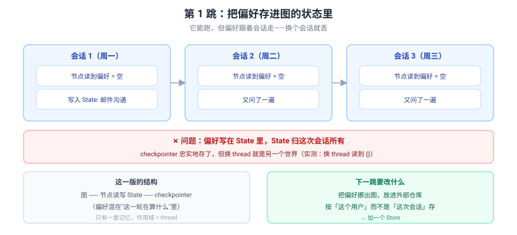
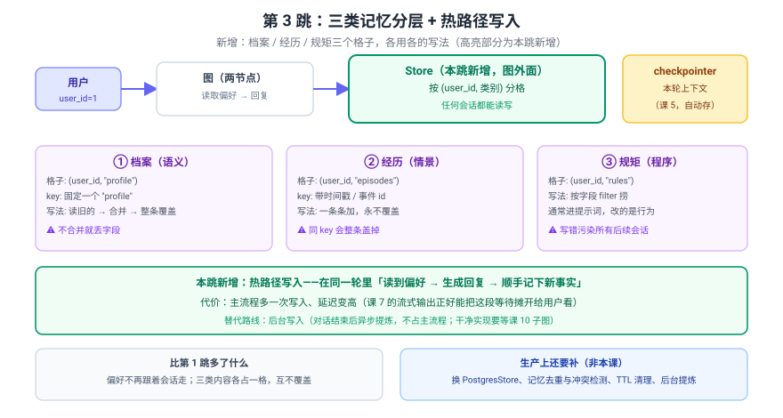

# 应用实战 06：客服记住老客户偏好

> 对应：[课 6 Store 长期记忆](../stages/2-执行模型与状态持久化/lessons/06-Store%20长期记忆.md)
> 覆盖知识点：Store 与命名空间 / 长期记忆落地（语义 / 情景）
> ✅ 全部代码实测于 langgraph 1.2.11 / Python 3.12（在 `../langchain/playground` 以 `uv run` 隔离执行）
> ✅ TypeScript 侧实测于 `playground-ts/`（`@langchain/langgraph` 1.5.1 / Node 22，`npm run a06`）

## 场景

做一个客服助手：用户上周说过"我偏好邮件沟通"，这周新开一个会话，助手得**还记得**——不能每次都当新人。

三跳演进：

| 跳 | 目标 | 新增的知识点 |
|:--:|------|-------------|
| 基础 | 把偏好存在图的状态里 | （反面起点）为什么 State 不行 |
| 问题 | 挪到 Store，跨会话不丢 | namespace / put / get / search |
| 综合 | 三类记忆分层 + 热路径写入 | 语义 / 情景 / 程序 |

> 完整方案还需要：换成 `PostgresStore` 落盘、记忆去重与冲突检测、TTL 清理、后台提炼——**这些都不是本课内容，点到为止。**

---

## 第 1 跳：把偏好存进状态里（基础 · 但它是错的）

沿用课 5 的直觉：状态会被持久化，那把偏好写进 State 不就行了？



> 看图：三个会话各自一个世界——周一写进去的偏好，周二周三读不到。**偏好被混进了"这一轮在算什么"里。**

::: code-group
```python [Python]
from langgraph.checkpoint.memory import InMemorySaver
from langgraph.graph import END, START, StateGraph
from typing_extensions import TypedDict


class State(TypedDict):
    user_id: str
    profile: dict          # ← 把用户档案放在这里


def write_node(state: State) -> dict:
    return {"profile": {"prefers": "邮件沟通"}}


def read_node(state: State) -> dict:
    return {"profile": state.get("profile", {})}


def build(node):
    b = StateGraph(State)
    b.add_node("n", node)
    b.add_edge(START, "n")
    b.add_edge("n", END)
    return b.compile(checkpointer=InMemorySaver())


# 会话 1：写
r1 = build(write_node).invoke(
    {"user_id": "1", "profile": {}}, {"configurable": {"thread_id": "sess-1"}})
print("  sess-1(写):", r1["profile"])

# 会话 2：换个 thread 读
r2 = build(read_node).invoke(
    {"user_id": "1", "profile": {}}, {"configurable": {"thread_id": "sess-2"}})
print("  sess-2(读):", r2["profile"])
```

```typescript [TypeScript]
import {
  Annotation,
  END,
  InMemoryStore,
  MemorySaver,
  START,
  StateGraph,
} from "@langchain/langgraph";

const State = Annotation.Root({
  user_id: Annotation<string>({ reducer: (_p, n) => n, default: () => "" }),
  profile: Annotation<Record<string, unknown>>({ reducer: (_p, n) => n, default: () => ({}) }),
});

const writeNode = () => ({ profile: { prefers: "邮件沟通" } });
const readNode = (s: typeof State.State) => ({ profile: s.profile ?? {} });

const build = (node: (s: typeof State.State) => any) =>
  new StateGraph(State)
    .addNode("n", node)
    .addEdge(START, "n")
    .addEdge("n", END)
    .compile({ checkpointer: new MemorySaver() });

// 会话 1：写
const r1 = await build(writeNode).invoke(
  { user_id: "1", profile: {} },
  { configurable: { thread_id: "sess-1" } }
);
console.log("  sess-1(写):", r1.profile);

// 会话 2：换个 thread 读
const r2 = await build(readNode).invoke(
  { user_id: "1", profile: {} },
  { configurable: { thread_id: "sess-2" } }
);
console.log("  sess-2(读):", r2.profile);
```
:::

实测输出：

实测（Python）：

```
  sess-1(写): {'prefers': '邮件沟通'}
  sess-2(读): {}
```

实测（TypeScript）：

```
  sess-1(写): { prefers: '邮件沟通' }
  sess-2(读): {}
```

> 💡 结论一致（换个 thread 就读不到）。TS 侧只有打印格式差异：dict 带引号、对象键不带引号。

### 它的问题

1. **换个会话就丢**——实测 `sess-2` 读到 `{}`。checkpointer 忠实存了，但那是**存给这个 thread 的**。
2. **偏好和"这一轮在算什么"混在一个结构里**——State 是工作区，不是档案柜。
3. **你没法按用户查**——想知道"这个用户历史上说过什么偏好"，只能挨个 thread 翻。

> 🔑 **根因**：课 5 的持久化是 **thread 作用域**的。用户档案需要的是 **user 作用域**——这是两套不同的"钥匙"。

---

## 第 2 跳：挪到 Store，跨会话不丢（问题被逼出来的下一步）

在图外面加一个柜子，`compile` 时交给图，节点里用 `*, store: BaseStore` 接。

::: code-group
```python [Python]
from langgraph.store.base import BaseStore
from langgraph.store.memory import InMemoryStore


class State(TypedDict):
    user_id: str
    seen: list
    note: str


def node(state: State, *, store: BaseStore) -> dict:
    ns = (state["user_id"], "preferences")        # ← 按「用户」分格，不是按会话
    item = store.get(ns, "contact")
    if item is None:
        store.put(ns, "contact", {"prefers": "邮件沟通"})
        return {"seen": None, "note": "首次：已记下偏好"}
    return {"seen": item.value, "note": f"老客户：读到偏好 {item.value['prefers']}"}


b = StateGraph(State)
b.add_node("n", node)
b.add_edge(START, "n")
b.add_edge("n", END)

store = InMemoryStore()                            # ← 关键：图外面，跨会话共享
graph = b.compile(checkpointer=InMemorySaver(), store=store)

for tid in ["monday", "friday", "next-week"]:
    r = graph.invoke({"user_id": "1", "seen": None, "note": ""},
                     {"configurable": {"thread_id": tid}})
    print(f"  thread={tid:10s} {r['note']}")
```

```typescript [TypeScript]
import type { LangGraphRunnableConfig } from "@langchain/langgraph";

const State = Annotation.Root({
  user_id: Annotation<string>({ reducer: (_p, n) => n, default: () => "" }),
  seen: Annotation<Record<string, unknown> | null>({ reducer: (_p, n) => n, default: () => null }),
  note: Annotation<string>({ reducer: (_p, n) => n, default: () => "" }),
});

// TS 侧没有"关键字参数注入"：store 挂在节点第二个参数的 store 字段上
const node = async (s: typeof State.State, config: LangGraphRunnableConfig) => {
  const store = config.store!;
  const ns = [s.user_id, "preferences"]; // ← 按「用户」分格，不是按会话
  const item = await store.get(ns, "contact");
  if (item == null) {
    await store.put(ns, "contact", { prefers: "邮件沟通" });
    return { seen: null, note: "首次：已记下偏好" };
  }
  const v = item.value as { prefers: string };
  return { seen: item.value, note: `老客户：读到偏好 ${v.prefers}` };
};

const graph = new StateGraph(State)
  .addNode("n", node)
  .addEdge(START, "n")
  .addEdge("n", END)
  // ← 关键：store 建在图外面，跨会话共享
  .compile({ checkpointer: new MemorySaver(), store: new InMemoryStore() });

for (const tid of ["monday", "friday", "next-week"]) {
  const r = await graph.invoke({ user_id: "1" }, { configurable: { thread_id: tid } });
  console.log(`  thread=${tid.padEnd(10)} ${r.note}`);
}
```
:::

实测输出：

实测（Python）：

```
  thread=monday     首次：已记下偏好
  thread=friday     老客户：读到偏好 邮件沟通
  thread=next-week  老客户：读到偏好 邮件沟通
```

实测（TypeScript）：

```
  thread=monday     首次：已记下偏好
  thread=friday     老客户：读到偏好 邮件沟通
  thread=next-week  老客户：读到偏好 邮件沟通
```

> ✅ **周一记下的，周五和次周都读到了**——三个完全不同的 thread，共享同一份档案。

> 💡 TS 侧这一跳有四处必改：①节点里没有关键字参数注入，store 要从 `config.store!` 取，签名是 `(state, config: LangGraphRunnableConfig)`；②namespace 是**数组** `[uid, "preferences"]`，不是元组；③`get` / `put` / `search` 全部返回 Promise，`await` 一个都不能省；④`get` 返回的是包装对象，取内容要 `.value`。

### 顺手验证：换个人就拿不到

::: code-group
```python [Python]
r = graph.invoke({"user_id": "2", "seen": None, "note": ""},
                 {"configurable": {"thread_id": "other"}})
print("  user=2:", r["note"])
```

```typescript [TypeScript]
const r2 = await graph.invoke({ user_id: "2" }, { configurable: { thread_id: "other" } });
console.log("  user=2:", r2.note);
```
:::

实测（Python）：

```
  user=2: 首次：已记下偏好
```

实测（TypeScript）：

```
  user=2: 首次：已记下偏好
```

> ✅ **隔离是对的**——`user_id=2` 是另一个格子，看不到 1 的档案。

### ⚠️ 这一步最容易写错的地方

::: code-group
```python [Python]
ns = (config["configurable"]["thread_id"], "preferences")   # ❌ 别这么写
```

```typescript [TypeScript]
const ns = [config.configurable.thread_id, "preferences"]; // ❌ 别这么写
```
:::

实测：这样写之后，新会话搜自己的格子 → `[]`。**用 `thread_id` 当第一层，等于把柜子按会话分格，长期记忆退化成短期记忆。**

另外两个实测提醒：

- **`search` 默认只给 10 条**——写 25 条只回来 10 条，且不报错。要全量得显式 `limit`。
- **不挂 `store=` 就在节点里用**——拿到的是 `None`，一调用就 `AttributeError: 'NoneType' object has no attribute 'search'`。

---

## 第 3 跳：三类记忆分层 + 热路径写入（综合）

真实的助手不止记"偏好"一件事。把柜子分成三个格子，各用各的写法。



> 看图：比第 2 跳多了**三个格子**（高亮的 Store 区域与下面三块）——档案 / 经历 / 规矩各占一格；写入发生在同一轮里（热路径），代价是主流程多一次写入。

::: code-group
```python [Python]
from datetime import datetime

from langgraph.store.base import BaseStore


class State(TypedDict):
    user_id: str
    message: str
    profile: dict
    episodes: list
    rules: list
    reply: str


def assistant(state: State, *, store: BaseStore) -> dict:
    uid = state["user_id"]
    profile_ns = (uid, "profile")
    episode_ns = (uid, "episodes")
    rule_ns = (uid, "rules")

    # ① 语义：读档案（一份，固定 key）
    p = store.get(profile_ns, "profile")
    profile = p.value if p else {}

    # ③ 程序：捞生效的规矩
    rules = [i.value for i in store.search(rule_ns, filter={"enabled": True})]

    # ② 情景：捞最近经历（注意显式给 limit）
    episodes = [i.value for i in store.search(episode_ns, limit=20)]

    # 热路径写入：本轮学到的新东西，当场记下（在生成回复之前！）
    if "邮件" in state["message"]:
        profile = {**profile, "prefers": "邮件沟通"}     # ← 合并旧的，别整条丢
        store.put(profile_ns, "profile", profile)

    store.put(episode_ns, datetime.now().isoformat(),
              {"event": state["message"]})               # ← key 带时间戳，永不覆盖

    # 生成回复（这里用固定文案代替真实 LLM 调用）
    # 注意顺序：上面已经把档案合并好了，这里才读得新偏好
    reply = (f"按{profile.get('prefers', '默认')}方式回复；"
             f"已知 {len(episodes)} 条历史；遵守 {len(rules)} 条规矩")

    return {"profile": profile, "episodes": episodes, "rules": rules, "reply": reply}


b = StateGraph(State)
b.add_node("assistant", assistant)
b.add_edge(START, "assistant")
b.add_edge("assistant", END)

shared = InMemoryStore()
shared.put(("1", "rules"), "r1", {"rule": "回复前先确认订单号", "enabled": True})
graph = b.compile(checkpointer=InMemorySaver(), store=shared)

for tid, msg in [("t1", "我偏好邮件沟通"), ("t2", "我的订单还没发货")]:
    r = graph.invoke({"user_id": "1", "message": msg, "profile": {},
                      "episodes": [], "rules": [], "reply": ""},
                     {"configurable": {"thread_id": tid}})
    print(f"  [{tid}] {msg}")
    print(f"        -> {r['reply']}")
    print(f"        档案={r['profile']}  历史={len(r['episodes'])}条  规矩={len(r['rules'])}条")
```

```typescript [TypeScript]
const State = Annotation.Root({
  user_id: Annotation<string>({ reducer: (_p, n) => n, default: () => "" }),
  message: Annotation<string>({ reducer: (_p, n) => n, default: () => "" }),
  profile: Annotation<Record<string, string>>({ reducer: (_p, n) => n, default: () => ({}) }),
  episodes: Annotation<any[]>({ reducer: (_p, n) => n, default: () => [] }),
  rules: Annotation<any[]>({ reducer: (_p, n) => n, default: () => [] }),
  reply: Annotation<string>({ reducer: (_p, n) => n, default: () => "" }),
});

const assistant = async (s: typeof State.State, config: LangGraphRunnableConfig) => {
  const store = config.store!;
  const uid = s.user_id;
  const profileNs = [uid, "profile"];
  const episodeNs = [uid, "episodes"];
  const ruleNs = [uid, "rules"];

  // ① 语义：读档案（一份，固定 key）
  const p = await store.get(profileNs, "profile");
  let profile: Record<string, string> = (p?.value as Record<string, string>) ?? {};

  // ③ 程序：捞生效的规矩
  const rules = (await store.search(ruleNs, { filter: { enabled: true } })).map((i) => i.value);

  // ② 情景：捞最近经历（注意显式给 limit）
  const episodes = (await store.search(episodeNs, { limit: 20 })).map((i) => i.value);

  // 热路径写入：本轮学到的新东西，当场记下（在生成回复之前！）
  if (s.message.includes("邮件")) {
    profile = { ...profile, prefers: "邮件沟通" }; // ← 合并旧的，别整条丢
    await store.put(profileNs, "profile", profile);
  }

  // ← key 带时间戳，永不覆盖
  await store.put(episodeNs, new Date().toISOString(), { event: s.message });

  // 生成回复（这里用固定文案代替真实 LLM 调用）
  // 注意顺序：上面已经把档案合并好了，这里才读得新偏好
  const reply =
    `按${profile.prefers ?? "默认"}方式回复；` +
    `已知 ${episodes.length} 条历史；遵守 ${rules.length} 条规矩`;

  return { profile, episodes, rules, reply };
};

// rules 要提前放进去，所以先建 store 再挂到图
const shared = new InMemoryStore();
await shared.put(["1", "rules"], "r1", { rule: "回复前先确认订单号", enabled: true });

const graph = new StateGraph(State)
  .addNode("assistant", assistant)
  .addEdge(START, "assistant")
  .addEdge("assistant", END)
  .compile({ checkpointer: new MemorySaver(), store: shared });

for (const [tid, msg] of [
  ["t1", "我偏好邮件沟通"],
  ["t2", "我的订单还没发货"],
] as const) {
  const r = await graph.invoke(
    { user_id: "1", message: msg },
    { configurable: { thread_id: tid } }
  );
  console.log(`  [${tid}] ${msg}`);
  console.log(`        -> ${r.reply}`);
  console.log(
    `        档案=${JSON.stringify(r.profile)}  历史=${r.episodes.length}条  规矩=${r.rules.length}条`
  );
}
```
:::

实测输出：

实测（Python）：

```
  [t1] 我偏好邮件沟通
        -> 按邮件沟通方式回复；已知 0 条历史；遵守 1 条规矩
        档案={'prefers': '邮件沟通'}  历史=0条  规矩=1条
  [t2] 我的订单还没发货
        -> 按邮件沟通方式回复；已知 1 条历史；遵守 1 条规矩
        档案={'prefers': '邮件沟通'}  历史=1条  规矩=1条
```

实测（TypeScript）：

```
  [t1] 我偏好邮件沟通
        -> 按邮件沟通方式回复；已知 0 条历史；遵守 1 条规矩
        档案={"prefers":"邮件沟通"}  历史=0条  规矩=1条
  [t2] 我的订单还没发货
        -> 按邮件沟通方式回复；已知 1 条历史；遵守 1 条规矩
        档案={"prefers":"邮件沟通"}  历史=1条  规矩=1条
```

> ✅ **t2 是全新的 thread，但读到了 t1 写下的档案和经历**——三类记忆同时跨会话生效。

> 💡 数值与文案逐字相同，只是档案打印形态：Python 是单引号 dict，本课脚本为便于逐字对比用 `JSON.stringify` 输出双引号。TS 侧 `store.search` 的第二个参数是**一个对象** `{ limit: 20 }` / `{ filter: { enabled: true } }`，Python 是关键字参数。

### 三个格子为什么要分开

| 格子 | key 怎么取 | 为什么 |
|---|---|---|
| `(uid, "profile")` | **固定** `"profile"` | 档案是一份，就是要反复覆盖 |
| `(uid, "episodes")` | **时间戳 / 事件 id** | 一条条加；用固定 key 会互相盖掉 |
| `(uid, "rules")` | 规则 id | 按 `filter` 捞生效的 |

> ⚠️ **同 key 再 `put` 是整条覆盖，不是合并**。实测：

::: code-group

```python [Python]
store.put(ns, "k0", {"i": 0})
store.put(ns, "k0", {"i": 999})
store.get(ns, "k0").value    # -> {'i': 999}，前面的 0 没了
```

```typescript [TypeScript]
await store.put(ns, "k0", { i: 0 });
await store.put(ns, "k0", { i: 999 });
(await store.get(ns, "k0"))!.value;    // -> { i: 999 }，前面的 0 没了
```

:::

> 所以写档案要 `{**旧的, **新的}` 合并（TS 写作 `{ ...旧的, ...新的 }`）；写经历要用唯一 key。

### 热路径 vs 后台

本跳的写入发生在**同一轮里**（热路径），好处是即时可用，代价是主流程多一次写入、延迟变高。

> 💡 **课 7 会看到**：流式输出正好能把这段等待"摊开"给用户看（先吐"正在回忆…"再吐正文）。
> 💡 **课 10 会看到**：后台写入通常落成另一个图或异步任务，不占主流程。

---

## 收尾：三跳带走了什么

| 跳 | 关键代码 | 得到的认识 |
|:--:|---------|-----------|
| 1 | `profile` 放进 State | ❌ 换 thread 就读不到（实测 `{}`） |
| 2 | `compile(store=...)` + `ns=(user_id, 类别)` | ✅ 跨 thread 共享；别用 thread_id 当首层 |
| 3 | 三个格子 + 热路径写入 | 档案合并覆盖、经历唯一 key、规矩靠 filter |

**四个提醒**：

1. **命名空间第一层用 `user_id`，不是 `thread_id`**——用错等于白做。
2. **`search` 默认 `limit=10`**，超了静默截断，要全量显式给 `limit`。
3. **档案是合并后覆盖，经历是唯一 key 追加**——搞反了就丢数据。
4. **不配 embedding 时 `query` 被静默忽略**——别以为在做语义搜索（课 6 验证三）。

### TS 侧写法对照

| 项 | Python | TypeScript |
|:--|--------|-----------|
| 建 store | `InMemoryStore()`（`langgraph.store.memory`） | `new InMemoryStore()`（`@langchain/langgraph`） |
| 节点里取 store | `def node(state, *, store: BaseStore)` | `(state, config: LangGraphRunnableConfig) => config.store!` |
| namespace | 元组 `("1", "prefs")` | 数组 `["1", "prefs"]` |
| 挂到图 | `compile(checkpointer=..., store=store)` | `compile({ checkpointer, store })` |
| `search` 选项 | `search(ns, limit=20, filter={...})` | `search(ns, { limit: 20, filter: {...} })` |
| 取内容 | `item.value` | `item.value`（`get` 可能返回 `undefined`，用 `?.`） |
| 三个坑实测 | 覆盖 / 默认 10 条 / 不挂 store 报 `AttributeError` | 覆盖 / 默认 10 条 / 不挂 store 报 `TypeError: Cannot read properties of undefined (reading 'search')` |

> 💡 **TS 侧「默认 10 条」的实测数字**：写 25 条（另有同名 `k0` 一条，共 26 条）后，不带 `limit` 的 `search` 回来 10 条，显式 `{ limit: 50 }` 回来 26 条——**静默截断、不报错**，与 Python 完全一致。

🎯 **会用标志**：能独立写出一个"新会话自动认出老客户偏好"的图，说清为什么命名空间第一层是 `user_id`，并能解释为什么写档案要合并而写经历要用唯一 key。
