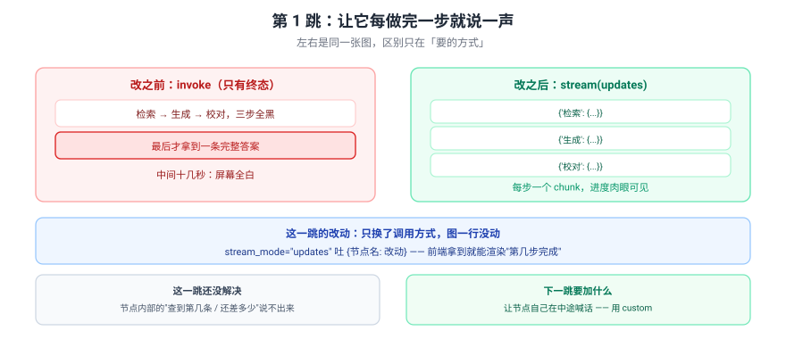
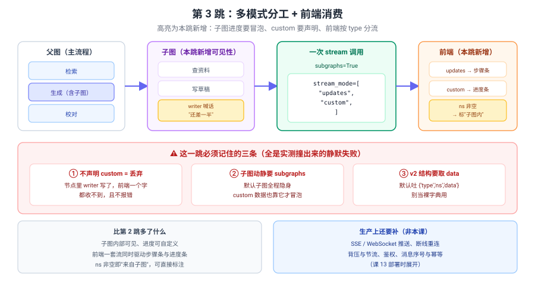

# 应用实战 07：把黑盒客服改成边跑边说

> 对应：[课 7 Streaming 流式输出](../stages/2-执行模型与状态持久化/lessons/07-Streaming%20流式输出.md)
> 覆盖知识点：流模式 / 事件流与子图事件
> ✅ 全部代码实测于 langgraph 1.2.11 / Python 3.12（在 `../langchain/playground` 以 `uv run` 隔离执行）
> ✅ TypeScript 侧实测于 `playground-ts/`（`@langchain/langgraph` 1.5.1 / Node 22，`npm run a07`）

## 场景

客服助手跑一次要十几秒：检索 → 生成 → 校对。用户点下去屏幕全白，以为它死了。

三跳演进：

| 跳 | 目标 | 新增的知识点 |
|:--:|------|-------------|
| 基础 | 让它每做完一步说一声 | values / updates 选型 |
| 问题 | 让它说"查到第几条 / 还差多少" | custom + get_stream_writer |
| 综合 | 子图里的进度也要看得见 | 事件流 / subgraphs=True |

> 完整方案还需要：SSE / WebSocket 推送、断线重连、背压与节流、鉴权、消息序号与幂等——**这些都不是本课内容**（课 13 部署时展开）。

---

## 第 1 跳：让它每做完一步说一声（基础）

图一行不改，把 `invoke` 换成 `stream`。



> 看图：左右是同一张图，区别只在"要的方式"。`invoke` 三步全黑、最后才给一条答案；`stream(updates)` 每步吐一个 `{节点名: 改动}`。

::: code-group
```python [Python]
from langgraph.graph import END, START, StateGraph
from typing_extensions import TypedDict


class State(TypedDict):
    question: str
    docs: list
    draft: str
    final: str


def retrieve(state: State) -> dict:
    return {"docs": ["文档A", "文档B"]}


def generate(state: State) -> dict:
    return {"draft": f"基于{len(state['docs'])}篇的草稿"}


def proofread(state: State) -> dict:
    return {"final": state["draft"] + "（已校对）"}


builder = StateGraph(State)
for name, fn in [("检索", retrieve), ("生成", generate), ("校对", proofread)]:
    builder.add_node(name, fn)
builder.add_edge(START, "检索")
builder.add_edge("检索", "生成")
builder.add_edge("生成", "校对")
builder.add_edge("校对", END)
graph = builder.compile()

inp = {"question": "怎么退款", "docs": [], "draft": "", "final": ""}

print("--- invoke（只有终态）---")
print(graph.invoke(inp)["final"])

print("--- stream(updates)（逐节点）---")
for chunk in graph.stream(inp, stream_mode="updates"):
    node = list(chunk.keys())[0]
    print(f"  完成：{node}")
```

```typescript [TypeScript]
import { Annotation, END, START, StateGraph } from "@langchain/langgraph";

const State = Annotation.Root({
  question: Annotation<string>({ reducer: (_p, n) => n, default: () => "" }),
  docs: Annotation<string[]>({ reducer: (_p, n) => n, default: () => [] }),
  draft: Annotation<string>({ reducer: (_p, n) => n, default: () => "" }),
  final: Annotation<string>({ reducer: (_p, n) => n, default: () => "" }),
});

const retrieve = () => ({ docs: ["文档A", "文档B"] });
const generate = (s: typeof State.State) => ({ draft: `基于${s.docs.length}篇的草稿` });
const proofread = (s: typeof State.State) => ({ final: s.draft + "（已校对）" });

const graph = new StateGraph(State)
  .addNode("检索", retrieve)
  .addNode("生成", generate)
  .addNode("校对", proofread)
  .addEdge(START, "检索")
  .addEdge("检索", "生成")
  .addEdge("生成", "校对")
  .addEdge("校对", END)
  .compile();

const inp = { question: "怎么退款", docs: [], draft: "", final: "" };

console.log("--- invoke（只有终态）---");
console.log((await graph.invoke(inp)).final);

console.log("--- stream(updates)（逐节点）---");
// ⚠️ streamMode 是驼峰；stream 返回 Promise，要先 await 再 for await
for await (const chunk of await graph.stream(inp, { streamMode: "updates" })) {
  const node = Object.keys(chunk as object)[0];
  console.log(`  完成：${node}`);
}
```
:::

实测输出：

实测（Python）：

```
--- invoke（只有终态）---
基于2篇的草稿（已校对）
--- stream(updates)（逐节点）---
  完成：检索
  完成：生成
  完成：校对
```

实测（TypeScript，`npm run a07`）：

```
--- invoke（只有终态）---
基于2篇的草稿（已校对）
--- stream(updates)（逐节点）---
  完成：检索
  完成：生成
  完成：校对
```

> 💡 TS 侧三处写法差异：①`stream_mode="updates"` 改成 `{ streamMode: "updates" }`（**驼峰**）；②`graph.stream()` 返回的是 **Promise**，要 `for await (const c of await graph.stream(...))`——**两个 `await` 分工不同**；③输出内容逐字相同。

### 为什么选 `updates` 不选 `values`

```
values（全量重发，3 节点 → 4 个 chunk，含初始状态）：
  {'question':'怎么退款','docs':[],'draft':'','final':''}
  {'question':'怎么退款','docs':['文档A','文档B'],'draft':'','final':''}
  {'question':'怎么退款','docs':['文档A','文档B'],'draft':'基于2篇的草稿','final':''}
  {'question':'怎么退款','docs':['文档A','文档B'],'draft':'基于2篇的草稿','final':'基于2篇的草稿（已校对）'}

updates（只给改动，3 个）：
  {'检索': {'docs': ['文档A','文档B']}}
  {'生成': {'draft': '基于2篇的草稿'}}
  {'校对': {'final': '基于2篇的草稿（已校对）'}}
```

TS 侧 `values` 实测（`npm run a07` 第 1 跳第三段）：

```
   { question: '怎么退款', docs: [], draft: '', final: '' }
   { question: '怎么退款', docs: [ '文档A', '文档B' ], draft: '', final: '' }
   { question: '怎么退款', docs: [ '文档A', '文档B' ], draft: '基于2篇的草稿', final: '' }
   { question: '怎么退款', docs: [ '文档A', '文档B' ], draft: '基于2篇的草稿', final: '基于2篇的草稿（已校对）' }
```

> ✅ 只想看"做到第几步"，`updates` 就够了——`values` 每次把整个状态重发一遍，状态越大越浪费。

### 它的问题

1. **节点内部还是黑盒**——"检索"这一步花 5 秒，中间查到第几条你不知道。
2. **没有自定义进度**——想显示"还差一半"做不到。

> 🔑 **根因**：`updates` 的粒度是"一个节点结束"，不是"节点内部进行到哪"。

---

## 第 2 跳：让它说"还差多少"（问题被逼出来的下一步）

在节点里用 `get_stream_writer()` 主动喊话。

::: code-group
```python [Python]
from langgraph.config import get_stream_writer


def retrieve_v2(state: State) -> dict:
    w = get_stream_writer()
    found = []
    for i, name in enumerate(["文档A", "文档B", "文档C"], 1):
        found.append(name)
        w({"step": "检索", "current": i, "total": 3, "msg": f"查到 {name}"})   # ← 喊一嗓子
    return {"docs": found}


def generate_v2(state: State) -> dict:
    w = get_stream_writer()
    w({"step": "生成", "progress": 0.5, "msg": "写了一半"})
    w({"step": "生成", "progress": 1.0, "msg": "写完了"})
    return {"draft": f"基于{len(state['docs'])}篇的草稿"}


builder2 = StateGraph(State)
builder2.add_node("检索", retrieve_v2)
builder2.add_node("生成", generate_v2)
builder2.add_node("校对", proofread)
builder2.add_edge(START, "检索")
builder2.add_edge("检索", "生成")
builder2.add_edge("生成", "校对")
builder2.add_edge("校对", END)
graph2 = builder2.compile()

print("--- stream(custom)：节点里喊的话 ---")
for data in graph2.stream(inp, stream_mode="custom"):
    print(f"  {data}")
```

```typescript [TypeScript]
import { getWriter } from "@langchain/langgraph";

const retrieveV2 = () => {
  const w = getWriter();     // ⚠️ Python 是 get_stream_writer()，TS 是 getWriter()
  const found: string[] = [];
  ["文档A", "文档B", "文档C"].forEach((name, i) => {
    found.push(name);
    w({ step: "检索", current: i + 1, total: 3, msg: `查到 ${name}` }); // ← 喊一嗓子
  });
  return { docs: found };
};

const generateV2 = (s: typeof State.State) => {
  const w = getWriter();
  w({ step: "生成", progress: 0.5, msg: "写了一半" });
  w({ step: "生成", progress: 1.0, msg: "写完了" });
  return { draft: `基于${s.docs.length}篇的草稿` };
};

const graph2 = new StateGraph(State)
  .addNode("检索", retrieveV2)
  .addNode("生成", generateV2)
  .addNode("校对", proofread)
  .addEdge(START, "检索")
  .addEdge("检索", "生成")
  .addEdge("生成", "校对")
  .addEdge("校对", END)
  .compile();

console.log("--- stream(custom)：节点里喊的话 ---");
for await (const data of await graph2.stream(inp, { streamMode: "custom" })) {
  console.log("  ", data);
}
```
:::

实测输出：

实测（Python）：

```
--- stream(custom)：节点里喊的话 ---
  {'step': '检索', 'current': 1, 'total': 3, 'msg': '查到 文档A'}
  {'step': '检索', 'current': 2, 'total': 3, 'msg': '查到 文档B'}
  {'step': '检索', 'current': 3, 'total': 3, 'msg': '查到 文档C'}
  {'step': '生成', 'progress': 0.5, 'msg': '写了一半'}
  {'step': '生成', 'progress': 1.0, 'msg': '写完了'}
```

实测（TypeScript）：

```
--- stream(custom)：节点里喊的话 ---
   { step: '检索', current: 1, total: 3, msg: '查到 文档A' }
   { step: '检索', current: 2, total: 3, msg: '查到 文档B' }
   { step: '检索', current: 3, total: 3, msg: '查到 文档C' }
   { step: '生成', progress: 0.5, msg: '写了一半' }
   { step: '生成', progress: 1, msg: '写完了' }
```

> ✅ 前端拿到就能渲染进度条了。

> 💡 TS 侧取 writer 的函数名是 **`getWriter()`**（`@langchain/langgraph`），不是 Python 的 `get_stream_writer()`——照抄名字会直接 `undefined is not a function`。数值上有一处无关紧要的差异：`1.0` 在 JS 里打印成 `1`（同一个数，不是精度问题）。

### ⚠️ 这一步的坑：不声明 `custom` 就白喊

::: code-group
```python [Python]
# 你以为写了就能收到：
list(graph2.stream(inp, stream_mode="values"))
# -> 只有状态，custom 数据一个都没有，且不报错
```

```typescript [TypeScript]
// 你以为写了就能收到：
for await (const _ of await graph2.stream(inp, { streamMode: "values" })) void _;
// -> 只有状态，custom 数据一个都没有，且不报错
```
:::

实测：

实测（Python）：

```
stream_mode='values' -> [{'docs':[],...}, {'docs':[...],...}, ...]   # 自定义数据没了
stream_mode='custom' -> [{'step':'检索',...}, ...]                    # 要这样才收得到
```

实测（TypeScript）：

```
--- 不声明 custom，用 values 收 ---
  values 收到 chunk 数: 4 （custom 数据全丢）
```

> 🔑 **写 `get_stream_writer()` 不等于有人听**——必须显式声明 `stream_mode="custom"`，否则**静默丢弃**。TS 侧同样如此：`values` 只回来 4 个状态快照（3 节点 + 初始态），5 条 custom 数据一条都没出现，也不报错。

### 两个模式一起要

::: code-group
```python [Python]
for mode, chunk in graph2.stream(inp, stream_mode=["updates", "custom"]):
    if mode == "custom":
        print(f"  进度 {chunk}")
    else:
        print(f"  完成 {list(chunk.keys())[0]}")
```

```typescript [TypeScript]
for await (const [mode, chunk] of await graph2.stream(inp, {
  streamMode: ["updates", "custom"],
}) as any) {
  if (mode === "custom") console.log(`  进度 ${JSON.stringify(chunk)}`);
  else console.log(`  完成 ${Object.keys(chunk as object)[0]}`);
}
```
:::

> ✅ 输出是 `(模式, 数据)` 元组且**交错**——不是先吐完一种再吐另一种。

TS 侧实测（顺序与 Python 一致，custom 都在所属节点结束前吐出）：

```
  进度 {"step":"检索","current":1,"total":3,"msg":"查到 文档A"}
  进度 {"step":"检索","current":2,"total":3,"msg":"查到 文档B"}
  进度 {"step":"检索","current":3,"total":3,"msg":"查到 文档C"}
  完成 检索
  进度 {"step":"生成","progress":0.5,"msg":"写了一半"}
  进度 {"step":"生成","progress":1,"msg":"写完了"}
  完成 生成
  完成 校对
```

> 💡 TS 侧要用数组解构 `for await (const [mode, chunk] of await graph.stream(...) as any)`，`as any` 不能省——否则 TS 会把输出类型当成单个对象而不让你解构。

---

## 第 3 跳：子图里的进度也要看得见（综合）

真实的生成步骤往往是个子图。这时候进度会"消失"。



> 看图：高亮部分是本跳新增——子图要可见、`custom` 要声明、前端按 `type` 分流。**三条铁律都在红框里**（全是实测撞出来的静默失败）。

::: code-group
```python [Python]
# 子图：内部也会喊话
class SubState(TypedDict):
    docs: list
    draft: str


def sub_search(state: SubState) -> dict:
    w = get_stream_writer()
    w({"from": "子图-查资料", "progress": 0.5})
    return {"docs": state.get("docs", []) + ["补充文档"]}


def sub_write(state: SubState) -> dict:
    w = get_stream_writer()
    w({"from": "子图-写草稿", "progress": 1.0})
    return {"draft": f"基于{len(state['docs'])}篇的草稿"}


sb = StateGraph(SubState)
sb.add_node("查资料", sub_search)
sb.add_node("写草稿", sub_write)
sb.add_edge(START, "查资料")
sb.add_edge("查资料", "写草稿")
sb.add_edge("写草稿", END)
sub = sb.compile()          # ← 编译成子图


# 父图：把编译好的子图直接当节点
def generate_v3(state: State) -> dict:
    r = sub.invoke({"docs": state["docs"], "draft": ""})
    return {"draft": r["draft"]}


builder3 = StateGraph(State)
builder3.add_node("检索", retrieve_v2)
builder3.add_node("生成", generate_v3)      # ← 子图在这里
builder3.add_node("校对", proofread)
builder3.add_edge(START, "检索")
builder3.add_edge("检索", "生成")
builder3.add_edge("生成", "校对")
builder3.add_edge("校对", END)
graph3 = builder3.compile()
```

```typescript [TypeScript]
// 子图：内部也会喊话
const SubState = Annotation.Root({
  docs: Annotation<string[]>({ reducer: (_p, n) => n, default: () => [] }),
  draft: Annotation<string>({ reducer: (_p, n) => n, default: () => "" }),
});

const subSearch = (s: typeof SubState.State) => {
  getWriter()({ from: "子图-查资料", progress: 0.5 });
  return { docs: [...(s.docs ?? []), "补充文档"] };
};

const subWrite = (s: typeof SubState.State) => {
  getWriter()({ from: "子图-写草稿", progress: 1.0 });
  return { draft: `基于${s.docs.length}篇的草稿` };
};

const sub = new StateGraph(SubState)
  .addNode("查资料", subSearch)
  .addNode("写草稿", subWrite)
  .addEdge(START, "查资料")
  .addEdge("查资料", "写草稿")
  .addEdge("写草稿", END)
  .compile();          // ← 编译成子图

// 父图：把编译好的子图当节点调用
const generateV3 = async (s: typeof State.State) => {
  const r = await sub.invoke({ docs: s.docs, draft: "" });
  return { draft: r.draft };
};

const graph3 = new StateGraph(State)
  .addNode("检索", retrieveV2)
  .addNode("生成", generateV3)      // ← 子图在这里
  .addNode("校对", proofread)
  .addEdge(START, "检索")
  .addEdge("检索", "生成")
  .addEdge("生成", "校对")
  .addEdge("校对", END)
  .compile();
```
:::

**先撞一次坑**——子图里的进度去哪了：

::: code-group
```python [Python]
print("--- 不开 subgraphs：子图的 custom 收不到 ---")
print(list(graph3.stream(inp, stream_mode="custom")))
```

```typescript [TypeScript]
console.log("--- 不开 subgraphs：子图的 custom 收不到吗 ---");
const none: unknown[] = [];
for await (const d of await graph3.stream(inp, { streamMode: "custom" })) none.push(d);
console.log("  ", JSON.stringify(none));
```
:::

实测（Python）：

```
--- 不开 subgraphs：子图的 custom 收不到 ---
[]
```

> ❌ **空的**。父图节点自己喊的话能收到，子图里的**一个都收不到**。

实测（TypeScript，同一段代码）：

```
--- 不开 subgraphs：子图的 custom 收不到吗 ---
   [{"step":"检索","current":1,"total":3,"msg":"查到 文档A"},...,{"from":"子图-查资料","progress":0.5},{"from":"子图-写草稿","progress":1}]
```

> ⚠️ **这一条 TS 侧结论与 Python 相反**：不写 `subgraphs: true`，子图里的 custom 数据**照样能收到**（本脚本用「节点函数里 `await sub.invoke(...)`」的方式挂子图）。另外补测了「直接把编译好的子图 `addNode`」这种挂法，结果相同——两种方式都收得到。也就是说 **TS 侧 custom 通道默认是全图透传的**，Python 侧才需要 `subgraphs` 打开。想让子图数据「隐身」在 TS 侧做不到。

**加上 `subgraphs=True`**：

::: code-group
```python [Python]
print("--- 开 subgraphs=True ---")
for ns, data in graph3.stream(inp, stream_mode="custom", subgraphs=True):
    where = "/".join(n.split(":")[0] for n in ns) or "主图"
    print(f"  [{where}] {data}")
```

```typescript [TypeScript]
console.log("--- 开 subgraphs=true ---");
for await (const [ns, data] of await graph3.stream(inp, {
  streamMode: "custom",
  subgraphs: true,
}) as any) {
  const where = (ns as string[]).map((n) => n.split(":")[0]).join("/") || "主图";
  console.log(`  [${where}] ${JSON.stringify(data)}`);
}
```
:::

实测输出：

实测（Python）：

```
--- 开 subgraphs=True ---
  [主图] {'step': '检索', 'current': 1, 'total': 3, 'msg': '查到 文档A'}
  [主图] {'step': '检索', 'current': 2, 'total': 3, 'msg': '查到 文档B'}
  [主图] {'step': '检索', 'current': 3, 'total': 3, 'msg': '查到 文档C'}
  [生成] {'from': '子图-查资料', 'progress': 0.5}
  [生成] {'from': '子图-写草稿', 'progress': 1.0}
```

实测（TypeScript）：

```
--- 开 subgraphs=true ---
  [主图] {"step":"检索","current":1,"total":3,"msg":"查到 文档A"}
  [主图] {"step":"检索","current":2,"total":3,"msg":"查到 文档B"}
  [主图] {"step":"检索","current":3,"total":3,"msg":"查到 文档C"}
  [生成] {"from":"子图-查资料","progress":0.5}
  [生成] {"from":"子图-写草稿","progress":1}
```

> ✅ 开了之后，`ns` 里带上了子图路径（`生成:uuid`），**主图和子图的进度都能区分来源了**。

> 💡 TS 侧开了 `subgraphs: true` 后，输出从「裸数据」变成 `[ns, data]` **二元数组**；`ns` 是字符串数组，主图时是 `[]`（空数组，不是缺失）。所以 `(ns as string[]).map(n => n.split(":")[0]).join("/") || "主图"` 这套写法两侧通用。

> ⚠️ 但要注意 TS 侧的语义与 Python 不同：Python 是「不开就收不到」，TS 是「开不开都收得到，开了只是多带上 `ns` 路径」。所以 TS 侧 `subgraphs` 的实际作用是**给你来源信息**，不是**放行数据**。

### 前端怎么消费

一次 stream 同时喂饱两种 UI：

::: code-group
```python [Python]
for ns, mode, payload in graph3.stream(inp, stream_mode=["updates", "custom"], subgraphs=True):
    where = "/".join(n.split(":")[0] for n in ns) or "主图"
    if mode == "custom":
        print(f"  进度条 [{where}] {payload}")
    else:
        print(f"  步骤条 [{where}] 完成 {list(payload.keys())[0]}")
```

```typescript [TypeScript]
for await (const [ns, mode, payload] of await graph3.stream(inp, {
  streamMode: ["updates", "custom"],
  subgraphs: true,
}) as any) {
  const where = (ns as string[]).map((n) => n.split(":")[0]).join("/") || "主图";
  if (mode === "custom") console.log(`  进度条 [${where}] ${JSON.stringify(payload)}`);
  else console.log(`  步骤条 [${where}] 完成 ${Object.keys(payload as object)[0]}`);
}
```
:::

实测输出：

实测（Python）：

```
  进度条 [主图] {'step': '检索', 'current': 1, 'total': 3, 'msg': '查到 文档A'}
  步骤条 [主图] 完成 检索
  进度条 [生成] {'from': '子图-查资料', 'progress': 0.5}
  步骤条 [生成] 完成 查资料
  进度条 [生成] {'from': '子图-写草稿', 'progress': 1.0}
  步骤条 [生成] 完成 写草稿
  步骤条 [主图] 完成 生成
  步骤条 [主图] 完成 校对
```

实测（TypeScript）：

```
  进度条 [主图] {"step":"检索","current":1,"total":3,"msg":"查到 文档A"}
  进度条 [主图] {"step":"检索","current":2,"total":3,"msg":"查到 文档B"}
  进度条 [主图] {"step":"检索","current":3,"total":3,"msg":"查到 文档C"}
  步骤条 [主图] 完成 检索
  进度条 [生成] {"from":"子图-查资料","progress":0.5}
  步骤条 [生成] 完成 查资料
  进度条 [生成] {"from":"子图-写草稿","progress":1}
  步骤条 [生成] 完成 写草稿
  步骤条 [主图] 完成 生成
  步骤条 [主图] 完成 校对
```

> ✅ 交错顺序与归属完全一致（TS 侧因为第 6 条差异，主图那 3 条进度也都带上了 `[主图]` 标签）。

> ⚠️ **这里有个坑**：多模式 + `subgraphs=True` 时，吐出来的是 **`(ns, mode, data)` 三元组**，不是二元组。实测：
>
> ```
> ((),                    'custom',  {'p': 1})
> (('n2:daea5cca-...',),  'custom',  {'from': 'sub'})
> (('n2:daea5cca-...',),  'updates', {'sn': {'out': 'A+'}})
> ```
>
> 用 `for mode, payload in ...` 解包会直接 **`ValueError: too many values to unpack (expected 2)`**。
> ✅ **组合规则**：单独开 `subgraphs` → `(ns, data)`；多模式 → `(mode, data)`；**两个都开 → `(ns, mode, data)`**。

### 三条铁律（全是实测撞出来的静默失败）

| # | 铁律 | 撞出来的现象 |
|:-:|---|---|
| 1 | **不声明 `custom` = 丢弃** | 节点里 writer 写了，前端一个字都收不到，**且不报错** |
| 2 | **子图动静要 `subgraphs=True`** | 默认子图全程隐身，`custom` 数据也靠它才冒泡 |
| 3 | **`v2` 结构要取 `data`** | 默认吐 `{'type','ns','data','interrupts'}`，别当裸字典用 |

> 🇹🇸 **三条铁律在 TS 侧的适用性（实测）**：第 1 条适用（`values` 下 custom 全丢，4 条状态快照、0 条进度）；第 2 条 **不适用**（子图 custom 默认就能收到，`subgraphs: true` 只额外给 `ns` 路径）；第 3 条 **不适用**（`stream()` 没有 `v1`/`v2` 信封）。移植时按 TS 的真实行为写，别照搬 Python 的三条当铁律。

> ⚠️ 第 3 条实测对照：
>
> ```
> version='v2'（默认）: [{'type':'values','ns':(),'data':{...},'interrupts':()}, ...]
> version='v1'        : [{...}, {...}]          ← 老教程的裸字典写法
> ```
>
> 💡 **TS 侧没有这层包装**：`graph.stream()` 直接吐数据本身，`ns` / `type` 这些字段是**并列返回**的（开了 `subgraphs` 就变成 `[ns, data]` 或 `[ns, mode, data]` 数组），不存在 Python `v1` / `v2` 那种 `{'type','ns','data','interrupts'}` 信封。**注意区分**：信封是 `stream()` 层面的，`streamEvents` 才是另一条 API。

---

## 收尾：三跳带走了什么

| 跳 | 关键代码 | 得到的认识 |
|:--:|---------|-----------|
| 1 | `stream(mode="updates")` | 图不用改；看进度用 `updates` 而非 `values` |
| 2 | `get_stream_writer()` + `mode="custom"` | 自定义进度；**不声明就静默丢弃** |
| 3 | `subgraphs=True` | 子图事件与 `custom` 都要它才冒泡 |

**四个提醒**：

1. **看全貌用 `values`、看进度用 `updates`**——选错直接影响带宽与前端渲染。
2. **`custom` 必须声明**，否则静默丢弃且不报错。
3. **子图的一切动静要 `subgraphs=True`**，包括 `custom` 数据。
4. **`v2` 的输出是包装字典**——老教程 `for state in stream(...)` 当字典用是 `v1` 写法。

### TS 侧写法对照

| 项 | Python | TypeScript |
|:--|--------|-----------|
| 流模式键 | `stream_mode="updates"` | `{ streamMode: "updates" }`（驼峰） |
| 迭代方式 | `for chunk in graph.stream(...)` | `for await (const c of await graph.stream(...))`（**两个 await**） |
| 多模式 | `stream_mode=["updates","custom"]` | `{ streamMode: ["updates","custom"] }`，解包要 `as any` |
| 取 writer | `get_stream_writer()`（`langgraph.config`） | `getWriter()`（`@langchain/langgraph`） |
| 子图开关 | `subgraphs=True` | `{ subgraphs: true }` |
| 子图可见性 | **不开就收不到** | **开不开都收得到**，开了多带 `ns` |
| 输出信封 | 默认 `{'type','ns','data','interrupts'}`（`v2`） | 无信封，裸数据 / `[ns, data]` |
| 累计 chunk 数 | `values` 为 节点数+1 | 相同（本课 3 节点 → 4 个） |

🎯 **会用标志**：能独立把一张黑盒图改成"步骤条 + 进度条"双路输出，说清为什么 `custom` 要显式声明、为什么子图要 `subgraphs=True`，并能解释 `v1` / `v2` 输出结构的差别。
