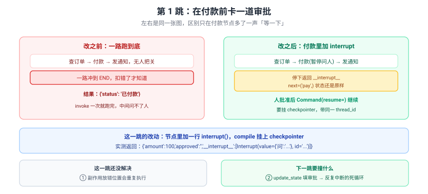
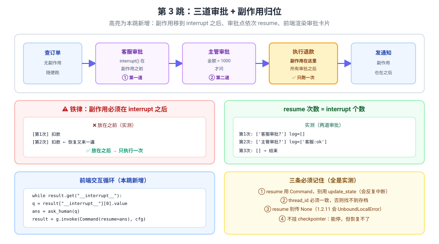

# 应用实战 08：给退款流程加三道审批

> 对应：[课 8 Interrupts 人在环中](../stages/3-可控性与人在环中/lessons/08-Interrupts%20人在环中.md)
> 覆盖知识点：interrupt 的中断机制 / 审批流落地
> ✅ 全部代码实测于 langgraph 1.2.11 / Python 3.12（在 `../langchain/playground` 以 `uv run` 隔离执行）
> ✅ TypeScript 侧实测于 `playground-ts/`（`@langchain/langgraph` 1.5.1 / Node 22，`npm run a08`）

## 场景

客服助手会自动退款。某天它自作主张退了一笔 5000 元，金额还错了。

三跳演进：

| 跳 | 目标 | 新增的知识点 |
|:--:|------|-------------|
| 基础 | 在付款前卡一道审批 | interrupt() / checkpointer / Command(resume=) |
| 问题 | 副作用放错位置 + 用错恢复方式 | 节点整体重跑 / update_state 不消中断 |
| 综合 | 多道审批 + 副作用归位 | 多节点依次 resume / 前端交互循环 |

> 完整方案还需要：审批超时自动驳回 / 审批记录落库审计 / 并发下同一 thread 的互斥、幂等与去重、审批人鉴权——**这些都不是本课内容**（课 12 测试 / 课 13 部署时展开）。

---

## 第 1 跳：在付款前卡一道审批（基础）



> 看图：左右是同一张图，区别只在付款节点多了一声"等一下"。`invoke` 一次跑完 → 变成"停下返回 `__interrupt__` → 人批准 → `Command(resume=)` 继续"。

::: code-group
```python [Python]
from langgraph.checkpoint.memory import InMemorySaver
from langgraph.graph import END, START, StateGraph
from langgraph.types import Command, interrupt
from typing_extensions import TypedDict


class RefundState(TypedDict):
    order_id: str
    amount: int
    approved: str
    status: str


def lookup(state: RefundState) -> dict:
    return {"status": f"订单{state['order_id']}金额{state['amount']}"}


def refund(state: RefundState) -> dict:
    answer = interrupt({                       # ← 停在这里等人
        "问": f"确认退款 {state['amount']} 元？",
        "order_id": state["order_id"],
    })
    return {"approved": str(answer)}


builder = StateGraph(RefundState)
builder.add_node("查订单", lookup)
builder.add_node("退款", refund)
builder.add_edge(START, "查订单")
builder.add_edge("查订单", "退款")
builder.add_edge("退款", END)

graph = builder.compile(checkpointer=InMemorySaver())    # ← 必须有
cfg = {"configurable": {"thread_id": "order-001"}}

result = graph.invoke(
    {"order_id": "A100", "amount": 5000, "approved": "", "status": ""},
    config=cfg,
)
print("中断返回:", result)
```

```typescript [TypeScript]
import {
  Annotation,
  Command,
  END,
  interrupt,
  MemorySaver,
  START,
  StateGraph,
} from "@langchain/langgraph";

const RefundState = Annotation.Root({
  order_id: Annotation<string>({ reducer: (_p, n) => n, default: () => "" }),
  amount: Annotation<number>({ reducer: (_p, n) => n, default: () => 0 }),
  approved: Annotation<string>({ reducer: (_p, n) => n, default: () => "" }),
  status: Annotation<string>({ reducer: (_p, n) => n, default: () => "" }),
});

const lookup = (s: typeof RefundState.State) => ({
  status: `订单${s.order_id}金额${s.amount}`,
});

const refund = (s: typeof RefundState.State) => {
  const answer = interrupt({                       // ← 停在这里等人
    问: `确认退款 ${s.amount} 元？`,
    order_id: s.order_id,
  });
  return { approved: String(answer) };
};

const graph = new StateGraph(RefundState)
  .addNode("查订单", lookup)
  .addNode("退款", refund)
  .addEdge(START, "查订单")
  .addEdge("查订单", "退款")
  .addEdge("退款", END)
  .compile({ checkpointer: new MemorySaver() });   // ← 必须有

const cfg = { configurable: { thread_id: "order-001" } };

const result = await graph.invoke(
  { order_id: "A100", amount: 5000 },
  cfg
);
console.log("中断返回:", JSON.stringify(result));
```
:::

实测输出：

实测（Python）：

```
中断返回: {'order_id': 'A100', 'amount': 5000, 'approved': '', 'status': '订单A100金额5000',
 '__interrupt__': [Interrupt(value={'问': '确认退款 5000 元？', 'order_id': 'A100'},
                             id='0e14aa7357cbd56bd29443f262c815fc')]}
```

实测（TypeScript）：

```
中断返回: {"order_id":"A100","amount":5000,"approved":"","status":"订单A100金额5000",
"__interrupt__":[{"id":"65f65d783cd9f601b9484db5ff8fe9a0",
                  "value":{"问":"确认退款 5000 元？","order_id":"A100"}}]}
```

> 💡 `__interrupt__` 数组里同样是 `{id, value}`，只是 TS 打印成纯对象。`interrupt()` 从 `@langchain/langgraph` 直接导入，`compile` 收 `{ checkpointer }` 对象参数。

看看停在哪了：

::: code-group
```python [Python]
st = graph.get_state(cfg)
print("next  =", st.next)
print("values=", st.values)
```

```typescript [TypeScript]
const st = await graph.getState(cfg);
console.log("next  =", JSON.stringify(st.next));
console.log("values=", JSON.stringify(st.values));
```
:::

实测（Python）：

```
next  = ('退款',)
values= {'order_id': 'A100', 'amount': 5000, 'approved': '', 'status': '订单A100金额5000'}
```

实测（TypeScript）：

```
next  = ["退款"]
values= {"order_id":"A100","amount":5000,"approved":"","status":"订单A100金额5000"}
tasks[0].interrupts = [{"id":"65f65d78...","value":{"问":"确认退款 5000 元？","order_id":"A100"}}]
```

> ⚠️ `approved` 还是空的——**节点的 `return` 根本没执行到**。

> 💡 TS 侧 `st.next` 是**数组**（Python 是元组）；要拿问题内容得走 `st.tasks[0].interrupts`，Python 可以直接用 `st.interrupts`。

人批准后恢复：

::: code-group
```python [Python]
result = graph.invoke(Command(resume="批准"), config=cfg)
print("恢复后:", result)
```

```typescript [TypeScript]
const result = await graph.invoke(new Command({ resume: "批准" }), cfg);
console.log("恢复后:", JSON.stringify(result));
```
:::

实测（Python）：

```
恢复后: {'order_id': 'A100', 'amount': 5000, 'approved': '批准', 'status': '订单A100金额5000'}
```

实测（TypeScript）：

```
恢复后: {"order_id":"A100","amount":5000,"approved":"批准","status":"订单A100金额5000"}
```

> 💡 TS 侧要写 `new Command({ resume: "批准" })`——`Command` 是类，参数是对象。

### 它的问题

1. **副作用放错位置会重复执行**——如果把"真正扣款"写在 `interrupt()` 之前呢？
2. **恢复方式容易用错**——用 `update_state` 填审批结果会怎样？

> 🔑 **根因**：还没验证"恢复"到底是从中断处接着跑，还是重跑。

---

## 第 2 跳：撞两个坑（问题被逼出来的下一步）

### 坑 1：副作用放 `interrupt()` 之前会被执行两次

::: code-group
```python [Python]
charges = []

def refund_bad(state: RefundState) -> dict:
    charges.append(state["amount"])          # ← 副作用在 interrupt 之前
    print(f"  [真的扣款了] {state['amount']} 元，累计扣款 {len(charges)} 次")
    answer = interrupt("确认退款？")
    return {"approved": str(answer)}


builder_bad = StateGraph(RefundState)
builder_bad.add_node("查订单", lookup)
builder_bad.add_node("退款", refund_bad)
builder_bad.add_edge(START, "查订单")
builder_bad.add_edge("查订单", "退款")
builder_bad.add_edge("退款", END)
graph_bad = builder_bad.compile(checkpointer=InMemorySaver())
cfg_bad = {"configurable": {"thread_id": "order-002"}}

graph_bad.invoke({"order_id": "A200", "amount": 100, "approved": "", "status": ""}, config=cfg_bad)
print("--- 人批准 ---")
graph_bad.invoke(Command(resume="批准"), config=cfg_bad)
print("总共扣款次数:", len(charges))
```

```typescript [TypeScript]
const charges: number[] = [];

const refundBad = (s: typeof RefundState.State) => {
  charges.push(s.amount);                  // ← 副作用在 interrupt 之前
  console.log(`  [真的扣款了] ${s.amount} 元，累计扣款 ${charges.length} 次`);
  const answer = interrupt("确认退款？");
  return { approved: String(answer) };
};

const graphBad = new StateGraph(RefundState)
  .addNode("查订单", lookup)
  .addNode("退款", refundBad)
  .addEdge(START, "查订单")
  .addEdge("查订单", "退款")
  .addEdge("退款", END)
  .compile({ checkpointer: new MemorySaver() });
const cfgBad = { configurable: { thread_id: "order-002" } };

await graphBad.invoke({ order_id: "A200", amount: 100 }, cfgBad);
console.log("--- 人批准 ---");
await graphBad.invoke(new Command({ resume: "批准" }), cfgBad);
console.log("总共扣款次数:", charges.length);
```
:::

实测输出：

实测（Python）：

```
  [真的扣款了] 100 元，累计扣款 1 次
--- 人批准 ---
  [真的扣款了] 100 元，累计扣款 2 次
总共扣款次数: 2
```

实测（TypeScript）：

```
  [真的扣款了] 100 元，累计扣款 1 次
--- 人批准 ---
  [真的扣款了] 100 元，累计扣款 2 次
总共扣款次数: 2
```

> ✅ **两侧逐字相同**——`interrupt()` 之前的代码在恢复时确实整体重跑一遍，TS 没有任何"优化"。

> ❌ **钱被扣了两次。**
> 🔑 **恢复不是"接着跑"，是"从头重跑"**——`interrupt()` 之前的代码每次恢复都会再执行一遍。
> ✅ **铁律：扣款、发短信、写库这类副作用必须放在 `interrupt()` 之后。**

### 坑 2：用 `update_state` 填审批，会陷入无限中断

::: code-group
```python [Python]
cfg3 = {"configurable": {"thread_id": "order-003"}}
graph.invoke({"order_id": "A300", "amount": 300, "approved": "", "status": ""}, config=cfg3)

for i in range(3):
    graph.update_state(cfg3, {"approved": f"同意{i}"})       # ← 直接改状态
    r = graph.invoke(None, config=cfg3)                       # ← 然后放行
    print(f"第 {i+1} 轮: 又中断 {len(r.get('__interrupt__') or [])} 次, values={r.get('approved')}")
```

```typescript [TypeScript]
const cfg3 = { configurable: { thread_id: "order-003" } };
await graph.invoke({ order_id: "A300", amount: 300 }, cfg3);

for (let i = 0; i < 3; i++) {
  await graph.updateState(cfg3, { approved: `同意${i}` });   // ← 直接改状态
  const r: any = await graph.invoke(null, cfg3);             // ← 然后放行
  const n = (r.__interrupt__ ?? []).length;
  console.log(`第 ${i + 1} 轮: 又中断 ${n} 次, values=${r.approved}`);
}
```
:::

实测输出：

实测（Python）：

```
第 1 轮: 又中断 1 次, values=同意0
第 2 轮: 又中断 1 次, values=同意1
第 3 轮: 又中断 1 次, values=同意2
```

实测（TypeScript）：

```
第 1 轮: 又中断 1 次, values=同意0
第 2 轮: 又中断 1 次, values=同意1
第 3 轮: 又中断 1 次, values=同意2
```

> ✅ 行为完全一致：`updateState` + `invoke(null)` 三轮都重新中断，没有一轮收敛。

> ❌ **`update_state` 不消中断**，`invoke(None)` 让节点重跑、再次 `interrupt()`——**可以无限重复**。
> ⚠️ 注意 `values` 确实被改成了 `同意0/1/2`，但这**没用**——节点重跑后 `return` 又会把它覆盖掉，而且中断标记一直挂着。
> ✅ **正解：动态中断必须用 `Command(resume=...)`。**

---

## 第 3 跳：多道审批 + 副作用归位（综合）

真实的退款要过客服和主管两道，金额大的才需要主管。



> 看图：高亮部分是本跳新增——**副作用（执行退款）移到所有审批之后**，两道审批点依次 resume，前端用一个 `while` 循环驱动。

::: code-group
```python [Python]
from langgraph.checkpoint.memory import InMemorySaver
from langgraph.graph import END, START, StateGraph
from langgraph.types import Command, interrupt
from typing_extensions import TypedDict


class Flow(TypedDict):
    order_id: str
    amount: int
    log: list
    done: str


audit = []          # 记录真正的副作用


def lookup2(state: Flow) -> dict:
    return {"log": [f"查到订单{state['order_id']}"]}


def cs_review(state: Flow) -> dict:
    ans = interrupt({"问": "客服确认退款？", "金额": state["amount"]})   # ① 第一道
    return {"log": state.get("log", []) + [f"客服:{ans}"]}


def mgr_review(state: Flow) -> dict:
    if state["amount"] <= 1000:                       # 小额不用主管
        return {"log": state.get("log", []) + ["主管:免审"]}
    ans = interrupt({"问": "金额超 1000，主管确认？", "金额": state["amount"]})   # ② 第二道
    return {"log": state.get("log", []) + [f"主管:{ans}"]}


def do_refund(state: Flow) -> dict:
    audit.append({"order": state["order_id"], "amount": state["amount"]})   # ← 副作用
    return {"log": state.get("log", []) + ["已退款"], "done": "完成"}


def notify(state: Flow) -> dict:
    audit.append({"notify": state["order_id"]})       # ← 副作用
    return {"log": state.get("log", []) + ["已通知"]}


b = StateGraph(Flow)
for name, fn in [("查订单", lookup2), ("客服审批", cs_review),
                 ("主管审批", mgr_review), ("执行退款", do_refund), ("发通知", notify)]:
    b.add_node(name, fn)
b.add_edge(START, "查订单")
b.add_edge("查订单", "客服审批")
b.add_edge("客服审批", "主管审批")
b.add_edge("主管审批", "执行退款")
b.add_edge("执行退款", "发通知")
b.add_edge("发通知", END)

g = b.compile(checkpointer=InMemorySaver())
cfg = {"configurable": {"thread_id": "order-100"}}

# 前端交互循环：一直问到人答完
result = g.invoke({"order_id": "B100", "amount": 5000, "log": [], "done": ""}, config=cfg)
round_no = 0
while result.get("__interrupt__"):
    round_no += 1
    q = result["__interrupt__"][0].value
    print(f"第 {round_no} 轮 问题: {q}")
    result = g.invoke(Command(resume={"decision": "approved", "by": f"user{round_no}"}), config=cfg)

print("最终:", result)
print("副作用执行次数:", len(audit), audit)
```

```typescript [TypeScript]
import {
  Annotation,
  Command,
  END,
  interrupt,
  MemorySaver,
  START,
  StateGraph,
} from "@langchain/langgraph";

const Flow = Annotation.Root({
  order_id: Annotation<string>({ reducer: (_p, n) => n, default: () => "" }),
  amount: Annotation<number>({ reducer: (_p, n) => n, default: () => 0 }),
  log: Annotation<string[]>({ reducer: (a, b) => a.concat(b), default: () => [] }),
  done: Annotation<string>({ reducer: (_p, n) => n, default: () => "" }),
});

const audit: unknown[] = [];        // 记录真正的副作用

const lookup2 = (s: typeof Flow.State) => ({ log: [`查到订单${s.order_id}`] });

const csReview = (s: typeof Flow.State) => {
  const ans = interrupt({ 问: "客服确认退款？", 金额: s.amount });   // ① 第一道
  return { log: [`客服:${String(ans)}`] };
};

const mgrReview = (s: typeof Flow.State) => {
  if (s.amount <= 1000) {                       // 小额不用主管
    return { log: ["主管:免审"] };
  }
  const ans = interrupt({ 问: "金额超 1000，主管确认？", 金额: s.amount });   // ② 第二道
  return { log: [`主管:${String(ans)}`] };
};

const doRefund = (s: typeof Flow.State) => {
  audit.push({ order: s.order_id, amount: s.amount });   // ← 副作用
  return { log: ["已退款"], done: "完成" };
};

const notify = (s: typeof Flow.State) => {
  audit.push({ notify: s.order_id });       // ← 副作用
  return { log: ["已通知"] };
};

const g = new StateGraph(Flow)
  .addNode("查订单", lookup2)
  .addNode("客服审批", csReview)
  .addNode("主管审批", mgrReview)
  .addNode("执行退款", doRefund)
  .addNode("发通知", notify)
  .addEdge(START, "查订单")
  .addEdge("查订单", "客服审批")
  .addEdge("客服审批", "主管审批")
  .addEdge("主管审批", "执行退款")
  .addEdge("执行退款", "发通知")
  .addEdge("发通知", END)
  .compile({ checkpointer: new MemorySaver() });

const cfg = { configurable: { thread_id: "order-100" } };

// 前端交互循环：一直问到人答完
let result: any = await g.invoke({ order_id: "B100", amount: 5000 }, cfg);
let roundNo = 0;
while ((result.__interrupt__ ?? []).length > 0) {
  roundNo += 1;
  const q = result.__interrupt__[0].value;
  console.log(`第 ${roundNo} 轮 问题: ${JSON.stringify(q)}`);
  result = await g.invoke(
    new Command({ resume: { decision: "approved", by: `user${roundNo}` } }),
    cfg
  );
}

console.log("最终:", JSON.stringify(result));
console.log("副作用执行次数:", audit.length, JSON.stringify(audit));
```
:::

实测输出：

实测（Python）：

```
第 1 轮 问题: {'问': '客服确认退款？', '金额': 5000}
第 2 轮 问题: {'问': '金额超 1000，主管确认？', '金额': 5000}
最终: {'order_id': 'B100', 'amount': 5000,
       'log': ['查到订单B100', "客服:{'decision': 'approved', 'by': 'user1'}",
               "主管:{'decision': 'approved', 'by': 'user2'}", '已退款', '已通知'],
       'done': '完成'}
副作用执行次数: 2 [{'order': 'B100', 'amount': 5000}, {'notify': 'B100'}]
```

实测（TypeScript）：

```
第 1 轮 问题: {"问":"客服确认退款？","金额":5000}
第 2 轮 问题: {"问":"金额超 1000，主管确认？","金额":5000}
最终: {"order_id":"B100","amount":5000,
       "log":["查到订单B100","客服:{\"decision\":\"approved\",\"by\":\"user1\"}",
              "主管:{\"decision\":\"approved\",\"by\":\"user2\"}","已退款","已通知"],
       "done":"完成"}
副作用执行次数: 2 [{"order":"B100","amount":5000},{"notify":"B100"}]
```

> ✅ 结构、顺序、副作用次数全部一致。唯一差异在 `log` 里那两串的转义形态：Python 打印 dict 用单引号，TS 用 `JSON.stringify` 转成字符串所以带反斜杠——**文本内容本身一样**。

> ✅ **副作用各执行一次**（退款 1 次 + 通知 1 次），**没有重复**——因为都在 `interrupt()` 之后。
> ✅ **`resume` 传的是 dict**，节点里原样拿到（实测类型透传）。

### 小额走免审分支

::: code-group
```python [Python]
cfg2 = {"configurable": {"thread_id": "order-200"}}
r = g.invoke({"order_id": "B200", "amount": 300, "log": [], "done": ""}, config=cfg2)
n = 0
while r.get("__interrupt__"):
    n += 1
    r = g.invoke(Command(resume="ok"), config=cfg2)
print(f"300 元：只问了 {n} 次 ->", r["log"])
```

```typescript [TypeScript]
const cfg2 = { configurable: { thread_id: "order-200" } };
let r: any = await g.invoke({ order_id: "B200", amount: 300 }, cfg2);
let n = 0;
while ((r.__interrupt__ ?? []).length > 0) {
  n += 1;
  r = await g.invoke(new Command({ resume: "ok" }), cfg2);
}
console.log(`300 元：只问了 ${n} 次 ->`, JSON.stringify(r.log));
```
:::

实测输出：

实测（Python）：

```
300 元：只问了 1 次 -> ['查到订单B200', "客服:ok", '主管:免审', '已退款', '已通知']
```

实测（TypeScript）：

```
300 元：只问了 1 次 -> ["查到订单B200","客服:ok","主管:免审","已退款","已通知"]
```

> ✅ **条件分支 + interrupt 天然配合**：小额只问客服，主管节点直接 `return` 不调 `interrupt()`。

### 前端怎么渲染审批卡片

接课 7 的流式——中断就是一个特殊的 chunk：

::: code-group
```python [Python]
cfg3 = {"configurable": {"thread_id": "order-300"}}
for chunk in g.stream({"order_id": "B300", "amount": 800, "log": [], "done": ""},
                      config=cfg3, stream_mode="updates"):
    if "__interrupt__" in chunk:
        q = chunk["__interrupt__"][0].value
        print(f"  [弹出审批卡片] {q}")
    else:
        print(f"  [步骤完成] {list(chunk.keys())[0]}")
```

```typescript [TypeScript]
const cfg3 = { configurable: { thread_id: "order-300" } };
for await (const chunk of await g.stream(
  { order_id: "B300", amount: 800 },
  { ...cfg3, streamMode: "updates" }
)) {
  if ("__interrupt__" in (chunk as object)) {
    const q = (chunk as any).__interrupt__[0].value;
    console.log(`  [弹出审批卡片] ${JSON.stringify(q)}`);
  } else {
    console.log(`  [步骤完成] ${Object.keys(chunk as object)[0]}`);
  }
}
```
:::

实测输出：

实测（Python）：

```
  [步骤完成] 查订单
  [弹出审批卡片] {'问': '客服确认退款？', '金额': 800}
```

实测（TypeScript）：

```
  [步骤完成] 查订单
  [弹出审批卡片] {"问":"客服确认退款？","金额":800}
```

> ✅ **"流式"和"暂停"是同一套机制的两面**——中断只是流里的一个特殊 chunk。

---

## 收尾：三跳带走了什么

| 跳 | 关键代码 | 得到的认识 |
|:--:|---------|-----------|
| 1 | `interrupt()` + `compile(checkpointer=...)` | 中断存快照；`values` 是原样（return 没跑到） |
| 2 | 副作用位置 / `update_state` 对比 | **节点整体重跑**；`update_state` 不消中断 |
| 3 | 多节点 `interrupt()` + `while` 循环 | resume 次数 = interrupt 个数；副作用放最后 |

**五条提醒**：

1. **必须有 checkpointer 才能恢复**——不挂能停，但 `get_state` 抛 `ValueError`、`resume` 抛 `RuntimeError`。
2. **副作用必须放 `interrupt()` 之后**——放之前会因重跑而重复执行（实测扣款 2 次）。
3. **用 `Command(resume=...)`，不是 `update_state`**——后者会无限中断。
4. **一个 interrupt 一次 resume**——`resume` 值类型原样透传（实测 dict / list / bool 都行）。
5. **`resume` 别传 `None`**——langgraph 1.2.11 会抛 `UnboundLocalError`（`_loop.py:927` 框架缺陷）。

### TS 侧写法对照

| 项 | Python | TypeScript |
|:--|--------|-----------|
| 导入 | `from langgraph.types import Command, interrupt` | `import { Command, interrupt } from "@langchain/langgraph"` |
| 恢复 | `graph.invoke(Command(resume="批准"), config=cfg)` | `graph.invoke(new Command({ resume: "批准" }), cfg)` |
| `next` 形态 | 元组 `('退款',)` | 数组 `["退款"]` |
| 读中断内容 | `st.interrupts` | `st.tasks[0].interrupts` |
| 改状态 | `graph.update_state(cfg, {...})` | `await graph.updateState(cfg, {...})` |
| 续跑 | `graph.invoke(None, config=cfg)` | `await graph.invoke(null, cfg)` |
| 空 resume | `None` 撞 `UnboundLocalError` 框架 bug | `""` / `0` / `false` / `null` **全部**报 `EmptyInputError: Received empty Command input` |

> ⚠️ **TS 侧空值更严格（实测四个都拒）**：`""`、`0`、`false`、`null` 逐一试过，**全部** `EmptyInputError: Received empty Command input`。Python 那句"用 `""` 或 `False` 当哨兵"的规避办法在 TS 不成立，必须改用非空值，例如 `"skip"` 或 `{ ok: true }`。

🎯 **会用标志**：能独立给一张自动执行的图加多道审批，把副作用正确放在 `interrupt()` 之后，说清为什么 `update_state` 会导致无限中断，并用流式输出渲染审批卡片。
