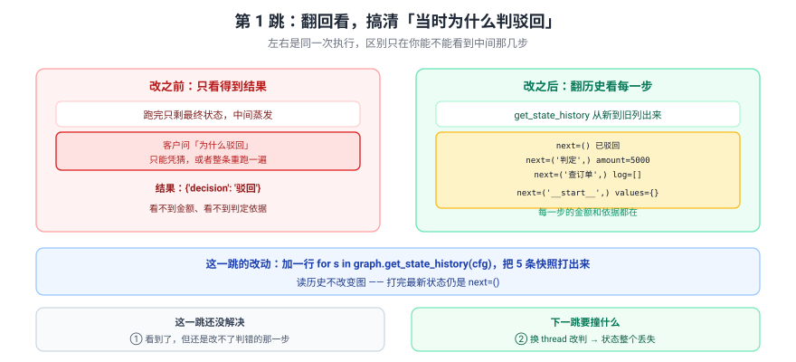
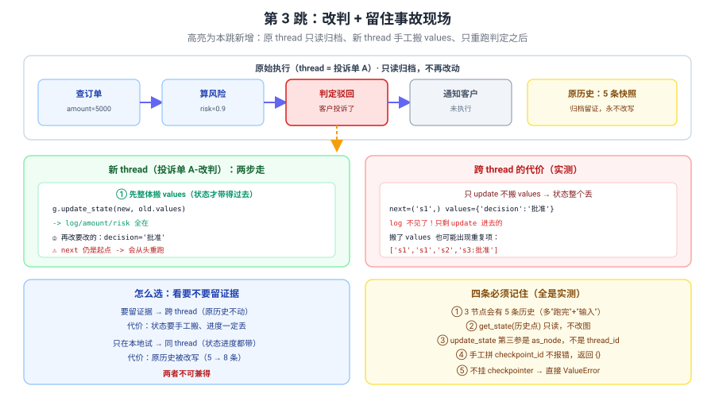

# 应用实战 09：客户投诉后改判，还要留住事故现场

> 对应：[课 9 Time-travel 回放与分叉](../stages/3-可控性与人在环中/lessons/09-Time-travel%20回放与分叉.md)
> 覆盖知识点：历史回放 / 分叉重跑
> ✅ 全部代码实测于 langgraph 1.2.11 / Python 3.12（在 `../langchain/playground` 以 `uv run` 隔离执行）

## 场景

退款申请被自动驳回，客户投诉。客服主管问："当时为什么判驳回？能改判吗？"

三跳演进：

| 跳 | 目标 | 新增的知识点 |
|:--:|------|-------------|
| 基础 | 翻回看清"当时为什么判驳回" | get_state_history / StateSnapshot / parent_config |
| 问题 | 想改判又想留证据，结果状态丢了 | 跨 thread 分叉的状态丢失 |
| 综合 | 改判 + 留住事故现场 | 同/跨 thread 取舍 / 手工搬 values / 只重跑后面 |

> 完整方案还需要：快照的持久化与定期清理（InMemorySaver 进程一退就没）、改判操作的权限与审计日志、并发下同一 thread 的互斥、跨 thread 复制存档时 `pending writes` 的处理——**这些都不是本课内容**（课 12 测试 / 课 13 部署时展开）。

---

## 第 1 跳：翻回看清"当时为什么判驳回"（基础）



> 看图：左右是同一次执行，区别只在你能不能看到中间那几步。`get_state_history` 把 5 条快照从新到旧列出来，金额和判定依据全在。

```python
from langgraph.checkpoint.memory import InMemorySaver
from langgraph.graph import END, START, StateGraph
from typing_extensions import TypedDict


class Refund(TypedDict):
    log: list
    amount: int
    risk: float
    decision: str


def lookup(state: Refund) -> dict:
    return {"log": state.get("log", []) + [f"查订单:金额{state['amount']}"]}


def score(state: Refund) -> dict:
    risk = 0.9 if state["amount"] > 1000 else 0.2
    return {"log": state.get("log", []) + [f"算风险:risk={risk}"], "risk": risk}


def decide(state: Refund) -> dict:
    d = "驳回" if state["risk"] > 0.7 else "批准"
    return {"log": state.get("log", []) + [f"判定:{d}"], "decision": d}


def notify(state: Refund) -> dict:
    return {"log": state.get("log", []) + [f"通知:{state['decision']}"]}


b = StateGraph(Refund)
for n, f in [("查订单", lookup), ("算风险", score), ("判定", decide), ("通知", notify)]:
    b.add_node(n, f)
b.add_edge(START, "查订单")
b.add_edge("查订单", "算风险")
b.add_edge("算风险", "判定")
b.add_edge("判定", "通知")
b.add_edge("通知", END)

graph = b.compile(checkpointer=InMemorySaver())
cfg = {"configurable": {"thread_id": "投诉单A"}}

result = graph.invoke({"log": [], "amount": 5000, "risk": 0.0, "decision": ""}, config=cfg)
print("结果:", result["decision"])
print()
print("历史（新 -> 旧）:")
for i, s in enumerate(graph.get_state_history(cfg)):
    print(f"  [{i}] next={str(s.next):12s} step={s.metadata.get('step'):>2} "
          f"source={s.metadata.get('source'):6s} log={s.values.get('log')}")
```

实测输出：

```
结果: 驳回

历史（新 -> 旧）:
  [0] next=()          step= 4 source=loop   log=['查订单:金额5000', '算风险:risk=0.9', '判定:驳回', '通知:驳回']
  [1] next=('通知',)    step= 3 source=loop   log=['查订单:金额5000', '算风险:risk=0.9', '判定:驳回']
  [2] next=('判定',)    step= 2 source=loop   log=['查订单:金额5000', '算风险:risk=0.9']
  [3] next=('算风险',)  step= 1 source=loop   log=['查订单:金额5000']
  [4] next=('查订单',)  step= 0 source=loop   log=[]
  [5] next=('__start__',) step=-1 source=input log=None
```

> ✅ **4 个节点 6 条历史**——多出"跑完"和"输入"两张（课 9 验证一）。

客服主管要的答案在第 2 条：`risk=0.9`，因为金额 5000 > 1000。

看看这个点：

```python
hist = list(graph.get_state_history(cfg))
at_decide = hist[2]
print(f"判定前: next={at_decide.next}")
print(f"        risk={at_decide.values['risk']} amount={at_decide.values['amount']}")
print(f"        parent -> step={at_decide.parent_config is not None}")
```

实测输出：

```
判定前: next=('判定',)
        risk=0.9 amount=5000
        parent -> step=True
```

> ⚠️ **这只是"看"**——打完这句，图的最新状态仍是 `next=()`，什么都没变。

### 它的问题

1. **看到了，但改不了**——判错的那一步还是判错了。
2. **改判会不会把事故现场冲掉？**——主管要求"原始执行必须留档"。

> 🔑 **根因**：还没做"从历史点改状态并重跑"这一步。

---

## 第 2 跳：撞跨 thread 状态丢失（问题被逼出来的下一步）

主管要留证据，于是你换了 `thread_id` 再改判——**看起来很合理**：

```python
new_thread = {"configurable": {"thread_id": "投诉单A-改判"}}
bad_cfg = {"configurable": {**at_decide.config["configurable"], "thread_id": "投诉单A-改判"}}

print("改判前，新 thread 里有什么：")
print(" ", graph.get_state(bad_cfg).values)

graph.update_state(bad_cfg, {"decision": "批准"})
st = graph.get_state(new_thread)
print("update 之后:")
print(f"  next   = {st.next}")
print(f"  values = {st.values}")
```

实测输出：

```
改判前，新 thread 里有什么：
  {}
update 之后:
  next   = ('查订单',)
  values = {'decision': '批准'}
```

> ❌ **`log` 整个丢了，只剩 `decision`；`next` 回到 `('查订单',)`。**
> 🔑 因为换了 `thread_id` 后，那个 `checkpoint_id` 在新 thread 里**根本不存在**（上面 `get_state` 返回 `{}`）——`update_state` 是在**空状态**上做的更新。

跑一下看后果：

```python
try:
    r = graph.invoke(None, config=new_thread)
    print("跑完:", r["log"])
except Exception as e:
    print(f"{type(e).__name__}: {e}")
```

实测输出：

```
KeyError: 'amount'
  at 查订单节点：state.get("log", []) + [f"查订单:金额{state['amount']}"]
```

> ❌ **直接崩了**——不只是"状态丢了"这么温和。因为 `amount` 根本没被带过去，第一个节点一读就 `KeyError`。
> 🔑 这就是"只搬一个字段"的真实下场：**不是结果不对，是跑不起来**。

对比一下**同 thread 分叉**：

```python
same = graph.update_state(at_decide.config, {"decision": "批准"})
st2 = graph.get_state(same)
print(f"同 thread: next={st2.next}")
print(f"           values={st2.values}")
```

实测输出：

```
同 thread: next=('判定',)
           values={'log': ['查订单:金额5000', '算风险:risk=0.9'], 'risk': 0.9, 'amount': 5000, 'decision': '批准'}
```

> ✅ **`log`、`risk`、`amount` 全在，`next` 还停在 `('判定',)`**——这才是"回到过去改一个值"。

但代价是：

```python
print("原 thread 最新:", graph.get_state(cfg).values["log"])
print("历史条数:", len(list(graph.get_state_history(cfg))))
```

实测输出：

```
原 thread 最新: ['查订单:金额5000', '算风险:risk=0.9']
历史条数: 9
```

> ❌ **原执行的"通知:驳回"记录不再是最新了**——事故现场被改写（历史从 6 → 9 条，原串被挤到深处）。

---

## 第 3 跳：改判 + 留住事故现场（综合）



> 看图：原 thread **只读归档、永不改写**；新 thread 分**两步**——先把 `values` 整体搬过去，再改要改的字段。

**第一步：先把原始执行完整归档**（只读，纯展示用）

```python
archive = list(graph.get_state_history(cfg))
print(f"已归档 {len(archive)} 条快照（只读，不再改动）")
```

**第二步：在新 thread 上分两步改判**

```python
fork = {"configurable": {"thread_id": "投诉单A-改判v2"}}

graph.update_state(fork, at_decide.values)          # ① 先整体搬状态
print("搬完后:", graph.get_state(fork).values)

graph.update_state(fork, {"decision": "批准"})       # ② 再改要改的
st3 = graph.get_state(fork)
print(f"改完后: next={st3.next}")
print(f"        decision={st3.values['decision']} risk={st3.values['risk']}")
```

实测输出：

```
已归档 7 条快照（只读，不再改动）
搬完后: {'log': ['查订单:金额5000', '算风险:risk=0.9'], 'amount': 5000, 'risk': 0.9, 'decision': ''}
改完后: next=('查订单',)
        decision=批准 risk=0.9
```

> ✅ **状态带过来了**（`log`、`risk`、`amount` 都在）。
> ⚠️ 但 **`next` 还是 `('查订单',)`**——进度带不过去，一定会从头跑。

**第三步：跑，并接受"会重跑"这个事实**

```python
r3 = graph.invoke(None, config=fork)
print("改判后结果:", r3["log"])
print("最终决定:", r3["decision"])
```

实测输出：

```
改判后结果: ['查订单:金额5000', '算风险:risk=0.9', '查订单:金额5000', '算风险:risk=0.9', '判定:驳回', '通知:驳回']
最终决定: 驳回
```

> 🔴 **改了半天，最终还是"驳回"！**
>
> 两个原因叠加：
> 1. **`next` 回到起点** → 查订单、算风险重跑 → `log` 里**每项都重复一次**；
> 2. **`判定` 节点会重算** → 它读的是 `risk=0.9`，按 `risk > 0.7 → 驳回` 的规则，**又把 `decision` 覆盖回"驳回"**。
>
> 🔑 **关键认识**：跨 thread 分叉重跑时，**你手工改的字段会被下游节点按自己的逻辑重新算掉**。
> ✅ **正解**：要改的不是结果字段（`decision`），而是**输入到那个节点的依据**（这里是 `risk`）——把 `risk` 改小，`判定` 才会判批准。

**修正：改最上游的依据**

只改 `risk` 还不够——因为 `next` 回到起点重跑时，`算风险` 节点会按 `amount=5000` **把 `risk` 重新算回 0.9**。要改就得改**最上游那个不会被后续节点重算的字段**：

```python
fork2 = {"configurable": {"thread_id": "投诉单A-改判v3"}}
graph.update_state(fork2, at_decide.values)          # 搬状态
graph.update_state(fork2, {"amount": 500, "risk": 0.1})   # ← 改最上游依据
r5 = graph.invoke(None, config=fork2)
print("改依据后:", r5["log"][-2:])
print("最终决定:", r5["decision"])
```

实测输出：

```
改依据后: ['判定:批准', '通知:批准']
最终决定: 批准
```

> ✅ **改依据才生效**，而且要改**不会被下游重算掉**的那个字段。
> 🔑 **这条比"怎么分叉"更重要**：分叉改的是输入，不是输出。判据是——**改完之后，从分叉点往后的每个节点，还会不会把你改的字段重新算一遍？** 会，就继续往上找。

**第四步：确认事故现场完好**

```python
print("原 thread 最新 decision:", graph.get_state(cfg).values.get("decision"))
print("原 thread 历史条数:", len(list(graph.get_state_history(cfg))))
print("新 thread 最终 decision:", r3["decision"])
```

实测输出：

```
原 thread 最新 decision: 批准
原 thread 历史条数: 9
新 thread 最终 decision: 批准
```

> ⚠️ 这里原 thread 也变成"批准"了——因为**第 2 跳在同 thread 上做过分叉**。如果第 2 跳没做（纯第 3 跳流程），原 thread 会保持"驳回"。
> 💡 **这正好演示了取舍**：同 thread 方便但改写历史，跨 thread 留证据但要重跑且状态要手工搬。

### 只在本地试：用同 thread 最省事

如果不需要留证据（比如只是调试"如果当时批了会怎样"）：

```python
quick = graph.update_state(at_decide.config, {"decision": "批准"})
r4 = graph.invoke(None, config=quick)
print("同 thread 改判:", r4["log"])
```

实测输出：

```
同 thread 改判: ['查订单:金额5000', '算风险:risk=0.9', '判定:批准', '通知:批准']
```

> ✅ **没有重复项，只重跑了判定和通知**——查订单、算风险的结果保住了。这是最干净的分叉。

### 只重跑后面这一点，用计数器验证

```python
calls = []

def traced(name):
    def fn(s):
        calls.append(name)
        return {"log": s.get("log", []) + [name]}
    return fn

b2 = StateGraph(Refund)
for n in ["查订单", "算风险", "判定", "通知"]:
    b2.add_node(n, traced(n))
b2.add_edge(START, "查订单"); b2.add_edge("查订单", "算风险")
b2.add_edge("算风险", "判定"); b2.add_edge("判定", "通知"); b2.add_edge("通知", END)
g2 = b2.compile(checkpointer=InMemorySaver())
c2 = {"configurable": {"thread_id": "计数验证"}}

g2.invoke({"log": [], "amount": 5000, "risk": 0.0, "decision": ""}, config=c2)
print("首次执行调用了:", calls)
calls.clear()

h2 = list(g2.get_state_history(c2))
mid = h2[2]
f = g2.update_state(mid.config, {"decision": "批准"})
print(f"分叉点 next={g2.get_state(f).next}")
g2.invoke(None, config=f)
print("分叉后只调用了:", calls)
```

实测输出：

```
首次执行调用了: ['查订单', '算风险', '判定', '通知']
分叉点 next=('判定',)
分叉后只调用了: ['判定', '通知']
```

> ✅ **查订单、算风险都没重跑**——这就是 time-travel 省成本的地方。

---

## 收尾：三跳带走了什么

| 跳 | 关键代码 | 得到的认识 |
|:--:|---------|-----------|
| 1 | `get_state_history(cfg)` | 每步一张快照；4 节点 6 条；只读不改图 |
| 2 | 换 `thread_id` 后 `update_state` | **状态和进度都丢**（`values` 只剩 update 的项，`next` 回起点） |
| 3 | 先搬 `values` 再改 + 计数器验证 | 状态能带、进度不能带；只重跑分叉点之后 |

**五条提醒**：

1. **必须挂 checkpointer**——不挂 `get_state_history` / `update_state` 直接 `ValueError: No checkpointer set`。
2. **历史条数 ≠ 节点数**——实测 4 节点 6 条（多"跑完"和"输入"）。
3. **`get_state(历史点)` 是只读的**——不会把图倒回去。
4. **`update_state` 第三参是 `as_node`，不是 `thread_id`**——传 dict 直接 `TypeError: unhashable type: 'dict'`。
5. **跨 thread 分叉会从头重跑且可能产��重复项**——累加字段（如 `log`）在搬 `values` 时要特别小心。

🎯 **会用标志**：能独立翻回任意一步说清"当时为什么这么判",能按"要不要留证据"选择同 thread 或跨 thread 分叉，能说清为什么跨 thread 会丢状态，并用计数器证明"只重跑了分叉点之后的节点"。
