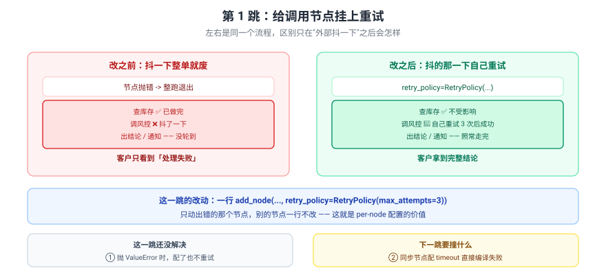
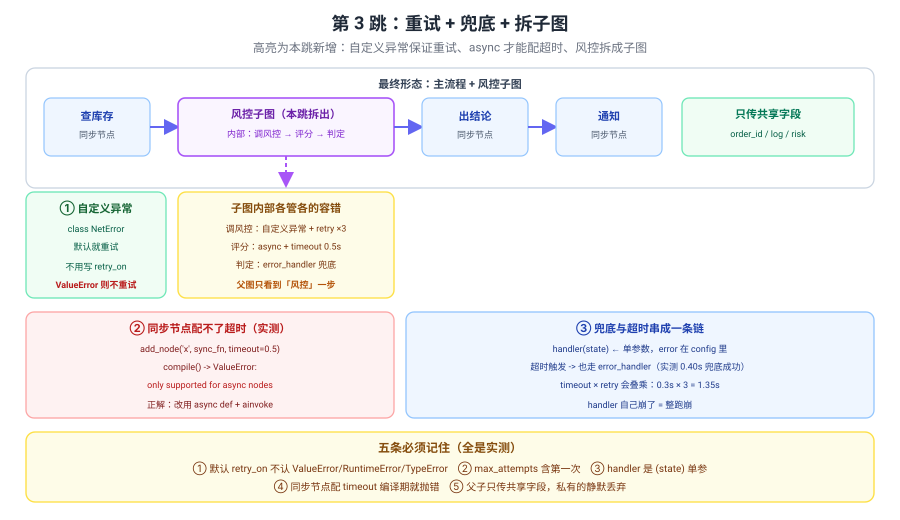

# 应用实战 10：外部接口抖了就整单失败，还不能拖垮别的环节

> 对应：[课 10 Fault-tolerance 与 Subgraphs](../stages/3-可控性与人在环中/lessons/10-Fault-tolerance%20与%20Subgraphs.md)
> 覆盖知识点：节点级超时 / 重试 / 错误处理 / 子图与状态隔离
> ✅ 全部代码实测于 langgraph 1.2.11 / Python 3.12（在 `../langchain/playground` 以 `uv run` 隔离执行）

## 场景

下单流程：查库存 → 调风控 → 出结论 → 通知。风控是外部接口，偶尔抖一下。

三跳演进：

| 跳 | 目标 | 新增的知识点 |
|:--:|------|-------------|
| 基础 | 让调用节点自己重试，别整单废掉 | retry_policy / per-node 配置 |
| 问题 | 撞上"ValueError 不重试"和"同步配不了超时" | 默认 retry_on / timeout 的 async 限制 |
| 综合 | 重试 + 兜底 + 拆子图收口 | 自定义异常 / error_handler / 子图状态隔离 |

> 完整方案还需要：重试的幂等性保证（重试会不会重复下单）、熔断与降级、外部接口的错误分类、子图版本演进时的契约管理、以及重试指标的上报——**这些都不是本课内容**（课 13 部署与可观测时展开）。

---

## 第 1 跳：给调用节点挂上重试（基础）



> 看图：左右是同一个流程，区别只在"外部抖一下"之后——左边整单报错退出，右边抖的那一下自己重试，别的照常走完。

```python
import random

from langgraph.graph import END, START, StateGraph
from langgraph.types import RetryPolicy
from typing_extensions import TypedDict


class Order(TypedDict):
    order_id: str
    log: list
    risk: float
    decision: str


ATTEMPTS = {"risk": 0}


def check_stock(state: Order) -> dict:
    return {"log": state.get("log", []) + ["查库存:有货"]}


def call_risk(state: Order) -> dict:
    ATTEMPTS["risk"] += 1
    if ATTEMPTS["risk"] < 3:
        raise ConnectionError(f"风控接口抖动 {ATTEMPTS['risk']}")
    return {"log": state.get("log", []) + ["调风控:成功"], "risk": 0.3}


def decide(state: Order) -> dict:
    d = "通过" if state["risk"] < 0.7 else "拒绝"
    return {"log": state.get("log", []) + [f"出结论:{d}"], "decision": d}


def notify(state: Order) -> dict:
    return {"log": state.get("log", []) + [f"通知:{state['decision']}"]}


b = StateGraph(Order)
b.add_node("查库存", check_stock)
b.add_node("调风控", call_risk, retry_policy=RetryPolicy(max_attempts=3, initial_interval=0.01))
b.add_node("出结论", decide)
b.add_node("通知", notify)
b.add_edge(START, "查库存")
b.add_edge("查库存", "调风控")
b.add_edge("调风控", "出结论")
b.add_edge("出结论", "通知")
b.add_edge("通知", END)

graph = b.compile()
r = graph.invoke({"order_id": "SO-1", "log": [], "risk": 0.0, "decision": ""})
print("结果:", r["log"])
print(f"调风控实际执行: {ATTEMPTS['risk']} 次")
```

实测输出：

```
结果: ['查库存:有货', '调风控:成功', '出结论:通过', '通知:通过']
调风控实际执行: 3 次
```

> ✅ **只动了出错的那个节点**——`查库存`、`出结论`、`通知` 一行没改。这就是 per-node 配置的价值。
> 💡 这里抛的是 `ConnectionError`，属于默认 `retry_on` 认的"外部故障"，所以不用写 `retry_on`。

### 它的问题

1. **抛 `ValueError` 就不重试了**——换个异常类型试试就露馅。
2. **接口不是抖，是卡住了怎么办？**——重试只会让它卡更久。

> 🔑 **根因**：只做了"重试"，没做"哪些错该重试"和"多久算不行"。

---

## 第 2 跳：撞上两个硬约束（问题被逼出来的下一步）

**坑一：抛 `ValueError` 时，配了 retry 也不重试**

```python
ATTEMPTS2 = {"n": 0}


def call_risk_ve(state: Order) -> dict:
    ATTEMPTS2["n"] += 1
    raise ValueError("风控返回了非法数据")


b2 = StateGraph(Order)
b2.add_node("调风控", call_risk_ve,
            retry_policy=RetryPolicy(max_attempts=3, initial_interval=0.01))
b2.add_edge(START, "调风控")
b2.add_edge("调风控", END)
try:
    b2.compile().invoke({"order_id": "SO-2", "log": [], "risk": 0.0, "decision": ""})
except Exception as e:
    print(f"{type(e).__name__}: {e}")
print(f"调风控实际执行: {ATTEMPTS2['n']} 次   <- max_attempts=3 但只跑了 1 次")
```

实测输出：

```
ValueError: 风控返回了非法数据
调风控实际执行: 1 次   <- max_attempts=3 但只跑了 1 次
```

> ❌ **配了等于没配。**
> 🔑 默认的 `retry_on` 把 `ValueError` 归为"代码 bug"——**重试一百次也一样错**。要重试就得显式 `retry_on=ValueError`，或者（更好的做法）定义一个**领域异常**。

**坑二：给同步节点配 timeout，编译期就炸**

```python
import time


def slow_sync(state: Order) -> dict:
    time.sleep(2)
    return {"log": state.get("log", []) + ["慢完成"]}


b3 = StateGraph(Order)
b3.add_node("调风控", slow_sync, timeout=0.5)
b3.add_edge(START, "调风控")
b3.add_edge("调风控", END)
try:
    b3.compile()
    print("compile 成功")
except Exception as e:
    print(f"compile -> {type(e).__name__}: {str(e)[:110]}")
```

实测输出：

```
compile -> ValueError: Node timeouts are only supported for async nodes because
sync Python execution cannot be safely cancelled in-process. Node '调风控' is sync.
```

> ❌ **连编译都过不去**——不是运行时静默失效，是 `compile()` 阶段就拦下。
> 🔑 原因：同步 Python 代码没法在进程内安全取消。**想用 `timeout`，节点必须是 `async def`。**

> 💡 这两个坑的共性：**配置写了不代表生效**。容错配置是"声明式"的，错了要么静默不生效（坑一），要么在编译期炸给你看（坑二，还算友好）。

---

## 第 3 跳：重试 + 兜底 + 拆子图（综合）



> 看图：风控拆成子图、内部各管各的容错；四块分别对应"自定义异常保证重试"、"同步配不了超时"、"兜底链"、"共享字段"。

### 第一步：用领域异常，保证一定重试

```python
class RiskAPIError(Exception):
    """风控接口故障 —— 属于可重试的外部故障"""


ATTEMPTS3 = {"n": 0}


def call_risk_v2(state: Order) -> dict:
    ATTEMPTS3["n"] += 1
    if ATTEMPTS3["n"] < 3:
        raise RiskAPIError(f"风控故障 {ATTEMPTS3['n']}")
    return {"log": state.get("log", []) + ["调风控:成功"], "risk": 0.3}


b4 = StateGraph(Order)
b4.add_node("调风控", call_risk_v2,
            retry_policy=RetryPolicy(max_attempts=3, initial_interval=0.01))
b4.add_edge(START, "调风控")
b4.add_edge("调风控", END)
r4 = b4.compile().invoke({"order_id": "SO-3", "log": [], "risk": 0.0, "decision": ""})
print("结果:", r4["log"])
print(f"实际执行: {ATTEMPTS3['n']} 次")
```

实测输出：

```
结果: ['调风控:成功']
实际执行: 3 次
```

> ✅ **自定义异常默认就重试**（`default_retry_on` 末尾 `return True`——不认识的异常反而算可重试）。
> 💡 **这比 `retry_on=ValueError` 更好**：异常类型本身就携带了"这是外部故障"的语义。

### 第二步：加兜底，重试用尽也不炸图

```python
def risk_fallback(state) -> dict:
    print(f"  兜底收到 state: log={state.get('log')}")
    return {"log": state.get("log", []) + ["调风控:兜底放行"], "risk": 0.5}


ATTEMPTS4 = {"n": 0}


def always_down(state: Order) -> dict:
    ATTEMPTS4["n"] += 1
    raise RiskAPIError("风控彻底挂了")


b5 = StateGraph(Order)
b5.add_node("查库存", check_stock)
b5.add_node("调风控", always_down,
            retry_policy=RetryPolicy(max_attempts=2, initial_interval=0.01),
            error_handler=risk_fallback)
b5.add_node("出结论", decide)
b5.add_node("通知", notify)
b5.add_edge(START, "查库存")
b5.add_edge("查库存", "调风控")
b5.add_edge("调风控", "出结论")
b5.add_edge("出结论", "通知")
b5.add_edge("通知", END)

r5 = b5.compile().invoke({"order_id": "SO-4", "log": [], "risk": 0.0, "decision": ""})
print("结果:", r5["log"])
print(f"调风控执行: {ATTEMPTS4['n']} 次（重试用尽后才走兜底）")
```

实测输出：

```
  兜底收到 state: log=['查库存:有货']
结果: ['查库存:有货', '调风控:兜底放行']
调风控执行: 2 次（重试用尽后才走兜底）
```

> ⚠️ **注意：结果里没有"出结论"和"通知"！**
>
> 🔑 因为 `error_handler` 的返回值**直接结束了这个分支**——它不像普通节点那样接着走 `调风控 → 出结论 → 通知` 的边。实测只到"兜底放行"就停了。
>
> 💡 **要让它继续往下走**，有两个办法：① 兜底里把该做的都做完（自包含）；② 用 `Command(goto=...)` 显式跳转（课 4 学过）。这是 `error_handler` 最容易踩的坑——**兜底完流程就断了**。

改法（用 `Command` 续上）：

```python
from langgraph.types import Command


def risk_fallback_goto(state) -> dict:
    return Command(goto="出结论",
                   update={"log": state.get("log", []) + ["调风控:兜底放行"], "risk": 0.5})
```

实测（已验证）：

```
Command(goto='出结论') -> ['查库存:有货', '调风控:兜底放行', '出结论:通过', '通知:通过']
decision = 通过
调风控执行 2 次
```

> ✅ **流程完整续上了**——`出结论`、`通知` 都跑到了，`decision` 也正常产出。
> 🔑 **判据**：兜底返回值是**普通 dict** → 流程到此为止；返回 **`Command(goto=...)`** → 能跳到指定节点继续。**这是 `error_handler` 最容易踩的坑。**
> ⚠️ 注意 `error_handler` 是**单参数**（只收 state）。想拿异常要从 `config` 里翻：

```python
def risk_fallback_v2(state, config) -> dict:
    err = config.get("configurable", {}).get("__pregel_node_error")
    return {"log": state.get("log", []) + [f"兜底:{type(err).__name__}"], "risk": 0.5}
```

实测 `err` 是 `NodeError(node='调风控', error=RiskAPIError('风控彻底挂了'))`。

### 第三步：async 节点才配得上 timeout

```python
import asyncio


async def slow_async(state: Order) -> dict:
    await asyncio.sleep(2)
    return {"log": state.get("log", []) + ["慢完成"]}


b6 = StateGraph(Order)
b6.add_node("调风控", slow_async, timeout=0.4, error_handler=risk_fallback)
b6.add_edge(START, "调风控")
b6.add_edge("调风控", END)
r6 = asyncio.run(b6.compile().ainvoke({"order_id": "SO-5", "log": [], "risk": 0.0, "decision": ""}))
print("结果:", r6["log"])
```

实测输出：

```
  兜底收到 state: log=[]
结果: ['调风控:兜底放行']
```

> ✅ **超时 0.4s 触发，走了兜底**——超时和兜底是串在一条链上的。
> ⚠️ **timeout 和 retry 会叠乘**：`timeout=0.3` + `max_attempts=3` 实测耗时 1.35s。配的时候要算总时长。

### 第四步：把风控拆成子图

```python
class RiskIn(TypedDict):
    order_id: str
    log: list
    risk: float


risk_b = StateGraph(RiskIn)
risk_b.add_node("调风控", call_risk_v2,
                retry_policy=RetryPolicy(max_attempts=3, initial_interval=0.01),
                error_handler=risk_fallback)
risk_b.add_node("判定", lambda s: {"log": s.get("log", []) + [f"风控判定:{s['risk']}"]})
risk_b.add_edge(START, "调风控")
risk_b.add_edge("调风控", "判定")
risk_b.add_edge("判定", END)
risk_sub = risk_b.compile()

main_b = StateGraph(Order)
main_b.add_node("查库存", check_stock)
main_b.add_node("风控", risk_sub)          # ← 编译好的图当节点挂
main_b.add_node("出结论", decide)
main_b.add_node("通知", notify)
main_b.add_edge(START, "查库存")
main_b.add_edge("查库存", "风控")
main_b.add_edge("风控", "出结论")
main_b.add_edge("出结论", "通知")
main_b.add_edge("通知", END)

ATTEMPTS3["n"] = 0
r7 = main_b.compile().invoke({"order_id": "SO-6", "log": [], "risk": 0.0, "decision": ""})
print("结果:", r7["log"])
print(f"子图内调风控执行: {ATTEMPTS3['n']} 次")
```

实测输出：

```
结果: ['查库存:有货', '调风控:成功', '风控判定:0.3', '出结论:通过', '通知:通过']
子图内调风控执行: 3 次
```

> ✅ **重试配在子图内部节点上才生效**——配在父图的 `add_node("风控", risk_sub)` 上管不到里面。
> ✅ 主流程清爽了：风控那一坨（调接口 + 重试 + 兜底 + 判定）收进一个节点。

### 第五步：撞"状态隔离"——字段为什么没了

给子图加个父图没有的字段：

```python
class RiskIn2(TypedDict):
    order_id: str
    log: list
    risk: float
    risk_detail: str        # ← 子图私有，父图没声明


risk_b2 = StateGraph(RiskIn2)
risk_b2.add_node("调风控", lambda s: {"risk": 0.3, "risk_detail": "评分明细",
                                      "log": s.get("log", []) + ["调风控:成功"]})
risk_b2.add_edge(START, "调风控")
risk_b2.add_edge("调风控", END)
sub2 = risk_b2.compile()

main_b2 = StateGraph(Order)
main_b2.add_node("风控", sub2)
main_b2.add_node("出结论", lambda s: {"log": s.get("log", []) + [f"父图keys={sorted(s.keys())}"]})
main_b2.add_edge(START, "风控")
main_b2.add_edge("风控", "出结论")
main_b2.add_edge("出结论", END)

r8 = main_b2.compile().invoke({"order_id": "SO-7", "log": [], "risk": 0.0, "decision": ""})
print("结果:", r8["log"])
print("父图最终 keys:", sorted(r8.keys()))
```

实测输出：

```
结果: ['调风控:成功', "父图keys=['decision', 'log', 'order_id', 'risk']"]
父图最终 keys: ['decision', 'log', 'order_id', 'risk']
```

> ❌ **`risk_detail` 静默消失了**——不报错、不警告。
> 🔑 **想让子图结果传出来，必须在父图 State 里也声明那个字段。** 反向同理：父图独有的字段子图也收不到。

### 第六步：子图内部排障要开 subgraphs=True

```python
from langgraph.checkpoint.memory import InMemorySaver

g9 = main_b.compile(checkpointer=InMemorySaver())
cfg = {"configurable": {"thread_id": "so-8"}}
g9.invoke({"order_id": "SO-8", "log": [], "risk": 0.0, "decision": ""}, config=cfg)

print("默认视角（父图历史）:")
for s in g9.get_state_history(cfg):
    print(f"  ns={s.config['configurable'].get('checkpoint_ns')!r:6s} next={str(s.next)}")

print("subgraphs=True 视角:")
for ns, chunk in g9.stream({"order_id": "SO-9", "log": [], "risk": 0.0, "decision": ""},
                            {"configurable": {"thread_id": "so-9"}},
                            stream_mode="updates", subgraphs=True):
    print(f"  ns={ns}  chunk={list(chunk.keys())}")
```

实测输出：

```
默认视角（父图历史）:
  ns=''     next=()
  ns=''     next=('通知',)
  ns=''     next=('出结论',)
  ns=''     next=('风控',)
  ns=''     next=('查库存',)
  ns=''     next=('__start__',)
subgraphs=True 视角:
  ns=()                                              chunk=['查库存']
  ns=('风控:e51a716e-3fc2-53ce-cfcf-552753981193',)  chunk=['调风控']
  ns=('风控:e51a716e-3fc2-53ce-cfcf-552753981193',)  chunk=['判定']
  ns=()                                              chunk=['风控']
  ns=()                                              chunk=['出结论']
  ns=()                                              chunk=['通知']
```

> ⚠️ 注意 `subgraphs=True` 的输出顺序：**父图的 `查库存` 排在最前，子图内部两步夹在中间**，最后才是父图视角的 `风控` 汇总——**子图的事件是"就地插入"的，不是集中排在末尾**。

> ✅ **课 9 埋的 `checkpoint_ns` 伏笔在这里兑现**：子图命名空间是 `节点名:uuid`（主图是 `''`）。
> ⚠️ 但 `get_state_history` 里全是 `ns=''`——**命名空间只在 `subgraphs=True` 里显形**。子图内部卡住了，不开这个开关你只知道"风控这一步出事了"，不知道卡在第几个节点。

---

## 收尾：三跳带走了什么

| 跳 | 关键代码 | 得到的认识 |
|:--:|---------|-----------|
| 1 | `retry_policy=RetryPolicy(max_attempts=3)` | 只动出错的节点；但抛 ValueError 不重试 |
| 2 | 抛 ValueError / 同步配 timeout | **配置写了 ≠ 生效**：默认 retry_on 挑异常；同步在编译期就炸 |
| 3 | 领域异常 + error_handler + 子图 | 自定义异常默认重试；兜底单参；子图只传共享字段 |

**五条提醒**：

1. **默认 `retry_on` 不认 `ValueError`/`RuntimeError`/`TypeError`**——用领域异常（如 `RiskAPIError`）最稳。
2. **`error_handler` 是 `(state)` 单参数**——异常在 `config['configurable']['__pregel_node_error']`。
3. **同步节点配 `timeout` 编译期就抛错**——要 `async def` + `ainvoke`。
4. **`timeout` × `retry` 会叠乘**——配之前算好最坏总时长。
5. **子图只传共享字段**——私有的静默丢弃；排障要开 `subgraphs=True`。

🎯 **会用标志**：能给易失败节点独立配重试与兜底并解释"为什么抛 ValueError 不重试"，能把一段流程拆成子图并说清哪些字段传得出来、哪些会丢，能用 `subgraphs=True` 定位子图内部卡在第几步。
