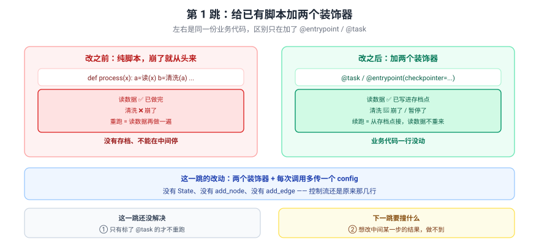
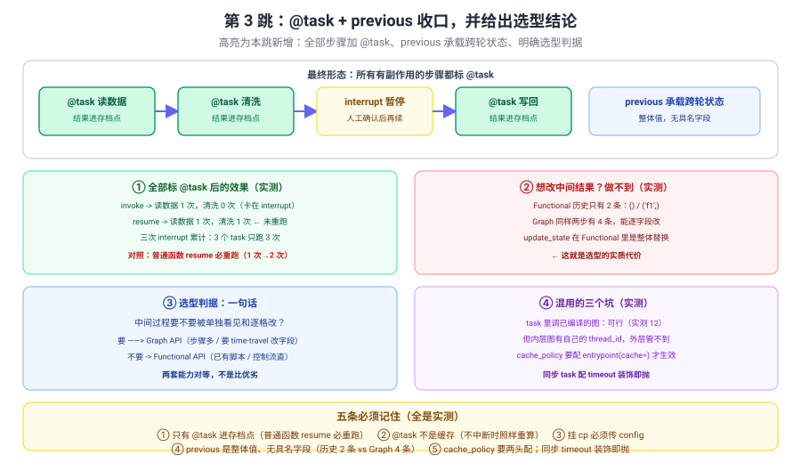

# 应用实战 11：已有脚本想加暂停和断点续跑，要不要重写成图

> 对应：[课 11 Functional API 与选型](../stages/3-可控性与人在环中/lessons/11-Functional%20API%20%E4%B8%8E%E9%80%89%E5%9E%8B.md)
> 覆盖知识点：@entrypoint / @task 模型 / 两套 API 选型
> ✅ 全部代码实测于 langgraph 1.2.11 / Python 3.12（在 `../langchain/playground` 以 `uv run` 隔离执行）

## 场景

你手上有个纯脚本：读数据 → 清洗 → 人工确认 → 写回。现在要加"中途暂停等人"和"崩了能续跑"，同事说"那得重写成 StateGraph 吧？"

三跳演进：

| 跳 | 目标 | 新增的知识点 |
|:--:|------|-------------|
| 基础 | 用两个装饰器给已有脚本加上 checkpoint | @entrypoint / @task |
| 问题 | 撞上"普通函数 resume 必重跑"和"没有具名状态" | task 持久化语义 / previous |
| 综合 | 全部标 @task + previous 收口，给出选型结论 | 选型判据 / 混用边界 |

> 完整方案还需要：生产环境的 checkpointer 选型（SQLite / Postgres）、幂等性保证（写回重复执行会怎样）、以及任务编排的版本演进管理——**这些都不是本课内容**（课 12/13 部署与工程化时展开）。

---

## 第 1 跳：给已有脚本加两个装饰器（基础）



> 看图：左右是同一份业务代码，区别只在加了 `@entrypoint` / `@task`——**业务代码一行没动**，就有了存档点和暂停能力。

```python
from langgraph.checkpoint.memory import InMemorySaver
from langgraph.func import entrypoint, task
from langgraph.types import interrupt

SIDE = {"load": 0, "clean": 0}


@task
def load(src: str) -> list:
    SIDE["load"] += 1
    return [3, 1, 2]


def clean(data: list) -> list:          # ← 注意：这个没加 @task
    SIDE["clean"] += 1
    return sorted(data)


@entrypoint(checkpointer=InMemorySaver())
def process(src: str) -> dict:
    data = load(src).result()
    cleaned = clean(data)
    ok = interrupt({"question": "清洗结果对吗", "data": cleaned})
    return {"data": cleaned, "approved": ok}


cfg = {"configurable": {"thread_id": "job-1"}}
r = process.invoke("orders.csv", config=cfg)
print("invoke ->", r)
print(f"副作用计数: {SIDE}")
```

实测输出：

```
invoke -> {'__interrupt__': [Interrupt(value={'question': '清洗结果对吗', 'data': [1, 2, 3]}, id='...')]}
副作用计数: {'load': 1, 'clean': 1}
```

> ✅ **没有 State、没有 `add_node`、没有 `add_edge`**——控制流还是原来那几行，只是多了两个装饰器和一个 `config`。
> ⚠️ **`config` 是必填的**（挂了 checkpointer 时）。不传直接 `ValueError: Checkpointer requires one or more of the following 'configurable' keys: thread_id, checkpoint_ns, checkpoint_id`。

### 它的问题

1. **`clean` 没标 `@task`**——resume 时它会重跑。
2. **想改中间结果？**——没有具名字段。

> 🔑 **根因**：只加了"存档"的壳，没搞清楚**持久化的单位是什么**。

---

## 第 2 跳：撞上两个硬约束（问题被逼出来的下一步）

**坑一：没标 @task 的函数，resume 时必然重跑**

```python
from langgraph.types import Command

print("resume 前:", SIDE)
r2 = process.invoke(Command(resume="通过"), config=cfg)
print("resume ->", r2)
print(f"resume 后: {SIDE}")
```

实测输出：

```
resume 前: {'load': 1, 'clean': 1}
resume -> {'data': [1, 2, 3], 'approved': '通过'}
resume 后: {'load': 1, 'clean': 2}
```

> ❌ **`clean` 从 1 次变成 2 次**——重跑了一遍。
> 🔑 **`load` 保持 1 次**（标了 `@task`，结果在存档点里），**`clean` 变成 2 次**（普通函数，没进存档点）。
> 💡 如果 `clean` 里有副作用（调外部接口、扣款、发消息），**副作用就重复发生了**。

**坑二：想改中间某一步的结果，做不到**

```python
st = process.get_state(cfg)
print("get_state ->", st.values)
print("历史条数:", len(list(process.get_state_history(cfg))))
```

实测输出：

```
get_state -> {'data': [1, 2, 3], 'approved': '通过'}
历史条数: 2
```

> ❌ **只有 2 条历史**：`()` 和 `('process',)`。
> 🔑 对照 Graph API——同样两步的流程有 **4 条**历史，而且能 `update_state({'某个字段': 新值})` 逐字段改。**Functional API 里 `previous` 是整体值，没有具名字段。**

> 💡 这两个坑的共性：**Functional API 的"状态"是粗粒度的**。它记得"上次交出来什么"（`previous`），但不记得"中间第几步算出了什么"。

---

## 第 3 跳：@task + previous 收口（综合）



> 看图：所有有副作用的步骤都标 `@task`（绿色），`interrupt` 卡在中间（黄色），`previous` 承载跨轮状态（蓝色）。四块分别对应"全标 @task 的效果"、"改不了中间结果"、"选型判据"、"混用的坑"。

### 第一步：给所有有副作用的步骤标 @task

```python
SIDE2 = {"load": 0, "clean": 0, "write": 0}


@task
def load2(src: str) -> list:
    SIDE2["load"] += 1
    return [3, 1, 2]


@task
def clean2(data: list) -> list:
    SIDE2["clean"] += 1
    return sorted(data)


@task
def write2(data: list, ok) -> str:
    SIDE2["write"] += 1
    return f"写回 {len(data)} 条（审批={ok}）"


@entrypoint(checkpointer=InMemorySaver())
def process2(src: str) -> dict:
    data = load2(src).result()
    cleaned = clean2(data).result()
    ok = interrupt({"question": "确认", "data": cleaned})
    return {"result": write2(cleaned, ok).result()}


cfg2 = {"configurable": {"thread_id": "job-2"}}
r3 = process2.invoke("orders.csv", config=cfg2)
print("invoke ->", r3)
print(f"  计数: {SIDE2}")
r4 = process2.invoke(Command(resume="通过"), config=cfg2)
print("resume ->", r4)
print(f"  计数: {SIDE2}")
```

实测输出：

```
invoke -> {'__interrupt__': [Interrupt(value={'question': '确认', 'data': [1, 2, 3]}, id='...')]}
  计数: {'load': 1, 'clean': 1, 'write': 0}
resume -> {'result': '写回 3 条（审批=通过）'}
  计数: {'load': 1, 'clean': 1, 'write': 1}
```

> ✅ **`clean` 保持 1 次**——标了 `@task` 就不再重跑。三次 interrupt 的场景实测：3 个 task 只跑 3 次，不是 3×3。
> ⚠️ **但 `@task` 不是缓存**：同 thread 再 `invoke` 一次（不中断），实测执行次数照样 +1。它只在**从存档点恢复**时才体现价值。

### 第二步：previous 承载跨轮状态

```python
@entrypoint(checkpointer=InMemorySaver())
def pipeline(batch: list, previous=None) -> dict:
    done = (previous or {}).get("done", [])
    done = done + [len(batch)]
    return {"done": done, "total": sum(done)}


cfg3 = {"configurable": {"thread_id": "pipe"}}
print("第1批:", pipeline.invoke([1, 2], config=cfg3))
print("第2批:", pipeline.invoke([3, 4, 5], config=cfg3))
print("第3批:", pipeline.invoke([6], config=cfg3))
```

实测输出：

```
第1批: {'done': [2], 'total': 2}
第2批: {'done': [2, 3], 'total': 5}
第3批: {'done': [2, 3, 1], 'total': 6}
```

> ✅ **`previous` 就是上一次的返回值**——天然累加，不用配 reducer。
> ⚠️ **但它是整体值**：你只能整体替换，不能说"把 total 改成 100"。

**对照 Graph API 的同样操作**：

```python
from langgraph.graph import END, START, StateGraph

b = StateGraph(dict)
b.add_node("add", lambda s: {"v": s.get("v", 0) + s.get("inc", 0)})
b.add_edge(START, "add")
b.add_edge("add", END)
g = b.compile(checkpointer=InMemorySaver())
cfgg = {"configurable": {"thread_id": "g"}}
print("Graph 第1次:", g.invoke({"v": 0, "inc": 10}, config=cfgg)["v"])
print("Graph 第2次:", g.invoke({"inc": 5}, config=cfgg)["v"])
```

实测输出：

```
Graph 第1次: 10
Graph 第2次: 5
```

> 🔑 **同一件事两套写法结果不同**：Functional 的 `previous` 天然累加（2→5→6），Graph API 没配 reducer 就是**覆盖**（10→5）。
> 💡 想要 Graph 也累加，得给字段配 reducer（课 3 学过）——**这是"显式声明"与"隐式继承"的差别**。

### 第三步：混用——把旧图当函数调

```python
@task
def call_legacy_graph(x: int) -> int:
    return g.invoke({"v": x}, {"configurable": {"thread_id": f"legacy-{x}"}})["v"]


@entrypoint(checkpointer=InMemorySaver())
def mixed(x: int) -> dict:
    return {"out": call_legacy_graph(x).result()}


cfg4 = {"configurable": {"thread_id": "mix"}}
print("混用 ->", mixed.invoke(1, config=cfg4))
print("再来 ->", mixed.invoke(1, config=cfg4))
```

实测输出：

```
混用 -> {'out': 1}
再来 -> {'out': 1}
```

> ⚠️ **不是 12！** 内层图 `g` 的 `add` 节点是 `v = s.get("v",0) + s.get("inc",0)`，外层传进去的是 `{"v": x}`（没传 `inc`），所以就是 `1 + 0 = 1`。
>
> 🔑 **这个"意外"恰好演示了混用最容易踩的坑**：**内层图的入参契约是它自己的 State schema**，跟外层 Functional 的入参没关系。外层传 `x=1`，内层收到的是 `{"v": 1}`——**字段名对不上就静默取默认值**。
>
> 💡 而且两次调用结果一样，是因为内层图用了 `thread_id=f"legacy-{x}"`（同一个 x 同一个 thread），**第二次 invoke 时内层图的状态已经被前一次覆盖**——外层的 time-travel 完全管不到内层。

改法：显式传全内层图需要的字段，并让每次调用有独立 thread：

```python
@task
def call_legacy_graph(x: int) -> int:
    return g.invoke({"v": x, "inc": 10},
                    {"configurable": {"thread_id": f"legacy-{x}"}})["v"]
# -> {'out': 11}
```

> ✅ 实测 `11`。**但这仍不是"外层能管内层"**——只是把契约写全了。

---

## 收尾：三跳带走了什么

| 跳 | 关键代码 | 得到的认识 |
|:--:|---------|-----------|
| 1 | `@entrypoint` + `@task` | 业务代码一行不动就有了存档点和暂停；但 `config` 必填 |
| 2 | resume 后数副作用 | **只有 `@task` 进存档点**，普通函数必重跑；没有具名字段 |
| 3 | 全标 `@task` + `previous` | `@task` 不是缓存；`previous` 天然累加但不能逐字段改；混用三个坑 |

**五条提醒**：

1. **只有 `@task` 进存档点**——普通函数在 resume 时必然重跑，副作用会重复。
2. **`@task` 不是缓存**——不中断时同 thread 再跑照样重算；真缓存要 `cache_policy` + `entrypoint(cache=...)`。
3. **挂了 checkpointer 必须传 `config`**——不传直接 `ValueError`。
4. **`previous` 是整体值**——历史只有 2 条（Graph 是 4 条），不能逐字段改。
5. **选型问一句**：中间过程要不要被单独看见和逐格改？要就 Graph，不要就 Functional。

🎯 **会用标志**：能给已有脚本加两个装饰器获得 checkpoint 与人在环中，能解释"为什么普通函数 resume 会重跑"，能说清 `previous` 与 Graph State 的差别并据此选型，能把已有的图包成 task 混用并知道三个坑。

## 回到开头的问题

同事问"要不要重写成 StateGraph？"

**看情况**——不是"哪个更好"，而是问：**中间过程要不要被单独看见和逐格改？**

- 如果这个流程将来要 **time-travel 改某一格**、要多个人照着拓扑接手、步骤会越来越复杂 → **用 Graph API**。
- 如果它就是个直脚本、改完就跑、团队更熟 Python → **Functional API 两个装饰器就够，别重写**。

两套 API **底层是同一个 Pregel 引擎**（实测 `type(entrypoint(...)).__name__ == 'Pregel'`），interrupt、回放、重试、流式全都对等——**所以这个选择不锁死，将来要换也有路**。
