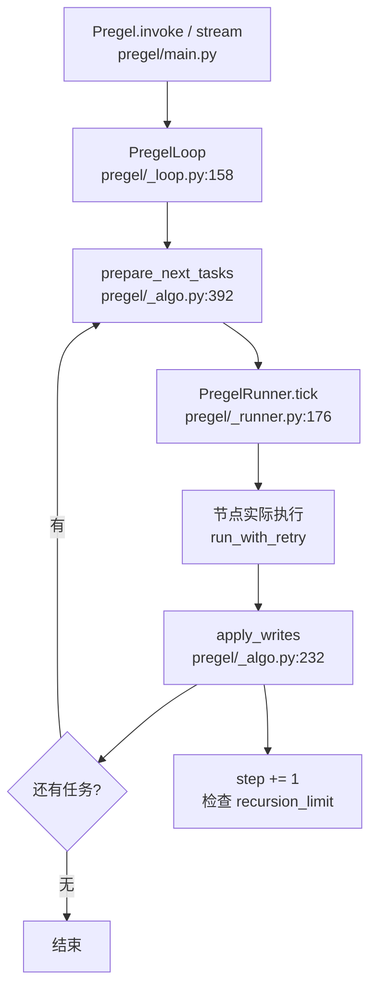

# 源码解析 04：一个 superstep 是怎么被调度出来的

> 对应：[课 4 Pregel 执行模型](../stages/2-执行模型与状态持久化/lessons/04-Pregel%20执行模型.md)
> 📌 源码锚点 @ **langgraph 1.2.11**（本机安装包 `langchain/playground/.venv/lib/python3.12/site-packages/langgraph/`）
> ⚠️ 行号对 1.2.11 有效，升级后须重新核对。

## 为什么要读这一段

课 4 讲了"一批一批跑"这个模型，但那是结论。这一篇回答三个"凭什么"：

1. 凭什么同一批的节点读的是同一份快照？
2. 凭什么"批"的推进是同步的（一批不完，下批不开）？
3. `recursion_limit` 到底在哪一步被检查？

读完之后，课 5 的 checkpoint 与课 9 的 time-travel 会变得非常自然——**因为它们都建立在这个 `step` 计数器上**。

---

## 全景：一次 invoke 的调用链



> 看图：整条链是一个**循环**——每转一圈就是一个 superstep。圈的核心只有两件事：`prepare_next_tasks`（决定这批跑谁）和 `apply_writes`（合并这批的产出）。

---

## 第一站：`prepare_next_tasks` —— 决定这一批跑谁

`pregel/_algo.py:392`

```python [Python 源码摘录 · langgraph 1.2.11 · 不可运行]
def prepare_next_tasks(
    checkpoint: Checkpoint,
    pending_writes: list[PendingWrite],
    processes: Mapping[str, PregelNode],
    channels: Mapping[str, BaseChannel],
    ...
    step: int,
    stop: int,
    ...
) -> dict[str, PregelTask] | dict[str, PregelExecutableTask]:
    """Prepare the set of tasks that will make up the next Pregel step."""
```

> ℹ️ **E5 标注**：这是 `pregel/_algo.py:392` 的**签名摘录**（省略了若干无关参数，因此不能直接运行）。TS 侧对应 `pregel/algo.js` 的 `prepareNextTasks`，参数名全部驼峰化（`pendingWrites` / `step` / `stop`），但**不是公开 API**，没有稳定的对外写法可给，故不做双语改写；本篇的四条结论对两侧都成立。

**三个关键观察**：

| 观察 | 说明 | 对应课 4 结论 |
|---|---|---|
| 参数是 `checkpoint` + `channels` | 它读的是**当前已合并的状态**，不是"正在跑的中间值" | 同一批读同一份快照 |
| 返回的是 `dict[str, PregelTask]` | 一批任务是**一个集合**，不是单个 | 一批里可以有多个节点并行 |
| 有 `step: int` 和 `stop: int` | `stop` 就是 `recursion_limit` 换算出来的终止步号 | 轮数 = 批数 |

> 💡 **对照课 4 实测**：我们观察到"两个节点来回 = 4 批，单节点自转 = 3 批"——差异就来自这里：**每次调用只装一批任务，装完才执行。**

---

## 第二站：`PregelRunner.tick` —— 这一批怎么跑

`pregel/_runner.py:176`

```python [Python 源码摘录 · langgraph 1.2.11 · 不可运行]
def tick(
    self,
    tasks: Iterable[PregelExecutableTask],
    *,
    reraise: bool = True,
    timeout: float | None = None,
    retry_policy: Sequence[RetryPolicy] | None = None,
    get_waiter: Callable[[], concurrent.futures.Future[None]] | None = None,
    schedule_task: Callable[...],
) -> Iterator[None]:
    tasks = tuple(tasks)
    futures = FuturesDict(...)
```

> ℹ️ **E5 标注**：这是 `pregel/_runner.py:176` 的 `PregelRunner.tick` 摘录。TS 侧是 `pregel/runner.js` 的 `PregelRunner.tick`，用 `Promise` + 弱引用回调替代 `FuturesDict`，但"generator 驱动 / 单任务 fast path / 多任务并发"三条结论一致。

**关键观察**：

- 它是一个 **generator**（`yield` 让出控制权），调用方驱动它分阶段推进；
- 有一条 **fast path**：`if len(tasks) == 1 and timeout is None and get_waiter is None:` ——**只有一个任务时不走线程池，直接同步跑**；
- 多个任务时才进 `FuturesDict` 并发调度，并且 `callback=weakref.WeakMethod(self.commit)` ——**每个任务完成时回调 `commit`**。

> 💡 **这解释了课 4 的一个细节**：单节点图不会有任何并行开销；**只有一批里有多个任务时才真正并发**。

---

## 第三站：`apply_writes` —— 这一批的产出怎么合并

`pregel/_algo.py:232`

```python [Python 源码摘录 · langgraph 1.2.11 · 不可运行]
def apply_writes(
    checkpoint: Checkpoint,
    channels: Mapping[str, BaseChannel],
    tasks: Iterable[WritesProtocol],
    get_next_version: GetNextVersion | None,
    trigger_to_nodes: Mapping[str, Sequence[str]],
) -> set[str]:
    """Apply writes from a set of tasks (usually the tasks from a Pregel step)
    to the checkpoint and channels..."""
    # sort tasks on path, to ensure deterministic order for update application
    tasks = sorted(tasks, key=lambda t: task_path_str(t.path[:3]))
```

> ℹ️ **E5 标注**：这是 `pregel/_algo.py:232` 的 `apply_writes` 摘录。TS 侧 `pregel/algo.js` 的 `applyWrites` **同样按 task path 排序**，所以"谁先跑完不影响结果"在 TS 侧一样成立。

**两个关键观察**：

1. **`sorted(...)` 保证确定性**——注释写得很直白：*"sort tasks on path, to ensure deterministic order for update application"*。**这正是课 4 说的"谁先跑完对结果没影响"的保证来源**：合并顺序由 `task_path` 排序决定，不由线程调度决定。
2. `bump_step = any(t.triggers for t in tasks)` ——**只有真正有触发的任务才推进 step 计数**。

> 💡 **对照课 4 实测**：fan1 / fan2 都看到空列表，且最终 `['fan1', 'fan2']` 顺序稳定——就是这两行代码的功劳。

---

## 回到课 3 的问号：`recursion_limit` 在哪被检查

课 3 实测"上限设成 N 就跑满 N 轮"，课 4 说"轮数 = 批数"。源码里的对应物就是 `prepare_next_tasks` 的 `step` 与 `stop`：

- 每转一圈循环，`step` 加一；
- `step` 达到 `stop`（由 `recursion_limit` 换算）时，不再装新任务并抛 `GraphRecursionError`。

而 `stop` 的来源，正是课 3 查到的那一行：

```python [Python 源码摘录 · langgraph 1.2.11 · 不可运行]
# langgraph/_internal/_config.py
DEFAULT_RECURSION_LIMIT = int(getenv("LANGGRAPH_DEFAULT_RECURSION_LIMIT", "10007"))
```

> ℹ️ **E5 标注**：单行常量摘录。⚠️ TS 侧默认是 **25**（不是 10007），配置字段为 `recursionLimit`；本机实测传 `recursion_limit`（下划线）不报错但被忽略、仍按 25 跑。

> ✅ **三处证据串成一条线**：课 3 实测"默认跑 10007 轮" → 源码常量 → 本篇的 `step` / `stop` 计数器。**"轮"就是这里的 `step`。**

---

## 一句话总结

**一个 superstep = 一次 `prepare_next_tasks`（装批）→ `tick`（跑批）→ `apply_writes`（合并）的完整循环**；`step` 计数既是 `recursion_limit` 的计量单位，也是课 5 checkpoint 的存档时机。

## 往下接什么

- **课 5 Checkpointer**：`apply_writes` 之后写的那个 `checkpoint`，就是"短期记忆"的载体。
- **课 9 Time-travel**：既然每个 `step` 都有 checkpoint，回到第 3 步重跑就是"取第 3 步的存档继续"。

## 官方文档

- [LangGraph Graph API overview](https://docs.langchain.com/oss/python/langgraph/graph-api)
- [LangGraph errors: GRAPH_RECURSION_LIMIT](https://docs.langchain.com/oss/python/langgraph/errors/GRAPH_RECURSION_LIMIT)
