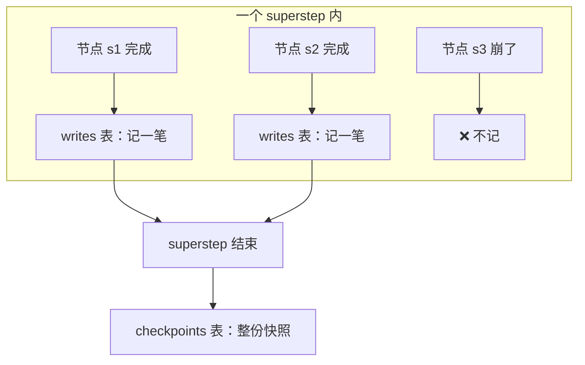
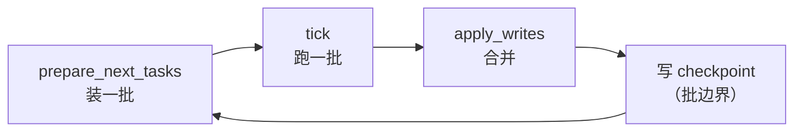

# 源码解析 05：checkpoint 是怎么被写进去的

> 对应：[课 5 Checkpointer 短期记忆](../stages/2-执行模型与状态持久化/lessons/05-Checkpointer%20短期记忆.md)
> 📌 源码锚点 @ **langgraph 1.2.11**（本机安装包 `langchain/playground/.venv/lib/python3.12/site-packages/langgraph/`）
> ⚠️ 行号对 1.2.11 有效，升级后须重新核对。

## 为什么要读这一段

课 5 讲了 checkpoint 的语义（存什么、按什么区分、崩了怎么接），但那是结论。这一篇回答三个"凭什么"：

1. `StateSnapshot` 到底有哪些字段，为什么它能支撑"回放"？
2. 数据库里那两张表（`checkpoints` / `writes`）分别对应什么？
3. 课 4 说的"批"和这里的"存档时机"在代码里是同一样东西吗？

---

## 第一站：`StateSnapshot` —— 快照到底长什么样

`langgraph/types.py:683`

```python [Python 源码摘录 · langgraph 1.2.11 · 不可运行]
class StateSnapshot(NamedTuple):
    """Snapshot of the state of the graph at the beginning of a step."""
    values: dict[str, Any] | Any
    next: tuple[str, ...]
    config: RunnableConfig
    metadata: CheckpointMetadata | None
    created_at: str | None
    parent_config: RunnableConfig | None
    tasks: tuple[PregelTask, ...]
    interrupts: tuple[Interrupt, ...]
```

> ℹ️ **E5 标注**：这是 `langgraph/types.py:683` 的 `StateSnapshot` 定义摘录。TS 侧对应 interface `StateSnapshot<ValuesType>`，八个字段一一对应，只有两处驼峰差异：`created_at` -> `createdAt`、`parent_config` -> `parentConfig`；且 `next` 是 **`string[]` 而非元组**（本机实测 `getState().next` 返回数组）。

**三个关键观察**：

| 观察 | 说明 | 对应课 5 结论 |
|---|---|---|
| 是 `NamedTuple`（不是 dataclass） | 8 个字段**固定且可索引**，不可变 | 快照是"某一时刻的只读切片" |
| 同时有 `config` 和 `parent_config` | **构成一条向前的链** | 课 9 time-travel 的回放结构基础 |
| `next` 是 `tuple[str, ...]` | 下一批要跑的节点（可多个 = 并行） | 与课 4 的"批"语义一致 |

> 💡 `tasks` 字段的注释写着 *"If already attempted, may contain an error"* ——**这就是崩溃后续跑能"知道哪一步失败过"的来源**，对应课 5 知识点 3 的 pending writes 恢复。

---

## 第二站：两张表 —— 整批快照 vs 每格记账

课 5 实测 SQLite 建了两张表：

```
表: ['checkpoints', 'writes']
```

官方文档的说法（核对于 2026-10）：

> 除了 super-step checkpoints，LangGraph 还会**在节点（task）级别**持久化写入。当某个节点在 super-step 内完成时，它的输出会作为 task 条目写入 `checkpoint_writes` 表，链接到进行中的 checkpoint。**完整的状态快照要等 super-step 结束才提交。**



> 看图：每格完成就往 `writes` 记一笔（**这就是崩溃容错的基础**），整个 superstep 跑完才往 `checkpoints` 提交整份快照（**这才是能回放的那个**）。

**两表分工**：

| 表 | 记什么 | 什么时候写 | 用来做什么 |
|---|---|---|---|
| `checkpoints` | 整份 `StateSnapshot` | super-step 结束 | 回放、time-travel、恢复 |
| `writes` | 单个节点的输出 | 节点完成时 | 崩溃恢复（不用重跑成功的节点） |

> 💡 **这解释了课 5 的一个细节**：为什么崩溃后 `history` 里那条消息**已经**在了——`record` 那格完成时就写进 `writes` 了，虽然整个 superstep 还没提交。

---

## 第三站：`th checkpoint` 时机与课 4 的"批"是同一样东西

课 4 源码解析里，我们看到循环是 `prepare_next_tasks` → `tick` → `apply_writes`。官方文档把 checkpoint 时机讲得很明确：

> *"A super-step is a single 'tick' of the graph where all nodes scheduled for that step execute (potentially in parallel)... producing a checkpoint after each one."*



> ✅ **两课在这里严丝合缝**：课 4 讲的"批"就是课 5 讲的"存档时机"。课 4 实测"一次跑完留 4 张快照"，正是这张图转了 4 圈。

---

## 一句话总结

**`StateSnapshot` 是 8 字段的不可变快照，`config`→`parent_config` 串成链；`checkpoints` 存整批、`writes` 存每格；存档时机 = 课 4 那张循环图里 `apply_writes` 之后。**

## 往下接什么

- **课 6 Store 长期记忆**：checkpoint 是 thread 内的；Store 是跨 thread 的。
- **课 9 Time-travel**：`parent_config` 那条链，就是"回到第 3 步重跑"的实现基础。

## 官方文档

- [Checkpointers（Super-steps / Pending writes）](https://docs.langchain.com/oss/python/langgraph/checkpointers)
- [Persistence（Checkpointer vs store）](https://docs.langchain.com/oss/python/langgraph/persistence)
