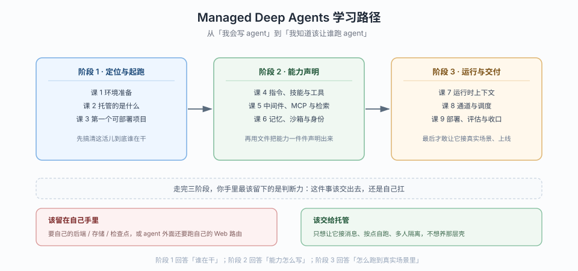

# Managed Deep Agents 学习路径总览

> 本文件是活文档，随学习进度动态调整。阶段依赖图统一用 SVG。

## 🎯 学习目标

- **目标类型**：动手实操（能力实操 + 环境验证）
- **目标说明**：学完能独立把一个 agent 组织成"一个目录的文件"，交给 LangSmith 托管运行；能说清托管替你接管了哪些部件、哪些能力只能声明不能编码、以及在什么情况下该退回自己跑 Deep Agents
- **前置**：已完成 [`../deepagents/`](../deepagents/02-课程目录.md)（4 阶段 / 13 课）与 [`../langchain/`](../langchain/02-课程目录.md)——本教程只提及 `create_deep_agent`、中间件、记忆、子代理等概念，不重讲基础

> 学习目标是全局基准，决定各阶段/课的取舍与实操比重。

## 故事主线

- **主角**：一个已经把 deep agent 跑在本地的开发者，遇到了"这东西只能我在自己机器上跑"的天花板
- **冲突**：agent 逻辑已经写好了，但要给别人用，就得自己搭服务、管密钥、接 Slack、写定时任务、维护沙箱——这些跟"让 agent 变聪明"一点关系都没有，却占掉八成工作量
- **收束**：把"agent 是什么"和"agent 跑在哪"彻底分开——前者写成目录里的文件，后者交给平台；**从"我会写 agent"到"我知道该让谁跑 agent"**

> 整个课程是这条故事线的展开，每个阶段是故事的一个"章节"，每课是章节中的一个"情节"。

## 学习路径图

> 看图：横轴三个阶段是三道路障——先搞清托管到底接管了什么（阶段 1），再学会用文件声明能力（阶段 2），最后才敢让它接真实渠道、按点自跑、上线交付（阶段 3）。右下角的分叉是本课程的出口判断：不是所有 agent 都该托管。

## 阶段总览

### 阶段 1：定位与起跑

- **目标**：说清 MDA 与 Deep Agents / LangChain Agent Server 的三层关系；跑通两侧脚手架并编译出可本地预览的项目
- **学习重点**：`define` 只产定义不产 agent 的设计动因、项目目录如何替代参数调用、`create_deep_agent` 与 `define_deep_agent` 的参数映射、脚手架语言由安装渠道决定这一实测坑
- **必须掌握**：能画出"作者写定义 → CLI 编译 → 运行时注入部件 → 部署"的四段链路；能解释为什么 `mda build` 通过不代表定义写对了；能独立生成两侧项目并跑通 `mda dev` 到"等模型 key"这一步
- **对应课**：课 1（环境准备）、课 2（托管的是什么）、课 3（第一个可部署项目）

### 阶段 2：能力声明

- **目标**：用文件把 agent 的能力一件件声明出来——指令、技能、工具、中间件、MCP、记忆、沙箱、身份
- **学习重点**：每类能力的落点文件与生效时机、托管预制中间件与作者中间件的顺序、双记忆层的挂载路径与默认拒绝策略、沙箱与权限的互斥
- **必须掌握**：能说清"这件事该写进 instructions、skills 还是 memory"；能解释为什么声明 `sandbox/` 会清掉 `permissions`；能配出"团队共享记忆 + 个人私有记忆"且说清默认策略为何这样设
- **对应课**：课 4（指令、技能与工具）、课 5（中间件、MCP 与检索）、课 6（记忆、沙箱与身份）

### 阶段 3：运行与交付

- **目标**：让 agent 跑在真实场景里——接消息渠道、按 cron 自跑、读运行时上下文做权限判断，最后部署并评估
- **学习重点**：`context` / `principal` / `channel` 三个来源与信任级别、工厂必须幂等的四条约束、通道运行 `context` 为 `None` 的根因、部署十一条步骤与 Context Hub 冲突处理
- **必须掌握**：能判断"这段判断该信哪个字段"，绝不把 `context` 当鉴权依据；能设计一个 Slack 入口 + 每日调度的 agent 并说清线程是临时还是持久；能对着迁移清单判断一个既有 agent 能不能迁
- **对应课**：课 7（运行时上下文）、课 8（通道与调度）、课 9（部署、评估与收口）

## 覆盖边界（明确不讲）

- **LangSmith 平台本身的完整使用**（项目管理、数据集、标注队列）：只在课 9 讲与部署/评估的接入点
- **Harbor 评估框架的细节**：官方只提供 `mda evals init` 的交接流程，本教程讲"怎么起手"，不讲评测算法
- **前端定制**：`custom-frontend` 一页只在课 9 定位级提及，不展开（属 UI 集成）
- **Slack 应用的市场审核流程**：属平台运营事务，非技术内容

## 当前进度

- [x] 阶段 1：定位与起跑（课 1-3 已完成）
- [x] 阶段 2：能力声明（课 4-6 已完成）
- [x] 阶段 3：运行与交付（课 7-9 已完成）
- [x] 结课综合实战项目（[projects/值班研究助手](./projects/值班研究助手/README.md)）
- [x] 课程手册汇总（[final-课程手册.md](./final-课程手册.md)）
- [x] 收尾产物：实战经验（[08](08-实战经验.md)）/ 排障速查手册（[09](09-排障速查手册.md)）/ 场景解法库（[INDEX](场景解法库/INDEX.md)）
- [x] 随课产物：应用实战 4 篇（[INDEX](应用实战/INDEX.md)，课 2 / 4 / 6 / 7，8 张分步设计图）/ 源码解析 2 篇（[INDEX](源码解析/INDEX.md)，课 2 / 7，每篇 Mermaid + SVG 各 1）/ TS 实操工程 [playground-ts/](playground-ts/README.md)（9 脚本 + 9 份输出存档 + [跨语言差异表](playground-ts/API-MAPPING.md)）/ 官方文档索引 [web-index/](web-index/INDEX.md)（Python + TS 各 29 页，58 条 URL 实测可达）
- [ ] 知识点对齐收口：[round-01](./知识点对齐记录/round-01.md) 6 题已出、**待作答**——正确率与错题知识点要等答题后才能回填

> 进度以 [00-学习档案.md](./00-学习档案.md) 的知识点级进度表为准。
