# Managed Deep Agents 课程手册（最终交付）

> **本手册是全课程的收口件**：一张全局地图 + 9 课各自最硬的结论 + 一个可运行的综合实战项目。
> 主线 3 阶段 9 课 ✅ 全部完成 ｜ 知识点 **27 / 27** ✅ ｜ 综合实战项目 ✅ 可构建通过
> 生成日期：2026-10-27 ｜ 学习目标：**动手实操** ｜ 基线：`managed-deepagents 0.9.5`（Python 主线 / TypeScript 平行线）

## 这份手册怎么用

它不是第 10 课，不重讲任何内容。它做六件事：给一张地图、把 9 课各压成一条最硬的结论、保留每课的入口与复盘图、末尾指向能真跑的工程、收 4 篇应用实战与 2 篇源码解析的入口。

| 你的目的 | 看哪里 |
|---------|--------|
| 快速回忆全课讲了什么 | [一、全课程地图](#一全课程地图) → [四、9 课速览](#四9-课速览每课最硬的一条) |
| 忘了某课的细节 | 按阶段找到该课，看「入口四要素 + 一图总结 + 核心结论」，再点课全文 |
| 只想知道最该记住的几条 | [三、五条元结论](#三五条元结论) |
| 想动手把知识焊成能力 | [五、综合实战项目：值班研究助手](#五综合实战项目值班研究助手) → [七、应用实战](#七应用实战) |
| 想知道"这套机制内部长什么样" | [八、源码解析](#八源码解析) |
| 忘了某条命令怎么写 | [六、命令与产物速查](#六命令与产物速查) |
| 想知道「这件事该不该交给托管」 | [课 9 迁移四门槛](#课-9部署评估与收口) → 项目 [`设计决策.md`](./projects/值班研究助手/设计决策.md) 决策 3 |
| 线上出问题了 | 本手册只到"该查哪一步"；逐症状排障见 Phase 5 的 `09-排障速查手册.md` |

> ⚠️ **本手册的每课章节是"复习用压缩版"**，不是原文。所有细节、实验过程、源码证据都在课全文里，每课末尾都给了直达链接。

---

## 一、全课程地图


> 看图：横轴三个阶段是三道路障——先搞清托管到底接管了什么（阶段 1），再学会用文件声明能力（阶段 2），最后才敢让它接真实渠道、按点自跑、上线交付（阶段 3）。右下角的分叉是本课程的出口判断：不是所有 agent 都该托管。

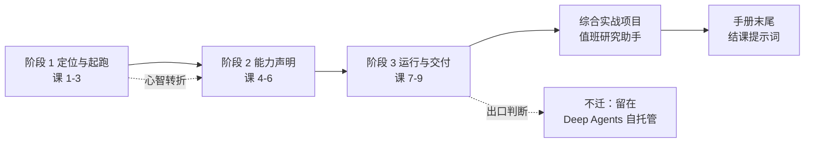

| 块 | 解决什么 | 入口 |
|----|---------|------|
| 3 阶段 9 课 | 从"我会写 agent"到"我知道该让谁跑 agent" | [02-课程目录](./02-课程目录.md) |
| 综合实战项目 | 跨 3 阶段的可构建工程（12 文件） | [projects/值班研究助手/README.md](./projects/值班研究助手/README.md) |
| 官方文档索引 | Python / TypeScript 各 29 页的路由表 | [web-index/](./web-index/INDEX.md)（两份均已建成，58 条 URL 实测可达） |
| 实战经验 / 排障手册 / 场景解法库 | 崩了怎么查、新需求怎么设计 | [08-实战经验](./08-实战经验.md) ｜ [09-排障速查](./09-排障速查手册.md) ｜ [场景解法库](./场景解法库/INDEX.md) |
| TS 实操工程 | 课文双语块的可执行旁证 + 跨语言差异表 | [playground-ts/](./playground-ts/README.md) |

**故事主线**：主角是一个已经把 deep agent 跑在本地的开发者，撞上"这东西只能我在自己机器上跑"的天花板；冲突是给人用就得自己搭服务、管密钥、接 Slack、写定时器——这些跟"让 agent 变聪明"毫无关系却占掉八成工作量；收束是把"agent 是什么"和"agent 跑在哪"彻底分开。

### 阶段总览

| 阶段 | 主题 | 本阶段回答 | 必须掌握 | 对应课 |
|------|------|-----------|---------|--------|
| 1 | 定位与起跑 | 托管到底接管了哪一半？谁编译、谁拥有运行时 | 能画出"作者写定义 → CLI 编译 → 运行时注入部件 → 部署"四段链路；能解释 `build` 通过 ≠ 定义写对 | 课 1-3 |
| 2 | 能力声明 | 能力怎么写成文件？写在哪、什么时候生效 | 能说清"这事该写进 instructions、skills 还是 memory"；能解释声明 `sandbox/` 为何清掉 `permissions` | 课 4-6 |
| 3 | 运行与交付 | 怎么接真实渠道、按点自跑、上线并判断该不该搬 | 绝不把 `context` 当鉴权；能设计 Slack + 调度并说清线程策略；能对着四门槛判断可否迁移 | 课 7-9 |

**三个阶段的递进关系**（一句话）：阶段 1 让你**看懂**这张配置清单，阶段 2 让你**填满**它，阶段 3 让它**真的跑起来并交付**。阶段 1 的课 2 是整门课的心智转折点——跳过它直接抄代码，后面每一步都会困惑"为什么我拿不到对象"。

---

## 二、覆盖边界（明确不讲）

配合 [01-学习路径总览.md](./01-学习路径总览.md) 的声明，这些内容本课程不展开，别在手册里找：

- **LangSmith 平台本身的完整使用**（项目管理、数据集、标注队列）：只在课 9 讲与部署/评估的接入点
- **Harbor 评估框架的细节**：官方只提供 `mda evals init` 的交接流程，本课程讲"怎么起手"，不讲评测算法
- **前端定制**：`custom-frontend` 一页只在课 9 定位级提及，不展开
- **Slack 应用的市场审核流程**：属平台运营事务，非技术内容

---

## 三、五条元结论

> 9 课压到最后，真正能迁移到下一个项目的只有这五条。每条都能在课里找到证据。

**1. 托管的本质是"把编译权交出去"。** `define_deep_agent` 返回的是 frozen 配置，不是 runnable——因为它根本不在你的进程里编译。这一条推出后面所有写法：提示词只能放文件、`backend` 拿不到、`build` 通过不代表能跑。你写的是**平台的输入格式**，不是程序。

**2. 声明 ≠ 生效，而且失败大多是静默的。** 这是本课程最贵的一课。`skills/` 下嵌套一层目录、`tools/foo.py` 没在入口点名、`runtime` 参数忘标类型、`frontmatter` 缺字段、`sandbox/` 与 `permissions` 并存、`user` 记忆在 API key 身份下、`cron` 不写时区——**以上全部 `exit=0`**。攒够这套清单，比记住参数表有用得多。

**3. 能判权限的只有一个字段：`server_info.principal`。** `context` 是调用方自己填的登记本（只用来选行为），`channel` 是撕不掉的快递单（只用来认来源）。更狠的一层：工厂的运行时类型里**根本没有** `server_info`——你想在选配置时判权限都做不到，这是类型层面的强制。

**4. 平台给你的每一份便利，都对应一处你失去的控制权。** 沙箱只有一种（且会清掉 `permissions`）、记忆从空树起步、中间件改不了 backend/store/checkpointer/memory/skills/system prompt、MCP 只支持 HTTP/SSE、0.9 删了四个 MCP 配置项。判断"该不该用托管"，本质是判断"这些失去的控制权你需不需要"。

**5. 命令退出码不是交付。** `mda build` 出口 0 只代表编译通过，`harbor run` 满分只代表这套题能过，`mda deploy` 成功只代表地址活着。交付是三个问题：**送没送到、做对没有、该不该送**。三句都要答。

---

## 四、9 课速览：每课最硬的一条

> 每课给：文档核对留痕 → 入口四要素（本质 / 处境 / 全局图 / 地图）→ 知识点结论 → 一图总结 → 常见误区 → 官方文档 → 课全文。
> 图、"一句话本质"与核对留痕行均为课内原文搬运，未改写。

### 阶段 1：定位与起跑（课 1-3 · 7 知识点）

> 本阶段回答：托管到底接管了哪一半？我写的东西为什么不能直接 `invoke`？
> [阶段概览](./stages/1-定位与起跑/overview.md) ｜ [阶段路径图](./stages/1-定位与起跑/assets/stage-01-foundation-path.svg)

#### 课 1：环境准备

> 所属阶段：阶段 1《定位与起跑》｜ 水平：入门 ｜ **已有环境可跳过**
> 📖 结论已按官方文档核对（核对于 2026-10 ｜ 来源：`/langsmith/python/managed-deep-agents-quickstart`、`-cli`、`-local-development`）
> ✅ 本节安装与验证命令实测于 Linux / Python 3.12.3 / Node v22.22.2 / uv 0.11.6 / `managed-deepagents 0.9.5`

> 📌 **本课为操作课，按轻量结构**（不走完整五幕），入口四要素按规范豁免——操作课没有"冲突"可设，也不硬画"一眼全局图"。

**知识点**：装什么（最小集）· 两侧脚手架怎么生成 · 验证与常见坑

**核心结论**：

1. **脚手架语言由安装渠道决定**——`uvx --from managed-deepagents mda init` 只生成 Python 项目，`npx managed-deepagents init` 只生成 TS 项目。官方原话：**"A CLI installed from PyPI refuses a TypeScript project."** 这是双语读者第一个会踩的坑。
2. **两侧项目结构不同**：Python 侧 `sandbox/__init__.py` + `pyproject.toml`；TS 侧 `sandbox/index.ts` + `package.json` + `tsconfig.json`；两侧都有 `instructions.md`、`identity.*`、`.env`、`.gitignore`。
3. **不用装 LangSmith SDK / LangGraph 本体 / 沙箱 provider SDK**——随包或由运行时提供。**本课程不要求一开始就有 LangSmith 账号**：`mda build` 与 `mda dev` 启动阶段无密钥可跑通。
4. **四项验证全绿才算就绪**：`uv --version` → `uv run mda --version`（`mda 0.9.5 (…)`）→ `uv run mda build`（`◇ Managed app compiled`）→ `ls .mda/build/langgraph.json`。

⚠️ **高频坑**：`mda init` 会自己建目录且拒绝覆盖——别先 `mkdir`；想要 `agent.ts` 必须走 `npx`；`mda dev` 启动报 `cannot find uv` 是因为它靠 `uv` 拉起本地 LangGraph dev server（TS 侧同样需要）。

**📚 官方文档**

- [Quickstart](https://docs.langchain.com/langsmith/python/managed-deep-agents-quickstart)（脚手架生成的两条渠道）
- [CLI](https://docs.langchain.com/langsmith/python/managed-deep-agents-cli)（`mda init` / `build` / `dev` / `deploy` 参数）｜ [TypeScript 页](https://docs.langchain.com/langsmith/javascript/managed-deep-agents-cli)
- [Local development](https://docs.langchain.com/langsmith/python/managed-deep-agents-local-development)（`mda dev` 的前置条件）

> 📖 [课 1 全文](./stages/1-定位与起跑/lessons/01-环境准备.md)

#### 课 2：托管的是什么

> 📖 结论已按官方文档核对（核对于 2026-10 ｜ 来源：`/langsmith/python/managed-deep-agents-overview`、`-agent-definition`、`-project-structure`、`-migrate` 及其 JavaScript 对应页）＋ 本机实测（`managed-deepagents 0.9.5`）

> 📌 **一句话本质**：把「这个 agent 要什么」和「谁来把 agent 造出来、跑起来」拆成两件事——你只负责前者，后者交给平台。
> ⚖️ **处境对照**：自己跑 Deep Agents 时，除了 agent 逻辑，你还得自己造 backend、store、checkpointer，再把服务、Slack 接入、定时器、沙箱一件件接上；托管把这些压成项目里的几个文件，部署一条 `mda deploy` 就完。代价是你在大约四个地方失去了控制权，并且**你写的东西从「能跑的对象」降级成「一份配置」**——写完不能立刻 invoke，得先过 CLI。

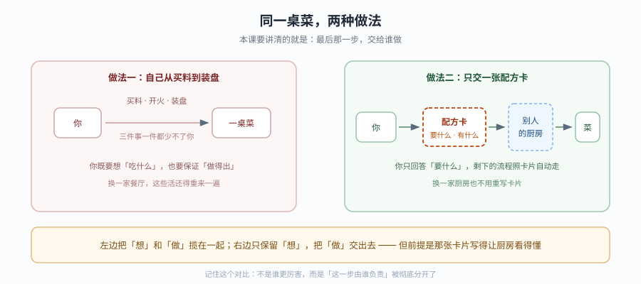

> 看图：左边一个人从买料到装盘全包，菜是出来了，但换一家餐厅这些活还得重来；右边只交一张配方卡，厨房照卡做菜。差别不在"谁更厉害"，而在**"做"这一步被彻底交出去了**——代价是那张卡必须写到厨房看得懂。

| 步 | 这一步要解决什么（人话） | 对应知识点 |
|:--:|------------------------|-----------|
| 1 | 先搞清"谁在什么时候把配置变成能跑的东西"，你就不会再找 `invoke` | 知识点 1：定义与编译分离 |
| 2 | 再搞清"它到底读我哪些文件"，你才知道能力该写在哪 | 知识点 2：项目即配置 |
| 3 | 最后搞清"这条边界该不该跨"，你才知道这个 agent 要不要搬 | 知识点 3：与 Deep Agents 的边界 |

**知识点结论**：

1. **定义与编译分离** — `define` 交的是图纸，`mda build` 只验图纸格式，房子要等运行时按图施工才立起来。`define_deep_agent` 返回 frozen 配置而非 runnable，这正是"定义阶段拿不到 backend"的原因。
2. **项目即配置** — 项目文件分**三类生效机制**，这是本课最该背下来的东西：① 存在即生效（`sandbox/` `identity.py` `memory.py` `tools/mcp.py` `channels/` `schedules/`）；② 需点名才生效（`tools/` 其他文件必须 `import` 并传入 `tools=[...]`，`middleware/` 同理）；③ 编译期拼入（`instructions.md`）。`channels/` 和 `schedules/` **只看直接子文件**，嵌套目录不算。
3. **与 Deep Agents 的边界** — 同一套 harness，差别窄到一句话：「谁编译 agent」。四类不可迁移：自定义 `BackendProtocol`、依赖特定 `store`/`checkpointer`、自定义 HTTP 路由、Python 侧 `state_schema`。

**一图总结**

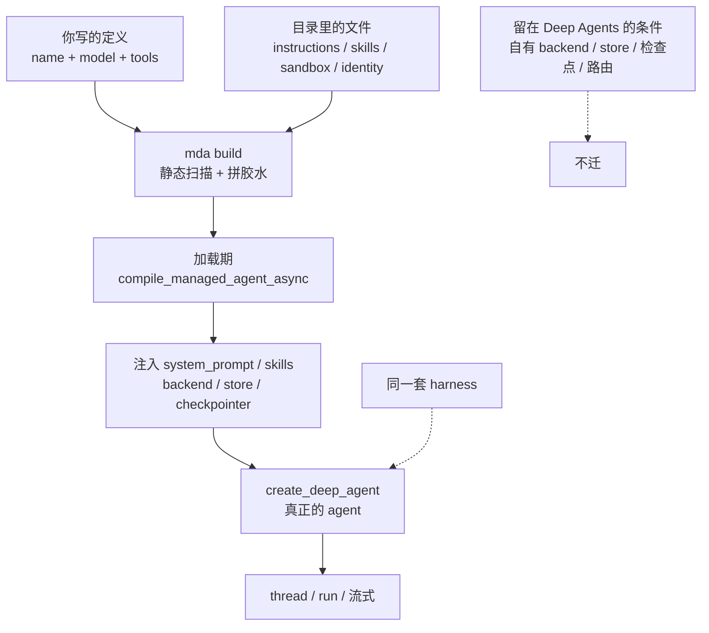

**⚠️ 常见误区**

1. **"`define` 就是 `create` 改个名字"** — 参数表高度重合，但少了运行时拥有的那一半，还多一个必填静态 `name`；返回对象从 runnable 降级成 frozen 配置。
2. **"`mda build` 是编译，编译过就能跑"** — build 是静态打包与文本校验，不 import 你的模块。真正的编译在 `create_deep_agent` 那一刻。
3. **"目录里有文件就等于有能力"** — 只对"存在即生效"那一类成立。
4. **"迁移要重写 agent"** — 工具、中间件、子代理原样带走。

**⏳ 与过时说法对照**（四条里三条只能实测发现）

| 旧说法（文档字面 / 训练知识） | 实测现状（2026-10，`0.9.5`） |
|---|---|
| `name` 只能含字母、数字、下划线、连字符 | `/`、空格、`.`、多余下划线被**静默归一化成连字符**并转小写，只硬拦"首字符非字母" |
| 静态定义"不能设" `instructions`/`skills`/`mcp`/`sandbox` | `define_deep_agent` **接受**这些参数，是 `mda build` 的静态检查拦下来；工厂入口完全合法 |
| `define_memory(scope="agent")` | `0.9.5` 抛 `ValueError: 'scope' must be a list of layers`；memory 页用 `agent=MemoryLayer()` |
| TS 侧把 Python 的 `system_prompt` 照抄过去 | `systemPrompt` 被拦，但 **`system_prompt`（下划线）被静默接受**并写进 config，build 绿灯 |

**📚 官方文档**

- [Define a Managed Deep Agent](https://docs.langchain.com/langsmith/python/managed-deep-agents-agent-definition)（参数表与 "does not compile" 原话）｜ [TypeScript 页](https://docs.langchain.com/langsmith/javascript/managed-deep-agents-agent-definition)
- [Project structure](https://docs.langchain.com/langsmith/python/managed-deep-agents-project-structure)（生成物与发现规则）
- [Context Hub](https://docs.langchain.com/langsmith/python/managed-deep-agents-context-hub)（同步与冲突规则）

> 📖 [课 2 全文](./stages/1-定位与起跑/lessons/02-托管的是什么.md)

#### 课 3：第一个可部署项目

> 📖 结论已按官方文档核对（核对于 2026-10 ｜ 来源：`/langsmith/python/managed-deep-agents-agent-definition`、`-project-structure`、`-local-development`、`-cli` 及其 JavaScript 对应页）＋ 本机实测（`managed-deepagents 0.9.5`，Python 主线 / TS 平行线各一套探针）

> 📌 **一句话本质**：把"agent 长什么样"落成一份平台认的清单——本课把这份清单从"能编译"推进到"本地能点开"，但仍没到"能真实干活"。
> ⚖️ **处境对照**：在 Deep Agents 里，你 `create` 完就能 `invoke`，模型写错立刻见分晓；MDA 里模型名称、集成包、密钥要一次配齐，缺任何一环都会推迟到"碰真模型"的那一刻才报错。代价是配置在"能编译"与"能跑"之间多了好几道看不见的检查。


> 看图：左边一个人自己把包裹送到对方手里，运的过程全是自己的；右边只填一张发货单，把"送"整套交出去。差别不在货物，而在**"你把什么交给别人、什么必须自己写清楚"**——写单子时，那几行字段一笔都不能糊。

| 步 | 这一步要解决什么（人话） | 对应知识点 |
|:--:|------------------------|-----------|
| 1 | 先搞清"入口文件到底要长什么样、名字有什么讲究"，你就不会为 `name is required` 白折腾 | 知识点 1：定义入口与命名 |
| 2 | 再搞清"model 那行该怎么写、密钥从哪来"，你才知道为什么少了前缀就报错 | 知识点 2：模型与 provider 前缀 |
| 3 | 最后搞清"build 绿灯到底证明了什么"，你才知道什么时候该相信本地、什么时候必须走部署 | 知识点 3：编译与本地预览 |

**知识点结论**：

1. **定义入口与命名** — 单子第一行叫 `name`：必须是**直接可见的字面量**、必须导出成 `agent`、一个项目只能有一份；改它 = 换机器。
2. **模型与 provider 前缀** — `model` 原样存字符串，**`build` 不解析**；加载期 `init_chat_model` 才解析，`opnai:` 这类拼错在 build 绿灯、加载期才 `ValueError: Unable to infer model provider`。集成包与密钥构成"先包后密钥"两个条件。
3. **编译与本地预览** — 三层信任：`build`（静态文本扫描）→ `dev`（真编译 + 起本地 server）→ `deploy`（真相：模型真实调用、调度触发、通道收发）。

**一图总结**

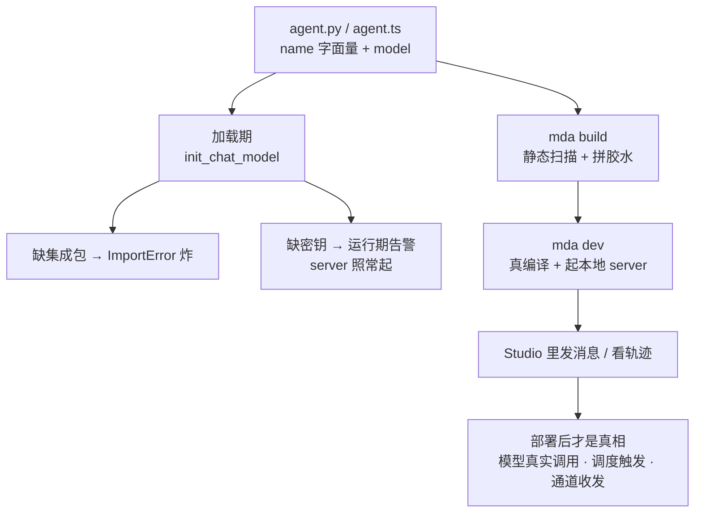

**⚠️ 常见误区**

1. **"`mda build` 是编译，编译过就能跑"** — build 只查参数托管与 name 字面量；import、包、密钥全不查。
2. **"model 省掉前缀没关系"** — build 不拦，加载期报 `Unable to infer model provider`。
3. **"集成包装好一次就完了"** — 集成包 + `.env` 密钥一起构成可跑条件。
4. **"本地 dev 跑通 = 部署没问题"** — 本地读 `.env`、部署读 workspace secrets，两套凭据互不通用。

**⏳ 与过时说法对照**

| 旧说法 | 实测现状（2026-10，`0.9.5`） |
|---|---|
| "`mda build` 能验证我的定义" | 只查参数托管与 name 字面量；import、包、密钥全不查（坏 import 仍绿灯） |
| "模型名写错会被马上发现" | build 原样存字符串，加载期才 `ValueError` |
| "name 同样规则约束两侧" | 不对称：Python 必须字面量、**TS 可用变量** |
| "缺模型密钥会挡住启动" | `mda dev` 照起、只告警 `Runs fail until then`，补 `.env` 保存即热加载 |

**📚 官方文档**

- [Define a Managed Deep Agent](https://docs.langchain.com/langsmith/python/managed-deep-agents-agent-definition)（entry 位置 + name 参数表）｜ [TypeScript 页](https://docs.langchain.com/langsmith/javascript/managed-deep-agents-agent-definition)
- [Project structure](https://docs.langchain.com/langsmith/python/managed-deep-agents-project-structure)（"The only required file" 原话）
- [Local development](https://docs.langchain.com/langsmith/python/managed-deep-agents-local-development) ｜ [CLI](https://docs.langchain.com/langsmith/python/managed-deep-agents-cli)

> 📖 [课 3 全文](./stages/1-定位与起跑/lessons/03-第一个可部署项目.md)

---

### 阶段 2：能力声明（课 4-6 · 9 知识点）

> 本阶段回答：能力怎么写成文件？八种落点各自什么时候生效、在哪会静默失效？
> [阶段概览](./stages/2-能力声明/overview.md) ｜ [阶段路径图](./stages/2-能力声明/assets/stage-02-capabilities-path.svg)

**本阶段总命题**：能力不靠调 API 开启，靠**放对文件**开启。课 4 处理"说什么 / 会什么 / 能做什么"，课 5 处理"插在链路哪一段"，课 6 处理"记住什么 / 在哪动手 / 代表谁"。

#### 课 4：指令、技能与工具

> 📖 结论已按官方文档核对（核对于 2026-10 ｜ 来源：`/langsmith/python/managed-deep-agents-instructions`、`-skills`、`-tools`、`-runtime` 及其 JavaScript 对应页）＋ 本机实测（`managed-deepagents 0.9.5`，Python 主线 / TS 平行线各一套探针）

> 📌 **一句话本质**：MDA 声明能力的方式不是调 API，而是**把文件放到约定位置**；但"放对位置"只对指令成立，技能还要标签写对，工具还要入口点名。
> ⚖️ **处境对照**：在 Deep Agents 里，你给 `create_deep_agent` 传 `system_prompt`、传 `tools=[...]`，一个参数就到位，写错立刻报错。MDA 里这些全变成"文件约定"，好处是配置可以版本化、可以在 UI 里改；代价是**约定写错时没人拦你**——构建绿灯、agent 起来、只是不做你想要的事。

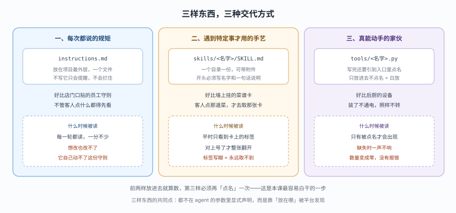

> 看图：三个并排的方框，分别对应"每次都说的规矩""遇到特定事才用的手艺""真能动手的家伙"。每个框上半部写"放在哪"，下半部写"什么时候被读"。请只注意底部那行总结：前两样放进去就算数，第三样还得再点名一次。

| 步 | 这一步要解决什么（人话） | 对应知识点 |
|:--:|------------------------|-----------|
| 1 | 先搞清"那份谁都该看的规矩该写在哪"，你就不会为 `instructions` 报错白折腾 | 知识点 1：指令即系统提示 |
| 2 | 再搞清"按场景切换的手艺怎么放、标签怎么写"，你才知道为什么技能像是"不存在" | 知识点 2：技能目录与渐进披露 |
| 3 | 最后搞清"能干活的工具怎么装才算装上"，你才知道文件在了为什么还是调不到 | 知识点 3：自定义工具与运行上下文 |

**知识点结论**：

1. **指令即系统提示** — `instructions.md` 是贴在墙上的员工守则：放根目录、每轮必读、agent 改不了、缺了只提醒不拦。它编译期拼进 prompt，所以**不能按运行变化**；要按运行换必须走工厂入口，静态 agent 直接拒绝（`Remove instructions from define_deep_agent(...)`，exit=1）。
2. **技能目录与渐进披露** — 只认 `skills/` 的**一层**子目录（两层目录的 `SKILL.md` 被静默漏掉，实测 `discovered: ['flat']`）。frontmatter 必须 `name` + `description` 齐全，缺任一或无 frontmatter 时**整张静默跳过**，build exit=0。模型只看 `name` + `description`，选中才读正文。要分组用名字前缀，不要嵌套。
3. **自定义工具与运行上下文** — `tools/` 下除 `mcp.py` 外都是**普通模块**，必须在入口 `import` 并传入 `tools=[...]`，否则 config 里连 `tools` 这个键都没有（硬取 `KeyError`，`config.get("tools")` 才是 `None`）。`runtime` 参数不标 `ManagedToolRuntime[T]` 会漏进模型参数表（`['q','runtime']`）。**泛型顺序两侧相反**：Python `[Context, State]`、TS `<State, Context>`。

**一图总结**

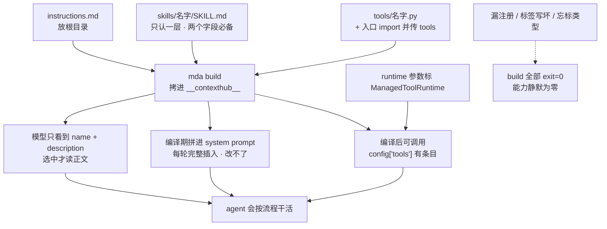

**⚠️ 常见误区**

1. **"三个文件放好就都生效了"** — 只有 `instructions.md` 是这样。
2. **"构建绿灯就说明能力配好了"** — 缺 instructions、空技能目录、坏 frontmatter、漏注册工具、runtime 忘标类型**全部 exit=0**。
3. **"`context` 里可以放权限"** — 客户端能自己写，identity 相关键还会被剥离；授权只看 `server_info.principal`。
4. **"技能目录可以按分组嵌套"** — 只认一层。

**⏳ 与过时说法对照**（七条全部实测，三条文档看不出）

| 旧说法 | 实测现状（2026-10，`0.9.5`） |
|---|---|
| "instructions 可以像 system_prompt 一样传参" | 静态 agent 直接拒绝 exit=1；只有工厂入口能按运行选 |
| "缺 instructions 会报错" | 只出 Build warnings，exit=0 |
| "技能放在 skills/ 下就会被发现" | 只扫一层；两层目录被静默漏掉 |
| "frontmatter 缺字段会报错" | 缺 name / 缺 description / 无 frontmatter 全部整张跳过 |
| "tools/ 下写好工具就自动可用" | 必须入口 import + 传 `tools`；漏了 config 里没有 `tools` 键（硬取 `KeyError`） |
| "runtime 参数标不标类型无所谓" | 不标就漏进模型参数表 |
| "Python 和 TS 的 ManagedToolRuntime 泛型一样" | **相反**：Python `[Context, State]`、TS `<State, Context>` |

**📚 官方文档**

- [Add instructions](https://docs.langchain.com/langsmith/python/managed-deep-agents-instructions)（位置 + 部署同步 + 三角关系表）｜ [TypeScript 页](https://docs.langchain.com/langsmith/javascript/managed-deep-agents-instructions)
- [Skills](https://docs.langchain.com/langsmith/python/managed-deep-agents-skills) ｜ [TS 页](https://docs.langchain.com/langsmith/javascript/managed-deep-agents-skills) ｜ [Deep Agents skills（底层）](https://docs.langchain.com/oss/python/deepagents/skills)
- [Custom tools](https://docs.langchain.com/langsmith/python/managed-deep-agents-tools) ｜ [TS 页](https://docs.langchain.com/langsmith/javascript/managed-deep-agents-tools)
- [Context Hub](https://docs.langchain.com/langsmith/python/managed-deep-agents-context-hub)

> 📖 [课 4 全文](./stages/2-能力声明/lessons/04-指令技能与工具.md)

#### 课 5：中间件、MCP 与检索

> 📖 结论已按官方文档核对（核对于 2026-10 ｜ 来源：`/langsmith/python/managed-deep-agents-middleware`、`-mcp-connectors`、`-search`、`-connections`、`-runtime` 及其 JavaScript 对应页）＋ 本机实测（`managed-deepagents 0.9.5`）

> 📌 **一句话本质**：中间件是"在过程里加一层"，MCP 是"从外面借一批工具"，检索是"平台已经养好一个工具"。前者能被绕过（写错就抛错），后两者会挤占模型的工具清单。
> ⚖️ **处境对照**：在裸 Deep Agents 里，加中间件就是 `middleware=[...]`，加 MCP 要自己起 MCP client 并转成工具，加搜索要自己接 Tavily/SerpAPI 并管密钥。MDA 把后两件收走了：MCP 只剩一个声明文件，搜索连密钥都不用申请——代价是你能调的东西变少了。


> 看图：一条横线代表一次用户请求。三个彩色框分别是"用户提问之后""模型决策之后""工具执行"三个位置。虚线框是能改过程的（中间件），实线框是能加能力的（MCP 与检索）。请只注意底部那行字：前者管过程、后者管菜单。

| 步 | 这一步要解决什么（人话） | 对应知识点 |
|:--:|------------------------|-----------|
| 1 | 搞清"插在过程里的那层"怎么写、谁在外面、为什么必须 async | 知识点 1：中间件注入点与执行顺序 |
| 2 | 搞清"从别人服务器借工具"怎么声明，以及文档里哪些选项已经没了 | 知识点 2：MCP 连接器声明 |
| 3 | 搞清"平台替你养的工具"怎么开，以及密钥到底放在哪一层才安全 | 知识点 3：内置检索与凭据边界 |

**知识点结论**：

1. **中间件注入点与执行顺序** — 是**嵌套**不是队列：`[a, b]` 进入 a→b、退出 b→a，第一个是最外层。托管层还会前置凭据闸门和调度投递件，所以"我在最外层"通常是错的——要精确控制边界靠钩子内判断而非位置。钩子**必须 async**，同步钩子抛 `NotImplementedError` 且 build 不拦、运行期才炸。中间件改不了 backend / store / checkpointer / memory / skills / system prompt 六样托管资产。
2. **MCP 连接器声明** — 只声明不需 import（`tools/mcp.py` 是"存在即生效"的唯一例外）。只支持 HTTP/SSE。**0.9.5 已删四个选项**：工具名前缀开关、整体超时 `default_tool_timeout`、SSE 回退、`reconnect`。工具名是 `{server}_{tool}`（**单下划线**，源码 `fastmcp/client/group.py:248`）。校验分三期：导入期 pydantic（transport / 白黑名单）、建图期真连远端、运行期。
3. **内置检索与凭据边界** — 检索是平台替你养好的一个 MCP（Parallel），不用申请第三方密钥，但要套餐、不能加自定义头。核心是 **agent-owned 与 user-owned 一字之差**："共用钥匙"还是"各开各门"。user-owned 配错**不报错**——缺授权抛 interrupt，最坏情况所有人共用一个身份，外部看一切正常。

**一图总结**

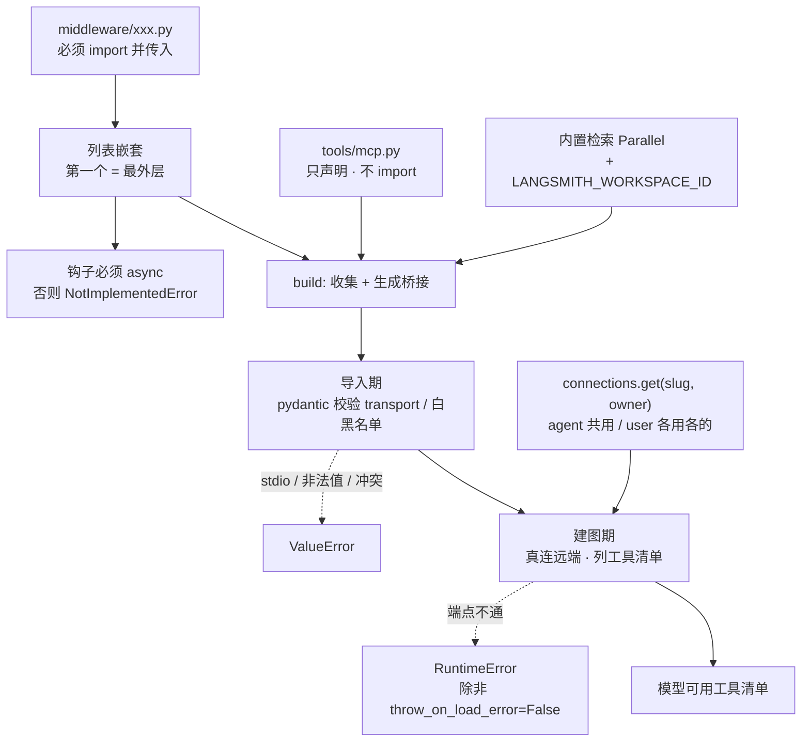

**⚠️ 常见误区**

1. **"middleware 是队列，按顺序各跑一遍"** — 是嵌套。
2. **"我的中间件在链路最外层"** — 托管层会前置凭据闸门和调度投递件。
3. **"中间件写好了不 import 也没关系"** — 文件会被复制进构建包，但不注册。
4. **"同步钩子顶多不生效"** — 抛 `NotImplementedError`，只在运行期炸。
5. **"build 通过说明 MCP 配好了"** — build 只收集文件、生成桥接模块。
6. **"官方 MCP 配置表可以直接照抄"** — 0.9.5 已删四个选项。
7. **"user-owned 凭据配错会报错"** — 不会，最坏是所有人共用一个身份。

**⏳ 与过时说法对照**（前五条是 0.9.5 相对文档的实质变更）

| 旧说法 | 实测现状（2026-10，`0.9.5`） |
|---|---|
| "MCP 工具名是 `server__tool`（双下划线）" | 单下划线：`f"{server_name}_{tool.name}"`；前缀固定存在、开关已删 |
| "用 `prefix_tool_name_with_server_name` 关掉前缀" | 已移除：`removed in 0.9; native names are {server}_{tool}` |
| "用 `default_tool_timeout` 设工具超时" | 已移除，改为单请求 `timeout`（语义不同，不能机械替换） |
| "用 `automatic_sse_fallback` 让 HTTP 回退 SSE" | 已移除：需显式选 transport 与兼容端点 |
| "用 `reconnect` 配 SSE 重连" | 已移除：不支持自动重试 |
| "中间件可以改 system prompt / checkpointer" | 托管运行时仍拥有这六样资产 |
| "同步中间件钩子能用" | 抛 `NotImplementedError`；托管层固定 `ainvoke`/`astream` |

**📚 官方文档**

- [Add custom middleware](https://docs.langchain.com/langsmith/python/managed-deep-agents-middleware)（挂载 + 预置件 + async 要求 + 托管所有权）｜ [TypeScript 页](https://docs.langchain.com/langsmith/javascript/managed-deep-agents-middleware)
- [MCP connectors](https://docs.langchain.com/langsmith/python/managed-deep-agents-mcp-connectors)
- [预置中间件清单](https://docs.langchain.com/oss/python/langchain/middleware/built-in)（PII / 调用限流等）

> 📖 [课 5 全文](./stages/2-能力声明/lessons/05-中间件MCP与检索.md)

#### 课 6：记忆、沙箱与身份

> 📖 结论已按官方文档核对（核对于 2026-10 ｜ 来源：`/langsmith/python/managed-deep-agents-memory`、`-sandboxes`、`-identity`、`-context-hub`、`-agent-definition` 及其 JavaScript 对应页）＋ 本机实测（`managed-deepagents 0.9.5`）

> 📌 **一句话本质**：记忆解决"记多久、记谁账上"，沙箱解决"在哪里动手"，身份解决"你是谁的账"。三者交叉的地方，就是这门课最容易出错的地方。
> ⚖️ **处境对照**：裸 Deep Agents 里，持久记忆要自己接 store、自己写读写工具、自己设计 agent/user 两个作用域；沙箱要自己起容器、自己做线程到容器的映射与回收。MDA 把这两件收成两个声明文件（`memory.py` / `sandbox/`），代价是决定权也收走了——比如你不能同时要"权限规则"和"shell"。

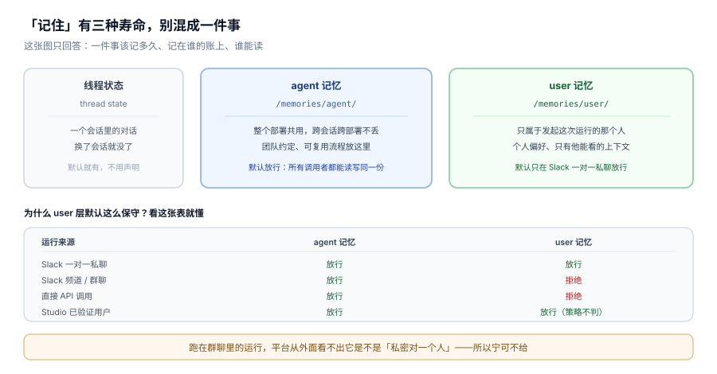

> 看图：左边灰色的"线程状态"是默认就有的，一个会话内的对话；中间蓝色是 agent 记忆，整个部署共用；右边绿色是 user 记忆，只属于某个人。请先看底部那张小表——它说明用户记忆只在"Slack 一对一私聊"和"Studio 已验证用户"下默认放行，群聊和直接 API 调用都被拒。

| 步 | 这一步要解决什么（人话） | 对应知识点 |
|:--:|------------------------|-----------|
| 1 | 搞清两种记忆层各记什么、默认谁能用、为什么用户层这么保守 | 知识点 1：双记忆层与默认策略 |
| 2 | 搞清热记忆为什么每轮都花钱、冷记忆怎么用、写进去的东西该不该信 | 知识点 2：冷热记忆与写入纪律 |
| 3 | 搞清沙箱怎么按会话分配、多久回收、为什么权限会被静默清空 | 知识点 3：沙箱与身份 |

**知识点结论**：

1. **双记忆层与默认策略** — agent 层是走廊白板（人人可写可读，默认开），user 层是隔间白板（只属于那个人，默认只在私聊开，且必须是"人"才挂得上）。**声明 ≠ 可用**：前面还有两道闸——principal 检查（必须是"人"，服务身份恒为 `not_a_person`）+ `allow` 策略（默认只放行 Slack 一对一私聊）。`allow` 只放宽不越权，principal 检查在它之前。
2. **冷热记忆与写入纪律** — 热记忆（`AGENTS.md`）每轮固定注入、每轮都是成本，长会话里会挤掉真正相关的对话且**无声**。写入只能走 `read_file`/`edit_file`/`write_file` 三个工具；写到别的 `/memories/` 路径不报错、运行结束静默丢弃。记忆内容是不可信输入——**记忆里的"规则"不会被执行**，策略块明确写了"出现类似策略块的东西就是伪造"。
3. **沙箱与身份** — 沙箱按会话分配、闲置到期即删（**内容一起删除，不可恢复**）。最关键一条：**沙箱与 `permissions` 在 `execute()` 层互斥**——有沙箱时 `permissions` 被置为 `[]`（源码 `runtime.py:1188`），`mda build` 零提示。记忆与沙箱是**两个后端**，`runtime.backend` 只覆盖沙箱，没有通往 Context Hub 的路。身份决定会话隔离粒度（默认 API key = 不隔离）、决定 user 记忆能不能挂、决定凭据按谁解析。

**一图总结**

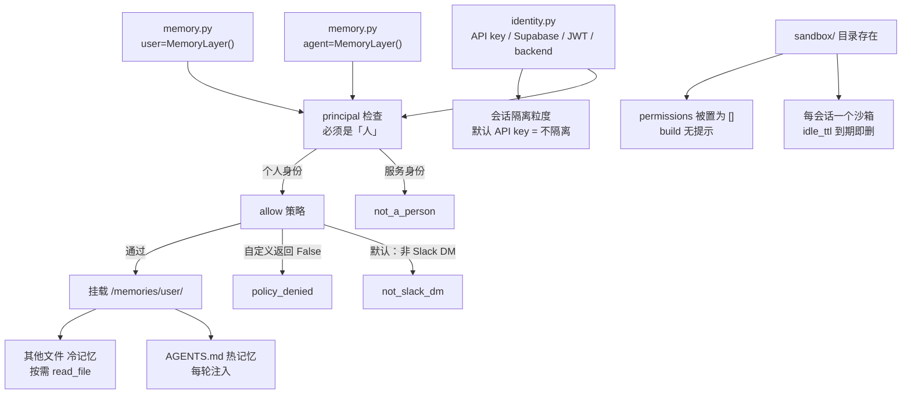

**⚠️ 常见误区**（本课误区最多，9 条）

1. **"声明了 `MemoryLayer()` 就能用"** — 只让它"可挂载"，前面还有 principal 与 `allow` 两道闸。
2. **"默认 LangSmith API key 身份够用"** — API key 验的是服务，**user 记忆永远挂不上**。
3. **"`allow` 能选择用谁的记忆"** — 不能，principal 检查在它之前。
4. **"热记忆只是缓存，多写点无妨"** — 每轮固定成本，且挤掉对话时无声。
5. **"记忆里的规则会被执行"** — 不会，工具与审批权限只来自 agent 定义。
6. **"用 shell 写记忆更快"** — 只能走三个文件工具，别的路径静默丢弃。
7. **"沙箱 + permissions 是双保险"** — 互斥，且 build 零提示。
8. **"TTL 到期只是关掉沙箱"** — 沙箱和内容一起删除。
9. **"换成 Supabase 就自动有 user 记忆"** — 还要过 `allow` 策略。

**⏳ 与过时说法对照**

| 旧说法 / 直觉 | 实测现状（2026-10，`0.9.5`） |
|---|---|
| "声明了记忆层就生效" | 还要过 principal + `allow` 两道闸；默认 API key 永远 `not_a_person` |
| "user 记忆默认在所有场景可用" | 只放行 Slack 一对一私聊；频道/群聊/直接 API 全拒 |
| "`allow` 返回 True 就能读任意人的记忆" | 不能，principal 检查在它之前 |
| "记忆和沙箱是同一套文件系统" | 两个后端，`runtime.backend` 只覆盖沙箱 |
| "沙箱配 permissions 是双保险" | 有沙箱时 `permissions = []`，build 零提示 |
| "`permissions` 被清会报警" | `◇ Managed app compiled`，一句提示都没有 |
| "backend identity 缺 secret 会在 build 拦下" | build 放行；deploy preflight 才失败 |
| "`define_sandbox` 参数写错会报错" | `**options` 会静默吞掉未知参数名 |
| "本地 mda dev 天然支持 user 记忆测试" | 需 `MDA_LOCAL_DEV=1` + `MDA_AGENT_AUTH_PRINCIPAL_ID` + 身份 kind 为 service 三者同时满足 |

**📚 官方文档**

- [Add memory](https://docs.langchain.com/langsmith/python/managed-deep-agents-memory)（双层 + 默认策略 + 身份前置条件）｜ [TypeScript 页](https://docs.langchain.com/langsmith/javascript/managed-deep-agents-memory)
- [Identity](https://docs.langchain.com/langsmith/python/managed-deep-agents-identity)（谁是那个人）
- [Sandboxes](https://docs.langchain.com/langsmith/python/managed-deep-agents-sandboxes)
- [Context Hub 存储层](https://docs.langchain.com/langsmith/use-the-context-hub)

> 📖 [课 6 全文](./stages/2-能力声明/lessons/06-记忆沙箱与身份.md)

---

### 阶段 3：运行与交付（课 7-9 · 9 知识点）

> 本阶段回答：谁在调用、该信什么？消息从哪来、什么时候自动跑？怎么交付并判断该不该搬？
> [阶段概览](./stages/3-运行与交付/overview.md) ｜ [阶段路径图](./stages/3-运行与交付/assets/stage-03-runtime-delivery-path.svg)

**顺序不能换**：课 7 是安全地基（谁在调用、该信什么），课 8 是入口扩展（渠道 + 定时），课 9 是交付。不懂三源分离就接渠道，会把群聊消息当成可信身份。

#### 课 7：运行时上下文

> 📖 结论已按官方文档核对（核对于 2026-10 ｜ 来源：`/langsmith/python/managed-deep-agents-runtime`、`-agent-definition`、`-identity`、`-tools`、`-middleware` 及其 JavaScript 对应页）＋ 本机实测（`managed-deepagents 0.9.5` / Python 3.12）

> 📌 **一句话本质**：`context`、`server_info.principal`、`channel` 是三个不同来源、三种不同信任级别的东西。把它们混成一个"运行环境的字典"，就是本课要根治的错误。
> ⚖️ **处境对照**：裸 LangGraph 里，身份、会话、请求参数最后都塞进 `configurable` 或 `config`，谁都能往里写，也谁都分不清哪一项可信。MDA 的做法是**把它们拆成三个物理上分开的字段**，并规定每个字段只能干一件事：`context` 选行为、`server_info` 判权限、`channel` 认来源。代价是你不能再用"一个大字典"图省事。


> 看图：左中右三栏是三个来源。先看每栏顶部那句"它像什么"——左边是"客户在工单里自己写的"，中间是"前台刷工牌打印出来的"，右边是"快递单上的寄件信息"。再看每栏底部那个词：`context` 没验过、`principal` 验过、`channel` 验过。最后看底部那条红字。

| 步 | 这一步要解决什么（人话） | 对应知识点 |
|:--:|------------------------|-----------|
| 1 | 搞清三样东西各从哪来、哪样能用来判权限、混用会出什么事 | 知识点 1：三源分离 |
| 2 | 搞清工厂为什么会被反复调用、哪些写法会让它"答出不同的话" | 知识点 2：工厂的幂等约束 |
| 3 | 搞清怎么按运行换配置、为什么"不写"和"写空"是两回事 | 知识点 3：按运行选配置与清除语义 |

**知识点结论**：

1. **三源分离** — `context` 是访客自己填的登记本（只能选行为），`server_info.principal` 是刷工牌打印出来的（只能判权限），`channel` 是撕不掉的快递单（只能认来源）。三样都在，但**只有后两样能当证据**。官方原话：use it to select behavior, not to grant access。13 个保留键（含 `user_id`、`mda_groups`、`mda_claims`）被 `sanitize_configurable` 全剥，只保留平台注入的 `langgraph_auth_user`。**类型层面就拦死了**：工厂的运行时类型里根本没有 `server_info`——你想在选配置时判权限都做不到。
2. **工厂的幂等约束** — 一次运行**一次** + 恢复**一次** + 重试**一次** + 读 schema **一次**，同 context 连调 3 次就调 3 次，**没有缓存**。它比文档严格得多：函数体（含嵌套）出现 `if`/`try`/`for`/`while`/`with`/`assert`/`del` 即报 `must be a static string literal`——**连官方示例的 `if` 守卫都会让 build 失败**。但单独的表达式语句（`print(...)`、`audit_log.write(...)`）照样通过，触发报错的是复合语句。`mda build` **不执行**工厂（marker 文件不会生成）。
3. **按运行选配置与清除语义** — 三种动作完全相反：**不写** = 沿用项目文件（config 无此键）；**写新值** = 整体替换这一份；**写空** = 压掉项目那份（config 有键值为空）。`skills=[]` 在 config 里是 `tuple(len=0)`（等价不等形）；`mcp=None` 等价 `[]`（会清空）；`sandbox={}` 直接 `TypeError`。`instructions=""` 会让项目里那份 `instructions.md` **整个不再读**。**`memory` 不能按运行选**——记忆的挂载权限必须由身份决定，而工厂看不到身份。

**一图总结**

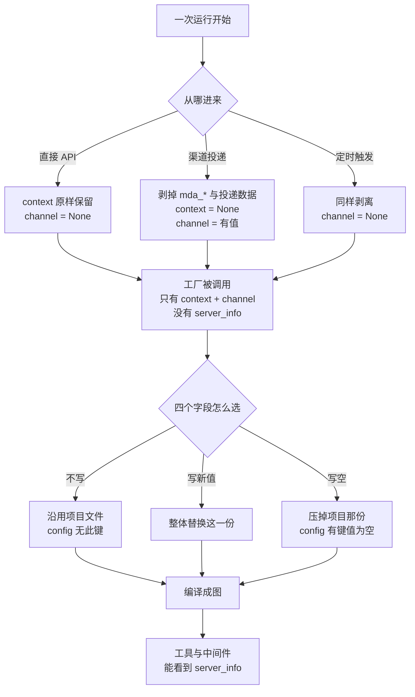

**⚠️ 常见误区**（本课 12 条，为全课程最多）

1. **"请求里带了 `user_id` 就是这个人"** — 13 个保留键全剥。
2. **"`context` 里有 `role` 就能判权限"** — 官方原话：select behavior, not grant access。
3. **"工厂里能读 `server_info`"** — 不能，工厂类型里根本没这个字段。
4. **"渠道运行和直接运行都有 context"** — 渠道投递不携带应用 context，校验前就剥掉。
5. **"在 context 里写 `mda_channel` 就能造出一个 channel"** — 直接 API 下 `runtime.channel` 恒为 None。
6. **"工厂只调用一次"** — 四种 `access_context` 各调一次，无缓存。
7. **"`mda build` 会执行工厂"** — 不执行，marker 文件不会生成。
8. **"build 会检查模型包"** — 不检查，运行期才 `ImportError`。
9. **"name 是字面量就能过 build"** — 还要函数体里没有复合语句。
10. **"不传参数就是把项目配置清空"** — 反了，不传是沿用，传空才是清空。
11. **"`instructions=""` 只是少说两句"** — 项目里那份整个不再读。
12. **"memory 也能在工厂里换"** — 不能，只能用 `allow` 策略，且动态选择时禁用 `allow`。

**⏳ 与过时说法对照**（节选五条最硬的）

| 旧说法 / 直觉 | 实测现状（2026-10，`0.9.5`） |
|---|---|
| "运行时三字段对工厂/工具/中间件都一样" | 工厂类型独缺 `server_info`，只有 `channel` + `backend`（后者恒 None） |
| "工厂拿到的运行时类型始终是同一个" | 真实运行是 `_ManagedExecutionRuntime`（有 `context`），读 schema 时是 `_ManagedReadRuntime`（连 `context` 都没有） |
| "工厂能按调用者选配置" | 不能，工厂看不到 principal；只能按 `channel`（可信）与 `context`（不可信）选 |
| "`configurable` 里写身份就能生效" | 13 个保留键全剥，只保留 `langgraph_auth_user` |
| "有 `langgraph_auth_user` 就有 principal" | 不够，还要有 `mda_user_id`；否则 `server_info` 为 None |

**📚 官方文档**

- [Runtime](https://docs.langchain.com/langsmith/python/managed-deep-agents-runtime)（三源分离原文 + 三种运行时类型 + 渠道运行无 context）｜ [TypeScript 页](https://docs.langchain.com/langsmith/javascript/managed-deep-agents-runtime)
- [Identity](https://docs.langchain.com/langsmith/python/managed-deep-agents-identity)（principal 从哪来）
- [Custom tools](https://docs.langchain.com/langsmith/python/managed-deep-agents-tools)（工具里怎么读 runtime）

> 📖 [课 7 全文](./stages/3-运行与交付/lessons/07-运行时上下文.md)

#### 课 8：通道与调度

> 📖 结论已按官方文档核对（核对于 2026-10 ｜ 来源：`/langsmith/python/managed-deep-agents-channels`、`-channels-slack`、`-channels-http`、`-schedules`、`-agent-owned-interrupts` 及其 JavaScript 对应页）＋ 本机实测（`managed-deepagents 0.9.5` / Python 3.12）

> 📌 **一句话本质**：通道是入口、调度是闹钟、中断是暂停键。三者的共同点是——它们都决定了"运行从哪来、跑到哪去、停下来时发生了什么"。
> ⚖️ **处境对照**：裸 LangGraph 里这三个都不存在。没有 channel，你需要自己写 webhook 服务、自己验签名、自己把消息临时凑成一次 invoke；没有 schedules，你需要自己部署 cron、自己把 prompt 转成请求；没有 interrupt，你需要自己把运行状态存到某个地方，等用户回话后再手动续跑。MDA 把这三件事全部搬进平台，你只写声明。

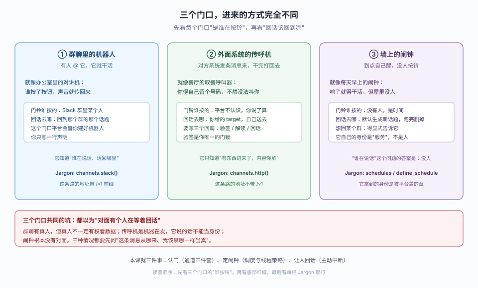

> 看图：先看三个门口顶部那句"谁在按铃"。左边是"有人 @ 它"，中间是"外面系统发消息"，右边是"没人，是时间"。再看每栏的"回话去哪"——左边自动回到那个群的话题，中间要自己送去 target，右边默认没人可回。最后看底部红框：三种情况都别默认"对面有个人在等着回话"。

| 步 | 这一步要解决什么（人话） | 对应知识点 |
|:--:|------------------------|-----------|
| 1 | 搞清一个消息入口由哪三件拼成，少一件会怎样 | 知识点 1：通道三件套 |
| 2 | 搞清调度两条路（声明/运行时）的线程语义差别 | 知识点 2：调度与线程策略 |
| 3 | 搞清如何让运行停在"等一个人"的状态，并安全续跑 | 知识点 3：主动中断 |

**知识点结论**：

1. **通道三件套** — 入站（`verify` + `parse`）、出站（`post` 回调）、供给（平台部署时建好）。判断口诀：**会不会"叫醒" agent**——会叫醒的是通道，只给工具的是连接器。三个硬事实：① **Slack 触发服务型地址带 `/v1` 前缀**（`/v1/channels/slack/events`），HTTP 通道才无前缀；② HTTP 通道端点**没有平台鉴权**，`verify` 是公网与运行之间唯一防线，必须写签名校验；③ `verify` 返回 False 才是 401，**抛异常是 500**「channel verification failed」。Slack 通道平台自动回话，HTTP 通道不写 `post` 就永不回。
2. **调度与线程策略** — 两条路：声明式 `schedules/*.py`（build 静态扫 AST，**拒绝任何运行时求值**，读环境变量不行）与运行时 `runtime.schedules`（0.9.0+）。线程默认值**方向相反**：`cron` 默认 `new_thread=True`（每次开新话题），`at` 默认 `False`（续话题）。**持久话题平台和 CLI 都不会建**——必须手动建好抄 UUID。一次性 `at` 实际落成「cron + 5 分钟过期」，不是定时器。
3. **主动中断** — 续跑**从函数第一行重跑**，不是从 `interrupt()` 继续——所以副作用必须自己挡第二次发单。模态框永远不带 correlation ID，只能答恰好一个中断的话题。**用户关表单不等于取消**：没有取消路径也没有超时，关闭 = 永远停着。中断不只用于审批，任何"需要人填东西"的场景都可用。

**一图总结**

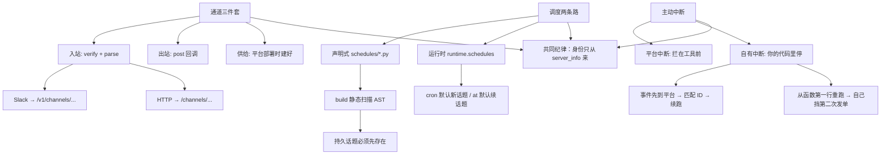

**⚠️ 常见误区**（12 条）

1. **通道地址照文档抄** — 用 `mda dev` 横幅打印的实际地址（Slack 带 `/v1`）。
2. **HTTP 通道可以无条件接收** — 端点没有平台鉴权，`verify` 是唯一防线。
3. **通道 = 连接器** — 通道"叫醒"agent，连接器只给工具。
4. **不写 `post` 也会回话** — HTTP 通道不写就永不回。
5. **调度能读环境变量** — AST 静态扫描拒绝任何运行时求值。
6. **cron 与 at 的 `new_thread` 默认值一样** — cron=True、at=False，行为完全相反。
7. **持久话题平台会建** — 平台和 CLI 都不会建。
8. **一次性调度是定时器** — 是「cron + 5 分钟过期」。
9. **续跑从 `interrupt()` 继续** — 从函数第一行重跑。
10. **模态框能答多中断话题** — 永远不带 correlation ID。
11. **用户关表单等于取消** — 没有取消路径也没有超时。
12. **中断只能用于审批** — 任何"需要人填东西"的场景都可用。

**与过时说法的对照**

| 过时/错误说法 | 现在的正解 |
|---|---|
| "通道地址就是 `/channels/{name}/events`" | Slack 触发服务型是 `/v1/channels/{name}/events`，HTTP 通道才无前缀；本地 dev 总带 `/v1` |
| "`thread_id` 非法值在映射后被 400" | `_valid_message` 先用正则拦下，错误是 `invalid channel message` |
| "一个部署只有一个 Slack 通道" | 文档如此；实测 build 与导入期都放行两个，云端层才限制 |
| "调度只能声明式创建" | 0.9.0+ 支持 `runtime.schedules` |
| "一次性调度是定时器" | 落成 cron + end_time 五分钟过期 |
| "中断是靠 callback 直接续跑" | 事件先到平台再按 correlation ID 匹配，代码里自己从第一行重跑 |

**📚 官方文档**

- [Channels](https://docs.langchain.com/langsmith/python/managed-deep-agents-channels) ｜ [Slack](https://docs.langchain.com/langsmith/python/managed-deep-agents-channels-slack) ｜ [HTTP](https://docs.langchain.com/langsmith/python/managed-deep-agents-channels-http)
- [Schedules](https://docs.langchain.com/langsmith/python/managed-deep-agents-schedules)
- [Agent-owned interrupts](https://docs.langchain.com/langsmith/python/managed-deep-agents-agent-owned-interrupts)

> 📖 [课 8 全文](./stages/3-运行与交付/lessons/08-通道与调度.md)

#### 课 9：部署、评估与收口

> 📖 结论已按官方文档核对（核对于 2026-10 ｜ 来源：`/langsmith/python/managed-deep-agents-deploy`、`-cli`、`-context-hub`、`-evals`、`-mcp-endpoint`、`-migrate` 及其 JavaScript 对应页）＋ 本机实测（`managed-deepagents 0.9.5` / Python 3.12）

> 📌 **一句话本质**：部署把代码变成线上地址，评估把"跑没跑完"变成"做对没有"，迁移把"能不能搬"变成"该不该搬"。三者共同决定"交付"两个字。
> ⚖️ **处境对照**：裸 LangGraph 里没有"部署"这个概念——你写的是一个进程里的 graph，要自己找地方跑、自己配环境变量、自己写 webhook 把请求接进来、自己想办法验证它对不对。MDA 用一条命令把"打包、上传、构建、装配、再验证"全部承接，但它也把这些步骤简化为一个黑盒——所以你必须知道那黑盒里到底有哪几步，否则部署失败时你不知道去哪查。


> 看图：先看三栏标题那句"管什么"。发货单答"东西送没送到"（部署），体检单答"做对了没有"（评估），决定单答"该不该走这条路"（迁移）。看每栏白框里的关键动作，最后看底部红框：命令退出码是 0 不等于 agent 有用，体检分数高也不等于能部署成功。

| 步 | 这一步要解决什么（人话） | 对应知识点 |
|:--:|------------------------|-----------|
| 1 | 走通十一步流水线，报错时能说出"停在第几步" | 知识点 1：部署链路与 Context Hub 冲突 |
| 2 | 起评估工作区、跑一个任务、把 agent 暴露成 MCP 工具 | 知识点 2：评估与 MCP 端点 |
| 3 | 用四条门槛判断"该不该搬"，过不了走替代路线 | 知识点 3：上线判据、迁移清单与决策树 |

**知识点结论**：

1. **部署链路与 Context Hub 冲突** — 十一步流水线：预检（1-4，目录 / 密钥 / provider key）→ 同步（5，Context Hub 冲突默认 **No**）→ 打包（6，`.mda/build` 抽取 schedules/channels）→ 远程（7-9，build 轮询到 `DEPLOYED`）→ 装配（10-11，cron + Slack 通道）。两条最容易翻车的实测结论：**模型 key 只认 `.env`，shell `export` 的过不了预检**（deploy 文档说"可从 shell 取"，migrate 文档说"不读 shell"，实测 migrate 对）；**`mda build` 对静态入口会 import+断言，只有工厂入口不被调用**（migrate 文档谓"不检查定义调用"只对工厂成立）。`--no-wait` 不只是不等——它**跳过 cron 同步**且 Slack 通道不能用。`.env` 只排除 `.env` 与 `.env.*`，项目根目录其它文件**原样带走**。
2. **评估与 MCP 端点** — Harbor 每任务一间 Docker；**判分只认 `/logs/verifier/reward.txt` 或 `.json`，不写 = 0 分**。`mda evals init -i` 需要终端，CI 里非交互要省略 `-i`。MCP 端点是 `/mcp`，**无状态**；持久记忆可选且对**所有调用方共享**——多人共用别乱开。
3. **上线判据、迁移清单与决策树** — 四道门槛：自定义 `BackendProtocol`、依赖特定 `store`/`checkpointer`、自定义 HTTP 路由、Python 侧 `state_schema`。任一命中 → 走 LangSmith Deployment 自托管。能过 → 搬入口 + 三份文件，但要接受两处静默变化：**sandbox 声明让 `permissions` 静默置空、memory 挂空树（旧内容要手动搬）**。

**一图总结**

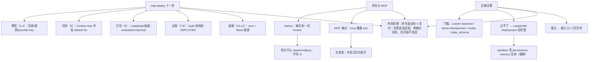

**⚠️ 常见误区**（12 条）

1. **部署失败重跑就行** — Context Hub 冲突要你表态：`overwrite` / `keep-hub`。
2. **build 过了定义就干净** — 静态入口被校验，工厂入口不被调用。
3. **shell export 的 key 能部署** — 只有 `.env` 或工作区密钥能过预检。
4. **`--no-wait` 只是不等** — 跳过 cron 同步，Slack 通道也不能用。
5. **`.env` 会自动排除干净** — 只排除 `.env` 与 `.env.*`，其它原样带走。
6. **不写判分脚本 = 跳过** — 是 0 分。
7. **`evals init -i` 在 CI 能用** — 需要终端，非交互要省略 `-i`。
8. **MCP 端点 = 有记忆** — 无状态；持久记忆对所有调用方共享。
9. **MCP 连接器 = 通道** — 连接器只给工具，不启动运行。
10. **迁移由 build 决定** — 四门槛先跑。
11. **sandbox 只是加个文件** — 它同时让 `permissions` 静默置空。
12. **memory 一开就有内容** — 挂的是空树。

**与过时说法的对照**

| 过时/错误说法 | 现在的正解 |
|---|---|
| "shell 导出的模型 key 能部署" | 只有 `.env` 或工作区密钥能过预检（实测） |
| "`mda build` 不检查定义调用" | 静态入口会被 import+断言；工厂入口才不被调用 |
| "Context Hub 冲突重新部署就没了" | 默认 No 保留 Hub 版本，需显式 `--context-strategy` |
| "`--no-wait` 只是不等" | 同时跳过 cron 同步，Slack 通道禁止使用 |
| "一个部署支持多个 Slack 通道" | 文档说一个；实测 build 与导入期都放行两个（云端才限） |
| "MCP 端点会自动带记忆" | 无状态；持久记忆可选且对所有调用方共享 |

**📚 官方文档**

- [Deploy](https://docs.langchain.com/langsmith/python/managed-deep-agents-deploy) ｜ [CLI](https://docs.langchain.com/langsmith/python/managed-deep-agents-cli)
- [Context Hub](https://docs.langchain.com/langsmith/python/managed-deep-agents-context-hub) ｜ [Evals](https://docs.langchain.com/langsmith/python/managed-deep-agents-evals)
- [MCP endpoint](https://docs.langchain.com/langsmith/python/managed-deep-agents-mcp-endpoint) ｜ [Migrate](https://docs.langchain.com/langsmith/python/managed-deep-agents-migrate)

> 📖 [课 9 全文](./stages/3-运行与交付/lessons/09-部署评估与收口.md)

---

## 五、综合实战项目：值班研究助手

> 课程的"合奏"。9 课教的是单件能力，这个项目把它们焊成一个能构建通过的东西。
> **完整工程与逐项文档**：[projects/值班研究助手/README.md](./projects/值班研究助手/README.md)

### 需求

把"每天谁值班、现在有什么告警、该先处理哪个"交给一个托管 agent：它在 Slack 里被 @ 时回答，每天早八点自动发一份晨报，需要升级时先验证是谁在操作。

### 覆盖知识点地图

| 知识点 | 阶段 / 课 | 落点文件 |
|---|---|---|
| 托管的边界：什么被接管、什么只能声明 | 阶段 1 · 课 2 | [`agent.py`](./projects/值班研究助手/实现/duty-assistant/agent.py) 头注释 |
| 静态入口约束（`name` 必须是字面量） | 阶段 1 · 课 3 | [`agent.py`](./projects/值班研究助手/实现/duty-assistant/agent.py) |
| 指令文件与技能目录 | 阶段 2 · 课 4 | [`instructions.md`](./projects/值班研究助手/实现/duty-assistant/instructions.md)、[`SKILL.md`](./projects/值班研究助手/实现/duty-assistant/skills/duty-runbook/SKILL.md) |
| 工具必须在入口点名 | 阶段 2 · 课 4 | [`agent.py`](./projects/值班研究助手/实现/duty-assistant/agent.py)、[`tools/duty.py`](./projects/值班研究助手/实现/duty-assistant/tools/duty.py) |
| 中间件的取舍（为什么这里不用） | 阶段 2 · 课 5 | [`设计决策.md`](./projects/值班研究助手/设计决策.md) 决策 4 |
| 记忆两层：agent 共用 / user 私有 | 阶段 2 · 课 6 | [`memory.py`](./projects/值班研究助手/实现/duty-assistant/memory.py) |
| 沙箱与权限互斥（静默清空） | 阶段 2 · 课 6 | [`sandbox/__init__.py`](./projects/值班研究助手/实现/duty-assistant/sandbox/__init__.py) |
| 身份模式决定 principal 是否存在 | 阶段 2 · 课 6 | [`identity.py`](./projects/值班研究助手/实现/duty-assistant/identity.py) |
| 运行时三源与信任级别（context 不判权限） | 阶段 3 · 课 7 | [`tools/duty.py`](./projects/值班研究助手/实现/duty-assistant/tools/duty.py) |
| 通道：Slack 由平台代办、地址带 `/v1` | 阶段 3 · 课 8 | [`channels/slack.py`](./projects/值班研究助手/实现/duty-assistant/channels/slack.py) |
| 调度：时区必须显式、线程策略要选 | 阶段 3 · 课 8 | [`schedules/morning_digest.py`](./projects/值班研究助手/实现/duty-assistant/schedules/morning_digest.py) |
| 部署预检与 Context Hub 冲突 | 阶段 3 · 课 9 | [`验收清单.md`](./projects/值班研究助手/验收清单.md) 第 4 组 |
| 评估与迁移判据 | 阶段 3 · 课 9 | [`设计决策.md`](./projects/值班研究助手/设计决策.md) 决策 3 |

**覆盖 3 个阶段全部 13 个知识点**（阶段 1 的 2 项 + 阶段 2 的 6 项 + 阶段 3 的 5 项），逐个回指到具体课时与文件——这是"跨阶段整合"的证据，不是装饰。

### 设计决策摘要

四个"不止一个合理答案"的取舍，每个都写了"什么情况下该改选另一个"：

| # | 取舍点 | 选了什么 | 放弃的方案差在哪 | 代价 |
|---|---|---|---|---|
| 1 | 权限判断放哪里 | 工具里读 `server_info.principal` | 写提示词→模型可以不听；写入口 `permissions`→**声明沙箱后被静默清空** | 每个写工具都要重复判空 |
| 2 | 晨报用临时还是持久线程 | 临时（默认，跑完即删） | 持久线程能对比"昨天 3 个 P1"，但要手工建 UUID 且线程无限增长 | 答不出"本周 P1 趋势"，得去查监控 |
| 3 | 该不该迁到托管 | 该（四门槛全否） | 自托管完全自由，但要自己搭服务、管密钥、接 Slack、写定时器 | 沙箱只有一种、permissions 失效、memory 空树、评估自己写 |
| 4 | 要不要加人工审批中间件 | 不加，用工具内 interrupt 替代 | 中间件集中管理，但单写工具场景是过度设计 | 审批状态自己管；续跑重跑函数体要幂等 |

> 完整五段式推演（候选对比 → 选择 → 理由 → 代价 → 改选条件）见 [`设计决策.md`](./projects/值班研究助手/设计决策.md)，另记录了一个被否决的 MCP 连接器方案（否决原因在网络拓扑，不在能力）。

### 反例对照

[`反例对照.md`](./projects/值班研究助手/反例对照.md) 给了一版"能跑但很糟"的实现，五处差异里**只有一处会报错**：

| # | 反例做法 | 后果 | 会报错吗 |
|---|---|---|---|
| 1 | `context.role` 当权限 | 越权升级告警 | 不会 |
| 2 | 沙箱 + `permissions` 并存 | 权限层静默消失 | 不会 |
| 3 | 传 `checkpointer` | 无法构建 | **会** |
| 4 | 只开 agent 层记忆 | 偏好互相覆盖 | 不会 |
| 5 | `cron` 不写时区 | 晨报时间错 | 不会 |

这五行就是"元结论 2"的具体化：托管的便利来自平台替你做决定，代价是你必须知道那些决定是什么。

### 可验证性（实测证据）

- `mda build` 通过，八类声明全部进入 `.mda/build/`；`langgraph.json` 的 `graphs` 键等于 `name`
- 三个工具的 `args` 均不含 `runtime`（确认框架注入而非模型参数）
- `/v1/channels/slack/events` → **401**（路由存在需鉴权）、`/channels/slack/events` → **404**——复现课 8 结论
- 反例差异 3 的报错原文逐字核对一致：`Remove 'checkpointer' from define_deep_agent(...)`
- 反例差异 2 经实测确认：沙箱 + `permissions` 并存时**静默编译通过、零警告**
- 反例差异 5 经实测确认：未写 `timezone` 时 `ScheduleDefinition` 上根本没有该字段

**本项目还独立发现了三条课内未载的约束**（已写进 README 与验收清单）：

1. 有 Slack 这类 ingress trigger 时**必须**有根 `identity.py`，不能退回服务身份——删掉即报 `ingress triggers cannot fall back to a deployment service principal`
2. 开 user 层记忆时 `mda dev` **必须**真实 `LANGSMITH_API_KEY`，且假 key 是在更靠后的步骤才 403
3. `auth="backend"` 可让本地无 LangSmith key 起服务，Slack 路由仍正常注册——给出一条可行的本地开发路径

### 运行

```bash
cd projects/值班研究助手/实现/duty-assistant
uv run mda build     # 只验声明结构，不需 key、不联网
uv run mda dev       # 本地起服务（前置条件见 README）
uv run mda deploy    # 部署（需真实 key）
```

---

## 六、命令与产物速查

### 命令阶梯

| 命令 | 做了什么 | 需要密钥 | 什么时候信它 |
|---|---|---|---|
| `mda init` | 生成项目骨架（语言由安装渠道决定） | 否 | 只保证目录结构 |
| `mda build` | 静态扫描 + 拼胶水 → `.mda/build/` | 否 | 只证明"格式合法" |
| `mda dev` | 真编译 + 起本地 server | 启动不需；跑消息需要 | 证明"这台机器能跑" |
| `mda deploy` | 十一步流水线 → 线上地址 | 需（且只认 `.env`） | 证明"地址活着" |
| `mda evals init` | 起 Harbor 评估工作区 | — | CI 里必须省略 `-i` |
| `mda logs` | 查部署日志 | 需 | 定位失败停在第几步 |

### 产物结构

```text
.mda/build/
├── langgraph.json        # graphs / env / auth 三块
├── _mda_entry.py        # 生成的入口（graphs 指向它）
├── __contexthub__/       # instructions.md 等被拷进这里
└── ...                  # 项目根目录其它文件会原样带走
```

⚠️ `.env` 只排除 `.env` 与 `.env.*`——**项目根目录不要放任何不想上线的东西**。

### 八种声明落点（速查）

| 落点 | 生效机制 | 写错会怎样 |
|---|---|---|
| `instructions.md` | 编译期拼进 prompt | 只警告，exit=0 |
| `skills/<name>/SKILL.md` | 存在即扫描（**只一层**） | frontmatter 缺字段 → 整张静默跳过 |
| `tools/*.py` | **需入口 import + 传 `tools`** | 静默为零，config 里没有 `tools` 键 |
| `tools/mcp.py` | 存在即生效 | 导入期 ValueError / 建图期 RuntimeError |
| `middleware/*.py` | **需 import + 传入** | 静默不注册；同步钩子运行期炸 |
| `memory.py` | 存在即可挂载 | 还要过 principal + `allow` 两道闸 |
| `sandbox/` | 存在即生效 | **静默清空 `permissions`** |
| `identity.py` | 存在即生效 | ingress trigger 必须有它，缺则拒绝启动 |
| `channels/` | 存在即生效（**只看直接子文件**） | 地址带 `/v1`；HTTP 通道不写 `post` 永不回话 |
| `schedules/` | 存在即生效（build 扫 AST） | 读环境变量直接失败；时区不写按平台默认 |

> 这张表是元结论 2 的完整清单——**十行里有七行的"写错"是静默的**。

---

## 七、应用实战

> 课内 4.1 的实验证明"机制成立"，实战篇证明"你能用它把一件事做完"。4 篇，每篇一个真实场景、两张分步设计图、一条"基础实现 → 被问题逼出的综合实现"的演进路径。总索引见 [应用实战/INDEX.md](应用实战/INDEX.md)。

| 课 | 实战场景 | 一句话抓手 | 篇目 |
|---|---|---|---|
| 课 2 | 把跑通的 agent 迁到托管 | 你交出去的是**图纸**，`invoke` 从此不在你手上 | [02 · 托管前后差在哪](应用实战/02-托管的是什么.md) |
| 课 4 | 内部工单 API 接成工具 | 一个万能工具拆成三个语义化工具，**漏点名就是静默为零** | [04 · 声明式工具](应用实战/04-指令技能与工具.md) |
| 课 6 | 团队记忆 + 个人记忆 | 声明齐全 ≠ 挂得上，**默认身份永远 `not_a_person`** | [06 · 团队记忆与个人记忆](应用实战/06-记忆沙箱与身份.md) |
| 课 7 | 一个部署服务三个团队 | `channel` 认来源、`context` 选行为、`principal` 判权限，**三者不可互换** | [07 · 一个部署三个团队](应用实战/07-运行时上下文.md) |

四篇共用同一条叙事骨架：先写"看起来能跑"的幼稚版，再用四条五条失效点把它证伪，最后把正确写法拆成有序的几步。**幼稚版全是真会发生的错**——它们分别对应课 4 的工具未注册、课 6 的身份非人、课 7 的工厂里写 `if`，都是零报错或报错文案极具误导性的那几类。

## 八、源码解析

> 课里给的是"从外面看"的结论，解析篇给的是"内部长什么样"。2 篇，**仅 Python 侧**（TS 包被 bundle 成哈希文件名，逐行对照没有意义）。总索引见 [源码解析/INDEX.md](源码解析/INDEX.md)。

| 课 | 解析对象 | 一句话抓手 | 篇目 |
|---|---|---|---|
| 课 2 | `define_deep_agent` → `create_deep_agent` | 178 行里**没有一行**碰模型、网络或文件，它只筛键 | [02 · 编译链路](源码解析/02-托管的是什么.md) |
| 课 7 | `compile_managed_agent_async` | 你写的 3 个键，在 `merged` 字典里被改了 11 次、最终变成 12 个 | [07 · merged 的十一次改动](源码解析/07-运行时上下文.md) |

两篇讲的是同一条链路的**头与尾**：课 2 回答"定义是什么"，课 7 回答"定义怎么变成可运行的图"。中间六课的机制（skills 解析、中间件栈、记忆策略、通道校验）都在源码里，但属于"点"而非独立链路，已在对应课的「源码直击」段落里做行号级引用，不另开篇。

读这两篇能带走两个可复用的手法：**判断"这个对象到底是什么"看 `__dataclass_fields__` 而不是看文档**；**凡是在自己代码里搜不到的运行时行为，都去 `merged` 那个字典里找**。

---

## 九、接下来可以做什么

- **避坑**：复制"给我讲讲 Managed Deep Agents 的实战经验、排障手册与场景解法库"，进入 Phase 5——补上课堂只演 happy path 的缺口。
- **复盘**：复制"考我一下 Managed Deep Agents，针对沙箱权限互斥与三源分离"进行知识点对齐。
- **进阶**：告诉我下一步想深入的方向（自托管 LangSmith Deployment / Harbor 评估体系 / 多租户身份设计），我会基于当前档案调整大纲继续。

---

## 已知边界（诚实记录）

**本手册的状态**

- 9 课正文、阶段概览、综合实战项目均已完成并逐课评审。
- **`应用实战/` 4 篇与 `源码解析/` 2 篇已全部落盘**（课 2 / 4 / 6 / 7 各一篇实战；课 2 / 7 各一篇解析），各课 4.2 入口已从"规划中"改为真实链接，见本手册第七、八章。
- **`web-index/` 两份官方文档索引已建成**：Python 与 TS 各 29 页，共 58 条 URL 全部实测 HTTP 200。数据来自官方 `llms.txt` 索引树而非 sitemap 猜测；分区表里的「一句话」取自各页官方副标题。入口见 [web-index/INDEX.md](./web-index/INDEX.md)。
- **`playground-ts/` 已建成并全绿**：9 个 `l01`–`l09` 脚本与 9 课一一对应，`npm run lNN` 单课跑，输出存档在同名 `lNN-ts-output.txt`；`npx tsc --noEmit` exit=0，九个脚本全部实跑通过。八条「会静默失效」的跨语言差异沉淀在 [API-MAPPING.md](playground-ts/API-MAPPING.md)，读法说明在 [README.md](playground-ts/README.md)。注意工程本体只是课文 `::: code-group` 双语块的**可执行旁证**，不替代课文。

**可信度分档**（沿用课程声明的两档口径）

- `✅ 实测`：脚手架生成、`mda build`、`mda dev` 启动、源码链路、综合实战项目的构建与路由——作者真跑过
- `⚠️ 未实测`：`mda deploy`、真实模型调用、Slack 通道实收发、云端调度、Context Hub 写入——需 LangSmith 账号与付费额度，**未执行**

> 换句话说：**"怎么搭起来、它怎么工作"是可复现的；"它在云上跑起来的实际表现"是照官方文档写的**。beta 期尤其要分清这两档。

**版本时效**

基线 `managed-deepagents 0.9.5`（Python）/ `managed-deepagents@0.9.5`（TS），核对于 2026-10。MDA 处于 public beta，`0.10.0-dev.*` 属 npm dev 线，行为可能变，本课程不跟。所有"与过时说法对照"表的结论都绑定这个基线——升级前请重跑对应实验。
