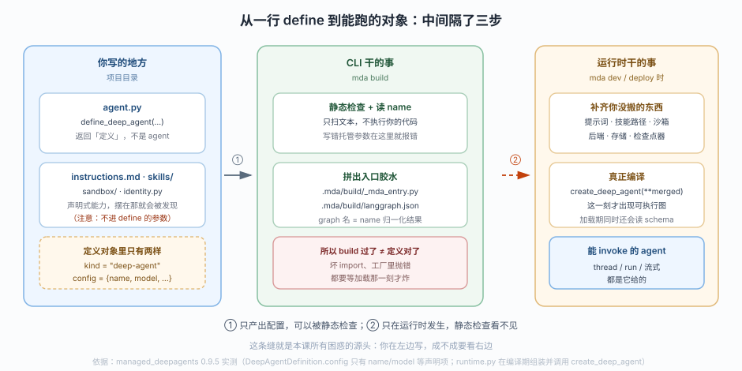
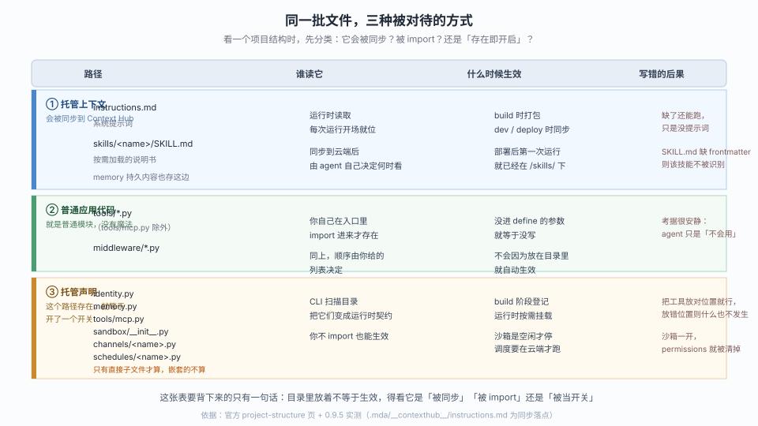
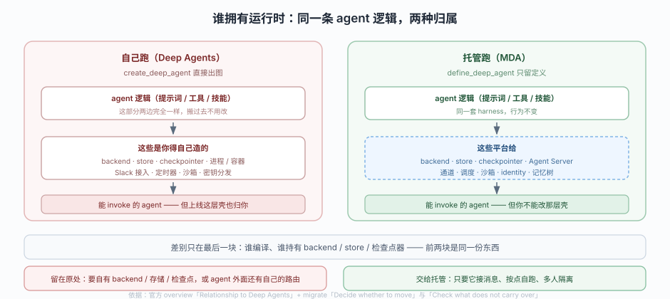
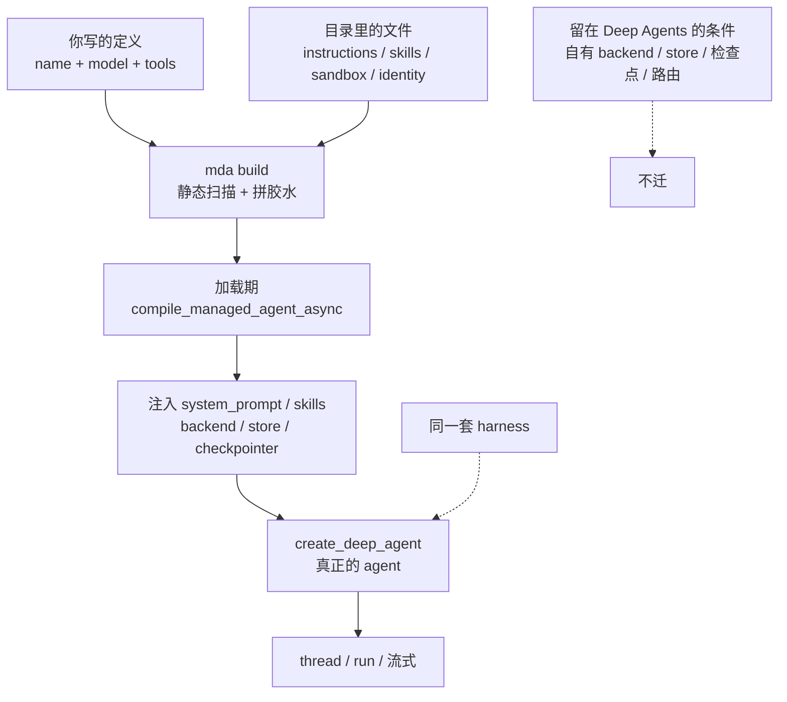

# 第 2 课：托管的是什么

> 所属阶段：阶段 1《定位与起跑》｜ 水平：入门 ｜ 本课知识点：定义与编译分离、项目即配置、与 Deep Agents 的边界
> 故事情节：主角照着 quickstart 敲完了 `define_deep_agent(...)`，想把 `agent` 拿去 `invoke` 试一句——结果发现手里这个东西连 `invoke` 都没有
> 📖 结论已按官方文档核对（核对于 2026-10 ｜ 来源：`/langsmith/python/managed-deep-agents-overview`、`-agent-definition`、`-project-structure`、`-migrate` 及其 JavaScript 对应页）＋ 本机实测（`managed-deepagents 0.9.5`）

## 🎯 本课目标

- 说清 `define_deep_agent` 与 `create_deep_agent` 的职责边界，解释为什么定义阶段拿不到 backend / store / checkpointer
- 对着一个项目目录，说出每个文件属于「被同步」「被 import」「存在即开启」中的哪一类，以及各自什么时候生效
- 对着一个既有 agent，判断它该留在 Deep Agents 还是迁到托管，并说出理由

---

## 第一幕：起源与场景引入

你上一门课学的是 Deep Agents：`create_deep_agent(...)` 一行，拿回来一个能 `invoke` 的图，模型、工具、文件系统全都齐了，跑在自己的终端里，想怎么改就怎么改。

现在同事说：这玩意儿挺好，让运营同事在 Slack 里也能用吧。你一想，那就得有个服务、有个地方存会话、给每个人单独隔开、模型密钥不能发到群里、还得每天早八点自动跑一次日报。

于是你打开了 MDA 的 quickstart，按文档写下：

::: code-group

```python [Python]
from managed_deepagents import define_deep_agent

agent = define_deep_agent(
    name="my-agent",
    model="openai:gpt-5.5",
)
```

```typescript [TypeScript]
import { defineDeepAgent } from "managed-deepagents";

export const agent = defineDeepAgent({
  name: "my-agent",
  model: "openai:gpt-5.5",
});
```

:::

然后很自然地接了一句 `agent.invoke(...)`。

报错了。不是密钥问题，不是网络问题——是这个对象**根本没有 `invoke`**。

> 🎬 **场景**：你写的东西叫 `agent`，但它不是 agent。

> 📌 **一句话本质**：把「这个 agent 要什么」和「谁来把 agent 造出来、跑起来」拆成两件事——你只负责前者，后者交给平台。

> ⚖️ **处境对照**：自己跑 Deep Agents 时，除了 agent 逻辑，你还得自己造 backend、store、checkpointer，再把服务、Slack 接入、定时器、沙箱一件件接上；托管把这些压成项目里的几个文件，部署一条 `mda deploy` 就完。代价是你在大约四个地方失去了控制权（本课第三个知识点会逐条列出），并且**你写的东西从「能跑的对象」降级成「一份配置」**——写完不能立刻 invoke，得先过 CLI。

> 如果此刻你的第一反应是"那我怎么写测试"：先收下一个判断——**手里没有能跑的东西，不代表写错了，只代表还没到"跑"的那一步**。那一步在哪、由谁来做，是第三幕第一条要拆的事。

---

## 第二幕：认知冲突

真正让人卡住的不是报错本身，而是报错之后那句"那我该怎么测？"

你手里现在有：一个 `agent` 变量、一个 `mda build` 命令、一个 `.mda/build/` 目录。你可能想：

> ❓ **问题**：如果 `define` 不给我 agent，那谁给了？我又怎么知道我给的东西是对的？

这两问其实是同一个问题的两面：**编译这件事被搬走了**。搬走之后，"写对了吗"这个判断也就跟着搬走了——从「我一 invoke 就知道」变成了「得等某一刻才知道，而且那一刻不一定是 `mda build`」。

这就是本课要拆的三层：谁编译（知识点 1）、它读哪些文件当输入（知识点 2）、以及这条边界该不该跨（知识点 3）。

---

## 第三幕：层层揭示

### 一眼全局图（进入细节前先看一眼）


> 看图：左边一个人从买料到装盘全包，菜是出来了，但换一家餐厅这些活还得重来；右边只交一张配方卡，厨房照卡做菜。差别不在"谁更厉害"，而在**"做"这一步被彻底交出去了**——代价是那张卡必须写到厨房看得懂。

四条硬约束自查：① 只回答"这课解决什么问题、靠什么思路"（把执行交出去）；② 图上无 `define`/`compile`/`runtime` 等术语；③ 带读图指引；④ 图旁文字可独立成立（本课本质那句话已独立说清同一件事）。

### 本课地图（分几步走）

| 步 | 这一步要解决什么（人话） | 对应知识点 |
|:--:|------------------------|-----------|
| 1 | 先搞清"谁在什么时候把配置变成能跑的东西"，你就不会再找 `invoke` | 知识点 1：定义与编译分离 |
| 2 | 再搞清"它到底读我哪些文件"，你才知道能力该写在哪 | 知识点 2：项目即配置 |
| 3 | 最后搞清"这条边界该不该跨"，你才知道这个 agent 要不要搬 | 知识点 3：与 Deep Agents 的边界 |

---

### 知识点 1：定义与编译分离

> 🧭 第 1/3 步｜承接：第二幕的"谁给了 agent" → 本步：把「定义 → 编译 → 注入」三段链路拆开，看清每一步谁负责
> 本知识点关键点：`define` 只产配置不产 runnable、编译发生在运行时而非 build 时、注入的部件清单由平台持有

#### 一句话定义

`define_deep_agent` 返回的是一份**声明**（`DeepAgentDefinition`），真正的 agent 由托管运行时在加载时用 `create_deep_agent` 编译出来——所以你在定义阶段既拿不到 agent，也拿不到它将要用的 backend。

#### 直觉建立（类比）

装修房子有两种交付方式。第一种：你自己买水泥、自己砌墙，交工时手里就是一堵墙，摸得到、敲得响。第二种：你只交一张施工图，图纸上写"三室两厅、承重墙在这、水电走顶"，然后施工队按图建。

第二种方式下，你手里那张纸**当然不是房子**——但这不代表图纸没用，恰恰相反，图纸是唯一能跨施工队复用的东西。你换一家施工队，图纸照用。

> 💡 **类比的边界**：图纸是死的、施工队照抄；而 MDA 的"施工队"（运行时）会在施工时**加料**——它会往你的定义里塞提示词、技能路径、沙箱、backend、store、检查点器。也就是说最终那栋房子里，有一部分不是你图纸上画的。

#### 核心原理

实测一下定义对象到底长什么样。在本机 `py-agent` / `ts-agent` 工程里各跑一份对称探针：

::: code-group

```python [Python]
# probe_definition.py
from agent import agent

print("type(agent) =", type(agent).__module__ + "." + type(agent).__name__)
print("has .invoke   =", hasattr(agent, "invoke"))
print("has .ainvoke  =", hasattr(agent, "ainvoke"))
print("has .nodes    =", hasattr(agent, "nodes"))
print("has .stream   =", hasattr(agent, "stream"))
print("config        =", agent.config)
```

```typescript [TypeScript]
// probe-definition.ts（跑法：node --experimental-strip-types probe-definition.ts）
import { agent } from "./agent.ts";

console.log("type       =", agent?.constructor?.name);
console.log("kind       =", (agent as any).kind);
console.log("config     =", JSON.stringify((agent as any).config));
console.log("has invoke =", typeof (agent as any).invoke !== "undefined");
console.log("has stream =", typeof (agent as any).stream !== "undefined");
console.log("keys       =", Object.keys(agent as any));
```

:::

实测输出：

::: code-group

```text [Python]
type(agent) = managed_deepagents.define_deep_agent.DeepAgentDefinition
has .invoke   = False
has .ainvoke  = False
has .nodes    = False
has .stream   = False
config        = {'name': 'py-agent', 'model': 'openai:gpt-5.5'}
```

```text [TypeScript]
type       = Object
kind       = deep-agent
config     = {"name":"ts-agent","model":"openai:gpt-5.5"}
has invoke = false
has stream = false
keys       = [ 'kind', 'config' ]
```

:::

两侧只有两个公开属性：`kind`（固定 `"deep-agent"`）和一个 `config` 字典。`invoke` / `stream` / `nodes` 一个都没有——**它不是 runnable**。顺带一提，Python 侧这个定义还是个 frozen dataclass，赋值会抛 `FrozenInstanceError`，从语言层面堵死了"我偷偷改一下"的路。

那么 agent 是什么时候出现的？看 `mda build` 生成的胶水文件 `.mda/build/_mda_entry.py`（原文照贴，开头就写着 don't edit）：

```python
# Generated by `mda deploy` — do not edit.
#
# Wraps the user's `define_deep_agent(...)` definition into a managed LangGraph
# graph factory. The platform-owned backend (configured sandbox when declared,
# otherwise StateBackend scratch), store, checkpointer, and runtime context are
# injected by the managed runtime, not by the agent author.
from managed_deepagents.runtime import compile_managed_agent_async
from managed_deepagents._static_entry import assert_static_agent_definition
from langgraph_sdk.runtime import ServerRuntime

from agent import agent as _definition
from sandbox import sandbox as _sandbox
from identity import identity as _identity

_context_root = "/tmp/mda-probe/py-agent/.mda/__contexthub__"
_has_skills = False


async def agent(config, runtime: ServerRuntime):
    assert_static_agent_definition(_definition)
    return await compile_managed_agent_async(_definition, config, context_root=_context_root, has_skills=_has_skills, sandbox=_sandbox, identity=_identity, runtime=runtime)
```

三件事一眼可见：

1. 你写的 `agent` 被重命名成 `_definition` 导进来，**只是一个入参**
2. 真正对外暴露的 `agent` 是个 `async` 函数（graph factory），签名是 `(config, runtime)`
3. 编译动作在函数体内，靠 `compile_managed_agent_async` 完成——**每次加载都会走一遍**

再往里翻一层，`compile_managed_agent_async` 在把参数交给你熟悉的 `create_deep_agent` 之前，会往参数字典里补东西。以下是真实源码片段（`managed_deepagents/runtime.py`，0.9.5）：

```python
merged["system_prompt"] = _select_system_prompt(
    authored_instructions,
    context.backend if context is not None else None,
    system_prompt,
)
...
if effective_has_skills:
    merged["skills"] = [MANAGED_SKILLS_PATH]
...
agent = create_deep_agent(**cast("Any", merged))
```

`system_prompt` 和 `skills` 都是运行时塞进去的。这就是为什么你在 `define_deep_agent` 里写 `system_prompt=` 会被拒——**那个位置已经被占了**。



> 看图：左边是你能碰的地方（只有配置），中间是 CLI 干的活（静态检查 + 拼胶水），最右才是运行时真正编译。注意那条从中间指向右边的橙色虚线——它是**加载期**才发生的，所以左边任何"写错了"的问题都可能跨过中间直接炸在右边。

关键结论：**`mda build` 不执行你的代码**。实测验证——在 `agent.py` 顶部插一句 `print("!!! MODULE IMPORTED !!!")`，跑 `mda build`，输出里一次都没出现（`grep -c` 结果是 `0`）。build 只做静态文本扫描。所以它拦得住"参数写错"，拦不住"import 写错"。这点在知识点 3 之后的机制验证里会给完整证据。

#### 示例演示

想亲眼确认"定义里没东西"，最省事的写法是打印 `config` 的键，然后拿 `create` 侧的签名对照：

::: code-group

```python [Python]
from agent import agent
print(sorted(agent.config.keys()))
# ['model', 'name']
```

```typescript [TypeScript]
import { agent } from "./agent.ts";
console.log(Object.keys(agent.config).sort());
// [ 'model', 'name' ]
```

:::

而 `create_deep_agent` / `createDeepAgent` 的入参有 `model` / `tools` / `system_prompt`（TS：`systemPrompt`）/ `middleware` / `backend` / `store` / `checkpointer` / `subagents` / `permissions` / `interrupt_on`（TS：`interruptOn`）/ `response_format`（TS：`responseFormat`）/ `context_schema`（TS：`contextSchema`）一大串。少掉的那些就是"运行时拥有"的部分。

#### 常见误区

1. **"`define` 是 `create` 的包装函数，所以应该能 invoke"**：不是包装，是**截断**。`create` 的入参里有一半被运行时接管了，`define` 只保留了作者该管的那一半，再加一个必填的 `name`。截断掉的自然也就不在返回对象里。
2. **"`mda build` 过了说明定义没问题"**：build 做的是静态文本扫描，不导入你的模块。实测证据：写一个 `from tools.nonexistent import not_a_tool`，`mda build` 直接 `◇ Managed app compiled` 通过；`mda dev` 一启动就 `Graph 'probe-bad-import' failed to load: ModuleNotFoundError: No module named 'tools'`。

#### 一句话记住

`define` 交的是图纸，`mda build` 只验图纸格式，房子要等运行时按图施工才立起来。

#### 🗣️ 行话对照

- **定义 / 声明式配置（declarative definition）**：只说"要什么"，不说"怎么造"——就是本课说的"定义"。在哪遇到：`define_deep_agent` / `defineDeepAgent` 的返回值类型名、错误信息里的 `definition`
- **图工厂（graph factory）**：一个接收运行时、返回图（或定义）的函数，LangGraph 用它做运行期重建——就是 `_mda_entry.py` 里那个 `async def agent(config, runtime)`。在哪遇到：`mda build` 产物、`graph-rebuild` 相关文档
- **运行期注入（runtime injection）**：平台在你不知情时补上 backend / store / 检查点器等部件。在哪遇到：生成文件头部的注释、编译期源码

#### 官方文档

- Define a Managed Deep Agent（参数表与"does not compile"原话）：https://docs.langchain.com/langsmith/python/managed-deep-agents-agent-definition
- 对应 TypeScript 页：https://docs.langchain.com/langsmith/javascript/managed-deep-agents-agent-definition
- Project structure（生成物与发现规则）：https://docs.langchain.com/langsmith/python/managed-deep-agents-project-structure

---

### 知识点 2：项目即配置

> 🧭 第 2/3 步｜承接：既然 agent 是运行时编译的，那它读什么当输入？ → 本步：把目录里的文件分成三类，说清每一类"什么时候生效、写错会怎样"
> 本知识点关键点：三类文件的生效机制完全不同、托管上下文的同步落点是 Context Hub、目录位置本身承载语义

#### 一句话定义

MDA 把大量构造参数换成了**目录约定**：文件放在约定位置就等于开了对应能力，不需要你在代码里 import 或传参。

#### 直觉建立（类比）

老式相机的拨盘上刻着 M/A/S/P，你把拨盘拧到哪一档，相机就按那档的规则工作——你不用"调用"它。MDA 的目录就是这种拨盘：`sandbox/` 目录一存在，等于拨到了"开沙箱"；`identity.py` 一存在，等于拨到了"要身份"。

> 💡 **类比的边界**：拨盘是显式动作，而目录约定是**隐式**的——文件摆在那里，没人提醒你它已经被当成开关了。这也是为什么它容易出"我明明写了却没生效"和"我没想开怎么开了"两类事故。

#### 核心原理

官方 project-structure 页把项目文件明确分成三类，这个分类是本课最该背下来的东西。实测补充了每一类的落点与失败形态：



> 看图：看三条色带。蓝色是"被同步"（内容进 Context Hub，运行时读），绿色是"被 import"（就是普通 Python/TS 模块，你不 import 就不存在），橙色是"存在即开启"（路径就是开关，扫描目录时登记）。同一批文件摆在一个文件夹里，但被三套完全不同的机制对待——混淆这三类是这一阶段最常见的返工来源。

补充几个只有实测才知道的细节：

- **同步落点是真的落地文件**：`mda dev` 之后工程里出现 `.mda/__contexthub__/instructions.md`，就是 `instructions.md` 的本地镜像。云端部署时对应的是真正的 Context Hub。
- **`tools/` 里只有一个例外**：`tools/mcp.py` 属于"存在即开启"，必须导出模块级 `mcp`；`tools/` 下其余模块都是普通代码。
- **`channels/` 和 `schedules/` 只看直接子文件**，嵌套目录里的不算——官方原文是 "only direct children are managed declarations; nested modules are not"。
- **`.mda/build/` 会把你项目根目录整个复制进去**。实测产物里连我随手放的 `probe_more.py`、`probe_reject.py` 都在。所以根目录别放无关文件，`mda deploy` 会把它们一起上传。

#### 示例演示

最小可跑的"三类并存"验证。在工程根目录做三件事，然后 `mda build`：

```bash
# ① 被同步：写 instructions.md
printf '# Assistant\n\nYou are a helpful assistant.\n' > instructions.md

# ② 被 import：写 tools/hello.py，再在 agent.py 里 import
# ③ 存在即开启：建 sandbox/ 并放一个空的 __init__.py
mkdir -p sandbox && : > sandbox/__init__.py
```

第③步会立刻给你一个反直觉结果（两侧报错措辞不同，都是"内容没导出"这一类）：

::: code-group

```text [Python]
error: sandbox/__init__.py must declare a module-level `sandbox` value
```

```text [TypeScript]
error: sandbox/index.ts must export a named `sandbox` declaration
```

:::

也就是说，"存在即开启"的开关不是空文件能糊弄的——目录的存在触发登记，文件的内容还要通过校验。往里补一行 `print("hi")` 依然同一个错误；只有真的导出 `sandbox` 才放行：

::: code-group

```python [Python]
# sandbox/__init__.py
from managed_deepagents import define_sandbox

sandbox = define_sandbox(
    idle_ttl_seconds=600,
    default_timeout=600,
)
```

```typescript [TypeScript]
// sandbox/index.ts
import { defineSandbox } from "managed-deepagents";

export const sandbox = defineSandbox({
  idleTtlSeconds: 600,
  defaultTimeout: 600,
});
```

:::

```text
◇  Managed app compiled
```

参数名也跟着语言变：Python 是 `idle_ttl_seconds` / `default_timeout`，TS 是 `idleTtlSeconds` / `defaultTimeout`。写混了**不一定报错**，但取值会走默认——实测两侧的表现并不相同：

- **TS 侧**：`defineSandbox({ idle_ttl_seconds: 123 })` 被原样收进定义（`{"kind":"sandbox","options":{"idle_ttl_seconds":123}}`），`mda build` 绿灯。运行时找的是 `idleTtlSeconds`，取不到就用默认 600。
- **Python 侧**：`define_sandbox(idleTtlSeconds=123)` 也不抛错（`extra="allow"` 让它作为未知键透传），但 `idle_ttl_seconds` 仍是 `None`，同样落到默认。

这就是"跨语言静默失效"的典型形态：**代码能跑、构建能过、行为不是你想要的**。核对自己的声明时，别只看有没有报错，要看参数名拼写。

这类"开关 + 内容"的双重校验，正是目录约定比参数调用更难排查的地方：**报错指向的是内容，可开关是你自己无意中打开的**（比如为了放别的文件 `mkdir` 了 `sandbox/`）。

#### 常见误区

1. **"文件放在目录里就生效"**：只对橙色那一类成立。`tools/foo.py` 放进去不等于 agent 有那个工具——必须在 `agent.py` 里 import 并放进 `tools=[...]`。官方原文：`tools/` 下是 "ordinary project modules. Import them from the agent entry."
2. **"`instructions.md` 我可以在代码里改"**：它由 Context Hub 托管且**永远只读**，agent 自己也不会改它。部署会同步项目里的版本，但不会覆盖 Context Hub 里已有的持久内容（这条在课 9 会变成具体的冲突场景）。
3. **"根目录多点文件没关系"**：`mda build` 复制整个项目根，`mda deploy` 上传整包。多放的东西会一起上线。

#### 一句话记住

蓝色被同步、绿色被 import、橙色是开关——摆错格子，什么都不会发生。

#### 🗣️ 行话对照

- **托管上下文（managed context）**：由平台同步与托管、运行时只读读取的内容集合（提示词、技能、持久记忆）——就是本课说的"蓝色那类"。在哪遇到：Context Hub 文档、部署日志里的 sync 阶段
- **约定优于配置（convention over configuration）**：靠目录/命名约定推断意图，减少显式参数——就是本课说的"目录即拨盘"。在哪遇到：这个说法是通用工程术语，官方 MDA 文档未使用该词，本文借用
- **发现式加载（discovery）**：扫描目录自动登记能力，而不是显式注册。在哪遇到：CLI 文档中的 "MDA discovers"

#### 官方文档

- Project structure（三类划分与 `tools/mcp.py` 例外）：https://docs.langchain.com/langsmith/python/managed-deep-agents-project-structure
- Context Hub（同步与不覆盖语义）：https://docs.langchain.com/langsmith/python/managed-deep-agents-context-hub
- 对应 TypeScript 页：https://docs.langchain.com/langsmith/javascript/managed-deep-agents-project-structure

---

### 知识点 3：与 Deep Agents 的边界

> 🧭 第 3/3 步｜承接：项目结构已经清楚了，那这套东西到底该不该用在我的 agent 上？ → 本步：给出"该留 / 该迁"的判据，以及四类迁不过去的情况
> 本知识点关键点：同一套 harness（行为不变）、差的只有"谁拥有运行时"、四类不可迁移

#### 一句话定义

MDA 跑的就是开源 Deep Agents 那套 harness，不是第二个框架——所以 agent 的行为不变，变的是**谁拥有并操作运行时那层壳**。

#### 直觉建立（类比）

同一份菜谱，你在自家厨房做和交给中央厨房做，出品的味道是一样的（同一个师傅、同一套流程）。区别在于：自家厨房里锅碗瓢盆都是你的，想换灶就换灶；中央厨房给你标准化灶台，省事，但你不能改它的排烟管道。

> 💡 **类比的边界**：中央厨房至少还允许你带自己的刀。MDA 更严格——**backend 只有一种选择**，你要自带 `BackendProtocol` 实现，就只能留在 Deep Agents。

#### 核心原理

官方把差别压成一句话：**"In the code, the difference is narrower: who compiles the agent."** 在代码层面，差别窄到只剩一件事——谁编译。



> 看图：上下两栏的前两格完全一样（同一份 agent 逻辑、同一套 harness），差别只在最后一格——左边那些 backend / store / checkpointer / 进程 / Slack / 定时器 / 沙箱 / 密钥分发，右边由平台给。所以迁移不是重写，是**重新打包**（官方原话：repackaging job rather than a rewrite）。

真正需要提前想清楚的，是官方明确列出的**四类迁不过去**：

| 你原来有的 | 迁过去会怎样 | 该怎么办 |
|---|---|---|
| 手写的 `BackendProtocol` 实现 | 没有等价物，托管沙箱是唯一选择 | 留在 Deep Agents |
| 自己的 store 或 checkpointer | 线程、运行、持久化都归 Agent Server | 把依赖那段逻辑搬进 tool 或 middleware |
| agent 外面的自定义路由 / 应用代码 | MDA 只托管 agent，不托管任意 Web 应用 | 改用 LangSmith deployment |
| Python 里传 `state_schema` | `define_deep_agent` 不接受 | TS 侧 `stateSchema` 反而接受；Python 侧只能留在原处 |

第四行是个跨语言的真实不对称，实测确认过：Python 侧传 `state_schema` 直接抛 `TypeError: Remove 'state_schema' ... Custom state schemas are not supported in Python.`，而 TS 侧 `defineDeepAgent({ ..., stateSchema })` 会被静默接受并写进 `config`。**同一份设计，换个语言结论就变了**——这是双语读者必须自己核一遍的地方。

#### 示例演示

拿一个你现有的 `create_deep_agent` 调用，做这张对照表填空题。以官方 migrate 页给的 before/after 为例：

::: code-group

```python [Python]
# before：create_deep_agent，入参里全是"谁拥有"的答案
agent = create_deep_agent(
    model="openai:gpt-5.5",
    tools=[internet_search],
    system_prompt=SYSTEM_PROMPT,   # → 搬进 instructions.md
    skills=["/skills/research/"],  # → 搬进 skills/research/SKILL.md
    checkpointer=checkpointer,     # → 删掉，运行时给
)

# after：define_deep_agent，只剩作者该管的
agent = define_deep_agent(
    name="research-assistant",     # 新增，必填，必须是静态字符串
    model="openai:gpt-5.5",
    tools=[internet_search],
)
```

```typescript [TypeScript]
// before：createDeepAgent，入参里全是"谁拥有"的答案
const agent = await createDeepAgent({
  model: "openai:gpt-5.5",
  tools: [internetSearch],
  systemPrompt: SYSTEM_PROMPT,      // → 搬进 instructions.md
  skills: ["/skills/research/"],    // → 搬进 skills/research/SKILL.md
  checkpointer,                     // → 删掉，运行时给
});

// after：defineDeepAgent，只剩作者该管的
export const agent = defineDeepAgent({
  name: "research-assistant",       // 新增，必填，必须是静态字符串
  model: "openai:gpt-5.5",
  tools: [internetSearch],
});
```

:::

填空规则一句话：**凡是"资源"性质的参数（backend / store / checkpointer）都删；凡是"内容"性质的（提示词 / 技能 / 记忆）都搬文件；其余原样保留。**

> ⚠️ 顺带一个 TS 专属陷阱：`createDeepAgent` 是 `await` 出来的（返回编译好的 agent），`defineDeepAgent` **不是 async**（返回定义）。把上一门课的 `await` 照抄到入口文件里，`mda build` 会报一个完全指错方向的错误：
>
> ```text
> error: agent `name` is required in agent.ts. Add a static string (e.g. name: "research-assistant") to defineDeepAgent(...)
> ```
>
> 你明明写了 `name`，它却说没有——因为静态扫描看不穿 `await` 这层包装。运行时 `await` 一个普通对象本身是无害的（实测返回原对象，`config.name` 还在），坑只在**入口文件的静态可读性**上。所以：入口里别加 `await`，其他地方随便。
>
> 另一处跨语言不对称：TS 侧 `name` 可以是**变量**（`const NAME = "ts-probe"; defineDeepAgent({ name: NAME, ... })` 实测通过，且 `"TS Probe/v1"` 被归一化成 `ts-probe-v1`），而 Python 侧写变量会直接被拒（`must be a static string literal`）。

#### 常见误区

1. **"迁移等于重写"**：不是。工具、中间件、子代理原样带走，模块位置也不用动。真正要改的通常只有入口文件一个，加上三处内容搬到文件。
2. **"先托管起来，以后要自定义再加"**：反过来更省事。官方推荐路径是先在本地的 Deep Agents 上把 agent 做对，等它够格上生产了再迁——因为 harness 相同，晚迁不会返工。
3. **"托管了就不能有自己的逻辑"**：能，但要放在 tool 或 middleware 里。不能放的是 agent 外面那层 Web 路由和应用代码。

#### 一句话记住

逻辑不用改，改的是"谁持有那层壳"；只要你想自己持有壳里任何一件东西，就别迁。

#### 🗣️ 行话对照

- **运行框架（harness）**：不含业务逻辑的那层"跑 agent 的固定装置"（循环、工具调用、文件系统、子代理）——就是本课说的"同一套 harness"。在哪遇到：Deep Agents 文档、MDA overview 的 "The Deep Agents harness"
- **重新打包（repackaging）**：只改组织形态不改逻辑的迁移。在哪遇到：migrate 页首段
- **迁移前后的对齐表（before/after mapping）**：参数级对照清单。在哪遇到：migrate 页的 "Map the parameters" 表

#### 官方文档

- Relationship to Deep Agents（"who compiles the agent" 原话）：https://docs.langchain.com/langsmith/python/managed-deep-agents-overview#relationship-to-deep-agents
- Move from Deep Agents（四类不可迁移 + 参数映射表）：https://docs.langchain.com/langsmith/python/managed-deep-agents-migrate
- 对应 TypeScript 页：https://docs.langchain.com/langsmith/javascript/managed-deep-agents-migrate

---

## 第四幕：实操验证

### 4.1 机制验证

> ✅ 实测于 Linux / Python 3.12.3 / Node v22.22.2 / `managed-deepagents 0.9.5`

这一段专治一个特别容易误信的判断：**"`mda build` 过了就是对的"**。

**实验一：build 不导入你的代码。**

```bash
# 在 agent.py 顶部插一句打印
printf 'print("!!! MODULE IMPORTED !!!")\n' | cat - agent.py > /tmp/a.py && mv /tmp/a.py agent.py
uv run mda build 2>&1 | grep -c "MODULE IMPORTED"
```

```text
0
```

一次都没打印。build 只读文本，不执行模块。

**实验二：build 能拦"托管参数没删干净"。**

```bash
# 故意留着 create_deep_agent 时代的参数
cat > agent.py <<'EOF'
from managed_deepagents import define_deep_agent

agent = define_deep_agent(name="probe-bad", model="openai:gpt-5.5", system_prompt="x")
EOF
uv run mda build; echo "exit=$?"
```

```text
error: agent.py: Remove `system_prompt` from define_deep_agent(...). Use a factory entrypoint with `instructions` for per-run prompts; static agents use instructions.md.
exit=1
```

同类拦截逐项实测，全部 `exit=1`，报错措辞各不相同但都指名了去处：

```text
[system_prompt]  Remove `system_prompt` ... static agents use instructions.md.
[backend]        Remove `backend` ... Configure the sandbox in sandbox/.
[store]          Remove `store` ... MDA provides the store automatically.
[checkpointer]   Remove `checkpointer` ... MDA provides the checkpointer automatically.
[state_schema]   Remove `state_schema` ... Custom state schemas are not supported in Python.
[memory]         Remove `memory` ... static agents use memory.py.
[instructions]   Remove `instructions` ... Use a factory entrypoint to select instructions per run.
[skills]         Remove `skills` ... static agents use skills/.
[sandbox]        Remove `sandbox` ... static agents use sandbox/.
[mcp]            Remove `mcp` ... static agents use tools/mcp.py.
```

**实验三：build 拦不住"import 写错"。**

```bash
cat > agent.py <<'EOF'
from managed_deepagents import define_deep_agent
from tools.nonexistent import not_a_tool

agent = define_deep_agent(name="probe-bad-import", model="openai:gpt-5.5", tools=[not_a_tool])
EOF
uv run mda build; echo "build_exit=$?"
uv run mda dev --no-browser 2>&1 | grep -iE "failed to load|ModuleNotFound" | head -2
```

```text
◇  Managed app compiled
build_exit=0

error  Graph 'probe-bad-import' failed to load: ModuleNotFoundError: No module named 'tools'
hint='Check that your project dependencies are installed and imports are correct.'
```

build 绿灯，dev 一启动就炸。这是"build 通过 ≠ 定义正确"的直接证据。

**实验四：`name` 的真实行为比文档宽。**

官方说 `name` 只能含字母、数字、下划线、连字符。实测 `mda build` 会**静默归一化**其他字符，并且大小写也被压低：

```text
name=[a/b]                 -> graphs=['a-b']
name=[a b]                 -> graphs=['a-b']
name=[A_B-c]               -> graphs=['a-b-c']
name=[a__b]                -> graphs=['a-b']
name=[a.b]                 -> graphs=['a-b']
name=[Research_Assistant_v2] -> graphs=['research-assistant-v2']
```

唯一的硬拦是首字符：

```text
error: agent `name` in agent.py must start with an ASCII letter (got "1abc")
```

而且 `name` 必须是**字面量**——写成变量也过不去：

```text
error: agent `name` in agent.py must be a static string literal (e.g. name="research-assistant"). Dynamic values cannot be used as the LangGraph assistant id.
```

为什么这么较真？因为 `name` 会被直接当成 graph id 写进 `.mda/build/langgraph.json`：

```json
{
  "graphs": { "a-ok": "./_mda_entry.py:agent" },
  "python_version": "3.14",
  "auth": { "path": "./_mda_auth.py:auth", "disable_studio_auth": true },
  "http": { "app": "./_mda_http.py:app", "middleware_order": "middleware_first" }
}
```

它还同时是默认部署名、以及客户端调用时传的 `assistant_id`。三处共用一份，所以必须在编译前就能读到——只能是字面量。

> ✅ **回扣场景**：第一幕那句 `agent.invoke(...)` 报错，到这里应该能自己解释了——不是用法错，是这个对象本来就不该被 invoke；而你想验证"写对没有"，正确姿势是 `mda build` 加 `mda dev`，并且知道 build 只覆盖一半。

### 4.2 应用实战（入口）

> 📖 本课的实战已独立成篇：[应用实战 02 · 同一份逻辑，托管前后差在哪](../../../应用实战/02-托管的是什么.md)。
>
> 那篇从"一个本地跑得好好的 `create_deep_agent` 值班助手"出发，先复现 `system_prompt` 与 `invoke` 两个当场报错，再把项目改成"一个目录"的形状，最后用探针确认 `DeepAgentDefinition` 里到底有什么。含两张分步设计图：迁移前的包袱清单、迁移后运行时替你加了哪些料。
>
> 想先看源码层怎么走通这条链：[源码解析 02 · define 到 create 的编译链路](../../../源码解析/02-托管的是什么.md)。

---

## 第五幕：体系收束

三个知识点串起来其实是一条因果链：

因为**编译被搬走了**（知识点 1），所以"能力"不能再靠函数参数传进去，只能落到**目录里的文件**上（知识点 2）；而这条约定一旦成立，你的项目就变成了"平台的输入格式"，于是"该不该用这个格式"就成了一个独立的判断题（知识点 3）。

> 📍 **全局定位**：本课是整门课的心智转折点。往后课 4 到课 8 讲的每一类能力（指令、技能、工具、中间件、MCP、记忆、沙箱、身份、通道、调度），本质都是"往这张三类表里加一格"，并回答"它在什么时刻生效"。你只要还能想起那张三色分区图，后面就不会乱。
> 🔗 **下一步**：课 3 把这张图落到地面——写一个真能被编译、真能在 Studio 里点开的项目，顺便把 `name` / `model` / `build` / `dev` 这四件最容易出错的小事一次讲透。

---

## 🐞 常见误区

1. **"`define` 就是 `create` 改个名字"**：参数表确实高度重合，但少了运行时拥有的那一半，还多了一个必填静态 `name`。返回对象从 runnable 降级成 frozen 配置。
2. **"`mda build` 是编译，编译过就能跑"**：build 是静态打包与文本校验，不 import 你的模块。真正的编译在加载期，`create_deep_agent` 那一刻才发生。
3. **"目录里有文件就等于有能力"**：只对 `sandbox/` `identity.py` `memory.py` `tools/mcp.py` `channels/` `schedules/` 成立；`tools/` 其他文件和 `middleware/` 都是普通模块，不 import 就不存在。
4. **"迁移要重写 agent"**：工具、中间件、子代理原样带走。真要重写的只有四类不可迁移场景里的逻辑，而那四类通常意味着"你不该迁"。

### ⏳ 与过时说法对照

| 旧说法（官方文档字面 / 训练知识里的说法） | 实测现状（核对于 2026-10，`0.9.5`） | 来源 |
|---|---|---|
| `name` 只能含字母、数字、下划线、连字符 | `mda build` 会把 `/`、空格、`.`、多余下划线**静默归一化成连字符**并转小写，只硬拦"首字符非字母"；但归一化后的 graph id 可能与你的预期不同 | 本机实测 + agent-definition 参数表 |
| 静态定义"不能设" `instructions` / `skills` / `mcp` / `sandbox` | 两层行为不同：构造函数 `define_deep_agent` 静态定义**接受**这些参数（实测 `config` 里会出现对应键），是 `mda build` 的静态检查把它们拦下来；工厂入口则完全合法 | 本机实测（构造期 vs 编译期分别验证） |
| `define_memory(scope="agent")` | 官方 migrate 页示例在 `0.9.5` 会抛 `ValueError: define_memory(...) 'scope' must be a list of layers, not 'agent'. Write scope=[{"type": "agent"}]`；memory 页用的是 `agent=MemoryLayer()` 写法 | 本机实测（课 6 展开） |
| TS 侧把 Python 的 `system_prompt` 照抄过去 | `systemPrompt` 会被拦下，但 **`system_prompt`（下划线写法）被静默接受**并写进 `config`，`mda build` 绿灯——典型的跨语言静默失效 | 本机实测（TS 探针） |

> 这张表是本课的非模板化亮点：四条里三条只能在实测里发现，官方文档字面看不出来。

## 一图总结



> 与课首入口的分工：课首那张讲"为什么要把执行交出去"（零术语、给没学过的人）；这张讲"交出去之后链路长什么样"（术语可用、给刚学完的人复习）。

## 课后小测

**Q1**：你写 `agent = define_deep_agent(name="x", model="openai:gpt-5.5")`，然后 `agent.invoke(...)` 报 `AttributeError`。最准确的解释是？
- A. 少装了 `langgraph`，装上就有 `invoke` 了
- B. 返回值是配置声明，不是 runnable；agent 由运行时用 `create_deep_agent` 编译出来
- C. 需要先 `mda build`，build 会把 `invoke` 方法注入到对象上
- D. 必须先 `mda deploy`，本地拿不到 `invoke`

<details><summary>答案与解析</summary>

**答案：B**。`DeepAgentDefinition` 只有 `kind` 和 `config`，没有任何 runnable 方法。`mda build` 生成的是胶水文件 `.mda/build/_mda_entry.py`，不会给原对象打补丁——所以 C 错在"注入到对象上"这个理解。

</details>

**Q2**：你把 `tools/query_ticket.py` 写好了，`mda build` 也通过了，但 agent 从来不用这个工具。最可能的原因？
- A. 工具函数缺 `@tool` 装饰器，MDA 静默跳过
- B. `tools/` 下除了 `mcp.py` 都是普通模块，没在 `agent.py` 里 import 并放进 `tools=[...]` 就等于没写
- C. 需要在 `tools/__init__.py` 里注册
- D. 需要重启 `mda dev` 才会重新扫描

<details><summary>答案与解析</summary>

**答案：B**。这是"绿色那类"（被 import）与"橙色那类"（存在即开启）的混淆。`tools/` 里唯一存在即生效的是 `mcp.py`。

</details>

**Q3**：下面哪种情况应该留在 Deep Agents，而不是迁到 MDA？
- A. 想让运营同事在 Slack 里直接用
- B. 想每天早八点自动跑一次日报
- C. 自己实现了一个 `BackendProtocol`，把文件存在内部对象存储里
- D. 想让多个用户各自有独立的会话记忆

<details><summary>答案与解析</summary>

**答案：C**。官方明确列出四类不可迁移，自定义 backend 是第一类——托管沙箱是唯一可选的文件系统后端。A / B / D 恰好是 MDA 的强项（通道 / 调度 / identity）。

</details>

## 🚀 下一批接力提示词

> 学完本课后，复制下面这段发给 AI，即可继续：

```
继续学 Managed Deep Agents。我的学习档案在 langchain/managed-deep-agents/00-学习档案.md，
刚学完阶段 1《定位与起跑》的课 2《托管的是什么》的三个知识点
（定义与编译分离、项目即配置、与 Deep Agents 的边界），
请按大纲继续讲解课 3《第一个可部署项目》的三个知识点。
```

## 🧭 课程导航

🎯 **练一练**：[知识点对齐 round-01](../../../知识点对齐记录/round-01.md)（本课覆盖 Q5：定义与编译分离）

🔬 **源码解析**：[02 · define 到 create 的编译链路](../../../源码解析/02-托管的是什么.md)

⬅️ **上一课**：[课 1：环境准备](./01-环境准备.md)

➡️ **下一课**：[课 3：第一个可部署项目](./03-第一个可部署项目.md)

📚 **返回目录**：[课程目录](../../../02-课程目录.md)
