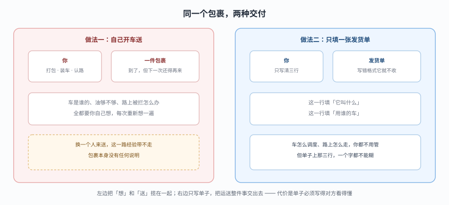
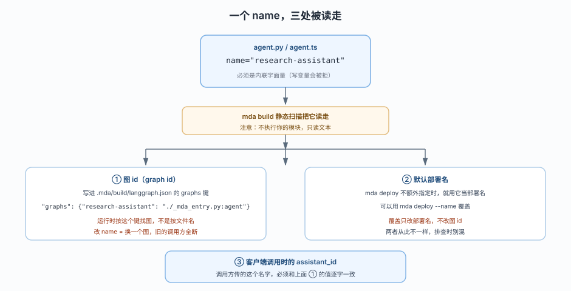
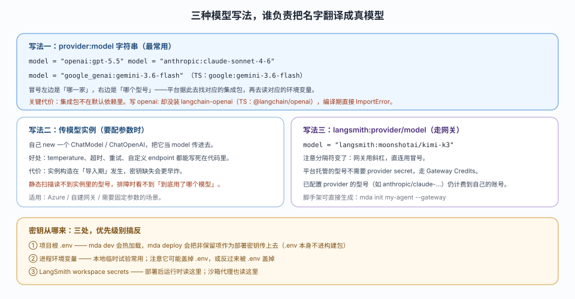
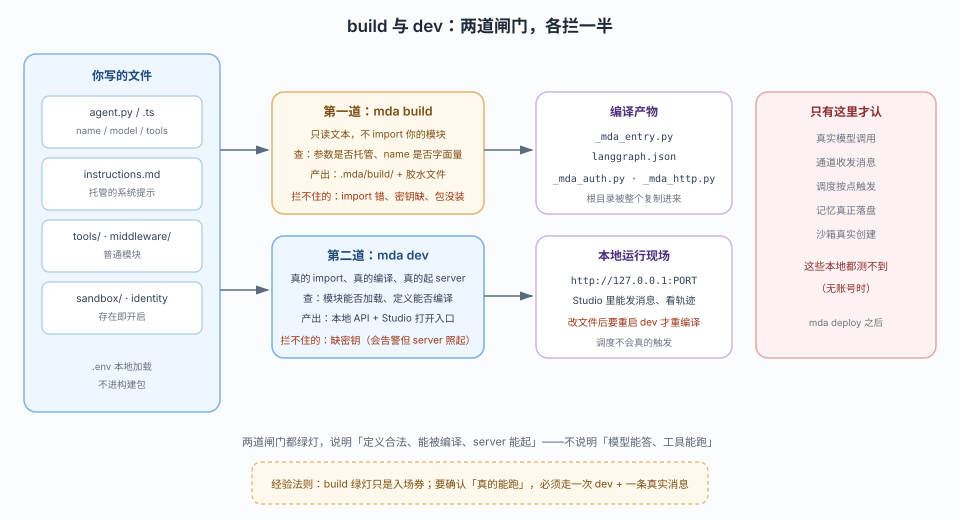
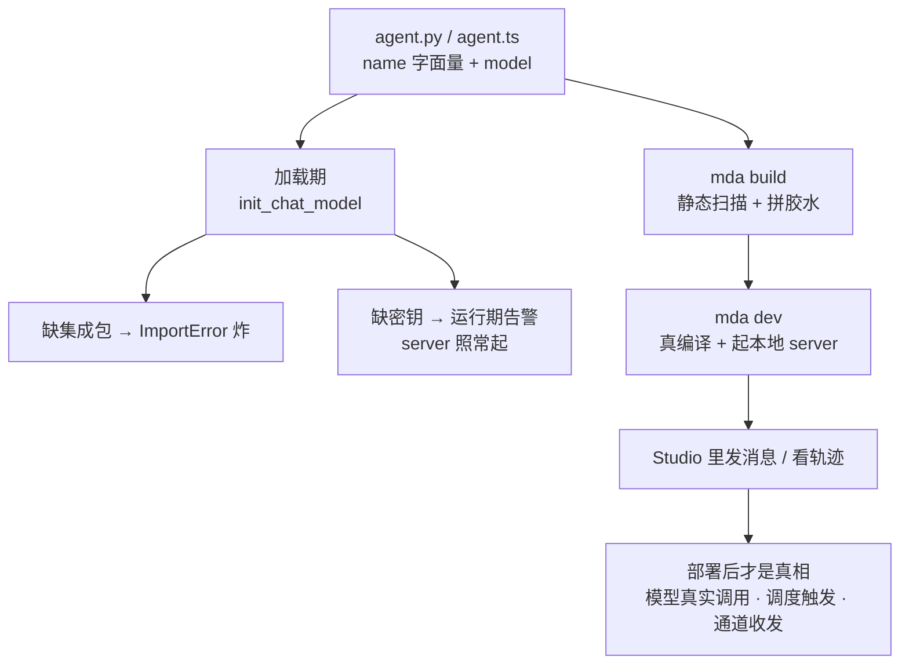

# 第 3 课：第一个可部署项目

> 所属阶段：阶段 1《定位与起跑》｜ 水平：入门 ｜ 本课知识点：定义入口与命名、模型与 provider 前缀、编译与本地预览
> 故事情节：你把定义写对了，但项目还是一个"目录"——本课把它变成一个真能被编译、真能在本地 Studio 里点开的项目
> 📖 结论已按官方文档核对（核对于 2026-10 ｜ 来源：`/langsmith/python/managed-deep-agents-agent-definition`、`-project-structure`、`-local-development`、`-cli` 及其 JavaScript 对应页）＋ 本机实测（`managed-deepagents 0.9.5`，Python 主线 / TS 平行线各一套探针）

## 🎯 本课目标

- 写出符合约束的 `agent.py` / `agent.ts` 入口，讲清 `name` 的三个用途
- 用字符串与实例两种方式配好模型，说清密钥从哪来、少了会怎样
- 跑通 `mda build` 与 `mda dev`，并解释"build 通过"到底证明了什么、没证明什么

---

## 第一幕：起源与场景引入

上一课你知道了：`define_deep_agent(...)` 给你的不是 agent，是一张"发货单"——得交给平台才能造出真东西。

问题来了：那这张单子怎么写，平台才收？

你翻开 quickstart，照着抄三行：

::: code-group

```python [Python]
from managed_deepagents import define_deep_agent

agent = define_deep_agent(
    name="research-assistant",
    model="openai:gpt-5.5",
)
```

```typescript [TypeScript]
import { defineDeepAgent } from "managed-deepagents";

export const agent = defineDeepAgent({
  name: "research-assistant",
  model: "openai:gpt-5.5",
});
```

:::

然后你执行 `uv run mda build`：

```text
◇  Managed app compiled
│  /abs/path/to/your-project/.mda/build
```

绿灯了。你松一口气，去 `mda dev`——server 起来了，但你朝它发一句"你好"，它回你：

```text
▲  The agent model 'openai:gpt-5.5' requires OPENAI_API_KEY in .../.env.
   Add `OPENAI_API_KEY=...` to .../ .env, and `mda dev` reloads it on save.
   Runs fail until then.
```

不是炸了，是**缺一张"入场券"**——模型密钥。本课就把"从单子到能跑"这条路上你会踩的三件小事一次讲清：单子第一行怎么写（name）、第二行怎么写（model）、以及"绿灯"到底证明什么。

> 📌 **一句话本质**：把"agent 长什么样"落成一份平台认的清单——本课把这份清单从"能编译"推进到"本地能点开"，但仍没到"能真实干活"。

> ⚖️ **处境对照**：在 Deep Agents 里，你 `create` 完就能 `invoke`，模型写错立刻见分晓；MDA 里模型名称、集成包、密钥要一次配齐，缺任何一环都会推迟到"碰真模型"的那一刻才报错。代价是配置在"能编译"与"能跑"之间多了好几道看不见的检查。

---

## 第二幕：认知冲突

你不是已经把 `name` 和 `model` 都写了吗？它还想要什么？

真正让人困惑的是这三点：

1. 我把 `name` 写成了变量 `NAME`，build 说 `name` 是 required——可我明明写了。
2. 我把 `model` 写成 `"gpt-5.5"`（省掉 openai: 前缀），build 竟然也绿灯，然后 dev 一碰就报错。
3. 我在本地把一切跑通了，可同事说部署后还是不行。

这三问指向同一个根因：**你的项目会被不止一个人读**——`mda build` 读文本、`mda dev` 读真代码、运行时按名字去别的系统里找东西。你以为在跟"一个 agent"打交道，其实你在跟**三套完全不同的检查逻辑**打交道。

本课拆开这三层：入口怎么写才算合格（知识点 1）、模型那行怎么写才真能找到（知识点 2）、以及"编译通过"到底证明了什么（知识点 3）。

---

## 第三幕：层层揭示

### 一眼全局图（进入细节前先看一眼）



> 看图：左边一个人自己把包裹送到对方手里，运的过程全是自己的；右边只填一张发货单，把"送"整套交出去。差别不在货物，而在**"你把什么交给别人、什么必须自己写清楚"**——写单子时，那几行字段一笔都不能糊。

四条硬约束自查：① 只回答"这课解决什么问题、靠什么思路"（把配置写对、交给平台跑）；② 图上无 `name`/`model`/`build` 等术语；③ 带读图指引；④ 图旁文字可独立成立。

### 本课地图（分几步走）

| 步 | 这一步要解决什么（人话） | 对应知识点 |
|:--:|------------------------|-----------|
| 1 | 先搞清"入口文件到底要长什么样、名字有什么讲究"，你就不会为 `name is required` 白折腾 | 知识点 1：定义入口与命名 |
| 2 | 再搞清"model 那行该怎么写、密钥从哪来"，你才知道为什么少了前缀就报错 | 知识点 2：模型与 provider 前缀 |
| 3 | 最后搞清"build 绿灯到底证明了什么"，你才知道什么时候该相信本地、什么时候必须走部署 | 知识点 3：编译与本地预览 |

---

### 知识点 1：定义入口与命名

> 🧭 第 1/3 步｜承接：第二幕的"我明明写了 name 却说没有" → 本步：看清入口文件的两个硬约束，以及 `name` 为什么必须是个字面量
> 本知识点关键点：入口必须导出名为 agent 的变量、`name` 必须是内联字面量、`name` 在一个项目里只能出现一次

#### 一句话定义

入口文件（`agent.py` / `agent.ts`）必须导出一个名为 `agent` 的定义，且 `name` 必须写成内联字符串字面量——因为 `mda build` 要在不执行你代码的前提下读到它。

#### 直觉建立（类比）

发货单上有一栏叫「运单号」。快递站的人长得高，得在三米外的墙上一排运单里找到你这张——他不可能跑过来问你，只能站在远处读单子上的字。所以这一栏**必须写清楚、必须是最外层能一眼看到的值**。

你如果把运单号写进一个变量 `const code = "123"`，快递员站在远处看到的是一张空白单——他找不到你的货，于是对你说「运单号没填」。

> 💡 **类比的边界**：快递员至少还能让你重填一次；而 `mda build` 是**一次性的静态扫描**——它读不到变量，就真的当「没填」处理，绝不会等你运行时再给一次机会。

#### 核心原理

##### 约束一：导出变量必须叫 `agent`

官方 project-structure 页的原话是：The only required file is `agent.py` at the project root containing the agent definition as a **named `agent`**.

实测一下"不叫 agent"会怎样。把定义改名后跑 build：

::: code-group

```python [Python]
# agent.py —— 错误示范
from managed_deepagents import define_deep_agent

renamed_agent = define_deep_agent(name="k3base", model="openai:gpt-5.5")
```

```typescript [TypeScript]
// agent.ts —— 错误示范
import { defineDeepAgent } from "managed-deepagents";

export const renamed = defineDeepAgent({ name: "ts-e", model: "openai:gpt-5.5" });
```

:::

```text
error: agent `name` is required in agent.py. Add a static string (e.g. name="research-assistant") to define_deep_agent(...);
       MDA uses it as the LangGraph assistant id and the default LangSmith deployment name.
```

注意这个报错有多**误导**：你明明写了 `name="k3base"`，它却说你没写 name——因为静态扫描根本认不出你的变量，于是从「找不到 name」出发，报了一个「name 缺失」的措辞。这类「报错指向别处」的陷阱，在参数映射里是常态，别被它带偏。

##### 约束二：`name` 必须是内联字面量

接上面：即便你写 `const NAME = "k3base"; agent = define_deep_agent(name=NAME, ...)`，依然报同一个错。因为扫描只认**直接的字符串字面量**，不认任何中间变量。

##### 一个项目只能有一个 `agent`

项目结构页说 "Use only one agent entry in a project." 实测：在 `agent.py` 里追加第二个定义 `second = define_deep_agent(name="second-one", ...)`，build 依然绿灯——因为它只认名为 `agent` 的那个导出，多余的会被忽略。所以「一个项目一个 agent」不是靠报错强制的，是**约定**：多写了也不报错，只是白写。



> 看图：中间那个 name 被三条线分别送进三个不同的地方——① build 时写进 langgraph.json 当图 id，② 不指定时当默认部署名，③ 客户端调用时当 assistant_id。三条消息指向同一个值：**改 name = 换了一台机器，旧的调用方全断**。

`name` 三处用途（官方 agent-definition 参数表原话整理）：

| 用途 | 何时生效 | 怎么改 |
|---|---|---|
| 图 id（graph id） | build 时写进 `langgraph.json` 的 `graphs` 键 | 运行时按这个键找图，不是按文件名 |
| 默认部署名 | `mda deploy` 不指定 `--name` 时 | 可用 `mda deploy --name` 覆盖，只改部署名不改图 id |
| 客户端 `assistant_id` | 调用方创建 run 时 | 必须和图 id 逐字一致，否则请求被拒 |

```json
// .mda/build/langgraph.json —— 图 id 就躺在这
{
  "graphs": { "research-assistant": "./_mda_entry.py:agent" }
}
```

#### 示例演示

写一个能过 build 的最小入口，然后故意踩一次「变量名」的坑，感受报错措辞和真实原因的对不上：

::: code-group

```python [Python]
# 先看能过的：
agent = define_deep_agent(name="demo", model="openai:gpt-5.5")

# 再故意写错：
NAME = "demo2"
agent = define_deep_agent(name=NAME, model="openai:gpt-5.5")
# error: agent `name` ... must be a static string literal
```

```typescript [TypeScript]
// 先看能过的（TS 侧 name 反而可以是变量，见下方"跨语言不对称"）：
const NAME = "demo2";
export const agent = defineDeepAgent({ name: NAME, model: "openai:gpt-5.5" }); // 通过

// TS 侧直接写非字面量也行：
export const agent = defineDeepAgent({ name: "ts-demo", model: "openai:gpt-5.5" });
```

:::

> ⚠️ **跨语言不对称（实测）**：Python 侧 `name` 必须是字面量；TS 侧 `name` 可以是变量（`const NAME = "ts-probe"; defineDeepAgent({ name: NAME })` 实测通过）。同一条约束，两种语言宽严不同——这是 `API-MAPPING.md` 里要单列的一条。

#### 常见误区

1. **"导出变量改名没事，反正就一个定义"**：不行。静态扫描只认 `agent` 这个导出名。改名后它找不到，直接报「name 缺失」——不是「导出缺失」，措辞极具误导。
2. **"name 是个变量我写得挺清楚"**：扫描看不出去。它只认直接的字符串字面量，`name=NAME` 就是「没写」。
3. **"加第二个 agent 会报错，所以我写错会被发现"**：不会报错，会**静默忽略**。项目只认名为 `agent` 的那个导出，其余的自作多情。

#### 一句话记住

单子第一行叫 `name`：必须是**直接可见的字面量**、必须导出成 `agent`、一个项目只能有一份；改它 = 换机器。

#### 🗣️ 行话对照

- **入口（entry / entrypoint）**：项目里那个导出 `agent` 的文件——就是本课说的"单子"。在哪遇到：project-structure 页的 "agent entry lives at the project root"
- **图 id（graph id）**：运行时用来找图的字符串键。在哪遇到：`langgraph.json` 的 `graphs` 键、部署日志、调用时的 `assistant_id`
- **静态扫描（static analysis / static read）**：不执行代码、只读源码文本的分析方式。在哪遇到：`mda build` 的行为描述、报错里 "must be a static string literal"

#### 官方文档

- Define a Managed Deep Agent（entry 位置 + name 参数表）: https://docs.langchain.com/langsmith/python/managed-deep-agents-agent-definition
- 对应 TypeScript 页: https://docs.langchain.com/langsmith/javascript/managed-deep-agents-agent-definition
- Project structure（"The only required file" 原话）: https://docs.langchain.com/langsmith/python/managed-deep-agents-project-structure

---

### 知识点 2：模型与 provider 前缀

> 🧭 第 2/3 步｜承接：入口写对了，但 model 那行反而成了最容易延期报错的地方 → 本步：把三种模型写法、密钥来源、缺包/缺前缀的真实表现讲透
> 本知识点关键点：`provider:model` 字符串是默认写法、模型实例用于要配参数时、密钥三处来源级别、集成包不在默认依赖里

#### 一句话定义

`model` 是平台用来"找模型"的线索——字符串写法让平台自己去翻译，实例写法让你自己把翻译好的东西塞进去；无论哪种，最后都差一个**集成包**和一个**密钥**。

#### 直觉建立（类比）

打电话订餐，你得报「哪家店、哪个套餐」——`provider:model` 就是这一句：「王记的牛肉面」。商家怎么接单、厨房怎么做，你不用管。

但如果你要加备注「少放辣、多点香菜」，光报名字不够——你得直接报「某某店，老板认识的李师傅，配菜按我上次说的来」。这就是传**模型实例**：把一堆配置好的细节直接交过去，平台不用自己翻译。

> 💡 **类比的边界**：订餐你还能随时改备注，而模型实例在**导入期**就建好了——一旦写进入口文件，它带的所有参数（temperature、endpoint）就固定了，改一行要重启整个 dev。

#### 核心原理



> 看图：上半部是三种写法并排，各自说清"谁去翻译这行字"；下半部是密钥三处来源。注意字符串写法里那个冒号左右——左边是「哪一家」，右边是「哪个型号」；而网关写法的分隔符变成了斜杠。

##### 写法一：`provider:model` 字符串（最常用）

```python
model = "openai:gpt-5.5"
model = "anthropic:claude-sonnet-4-6"
model = "google_genai:gemini-3.6-flash"   # TS: "google:gemini-3.6-flash"
```

冒号左边是 provider（哪一家），右边是型号。平台根据左边那串去找对应的集成包，再去读对应的环境变量。

**关键坑：集成包不在默认依赖里。** 脚手架 `pyproject.toml`（Python）或 `package.json`（TS）只声明了 `managed-deepagents` 自己。实测：

::: code-group

```text [Python]
# 没装 langchain-openai，直接编译定义
ImportError: Initializing ChatOpenAI requires the langchain-openai package. Please install it with `pip install langchain-openai`
```

```text [TypeScript]
# 没装 @langchain/openai，用 initChatModel 解析
Error: Unable to import @langchain/openai. Please install with `npm install @langchain/openai` or `pnpm install @langchain/openai`
```

:::

所以写 `openai:` 就得先补集成包。Python：`uv add langchain-openai`；TS：`npm install @langchain/openai`。装好后再触发一次，错误就从"缺包"变成"缺密钥"——**包和密钥是两个独立的问题，报错顺序固定：先包后密钥。**

##### 写法二：传模型实例（要配参数时）

```python
from langchain_azure_ai.chat_models import AzureAIOpenAIApiChatModel
model = AzureAIOpenAIApiChatModel(
    endpoint=os.environ["AZURE_AI_OPENAI_ENDPOINT"],
    credential=os.environ["AZURE_OPENAI_API_KEY"],
    model=os.environ["AZURE_OPENAI_DEPLOYMENT_NAME"],
)
agent = define_deep_agent(name="research-assistant", model=model)
```

实例写法的代价：① 实例在**导入期**就构造，密钥缺失会更早炸；② 静态扫描读不到实例里的型号，排障时"看不到到底用了哪个模型"；③ 当在需要固定参数、自定义 endpoint（Azure、自建网关）时。

##### 写法三：`langsmith:...`（走网关）

```python
model = "langsmith:moonshotai/kimi-k3"   # 网关用斜杠，直连用冒号
```

平台托管的型号不需要 provider secret，走 Gateway Credits；已配置 provider 的型号（如 `anthropic/claude-...`）仍计费到自己的账号。脚手架可一步生成：`mda init my-agent --gateway`。

##### 密钥三处来源（级别别搞反）

| 来源 | 什么时候读 | 备注 |
|---|---|---|
| 项目根 `.env` | `mda dev` 热加载；`mda deploy` 把非保留项作为部署密钥传上去（`.env` 本身不进构建包） | 日常开发最常用 |
| 进程环境变量 | 本地临时试验 | 可能和 .env 互盖，谁赢看实现 |
| LangSmith workspace secrets | 部署后运行时 | 沙箱代理也读这里 |

缺密钥的**真实报错**（`mda dev` 已起、但一发消息就失败）：

```text
▲  The agent model 'openai:gpt-5.5' requires OPENAI_API_KEY in .../.env.
   Add `OPENAI_API_KEY=...` to .../ .env, and `mda dev` reloads it on save.
   Runs fail until then.
```

注意：这行**不炸** server——它会热加载，你把 key 写进 `.env`，保存即生效。这是它和"缺包"的区别：缺包是编译期 ImportError（炸）、缺密钥是运行期告警（不炸但跑不动）。

#### 示例演示

验证"省掉前缀"会怎样。把 `model` 从 `"openai:gpt-5.5"` 改成 `"gpt-5.5"`：

::: code-group

```python [Python]
# 省掉前缀，build 照样绿灯：
agent = define_deep_agent(name="x", model="gpt-5.5")
# ◇  Managed app compiled   ← 绿灯

# 但一碰真实模型就露馅（实测，装好 langchain-openai 后）：
# OpenAIError: Missing credentials. Please pass an `api_key`, ... or set the
# OPENAI_API_KEY or OPENAI_ADMIN_KEY environment variable.
```

```text [TypeScript]
# TS 侧 initChatModel 解析：
# gpt-5.5            → 需要 openai 集成包
# openai:gpt-5.5     → 同样需要 openai 集成包
# opnai:gpt-5.5      → ValueError: Unable to infer model provider ... Please specify 'model_provider'
```

:::

结论一句话：**build 不解析模型名**——它只把字符串原样存起来；真正去"认"provider 的是加载期的 `init_chat_model`。所以写错拼写（比如 `opnai:`）在 build 时看不出来，到了加载期才报「Unable to infer model provider」。

#### 常见误区

1. **"省掉 `openai:` 前缀没关系，反正都是模型"**：build 确实不拦，但加载期会报错——省前缀不是"优化"，是"推迟报错"。
2. **"集成包装一次就完了"**：`.env` 里的密钥、`pyproject.toml` / `package.json` 里的依赖，一起构成"可跑"的最低条件。缺任何一个，都会在某个你看不到的阶段暴露。
3. **"本地跑通了就一定能部署"**：本地能编译、能起 server，不代表部署后模型密钥、沙箱凭据都能对上——那些是从 workspace secrets 读的，跟本地 `.env` 是两回事。

#### 一句话记住

`model` 写品牌+型号，但要真跑得补集成包、配密钥——缺包是编译炸、缺密钥是运行期告警，两者先后顺序不同。

#### 🗣️ 行话对照

- **provider / 模型提供方**：`model` 字符串冒号左边那半，决定用什么集成包。在哪遇到：models 文档、部署日志。
- **集成包（integration package）**：如 `langchain-openai` / `@langchain/openai`，负责把品牌 API 翻译成 langchain 的 ChatModel。在哪遇到：加载期 ImportError 的提示。
- **LLM Gateway（模型网关）**：平台集中路由模型调用、施加速率与回退策略的服务；model ID 用 `langsmith:` 前缀 + 斜杠分隔。在哪遇到：agent-definition 页 "Use LLM Gateway" 小节。

#### 官方文档

- Define a Managed Deep Agent（model 参数两种写法 + gateway）: https://docs.langchain.com/langsmith/python/managed-deep-agents-agent-definition
- 对应 TypeScript 页: https://docs.langchain.com/langsmith/javascript/managed-deep-agents-agent-definition

---

### 知识点 3：编译与本地预览

> 🧭 第 3/3 步｜承接：名字和模型都对了，那"build 绿灯"到底值多少钱？ → 本步：把 build 与 dev 的能力边界画清楚，讲清什么时候该信本地、什么时候必须走部署
> 本知识点关键点：build 是静态文本校验、dev 才是真编译、部署是唯一验证真实行为的途径

#### 一句话定义

`mda build` 只做静态文本扫描与胶水拼装，不执行你的代码；真正的编译发生在加载期（`mda dev` / `mda deploy`）；而「模型真能答、工具真能跑」只能在部署后验证。

#### 直觉建立（类比）

体检报告「各项指标正常」不等于「你能跑马拉松」——它只说明你没查出大毛病。`mda build` 就是这个体检：查的是"格式对不对"，不是"能不能干活的职能"。

真正的体格测试是 `mda dev`：真的把你整个人拉起来跑几步。但它也只是在操场跑——跟正式比赛（部署）还是有差别：赛场上风云、对手、计分规则都不一样。

> 💡 **类比的边界**：更多时候「体检正常」连"能跑几步"都不保证——build 绿灯但缺模型包，一 deploy 就炸。所以永远别把 build 当"生产就绪"的证明。

#### 核心原理

已知（来自课 2 的实测证据链）：
- `mda build` 不 import 你的模块（print 计数为 0）
- `mda build` 拦得住"参数托管"（system_prompt 等 10 项全部 exit=1）
- `mda dev` 一启动就做真加载；import 写错会在这里炸

把这两道闸门并排画出来，能力边界一目了然：



> 看图：第一道 build 只读文本（绿框），拦「参数托管、name 非字面量」；第二道 dev 真编译（蓝框），拦「模块加载、定义编译」。两道都拦不住的，是「缺密钥」（会告警但不炸）——而真实模型调用、通道、调度、记忆落盘，本地根本测不到。

关键结论，按"该信什么"从强到弱排：

| 我想确认的事 | 用哪个手段 | 绿灯说明什么 |
|---|---|---|
| 定义本身合法（无托管参数） | `mda build` | 静态扫描通过 |
| 模块能被加载、定义能编译 | `mda dev` | 真代码能跑起来、server 正常 |
| 模型真能答、工具真能跑 | 只有部署后 | 本地测不到 |
| 调度按点触发、通道收发 | 只有部署后 | 本地 dev 记为列表但不触发 |

补充一个实测细节：`mda dev` 在缺模型密钥时**不炸**——server 照常起来，只是每次真实调用都回到「缺失告警」：
- 报错原文（脱敏）：`▲  The agent model 'openai:gpt-5.5' requires OPENAI_API_KEY in .../.env ... Runs fail until then.`
- 这行告警你只要补 `.env` 就会消失，`mda dev` 检测到保存会热加载。

还有两个 dev 的本地行为（local-development 页原话）：
- 调度在本地**不触发**：`mda dev` 只是把每个 schedule 列出来，不会真的 provision。
- 改文件后**停掉重跑** `mda dev` 才会重编译（新版本可能会热重载，但别依赖）。

#### 示例演示

完整串一遍"从目录到真能在 Studio 里点开"的最小路径：

```bash
# ① 生成项目
uvx --from managed-deepagents mda init demo --model "openai:gpt-5.5"
cd demo

# ② 装依赖（含 provider 集成包）
uv sync
uv add langchain-openai          # 补 openai 集成包（脚手架不自带）

# ③ 静态校验（不需要密钥）
uv run mda build
# ◇  Managed app compiled  →  验证格式合法

# ④ 真加载 + 起 server（需要密钥；缺了会告警但不炸）
uv run mda dev --no-browser
# ●  Project: demo (Python)
# ●  Agent   demo (agent.py)
# └  Starting LangGraph dev server…
# - 🚀 API: http://127.0.0.1:PORT
# - 🎨 Studio UI: https://smith.langchain.com/studio/?baseUrl=http://127.0.0.1:PORT
```

TS 侧对应：

```bash
npx managed-deepagents init demo-ts --model "openai:gpt-5.5"
cd demo-ts
npm install
npm install @langchain/openai
./node_modules/.bin/mda build
./node_modules/.bin/mda dev --no-browser
```

> 🎯 **会用标志**：你能说出「`mda build` 绿灯 × `mda dev` 起来 + 一条真实消息成功」三层分别证明了什么，就是会用本课了。做到这一步，你就完成了阶段 1 的全部目标。

#### 常见误区

1. **" `mda build` 过了，说明定义没问题"**：只说明"格式"没问题。import 写错、包没装，build 全绿灯，dev 一碰就炸。
2. **"本地 dev 都跑通了，部署肯定没问题"**：本地读 `.env`、部署读 workspace secrets——两套凭据，互不通用。
3. **"缺密钥会报错挡住我"**：不会挡住，`mda dev` 照起，只是每次调用失败并告警。别把"server 起来了"当成"能干活了"。

#### 一句话记住

build 查格式、dev 查编译、部署查真实——绿灯层层递进，越往后越接近"真的能跑"，但只有最后一层算数。

#### 🗣️ 行话对照

- **静态校验 / 文本扫描（static check）**：不执行代码的源码检查。在哪遇到：`mda build` 行为说明。
- **加载期（load time）**：真正 import 与编译发生的时间点，区别于 build 期。在哪遇到：`mda dev` / `mda deploy` 的失败日志。
- **本地 Agent Server / 本地 dev server**：`mda dev` 拉起来的本地 LangGraph server，真实战斗前最后的沙盘。在哪遇到：local-development 文档、`--no-browser` / `--port` 参数。

#### 官方文档

- Develop locally with LangSmith Studio（mda dev 行为 + `--no-browser` / `--port`）: https://docs.langchain.com/langsmith/python/managed-deep-agents-local-development
- CLI reference（mda init --model / build / dev 参数表）: https://docs.langchain.com/langsmith/python/managed-deep-agents-cli
- 对应 TypeScript 页: https://docs.langchain.com/langsmith/javascript/managed-deep-agents-cli

---

## 第四幕：实操验证

### 4.1 机制验证

> ✅ 实测于 Linux / Python 3.12.3 / Node v22.22.2 / `managed-deepagents 0.9.5`（三个探针工程：`k3-a` 改名、`k3-b` 多定义、`ts-e` TS 侧）

**实验一：导出变量不叫 `agent`，build 报什么？**

::: code-group

```bash [Python]
cd my-agent
sed -i 's/^agent = define_deep_agent/renamed_agent = define_deep_agent/' agent.py
uv run mda build; echo "exit=$?"
```

```text [Python 输出]
error: agent `name` is required in agent.py. Add a static string (e.g. name="research-assistant") to define_deep_agent(...)
exit=1
```

```bash [TypeScript]
sed -i 's/export const agent = defineDeepAgent/export const renamed = defineDeepAgent/' agent.ts
./node_modules/.bin/mda build; echo "exit=$?"
```

```text [TypeScript 输出]
error: agent `name` is required in agent.ts. Add a static string (e.g. name: "research-assistant") to defineDeepAgent(...)
exit=1
```

:::

报错都指向 `name`——**不是**「你没导出 agent」。这就是静态扫描的误导性：它认不出你的变量，于是从「没 name」这个起点编了个理由。记住这条经验：**报错说 name 缺失，先去看导出名对不对。**

**实验二：一个项目加第二个 `agent` 定义，会怎样？**

```bash
# 在 agent.py 末尾追加第二个定义
cat >> agent.py <<'EOF'

second = define_deep_agent(name="second-one", model="openai:gpt-5.5")
EOF
uv run mda build; echo "exit=$?"
# ◇  Managed app compiled
# exit=0
```

```json
// 看产物：graphs 里只有第一个（k3base），第二个（second-one）被静默丢弃
{ "graphs": { "k3base": "./_mda_entry.py:agent" } }
```

结论：**不报错，静默忽略**。项目只认命名为 `agent` 的那个导出。

**实验三：`model` 缩写成 `<型号>`，build 和 dev 分别怎么反应？**

```bash
# 把 openai:gpt-5.5 改成 gpt-5.5
sed -i 's|model="openai:gpt-5.5"|model="gpt-5.5"|' agent.py
uv run mda build 2>&1 | tail -2
# ◇  Managed app compiled     ← build 完全不管模型名
```

```python
# 但用 init_chat_model 去解析它，立刻露馅（装好 langchain-openai 后）：
import langchain
from langchain.chat_models import init_chat_model
init_chat_model("gpt-5.5")
# ImportError: Initializing ChatOpenAI requires the langchain-openai package...
# 而 init_chat_model("opnai:gpt-5.5")
# ValueError: Unable to infer model provider for model='opnai:gpt-5.5'
```

**实验四：集成包到底在不在脚手架默认依赖里？（两侧实测）**

::: code-group

```text [Python]
# pyproject.toml 的 dependencies 只有一行：
dependencies = ["managed-deepagents==0.9.5"]
# 没装 openai 集成包，直接编译定义：
ImportError: Initializing ChatOpenAI requires the langchain-openai package.
```

```text [TypeScript]
# package.json 的 dependencies 只有：
{ "managed-deepagents": "0.9.5" }
# 没装 @langchain/openai，用 initChatModel 解析：
Error: Unable to import @langchain/openai. Please install with `npm install @langchain/openai`
```

:::

补装后（Python `uv add langchain-openai` / TS `npm install @langchain/openai`），再触发一次，错误从「缺包」变成「缺密钥」（`Missing credentials ... set the OPENAI_API_KEY`）——**包和密钥是两个先后出现的独立问题，报错顺序固定。**

> ✅ **回扣场景**：第一幕里那句「你可能以为 name 没写」的困惑，到这里应该能自己解释了——不是你没写，是静态扫描只能读到能直接看到的东西。而「build 绿灯却一发消息就失败」，是缺模型包/密钥被推迟到了加载期与运行期。

### 4.2 应用实战（入口）

> 📖 本课不配独立应用实战——知识点本身就是"把最小项目跑通"，与阶段 1 的整体目标一致，已由课 2 实战的「搬运」练习覆盖演进需求。后续阶段的能力声明课（课 4–6）将各自配实战。

---

## 第五幕：体系收束

三个知识点串起来是同一个判断的深化：

因为 **build 只读文本**（知识点 1 的 `name` 字面量约束由此而来），所以**模型配置的正确性必须靠加载期把关**（知识点 2 的"先包后密钥"）；而加载期把关也拦不住「真实行为」，于是**能跑多远取决于你敢走多深**（知识点 3 的 build → dev → deploy 三层信任）。

> 📍 **全局定位**：本课完成阶段 1 的全部目标——你现在能写出符合约束的入口、配好模型、并在本地把它编译起来。但本地证明的只是"这台机器的沙盘"，真实行为要等部署。接下来阶段 2（课 4–6）会往单子里填能力：指令、技能、工具、中间件、MCP、记忆、沙箱、身份。每加一样，你都要能回答"它写在哪、什么时候生效"——这正是课 2 那张三色分区图的用法。
> 🔗 **下一步**：课 4 讲第一类能力——指令、技能与工具。你会发现，`instructions.md` 是"系统提示该放的地方"，而工具要写成普通模块再 import 进入口。

---

## 🐞 常见误区

1. **"`mda build` 是编译，编译过就能跑"**：build 是静态文本扫描，不 import 你的模块。真正编译在加载期。
2. **"model 省掉前缀没关系"**：build 不拦，但加载期 `init_chat_model` 解析不了，报 `Unable to infer model provider`。
3. **"集成包装好一次就完了"**：集成包 + `.env` 密钥一起构成可跑条件；缺任何一环都会在某个阶段暴露（先包后密钥）。
4. **"本地 dev 跑通 = 部署没问题"**：本地读 `.env`、部署读 workspace secrets，两套凭据互不通用。

### ⏳ 与过时说法对照

| 旧说法 | 实测现状（核对于 2026-10，`0.9.5`） | 来源 |
|---|---|---|
| "`mda build` 能验证我的定义" | build 只查参数托管与 name 字面量；import、包、密钥全不查，绿灯不代表编译通过 | 本机实测（print 计数 0 + 坏 import 绿灯） |
| "模型名写错会被马上发现" | 不会。build 原样存字符串，加载期 `init_chat_model` 才解析；`opnai:` 在 build 绿灯、加载期才 `ValueError` | 本机实测（三探针） |
| "name 同样规则约束两侧" | 不对称：Python 必须字面量、TS 可用变量 | 本机实测（TS 探针） |
| "缺模型密钥会挡住启动" | 不会。`mda dev` 照起、只告警 `Runs fail until then`，补 `.env` 保存即热加载 | 本机实测（k3-c / ts-e dev 日志） |

> 这张表是本课的非模板化亮点：四条都来自实测，其中「先包后密钥」「build 不解析模型名」「TS 变量 name」三条官方文档字面看不出来。

## 一图总结



> 与课首入口的分工：课首那张讲"把写单子这回事想清楚"（零术语）；这张讲"单子提交后的链路"（术语可用、给刚学完的人复习）。

## 课后小测

**Q1**：你把 `agent.py` 里的定义改名成 `my_def = define_deep_agent(...)`，跑 `mda build` 报 `agent name is required`。最可能的原因是？
- A. `name` 参数拼写错了
- B. 静态扫描认不出你的导出变量，从「没 name」出发报了误导措辞
- C. 需要先装 `langchain-openai`
- D. `name` 不能以字母开头

<details><summary>答案与解析</summary>

**答案：B**。静态扫描只认名为 `agent` 的导出；改名后它找不到定义，就报「name 缺失」——措辞指向别处。装包、拼写都与此无关。

</details>

**Q2**：你想确认"这个 agent 真能跑"——最接近正确的判断是？
- A. `mda build` 绿灯即可
- B. `mda dev` 起来 + 发一条真实消息成功
- C. `mda dev` 起来就行，server 正常 = 能跑
- D. `mda build` + 检查 `.env` 里有没有 key

<details><summary>答案与解析</summary>

**答案：B**。build 只查格式；dev 起来只代表能编译；缺密钥时 server 照起但一发消息就失败。要确认"能跑"，必须真发消息。C 的陷阱在于"server 正常 ≠ 模型能答"。

</details>

**Q3**：下面哪种最能避免"部署后才发现问题"？
- A. 部署前跑一次 `uv run mda build`，确认绿灯
- B. 本地 dev 里把每条指令都试一遍，属于"部署前完整验证"
- C. 明确区分「静态校验 / 本地编译 / 部署真实行为」三层能力边界，按需选择验证手段
- D. 部署前把 `.env` 里的 key 分享给团队每个人都配一份

<details><summary>答案与解析</summary>

**答案：C**。关键在于知道每层证明什么：build 只查格式、dev 查编译、真实行为只能部署后验。A 会漏掉缺包/密钥；B 错误（本地无调度、无通道、无真实云凭据）；D 是泄密行为。

</details>

## 🚀 下一批接力提示词

> 学完本课后，复制下面这段发给 AI，即可继续：

```
继续学 Managed Deep Agents。我的学习档案在 langchain/managed-deep-agents/00-学习档案.md，
刚学完阶段 1《定位与起跑》的课 3《第一个可部署项目》的三个知识点
（定义入口与命名、模型与 provider 前缀、编译与本地预览），
请按大纲继续讲解阶段 2 的课 4《指令、技能与工具》的三个知识点。
```

## 🧭 课程导航

⬅️ **上一课**：[课 2：托管的是什么](./02-托管的是什么.md)

➡️ **下一课**：[课 4：指令、技能与工具](../../2-能力声明/lessons/04-指令技能与工具.md)

📚 **返回目录**：[课程目录](../../../02-课程目录.md)
