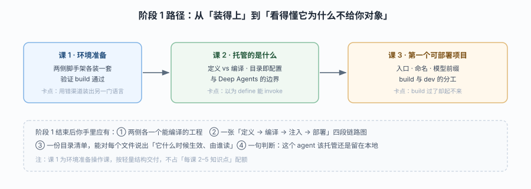

# 阶段 1：定位与起跑

> 所属课程：Managed Deep Agents ｜ 故事章节：「这活儿到底谁在干」 ｜ 下一阶段：[阶段 2](../2-能力声明/overview.md)

## 🎯 本阶段目标

- 说清 MDA 在 LangChain 生态里站在哪一层：它不是新框架，而是"给 Deep Agents 配了一个运行平台"
- 跑通两侧脚手架，把一个最小 agent 编译出来并在本地预览到"只差模型密钥"这一步
- 建立本课程最重要的一条判断力：**看到 `define_deep_agent` 就想清楚"它为什么不给我一个能直接 invoke 的 agent"**

## 📍 学习重点

- **定义与编译分离**：`define_deep_agent` 返回的是配置而非 runnable，这个设计决定了后面所有的写法（为什么提示词要放文件、为什么拿不到 backend）
- **项目即配置**：目录约定（`instructions.md` / `skills/` / `tools/mcp.py` / `sandbox/`）取代了大量构造参数，代价是"看不见的约定"
- **参数映射**：`create_deep_agent` → `define_deep_agent` 哪些原样保留、哪些搬进文件、哪些被运行时接管
- **脚手架语言由安装渠道决定**：PyPI 包只生成 Python 项目，npm 包只生成 TS 项目——这是双语读者第一个会踩的坑

## ✅ 必须掌握的知识点

| 知识点 | 所属课 | 学完应能 |
|--------|--------|----------|
| 环境准备（操作课） | 课 1 | 独立装好两侧工具链，用验证命令确认每项可用 |
| 定义与编译分离 | 课 2 | 说清 `define_deep_agent` 与 `create_deep_agent` 的职责边界，解释为什么定义阶段拿不到 backend |
| 项目即配置 | 课 2 | 对着一个目录说出每个文件的用途与生效时机 |
| 与 Deep Agents 的边界 | 课 2 | 判断一个既有 agent 该留在原处还是迁移，并说出理由 |
| 定义入口与命名 | 课 3 | 写出符合约束的 `agent.py` / `agent.ts` 入口，解释 `name` 的三处用途 |
| 模型与 provider 前缀 | 课 3 | 用字符串与实例两种方式配模型，说清密钥从哪来 |
| 编译与本地预览 | 课 3 | 跑通 `mda build` / `mda dev`，并解释 build 通过不等于定义正确 |

## 🗺️ 本阶段路径图

> 看图：先把环境立起来（课 1），再建立"定义不等于 agent"这个心智模型（课 2），最后才能写出第一个真正能被编译的入口（课 3）。课 2 是关键转折——跳过它直接抄代码，后面每一步都会困惑"为什么我拿不到对象"。

## 本阶段产出

- [ ] `lessons/01-环境准备.md`
- [ ] `lessons/02-托管的是什么.md`
- [ ] `lessons/03-第一个可部署项目.md`
