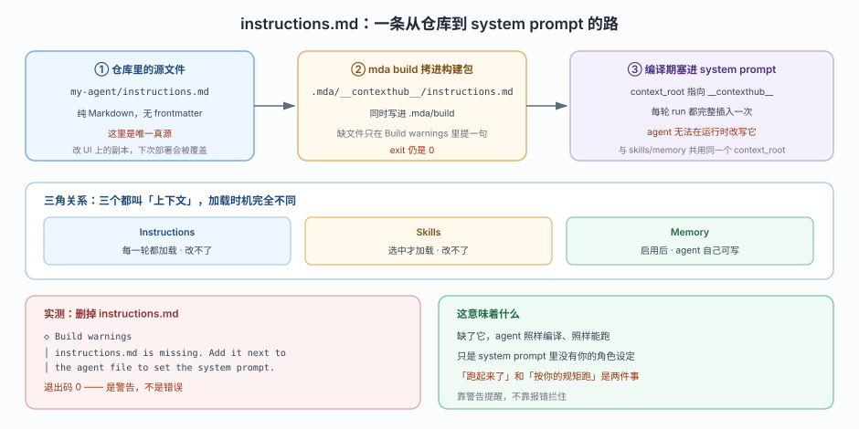
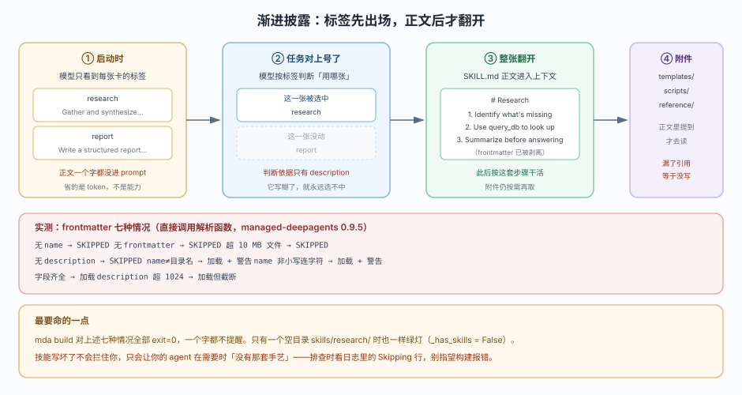
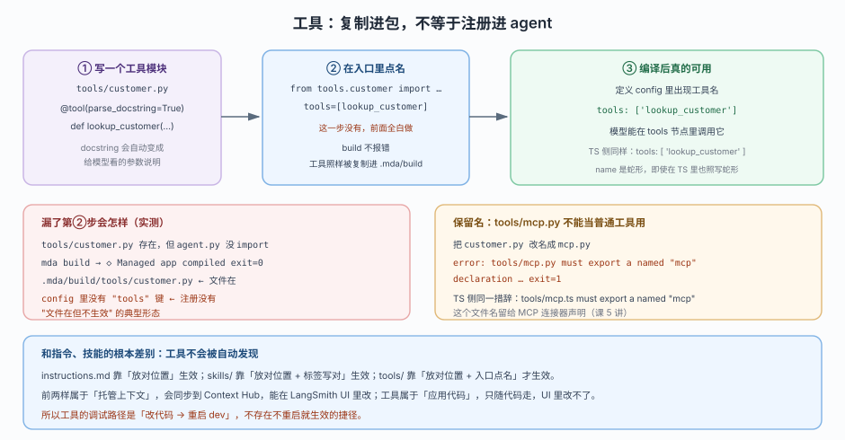
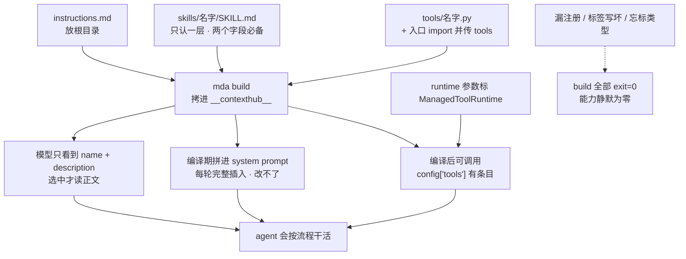

# 第 4 课：指令、技能与工具

> 所属阶段：阶段 2《能力声明》｜ 水平：入门 ｜ 本课知识点：指令即系统提示、技能目录与渐进披露、自定义工具与运行上下文
> 故事情节：上一课你把项目跑到本地能点开了，但那个 agent 还只会说"我是助手"——本课给它装上三样东西：规矩、手艺、动手能力
> 📖 结论已按官方文档核对（核对于 2026-10 ｜ 来源：`/langsmith/python/managed-deep-agents-instructions`、`-skills`、`-tools`、`-runtime` 及其 JavaScript 对应页）＋ 本机实测（`managed-deepagents 0.9.5`，Python 主线 / TS 平行线各一套探针）

## 🎯 本课目标

- 写对 `instructions.md`，讲清它为什么永远只读、和 skills/memory 的加载时机差在哪
- 写出 `skills/<名字>/SKILL.md`，说清 frontmatter 写坏会怎样、目录能放几层
- 写出能被模型真正调用的工具，并用 `ManagedToolRuntime` 安全读出调用者与运行来源

---

## 第一幕：起源与场景引入

上一课结束时，你的项目已经是这个状态：

```text
◇  Managed app compiled
●  Project: demo (Python)
└  Starting LangGraph dev server…
```

你把 Studio 打开，发一句"帮我看下 A-1024 这个客户是什么等级"，它回你：

```text
我是一个有帮助的助手。请问您需要什么帮助？
```

技术上完全正确——`instructions.md` 里就写着 `# Assistant / You are a helpful assistant.`。但这不是你要的东西。

你要的是：它知道自己是谁（客服）、查客户时该用什么（一个内部接口）、以及每次查之前该先确认什么（一套核对流程）。这三件事，正好对应三个不同的文件位置：

| 你要它具备的 | 该写到哪 | 谁决定什么时候看 |
|---|---|---|
| 「你是客服，遇到退款先核对订单」——永远成立的规矩 | `instructions.md` | 平台，每一轮都塞进去 |
| 「查客户等级的完整流程」——只在相关时才用的手艺 | `skills/<名字>/SKILL.md` | 模型，觉得对得上才翻 |
| 「真去调内部接口拿数据」——能干活的手 | `tools/<名字>.py` + 入口 import | 你，必须显式点名 |

三样东西都只是"放文件"，但只有第一样是放进去就生效。本课就把这三种"交代方式"的差别讲透——尤其是那两样**放错了不会报错**的。

> 📌 **一句话本质**：MDA 声明能力的方式不是调 API，而是**把文件放到约定位置**；但"放对位置"只对指令成立，技能还要标签写对，工具还要入口点名。

> ⚖️ **处境对照**：在 Deep Agents 里，你给 `create_deep_agent` 传 `system_prompt`、传 `tools=[...]`，一个参数就到位，写错立刻报错。MDA 里这些全变成"文件约定"，好处是配置可以版本化、可以在 UI 里改；代价是**约定写错时没人拦你**——构建绿灯、agent 起来、只是不做你想要的事。

---

## 第二幕：认知冲突

你已经把三个文件都放好了，为什么 agent 还是不听话？

真正让人困惑的是这四点：

1. 我写了 `instructions.md`，但我在 `define_deep_agent(instructions="...")` 里也写了一份——build 直接报错，说让我删掉。
2. 我建了 `skills/research/` 目录，忘了放 `SKILL.md`，build 绿灯，agent 也从不提这个技能。
3. 我在 `tools/customer.py` 里把工具写好了，build 绿灯，`.mda/build/tools/customer.py` 文件也在——但模型根本调不到。
4. 我按官方示例给工具加了 `runtime` 参数，结果模型的参数列表里多出一个叫 `runtime` 的必填项。

这四问指向同一个根因：**"文件在不在"和"能力生效没生效"是两套完全独立的判断。** 构建器只管搬文件，真正决定能力的另有其人——指令由编译期拼 prompt、技能由模型自己按标签挑、工具由你在入口里点名。

本课拆开这三层：规矩怎么写才真进 prompt（知识点 1）、手艺怎么写才真被挑中（知识点 2）、手怎么装才真能调用（知识点 3）。

---

## 第三幕：层层揭示

### 一眼全局图（进入细节前先看一眼）


> 看图：三个并排的方框，分别对应"每次都说的规矩""遇到特定事才用的手艺""真能动手的家伙"。每个框上半部写"放在哪"，下半部写"什么时候被读"。请只注意底部那行总结：前两样放进去就算数，第三样还得再点名一次。

四条硬约束自查：① 只回答"这课解决什么问题、靠什么思路"（把三样东西分清）；② 图上无 `instructions.md` 以外的术语（`SKILL.md` / `tools/` 是必要路径，已用大白话解释）；③ 带读图指引；④ 图旁文字可独立成立。

### 本课地图（分几步走）

| 步 | 这一步要解决什么（人话） | 对应知识点 |
|:--:|------------------------|-----------|
| 1 | 先搞清"那份谁都该看的规矩该写在哪"，你就不会为 `instructions` 报错白折腾 | 知识点 1：指令即系统提示 |
| 2 | 再搞清"按场景切换的手艺怎么放、标签怎么写"，你才知道为什么技能像是"不存在" | 知识点 2：技能目录与渐进披露 |
| 3 | 最后搞清"能干活的工具怎么装才算装上"，你才知道文件在了为什么还是调不到 | 知识点 3：自定义工具与运行上下文 |

---

### 知识点 1：指令即系统提示

> 🧭 第 1/3 步｜承接：第二幕的"我两个地方都写了 instructions 反而报错" → 本步：把 instructions.md 的唯一真源地位、注入链路、以及它与 skills/memory 的分工讲清
> 本知识点关键点：`instructions.md` 是唯一入口、每轮完整插入、运行时改不了、平台还会额外拼一段固定前言

#### 一句话定义

`instructions.md` 是放在项目根目录的一份纯 Markdown，平台在**每一轮 run** 都把它完整塞进 system prompt 的最前面——而且 agent 自己改不了它。

#### 直觉建立（类比）

店门口贴的员工守则。不管今天来的是老客人还是新客人、点的是面还是饭，员工进门第一件事都是抬头看一遍这张纸。它贴在墙上，不是揣在兜里——所以员工没法自己撕下来改。

而 skills 是墙上挂的菜谱卡：只在客人点那道菜时才取下来看。memory 是后厨那本随手记的本子：谁都能往上写。

> 💡 **类比的边界**：守则贴墙上确实谁都改不了，但店长可以换一张（你重新部署就行）；而 agent 连"换"都做不到——它在运行时既不能读自己的 instructions 去改，也不能把它挪走。

#### 核心原理



> 看图：上面三段是链路——仓库源文件 → `mda build` 拷进 `.mda/__contexthub__/` → 编译期拼进 system prompt。中间那条淡蓝框是"三角关系"对比，把 instructions / skills / memory 的加载时机并排放。下面两块红绿对照，是删掉文件后 build 的原始输出。重点看红块右下角那行：退出码是 0。

##### 三件事要分清

第一，**它在仓库里是唯一真源**。官方原文：It is best to keep the `instructions.md` file in the repo as the source of truth for lasting changes, as later deployments sync the project copy again. 意思是：你可以在 LangSmith UI 里临时改，但下次 `mda deploy` 会拿仓库里的版本盖回去。想让改动长期生效，改文件、重新部署。

第二，**它不能写在参数里**。很多人第一反应是 `define_deep_agent(instructions="You are a pirate.")`。实测直接拒绝：

::: code-group

```text [Python]
error: agent.py: Remove `instructions` from define_deep_agent(...). Use a factory entrypoint to
       select instructions per run; static agents use instructions.md.
```

```text [TypeScript]
error: agent.ts: Remove `instructions` from defineDeepAgent(...). Use a factory entrypoint to
       select instructions per run; static agents use instructions.md.
```

:::

注意报错里的分岔：静态 agent 用 `instructions.md`；要"每次运行不一样"，得用**工厂入口**（factory entrypoint，课 7 讲）。这不是限制你，是逼你把"固定规矩"和"按运行变化"分开——前者可审计、可在 UI 改，后者才进代码。

第三，**平台会额外拼一段固定前言**。你写在 `instructions.md` 里的内容并不是 system prompt 的全部。实测拼装逻辑是：

```text
<managed_deep_agent>
You are a Managed Deep Agent (MDA), built on LangChain's Deep Agents harness.
</managed_deep_agent>

（这里才是你 instructions.md 里的内容）
```

这段 120 字符的前言是平台标识，`\n\n` 接你的正文——**你的内容永远在后面，且无法覆盖它**。写 instructions 时心里要有数：模型看到的第一句不是你写的那句。

##### 三角关系：三个都叫"上下文"，加载时机完全不同

| 概念 | 角色 | 什么时候加载 | agent 能改吗 |
|---|---|---|---|
| **Instructions** | 常驻 system prompt | 每一轮 run | 不能 |
| **Skills** | 任务专用的流程 | 模型挑中时 | 不能 |
| **Memory** | agent 自己积累的知识 | 启用持久记忆后 | 能写 |

这张表在官方 instructions 与 skills 两页底部各完整出现一次；memory 页则用另一种两行对照（"instructions + skills" vs "memory"），强调前者"部署所有、对 agent 只读"，后者运行时可变。三者最容易混的点是：**都"写在项目里"，但只有 memory 是运行时可写的**。如果你希望 agent"越用越懂"，那不是 instructions 的事。

##### 缺了它会不会炸

不会。实测删掉 `instructions.md` 后 `mda build`：

```text
◇  Managed app compiled
│  /abs/path/.mda/build

◇  Build warnings
│  instructions.md is missing. Add it next to the agent file to set the system prompt.

◇  Run locally
│  mda dev
```

退出码 **0**。这是警告，不是错误。含义很清楚：缺了它 agent 照样能编译、照样能跑，只是 system prompt 里没有你的角色设定——**"跑起来了"和"按你的规矩跑"是两件事**。

#### 示例演示

写一份真正有用的 instructions。不要只写"你是一个助手"，要写角色、边界、以及"什么时候该去看技能"：

```markdown instructions.md
# 客服助手

你是 A 公司的客服助手，负责查询客户等级与订单状态。

## 你必须遵守
- 涉及退款、改价、取消订单时，先核对订单状态再回答，不要凭印象承诺。
- 查不到数据就直说查不到，不要编造客户等级。
- 用中文回答，简短直接。

## 你手上有什么
- 工具 `lookup_customer`：按客户 ID 查等级。
- 技能 `refund-flow`：处理退款请求的完整流程。遇到退款时按它走。
```

最后那两行是重点：它把"什么时候该去翻技能"提前告诉了模型。技能能不能被选中，很大程度取决于 instructions 里有没有指路——因为模型平时只看得到技能的 `description`，看不到正文。

#### 常见误区

1. **"instructions 是个参数，跟 system_prompt 一样传就行"**：静态 agent 里不是。传了会被 build 拒绝，必须落成 `instructions.md`。
2. **"缺了会报错提醒我"**：只出 Build warnings，退出码 0。你如果只 grep `error` 就会漏掉它。
3. **"我写的 instructions 就是 system prompt 全文"**：前面还有平台那段 120 字符的固定前言，你改不掉。
4. **"在 UI 里改完就长期生效了"**：下次部署会被仓库副本盖回去。想长期生效，改文件。

#### 一句话记住

`instructions.md` 是贴在墙上的员工守则：放根目录、每轮必读、agent 改不了、缺了只提醒不拦。

#### 🗣️ 行话对照

- **system prompt（系统提示）**：模型每轮最先看到的那段指令，优先级高于用户消息。在哪遇到：所有 LLM 框架文档
- **Context Hub**：MDA 托管的上下文存储，`instructions.md`、`skills/` 会被部署同步到这里。在哪遇到：`mda deploy` 输出、Context Hub 页
- **工厂入口（factory entrypoint）**：导出一个函数而非固定定义的入口，用于"每次运行选不同配置"。在哪遇到：`instructions` 的报错提示、课 7

#### 官方文档

- Add instructions（`instructions.md` 位置 + 部署同步 + 三角关系表）: https://docs.langchain.com/langsmith/python/managed-deep-agents-instructions
- 对应 TypeScript 页: https://docs.langchain.com/langsmith/javascript/managed-deep-agents-instructions
- Context Hub（同步与冲突规则）: https://docs.langchain.com/langsmith/python/managed-deep-agents-context-hub

---

### 知识点 2：技能目录与渐进披露

> 🧭 第 2/3 步｜承接：规矩写好了，但"只在特定场景才用的流程"塞进 instructions 会让 prompt 越来越长 → 本步：把技能的目录结构、frontmatter 硬要求、渐进披露机制讲清
> 本知识点关键点：`skills/<名字>/SKILL.md`、frontmatter 必须同时有 name 和 description、平时只加载标签、目录只有一层

#### 一句话定义

技能就是"一份带标签的流程说明书"放在 `skills/<名字>/` 下：平时模型只看到标签（名字 + 一句话说明），等任务对得上标签了，才把整份正文读进来。

#### 直觉建立（类比）

墙上挂一排菜谱卡。每张卡只露出一行标题："红烧肉 · 五花肉慢炖两小时"。客人点红烧肉，厨师才去取那张卡看完整步骤；不点就永远不取。

这个设计解决一个很实际的问题：如果你有 20 个技能、每个 500 字，全塞进 prompt 就是一万字——既是成本，也是干扰。而只露 20 行标题，只有几百字。

> 💡 **类比的边界**：菜谱卡的标题是给人看的，人一看不懂还能问一句；技能的标签是给模型判断的，**标签写糊了它连"该不该问"都不知道**——它会直接认为没有这个技能。

#### 核心原理



> 看图：从左到右四个阶段——① 启动时只加载标签订阅，正文一个字没进 prompt；② 任务对上了，模型按 description 判断选哪一张；③ 被选中的那份 SKILL.md 正文进上下文（frontmatter 已被剥离）；④ 正文里提到的附件才按需再取。下半部红框列的是实测：frontmatter 七种写法的结果，以及"build 全程 exit=0"这个要命的结论。

##### 目录结构：只有一层

官方给的布局是：

```text
my-agent/
  agent.py
  instructions.md
  skills/
    research/
      SKILL.md
      templates/
        report.md
      scripts/
        fetch_sources.py
```

`skills/` 下**每个子目录就是一个技能**，每个技能必须有 `SKILL.md`。附件（模板、脚本、参考文件）放同目录下，在 `SKILL.md` 正文里提到它们，模型才会去取。

**实测发现的第一个坑：技能目录只能一层。** 我建了 `skills/flat/SKILL.md` 和 `skills/parent/child/SKILL.md` 两个文件，构建产物里两个文件都在：

```text
files on disk: ['flat/SKILL.md', 'parent/child/SKILL.md']
discovered: ['flat']
```

发现逻辑只扫 `skills/` 的**直接子目录**，两层及以下的 `SKILL.md` 不会被识别——文件在，但技能不存在。**所以不要用 `skills/分组/技能名/SKILL.md` 这种分类结构来组织技能**，分组需求只能靠名字前缀（如 `refund-basic`、`refund-advanced`）。

##### frontmatter：两个字段缺一不可

每份 `SKILL.md` 开头必须是 YAML frontmatter，且 `name` 和 `description` 都要有：

```markdown
---
name: refund-flow
description: Handle a customer refund request end to end, including order verification and approval checks.
---

# 退款流程

当用户提出退款时，按下面顺序处理：

1. 用 `lookup_customer` 确认客户等级。
2. 核对订单是否已发货。
3. 已发货的订单不走自动退款，转人工。
4. 汇报时说明依据了哪几步。
```

实测七种写法的结果（直接调用解析函数）：

| frontmatter 情况 | 结果 |
|---|---|
| 缺 `name` | 整张被跳过（SKIPPED） |
| 缺 `description` | 整张被跳过（SKIPPED） |
| 完全没有 frontmatter | 整张被跳过（SKIPPED） |
| `name` 与目录名不一致 | 加载，但打警告 |
| `name` 不是小写字母/数字/连字符 | 加载，但打警告 |
| `description` 超 1024 字符 | 加载，但截断 |
| `SKILL.md` 超过 10 MB | 整张被跳过（SKIPPED） |

那两条警告的原文（实测抓到）：

```text
Skill 'other' in skills/x/SKILL.md does not follow Agent Skills specification:
name 'other' must match directory name 'x'. Consider renaming for spec compliance.

Skill 'Upper' in p does not follow Agent Skills specification:
name must be lowercase alphanumeric with single hyphens only.
```

`name` 必须与目录名逐字一致、全小写、单词间单个连字符。这条规范不遵守会被加载，但**日志里会留一条警告**——如果你用技能名做路由，这条警告就是 bug 的线索。

##### 最要命的一点：build 全程不拦

上面这七种情况，加上"`skills/research/` 目录存在但没有 `SKILL.md`"，**`mda build` 全部 exit=0，一个字都不提醒**。

更细的一个信号：构建产物里会写一个 `_has_skills` 标志。空目录时它是什么样子？实测：

```text
# 有 skills/research/ 但没 SKILL.md：
_has_skills = False

# 补上合法 SKILL.md 后：
_has_skills = True
```

也就是说，**构建器自己知道"这次没加载到任何技能"**，但它只是默默记下来，不会告诉你。技能写坏了的表现，就是 agent 在需要时"没有那套手艺"——排查时去看运行日志里的 `Skipping` 行，别指望构建报错。

#### 示例演示

一个能被选中的技能，关键在于 description 写得好。对比一下：

```markdown
<!-- ❌ 写糊了：模型无法判断何时该用 -->
---
name: helper
description: Helps with stuff.
---

<!-- ✅ 写得具体：列出触发条件 -->
---
name: refund-flow
description: Handle a customer refund request end to end. Use when the user asks for a refund, mentions returning an order, or disputes a charge. Covers order verification, shipping status checks, and approval routing.
---
```

第二种写法的 description 干三件事：说清做什么、列出触发词、点明覆盖范围。模型手上只有这几十个字做判断，**这就是你唯一能"编程"技能选择的地方**。

附件的用法（正文里必须点名）：

```markdown
---
name: report-builder
description: Build a structured weekly report from raw notes. Use when the user asks for a weekly summary or report.
---

# 周报生成

1. 读 `templates/weekly.md` 确认结构。
2. 需要抓外部数据时运行 `scripts/fetch_sources.py`。
3. 按模板填，不要自创章节。
```

漏了第 1、2 步的引用，附件就等于没写——模型不知道有这些文件，也不会去找。

#### 常见误区

1. **"技能目录随便嵌套分类"**：只认一层。`skills/分组/技能/SKILL.md` 会被静默漏掉。
2. **"description 是给人看的备注"**：不。它是模型判断"要不要用"的唯一依据，写糊 = 技能不存在。
3. **"frontmatter 少个字段没事"**：缺 `name` 或 `description` 直接整张跳过，而且 build 不报错。
4. **"附件放在目录里就会自动用上"**：必须在 `SKILL.md` 正文里提到，模型才知道它们存在。

#### 一句话记住

技能是墙上挂的菜谱卡：`skills/<名字>/SKILL.md`、只认一层、标签两个字段缺一不可、平时只看标签对上号才翻正文——写坏了构建一声不响。

#### 🗣️ 行话对照

- **渐进披露（progressive disclosure）**：先给概要、按需再给细节的加载策略。在哪遇到：skills 页 "How the agent uses skills"
- **frontmatter**：Markdown 文件开头 `---` 包住的元数据块。在哪遇到：`SKILL.md`、Jekyll/Hugo 等静态站
- **Agent Skills 规范（Agent Skills specification）**：定义 name / description / allowed-tools 等字段的通用约定。在哪遇到：警告里的 "does not follow Agent Skills specification"

#### 官方文档

- Add skills（目录结构 + frontmatter + 渐进披露）: https://docs.langchain.com/langsmith/python/managed-deep-agents-skills
- 对应 TypeScript 页: https://docs.langchain.com/langsmith/javascript/managed-deep-agents-skills
- Deep Agents 技能规范（完整格式）: https://docs.langchain.com/oss/python/deepagents/skills

---

### 知识点 3：自定义工具与运行上下文

> 🧭 第 3/3 步｜承接：规矩和手艺都只是"说"，要真拿到数据还得有手 → 本步：把工具的注册方式、保留名冲突、以及运行时上下文的安全读法讲清
> 本知识点关键点：`tools/` 下写完必须 import 进入口、`tools/mcp.py` 是保留名、runtime 参数必须标注类型否则会漏进模型参数表

#### 一句话定义

工具就是一段普通的 Python/TS 函数，包上 `@tool` 放到 `tools/` 下，**并且在入口文件的 `tools=[...]` 里点名**——只有被点名的才会出现在模型能调用的清单里。

#### 直觉建立（类比）

后厨装了台新设备。你把它搬进厨房（文件放进 `tools/`）、插上电（写了 `@tool`），但没在值班表上登记这台设备归谁管（没 import 进入口）——那它永远不会被派上用场。设备是本设备，但没人知道它存在。

对比一下前两样：守则（instructions）贴上墙就算生效；菜谱卡（skills）挂上墙就算登记了；而设备必须**被人点名登记**（入口 import + 传进 `tools` 列表）才算装上。

> 💡 **类比的边界**：后厨设备没登记，老师傅至少会问"那台机器是干嘛的"；而 MDA 里工具没点名，**模型连"有这个工具"都不知道**——它的可用工具清单就是空的，没有任何提示。

#### 核心原理



> 看图：上面三步链路——写模块、入口点名、编译后可用。中间左右两块红色/橙色框是两组实测：左边"漏了点名"，文件在、但 config 里连 `tools` 这个键都没有（不是空列表，是压根没设置）；右边"用了保留名 mcp.py"，直接报错退出。下面淡蓝框讲的是它与指令、技能的根本差别。

##### 三步链路，缺第三步等于零

官方示例：

::: code-group

```python [Python]
# tools/customer.py
from langchain.tools import tool

@tool(parse_docstring=True)
def lookup_customer(customer_id: str) -> str:
    """Look up a customer record by ID.

    Args:
        customer_id: Customer ID from the CRM.
    """
    return f"Customer {customer_id} is on the enterprise plan."
```

```typescript [TypeScript]
// tools/customer.ts
import { tool } from "langchain";
import { z } from "zod";

export const lookupCustomer = tool(
  async ({ customerId }) => `Customer ${customerId} is on the enterprise plan.`,
  {
    name: "lookup_customer",
    description: "Look up a customer record by ID.",
    schema: z.object({
      customerId: z.string().describe("Customer ID from the CRM."),
    }),
  },
);
```

:::

然后在入口点名：

::: code-group

```python [Python]
# agent.py
from managed_deepagents import define_deep_agent

from tools.customer import lookup_customer

agent = define_deep_agent(
    name="support-agent",
    model="openai:gpt-5.5",
    tools=[lookup_customer],
)
```

```typescript [TypeScript]
// agent.ts
import { defineDeepAgent } from "managed-deepagents";

import { lookupCustomer } from "./tools/customer";

export const agent = defineDeepAgent({
  name: "support-agent",
  model: "openai:gpt-5.5",
  tools: [lookupCustomer],
});
```

:::

关键细节：官方说 "Your imports should work the same way they do in a normal local Python project." ——就是普通相对导入，没有魔法。

**实测漏掉 import 的后果。** 我把 `tools/customer.py` 造好、入口不 import，直接 build：

```text
◇  Managed app compiled                        ← 绿灯，exit=0
.mda/build/tools/customer.py                   ← 文件确实进去了

# 但读定义对象：
definition config tools: None                  ← 注册列表是空的
```

注意 `None` 不是空列表 `[]`，是**这个字段压根没被设置**。这不是"配错了"，是"你没配"。模型侧看到的就是零个自有工具。

对照实验：import 并传入后，同一处读出来是：

::: code-group

```python [Python]
tools: ['lookup_customer']       # 蛇形名字，不想被改成驼峰
```

```typescript [TypeScript]
tools: [ 'lookup_customer' ]     // TS 侧即使变量叫 lookupCustomer，name 仍是蛇形
```

:::

##### 保留名：`tools/mcp.py` 不能当普通工具用

如果你想写个"顺便导出的工具模块"叫 `mcp.py`，会被当场拦下：

::: code-group

```text [Python]
error: tools/mcp.py must export a named `mcp` declaration: write
       `export const mcp = defineMcp(...)` (TypeScript) or `mcp = define_mcp(...)` (Python).
```

```text [TypeScript]
error: tools/mcp.ts must export a named `mcp` declaration: write
       `export const mcp = defineMcp(...)` (TypeScript) or `mcp = define_mcp(...)` (Python).
```

:::

这个文件名被留给 MCP 连接器声明（课 5 讲）。报错写得挺明白，但注意它把两种语言写在同一句里——第一次读容易以为要在 Python 里写 TS 语法。看到 `defineMcp` 别慌，Python 侧写 `define_mcp`。

顺带一个坑：我试着把 `mcp.py` 补成合法声明后，再从这个文件里 import 工具，编译期会抛

```text
1 validation error for _McpServersArgs
servers
  Value error, requires a ...
```

即**不要试图在 MCP 声明文件里顺便放普通工具**——职责混在一起，两边都不成立。

##### 运行时上下文：安全读法的三个要点

工具可以接收一个特殊的 `runtime` 参数，里面带着"谁在调、从哪来、能碰哪个沙箱"。但这里有个极易踩空的地方。

官方示例：

::: code-group

```python [Python]
from dataclasses import dataclass

from langchain.tools import tool
from managed_deepagents import ManagedToolRuntime


@dataclass
class AppContext:
    region: str = "us"


@tool
async def check_order(order_id: str, runtime: ManagedToolRuntime[AppContext]) -> str:
    """Check the status of an order."""
    principal = runtime.server_info.principal if runtime.server_info else None
    if principal is None:
        return "Sign in to check orders."
    region = runtime.context.region if runtime.context else "us"
    return f"Order {order_id} for {principal.id} ships from {region}."
```

```typescript [TypeScript]
import { tool } from "langchain";
import type { ManagedToolRuntime } from "managed-deepagents";
import { z } from "zod";

type AppContext = { region?: string };

export const checkOrder = tool(
  async ({ orderId }, runtime: ManagedToolRuntime<unknown, AppContext>) => {
    const principal = runtime.serverInfo?.principal;
    if (!principal) return "Sign in to check orders.";
    const region = runtime.context?.region ?? "us";
    return `Order ${orderId} for ${principal.id} ships from ${region}.`;
  },
  {
    name: "check_order",
    description: "Check the status of an order.",
    schema: z.object({ orderId: z.string() }),
  }
);
```

:::

**要点一：泛型参数顺序，两侧正好相反。**

| 语言 | 写法 | 顺序 |
|---|---|---|
| Python | `ManagedToolRuntime[AppContext]` | context 在前，state 在后 |
| TypeScript | `ManagedToolRuntime<unknown, AppContext>` | **state 在前**，context 在后 |

实测 Python 侧 `ManagedToolRuntime.__parameters__` 是 `(~_ContextT, ~_StateT)`；官方 TS 页原文写的是 "Type parameters follow the native order, so `ManagedToolRuntime` takes state first, then context."。照抄对面那一行的类型参数，TypeScript 会给你一张上下文类型错位的检查——编译器能抓到，但会让你困惑很久。

**要点二：参数名无关，但类型标注必须写对。**

官方说 "Managed Deep Agents injects the managed runtime for that parameter, whatever its name"。实测把参数名改成 `ctx_whatever` 依然生效：

```python
@tool
async def check_order2(order_id: str, ctx_whatever: ManagedToolRuntime) -> str:
    """Check order by a differently-named runtime parameter."""
    return "ok"

# input keys: ['order_id']
# tool_call_schema: ['order_id']
```

模型可见的参数表里只有 `order_id`，runtime 被完全隐藏。

**但如果你忘了标注类型**，实测结果是这样的：

```python
@tool
def no_annotation(q: str, runtime) -> str:   # ← 没有类型标注
    """Runtime param without annotation."""
    return "x"

# tool_call_schema: ['q', 'runtime']   ← runtime 泄漏成模型要填的参数
```

模型会看到两个必填参数 `q` 和 `runtime`，然后努力去编一个 runtime 值——**工具必然调用失败，而 build 依然 exit=0**。

这里还有个不对称值得记住：用原生的 `ToolRuntime` 标注（不是 `ManagedToolRuntime`）也能被正确剔除，实测 `schema props: ['q']`。所以"能不能剔除"看的是**有没有标成 runtime 类型**，而不是标成哪一个。

**要点三：授权看 `server_info.principal`，不要看 `context`。**

官方明确区分三个来源、三种信任级别：

| 字段 | 来源 | 可信吗 | 用来做什么 |
|---|---|---|---|
| `context` | API 调用方传的 | **不可信** | 选行为（比如语言、详细程度） |
| `server_info.principal` | identity 验证过的 token | 可信 | **做授权** |
| `channel` | 通道入站已验证 | 可信 | 判断来源渠道 |

原文警告：Managed Deep Agents strips identity keys that a client sends through `configurable`, so use this field for authorization. 也就是说，客户端想在 `configurable` 里塞个"我是管理员"，会被剥掉。**如果你用 `context` 里的字段判权限，等于让客户端自己给自己发权限。**

另一个细节：`principal` 可能是 `None`——因为 identity 是**可选**的。没配 identity 就没调用者身份。所以工具里那句 `if principal is None: return "Sign in to check orders."` 不是防御性编程的洁癖，是必需的。

#### 示例演示

一个结合了业务逻辑与安全授权的工具，这是实战里最常见的形态：

::: code-group

```python [Python]
# tools/order.py
from dataclasses import dataclass

from langchain.tools import tool
from managed_deepagents import ManagedToolRuntime


@dataclass
class AppContext:
    region: str = "us"
    verbose: bool = False


@tool
async def refund_lookup(order_id: str, runtime: ManagedToolRuntime[AppContext]) -> str:
    """Look up refund eligibility for an order.

    Args:
        order_id: The order ID to check.
    """
    principal = runtime.server_info.principal if runtime.server_info else None
    if principal is None:
        return "需要登录后才能查询退款资格。"

    # 授权用 principal，不用 context
    if "support" not in (principal.claims.get("groups") or ()):
        return "你没有客服组的权限，无法查询退款资格。"

    # 行为选择才用 context
    region = runtime.context.region if runtime.context else "us"
    verbose = runtime.context.verbose if runtime.context else False

    base = f"订单 {order_id} 在 {region} 区，退款资格：可退。"
    return base + ("（依据：未发货 + 30 天内）" if verbose else "")
```

```typescript [TypeScript]
// tools/order.ts
import { tool } from "langchain";
import type { ManagedToolRuntime } from "managed-deepagents";
import { z } from "zod";

type AppContext = { region?: string; verbose?: boolean };

export const refundLookup = tool(
  async ({ orderId }, runtime: ManagedToolRuntime<unknown, AppContext>) => {
    const principal = runtime.serverInfo?.principal;
    if (!principal) return "需要登录后才能查询退款资格。";

    const groups = (principal.claims?.groups as string[] | undefined) ?? [];
    if (!groups.includes("support")) {
      return "你没有客服组的权限，无法查询退款资格。";
    }

    const region = runtime.context?.region ?? "us";
    const verbose = runtime.context?.verbose ?? false;
    const base = `订单 ${orderId} 在 ${region} 区，退款资格：可退。`;
    return verbose ? `${base}（依据：未发货 + 30 天内）` : base;
  },
  {
    name: "refund_lookup",
    description: "Look up refund eligibility for an order by order ID.",
    schema: z.object({ orderId: z.string().describe("The order ID to check.") }),
  }
);
```

:::

注意这个工具干了三件不同的事，分别用了三个不同的来源：授权（principal）、行为（context）、业务（参数）。把它们混成一个字段，就是安全事故的起点。

#### 常见误区

1. **"工具文件放进 `tools/` 就会被发现"**：不会。指令和技能是自动发现，工具**必须**在入口 import 并传进 `tools=[...]`。漏了 build 绿灯、文件也在，但 config 里连 `tools` 这个键都不会有（不是空列表，是压根没设置）。
2. **"`runtime` 参数不用标类型也能用"**：不标就漏进模型参数表，模型被迫编一个值，工具必失败，且 build 不拦。
3. **"`context` 里的东西可以当权限用"**：客户端能自己写 `context`，identity 相关的键会被剥离。授权只看 `server_info.principal`。
4. **"工具和技能一样会被同步到 Context Hub"**：不会。工具是应用代码，随代码走；`mda dev` / `mda deploy` 会把 `tools/` 里的模块复制进构建包，但不会同步到 Context Hub，UI 里改不了。

#### 一句话记住

工具是后厨设备：写进 `tools/`、入口点名、runtime 参数必须标类型——不点名等于没装，不标类型等于让模型自己编参数。

#### 🗣️ 行话对照

- **`@tool` 装饰器 / `tool()` 包装**：把普通函数变成模型可调用的工具，参数表由签名或 schema 生成。在哪遇到：LangChain tools 文档
- **`parse_docstring`**：Python 侧从 docstring 自动提取参数说明的开关。在哪遇到：官方 tools 示例
- **`principal`（调用主体）**：identity 验证后的调用者身份，含 id / kind / claims。在哪遇到：runtime 页 "Server info" 小节
- **`ToolRuntime` / `ManagedToolRuntime`**：工具可读的运行时对象，后者在前者基础上加了 `server_info` / `channel` / `backend`。在哪遇到：runtime 页

#### 官方文档

- Add custom tools（工具定义 + 入口挂载 + HITL）: https://docs.langchain.com/langsmith/python/managed-deep-agents-tools
- 对应 TypeScript 页: https://docs.langchain.com/langsmith/javascript/managed-deep-agents-tools
- Runtime（`ManagedToolRuntime` 字段 + 三源分离）: https://docs.langchain.com/langsmith/python/managed-deep-agents-runtime
- 对应 TypeScript 页: https://docs.langchain.com/langsmith/javascript/managed-deep-agents-runtime

---

## 第四幕：实操验证

### 4.1 机制验证

> ✅ 实测于 Linux / Python 3.12.3 / Node v22.22.2 / `managed-deepagents 0.9.5`（Python 探针 `k4/a`–`k4/k`，TS 平行线 `k4/ts4`–`k4/ts4e`）

**实验一：删掉 `instructions.md`，build 会给什么？**

```bash
cp -r base a && rm a/instructions.md && cd a
uv run mda build; echo "exit=$?"
```

```text
◇  Managed app compiled
◇  Build warnings
│  instructions.md is missing. Add it next to the agent file to set the system prompt.
exit=0
```

**结论**：这是警告，不是错误。agent 照样编译，只是 system prompt 里没有你的角色设定。TS 侧措辞完全一致。

**实验二：在 `define_deep_agent` 里传 `instructions` 会怎样？**

::: code-group

```bash [Python]
python3 - <<'EOF'
import re,pathlib
p=pathlib.Path("agent.py"); s=p.read_text()
p.write_text(s.replace('model="openai:gpt-5.5",','model="openai:gpt-5.5",\n    instructions="You are a pirate.",'))
EOF
uv run mda build; echo "exit=$?"
```

```text [Python 输出]
error: agent.py: Remove `instructions` from define_deep_agent(...). Use a factory entrypoint
       to select instructions per run; static agents use instructions.md.
exit=1
```

```text [TypeScript 输出]
error: agent.ts: Remove `instructions` from defineDeepAgent(...). Use a factory entrypoint
       to select instructions per run; static agents use instructions.md.
exit=1
```

:::

**结论**：静态 agent 只能走 `instructions.md`。要"按运行变化"必须用工厂入口（课 7）。这条是硬拦截，不是警告。

**实验三：`skills/` 目录存在但缺 `SKILL.md`、frontmatter 写坏，build 有反应吗？**

```bash
mkdir -p skills/research              # 空目录
uv run mda build; echo "exit=$?"
# ◇  Managed app compiled
# exit=0
# _has_skills = False      ← 构建器知道没加载到技能，但不说

printf -- '---\nname: research\n---\n\nno description\n' > skills/research/SKILL.md
uv run mda build; echo "exit=$?"
# ◇  Managed app compiled
# exit=0
# _has_skills = True       ← 目录级标志翻了，但这一张被解析器跳过
```

直接调解析函数拿到七种 frontmatter 的确切结果：

```python
from deepagents.middleware.skills import _parse_skill_metadata

cases = {
  "无 name":              "---\ndescription: only desc\n---\nbody\n",
  "无 description":       "---\nname: x\n---\nbody\n",
  "字段齐全":             "---\nname: x\ndescription: d\n---\nbody\n",
  "无 frontmatter":       "# just markdown\n",
  "name≠目录":            "---\nname: other\ndescription: d\n---\nbody\n",
  "超长 desc(1100)":      "---\nname: x\ndescription: " + "d"*1100 + "\n---\nbody\n",
  "超 10MB 文件":         "---\nname: x\ndescription: d\n---\n" + "a"*10485761,
}
```

```text
无 name         -> SKIPPED
无 description  -> SKIPPED
字段齐全         -> loaded name=x
无 frontmatter  -> SKIPPED
name≠目录        -> loaded name=other       （伴随警告）
超长 desc        -> loaded name=x            （截断到 1024）
超 10MB          -> SKIPPED
```

**结论**：三种情况整张技能被跳过，且 build 全程 exit=0。技能写坏的表现是"agent 缺一门手艺"，不是报错。

**实验四：技能目录能嵌套几层？**

```bash
mkdir -p skills/flat skills/parent/child
# 两个都写合法 frontmatter
uv run mda build

# 用真实 FilesystemBackend 调发现函数：
files on disk: ['flat/SKILL.md', 'parent/child/SKILL.md']
discovered: ['flat']
```

**结论**：只扫一层。`parent/child/SKILL.md` 文件在磁盘上、也被同步进了 Context Hub，但没被识别成技能。

**实验五：`tools/` 里写好工具但入口不 import，会怎样？**

```text
◇  Managed app compiled                 ← 绿灯
.mda/build/tools/customer.py            ← 文件在
definition config tools: None           ← 注册列表压根没设置
```

import 并传进 `tools=[lookup_customer]` 后：

```text
tools: ['lookup_customer']              ← Python
tools: [ 'lookup_customer' ]            ← TS，name 仍是蛇形
```

**结论**：复制 ≠ 注册。前者是构建器的行为，后者是你的责任。

**实验六：`tools/mcp.py` 当普通工具模块用会怎样？**

::: code-group

```text [Python]
error: tools/mcp.py must export a named `mcp` declaration: write
       `export const mcp = defineMcp(...)` (TypeScript) or `mcp = define_mcp(...)` (Python).
exit=1
```

```text [TypeScript]
error: tools/mcp.ts must export a named `mcp` declaration: write
       `export const mcp = defineMcp(...)` (TypeScript) or `mcp = define_mcp(...)` (Python).
exit=1
```

:::

**结论**：保留名冲突会硬拦。补成合法 `define_mcp(...)` 后再从该文件 import 普通工具，编译期抛 `_McpServersArgs` 校验错误——两种职责不能混在一个文件里。

**实验七：runtime 参数忘标类型，会漏进模型参数表吗？**

```python
@tool
def bad_tool(q: str, runtime) -> str:          # 没标类型
    """A tool that forgot to annotate its runtime parameter."""
    return "x"

# mda build → ◇ Managed app compiled  exit=0
# tool_call_schema: ['q', 'runtime']           ← runtime 变成模型要填的参数
```

对照组：

```python
@tool
def no_annotation(q: str, runtime: ToolRuntime) -> str:   # 标成原生 ToolRuntime
    ...
# tool_call_schema: ['q']                                  ← 正确剔除

@tool
async def check_order2(order_id: str, ctx_whatever: ManagedToolRuntime) -> str:
    ...
# input keys: ['order_id']    tool_call_schema: ['order_id']   ← 参数名随意，标注对了就行
```

**结论**：剔除与否取决于"有没有标成 runtime 类型"，与参数名无关。忘标 = 模型被迫编一个 runtime 值，工具必失败，而 build 不拦。

**实验八：泛型参数顺序两侧真不一样吗？**

```python
from managed_deepagents import ManagedToolRuntime, ManagedDeepAgentRuntime
print(getattr(ManagedToolRuntime, "__parameters__", None))
# (~_ContextT, ~_StateT)          ← context 在前
print(ManagedDeepAgentRuntime is ManagedToolRuntime)
# True                             ← 别名确认
```

TS 官方页原文：Type parameters follow the native order, so `ManagedToolRuntime` takes **state first, then context**.

**结论**：Python `[Context]`、TS `<State, Context>`。这是 `API-MAPPING.md` 里必须单列的一条。

> ✅ **回扣场景**：第一幕那句"三个文件都放好了为什么还是不听话"，到这里应该能自己回答了——指令由编译期拼 prompt（放对就生效）、技能由模型按标签挑（标签写坏就消失）、工具由你点名才注册（漏了就是零）。三种机制、三种失败方式，全都不报错。

### 4.2 应用实战（入口）

> 📖 本课的实战已独立成篇：[应用实战 04 · 把内部工单 API 做成声明式工具](../../../应用实战/04-指令技能与工具.md)。
>
> 那篇从"一个 200 行的 instructions + 一个万能 `itsm_api(action, payload)` 工具"出发，把它拆成三份声明：流程搬进 `skills/escalate/SKILL.md`（靠 description 触发）、接口拆成 `query_ticket` / `prepare_escalation` / `commit_escalation` 三个语义化工具（全部在入口点名）、操作人从 `principal` 取而不让模型填。含两张分步设计图。
>
> 课内 4.1 的八个实验仍是配套的最小验证：建议至少亲手跑一遍实验三、实验五、实验七，它们对应本课三个最隐蔽的失败点。

---

## 第五幕：体系收束

三个知识点串起来是同一个判断的深化：

因为 **指令是编译期拼进 prompt 的**（知识点 1：所以它只能整份替换、不能按运行变化、缺了只警告），所以**需要按场景切换的内容必须外置**（知识点 2：技能用标签做索引、正文按需加载）；而**技能再怎么写也只是"指导模型怎么想"，真拿到数据还得靠工具**（知识点 3：工具必须点名注册、runtime 参数必须标类型）。三者构成一条从"原则"到"流程"再到"动作"的能力阶梯。

> 📍 **全局定位**：本课完成了阶段 2 的第一类能力——agent 说什么（指令）、会什么（技能）、能做什么（工具）。这三样都是"声明在文件里"的，符合阶段 2 的总命题：能力不靠调 API 开启，靠放对文件开启。但它们的失败方式完全不同：指令缺失是警告、技能写坏是静默跳过、工具漏注册是静默为零。
> 🔗 **下一步**：课 5 会讲"在它前后插什么"——中间件（改变执行流程）、MCP（把外部服务当工具源）、检索（内置的凭据与边界）。你会发现中间件的注入点和本课的"三源分离"直接相关：`ManagedRuntime` 就是同一套运行时对象在中间件钩子里的形态。

---

## 🐞 常见误区

1. **"三个文件放好就都生效了"**：只有 `instructions.md` 是这样。技能要 frontmatter 两个字段齐全且只放一层；工具要在入口 import 并传进 `tools=[...]`。
2. **"构建绿灯就说明能力配好了"**：`mda build` 对缺 instructions、空技能目录、坏 frontmatter、漏注册工具、runtime 忘标类型**全部 exit=0**。它只搬文件。
3. **"`context` 里可以放权限"**：客户端能自己写 context，identity 相关键还会被剥离。授权只看 `server_info.principal`。
4. **"技能目录可以按分组嵌套"**：只认 `skills/` 的一层子目录。要分组用名字前缀。

### ⏳ 与过时说法对照

| 旧说法 | 实测现状（核对于 2026-10，`0.9.5`） | 来源 |
|---|---|---|
| "instructions 可以像 system_prompt 一样传参" | 静态 agent 直接拒绝：`Remove instructions from define_deep_agent(...)`，exit=1；只有工厂入口能按运行选 | 本机实测（k4/j、ts4e） |
| "缺 instructions 会报错" | 只出 Build warnings，exit=0 | 本机实测（k4/a、ts4b） |
| "技能放在 skills/ 下就会被发现" | 只扫一层；两层目录的 SKILL.md 被静默漏掉 | 本机实测（k4/i，`discovered: ['flat']`） |
| "frontmatter 缺字段会报错" | 缺 name / 缺 description / 无 frontmatter 全部整张跳过，build exit=0 | 本机实测（调 `_parse_skill_metadata`） |
| "tools/ 下写好工具就自动可用" | 必须入口 import + 传 `tools`；漏了 config 里没有 `tools` 键（硬取 `KeyError`，`get` 才得 `None`） | 本机实测（k4/d vs k4/e） |
| "runtime 参数标不标类型无所谓" | 不标就漏进模型参数表（`['q','runtime']`）；标成原生 `ToolRuntime` 也能剔除 | 本机实测（k4/k、k4/e） |
| "Python 和 TS 的 ManagedToolRuntime 泛型一样" | 相反：Python `[Context, State]`、TS `<State, Context>` | 本机实测 introspection + 官方 TS 页原文 |

> 这张表是本课的非模板化亮点：七条全部来自实测，其中「技能只扫一层」「runtime 忘标类型泄漏」「泛型顺序相反」三条在官方文档字面上看不出来。

## 一图总结



> 与课首入口的分工：课首那张讲"三种交代方式的差别"（零术语）；这张讲"三样东西各自的生效链路与失败点"（术语可用、给刚学完的人复习）。

## 课后小测

**Q1**：你写了 `skills/research/SKILL.md`，frontmatter 只有 `description` 没有 `name`，`mda build` 绿灯。最可能发生什么？
- A. 技能正常加载，name 会自动取目录名
- B. 技能被整张跳过，agent 在需要时没有这套流程
- C. build 会报错，但被你的日志过滤掉了
- D. 技能能加载，但模型看不到 description

<details><summary>答案与解析</summary>

**答案：B**。解析函数对缺 name 或 description 的处理是返回 `None`（整张跳过），并打一条 `Skipping ...: missing required 'name' or 'description'` 警告到运行日志。build 不检查 frontmatter 内容，所以全程 exit=0。**A 是最常见的误判**——`name` 不会从目录名推断。

</details>

**Q2**：你的工具写好了、`tools/customer.py` 也进了 `.mda/build`，但模型说"我没有查询客户的工具"。最可能的原因？
- A. `@tool` 装饰器写错了
- B. 忘记在 `agent.py` 里 `from tools.customer import lookup_customer` 并传进 `tools=[...]`
- C. 需要先 `mda deploy` 才会注册
- D. 工具名有下划线，模型识别不了

<details><summary>答案与解析</summary>

**答案：B**。指令和技能是自动发现，工具不是。漏了入口点名时，定义 config 里**连 `tools` 这个键都不会有**——不是空列表，是压根没设置（`"tools" in config` 为 `False`，硬取抛 `KeyError`，只有 `config.get("tools")` 才拿到 `None`）。C 不对（本地 dev 就会注册）；D 不对（`lookup_customer` 正是官方示例名）；A 不对（写错的话 import 就会炸）。

</details>

**Q3**：你想让工具判断"调用者是不是客服组成员"。应该读哪个字段？
- A. `runtime.context.groups`——调用方传上来的
- B. `runtime.server_info.principal.claims["groups"]`——identity 验证过的
- C. 两个都可以，context 更方便
- D. 从工具参数里让模型传一个 `is_support` 布尔值

<details><summary>答案与解析</summary>

**答案：B**。官方明确区分三个来源的信任级别：context 来自 API 调用方，不可信，只能用来"选行为"；principal 来自 identity 验证过的 token，用于授权；channel 来自通道入站验证。而且 MDA 会剥离客户端通过 `configurable` 传的 identity 键。D 最危险——等于让模型自己决定权限。

</details>

**Q4**：下面哪句话最准确？
- A. `instructions.md`、`skills/`、`tools/` 三者都是"放对位置就生效"
- B. 三者都会同步到 Context Hub，都能在 LangSmith UI 里改
- C. 只有 `instructions.md` 是"放对位置就生效"；技能还要标签写对，工具还要入口点名
- D. 三者在 build 阶段都会严格校验，写错就报错

<details><summary>答案与解析</summary>

**答案：C**。这是本课的核心结论。A 错在技能和工具都需要额外条件；B 错在工具是应用代码，不同步到 Context Hub，UI 里改不了；D 错得最彻底——本课七个实验全部 exit=0。

</details>

## 🚀 下一批接力提示词

> 学完本课后，复制下面这段发给 AI，即可继续：

```
继续学 Managed Deep Agents。我的学习档案在 langchain/managed-deep-agents/00-学习档案.md，
刚学完阶段 2 的课 4《指令、技能与工具》的三个知识点
（指令即系统提示、技能目录与渐进披露、自定义工具与运行上下文），
请按大纲继续讲解课 5《中间件、MCP 与检索》的三个知识点。
```

## 🧭 课程导航

🎯 **练一练**：[知识点对齐 round-01](../../../知识点对齐记录/round-01.md)（本课覆盖 Q1 工具未注册、Q2 技能多选）

⬅️ **上一课**：[课 3：第一个可部署项目](../../1-定位与起跑/lessons/03-第一个可部署项目.md)

➡️ **下一课**：[课 5：中间件、MCP 与检索](./05-中间件MCP与检索.md)

📚 **返回目录**：[课程目录](../../../02-课程目录.md)
