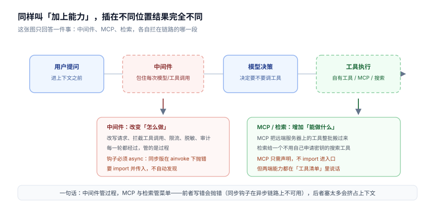
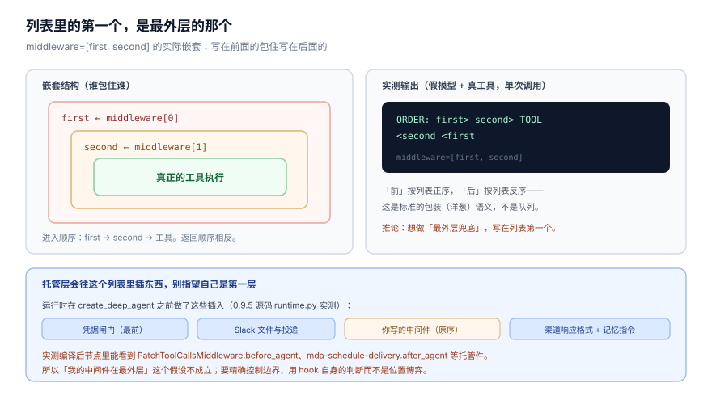
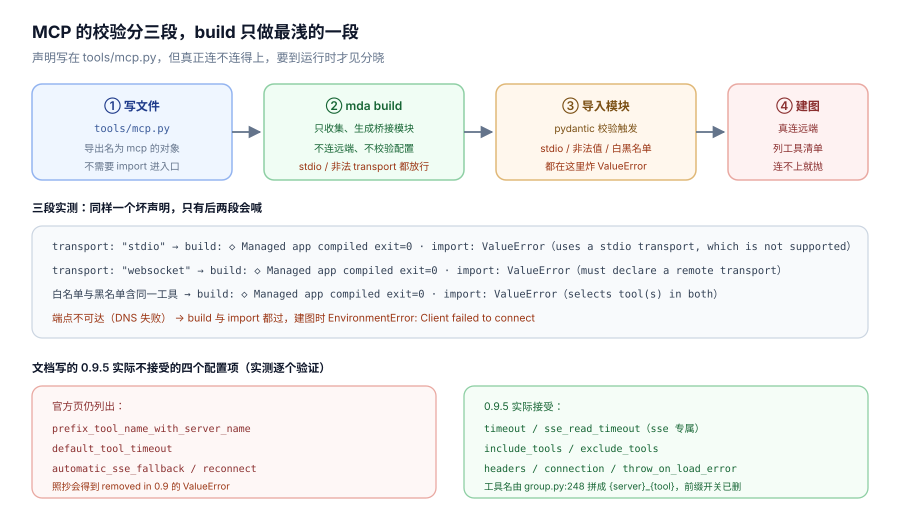
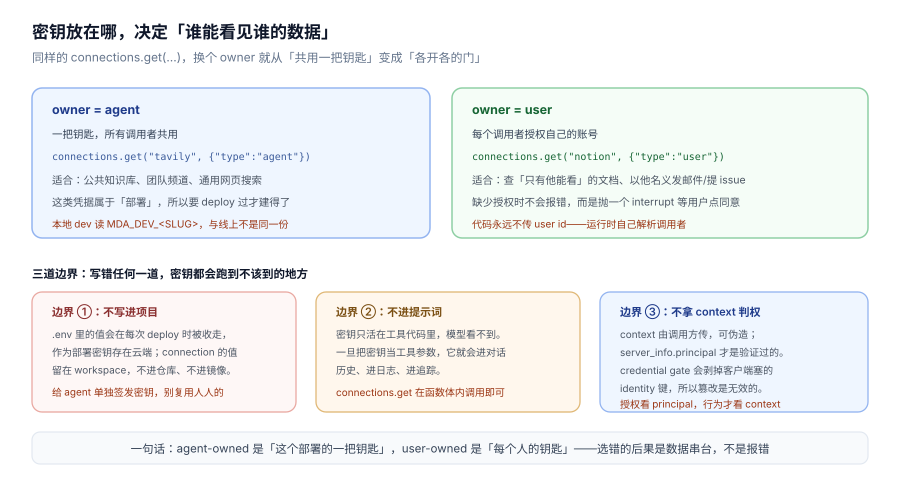
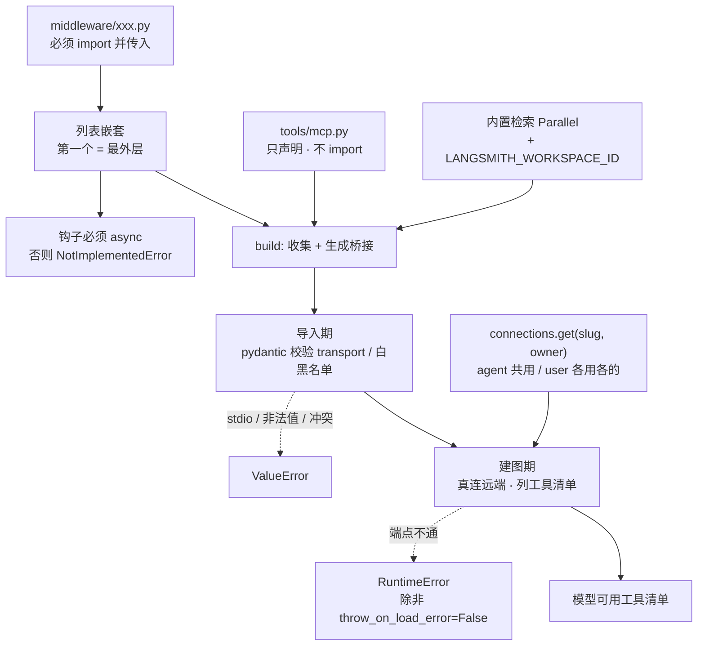

# 第 5 课：中间件、MCP 与检索

> 所属阶段：阶段 2《能力声明》｜ 水平：入门 ｜ 本课知识点：中间件注入点与执行顺序、MCP 连接器声明、内置检索与凭据边界
> 故事情节：上一课给 agent 装上了规矩、手艺和手。本课讲三种「不是自己写的」能力——拦在中间的、从外面搬来的、平台替你养着的
> 📖 结论已按官方文档核对（核对于 2026-10 ｜ 来源：`/langsmith/python/managed-deep-agents-middleware`、`-mcp-connectors`、`-search`、`-connections`、`-runtime` 及其 JavaScript 对应页）＋ 本机实测（`managed-deepagents 0.9.5`）

## 🎯 本课目标

- 说清中间件插在哪、列表顺序如何决定嵌套、托管层还会额外插入哪些中间件
- 写出能通过校验的 `tools/mcp.py`，并知道 0.9.5 里哪些文档选项已经不存在
- 分清 agent-owned 与 user-owned 凭据，讲清检索为什么不用自己申请密钥

---

## 第一幕：起源与场景引入

上一课结束时，你的客服 agent 已经能查客户等级了。现在产品提出三个新要求：

```text
1. 所有工具调用的入参和结果都要留审计日志，出事能查。
2. 客户等级之外，还要能查 Notion 里只有客服本人能看的处理手册。
3. 用户问「最近这个型号有没有召回公告」，得能上网搜。
```

三个要求看起来都是"加能力"，但它们的实现方式完全不同：

| 要求 | 本质 | 落点 |
|---|---|---|
| 审计日志 | 不改能力，只插在调用前后观察 | 中间件 |
| 查 Notion 手册 | 能力已经有，只是长在别人的服务器上 | MCP 声明 |
| 上网搜召回公告 | 能力本身是平台替你养着的 | 内置检索 |

这三样东西的共同点是**都不用你自己写业务逻辑**。不同点是它们插在链路的三个不同位置，写错的后果也完全不同。

> 📌 **一句话本质**：中间件是"在过程里加一层"，MCP 是"从外面借一批工具"，检索是"平台已经养好一个工具"。前者能被绕过（写错就抛错），后两者会挤占模型的工具清单。

> ⚖️ **处境对照**：在裸 Deep Agents 里，加中间件就是 `middleware=[...]`，加 MCP 要自己起 MCP client 并转成工具，加搜索要自己接 Tavily/SerpAPI 并管密钥。MDA 把后两件收走了：MCP 只剩一个声明文件，搜索连密钥都不用申请——代价是你能调的东西变少了。

---

## 第二幕：认知冲突

三个要求都做完了，结果是三个不同的问题：

1. 审计日志中间件写好了，本地 `mda dev` 启动就崩：`NotImplementedError: Asynchronous implementation of awrap_tool_call is not available`。
2. `tools/mcp.py` 里照官方文档写了 `default_tool_timeout: 30`，跑起来报 `default_tool_timeout was removed in 0.9`。
3. 搜索接上了，但同事说"你这个 agent 怎么什么都能搜"，而你想只让它搜内部知识库。

这三问指向同一个根因：**这一课的三样东西，文档写的和装的版本不完全一致，而且校验发生在不同阶段。** `mda build` 一路绿灯，问题全在运行期才露头。

具体来说：中间件要 `async`（同步版在异步链路上直接不可用）、MCP 配置项在 0.9 有一批被删掉了（构建期不校验）、检索是"要么全给要么不给"的整包能力。

---

## 第三幕：层层揭示

### 一眼全局图（进入细节前先看一眼）



> 看图：一条横线代表一次用户请求。三个彩色框分别是"用户提问之后""模型决策之后""工具执行"三个位置。虚线框是能改过程的（中间件），实线框是能加能力的（MCP 与检索）。请只注意底部那行字：前者管过程、后者管菜单。

四条硬约束自查：① 只回答"这三种扩展分别插在哪、各自解决什么"；② 图上没有 `SKILL.md` 级别的术语，MCP 用"远端服务器上的工具"解释；③ 带读图指引；④ 图旁文字可独立成立。

### 本课地图（分几步走）

| 步 | 这一步要解决什么（人话） | 对应知识点 |
|:--:|------------------------|-----------|
| 1 | 搞清"插在过程里的那层"怎么写、谁在外面、为什么必须 async | 知识点 1：中间件注入点与执行顺序 |
| 2 | 搞清"从别人服务器借工具"怎么声明，以及文档里哪些选项已经没了 | 知识点 2：MCP 连接器声明 |
| 3 | 搞清"平台替你养的工具"怎么开，以及密钥到底放在哪一层才安全 | 知识点 3：内置检索与凭据边界 |

---

### 知识点 1：中间件注入点与执行顺序

> 🧭 第 1/3 步｜承接：第二幕的"审计日志中间件一启动就崩" → 本步：把中间件的挂载方式、列表顺序的真实语义、以及托管层会插入什么讲清
> 本知识点关键点：要 import 并传入、列表首个是最外层、托管层会插自己的中间件、钩子必须 async

#### 一句话定义

中间件是一段包在"模型调用 / 工具调用 / 生命周期"外面的代码：它在真正的动作前后各插一手，用来改写请求、拦截调用、限流、脱敏、审计。

#### 直觉建立（类比）

快递分拣线上的检查站。包裹（一次工具调用）从入口进来，先过 A 站盖章，再过 B 站称重，最后才上车；出来时按相反顺序再过一遍。你把 A 站写在前面，它就是最外层；把 B 站写在前面，B 就是最外层。

关键在于：检查站是**建在流水线上**的，它不改变包裹里装什么（那是工具的事），只改变包裹怎么被处理。

> 💡 **类比的边界**：检查站建歪了顶多没效果；中间件写错了会让整条流水线停摆——因为托管环境只用异步调用，同步钩子根本没有对应的实现。

#### 核心原理



> 看图：左边是嵌套结构——`middleware=[first, second]` 时，first 包住 second，second 包住真正的工具。右边是实测输出 `first> second> TOOL <second <first`：进去按正序，出来按反序。下半部分淡蓝框列的是托管层往这个列表里插入的四类东西。重点看最后两行：你以为自己在最外层，其实不是。

##### 挂载方式：和工具一样，必须点名

官方开头就写明：Like custom tools, MDA does not discover middleware automatically. Import it and pass it to the agent definition.

```text
my-agent/
  agent.py
  middleware/
    audit.py
```

注意这里和 MCP 的差别：MCP 只要放 `tools/mcp.py` 就自动被发现，中间件必须 import 进入口。

::: code-group

```python [Python]
# middleware/audit.py
from collections.abc import Awaitable, Callable

from langchain.agents.middleware import wrap_tool_call
from langchain.messages import ToolMessage
from langchain.tools.tool_node import ToolCallRequest
from langgraph.types import Command


@wrap_tool_call
async def log_tool_calls(
    request: ToolCallRequest,
    handler: Callable[[ToolCallRequest], Awaitable[ToolMessage | Command]],
) -> ToolMessage | Command:
    print(f"Calling tool: {request.tool_call['name']}")
    result = await handler(request)
    print(f"Finished tool: {request.tool_call['name']}")
    return result
```

```typescript [TypeScript]
// middleware/audit.ts
import { createMiddleware } from "langchain";

export const logToolCalls = createMiddleware({
  name: "LogToolCalls",
  wrapToolCall: async (request, handler) => {
    console.log(`Calling tool: ${request.toolCall.name}`);
    const result = await handler(request);
    console.log(`Finished tool: ${request.toolCall.name}`);
    return result;
  },
});
```

:::

然后在入口点名：

::: code-group

```python [Python]
from managed_deepagents import define_deep_agent

from middleware.audit import log_tool_calls

agent = define_deep_agent(
    name="support-agent",
    model="openai:gpt-5.5",
    middleware=[log_tool_calls],
)
```

```typescript [TypeScript]
import { defineDeepAgent } from "managed-deepagents";

import { logToolCalls } from "./middleware/audit";

export const agent = defineDeepAgent({
  name: "support-agent",
  model: "openai:gpt-5.5",
  middleware: [logToolCalls],
});
```

:::

两边的写法差异值得记住：Python 用 `@wrap_tool_call` 装饰一个**裸函数**；TypeScript 用 `createMiddleware({ name, wrapToolCall })` 包一个**对象**。Python 侧 `name` 由函数名推断（所以要用能读懂的名字），TS 侧显式写 `name`。

##### 顺序的真实语义：包装，不是队列

这一点最容易想错。很多人以为 `middleware=[a, b]` 是"先执行 a 再执行 b"，各自的 before 跑完后依次跑 after。实际是**嵌套**：

```text
middleware = [first, second]

进入：first 前 → second 前 → 工具 → second 后 → first 后
```

实测（假模型 + 真工具，单次工具调用）：

```text
ORDER: first> second> TOOL <second <first
```

这是标准的洋葱/装饰器语义，不是队列。**推论很实用**：想做"最外层兜底"（比如统一异常处理、总体计时），就写在列表第一个；想做"最贴近工具"的（比如参数校验），写在最后一个。

##### 托管层会插入自己的中间件

这是本课最容易被忽略的一条。运行时在调用 `create_deep_agent` 之前，已经往你的列表里插了一串托管件。0.9.5 源码里的具体动作：

```python
_prepend_credential_gate_middleware(merged, connectors, sandbox)
_prepend_slack_files_middleware(merged, channels)
...
_prepend_schedule_delivery_middleware(merged)
_append_channel_response_format_middleware(merged)
if mounted_memory:
    _append_memory_instructions_middleware(...)
```

拼装完的顺序是：

| 位置 | 中间件 | 谁放的 |
|---|---|---|
| 最前 | 凭据闸门（credential gate） | 托管层 |
| 次前 | Slack 文件保存与投递 | 托管层 |
| 中间 | **你写的中间件（保持原序）** | 你 |
| 之后 | 定时投递、渠道响应格式 | 托管层 |
| 最后 | 记忆指令注入（启用持久记忆时） | 托管层 |

实测能直接观察到：编译后的图节点里有 `PatchToolCallsMiddleware.before_agent`、`mda-schedule-delivery.after_agent` 这些你没写过的名字。

**所以「我的中间件在最外层」这个假设不成立。** 想做全局兜底，不要靠位置博弈，要在钩子里自己判断——比如检查 `request.tool_call["name"]` 是否属于你要管的范围。

##### 钩子必须是 async

官方有一条容易看漏的注意：Managed Deep Agents always invoke the agent with ainvoke and astream, so custom middleware must use async hooks.

如果你的钩子是同步的，实测会直接抛：

```text
NotImplementedError: Asynchronous implementation of awrap_tool_call is not available.
You are likely encountering this error because you defined only the sync version (wrap_tool_call)
and invoked your agent in an asynchronous context (e.g., using astream() or ainvoke()).
To resolve this, either: (1) subclass AgentMiddleware and implement the asynchronous
awrap_tool_call method, (2) use the @wrap_tool_call decorator on a standalone async function,
or (3) invoke your agent synchronously using stream() or invoke().
```

注意一个要命的细节：**这条错误在 `mda build` 阶段不会出现**。我写了个同步钩子，build 输出 `◇ Managed app compiled`、exit=0，一路绿灯；只有真正跑起来才炸。第三选项"用同步方式调用"在托管环境里不成立——托管层固定用 `ainvoke`/`astream`。

##### 边界：托管运行时仍然是主人

官方明确划了界：The managed runtime still owns `backend`, `store`, `checkpointer`, `memory`, `skills`, and the system prompt. Middleware should focus on agent behavior around model calls, tool calls, and lifecycle hooks.

换句话说，中间件能改"怎么做"，不能改"是什么"：后端、存储、检查点、记忆、技能、系统提示这六样仍归托管层。想在中间件里换掉 checkpointer 或重写 system prompt，是走错方向了。

#### 示例演示

一个真正有用的中间件：给工具调用加审计，但只审敏感工具，并且不让异常漏出去。

::: code-group

```python [Python]
# middleware/audit.py
import json
import logging

from langchain.agents.middleware import wrap_tool_call
from langchain.messages import ToolMessage

logger = logging.getLogger("audit")

SENSITIVE = {"refund_lookup", "lookup_customer"}


@wrap_tool_call
async def audit_sensitive_tools(request, handler):
    name = request.tool_call["name"]
    if name not in SENSITIVE:
        return await handler(request)

    args = json.dumps(request.tool_call.get("args", {}), ensure_ascii=False)
    logger.info("tool.start name=%s args=%s", name, args)
    try:
        result: ToolMessage = await handler(request)
    except Exception as exc:
        logger.warning("tool.error name=%s err=%s", name, type(exc).__name__)
        raise
    logger.info("tool.end name=%s status=%s", name, getattr(result, "status", "ok"))
    return result
```

```typescript [TypeScript]
// middleware/audit.ts
import { createMiddleware } from "langchain";

const SENSITIVE = new Set(["refund_lookup", "lookup_customer"]);

export const auditSensitiveTools = createMiddleware({
  name: "AuditSensitiveTools",
  wrapToolCall: async (request, handler) => {
    const name = request.toolCall.name;
    if (!SENSITIVE.has(name)) return handler(request);

    console.log(`tool.start name=${name} args=${JSON.stringify(request.toolCall.args)}`);
    const result = await handler(request);
    console.log(`tool.end name=${name}`);
    return result;
  },
});
```

:::

这个例子顺带说明了为什么"检查名单"比"抢占最外层"更可靠：不管托管层插了几个中间件在前后，你的过滤逻辑都成立。

#### 常见误区

1. **"middleware 列表是执行队列，按顺序跑两遍"**：是嵌套。`[a, b]` 的进入顺序是 a→b，退出是 b→a。
2. **"我的中间件在最外层"**：托管层会前置凭据闸门与 Slack 文件件、后置投递与记忆注入。想在边界上生效，靠钩子内判断。
3. **"同步钩子也能用，顶多不生效"**：会抛 `NotImplementedError`，而且 build 阶段不拦。
4. **"中间件可以改 system prompt / checkpointer"**：托管运行时仍拥有 backend、store、checkpointer、memory、skills、system prompt。

#### 一句话记住

中间件是插在流水线上的检查站：要 import 才装上、写在前面的包住后面的、托管层还会塞自己的几站、钩子必须 async。

#### 🗣️ 行话对照

- **`wrap_tool_call` / `wrapToolCall`**：包住单次工具调用的钩子。在哪遇到：官方 middleware 页、LangChain 中间件文档
- **洋葱模型 / 装饰器语义**：外层的"前"最先、内层的"后"最先返回。在哪遇到：中间件、Flask 中间件、Express middleware
- **credential gate（凭据闸门）**：每次运行前检查 user-owned 凭据是否齐全的全托管中间件。在哪遇到：`_credential_gate.py`、connections 页

#### 官方文档

- Add custom middleware（挂载 + 预置件 + async 要求 + 托管所有权）: https://docs.langchain.com/langsmith/python/managed-deep-agents-middleware
- 对应 TypeScript 页: https://docs.langchain.com/langsmith/javascript/managed-deep-agents-middleware
- 预置中间件清单（PII / 调用限流等）: https://docs.langchain.com/oss/python/langchain/middleware/built-in

---

### 知识点 2：MCP 连接器声明

> 🧭 第 2/3 步｜承接：内部工具自己写没问题，但「查 Notion 手册」这类能力已经长在别人服务器上 → 本步：把 MCP 的声明方式、工具裁剪、以及 0.9 的配置变更讲清
> 本知识点关键点：`tools/mcp.py` 只声明不 import、校验分三段、四个文档选项已被移除、工具名固定为 `{server}_{tool}`

#### 一句话定义

MCP 连接器是在 `tools/mcp.py` 里写一份**声明**，告诉平台"去这个 URL 上把工具搬过来"——MCP client 由平台创建，工具由平台加载，你一行调用代码都不写。

#### 直觉建立（类比）

给公司采购部写一张采购单：不写"怎么造"，只写"去哪家供应商、买哪几样、钥匙找谁要"。采购单交上去，东西会自己出现在仓库里。你不用管物流、不用管清关。

对比一下自写工具：那是自己动手做，从头到尾你负责。MCP 是"外包已有能力"，只负责下订单。

> 💡 **类比的边界**：采购单上面的型号写错了，采购部会退单；而 MCP 声明里写了个已废弃的选项，`mda build` 不会退单——它会把单子收下，等到真正要建图时才炸。

#### 核心原理



> 看图：上面四个方框是声明从文件到连上远端的四步。请注意第 ② 步 `mda build`：它只做"收集 + 生成桥接模块"，既不连远端也不校验配置。中间那段是四种坏声明的实测结果——前三种都表现为 `build exit=0` + `import 时 ValueError`，第四种更晚，要到建图才炸。下面两栏是文档写法与 0.9.5 实装的对账。

##### 目录与声明

```text
my-agent/
  agent.py
  tools/
    mcp.py       ← 只放声明
```

::: code-group

```python [Python]
# tools/mcp.py
from managed_deepagents import define_mcp

mcp = define_mcp(
    servers={
        "langchainDocs": {
            "transport": "http",
            "url": "https://docs.langchain.com/mcp",
        },
    },
)
```

```typescript [TypeScript]
// tools/mcp.ts
import { defineMcp } from "managed-deepagents";

export const mcp = defineMcp({
  servers: {
    langchainDocs: {
      transport: "http",
      url: "https://docs.langchain.com/mcp",
    },
  },
});
```

:::

三条硬规矩：

1. **必须导出名叫 `mcp` 的模块级变量**。写成 `export const myServers = ...` 会被拦（课 4 已实测过这条报错）。
2. **一个项目只有一份声明**。所有服务器都写在这一个 `mcp` 里——这也是课 4 说 `tools/mcp.py` 是保留名的原因。
3. **不支持 stdio**。官方原文：Stdio MCP servers are not supported. 只支持 Streamable HTTP（`"http"`）和旧版 SSE（`"sse"`）。

第 3 条对很多人是硬伤：本地用 `npx -y @xxx/mcp` 起的 stdio 服务器，在 MDA 里一行都写不了。要么自己把它包成 HTTP，要么改用自写工具（课 4）。

##### 校验分三段，build 最浅

这是我实测出来的结构性事实，官方文档没有直接说。同一个坏声明，三个阶段表现完全不同：

| 声明里的问题 | `mda build` | 导入模块 | 建图（首次运行） |
|---|---|---|---|
| `transport: "stdio"` | ✅ exit=0 | ❌ ValueError | — |
| `transport: "websocket"` | ✅ exit=0 | ❌ ValueError | — |
| 同一工具既在 `include_tools` 又在 `exclude_tools` | ✅ exit=0 | ❌ ValueError | — |
| 端点 DNS 解析不了 | ✅ exit=0 | ✅ 通过 | ❌ `Client failed to connect` |

原文报错（前三条分别在导入期抛出）：

```text
ValueError: define_mcp(...) received invalid configuration:
1 validation error for _McpServersArgs
servers.stdioSrv
  Value error, uses a stdio transport, which is not supported. Managed Deep Agents
  support remote MCP servers over HTTP/SSE only; expose the server over HTTP or write
  a normal authored tool instead.

servers.bad.transport
  Value error, must declare a remote transport ("http" or "sse")

servers.docs
  Value error, selects tool(s) in both `include_tools` and `exclude_tools`: search_docs_by_lang_chain
```

第四条更晚，且错误类型不同：

```text
RuntimeError: Client failed to connect: [Errno -2] Name or service not known
  （cause: httpx.ConnectError）
```

**这条对排查很关键**：`mda build` 绿灯 ≠ MCP 配好了。真正确认要跑一次 `mda dev` 或直接导入模块。

##### 文档与 0.9.5 的四处不一致

官方 MCP 页的配置表里还列着这些选项，但 0.9.5 全部拒绝。实测逐条验证：

| 文档里的写法 | 0.9.5 实测 |
|---|---|
| `prefix_tool_name_with_server_name: true` | ❌ `was removed in 0.9; native names are {server}_{tool}` |
| `default_tool_timeout: 30` | ❌ `was removed in 0.9; use timeout for individual MCP requests` |
| `automatic_sse_fallback: true` | ❌ `was removed in 0.9; choose an explicit transport and compatible endpoint` |
| `reconnect: {...}` | ❌ `was removed in 0.9; automatic tool-call retries are unsupported` |
| `timeout: 30`（新名） | ✅ 通过 |

源码里那张 `_REMOVED_FIELDS` 表把迁移方向写得很清楚：

```python
"prefix_tool_name_with_server_name": (
    "prefix_tool_name_with_server_name was removed in 0.9; native names are {server}_{tool}"
),
"default_tool_timeout": (
    "default_tool_timeout was removed in 0.9; "
    "use timeout for individual MCP requests, rather than a whole-tool deadline"
),
```

两个含义要分清：

第一，**前缀开关没了，但前缀还在**。工具名固定是 `{server}_{tool}`——这条不是从文档抄的，是从**实际拼接代码**读出来的：

```python
# fastmcp/client/group.py:248 —— 最终生效的一行
public_name = f"{server_name}_{tool.name}"

# managed_deepagents/_connectors/mcp/load.py:677 —— 裁剪时也要同样限定
field: [f"{name}_{raw}" for raw in server[field]]
```

注意这里是**单个下划线**，和官方文档示例里的 `langchainDocs__search_docs_by_lang_chain`（双下划线）不一致。按 0.9.5 的实际代码，暴露给模型的名字是 `langchainDocs_search_docs_by_lang_chain`。

写 `exclude_tools` 时要用**原始名**（`search_docs_by_lang_chain`），因为 `load.py:677` 会替你补前缀——自己再加前缀会变成 `docs_docs_xxx`，匹配不上。

另外注意 `load.py` 里紧跟着的碰撞检查：

```python
if tool.name in names:
    raise ValueError(
        f"MCP tool name collision: {tool.name!r}; rename the server or upstream tool"
    )
```

两个服务器各有同名工具时会直接抛错（不是覆盖），这就是源码注释里"ambiguous names fail discovery"的实现。

第二，**"整体超时"被换成"单请求超时"**。以前是给整个工具调用设一个 deadline，现在是给每次 MCP 请求设超时。如果你的原配置是"这个工具最多跑 30 秒"，迁移后语义已经变了，不能机械替换。

##### 工具裁剪：白名单与黑名单

默认把每个服务器的所有工具都暴露出来。要收窄：

::: code-group

```python [Python]
{
    "transport": "http",
    "url": "https://docs.langchain.com/mcp",
    "include_tools": ["search_docs_by_lang_chain"],
}
```

```typescript [TypeScript]
{
  transport: "http",
  url: "https://docs.langchain.com/mcp",
  includeTools: ["search_docs_by_lang_chain"],
}
```

:::

规则（官方 + 实测一致）：

- `include_tools` 是白名单，`exclude_tools` 是黑名单，黑名单在**白名单之后**生效。
- 同一个工具不能同时出现在两边——实测直接 `ValueError`（见上表第三行）。
- 显式写 `include_tools` 是控制上下文成本最有效的手段。一个 MCP 服务器动辄几十个工具，全暴露会占满模型的工具清单。

##### 加载失败的容错开关

官方表格里 `throw_on_load_error` 默认 `true`：加载失败就整体失败，而不是带着半个工具集启动。改成 `false` 后实测：

```python
mcp = define_mcp(
    servers={"unreachable": {"transport": "http", "url": "https://不存在的域/mcp"}},
    throw_on_load_error=False,
)
```

```text
build:  ◇ Managed app compiled  exit=0
run:    compiled ok (partial tool set tolerated)
```

这是一个真实的取舍：默认 `true` 意味着**一个 MCP 服务器挂了，整个 agent 起不来**。生产环境如果依赖第三方 MCP，通常要显式改成 `false` 并接受"这次少几个工具"。

#### 示例演示

一个带裁剪、带凭据、带容错的完整声明：

::: code-group

```python [Python]
# tools/mcp.py
from managed_deepagents import connections, define_mcp

mcp = define_mcp(
    servers={
        # 公开文档站：只留一个检索工具，避免几十个工具挤占清单
        "docs": {
            "transport": "http",
            "url": "https://docs.langchain.com/mcp",
            "include_tools": ["search_docs_by_lang_chain"],
        },
        # 内部 Notion：每个客服看自己有权看的页面
        "notion": {
            "transport": "http",
            "url": "https://mcp.notion.com/mcp",
            "connection": connections.get("engineering-notion", {"type": "user"}),
            "exclude_tools": ["delete_page"],
        },
    },
    # 第三方服务器抖动时降级为部分工具集，而不是整个 agent 起不来
    throw_on_load_error=False,
)
```

```typescript [TypeScript]
// tools/mcp.ts
import { connections, defineMcp } from "managed-deepagents";

export const mcp = defineMcp({
  servers: {
    docs: {
      transport: "http",
      url: "https://docs.langchain.com/mcp",
      includeTools: ["search_docs_by_lang_chain"],
    },
    notion: {
      transport: "http",
      url: "https://mcp.notion.com/mcp",
      connection: connections.get("engineering-notion", { type: "user" }),
      excludeTools: ["delete_page"],
    },
  },
  throwOnLoadError: false,
});
```

:::

注意 `connections.get(...)` 在这里是**同步调用**（不 await），返回一个引用对象，实测类型是 `ConnectionReference`。真正的取值在运行时完成——这一点下一节展开。

#### 常见误区

1. **"build 绿灯就说明 MCP 配好了"**：build 只收集文件、生成桥接模块，不校验配置也不连远端。stdio、非法 transport、白黑名单冲突都要到导入期才报。
2. **"照官方文档的配置表写就行"**：0.9.5 已删掉四个选项（前缀开关、整体超时、SSE 回退、重连）。照抄会得到 `removed in 0.9` 的报错。
3. **"工具名是 `server__tool`"**：文档示例是双下划线，但 0.9.5 源码写的是 `{server}_{tool}`（单下划线）。裁剪时用原始名，不要带前缀。
4. **"本地 stdio 服务器也能接"**：不支持。要包成 HTTP 或改写为自写工具。
5. **"一个项目可以有多份 mcp 声明"**：只有一份。所有服务器写进同一个 `mcp`。

#### 一句话记住

MCP 是给平台下一张采购单：写在 `tools/mcp.py`、只声明不 import、只支持 HTTP/SSE、build 不校验配置、工具名由平台加前缀。

#### 🗣️ 行话对照

- **MCP（Model Context Protocol）**：让模型发现并调用外部工具的通用协议。在哪遇到：官方 MCP 页、Anthropic MCP 文档
- **Streamable HTTP / SSE**：MCP 的两种远程传输方式，后者是旧版。在哪遇到：MCP 声明里的 `transport`
- **allowlist / denylist（白名单 / 黑名单）**：`include_tools` 与 `exclude_tools`。在哪遇到：MCP 配置表

#### 官方文档

- Connect to MCP servers（声明 + 裁剪 + 配置表）: https://docs.langchain.com/langsmith/python/managed-deep-agents-mcp-connectors
- 对应 TypeScript 页: https://docs.langchain.com/langsmith/javascript/managed-deep-agents-mcp-connectors
- Manage connections（凭据与 owner 语义）: https://docs.langchain.com/langsmith/python/managed-deep-agents-connections

---

### 知识点 3：内置检索与凭据边界

> 🧭 第 3/3 步｜承接：通知要"上网搜召回公告"，而这背后牵扯一个更根本的问题——谁有权用什么密钥 → 本步：把内置检索的开通方式、以及 connections 的两种归属讲清
> 本知识点关键点：检索是平台托管的 MCP 服务器、不用申请第三方密钥、凭据分 agent/user 两种归属、授权看 principal 不看 context

#### 一句话定义

内置检索是平台用 Parallel 托管的一个搜索服务，本质是一个预配置好的 MCP 服务器；而凭据（connection）是把密钥存在 workspace 而不是项目里的机制，分"整个部署共用一把"和"每个调用者各用各的"两种。

#### 直觉建立（类比）

公司统一办的差旅账号。你出差订票，不用自己注册航空公司和酒店账号，公司已经和它们签好了协议——这是内置检索。

而凭据就是"门禁卡"。公司配的门禁卡刷所有公共区域（agent-owned）；员工的个人工牌只能开自己有权限的门（user-owned）。**用错卡不会报警，只会让你看到不该看的东西，或者看不到该看的。**

> 💡 **类比的边界**：门禁卡用错，保安当场就会拦；而 user-owned 凭据配错了，最坏情况是"所有人都共用一个账号"，从外部看一切正常，直到有人发现别人能查到自己的资料。

#### 核心原理



> 看图：上半部左右两种 owner 对照——agent 是一把共用钥匙，user 是各开各的门，右侧那行小字是关键：缺授权时不报错，而是抛一个 interrupt 等用户点同意。下半部三道边界分别对应"不写进项目""不进提示词""不拿 context 判权"。每条都在下面有实测或原文支撑。

##### 内置检索：三步开通，不用第三方密钥

官方原文：LangSmith manages the search infrastructure, so you can add search without hosting a service or creating a separate Parallel account or API key. The integration offers zero data retention.

开通只要三步：

```bash
# 1. 项目 .env 里设置 workspace
LANGSMITH_WORKSPACE_ID=YOUR_WORKSPACE_ID

# 2. 同一个 .env 里设置个人 LangSmith API key（给 Studio 用）
LANGSMITH_API_KEY=YOUR_LANGSMITH_API_KEY

# 3. tools/mcp.py 里加一个 Parallel 服务器
```

::: code-group

```python [Python]
# tools/mcp.py
from managed_deepagents import define_mcp

mcp = define_mcp(
    servers={
        "Parallel": {
            "transport": "http",
            "url": "https://api.smith.langchain.com/v1/managed-tools/servers/parallel/mcp",
        },
    },
)
```

```typescript [TypeScript]
// tools/mcp.ts
import { defineMcp } from "managed-deepagents";

export const mcp = defineMcp({
  servers: {
    Parallel: {
      transport: "http",
      url: "https://api.smith.langchain.com/v1/managed-tools/servers/parallel/mcp",
    },
  },
});
```

:::

三个容易踩的点：

第一，**注意 URL 域名**。它是 `api.smith.langchain.com` 下的 managed-tools 路径，不是公开的 Parallel 端点。0.9.5 对这类 URL 有额外约束：源码里 `_LANGSMITH_MANAGED_TRANSPORT` 要求必须是 `"http"`、`_LANGSMITH_MANAGED_CONFLICT` 禁止声明 `headers` 或 `connection`。也就是说这个服务器你**不能自己加请求头、也不能挂自己的 connection**——凭据由平台处理。

第二，**如果文件里已经有 `mcp`，把它加进现有 `servers` map**，不要新写一个 `define_mcp`。官方特意提醒：If the file already defines `mcp`, add `Parallel` to the existing `servers` map. Define `mcp` only once.

第三，**只有 Plus / Startup 套餐可用**。官方：Built-in search is available only on LangSmith Plus and Startup plans. Usage is free during private beta. 免费版接不上，报错信息也不会告诉你是因为套餐。

##### 凭据：两种归属

`connections.get(slug, owner)` 的第二个参数决定"用谁的密钥"：

| owner | 解析成 | 适合场景 |
|---|---|---|
| `agent` | 整个部署共用的一份凭据 | 公共知识库、团队频道、通用网页搜索 |
| `user` | 发起本次调用的那个人的凭据 | 查只有他能看的文档、以他名义提 issue / 发邮件 |

官方原文对这两种的描述：`agent` 是 "One credential that belongs to the deployment. Every caller uses it."；`user` 是 "The calling person's own credential. Each person authorizes their own account."

实测 `connections.get` 的签名与返回：

```python
>>> inspect.signature(connections.get)
(slug: 'str', owner: 'ConnectionOwner | Mapping[str, object]') -> 'ConnectionReference'

>>> r = connections.get('engineering-notion', {'type': 'user'})
>>> type(r).__name__
'ConnectionReference'
>>> hasattr(r, '__await__')
True          # 是关键：在工具里 await 它才拿到字符串
```

也就是说：**在 `tools/mcp.py` 的声明里写 `connections.get(...)` 不加 await**（声明阶段只要引用）；**在自写工具里 `await connections.get(...)`** 才拿到密钥字符串。

##### 三道边界

**边界一：密钥不该存在项目里。** 官方把这条讲得很直白：`mda deploy` collects `.env` values as deployment secrets on every deploy. A connection value stays in the workspace instead. 意思是 `.env` 里的值每次部署都会被收走当部署密钥；connection 的值留在 workspace，不进仓库也不进镜像。

而且官方明确建议给 agent 单独签发密钥，别复用人人的：Issue a key that belongs to the agent rather than reusing a personal key. A dedicated key can be scoped, rotated, and revoked without affecting anything else that shares it.

**边界二：密钥不该进提示词。** connection 的价值在于"代码里取、代码里用"。如果你把密钥做成工具参数（`def search(api_key: str)`），它就进了模型的参数表、进了对话历史、进了追踪记录。正确做法是在函数体内 `await connections.get(...)`。

**边界三：不要用 `context` 判断权限。** 这条课 4 讲过工具侧的版本，这里补凭据侧的机制。身份从哪来，取决于调用入口：

| 入口 | 调用者身份来源 |
|---|---|
| Slack | 发消息的那个 Slack 用户 |
| LangSmith Studio | 已登录的 LangSmith 用户 |
| SDK / 自定义前端 | identity 声明验证的身份 |

默认的 identity 声明验证的是 LangSmith API key——**它证明的是"某个客户端"，不是"某个人"**。所以所有拿同一把 key 的调用者都会解析成同一个身份。要让每个人有自己的凭据，得配 Supabase identity（课 8 讲）。

官方还有一句关键：Code never passes a user ID to `connections.get(...)`. The runtime resolves the caller and returns that person's credential. 也就是说你没法（也不该）自己指定"用谁的密钥"，运行时按本次运行的调用者解析。

##### 缺凭据时会发生什么

这是 user-owned 与 agent-owned 最大的行为差异：

- **agent-owned 缺失** → 运行直接失败（`no agent connection is set for slug '<slug>'`）。
- **user-owned 缺失** → 抛一个 LangGraph interrupt，payload 里带 `connect_url`，用户点完同意后运行继续。

interrupt 的 payload 结构：

```json
{
  "type": "credential_authorization_required",
  "message": "Connect the following integrations to continue.",
  "credentials": [
    {
      "slug": "engineering-notion",
      "kind": "oauth2",
      "connect_url": "https://api.smith.langchain.com/v1/agent-auth/...",
      "auth_id": "sess_abc123"
    }
  ]
}
```

`kind` 只会是 `oauth2` 或 `secret`。注意 `secret` 这一类没有 `connect_url`——Slack 和 Studio 都不收集它，得在自定义前端里做隐藏输入框。

##### 本地开发怎么取凭据

`mda dev` 下，agent-owned 的不透明密钥从环境变量读，规则是 `MDA_DEV_` + slug 大写 + 连字符换下划线。比如 slug 是 `organization-tavily`，就读 `MDA_DEV_ORGANIZATION_TAVILY`。

user-owned 的**在本地没法端到端测**：它需要真实调用者身份和 Agent Auth。官方建议：Deploy the agent to exercise the authorization interrupt end to end. 这是一个真实的能力边界，不是配置问题。

#### 示例演示

一个自写工具里安全取密钥的完整写法：

::: code-group

```python [Python]
# tools/search_web.py
import httpx
from langchain.tools import tool
from managed_deepagents import connections


@tool(parse_docstring=True)
async def search_web(query: str) -> str:
    """Search the internal web index.

    Args:
        query: Search query.
    """
    api_key = await connections.get("organization-tavily", {"type": "agent"})
    async with httpx.AsyncClient(timeout=30.0) as client:
        response = await client.post(
            "https://api.tavily.com/search",
            json={"api_key": api_key, "query": query, "max_results": 5},
        )
        response.raise_for_status()
        return response.text
```

```typescript [TypeScript]
// tools/search_web.ts
import { tool } from "langchain";
import { connections } from "managed-deepagents";
import { z } from "zod";

export const searchWeb = tool(
  async ({ query }) => {
    const apiKey = await connections.get("organization-tavily", { type: "agent" });
    const response = await fetch("https://api.tavily.com/search", {
      method: "POST",
      headers: { "content-type": "application/json" },
      body: JSON.stringify({ api_key: apiKey, query, max_results: 5 }),
    });
    if (!response.ok) throw new Error(`search failed: ${response.status}`);
    return await response.text();
  },
  {
    name: "search_web",
    description: "Search the internal web index.",
    schema: z.object({ query: z.string().describe("Search query.") }),
  }
);
```

:::

注意这个工具的签名叫 `query` 一个参数——密钥完全不在参数表里。模型看不到它，追踪记录里也没有它。

#### 常见误区

1. **"内置检索要自己申请 Parallel 密钥"**：不用。只要 `LANGSMITH_WORKSPACE_ID` + `LANGSMITH_API_KEY`，且套餐是 Plus / Startup。
2. **"给 Parallel 服务器加个 headers 更保险"**：会报错。托管工具 URL 明确禁止 `headers` 和 `connection`，必须是 `transport: "http"`。
3. **"凭据只有一种，存在 workspace 就行"**：分 agent-owned 与 user-owned。前者共用一把钥匙，后者各用各的；选错等于数据串台。
4. **"user-owned 缺授权会报错"**：不报错，抛 interrupt 等用户点同意。而 agent-owned 缺失才是直接失败。
5. **"本地能把 user-owned 凭据测通"**：测不了，必须部署。本地只支持 agent-owned 的 `MDA_DEV_*` 环境变量。

#### 一句话记住

检索是平台养好的搜索工具（不用自己办密钥），凭据是存在 workspace 的门禁卡——agent-owned 一把共用，user-owned 各开各门，配错不报警只串数据。

#### 🗣️ 行话对照

- **connection（连接）**：把外部服务凭据存在 workspace 的容器，代码里用 slug 引用。在哪遇到：connections 页
- **agent-owned / user-owned**：凭据归属，决定"共用一把"还是"各用各的"。在哪遇到：`connections.get` 的第二个参数
- **credential gate（凭据闸门）**：每次运行前检查 user-owned 凭据的中间件，缺就抛 interrupt。在哪遇到：中间件顺序表最前那位
- **Agent Auth**：LangSmith 的授权服务，负责 OAuth 往返与会话状态。在哪遇到：connections 页的授权小节

#### 官方文档

- Built-in search（Parallel 三步开通 + 套餐限制）: https://docs.langchain.com/langsmith/python/managed-deep-agents-search
- 对应 TypeScript 页: https://docs.langchain.com/langsmith/javascript/managed-deep-agents-search
- Manage connections（两种 owner + 三道边界 + 本地开发）: https://docs.langchain.com/langsmith/python/managed-deep-agents-connections
- Identity（调用者身份从哪来）: https://docs.langchain.com/langsmith/python/managed-deep-agents-identity

---

## 第四幕：实操验证

### 4.1 机制验证

> ✅ 实测于 Linux / Python 3.12.3 / `managed-deepagents 0.9.5`（探针 `k4/m1`–`k4/m4`、`k4/n1`–`k4/n7`）

**实验一：官方中间件示例能直接通过构建吗？**

```bash
mkdir -p middleware && # 写入官方 audit.py
uv run mda build; echo "exit=$?"
```

```text
◇  Managed app compiled
exit=0
```

**结论**：能。但注意这只是"构建通过"，不代表钩子真的会跑——见实验四。

**实验二：中间件写了但不 import 进入口，文件还会进包吗？**

```text
build exit=0
.mda/build/middleware/audit.py     ← 文件确实被复制进去了
```

**结论**：会。这跟工具的行为一致（课 4 实验五）：构建器负责搬文件，注册是你的责任。区别是中间件连"复制"都不代表生效，漏 import 就是纯死代码。

**实验三：列表顺序到底是队列还是嵌套？**

用假模型 + 真工具，两个钩子各打印进入/退出：

```python
middleware=[first, second]
```

```text
ORDER: first> second> TOOL <second <first
```

**结论**：嵌套（洋葱模型）。进入按正序，退出按反序。第一个是最外层。

**实验四：同步钩子在托管环境里会怎样？**

```python
@wrap_tool_call
def sync_log(request, handler):     # 注意：没有 async
    return handler(request)
```

`mda build`：

```text
◇  Managed app compiled
exit=0                                ← 绿灯
```

真正 `ainvoke` 时：

```text
NotImplementedError: Asynchronous implementation of awrap_tool_call is not available.
You are likely encountering this error because you defined only the sync version (wrap_tool_call)
and invoked your agent in an asynchronous context (e.g., using astream() or ainvoke()).
To resolve this, either: (1) subclass AgentMiddleware and implement the asynchronous
awrap_tool_call method, (2) use the @wrap_tool_call decorator on a standalone async function,
or (3) invoke your agent synchronously using stream() or invoke().
```

**结论**：不是静默失效，是显式抛错——但**只在运行期抛**。第三个建议（用同步方式调用）在托管环境里不成立，托管层固定走 `ainvoke`/`astream`。

**实验五：MCP 的坏声明，build 拦不拦？**

逐个试四种坏声明：

```text
transport: "stdio"                        → build exit=0  → import: ValueError（stdio 不支持）
transport: "websocket"                    → build exit=0  → import: ValueError（must declare http/sse）
include_tools 与 exclude_tools 含同一工具 → build exit=0  → import: ValueError（selects tool(s) in both）
端点 DNS 解析不了                          → build exit=0  → import 通过 → 建图: RuntimeError
```

**结论**：build 一个都不拦。前三种在模块导入期由 pydantic 拦下，第四种要到真正建图才炸。

**实验六：文档里的四个 MCP 配置项，0.9.5 还认吗？**

```text
prefix_tool_name_with_server_name  → ValueError: removed in 0.9; native names are {server}_{tool}
default_tool_timeout               → ValueError: removed in 0.9; use timeout for individual MCP requests
automatic_sse_fallback             → ValueError: removed in 0.9; choose an explicit transport
reconnect                          → ValueError: removed in 0.9; automatic tool-call retries are unsupported
timeout（新名）                     → OK
```

**结论**：四个全被移除。官方配置表尚未更新，照抄会失败。

**实验七：`throw_on_load_error=False` 真的能降级吗？**

```python
mcp = define_mcp(servers={"unreachable": {..., "url": "https://不存在的域/mcp"}},
                 throw_on_load_error=False)
```

```text
build:  ◇ Managed app compiled  exit=0
run:    compiled ok (partial tool set tolerated)
```

对照组（默认 `True`）：

```text
RuntimeError: Client failed to connect: [Errno -2] Name or service not known
  （cause: httpx.ConnectError）
```

**结论**：默认一个 MCP 挂掉整个 agent 起不来；显式关掉后降级为部分工具集。

**实验八：MCP 声明在构建产物里长什么样？**

```python
# .mda/build/_mda_connectors.py（自动生成）
from types import SimpleNamespace
from managed_deepagents.runtime import collect_connectors
import tools.mcp as _connector0

connectors = collect_connectors([
    ("tools/mcp.py", SimpleNamespace(connector=_connector0.mcp)),
])
```

**结论**：构建器生成一个桥接模块去 import 你的 `tools/mcp.py` 并取 `mcp` 属性。这解释了两件事：① 为什么必须叫 `mcp`；② 为什么配置错误发生在"导入期"——因为桥接模块 import 你的文件时就触发了 pydantic 校验。

**实验九：`connections.get` 在声明里和工具里行为一样吗？**

```python
>>> inspect.signature(connections.get)
(slug: str, owner: ConnectionOwner | Mapping[str, object]) -> ConnectionReference
>>> r = connections.get('engineering-notion', {'type': 'user'})
>>> type(r).__name__
'ConnectionReference'
>>> hasattr(r, '__await__')
True
```

**结论**：同一个函数，两种用法。声明里用引用（不 await），工具里 `await` 才拿到密钥字符串。

> ✅ **回扣场景**：第一幕那三个要求现在都有答案了——审计日志是中间件（第一个是最外层？不，托管层还在外面）、Notion 手册是 MCP + user-owned 凭据（每人看自己的）、召回公告是内置检索（不用申请密钥，但官方明说只有 Plus / Startup 套餐可用）。三者的失败方式也各不相同：中间件运行期抛错、MCP 导入期或建图期抛错、检索在套餐不符时按官方描述属于"能力不可用"（本机未验证具体报错形态，需有对应套餐才能确认）。

### 4.2 应用实战（入口）

> 📌 本课**不配独立实战篇**。原因是这三样能力的验证门槛卡在"外部账号"上：审计中间件要真跑起来才有日志，MCP 的 user-owned 凭据要真连一个 MCP 服务端，内置检索明说只有 Plus / Startup 套餐可用——本地环境凑不齐一条完整、可复现的链路，硬写出来的实战会变成"照抄配置"，学不到东西。
>
> 就近的动手替代：4.1 的九个实验已覆盖三样东西的**失败形态**（这才是排查时真正用得到的部分）——建议至少亲手跑实验四、实验五、实验六，它们分别对应"同步钩子 build 绿灯却启动即崩"、"照文档写已删除选项"、"MCP 三类坏声明各在哪一层报错"。
>
> 想把这三样能力放进真实项目，见结课项目 [值班研究助手](../../../projects/值班研究助手/README.md) 里对中间件与工具收窄的用法。

---

## 第五幕：体系收束

三个知识点串起来是同一条主线：**这一课的三样东西都不是你自己写的，所以"谁在什么时候校验"比"怎么写"更关键。**

因为**中间件插在过程里**（知识点 1：所以列表顺序是嵌套语义、托管层还会插自己的件、钩子必须 async），所以**它不是万能钩子**——只能改"怎么做"，改不了 backend / store / checkpointer / memory / skills / system prompt 这六样托管资产。而**MCP 把外部能力搬进来**（知识点 2：所以只需声明不需 import、只支持 HTTP/SSE、0.9 删了一批配置项、校验要等导入期），它的风险不在写错语法，而在"配置看起来对但版本已经变了"。最后**检索是平台替你养好的一个 MCP**（知识点 3：所以不用申请第三方密钥，但要套餐、不能加自定义头），而它牵扯出的凭据问题是整门课第一次真正触碰安全边界——agent-owned 与 user-owned 一字之差，是"共用钥匙"和"各开各门"的区别。

> 📍 **全局定位**：课 4 解决"能力从哪来"（自己写），课 5 解决"能力从哪借"（中间件借过程、MCP 借工具、检索借平台）。阶段 2 一共八种声明落点——指令、技能、工具、中间件、MCP、检索、记忆、沙箱与身份；本课拿下其中三种（中间件、MCP、检索），剩下三种留到课 6。
> 🔗 **下一步**：课 6 会讲"记忆、沙箱与身份"——那三样恰好是中间件碰不得的托管资产。你会发现本课那句"托管运行时仍拥有 backend / store / checkpointer / memory / skills / system prompt"是课 6 的引子：既然中间件改不了它们，那它们的策略就只能通过别的声明方式配置。

---

## 🐞 常见误区

1. **"middleware 是队列，按顺序各跑一遍"**：是嵌套。`[a, b]` 进入 a→b、退出 b→a，第一个是最外层。
2. **"我的中间件在链路最外层"**：托管层会前置凭据闸门和 Slack 文件件。要精确控制边界，靠钩子内判断而非位置。
3. **"中间件写好了不 import 也没关系"**：文件会被复制进构建包，但不会注册。和工具一样必须点名。
4. **"同步钩子顶多不生效"**：会抛 `NotImplementedError`，而且 `mda build` 不拦，只在运行期炸。
5. **"build 通过说明 MCP 配好了"**：build 只收集文件、生成桥接模块。stdio、非法 transport、白选冲突都要到导入期；端点不通要到建图期。
6. **"官方 MCP 配置表可以直接照抄"**：0.9.5 已删四个选项（前缀开关、整体超时、SSE 回退、重连）。
7. **"user-owned 凭据配错会报错"**：不会。缺授权抛 interrupt，最坏情况是所有人共用一个身份，从外部看一切正常。

### ⏳ 与过时说法对照

| 旧说法 | 实测现状（核对于 2026-10，`0.9.5`） | 来源 |
|---|---|---|
| "MCP 工具名是 `server__tool`（双下划线）" | 实际拼接代码是单下划线：`fastmcp/client/group.py:248` 的 `f"{server_name}_{tool.name}"`；前缀开关已删、前缀固定存在 | 源码实测 + 本机验证 |
| "用 `prefix_tool_name_with_server_name` 关掉前缀" | 已移除：`removed in 0.9; native names are {server}_{tool}` | 本机实测 |
| "用 `default_tool_timeout` 设工具超时" | 已移除，改为单请求的 `timeout`（语义不同，不能机械替换） | 本机实测 |
| "用 `automatic_sse_fallback` 让 HTTP 回退 SSE" | 已移除：需显式选 transport 和兼容端点 | 本机实测 |
| "用 `reconnect` 配 SSE 重连" | 已移除：不支持自动重试 | 本机实测 |
| "中间件可以改 system prompt / checkpointer" | 托管运行时仍拥有 backend、store、checkpointer、memory、skills、system prompt | 官方 middleware 页原文 |
| "同步中间件钩子能用" | 抛 `NotImplementedError`；托管层固定 `ainvoke`/`astream`，第三选项不成立 | 本机实测（k4/m4） |

> 这张表是本课的非模板化亮点：前五条是 0.9.5 相对官方文档的实质变更，其中「工具名单双下划线变单下划线」「四个选项被删」两条无法从文档字面看出。

## 一图总结



> 与课首入口的分工：课首那张讲"三种扩展插在链路哪一段"（零术语）；这张讲"各自的校验阶段与失败类型"（给刚学完的人复习）。

## 课后小测

**Q1**：`middleware=[a, b]`，其中 a 和 b 都实现了 `wrap_tool_call`。一次工具调用的实际执行顺序是？
- A. a-before → a-after → b-before → b-after → 工具
- B. a-before → b-before → 工具 → b-after → a-after
- C. b-before → a-before → 工具 → a-after → b-after
- D. a 和 b 的执行顺序不确定

<details><summary>答案与解析</summary>

**答案：B**。嵌套（洋葱）语义，不是队列。列表第一个 a 是最外层，所以它的 before 最先、after 最后。实测输出 `first> second> TOOL <second <first` 正是这个形态。A 是"队列"的误判；C 是反序误判；D 不对，顺序由列表位置确定。

</details>

**Q2**：你的 `tools/mcp.py` 里写了 `transport: "stdio"`，`mda build` 显示 `◇ Managed app compiled`。接下来最可能发生什么？
- A. 一切正常，stdio 也支持
- B. build 之后会有一条警告提醒你
- C. 导入模块时抛 `ValueError: uses a stdio transport, which is not supported`
- D. 要等第一次用户提问才报错

<details><summary>答案与解析</summary>

**答案：C**。stdio 在 0.9.5 中被明确拒绝，但校验发生在 `define_mcp(...)` 执行时——也就是构建产物里的桥接模块 `import tools.mcp` 的那一刻，不是 build 阶段。官方文档也写了 Stdio MCP servers are not supported。A 错（不支持）；B 错（build 没有任何提示）；D 错（更早，在导入期就炸）。

</details>

**Q3**：你要让 agent 查 Notion 里"只有当前客服本人能看"的处理手册。应该怎么配凭据？
- A. `connections.get("notion", {"type": "agent"})`，一把共用密钥最省事
- B. `connections.get("notion", {"type": "user"})`，配合能区分个人的 identity
- C. 把 Notion token 放进 `.env` 的 `NOTION_TOKEN`
- D. 让模型在调用时传一个 `user_id` 参数

<details><summary>答案与解析</summary>

**答案：B**。user-owned 解析成"发起本次调用的那个人的凭据"。但要注意配套条件：默认 identity 验证的是 LangSmith API key，它证明的是客户端不是个人，所有人会解析成同一身份——要真正做到每人不同，需要配 Supabase identity。A 是最危险的选项（所有人共用一个账号，能看到彼此的资料）；C 会把密钥带进部署密钥并让所有调用者共用；D 官方明确说 Code never passes a user ID to `connections.get(...)`。

</details>

**Q4**：关于本课三样东西的校验时机，哪句最准确？
- A. 三者都在 `mda build` 阶段严格校验
- B. 中间件的同步钩子问题、MCP 的配置错误、MCP 的端点不可达，全部在 build 阶段暴露
- C. 中间件的同步钩子问题要运行期才抛；MCP 配置错误在导入期抛；端点不可达要建图期才抛
- D. 三者都只在实际调用工具时才校验

<details><summary>答案与解析</summary>

**答案：C**。这正是本课的核心结构发现。A 全错——build 对三者都是绿灯；B 错在把三个阶段混成一团；D 错在太晚（中间件同步问题和 MCP 配置错误都比"调用工具"更早）。记住这条三段式：build 只收文件、导入期校验配置、建图期才连远端。

</details>

## 🚀 下一批接力提示词

> 学完本课后，复制下面这段发给 AI，即可继续：

```
继续学 Managed Deep Agents。我的学习档案在 langchain/managed-deep-agents/00-学习档案.md，
刚学完阶段 2 的课 5《中间件、MCP 与检索》的三个知识点
（中间件注入点与执行顺序、MCP 连接器声明、内置检索与凭据边界），
请按大纲继续讲解课 6《记忆、沙箱与身份》的三个知识点。
```

## 🧭 课程导航

⬅️ **上一课**：[课 4：指令、技能与工具](./04-指令技能与工具.md)

➡️ **下一课**：[课 6：记忆、沙箱与身份](./06-记忆沙箱与身份.md)

📚 **返回目录**：[课程目录](../../../02-课程目录.md)
