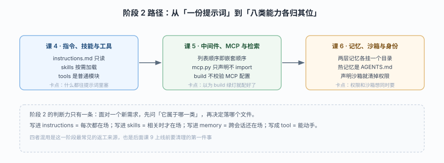

# 阶段 2：能力声明

> 所属课程：Managed Deep Agents ｜ 故事章节：「把能力写成文件」 ｜ 上一阶段：[阶段 1](../1-定位与起跑/overview.md) ｜ 下一阶段：[阶段 3](../3-运行与交付/overview.md)

## 🎯 本阶段目标

- 掌握 MDA 的核心工作方式：**能力不靠调 API 开启，靠放对文件开启**
- 逐类拆解八种声明落点（指令 / 技能 / 工具 / MCP / 中间件 / 记忆 / 沙箱 / 身份），说清各自的生效时机与边界
- 建立"声明式配置"的负面清单：哪些东西一旦声明就会互相顶掉、哪些行为由模型自主决定

## 📍 学习重点

- **三层上下文的分工**：`instructions.md`（常驻、只读）、`skills/`（按需加载）、`memory`（运行时学习）——三者最容易放错位置
- **托管预制件与作者中间件的顺序**：运行时会在你的中间件前后插入自己的中间件（凭据门、调度投递、记忆注入等），理解这点才能预测实际行为
- **沙箱与权限互斥**：声明 `sandbox/` 会清掉 `permissions`，因为权限规则会禁用沙箱的 `execute` 工具——这是最反直觉的一条
- **双记忆层的默认拒绝**：user 层在群聊与直连 API 场景默认不挂载，因为运行时无法判断该会话是否私密

## ✅ 必须掌握的知识点

| 知识点 | 所属课 | 学完应能 |
|--------|--------|----------|
| 指令即系统提示 | 课 4 | 说清 `instructions.md` 为什么永远只读，以及部署时如何同步 |
| 技能目录与渐进披露 | 课 4 | 写出 `skills/<name>/SKILL.md` 并解释它何时被加载 |
| 自定义工具与运行上下文 | 课 4 | 写出注入 `ManagedToolRuntime` 的工具，正确读取调用者与通道 |
| 中间件注入点 | 课 5 | 说清作者中间件与托管中间件的相对位置与执行顺序 |
| MCP 连接器声明 | 课 5 | 区分"导入成工具"与"声明式连接器"两种接法的适用场景 |
| 内置检索与凭据 | 课 5 | 配出 Parallel 检索，说清它省掉了什么、边界在哪 |
| 双记忆层 | 课 6 | 配出 agent + user 双层，解释默认策略为何这样设 |
| 冷热记忆与写入纪律 | 课 6 | 设计 `AGENTS.md` 热层 + 冷文件的组织方式，说出写入失败的诚实处理 |
| 沙箱与身份 | 课 6 | 配沙箱 TTL 与身份提供方，解释权限被清除的机制 |

## 🗺️ 本阶段路径图

> 看图：课 4 处理"agent 说什么、会什么"（指令 / 技能 / 工具），课 5 处理"在它前后插什么"（中间件 / MCP / 检索），课 6 处理"它记住什么、在哪动手、谁能用"（记忆 / 沙箱 / 身份）。三条线互不依赖，可以按需跳读，但课 4 → 课 6 的"上下文三兄弟"建议连着读。

## 本阶段产出

- [x] `lessons/04-指令技能与工具.md`
- [x] `lessons/05-中间件MCP与检索.md`
- [x] `lessons/06-记忆沙箱与身份.md`
