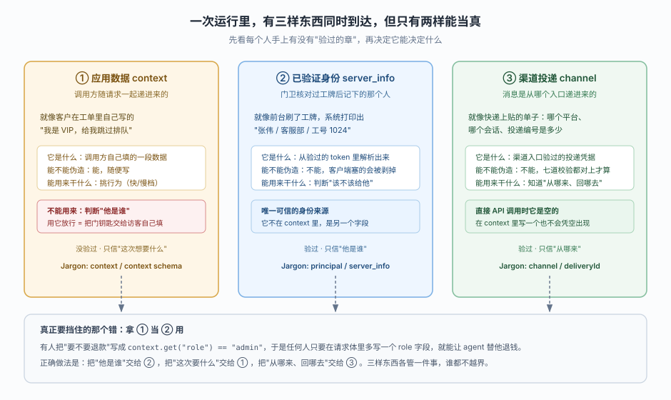
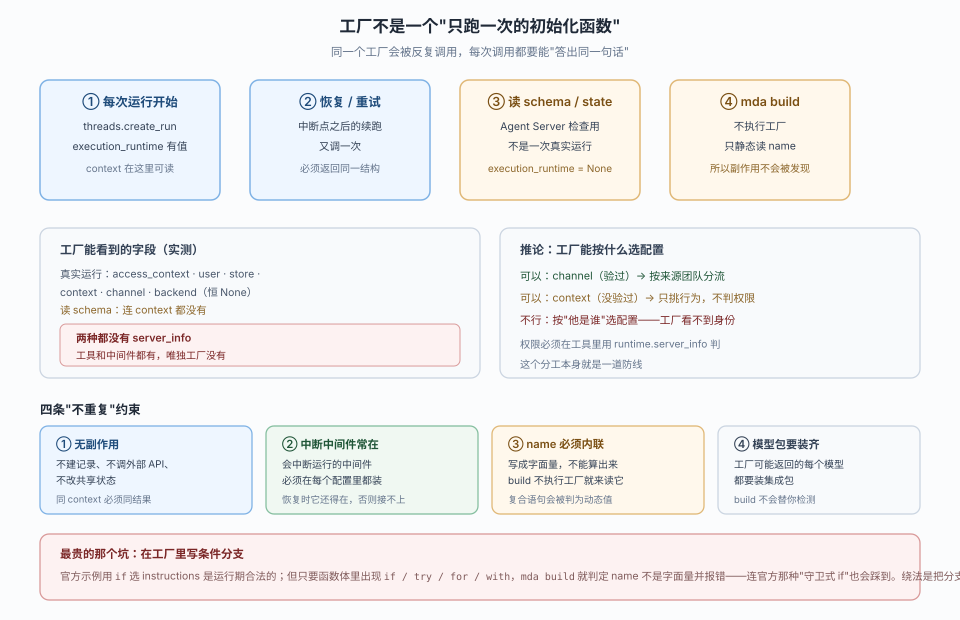
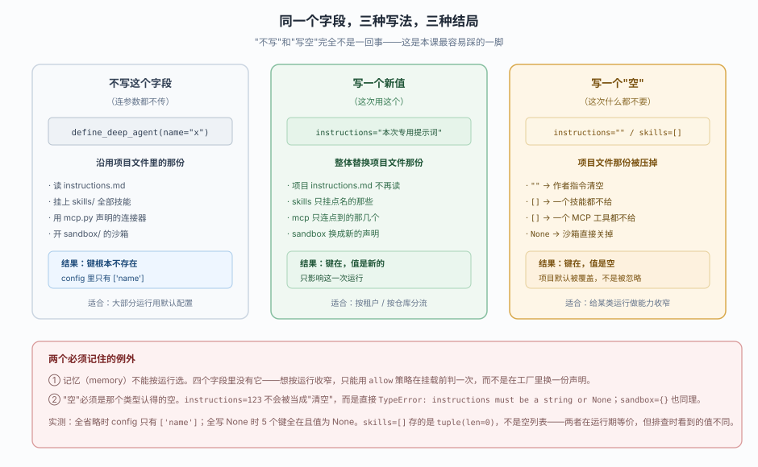
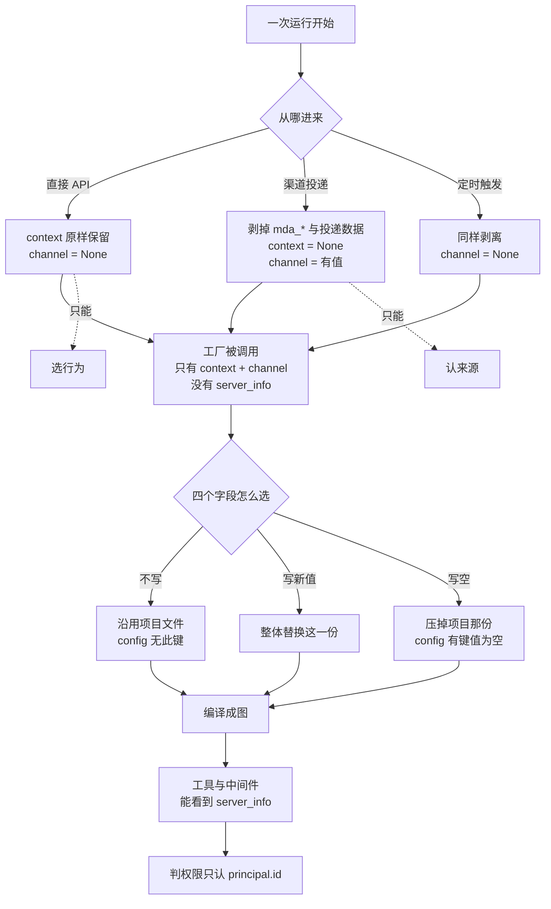

# 第 7 课：运行时上下文

> 所属阶段：阶段 3《运行与交付》｜ 水平：入门 ｜ 本课知识点：三源分离（context / principal / channel）、工厂的幂等约束、按运行选配置与清除语义
> 故事情节：前六课都在给这一个 agent 加能力；本课第一次问"来的是谁、他想要什么、我该信哪一句"
> 📖 结论已按官方文档核对（核对于 2026-10 ｜ 来源：`/langsmith/python/managed-deep-agents-runtime`、`-agent-definition`、`-identity`、`-tools`、`-middleware` 及其 JavaScript 对应页）＋ 本机实测（`managed-deepagents 0.9.5` / Python 3.12）

## 🎯 本课目标

- 说清三种运行时来源各自的来历与信任级别，并能对一段判断代码指出"该信哪个字段"
- 列出工厂的四条重复调用约束，认出违反幂等的写法并改对
- 用工厂为不同租户/仓库选指令、技能、MCP、沙箱，并讲清"省略"与"清空"的差别

---

## 第一幕：起源与场景引入

前六课你已经把八种能力声明全部配好了。现在运维把这套 agent 接进了三个入口：Slack 群里的一个机器人、一个给内部系统调用的 HTTP API、一个每天早上九点自跑的定时任务。

上线第三天，客服主管发来三条反馈：

```text
1. 有人在群里 @ 机器人问"帮我查下张三的订单"，它真去查了，还回了订单号。
   群里有 40 个人，谁都能看。
2. 后台系统调 API 时传了 {"role": "admin"}，agent 就跳过了审批直接退款。
   我们查日志才发现，这个 role 是调用方自己写在请求体里的。
3. 早上九点那个定时任务，每次都报错说 context 里缺 repository 字段。
   可这个任务根本不处理仓库。
```

三条反馈，三种"以为对但其实错"的假设：

| 反馈 | 当时以为 | 实际发生的 |
|---|---|---|
| 群里能查别人订单 | "群里聊天的都是同事" | 身份判的是"渠道投递"，不是"聊天内容"。渠道验过的是"这条消息确实从 Slack 这个会话来的"，不是"这个人有权看张三的订单" |
| 传 `role=admin` 就放行 | "请求里有 role 字段就是管理员" | `role` 在 `context` 里，那是调用方自己填的，平台一个字都没验。真正验过的身份在另一个字段 |
| 定时任务报缺字段 | "所有运行都有 context" | 渠道运行和定时运行的 context 会被剥掉。官方原话是"渠道投递不携带应用 context" |

> 📌 **一句话本质**：`context`、`server_info.principal`、`channel` 是三个不同来源、三种不同信任级别的东西。把它们混成一个"运行环境的字典"，就是本课要根治的错误。

> ⚖️ **处境对照**：裸 LangGraph 里，身份、会话、请求参数最后都塞进 `configurable` 或 `config`，谁都能往里写，也谁都分不清哪一项可信。MDA 的做法是**把它们拆成三个物理上分开的字段**，并规定每个字段只能干一件事：`context` 选行为、`server_info` 判权限、`channel` 认来源。代价是你不能再用"一个大字典"图省事。

---

## 第二幕：认知冲突

上面三条反馈有个共同点：**代码跑通、日志没红、效果却是错的。**

这正是本课的难点所在——三源分离不是一个"配置项"，而是一条纪律。违反它不会报错，只会让你在某个凌晨发现 agent 替陌生人退了款。

再看一个更隐蔽的例子。你为了让一个部署服务多个团队，把 agent 写成了工厂函数：

::: code-group

```python [Python]
# agent.py
from managed_deepagents import ManagedServerRuntime, define_deep_agent


def agent(runtime: ManagedServerRuntime):
    execution = runtime.execution_runtime
    context = execution.context if execution is not None else None
    tier = (context or {}).get("tier", "standard")

    audit_log.write(f"run started for tier={tier}")  # 记一笔审计
    return define_deep_agent(name="support", model="openai:gpt-5.5")
```

```typescript [TypeScript]
// agent.ts
import { defineDeepAgent, type ManagedServerRuntime } from "managed-deepagents";

export function agent(runtime: ManagedServerRuntime<any>) {
  const context = runtime.executionRuntime?.context;
  const tier = context?.tier ?? "standard";

  auditLog.write(`run started for tier=${tier}`); // 记一笔审计
  return defineDeepAgent({ name: "support", model: "openai:gpt-5.5" });
}
```

:::

看起来人畜无害：读一下 context，记一笔审计，返回定义。三个问题同时存在：

1. **审计日志会重复。** 一次运行开始调一次，恢复调一次，重试调一次，Agent Server 读 schema 还要调一次。你在审计系统里会看到同一次运行四条记录。
2. **那段 `tier` 判断一改成 `if` 就构建不过。** 现在这个写法（条件表达式 + 一次函数调用）恰好躲过了静态扫描，但只要你把它改写成更自然的 `if context: tier = ...`，`mda build` 立刻报 `agent name ... must be a static string literal`——明明 `name="support"` 是字面量。
3. **你没法按"他是谁"选配置。** 你本来想给付费用户开更贵的模型，但工厂拿不到 `server_info`——它只有 `context`（不可信）和 `channel`（可信但只说明来源）。

三件事叠在一起说明：**工厂不是一个普通的初始化函数，它是一个会被反复调用、且只能看半张脸的纯函数。**

---

## 第三幕：层层揭示

### 一眼全局图（进入细节前先看一眼）



> 看图：左中右三栏是三个来源。先看每栏顶部那句"它像什么"——左边是"客户在工单里自己写的"，中间是"前台刷工牌打印出来的"，右边是"快递单上的寄件信息"。再看每栏底部那个词：`context` 没验过、`principal` 验过、`channel` 验过。最后看底部那条红字，它写的正是第一幕的第一条反馈。

四条硬约束自查：① 只回答"三样东西各是什么、哪样能当真、混用会怎样"；② 没有 `server_info`、`Runtime` 这类术语，用"门卫核牌"解释身份；③ 带读图指引（先看每栏那两句话）；④ 图旁文字可独立成立。

### 本课地图（分几步走）

| 步 | 这一步要解决什么（人话） | 对应知识点 |
|:--:|------------------------|-----------|
| 1 | 搞清三样东西各从哪来、哪样能用来判权限、混用会出什么事 | 知识点 1：三源分离 |
| 2 | 搞清工厂为什么会被反复调用、哪些写法会让它"答出不同的话" | 知识点 2：工厂的幂等约束 |
| 3 | 搞清怎么按运行换配置、为什么"不写"和"写空"是两回事 | 知识点 3：按运行选配置与清除语义 |

---

### 知识点 1：三源分离（context / principal / channel）

> 🧭 第 1/3 步｜承接：第二幕的"传 role=admin 就放行" → 本步：把三个来源的来历、信任级别、以及混用的后果讲清
> 本知识点关键点：三者来源不同、`context` 不能判权限、客户端塞的身份键会被剥、渠道运行 context 为 None、`channel` 七道校验

#### 一句话定义

一次运行开始前，平台会把三样东西分别放进运行时的三个不同字段：`context`（调用方自己填的数据）、`server_info.principal`（从验过的 token 解析出的调用者）、`channel`（渠道入口验过的投递凭据）。三者来源不同、信任级别不同，也各自只该干一件事。

#### 直觉建立（类比）

一家公司的前台有三样东西：

访客登记本（`context`）——访客自己写"我来找谁、什么事"。前台只负责递笔，不核实内容。有人写"我是 CEO"，前台不会因此让他进财务室。

工牌读卡器（`server_info`）——刷卡后系统打印"张伟 / 客服部 / 工号 1024"。这个信息不是访客说的，是发卡系统里存的，改不了。

快递单（`channel`）——包裹上贴着"从哪个平台寄出、哪个订单号"。这张单子贴上去之后就撕不掉，它证明的是"这个东西确实从那个入口来的"。

三样都在前台，但**只有后两样能当证据**。访客登记本的作用是"知道他想干什么"，不是"证明他是谁"。

> 💡 **类比的边界**：前台可以拒收一张假快递单，平台也一样——`channel` 有七道校验，任一对不上就当作"没有渠道"。但平台不会替你判断"这个人该不该看张三的订单"，那要靠你在工具里比对 `principal` 和资源归属。

#### 核心原理

##### 三者的来历

官方原文把三句话写得很清楚：

> Context comes from the context parameter of an API call. LangGraph validates it against your context schema. **Use it to select behavior, not to grant access.**
>
> Server info comes from identity, which resolves the caller from a verified token. Managed Deep Agents **strips identity keys that a client sends through `configurable`**, so use this field for authorization.
>
> Channel comes from managed channel ingress, which verifies the delivery before the run starts. **A `channel` key in a direct API call's context does not create `runtime.channel`.**

翻成一张表：

| 字段 | 从哪来 | 谁验的 | 能用来做什么 | 不能用来做什么 |
|---|---|---|---|---|
| `runtime.context` | API 调用的 `context` 参数 | 只按你写的 schema 校验形状 | 选行为（快/慢档、选哪个仓库、开不开某个能力） | 判权限、认人 |
| `runtime.server_info.principal` | identity 从已验证 token 解析 | 身份提供方 | 判权限、审计、按人取凭据 | 决定"这次要做什么" |
| `runtime.channel` | 渠道入口的投递 | 渠道适配器 + 平台七道校验 | 认来源、决定回哪里、按来源团队分流 | 判权限（它只说"从哪来"） |

##### 客户端塞的身份键会被剥掉

这一条是"为什么不能信 `configurable`"的答案。源码里有一份 13 个保留键的清单，以及一个把它们剥掉的函数：

```python
RESERVED_CONFIGURABLE_KEYS = frozenset({
    "user_id", "organization_id", "groups", "mda_user_id", "mda_organization_id",
    "mda_groups", "mda_user_kind", "mda_user_email", "mda_claims",
    "mda_source_provider", "mda_source_thread_id",
    "mda_channel_binding", "mda_schedule",
})

def sanitize_configurable(configurable):
    """Strip client-supplied identity keys so a body can't spoof the actor.
    The platform-set ``langgraph_auth_user`` is preserved — it is the only trusted
    identity source."""
    if not configurable:
        return {}
    return {k: v for k, v in configurable.items() if k not in RESERVED_CONFIGURABLE_KEYS}
```

实测（本机 `0.9.5`）：往 `configurable` 里塞 6 个伪造键，剥完只剩两个与身份无关的键：

```text
before: {'user_id': 'victim-001', 'mda_user_id': 'victim-001', 'mda_user_kind': 'user',
         'mda_organization_id': 'org-evil', 'mda_groups': ['admin'], 'mda_claims': {'x': 1},
         'thread_id': 't-1', 'tier': 'fast'}
after : {'thread_id': 't-1', 'tier': 'fast'}
```

注意注释里那句：`langgraph_auth_user` 被保留，因为它是**平台注入的**。这条区分很重要——同样叫"从 configurable 里读身份"，读 `mda_user_id` 得到的是别人伪造的，读 `langgraph_auth_user` 得到的是平台盖过章的。

##### `server_info` 什么时候是 None

官方的说法是 principal is absent when no caller resolved, because identity is opt-in. 实测补了一个更细的条件：**光有 `langgraph_auth_user` 不够，里面还得有 `mda_user_id`**。

```text
只有 identity + is_authenticated   -> server_info = None
identity + mda_user_id=real-user-42 -> principal.id = 'real-user-42'
```

原因在 `_runtime_user_id()`：它从 auth user 里取 `mda_user_id`，取不到就返回 None，而 `build_managed_server_info()` 见到 user 为 None 且没有既存值时直接返回 None。结合上一条——客户端塞的 `mda_user_id` 已经被剥掉了——所以**如果身份提供方没配好，你在代码里没有任何兜底手段**。

因此 `runtime.server_info` 的正确读法必须带判空：

::: code-group

```python [Python]
# tools/check_order.py
from dataclasses import dataclass

from langchain.tools import tool
from managed_deepagents import ManagedToolRuntime


@dataclass
class AppContext:
    region: str = "us"


@tool
async def check_order(order_id: str, runtime: ManagedToolRuntime[AppContext]) -> str:
    """Check the status of an order."""
    principal = runtime.server_info.principal if runtime.server_info else None
    if principal is None:
        return "Sign in to check orders."
    # 权限判断只认 principal，绝不看 runtime.context
    if not await owns_order(principal.id, order_id):
        return "That order does not belong to your account."
    region = runtime.context.region if runtime.context else "us"
    return f"Order {order_id} for {principal.id} ships from {region}."
```

```typescript [TypeScript]
// tools/checkOrder.ts
import { tool } from "@langchain/core/tools";
import type { ManagedToolRuntime } from "managed-deepagents";
import { z } from "zod";

type AppContext = { region?: string };

export const checkOrder = tool(
  async ({ orderId }, runtime: ManagedToolRuntime<unknown, AppContext>) => {
    const principal = runtime.serverInfo?.principal ?? null;
    if (principal === null) {
      return "Sign in to check orders.";
    }
    // 权限判断只认 principal，绝不看 runtime.context
    if (!(await ownsOrder(principal.id, orderId))) {
      return "That order does not belong to your account.";
    }
    const region = runtime.context?.region ?? "us";
    return `Order ${orderId} for ${principal.id} ships from ${region}.`;
  },
  {
    name: "check_order",
    description: "Check the status of an order.",
    schema: z.object({ orderId: z.string() }),
  }
);
```

> ⚠️ **泛型顺序别写反**：`ManagedToolRuntime<TState, TContext>` 是**两个**参数，且与 Python 的 `[Context, State]` 顺序**相反**。只写一个（`ManagedToolRuntime<AppContext>`）等于把 `AppContext` 塞进 `TState` 槽，`TContext` 留给默认的 `unknown`——于是 `runtime.context` 被推断成 `{}`，访问 `.region` 直接报 `TS2339: Property 'region' does not exist on type '{}'`。本工程 `playground-ts/l07-runtime-context.ts` 对这条有实测。

:::

这个写法把三源分离落到实处：`principal.id` 判"这个订单是不是他的"，`context.region` 只决定"走哪个分区"，两者互不代劳。

##### 三种运行时类型看到的字段并不一样

这是本课最反直觉的一处实测发现。官方文档说"三个托管字段"是给工厂、工具、中间件共用的，但实际字段清单不一样：

| 代码跑在哪 | 类型 | `context` | `server_info` | `channel` | `backend` |
|---|---|---|---|---|---|
| 工厂（真实运行） | `_ManagedExecutionRuntime` | 有 | **没有** | 有 | 恒为 None |
| 工厂（读 schema/state） | `_ManagedReadRuntime` | **没有** | **没有** | 有 | 恒为 None |
| 中间件钩子 | `ManagedRuntime` | 有 | 有 | 有 | 有 |
| 工具 | `ManagedToolRuntime` | 有 | 有 | 有 | 有 |

注意第二行：`ManagedServerRuntime` 其实是这两种类型的联合，Agent Server 读 schema 时给你的是 `_ManagedReadRuntime`——它**连 `context` 都没有**，因为那次调用根本不是一次运行。这正是官方那句 "`execution_runtime` is None when Agent Server loads the agent for inspection" 的类型层面后果：你不判空就直接 `runtime.execution_runtime.context`，在真实运行里对、在读 schema 时崩。

实测直接列 `dataclasses.fields()`：

```text
--- _ManagedExecutionRuntime（真实运行时工厂拿到的）---
    access_context | user | store | context | channel | backend
--- _ManagedReadRuntime（读 schema/state 时工厂拿到的）---
    access_context | user | store | channel | backend

factory 有 server_info?  False（两种都没有）
middleware 有 server_info?  True
tool 有 server_info?  True
```

这个差异不是 bug，而是一道设计上的防线：**工厂负责"这次用哪套配置"，这件事本来就不该知道"他是谁"。** 因为一旦工厂能看 principal，你就会被诱导写"给管理员开更贵的模型"——听起来无害，实际上把权限判断挪到了一个无法审计、且会被 Agent Server 在读 schema 时也执行的位置。

所以工厂的选择依据只剩两个：`channel`（可信，能按来源分流）和 `context`（不可信，只挑行为）。官方在"按运行选配置"那段的示例也正是这么写的：按 `context["repository"]` 选技能，而不是按人。

##### 渠道运行的 context 是 None

第三幕第一段里第三条反馈的答案在这里。官方原文：A channel delivery carries no application context. Managed Deep Agents removes delivery data before LangGraph validates context, so required context fields do not reject channel runs.

源码里这个剥离动作在 `execution_context()`：

```python
def execution_context(context, defaults, config):
    """Split managed routing out of a managed run's context; direct runs keep theirs whole."""
    channel_run = is_channel_execution(configurable)
    scheduled_run = is_scheduled_execution(configurable)
    if not channel_run and not scheduled_run:
        return None, context, None          # 直接 API 调用：原样保留
    raw = context if isinstance(context, Mapping) else {}
    ...
    rest = {key: value for key, value in raw.items() if not is_managed_key(key)}
    ...
    if "langgraph_auth_user" in rest:
        rest = {}                           # 出现平台身份键 → 整个 context 作废
    return binding, rest or None, routing   # 剥完为空 → None
```

实测三种情况：

```text
直接 API 运行，context={'tier': 'fast', 'mda_channel': {...}}
  -> authored_context = {'tier': 'fast', 'mda_channel': {...}}   （原样）
渠道运行，context={'tier': 'fast', 'mda_channel': {...}}
  -> authored_context = {'tier': 'fast'}    routing 剥走 ['mda_channel']
渠道运行，context={'tier': 'fast', 'langgraph_auth_user': {...}}
  -> authored_context = None                 （整块作废）
```

这里有两个容易踩的点：

第一，**`mda_*` 开头的键会被搬进 routing，不留给作者**。所以你在 context 里写 `mda_channel` 想"手动指定渠道"，在渠道运行下只会被当成路由数据搬走；在直接 API 运行下则原样留着，但 `runtime.channel` 依然是 None——官方那句"a channel key in a direct API call's context does not create runtime.channel"说的就是这个。

第二，**context 里出现 `langgraph_auth_user` 会让整个 context 变 None**。这是一条防伪规则：既然只有平台能注入这个键，那么作者侧看到它就说明这次 context 的来路可疑，干脆整块丢掉。

判断"这次是不是渠道运行"的正确方式，官方给了一句：To tell a channel run from a direct run, check `runtime.channel`. 而不是去 context 里找痕迹。

##### `channel` 的七道校验

`channel` 之所以可信，是因为它过了一道相当严格的校验。源码 `resolve_channel_binding()` 依次检查：

| # | 检查什么 | 不满足的结果 |
|---|---|---|
| 1 | `mda_channel` 是合法 JSON 值 | 返回 None |
| 2 | 能被 `_CHANNEL_CONTEXT_ADAPTER` 解析成 `ChannelContext` | 返回 None |
| 3 | `mda_source_provider` == `provider` | 返回 None |
| 4 | `mda_source_thread_id` == `source_thread_key` | 返回 None |
| 5 | `channel_provider_for_name(name)` == `provider`（渠道得已注册） | 返回 None |
| 6 | 若 `transport == "trigger_server"`，`target` 能被解析 | 返回 None |
| 7 | 若 `transport == "trigger_server"`，`target.source_thread_key` == `source_thread_key` | 返回 None |

**七道里任何一道不过，全部静默返回 None**——不抛异常、不写日志。这意味着"渠道没生效"在代码里表现为"`runtime.channel` 是 None"，而不是一条错误信息。

实测七种情况（1 条通过、6 条被拒）：

```text
全字段一致                          -> PASS
provider 不符                        -> None
source_thread_key 不符               -> None
缺 auth stamp（无 mda_source_*）     -> None
渠道未声明（name 未注册）            -> None
声明 provider 与 channel provider 不符 -> None
trigger_server 但 target 缺 key      -> None
```

还有一个连带的实测结论：**工厂能看到的 `channel` 依赖渠道已注册**。同一个项目，`channels/` 里没声明渠道时工厂里 `channel=None`，声明后变 `channel=有值`——因为 `register_channel_messaging(channels or [])` 在工厂解析之前就执行了。

#### 常见误区

1. **"请求里带了 `user_id` 就是这个人"**：会被剥掉。13 个保留键全部剥，包括 `user_id` / `mda_user_id` / `mda_groups`。
2. **"`context` 里有 `role` 就能判权限"**：`context` 是调用方自己填的，官方原话是 use it to select behavior, not to grant access。
3. **"工厂里能拿到 `server_info`"**：拿不到。工厂的运行时类型没有这个字段，只有 `channel` 和 `backend`（后者恒 None）。
4. **"渠道运行也能读到 context"**：不能。渠道投递不携带应用 context，运行时在校验前就剥掉了。
5. **"在 context 里写 `mda_channel` 就能造出一个 channel"**：不能。直接 API 调用下 `runtime.channel` 恒为 None。
6. **"`runtime.channel` 是 None 说明渠道配置写错了"**：也可能是七道校验里某一道不过，而且它不会告诉你哪一道。
7. **"有 `langgraph_auth_user` 就有 principal"**：不够，里面还得有 `mda_user_id`。

#### 一句话记住

`context` 是访客自己填的登记本（只能用来挑行为），`server_info.principal` 是刷工牌打印出来的（只能用来判权限），`channel` 是撕不掉的快递单（只能用来认来源）。三样都在，但只有后两样能当证据。

#### 🗣️ 行话对照

- **runtime（运行时）**：每次运行交给你的那个对象，原生字段 + 三个托管字段。在哪遇到：`ManagedToolRuntime` / `ManagedRuntime` / `ManagedServerRuntime`
- **principal**：本次运行验证过的调用者。在哪遇到：`runtime.server_info.principal`、identity 页
- **context schema**：你声明的 context 形状，LangGraph 按它校验。在哪遇到：`define_deep_agent(context_schema=...)`
- **channel binding**：渠道投递经过校验后形成的那份凭据。在哪遇到：`runtime.channel`、`channels/`
- **execution_runtime**：只有真正跑起来才有值，读 schema 时为 None。在哪遇到：工厂里 `runtime.execution_runtime`

#### 官方文档

- Runtime（三源分离原文 + 三种运行时类型 + 渠道运行无 context）: https://docs.langchain.com/langsmith/python/managed-deep-agents-runtime
- 对应 TypeScript 页: https://docs.langchain.com/langsmith/javascript/managed-deep-agents-runtime
- Identity（principal 从哪来）: https://docs.langchain.com/langsmith/python/managed-deep-agents-identity
- Custom tools（工具里怎么读 runtime）: https://docs.langchain.com/langsmith/python/managed-deep-agents-tools

---

### 知识点 2：工厂的幂等约束

> 🧭 第 2/3 步｜承接：第二幕的"审计日志写了四遍、build 说 name 不是字面量" → 本步：把工厂会被调几次、四条约束、以及那条文档没写的静态扫描规则讲清
> 本知识点关键点：四个调用点、四条官方约束、build 不执行工厂、build 不检测模型依赖、静态扫描比文档严格

#### 一句话定义

工厂（graph factory）是导出一个可调用对象来代替 `define_deep_agent(...)` 的写法；它在每次运行开始、每次恢复或重试、以及 Agent Server 读 schema/state 时都会被调用，所以它必须是一个"同一个输入永远答同一句话、且不产生任何外部影响"的纯函数。

#### 直觉建立（类比）

自动售货机。你投币、按 A3，它掉出一瓶可乐。你退币再来一次，投币、按 A3，它还得掉出可乐——不能因为"今天已经卖过一瓶"就给你一包薯片。

更关键的是：**维修工每天来检查机器时也会按一次 A3**（Agent Server 读 schema），那时候他并不真的想喝可乐，但机器必须照样正常响应。如果按 A3 的动是"给仓库下单一箱可乐"，维修工每检查一次就多订一箱。

> 💡 **类比的边界**：售货机的好处在结果可预期；工厂的难点在于它的调用次数你数不清——你只能保证"无论调几次，结果一样、副作用为零"。

#### 核心原理

##### 四个调用点



> 看图：上半部四个方框是四个调用点，注意第 3、4 个不是真实运行——一个为了读 schema/state，一个连工厂都不执行。中间左栏列出工厂实际能看到的字段，红框那句"没有 server_info"是本课最有用的发现。下半部四张卡片是四条约束，最后那条红字是文档没写、但实测必然踩到的静态扫描规则。

官方原文：Managed Deep Agents calls the factory at the start of each run, and again when a run resumes or retries. Agent Server also calls it to read schemas and state.

实测把四个调用点确认了一遍：

```text
threads.create_run  -> 工厂调用 1 次，execution_runtime 有值，可读 context
threads.update      -> 工厂调用 1 次，execution_runtime = None
threads.read        -> 工厂调用 1 次，execution_runtime = None
assistants.read     -> 工厂调用 1 次，execution_runtime = None
同一 context 连调 3 次 -> 就真的调 3 次（没有任何缓存）
```

最后一行值得单独记：**没有缓存**。你以为"同一个 context 应该复用"，实际上每次都要重新执行你的函数体。

##### 四条约束

官方原文的四条，逐条配上实测证据：

| # | 约束 | 官方表述 | 违反后的表现（实测） |
|---|---|---|---|
| 1 | 无副作用 | Return the same definition for the same context. Do not create records, call external APIs, or change shared state in the factory. | 不报错，但审计/埋点会按调用次数重复 |
| 2 | 中断中间件常在 | Keep middleware that can interrupt a run in every configuration. When a run resumes, the middleware that raised the interrupt must still be present. | 恢复时报错或接不上中断点 |
| 3 | name 内联 | Set `name` as an inline string. `mda build` reads it without calling the factory and uses it as the graph ID and default deployment name. | `mda build` 报 must be a static string literal |
| 4 | 模型依赖装齐 | Install the integration package for every model the factory can return. The build does not detect them. | build 绿灯，运行期 `ImportError` |

第 4 条实测特别值得看。项目里没装 `langchain-cohere`，但工厂有一条分支返回 `cohere:...`：

```text
$ uv run mda build
◇  Managed app compiled          ← 一句提示都没有，exit=0

运行期：
ImportError: Initializing ChatCohere requires the langchain-cohere package.
```

也就是说：**只要你的工厂有多个模型分支，就必须把所有分支的模型包都装上**，build 一点忙都帮不上。

第 3 条实测更微妙。`mda build` 确实不执行工厂——用一个有文件副作用的工厂验证，marker 文件没被创建、exit=0：

```python
def agent(runtime):
    open("/tmp/marker-f6", "a").write("x")   # 副作用
    return define_deep_agent(name="f6", model="openai:gpt-5.5")
```

```text
$ uv run mda build
◇  Managed app compiled
$ ls /tmp/marker-f6
ls: cannot access '/tmp/marker-f6': No such file or directory
```

但同一份代码如果函数体里换成 `if` 守卫，build 立刻失败——这就引出下一节。

##### 文档没写的静态扫描规则

官方只说 name 要写成内联字符串。实测发现它的判定方式比"是不是字面量"严格得多：**只要工厂函数体（含嵌套函数体）里出现任何复合语句，就判定 name 是动态值。**

用 30+ 个最小用例把边界扫了出来：

| 函数体里有什么 | 结果 |
|---|---|
| 只有 `Assign` + `Return` | 通过 |
| `Assign` 里用条件表达式 `a if c else b` | 通过 |
| `Assign` 里用 f-string | 通过 |
| `Assign` 里用 `**dict` 展开 | 通过 |
| `Assign` 里调用辅助函数 | 通过 |
| 单独的表达式语句（如 `print(...)` / `audit_log.write(...)`） | 通过 |
| 出现 `if` | **失败** |
| 出现 `try` | **失败** |
| 出现 `for` / `while` | **失败** |
| 出现 `with` | **失败** |
| 出现 `assert` | **失败** |
| 出现 `del` | **失败** |
| 模块级 `if`（不在函数体内） | 通过 |

失败时的报错长这样：

```text
error: agent `name` ... must be a static string literal
```

最扎心的一条：**官方文档自己的守卫写法会失败**。

```python
def agent(runtime):
    if runtime is None:                       # ← 这一行就让 build 失败
        raise ValueError("runtime required")
    return define_deep_agent(name="x", model="openai:gpt-5.5")
```

而把分支挪出工厂就没事：

::: code-group

```python [Python]
# agent.py —— 查表在工厂外，工厂内没有 if/try 这类复合语句
from managed_deepagents import ManagedServerRuntime, define_deep_agent

CONFIGS = {
    "payments-service": {
        "model": "openai:gpt-5.5",
        "instructions": "Python service. Run pytest before opening a PR.",
        "skills": ["./skills/python-service"],
    },
    "storefront": {
        "model": "openai:gpt-5.5-mini",
        "instructions": "Next.js app. Run web tests and an a11y check.",
        "skills": ["./skills/typescript-web"],
    },
}
DEFAULT_CONFIG = CONFIGS["storefront"]


def agent(runtime: ManagedServerRuntime):
    execution = runtime.execution_runtime
    context = execution.context if execution is not None else None
    repo = (context or {}).get("repository")
    config = CONFIGS.get(repo, DEFAULT_CONFIG)
    return define_deep_agent(name="open-swe", **config)
```

```typescript [TypeScript]
// agent.ts —— 查表在工厂外，工厂内只有赋值与 return
import { defineDeepAgent, type ManagedServerRuntime } from "managed-deepagents";

const CONFIGS: Record<string, Record<string, unknown>> = {
  "payments-service": {
    model: "openai:gpt-5.5",
    instructions: "Python service. Run pytest before opening a PR.",
    skills: ["./skills/python-service"],
  },
  storefront: {
    model: "openai:gpt-5.5-mini",
    instructions: "Next.js app. Run web tests and an a11y check.",
    skills: ["./skills/typescript-web"],
  },
};
const DEFAULT_CONFIG = CONFIGS.storefront;

export function agent(runtime: ManagedServerRuntime<any>) {
  const context = runtime.executionRuntime?.context;
  const repo = context?.repository as string | undefined;
  const config = CONFIGS[repo ?? ""] ?? DEFAULT_CONFIG;
  return defineDeepAgent({ name: "open-swe", ...config });
}
```

:::

这个写法的好处不只是"能过 build"：把配置表提到模块级，也顺手满足了第 1 条约束——查表是纯的，反复调用结果一样。

##### 工厂的错误边界

工厂内部抛任何异常，对外都只剩一句话：

```text
工厂内部抛 ValueError("boom")  -> RuntimeError: agent factory failed
```

原始异常、堆栈、消息全被吞掉（源码注释写着 callback failures cross an untrusted boundary）。这是有意的：工厂返回值要跨信任边界，平台不想把内部信息泄给调用方。

其余六种非法返回的实测结果：

| 工厂返回 | 报错 |
|---|---|
| `dict` / `None` / 其它非定义 | `TypeError: agent factory must return define_deep_agent(...)` |
| 导出对象不是 callable | `TypeError: agent export must be a managed agent definition or factory entrypoint` |
| `name=""` 或 `"   "` | `RuntimeError: agent factory failed` |
| 定义里含 `backend` / `store` / `checkpointer` / `system_prompt` / `disable_memory` | `ValueError: agent factory returned a managed runtime field` |
| `define_deep_agent(backend=...)` 直接写 | `TypeError: Remove backend from define_deep_agent(...). Configure the sandbox in sandbox/.` |

注意最后两行的差别：**通过 `define_deep_agent` 传会被当场拦住（明确的 TypeError），绕过它手搓 `DeepAgentDefinition` 则要到工厂返回时才被 `snapshot` 检查拦下（ValueError）**。两条路都堵住了，但报错位置和类型不同，排查时容易误判。

#### 常见误区

1. **"工厂只调用一次"**：一次运行至少一次，恢复一次，重试一次，读 schema 一次。
2. **"同一个 context 会被缓存"**：不会，连调三次就是三次执行。
3. **"在工厂里记审计日志很合理"**：记录会按调用次数重复（这是真问题）。但它本身不会让 build 失败——让它失败的是你顺手加的那句 `if`。
4. **"`mda build` 会执行工厂，所以副作用能被发现"**：不执行。副作用只有到运行时才发生，且不报错。
5. **"build 会检查模型包有没有装"**：不检查。多模型工厂必须自己装齐。
6. **"name 是字面量就行"**：还要函数体里没有 `if`/`try`/`for`/`with`/`assert`/`del`，包括嵌套函数体。
7. **"官方示例的 `if` 守卫可以照抄"**：那段是运行期示例，放进工厂函数体就会让 `mda build` 失败。

#### 一句话记住

工厂是一台"投同一个币必须掉同一瓶饮料、且不能顺手给仓库下单"的售货机；而且维修工每天也会按一次按钮。

#### 🗣️ 行话对照

- **graph factory（图工厂）**：导出一个可调用对象代替定义，运行期返回定义。在哪遇到：`agent.py`、agent-definition 页
- **access_context**：这次调用是哪一种（`threads.create_run` / `threads.update` / `threads.read` / `assistants.read`）。在哪遇到：`runtime.execution_runtime.access_context`
- **execution_runtime**：只有真实运行才有值。在哪遇到：工厂里读 context 的唯一入口
- **graph ID**：`name` 被用作的标识。在哪遇到：`mda build`、`assistantId`

#### 官方文档

- Agent definition → Select configuration per run / Keep the factory repeatable: https://docs.langchain.com/langsmith/python/managed-deep-agents-agent-definition#select-configuration-per-run
- 对应 TypeScript 页: https://docs.langchain.com/langsmith/javascript/managed-deep-agents-agent-definition
- Runtime（工厂接收的类型与 `access_context`）: https://docs.langchain.com/langsmith/python/managed-deep-agents-runtime
- Graph rebuild（工厂模式的 LangGraph 出处）: https://docs.langchain.com/langsmith/graph-rebuild

---

### 知识点 3：按运行选配置与清除语义

> 🧭 第 3/3 步｜承接：知识点 2 的"工厂能过 build"→ 本步：把四个字段的三种写法、以及两个例外讲清
> 本知识点关键点：四个可选字段、省略/选中/清空三态、memory 不能按运行选、"空"必须是类型认得的空

#### 一句话定义

工厂可以为这一次运行选 `instructions`、`skills`、`mcp`、`sandbox` 四个托管资源；字段不写就沿用项目文件，写了就整体替换这一份，写"类型认得的空值"就是把项目那份压掉。

#### 直觉建立（类比）

公司统一配置的办公用品申领单。单子上有一栏"特殊申请"：

- **不填这一栏**（省略）→ 按公司默认配置给你配齐（笔、本子、订书机）。
- **填了具体物品**（选中）→ 就给你这些，不再按默认配置发。
- **写"本栏不申请任何物品"**（清空）→ 什么都不发给你，但申领单上这一栏是"已填、内容为空"，不是"没填"。

第三种最容易被误解成"什么都没发生"。实际上它是**主动的收窄**，效果和"没填"完全相反。

> 💡 **类比的边界**：办公用品申领单填错了还能补；这里的"清空"一旦生效，那一次运行就真的没有任何技能可用——而且不会报错说"你的 agent 现在什么都不会"。

#### 核心原理



> 看图：三栏分别是"不写"、"写新值"、"写空"。每栏中间那行灰底代码是这一态的最小写法，下面四条是它实际影响的范围，最后那句"结果"是 config 里看到的样子。请重点看最底部那段红字——两个例外都藏在这里。

##### 四个字段与三种写法

官方表格原文（Python 侧）：

| 字段 | 省略 | 选中 | 清空 |
|---|---|---|---|
| `instructions` | 用 `instructions.md` | 用本次给的提示词 | `""` 去掉作者指令 |
| `skills` | 暴露项目全部技能 | 只暴露点名的技能 | `[]` 一个都不暴露 |
| `mcp` | 用 `mcp` 声明 | 只用本次点的 MCP | `[]` 不暴露任何 MCP 工具 |
| `sandbox` | 用 `sandbox/` 声明 | 用本次给的沙箱 | `None` 关掉沙箱 |

TS 侧完全对称，只是 `null` 代替 `None`：`instructions: ""` / `skills: []` / `mcp: []` / `sandbox: null`。

##### config 里能看到的差别

实测 `define_deep_agent(...)` 之后 `config` 的键：

```text
全省略                    -> keys=['name']
instructions=None        -> keys=['instructions', 'name']
instructions=''          -> keys=['instructions', 'name']
skills=[]                -> keys=['name', 'skills']
mcp=[]                   -> keys=['mcp', 'name']
sandbox=None             -> keys=['name', 'sandbox']
memory=None              -> keys=['memory', 'name']
instructions='hi'        -> keys=['instructions', 'name']
```

规律很清楚：**省略 = 键不存在；清空 = 键存在且值为空**。这条规律在排查时非常有用——直接在 `dict(definition.config)` 里看键在不在，就知道这一份是"没选"还是"选了空"。

##### 清空真的会压掉项目文件

这是"键存在"的实际后果。用一个假的 context backend 模拟项目里有 `instructions.md`，验证最终系统提示里还剩不剩项目内容：

```text
instructions=省略 OMITTED  -> 含项目内容      len=151
instructions=None          -> 不含项目内容    len=120
instructions=''            -> 不含项目内容    len=120
instructions='hi'          -> 不含项目内容    len=124
```

注意第三行和第一行的对比：`''` 和 `省略` 的差别不是"少一段提示词"，而是**项目里那份 `instructions.md` 整个不再读**。

沙箱与 MCP 同理（用对象身份判断是"沿用"还是"替换"）：

```text
工厂没写 sandbox 键          -> 与项目那份是同一个对象（沿用）
sandbox=None                -> None（关掉）
sandbox=另一个 define_sandbox -> 新对象（替换）

工厂没写 mcp 键              -> [proj-mcp1, proj-mcp2]（沿用）
mcp=None                    -> []（等价于清空）
mcp=[]                      -> []（清空）
```

有个细节值得记：**`mcp=None` 和 `mcp=[]` 效果一样**，都是空列表；但 `sandbox` 那边只认 `None`，`sandbox={}` 会走到类型校验报错。四个字段的"空"不是一个统一的空值，得按表照抄。

##### 例外一：memory 不能按运行选

官方原文：Memory is not selected per run. Declare it in the project's memory file, and control access for each run with an `allow` policy.

四个可选字段里没有 `memory`。更严格的是，即使你在工厂返回的定义里带上 `allow`，也会被拒：

```text
Dynamically selected memory cannot use `allow`. Select memory layers or return
None from the dynamic agent resolver instead.
```

所以"按运行收窄记忆"的唯一合法路径，是在 `memory.py` 里写 `allow(context)` 策略——注意这里是**策略被调用**，而不是**声明被替换**。区别在于：策略只能在"这个人已经确定"的前提下放宽，不能换一份记忆定义。

##### 例外二："空"必须是类型认得的空

实测两类会被当成"非法值"而不是"清空"：

```text
instructions=123    -> TypeError: instructions must be a string or None
sandbox={}          -> TypeError: sandbox must be a SandboxDefinition or None
```

还有一个排查时容易困惑的点：`skills=[]` 存进 config 后取出是 `tuple(len=0)` 而不是 `[]`。因为 `copy_managed_selections` 里走的是 `snapshot_mcp_selection` / 技能快照，会把序列统一成元组。运行期两者等价，但你如果在日志里断言 `config["skills"] == []`，会得到 False。

##### 静态定义不能设这四个字段

官方有一句：Static definitions cannot set these fields. 意思是如果你不用工厂、直接 `agent = define_deep_agent(...)`，那么这四个字段只能由项目文件决定，写进定义里的值不会被当作"按运行选择"。

这解释了为什么"一个部署服务多个团队"必须走工厂：静态定义里根本没有"这一次"这个概念。

##### 技能路径的额外约束

官方补了一条：A skill path must end in `skills/<name>` and point to a skill in the project. 以及工厂可以返回生成的技能定义，但名字不能和项目里的技能重名。

也就是说按运行选技能不是"随便给个路径"，而是"从项目已有的 `skills/<name>` 里点菜"。这条约束的实际意义是：**技能仍然是部署产物的一部分**，工厂只能选，不能凭空造出新目录。

#### 常见误区

1. **"不传参数就是把项目配置清空"**：反了。不传是沿用，传空才是清空。
2. **"`instructions=""` 只是少说两句"**：项目里的 `instructions.md` 整个不再读。
3. **"`mcp=None` 和省略一样"**：不一样，`None` 等价于 `[]`，会清空。
4. **"`sandbox={}` 能当清空用"**：不能，会 `TypeError`。清空只认 `None`。
5. **"memory 也能在工厂里换"**：不能，只能用 `allow` 策略；动态选择还禁用 `allow`。
6. **"`skills=[]` 在 config 里就是空列表"**：是 `tuple(len=0)`，等价但不等形。
7. **"静态定义也能按运行选"**：不能，静态定义没有"这一次"的概念。

#### 一句话记住

不写是"照公司默认发"，写具体是"就要这些"，写空是"这次什么都不要"——第三种最容易被当成第一种。

#### 🗣️ 行话对照

- **OMITTED**：源码里表示"这个参数没传"的哨兵对象。在哪遇到：`_managed_composition.py`
- **managed resources（托管资源）**：可由工厂按运行选的四个字段。在哪遇到：agent-definition 页
- **clear（清空）**：写类型认得的空值，覆盖项目默认。在哪遇到：`""` / `[]` / `None`

#### 官方文档

- Agent definition → Select managed resources（三态表格原文）: https://docs.langchain.com/langsmith/python/managed-deep-agents-agent-definition#select-managed-resources
- 对应 TypeScript 页: https://docs.langchain.com/langsmith/javascript/managed-deep-agents-agent-definition
- Add memory → Control access to a layer（`allow` 策略）: https://docs.langchain.com/langsmith/python/managed-deep-agents-memory
- Add a sandbox（`define_sandbox` 参数）: https://docs.langchain.com/langsmith/python/managed-deep-agents-sandboxes

---

## 第四幕：实操验证

### 4.1 机制验证

> ✅ 实测于 Linux / Python 3.12 / `managed-deepagents 0.9.5`（探针 `k7/base`、`k7/f1`、`k7/f6`、`k7/f7`、`k7/s1`、`k7/g1-r4`）

**实验一：客户端塞的身份键会被剥掉多少？**

把 6 个伪造的身份键和 2 个无辜键一起塞进 `configurable`，看 `sanitize_configurable` 之后剩什么。

```python
sanitize_configurable({
    "user_id": "victim-001", "mda_user_id": "victim-001",
    "mda_user_kind": "user", "mda_organization_id": "org-evil",
    "mda_groups": ["admin"], "mda_claims": {"x": 1},
    "thread_id": "t-1", "tier": "fast",
})
```

```text
after: {'thread_id': 't-1', 'tier': 'fast'}
```

**结论**：13 个保留键全剥，与身份无关的键保留。所以"调用方自己在请求体里写 `mda_groups: ['admin']`"这条路彻底堵死了。

**实验二：只有 `langgraph_auth_user` 够不够拿到 principal？**

```text
langgraph_auth_user = {"identity": "...", "is_authenticated": True}
  -> build_managed_server_info(...) = None
  -> runtime.server_info = None

补上 mda_user_id = "real-user-42"
  -> principal.id = 'real-user-42'
```

**结论**：不够。`_runtime_user_id()` 只认 `mda_user_id`，取不到就整块返回 None。而客户端塞的 `mda_user_id` 已被实验一剥掉——所以身份提供方没配好时，代码里没有任何兜底。

**实验三：principal 里到底有什么？**

```text
principal.id              = 'real-user-42'
principal.claims['groups'] = ('admin',)      ← 元组，不是列表
principal.link.status      = 'not_required'
principal.source.provider  = 'slack'
```

**结论**：claims 是元组，写 `== ['admin']` 会判 False。`source.provider` 才是"从哪个身份源解析"的答案。

**实验四：工厂会被调用几次？**

在一个工厂里加计数器，分别触发四种 `access_context`。

```text
threads.create_run  -> count=1, execution_runtime 有值, context 可读
threads.update      -> count=1, execution_runtime = None
threads.read        -> count=1, execution_runtime = None
assistants.read     -> count=1, execution_runtime = None
同一 context 连调 3 次 -> count=3（无缓存）
```

**结论**：每个调用点各一次，且完全没有缓存。这一条直接否掉了"工厂里做一次性初始化"的想法。

**实验五：`mda build` 会不会执行工厂？**

工厂函数体第一行写文件副作用，然后构建：

```bash
uv run mda build; echo "exit=$?"; ls /tmp/marker-f6
```

```text
◇  Managed app compiled
exit=0
ls: cannot access '/tmp/marker-f6': No such file or directory
```

**结论**：不执行。所以工厂里的副作用既不会被 build 发现，也不会被 build 阻止——它只会在每次运行时安静地发生。

**实验六：build 会检测模型依赖吗？**

工厂有一条分支返回 `cohere:command-r`，但项目没装 `langchain-cohere`：

```text
$ uv run mda build
◇  Managed app compiled          exit=0

运行期走到那条分支：
ImportError: Initializing ChatCohere requires the langchain-cohere package.
```

**结论**：不检测。多模型工厂必须自己把所有分支的集成包装齐。

**实验七：静态字面量扫描到底怎么判？**

用 30+ 个最小用例扫边界，把结论压成一张表（完整矩阵见知识点 2）。

```text
k2  if runtime is None: raise ...; return define_deep_agent(name="x")
    -> error: agent `name` ... must be a static string literal
l1  模块级 if 决定 CONFIG，函数体内只有 return
    -> ◇ Managed app compiled
m1  分支判断抽到辅助函数，函数体内没有复合语句
    -> ◇ Managed app compiled
r1  函数体内 config = A if cond else B; return define_deep_agent(name="x", **config)
    -> ◇ Managed app compiled
p1  q1 的写法 + 多一行 del y
    -> error: agent `name` ... must be a static string literal
```

再用同一份骨架逐句替换函数体，确认到底是"哪一类语句"触发：

```text
只是 print("run started") 一行表达式语句        -> ◇ Managed app compiled
audit_log.write(f"...{tier}") 带 f-string 调用   -> ◇ Managed app compiled
if runtime is None: raise ...                   -> error（静态字面量）
try: ... except: ...                            -> error（静态字面量）
for i in range(1): ...                          -> error（静态字面量）
with open("/dev/null") as f: ...                -> error（静态字面量）
assert runtime is not None                      -> error（静态字面量）
y = 1; del y                                    -> error（静态字面量）
```

**结论**：判据不是"name 是不是字面量"，而是"函数体里有没有复合语句"。`if`/`try`/`for`/`while`/`with`/`assert`/`del` 任意一个出现即失败，**包括嵌套函数体**；`Assign`、`Return`、以及单独的表达式语句（如 `print(...)`）都安全。官方文档里那段 `if runtime is None: raise` 的守卫写法恰好会失败。

**实验八：工厂非法返回的错误边界**

```text
内部抛 ValueError("boom")           -> RuntimeError: agent factory failed
返回 dict / None                    -> TypeError: agent factory must return define_deep_agent(...)
导出对象不是 callable               -> TypeError: agent export must be a managed agent definition or factory entrypoint
name="" 或 "   "                    -> RuntimeError: agent factory failed
定义里含 backend/store/...          -> ValueError: agent factory returned a managed runtime field
define_deep_agent(backend=...) 直写 -> TypeError: Remove `backend` from define_deep_agent(...).
```

**结论**：内部异常全部被吞成一句话。但"返回了托管字段"有独立报错，这条可以准确定位问题——如果你看到它，说明你在工厂里手搓了 `DeepAgentRuntime` 的字段。

**实验九：三种运行时类型的字段差异**

```text
--- _ManagedExecutionRuntime（真实运行时工厂拿到的）---
    access_context | user | store | context | channel | backend
--- _ManagedReadRuntime（读 schema/state 时工厂拿到的）---
    access_context | user | store | channel | backend
--- ManagedRuntime（中间件）---
    context | store | stream_writer | heartbeat | previous
    execution_info | server_info | control | channel | backend | schedules
--- ManagedToolRuntime（工具）---
    state | context | config | stream_writer | tool_call_id | store
    tools | execution_info | server_info | channel | backend | schedules

factory 有 server_info?      False
middleware 有 server_info?   True
tool 有 server_info?         True
```

**结论**：工厂独缺 `server_info`，两种工厂运行时类型都没有。这不是遗漏，而是把"选配置"和"判权限"两件事从类型层面就分开。另外 `_ManagedReadRuntime` 连 `context` 都没有——读 schema 不是一次运行，所以那段"从 `execution_runtime.context` 取参数"的代码必须判空。

**实验十：四种 `access_context` 与 context 剥离**

```text
直接 API 运行 context={'tier':'fast','mda_channel':{...}}
  -> authored = {'tier':'fast','mda_channel':{...}}      原样
渠道运行     context={'tier':'fast','mda_channel':{...}}
  -> authored = {'tier':'fast'}, routing=['mda_channel']
渠道运行     context={'tier':'fast','langgraph_auth_user':{...}}
  -> authored = None
context 不是 Mapping
  -> None
```

**结论**：`mda_*` 键会被搬进 routing；出现 `langgraph_auth_user` 整块作废；非 Mapping 直接 None。这就是第一幕第三条反馈的根因。

**实验十一：渠道绑定的七道校验**

```text
全字段一致                            -> PASS
provider 不符                          -> None
source_thread_key 不符                 -> None
缺 auth stamp（无 mda_source_*）       -> None
渠道未声明（name 未注册）              -> None
声明 provider 与 channel provider 不符 -> None
trigger_server 但 target 缺 key        -> None
```

**结论**：七道全过才返回绑定，其余静默 None，不抛异常、不打日志。

**实验十二：三种语义在 config 里的样子**

```text
全省略                -> keys=['name']
instructions=None    -> keys=['instructions', 'name']
instructions=''      -> keys=['instructions', 'name']
skills=[]            -> keys=['name', 'skills']   值 = tuple(len=0)
mcp=[]               -> keys=['mcp', 'name']
sandbox=None         -> keys=['name', 'sandbox']
instructions='hi'    -> keys=['instructions', 'name']
```

**结论**：省略 = 无键，清空 = 有键且值为空。这是排查"到底选没选"最快的判据。

**实验十三：清空是否真的压掉项目文件**

用假 backend 模拟项目里有 `instructions.md`：

```text
省略 OMITTED  -> 系统提示含项目内容   len=151
None          -> 不含项目内容         len=120
''            -> 不含项目内容         len=120
'hi'          -> 不含项目内容         len=124
```

```text
工厂没写 sandbox 键          -> 与项目那份同一对象（沿用）
sandbox=None                -> None
工厂没写 mcp 键              -> [proj-mcp1, proj-mcp2]
mcp=None / mcp=[]           -> []
```

**结论**：`''` 让项目那份 `instructions.md` 整个不再读，不是"少说两句"。`mcp=None` 等价于 `[]`，但 `sandbox` 只认 `None`。

**实验十四：非法"空"值**

```text
instructions=123  -> TypeError: instructions must be a string or None
sandbox={}        -> TypeError: sandbox must be a SandboxDefinition or None
```

**结论**：清空必须是类型认得的空值，随便给个空容器不算。

**实验十五：memory 能不能按运行选**

```text
工厂返回的定义里带 memory（含 allow）
  -> ValueError: Dynamically selected memory cannot use `allow`. Select memory
     layers or return None from the dynamic agent resolver instead.
```

**结论**：不能。按运行收窄记忆的唯一路径是 `memory.py` 里的 `allow` 策略。

**实验十六：工厂可见的 channel 依赖渠道注册**

同一项目，`channels/` 目录为空 vs 声明了一个渠道：

```text
channels 未声明 -> 工厂里 runtime.channel = None
channels 已声明 -> 工厂里 runtime.channel = 有值
```

**结论**：`register_channel_messaging(channels or [])` 在工厂解析之前执行，所以"渠道没注册"和"这次不是渠道运行"在工厂里看起来完全一样，都是 None。

> ✅ **回扣场景**：第一幕那三条反馈现在都有答案了——群里能查别人订单，是因为把 `channel` 当成了权限凭据（它只说明来源）；传 `role=admin` 就放行，是因为把 `context` 当成了身份（它只该选行为）；定时任务报缺字段，是因为渠道/定时运行本来就没有 context。而第二幕那个"审计日志写四遍 + build 报 name 不是字面量"，正是知识点 2 那四条约束被同时违反的样子。

### 4.2 应用实战（入口）

> 📖 本课的实战已独立成篇：[应用实战 07 · 一个部署，三个团队：按来源分流配置](../../../应用实战/07-运行时上下文.md)。
>
> 那篇从"客服 agent 做得不错，运维和财务也想要，但三份 `instructions.md` 会开始漂移"出发，先写那个想当然的工厂——从 `context` 里读团队名，让 `mda build` 当场报 `agent name ... must be a static string literal`；再把三个知识点串成一条真实链路：用 `runtime.channel` 认出来源团队、用 `context` 挑这一次的模型与技能、把权限判断全部推进工具里比对 `principal`。含两张分步设计图（一份静态定义撑三个团队的失效点 + 工厂查表分流的完整结构）。
>
> 🔬 想看这套机制内部长什么样：[源码解析 07 · compile_managed_agent_async 注入了什么](../../../源码解析/07-运行时上下文.md)——你写进去的 3 个键，在 `merged` 字典里被改了 11 次、最终变成 12 个。
>
> 课内 4.1 的十六个实验仍是配套的最小验证——建议至少亲手跑实验二、实验六、实验七，它们分别对应本课三个最隐蔽的失败点。

---

## 第五幕：体系收束

三个知识点串起来是同一条主线：**前三课讲的是"这一个 agent 有什么能力"，本课第一次处理"这次运行是谁发起的、该按哪套配置跑"——而一旦涉及"每次都不一样"，就必然牵扯信任分级与可重复性。**

因为**来源分三级**（知识点 1：所以 `context` 只能选行为、`server_info` 才能判权限、`channel` 只能认来源；混用的后果不是报错而是静默越权），所以本课的第一道防线不是代码检查，而是类型——工厂根本拿不到 `server_info`，你想在选配置时判权限都做不到。而**工厂会被反复调用**（知识点 2：所以它必须是纯函数；副作用不会报错，只会在审计里重复四遍），这条约束里最反直觉的一处是它比文档严格得多：`if`/`try` 一出现，`mda build` 就判 name 不是字面量，连官方自己的守卫写法都会失败。最后**按运行选配置**（知识点 3：所以"省略"与"清空"是两种完全相反的动作，差别在 config 里体现为键在不在），而它的边界恰好回收了知识点 1：`memory` 不能按运行选，因为记忆的挂载权限必须由身份决定，而工厂看不到身份。

> 📍 **全局定位**：课 4 讲能力从哪来（自己写），课 5 讲能力从哪借（中间件/MCP/检索），课 6 讲能力留在哪（记忆）与代表谁（身份），课 7 讲**这次运行为什么用这套配置**——也就是把前六课的所有声明，从"部署时定死"变成"运行时可调"，同时不牺牲信任边界。
> 🔗 **下一步**：课 8 会把 `channel` 这一路彻底展开——入站怎么验、出站怎么回、定时任务怎么按 cron 自跑。你会发现本课埋下的三个钩子都会在课 8 回收：`channel` 的七道校验对应渠道声明的写法、渠道运行 `context=None` 对应"投递不携带应用数据"的设计、以及 `runtime.channel.post(...)` 为什么能在工具里主动补一条消息。

---

## 🐞 常见误区

1. **"请求里带了 `user_id` 就是这个人"**：会被剥掉，13 个保留键全剥，包括 `user_id`、`mda_groups`、`mda_claims`。
2. **"`context` 里有 `role` 就能判权限"**：官方原话 use it to select behavior, not to grant access。
3. **"工厂里能读 `server_info`"**：不能，工厂的运行时类型里根本没有这个字段。
4. **"渠道运行和直接运行都有 context"**：渠道投递不携带应用 context，校验前就剥掉了。
5. **"在 context 里写 `mda_channel` 就能造出一个 channel"**：直接 API 调用下 `runtime.channel` 恒为 None。
6. **"工厂只调用一次"**：一次运行一次 + 恢复一次 + 重试一次 + 读 schema 一次，且没有缓存。
7. **"`mda build` 会执行工厂，所以副作用能被发现"**：不执行，marker 文件不会生成。
8. **"build 会检查模型包"**：不检查，运行期才 `ImportError`。
9. **"name 是字面量就能过 build"**：还要函数体里没有 `if`/`try`/`for`/`with`/`assert`/`del`。
10. **"不传参数就是把项目配置清空"**：反了。不传是沿用，传空才是清空。
11. **"`instructions=""` 只是少说两句"**：项目里那份 `instructions.md` 整个不再读。
12. **"memory 也能在工厂里换"**：不能，只能用 `allow` 策略，且动态选择禁用 `allow`。

### ⏳ 与过时说法对照

| 旧说法 / 直觉 | 实测现状（核对于 2026-10，`0.9.5`） | 来源 |
|---|---|---|
| "运行时三字段对工厂/工具/中间件都一样" | 工厂类型独缺 `server_info`，只有 `channel` + `backend`（后者恒 None） | 源码 `_managed_tools.py` + 本机实测（实验九） |
| "工厂拿到的运行时类型始终是同一个" | 真实运行是 `_ManagedExecutionRuntime`（有 `context`），读 schema 时是 `_ManagedReadRuntime`（连 `context` 都没有） | 源码 `_managed_tools.py:112-117` + 本机实测（实验九） |
| "工厂能按调用者选配置" | 不能，工厂看不到 principal；只能按 `channel`（可信）与 `context`（不可信）选 | 源码字段清单 + 官方 runtime 页 |
| "`configurable` 里写身份就能生效" | 13 个保留键被 `sanitize_configurable` 全剥，只保留平台注入的 `langgraph_auth_user` | 源码 `_identity_runtime.py` + 本机实测（实验一） |
| "有 `langgraph_auth_user` 就有 principal" | 不够，还要有 `mda_user_id`；否则 `server_info` 为 None | 本机实测（实验二） |
| "工厂只在运行开始时调用一次" | 四种 `access_context` 各调一次，同 context 连调 3 次就调 3 次 | 本机实测（实验四） |
| "`mda build` 会执行工厂" | 不执行；marker 文件未生成、exit=0 | 本机实测（实验五） |
| "build 会检测模型依赖是否装好" | 不检测；`cohere` 未装仍 compiled，运行期才 ImportError | 本机实测（实验六） |
| "name 是字面量就能通过构建" | 函数体（含嵌套）出现 `if`/`try`/`for`/`while`/`with`/`assert`/`del` 即失败 | 30+ 用例矩阵实测（实验七） |
| "官方示例的 `if` 守卫可以照抄进工厂" | 会让 `mda build` 报 must be a static string literal | 官方示例 + 本机实测（实验七） |
| "工厂里一写函数调用就让 build 报错" | 不会。单独的表达式语句（`print(...)`、`audit_log.write(...)`）照样 compiled；触发报错的是复合语句 | 本机实测（实验七，`expr-a` 五变体） |
| "`sandbox={}` 可以当清空" | `TypeError: sandbox must be a SandboxDefinition or None` | 本机实测（实验十四） |
| "`mcp=None` 和省略一样" | 不一样，`None` 等价于 `[]`，会清空 | 源码 `_select_run_connectors` + 本机实测（实验十三） |
| "`skills=[]` 在 config 里是空列表" | 是 `tuple(len=0)`，等价但不等形 | 本机实测（实验十二） |
| "渠道未注册时工厂也能看到 channel" | 看不到；`register_channel_messaging` 在工厂解析前执行 | 本机实测（实验十六） |
| "渠道绑定校验失败会有提示" | 七道校验任一不过都静默返回 None，不抛异常不打日志 | 源码 `binding.py` + 本机实测（实验十一） |

> 这张表是本课的非模板化亮点：前四行是"三源分离"在类型层面的硬证据，第五到九行是工厂幂等在 build 侧的全部盲区，最后五行是按运行选配置与渠道绑定的静默行为。

## 一图总结



> 与课首入口的分工：课首那张讲"三样东西像什么、哪样能当真"（零术语）；这张讲"一次运行从进来到能用，中间经过了哪些剥离与选择"（给刚学完的人复习）。注意那个虚线标注——它不是流程的一部分，而是提醒你每个字段的合法用途。

## 课后小测

**Q1**：你在一个工具里写了这段判断，想让管理员能看所有订单：

```python
if runtime.context.get("role") == "admin":
    return all_orders()
```

实际后果是什么？
- A. 只有管理员能看所有订单
- B. 任何人在请求的 `context` 里加一个 `role` 字段就能看所有订单
- C. 会报错，`context` 里不能有 `role`
- D. 只有渠道运行时才有这个漏洞

<details><summary>答案与解析</summary>

**答案：B**。`context` 来自 API 调用的 `context` 参数，官方明确 use it to select behavior, not to grant access。它只按你的 schema 校验形状，不校验内容真假。正确写法是用 `runtime.server_info.principal` 判，而 principal 来自已验证 token。C 错（不会报错，这正是它危险的地方）；D 错（直接 API 调用同样能被伪造，反而渠道运行下 context 是 None 所以这段代码根本不成立）。

</details>

**Q2**：你写了个工厂，想在每次运行开始时往审计系统写一条记录：

```python
def agent(runtime):
    audit_log.write("run started")
    return define_deep_agent(name="support", model="openai:gpt-5.5")
```

会有什么问题？
- A. 没问题，工厂本来就在每次运行开始时调用
- B. 审计记录会重复多条，但 `mda build` 通过
- C. 只会多写一条，因为恢复时不调用工厂
- D. 编译就报错，因为工厂里不允许函数调用

<details><summary>答案与解析</summary>

**答案：B**。工厂在运行开始、恢复/重试、读 schema 时都调用，且无缓存，所以一次运行可能写四遍；但 `mda build` 不执行工厂、只静态读 `name`，这一行裸表达式语句不影响扫描，构建照样通过（实测 `◇ Managed app compiled`）。A 错（会重复）；C 错（恢复确实会调）；D 错（普通的表达式语句不会触发报错，触发它的是 `if`/`try`/`for`/`with`/`assert`/`del` 这类复合语句）。

</details>

**Q3**：项目里有 `skills/python-service/` 和 `skills/typescript-web/`，`sandbox/` 也声明了。你的工厂对某类运行返回 `skills=[]`、`sandbox=None`。这次运行的实际能力是？
- A. 用项目里全部技能，开沙箱
- B. 一个技能都没有，沙箱关闭
- C. 技能清空但沙箱保留
- D. 会报错，两个字段不能同时清空

<details><summary>答案与解析</summary>

**答案：B**。`[]` 表示 exposes no skills，`None` 表示 disables the sandbox，两者都是"清空"语义，各自独立生效、互不影响，也不会报错。A 是"省略"的效果，恰好反过来。C 错（沙箱也被关掉了）；D 错（可以同时清空）。

</details>

**Q4**：你的工厂里有一条分支返回 `cohere:command-r`，但项目只装了 OpenAI 的包。`mda build` 的结果是？
- A. 报错说缺少 langchain-cohere
- B. 通过，没有任何提示；运行到那条分支时才 ImportError
- C. 通过，但会给一条警告
- D. 报错说模型不支持

<details><summary>答案与解析</summary>

**答案：B**。官方原文：Install the integration package for every model the factory can return. The build does not detect them. 实测 `cohere` 未装时 build 仍输出 `◇ Managed app compiled`、exit=0，直到运行期走到那条分支才 `ImportError: Initializing ChatCohere requires the langchain-cohere package`。A 和 C 都高估了 build 的检查能力。

</details>

**Q5**：你想让付费用户用更强的模型。最合理的做法是？
- A. 在工厂里读 `runtime.server_info.principal`，按套餐返回不同模型
- B. 工厂读 `context` 里的套餐字段选模型，但把"能不能用"的校验放在工具里用 principal 判
- C. 在工厂里读 `configurable` 里的 `mda_groups`
- D. 给每个套餐部署一套 agent

<details><summary>答案与解析</summary>

**答案：B**。工厂的运行时类型里没有 `server_info`（实测 `hasattr` 为 False），所以 A 根本写不出来。C 会被 `sanitize_configurable` 剥掉。D 可行但代价最高，官方推荐的正是"one deployment, per-run configuration"。B 的关键是接受"工厂只能按不可信的 context 选行为，真正的越权拦截必须在工具里用 principal"这一分工——这也是平台把 `server_info` 从工厂类型里去掉的用意。

</details>

## 🚀 下一批接力提示词

> 学完本课后，复制下面这段发给 AI，即可继续：

```
继续学 Managed Deep Agents。我的学习档案在 langchain/managed-deep-agents/00-学习档案.md，
刚学完阶段 3 的课 7《运行时上下文》的三个知识点
（三源分离、工厂的幂等约束、按运行选配置与清除语义），
请按大纲讲授课 8《通道与调度》的三个知识点。
```

## 🧭 课程导航

⬅️ **上一课**：[课 6：记忆、沙箱与身份](../../2-能力声明/lessons/06-记忆沙箱与身份.md)

➡️ **下一课**：[课 8：通道与调度](./08-通道与调度.md)

🎯 **练一练**：[知识点对齐 round-01](../../../知识点对齐记录/round-01.md)（本课覆盖 Q6：三源分离）

🔬 **源码解析**：[07 · compile_managed_agent_async 注入了什么](../../../源码解析/07-运行时上下文.md)

📚 **返回目录**：[课程目录](../../../02-课程目录.md)
