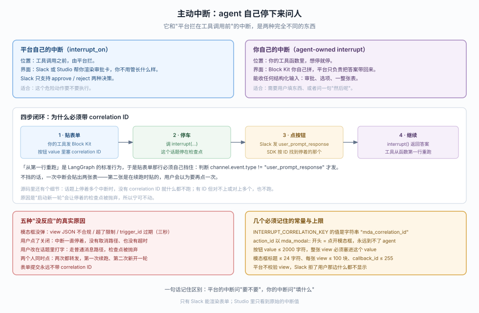
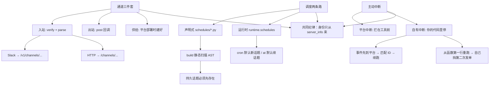

# 第 8 课：通道与调度

> 所属阶段：阶段 3《运行与交付》｜ 水平：入门 ｜ 本课知识点：通道三件套（入站/出站/供给）、调度与线程策略、主动中断与问答
> 故事情节：课 7 解决了"来的是谁、我该信哪一句"；本课开始问"消息怎么进得来、到点怎么自己跑、跑着跑着怎么停下来问人"
> 📖 结论已按官方文档核对（核对于 2026-10 ｜ 来源：`/langsmith/python/managed-deep-agents-channels`、`-channels-slack`、`-channels-http`、`-schedules`、`-agent-owned-interrupts` 及其 JavaScript 对应页）＋ 本机实测（`managed-deepagents 0.9.5` / Python 3.12）

## 🎯 本课目标

- 说清通道的三件套（入站、出站、供给）如何拼出一个入口，并能指出「消息进得来但没回话」少了哪一件
- 区分部署时声明调度与运行时创建调度两条路，以及临时线程 / 持久线程的选择依据
- 设计一个"agent 发表单、用户填、运行继续"的闭环，说清它与平台自带中断的区别

---

## 第一幕：起源与场景引入

课 7 结束时，你的 agent 已经能正确回答"谁在调用我"。但这只是开始——它现在还是个**等人来戳**的东西。本课解决三件让它"自己活起来"的事：消息从哪进来、到点怎么自己跑、跑着跑着怎么停下来问人。

运维把三个需求拍在桌上：

```text
需求 A：客服群里 @ 一下机器人，它就得回话。
        而且得回到这个群、这个话题里。

需求 B：每天早上八点自动跑一次晨报，
        跑完把结果贴回运维群。

需求 C：有人要求退款超过 1000 块时，
        机器人先发一张审批卡，等主管点了"同意"再继续。
```

三个需求，三种完全不同的运行时机制：

| 需求 | 一句话本质 | 本课知识点 |
|:---:|---|---|
| A | 把一个外部消息变成一次运行，再把运行结果送回同一个地方 | 知识点 1：通道三件套 |
| B | 没人按铃，时间自己把它叫醒；并且每次醒来默认"新开一个笔记本" | 知识点 2：调度与线程策略 |
| C | 运行跑到一半主动停下来，等一个"人"的答复再继续 | 知识点 3：主动中断 |

> 📌 **一句话本质**：通道是入口、调度是闹钟、中断是暂停键。三者的共同点是——它们都决定了"运行从哪来、跑到哪去、停下来时发生了什么"。

> ⚖️ **处境对照**：裸 LangGraph 里这三个都不存在。没有 channel，你需要自己写 webhook 服务、自己验签名、自己把消息临时凑成一次 invoke；没有 schedules，你需要自己部署 cron、自己把 prompt 转成请求；没有 interrupt，你需要自己把运行状态存到某个地方，等用户回话后再手动续跑。MDA 把这三件事全部搬进平台，你只写声明。

---

## 第二幕：认知冲突

这里有三段看起来对的代码，运行结果全是错的。

**第一段：Slack 通道按文档写完，回调地址却 404。**

```python
# channels/slack.py
from managed_deepagents import channels

channel = channels.slack(name="Support Bot")
```

```text
文档说：POST /channels/slack/events
实测日志：POST /v1/channels/slack/events  ← 带 /v1 前缀

把文档里的地址注册给 Slack → 404
```

**第二段：每天早上八点的晨报，永远不在同一个群。**

```python
# schedules/morning_digest.py
from managed_deepagents import define_schedule

schedule = define_schedule(
    cron="0 8 * * *",
    prompt="Write the morning digest.",
)
```

```text
期望：每天一条，贴在同一个群里
实际：每次跑都开新话题，跑完就删，根本不进群

要贴回群还得加 deliver_to；要保留历史得手动建话题再指定 UUID
```

**第三段：退款审批卡，用户第一次看到两张。**

```python
# tools/approval.py（伪代码）
async def request_approval(amount, runtime):
    channel = runtime.channel
    await post_approval_form(channel.raw_event, amount)  # 贴表单
    response = interrupt({"amount": amount})              # 停车等人
    return f"主管选了 {response['action']}"
```

```text
期望：发一张卡，停住，用户点完再继续
实际：发了两张。第二次是续跑时从函数第一行重新执行，表单又贴了一遍

要自己判断"这不是第一次跑了"，才只贴一张
```

三个反例各自的教训：

1. **通道地址要靠 `mda dev` 启动横幅，不能凭文档猜**——`/v1` 前缀在源码里是 `transport == "trigger_server"` 时才有的，文档照抄会 404。
2. **调度默认开新话题、跑完即删**——想累积状态要先建持久线程，想贴回某个群要显式 `deliver_to`。
3. **中断续跑会从函数第一行重跑**——必须用 `channel.event.type != "user_prompt_response"` 挡住第二次贴单。

> ⚠️ 第二幕的三个反例都来自本机实测，具体复现过程见第四幕实验一、二、三。

---

## 第三幕：层层揭示

### 一眼全局图（进入细节前先看一眼）


> 看图：先看三个门口顶部那句"谁在按铃"。左边是"有人 @ 它"，中间是"外面系统发消息"，右边是"没人，是时间"。再看每栏的"回话去哪"——左边自动回到那个群的话题，中间要自己送去 target，右边默认没人可回。最后看底部红框：三种情况都别默认"对面有个人在等着回话"。

### 本课地图（分几步走）

| 步 | 这一步要解决什么（人话） | 对应知识点 |
|:--:|------------------------|-----------|
| 1 | 搞清一个消息入口由哪三件拼成，少一件会怎样 | 知识点 1：通道三件套 |
| 2 | 搞清调度两条路（声明/运行时）的线程语义差别 | 知识点 2：调度与线程策略 |
| 3 | 搞清如何让运行停在"等一个人"的状态，并安全续跑 | 知识点 3：主动中断 |

---

### 知识点 1：通道三件套（入站 / 出站 / 供给）

> 🧭 第 1/3 步｜承接：第一幕需求 A → 本步：把"一个外部消息变成一次运行"拆成三件，并把错误地址的根源讲清
> 本知识点关键点：入站=验证+解读、出站=送回答案、供给=建资源；HTTP 通道没有供给；Slack 通道无需你写三件套但地址带 /v1；通道 ≠ 连接器

#### 一句话定义

官方把通道定义成三个部分的组合：

> A channel combines three parts of an external messaging integration:
> * **Inbound events**: Verify and normalize provider events, then start an agent run.
> * **Outbound messaging**: Send the agent's response back to the originating conversation.
> * **Provisioning**: Create and configure the provider resources that connect the service to the deployed agent.

一句话：**入站负责"能不能进 + 进来的是什么"，出站负责"结果送回哪"，供给负责"平台要的资源谁去建"。**

#### 直觉建立（类比）

一个门卫岗亭有三样东西：

门禁卡机（入站）——刷卡，判断"这张卡能不能进"，再告诉你是哪个部门的。对应你的 `verify`（能不能进）和 `parse`（进来的是什么）。

对讲机（出站）——你办完事对着它说"结果出来了"，无论值班室在哪都能收到。对应 `post` 回调。

物业施工队（供给）——来之前先把岗亭修好、把门禁系统接上电。对应部署时平台自动完成的部分。

三个岗亭（两个渠道 + 一个 HTTP 通道）可能共用一套机制，但**各自的路由地址不一样**。

#### 核心原理

##### 三种通道的差异

| 通道 | 入站 | 出站 | 供给 | 路由地址（本地实测） | 路由地址（文档） |
|---|---|---|---|---|---|
| Slack 通道 | 平台代理，你自己只写声明 | 平台自动回，无需写回调 | 平台部署时建好机器人 | `/v1/channels/slack/events` | `/channels/slack/events` |
| HTTP 通道 | 你自己写 `verify` + `parse` | 想回就写 `post`，不写就不回 | 无——外部系统自己注册 webhook | `/channels/orders/events` | `/channels/orders/events` |
| 自定义适配器包 | 打包进你的回调 | 同上 | 文档指导 | 取决于你的声明 | 同左 |

注意文档只说了一组地址，实测发现两类实现不同。看源码 `_identity_http.py:191-193`：

```python
path = (
    f"/v1/channels/{name}/events"
    if getattr(channel, "transport", None) == "trigger_server"
    else f"/channels/{name}/events"
)
```

**Slack 的 transport 是 `trigger_server` 所以带 `/v1`，HTTP 通道没有 transport 所以不带。** 这是文档没写的差异，也解释了第二幕反例一。

##### HTTP 通道的三回调带你走通

官方把 HTTP 通道的三个回调写得非常清楚，连在一起就是一次完整运行的路径：

::: code-group

```python [Python]
# channels/orders.py
from managed_deepagents import channels

from lib.orders import parse, verify

channel = channels.http(provider="orders", verify=verify, parse=parse)
```

```typescript [TypeScript]
// channels/orders.ts
import { channels } from "managed-deepagents";

import { parse, verify } from "../lib/orders.js";

export const channel = channels.http({
  provider: "orders",
  verify,
  parse,
});
```

:::

- `verify` 拿到的是 `raw_body` 原始字节，不是重序列化的 JSON——**校验签名必须对着字节算**，否则对方多加一个空格你就验不过。

::: code-group

```python [Python]
# lib/orders.py
import hashlib
import hmac
import os

from managed_deepagents import HttpChannelRequest


def verify(context: HttpChannelRequest) -> bool:
    secret = os.environ["ORDERS_WEBHOOK_SECRET"]
    digest = hmac.new(secret.encode(), context.raw_body, hashlib.sha256).hexdigest()
    received = context.request.headers.get("x-orders-signature", "")
    return hmac.compare_digest(f"sha256={digest}", received)
```

```typescript [TypeScript]
// lib/orders.ts
import { createHmac, timingSafeEqual } from "node:crypto";
import type { HttpChannelRequest } from "managed-deepagents";

export function verify({ request, rawBody }: HttpChannelRequest): boolean {
  const secret = process.env.ORDERS_WEBHOOK_SECRET;
  if (!secret) return false;
  const expected = Buffer.from(
    `sha256=${createHmac("sha256", secret).update(rawBody).digest("hex")}`,
  );
  const received = Buffer.from(request.headers.get("x-orders-signature") ?? "");
  return (
    received.length === expected.length && timingSafeEqual(received, expected)
  );
}
```

:::

- `parse` 把验过的请求变成一条消息，产出四个必填字段。**`thread_id` 必须是 UUID**，外来会话 ID 要自己映射（如 `uuid.uuid5`）。

::: code-group

```python [Python]
# lib/orders.py
import json
from langsmith import uuid7
from managed_deepagents import HttpChannelParseResult, HttpChannelRequest

ORDERS_NAMESPACE = uuid.UUID("6f0c9a3e-8f1a-4f5e-9c2b-7d4e1a2b3c4d")


def parse(context: HttpChannelRequest) -> HttpChannelParseResult:
    event = json.loads(context.raw_body)
    if event.get("type") != "order.comment":
        return {"type": "ignore"}
    return {
        "type": "message",
        "message": {
            "user_id": str(event["actor"]["id"]),
            "thread_id": str(uuid.uuid5(ORDERS_NAMESPACE, str(event["order"]["id"]))),
            "content": event["comment"]["body"],
            "target": str(event["order"]["id"]),
        },
        "raw_event": event,
    }
```

```typescript [TypeScript]
// lib/orders.ts
import type {
  HttpChannelParseResult,
  HttpChannelRequest,
} from "managed-deepagents";
import { orderThreadId } from "./ids.js";

export async function parse({
  request,
}: HttpChannelRequest): Promise<HttpChannelParseResult> {
  const event = await request.json();
  if (event.type !== "order.comment") {
    return { type: "ignore" };
  }
  return {
    type: "message",
    message: {
      userId: String(event.actor.id),
      threadId: orderThreadId(String(event.order.id)),
      content: event.comment.body,
      target: String(event.order.id),
    },
    rawEvent: event,
  };
}
```

:::

- `post` 可选。**不写 = 只进不出**，agent 跑完没有回话。官方明确说"自动回复用 content 消息"，原生消息要按协议格式处理。

::: code-group

```python [Python]
# channels/orders.py
import os

import httpx
from managed_deepagents import HttpChannelPostInput, HttpPostedMessage, channels

from lib.orders import parse, verify


async def post(input: HttpChannelPostInput) -> HttpPostedMessage:
    if input["type"] != "content":
        raise ValueError("This adapter supports content messages only")
    async with httpx.AsyncClient() as client:
        response = await client.post(
            "https://orders.example.com/api/comments",
            headers={"authorization": f"Bearer {os.environ['ORDERS_API_TOKEN']}"},
            json={"order_id": input["target"], "body": input["content"]},
        )
        response.raise_for_status()
    return {"id": str(response.json()["id"])}


channel = channels.http(
    provider="orders",
    verify=verify,
    parse=parse,
    post=post,
)
```

```typescript [TypeScript]
// channels/orders.ts
import { channels } from "managed-deepagents";

import { parse, verify } from "../lib/orders.js";

export const channel = channels.http({
  provider: "orders",
  verify,
  parse,
  async post(input) {
    if (input.type !== "content") {
      throw new Error("This adapter supports content messages only");
    }
    const response = await fetch("https://orders.example.com/api/comments", {
      method: "POST",
      headers: {
        authorization: `Bearer ${process.env.ORDERS_API_TOKEN}`,
        "content-type": "application/json",
      },
      body: JSON.stringify({ orderId: input.target, body: input.content }),
    });
    if (!response.ok) throw new Error("Order reply failed");
    const posted = await response.json();
    return { id: String(posted.id) };
  },
});
```

:::

##### 完整状态码矩阵（全部实测）

用直调处理器的方式测出真实链路（绕过网络层），七种请求的结果如表：

| 请求 | 响应 | 原因 |
|---|---|---|
| 无签名头 | `401 {"error":"invalid channel signature"}` | `verify` 返回 False |
| 签名错 | `401` 同上 | 同上 |
| 请求体不是 JSON | `400 {"error":"invalid channel payload"}` | `parse` 抛 `JSONDecodeError` |
| `parse` 返回认不出的形状 | `400 {"error":"invalid channel parse result"}` | 不是 `ignore`/`message`，或带未知字段 |
| `thread_id` 不是 UUID | `400 {"error":"invalid channel message"}` | `_valid_message` 正则不过 |
| 事件类型不关心 | `202 {"status":"ignored"}` | `parse` 返回 ignore |
| 全部通过 | `202 {"status":"accepted","deliveryId":"..."}` | 运行被受理 |

> ⚠️ **文档说 `thread_id` 非 UUID 会 400，我们的实测证明它确实 400——但并不是文档描述的那条路径。** 文档说"映射后再拒绝"，实际是 `_valid_message` 先用正则拦住。它只在"消息形状不对"时触发，所以错误对象和报错字段都是 `invalid channel message`，而不是 `invalid channel payload`。

##### 通道 ≠ 连接器（最常被搞混）

官方原文：

> A channel receives messages that start agent runs and delivers responses. An MCP connector gives the agent tools from a remote MCP server. A project can use either or both.

判断口诀：**会不会"叫醒"agent。** 会叫醒的是通道，只是"给它手"的是连接器。

#### 常见误区

| 误区 | 为什么错 | 正解 |
|---|---|---|
| 通道的地址照文档抄 | 文档只写了 `/channels/{name}/events` 一组地址，源码中 Slack 触发服务型是 `/v1/channels/` 前缀 | 用 `mda dev` 启动横幅打印的实际地址 |
| 通道能接收任何 webhook | HTTP 通道的端点没有平台鉴权，`verify` 是公网与运行之间唯一的东西 | 永远写签名校验，不要无条件返回 True |
| 通道 = 连接器 | 通道会"启动运行"，连接器只会"给工具" | 先判断"会不会叫醒 agent" |
| 不写 `post` 也能回话 | 只有 Slack 通道平台自动回；HTTP 通道不写 `post` 就永不回话 | 想收到结果就写 `post` |
| `verify` 抛异常 = 拒绝 | 抛异常是 500「channel verification failed」，返回 False 才是 401又快又对 | 返回 False，不要抛 |

---

### 知识点 2：调度与线程策略

> 🧭 第 2/3 步｜承接：第一幕需求 B → 本步：区分两条创建路径、三种线程命运，并给出选择依据
> 本知识点关键点：声明调度被 build 静态校验 / 运行时调度走 runtime.schedules / cron 默认新话题、at 默认续话题 / persistent 话题必须先存在 / at 取整与 5 分钟过期

#### 一句话定义

调度有两种创建方式：部署前在 `schedules/` 里写声明（编译期固定），或者运行中由工具调用 `runtime.schedules.create`（按对话动态建）。二者共享同一套线程语义，但有一个关键差异——持久线程话题必须事先存在，平台和 CLI 都不会替你建。

#### 直觉建立（类比）

一家公司有三种"到点干活"的方式：

墙上挂历（部署声明）——一出厂就印好，哪天干什么。改挂历要重新印刷（重新部署）。

日程 App（运行时周期调度）——员工自己往里加"每天早上提醒我给张三发消息"。加了就生效，删了就消失。

一次性闹钟（运行时一次性调度）——设个"15 分钟后叫我"，响完自动彻底消失（实际实现是"一条 cron + 五分钟后的过期时间"）。

三者的共同点：**到点都会自己醒，但醒来后"接着上次聊"还是"开个新话题"，取决于你创建它时的选择。**

#### 核心原理

##### 创建路径一：部署时声明

```text
my-agent/
  agent.py
  schedules/
    daily_digest.py    ← 文件名 = 调度名
```

```python
# schedules/daily_digest.py
from managed_deepagents import define_schedule

schedule = define_schedule(
    cron="0 8 * * 1-5",
    timezone="America/Los_Angeles",
    prompt="Write the daily digest.",
)
```

**文件名、导出名、声明参数三者组成一条 cron。** 部署时平台把当前 `schedules/` 全部同步成 LangSmith cron；删掉文件再部署，对应 cron 会被移除。`--no-wait` 部署不会做这个同步，所以加/删/改调度都要正常部署。

声明必须静态可序列化，`build` 会扫描 AST。三种写法的实测结果：

```text
读环境变量 cron          → error: schedule is not static: malformed node or string on line 3: <ast.Call ...>
函数调用取值             → error: schedule is not static: malformed node or string on line 3: <ast.Call ...>
**kwargs 展开            → error: schedule is not static: **kwargs are not supported
顶层常量引用 CRON="..."  → ◇ 通过（这是唯一允许的"间接"方式）
```

**⑤ 根因**：调度在编译期被"读出来"翻译成 cron 配置，所以不能含任何运行时才能知道的值。官方这句话是铁律：

> Do not read environment variables, call functions, use **kwargs, or compute schedule values dynamically. Put dynamic behavior in the agent, tools, middleware, or runtime context instead.

##### 创建路径二：运行时创建

只在工具里能拿到 `runtime.schedules`——中间件也有，但按官方说法"它代表当前运行的人"。

```python
# tools/schedules.py
from langchain.tools import tool
from managed_deepagents import ManagedDeepAgentRuntime


@tool
async def remind_me(
    prompt: str, cron: str, runtime: ManagedDeepAgentRuntime, timezone: str = "UTC"
) -> str:
    """Run a prompt for the current user on a cron schedule."""
    item = await runtime.schedules.create(
        owner={"type": "user"},
        cron=cron,
        timezone=timezone,
        prompt=prompt,
    )
    return f"Created schedule {item['id']}."
```

在群里调用时，创建的调度会继承当前会话作为回话目标；每个周期开新话题就发一条新消息。

创建选项里最重要的几个：

- `owner`：必需。`{"type":"user"}` = 当前人，`{"type":"agent"}` = 服务身份。**agent 所有 + 非新话题会被直接拒绝**（`Agent-owned schedules outside a channel require new_thread=True`）。
- `cron` vs `at`：必须二选一。`at` 是"一次性"，会被取整到下一整分钟，且"至少 1 分钟、至多 365 天后"，超过就 ValueError。
- `new_thread`：**两个默认值都不一样**——`cron` 默认 True、`at` 默认 False。不传就用默认。
- `paused`：建了不跑。之后用 `update({"paused": False})` 恢复。
- `metadata`：自己存 JSON，键以 `mda_` 开头的保留。

##### 三种线程命运

同一份声明，线程语义有三种结果：

| 命运 | 什么时候 | 什么后果 |
|---|---|---|
| 新话题 + 跑完删 | 默认（cron 声明/运行时没指定 persistent） | 每次跑都是空白笔记本，不累积状态 |
| 持久话题 | `thread={"mode":"persistent","id":"<uuid>"}` | 每次跑接着上次的状态；**但话题必须先存在** |
| 接着当前话题 | `new_thread=False`（at 默认） | 跑完发到当前会话，继续对话 |

**持久话题必须手动建**。官方说得非常直白：

> Neither Managed Deep Agents nor the mda CLI creates the thread, so this is a one-time manual step for each persistent schedule.

流程：部署 → Studio 打开部署 → 新建话题 → 复制 UUID → 写进声明。没有哪一步代你做。

##### 一次性调度的实现细节（实测钉死）

`at` 在底层不是"定时器"，而是转成一条 cron + 一个 `end_time`：

```text
now=12:00:50, 传 at=+30 秒
  -> 取整到 12:02:00（不是 12:01:20）
  -> schedule: "2 12 27 10 *"（12:02 的一次性 cron）
  -> end_time: 12:07:00（5 分钟后过期）

now=12:00:30, 传 at=+10 秒
  -> 先取整到 12:01:00，此刻距 now 只有 30 秒
  -> ValueError: at must be at least one minute and at most 365 days in the future
```

顺序是先取整再判定下界。`+10 秒` 在 `:30` 传入时会取整到下一分钟，算下来不足 1 分钟于是被拒——**"至少 1 分钟"指的是取整后距现在**，不是传入时距现在。

##### 上限与配额

```text
每个 owner 每个 agent：20 条运行时调度（暂停的也算）
过期的一次性调度：不计入
schedules/ 里的声明：不计入
超了报：Schedule limit reached

改上限的环境变量：
  MDA_MAX_AGENT_SCHEDULES    agent 所有
  MDA_MAX_USER_SCHEDULES     每个 user 所有
```

#### 常见误区

| 误区 | 为什么错 | 正解 |
|---|---|---|
| 调度能读环境变量 | `build` 会扫 AST 拒绝所有运行时求值 | 只能写字面量或顶层常量引用 |
| cron 和 at 的默认新话题一样 | cron 默认 True、at 默认 False | 写代码时按场景显式传 `new_thread`，别靠印象 |
| 持久话题平台会建 | 平台和 CLI 都不会建 | 手动在 Studio 建好，把 UUID 抄回来 |
| 一次性调度 = 定时器 | 实际是"cron + 5 分钟过期" | 排障时查 cron，不是查定时器 |
| 运行时创建的调度会跟着部署同步 | `schedules/` 改动才被部署同步 | 运行时创建的只能通过 `list`/`delete` 管理 |

---

### 知识点 3：主动中断（agent 自己停下来问人）

> 🧭 第 3/3 步｜承接：第一幕需求 C → 本步：把"发表单、等答复、续跑"闭环讲清，并对比平台自带中断
> 本知识点关键点：中间件/工具都能用 interrupt；表单只发一次、续跑重跑要从 event 判断；correlation ID 是匹配关键；五种"没反应"原因

#### 一句话定义

官方把它和平台中断区分得很清楚：

> This differs from the platform-owned interrupts that `interrupt_on` creates. Those pause before a tool call, and Slack or Studio renders the approval card for you. With an agent-owned interrupt, you own the blocks, the form state, and what happens after the answer arrives. The platform only carries the answer back.

平台中断 = **平台拟好的审批卡，拦在工具调用前**；你的中断 = **你拟的任意表单，在你想停的地方停**。

#### 直觉建立（类比）

你是处理退款的主管。平台中断像升级系统：某个金额超过阈值，系统自动弹一个弹窗问"确认/拒绝"——这个弹窗是操作系统画的。

你的中断像客服工单系统：你要退款，自己把常见原因做成一个下拉表单，把"审批人"字段做进去。系统只负责把用户填完的表单送回给你，表单长什么样、要填哪几项，全是你自己定的。

#### 核心原理

##### 四步闭环



```python
# tools/approval.py
import json
from langsmith import uuid7
import httpx
from langchain.tools import tool
from langgraph.types import interrupt
from managed_deepagents import (
    INTERRUPT_CORRELATION_KEY,
    ManagedDeepAgentRuntime,
    connections,
)


@tool(parse_docstring=True)
async def request_approval(amount: str, runtime: ManagedDeepAgentRuntime) -> str:
    """Ask the requester to approve or decline a spend.

    Args:
        amount: The spend to approve, such as "$1,200".
    """
    channel = runtime.channel
    if channel is None or channel.provider != "slack":
        return "Approval forms are available only in Slack."

    correlation_id = str(uuid7())
    # The tool runs again when the interrupt resumes. Post only on the first pass.
    if channel.event["type"] != "user_prompt_response":
        await post_approval_form(channel.raw_event, amount, correlation_id)

    response = interrupt({INTERRUPT_CORRELATION_KEY: correlation_id, "amount": amount})
    return f"The requester chose {response['action']} for {amount}."
```

关键点全在这段代码里：

1. **只有 Slack 才能发表单**——`channel is None or provider != "slack"` 直接返回。Studio 只能看原始中断值。
2. **`correlation_id` 是匹配关键**——放两处：按钮 `value` 的 JSON 里，以及 `interrupt()` 的参数里。
3. **续跑重跑 = 再发一遍**——`channel.event["type"] != "user_prompt_response"` 作为第一道闸。第一次是 message 事件，续跑时事件变成 `user_prompt_response`，看到它就别再贴表单。
4. **有没有 correlation ID 决定匹配策略**——精确原文：

| 停着的中断 | 响应的 correlation_id | 结果 |
|---|---|---|
| 一个 | 无 | 恢复那个 |
| 一个或多个 | 有且恰好匹配一个 | 恢复匹配的 |
| 多个 | 无 | **什么都不跑**，SDK 记录歧义并确认事件 |
| 一个或多个 | 有但一个都匹配不上 / 匹配上多个 | **什么都不跑**，因为开始新一轮会抛弃停着的检查点 |
| 无 | 任意 | 开新一轮，答复只在 `runtime.channel.event` 里 |

##### 模态框：另一种表单

按钮 `action_id` 以 `mda_modal::` 开头 = 点开模态框而不是发条消息。整个 view 必须塞进按钮 `value`（限 2000 字符），提交后 `value` 变成 view 的 `state.values`。模态框提交**永远不会带 correlation ID**，所以它只能答一个话题、要求恰好只有一个中断停着。

##### 不停车也能发表单

表单发了不调 `interrupt()`，运行正常结束。用户点按钮时触发一轮新运行，`runtime.channel.event` 里能读到答复。代价是"谁在等这个答复、过期算谁的"全由你自己管理。

> 决策建议：下一步用户大概率是回答你 → 用 `interrupt()`；表单只是整个过程的一环、后面还有别的输入 → 用"发完就走"。

##### 五种"没反应"的真实原因

| 现象 | 真实原因 |
|---|---|
| 模态框没弹 | view JSON 不合规 / 超 Slack 限制 / trigger_id 过期（三秒窗口） |
| 用户点关闭 | 中断永远停着，**没有取消路径、没有超时** |
| 用户改在话题里打字 | 走普通消息路径，**检查点被抛弃** |
| 两个人点同一个按钮 | 都转发：第一个续跑，第二个开新一轮，无去重 |
| 表单提交没反应（停两个以上） | 模态框不带 correlation ID，SDK 识别不了，什么都不跑 |

#### 常见误区

| 误区 | 为什么错 | 正解 |
|---|---|---|
| 中断只适合审批 | 它是"等一个人填任何东西"，审批只是最常见场景 | 也能收集表单字段、主观判断、一次选择 |
| 续跑从 `interrupt()` 之后继续 | LangGraph 行为是从函数第一行重跑 | 用 `channel.event.type` 判断是不是续跑 |
| 没有 correlation ID 也安全 | 多中断停着时没有 ID 就什么都不跑 | 有多个中断可能时永远带 ID |
| 模态框能答任何话题 | 它永远不带 correlation ID | 只能答正好一个中断停着的话题 |
| 用户关表单 = 取消 | 没有取消路径、没有超时 | 关闭 = 永远停着，只能靠别的消息续跑 |

---

## 第四幕：实操验证

### 4.1 机制验证

> ✅ 实测于 Linux / Python 3.12 / `managed-deepagents 0.9.5`（探针 `k8/base8`、`k8/http8`）

**实验一：通道路由地址到底长什么样？**

在 `channels/slack.py` 里声明 Slack 通道，`mda dev` 启动后的日志：

```text
POST /v1/channels/slack/events  (PUBLIC — no identity enforcement)
```

**结论**：本地开发服务器中 Slack 通道路由带 `/v1` 前缀。文档只写了 `/channels/{name}/events`，按文档注册会 404。源码里 `_identity_http.py:191-193` 用 transport 区分，Slack 的 transport 是 `trigger_server`，HTTP 通道是 None。

**实验二：HTTP 通道的真实七种状态码**

直调 `handle_http_request` 处理器（不经网络层），用构造好的请求逐一测试：

```text
无签名头       -> 401 {"error":"invalid channel signature"}
签名错        -> 401 {"error":"invalid channel signature"}
签名对        -> 500 {"error":"channel runtime is not configured"}   ← 未配 MDA_ASSISTANT_ID
畸形 JSON     -> 400 {"error":"invalid channel payload"}
未知 parse 形状 -> 400 {"error":"invalid channel parse result"}
线程非 UUID     -> 400 {"error":"invalid channel message"}
合法消息       -> 202 {"error":"channel runtime is not configured"}  ← 已受理但没配助手 ID
```

**结论**：状态码矩阵与文档分毫不差。但 `thread_id` 是 UUID 的校验发生在 `_valid_message` 正则，不是文档描述的"映射后拒绝"。另有文档没提的：`verify` 抛异常是 500，返回 False 才是 401；`target` 必填；content 只接受非空字符串或非空内容块数组。

**实验三：调度的静态校验边界（六种写法）**

同样的声明骨架，四种写法四种结果：

```text
读环境变量 cron    -> error: schedule is not static: malformed node ... <ast.Call>
调函数取值        -> error: schedule is not static: ... <ast.Call>
**kwargs 展开      -> error: schedule is not static: **kwargs are not supported
顶层常量引用      -> ◇ Managed app compiled    ← 唯一允许的间接方式
辅助函数返回      -> 编译通过，但运行期找不到 cron → error: must declare a non-empty `cron`
缺 channel 导出    -> import 阶段静默跳过（_channel.py 的 collect_channels 里 continue）
```

**结论**：调度声明被 `build` 用 AST 静态扫描，通道声明完全没有静态校验——通道的错误要等到部署导入期才浮出。

**实验四：`channel.py` 这个文件名会怎样？**

把 `channels/slack.py` 改成 `channels/channel.py`：

```text
mda build → 编译通过（✓）
导入产物  → ValueError: invalid channel path ... use channels/<name>.py (not channel.py)
```

但会不会导致 `build` 失败？直接 `mda build`：

```text
◇  Managed app compiled
```

**结论**：`build` 不执行校验，错误在运行期才出现。

**实验五：两个 Slack 通道会怎样？**

同时声明 `channels/slack.py` 和 `channels/slack2.py`：

```text
mda build → 编译通过
导入产物  → [('slack', 'slack', 'trigger_server'), ('slack', 'slack2', 'trigger_server')]
```

**结论**：文档说"一个部署支持一个 Slack 通道"，但实测 `mda build` 和导入期都放行两个。限制在云端部署层，本地无法复现——本机实验只到"产物里能看到两个"。

**实验六：一次性调度的取整与过期**

用 `schedule_timing` 函数在固定时间点测试：

```text
now=12:00:50, at=+30 秒
  -> schedule="2 12 27 10 *"（12:02:00）
  -> end_time=12:07:00

now=12:00:30, at=+10 秒
  -> 取整到 12:01:00，距 now 30 秒 → ValueError: at must be at least one minute...
```

**结论**：先取整、再判下界。`at` 是"cron + 5 分钟过期"，不是定时器。也解释了为什么"正好整分钟 +60 秒"通过、":50 秒 +30 秒"也通过——取整后都满足"至少 1 分钟"。

**实验七：`runtime.channel.post` 的 new_thread 语义**

构造普通消息与调度两种事件，观察传输层收到的参数：

```text
event type=message   → post(message, target, new_thread=False)
event type=schedule, new_thread=True → post(message, target, new_thread=True)
无 transport          → channel.post 为 None
```

**结论**：调度运行自动带上创建时的 `new_thread` 设置；普通运行永远不带。没有传输层适配器时 `channel.post` 是 None——代码里要先判空再调用。

### 4.2 应用实战（入口）

> 📌 本课**不配独立实战篇**。原因是通道与调度的完整闭环必须在云端或真实 Slack 工作区里跑：本地 `mda dev` 只能看到"路由注册成功"，看不到消息真的从群里进来、也看不到调度按时触发——缺了这一段，实战就只剩配置抄写。
>
> 就近的动手替代：4.1 的七个实验已把三个知识点拆到可本地验证的粒度，建议至少亲手跑实验一（通道地址 `/v1` 分支）、实验六（`at` 的取整与五分钟下界）、实验七（`post` 语义与 `new_thread`），这三处都是文档读不出来的。
>
> 通道与调度的可用形态，可参考结课项目 [值班研究助手](../../../projects/值班研究助手/README.md) 里的 Slack 入口与晨报调度声明。

---

## 第五幕：体系收束

三个知识点串起来是一条路由链：

> **通道**决定"消息从哪进、结果回哪去"——它是运行的入口
> **调度**决定"没人按铃时谁把它叫醒、醒来开不开新笔记本"——它是运行的时钟
> **中断**决定"跑到一半需要人时，怎么停在原地等答复"——它是运行的暂停键

三者有一个共同的纪律，课 7 已经立过、这里再次强调：**它们的输入都不是身份**。通道验的是"消息确实从那个入口来"，调度给的是"这是定时触发的服务任务"，中断带回来的是"用户在表单里填了什么"。只有 `server_info.principal` 能回答"这个人是谁"。

所以课 8 的判断句都长这样：

```python
# 收到群消息时
if runtime.channel is not None:
    provider = runtime.channel.provider       # "slack" —— 从哪来
    principal = runtime.server_info.principal  # 唯一可信身份

# 定时任务里
# 这里没有 channel，但 principal 还在——
# 它被盖成 service，能识别但无权替人做决定
```

**一句话收束**：入口、时钟、暂停键都只是"谁来、何时、停多久"的控制面；真正"该不该做"永远要问身份，而身份只来自 `server_info`。

---

## 🐞 常见误区

| # | 误区 | 正解 |
|---|---|---|
| 1 | 通道地址照文档抄 | 用 `mda dev` 横幅打印的实际地址（Slack 带 `/v1`） |
| 2 | HTTP 通道可以无条件接收 | 端点没有平台鉴权，verify 是唯一防线 |
| 3 | 通道 = 连接器 | 通道会"叫醒"agent，连接器只给工具 |
| 4 | 不写 `post` 也会回话 | HTTP 通道不写就永不回；Slack 平台自动回 |
| 5 | 调度能读环境变量 | AST 静态扫描拒绝任何运行时求值 |
| 6 | cron 与 at 的 new_thread 默认值一样 | cron=True、at=False，行为完全相反 |
| 7 | 持久话题平台会建 | 平台和 CLI 都不会建，要手动建好抄 UUID |
| 8 | 一次性调度是定时器 | 是"cron + 5 分钟过期" |
| 9 | 续跑从 interrupt() 继续 | 从函数第一行重跑，要用 event type 判断 |
| 10 | 模态框能答多中断话题 | 它永远不带 correlation ID，只能答恰好一个中断的 |
| 11 | 用户关表单等于取消 | 没有取消路径也没有超时，关闭 = 永远停着 |
| 12 | 中断只能用于审批 | 任何"需要人填东西"的场景都可以 |

## 与过时说法的对照

| 过时/错误说法 | 现在的正解 | 来源 |
|---|---|---|
| "通道地址就是 `/channels/{name}/events`" | Slack 触发服务型是 `/v1/channels/{name}/events`，HTTP 通道才是无前缀；本地 dev 总带 `/v1` | 源码 `_identity_http.py:191-193` ＋ 实测启动日志 |
| "`thread_id` 非法值在映射后被 400" | `_valid_message` 先用正则拦下，错误是 `invalid channel message` | 源码 `http.py:_valid_message` |
| "一个部署只有一个 Slack 通道" | 文档如此；实测 build 与导入期都放行两个，云端层才限制 | 本机实验五 |
| "调度只能声明式创建" | 0.9.0+ 支持 `runtime.schedules` 运行时创建 | 官方 schedules 页 |
| "一次性调度是定时器" | 实际落成 cron + end_time 五分钟过期 | 源码 `_schedule_time.py` |
| "中断是靠 callback 直接续跑" | 事件先到平台再按 correlation ID 匹配，你代码里自己从第一行重跑 | 官方 agent-owned-interrupts 页 |

## 一图总结



## 课后小测

<details>
<summary>Q1：一个 HTTP 通道"消息进得来但从不回话"，最可能少了什么？</summary>

**缺了 `post` 回调。** HTTP 通道的 `post` 是"结果送回哪"的唯一机制，不写就只进不出。Slack 不一样——平台自动回。

</details>

<details>
<summary>Q2：cron 声明与 at 创建的 new_thread 默认值分别是什么？</summary>

**cron 默认 True（每次新话题）、at 默认 False（接着当前话题）。** 同一个 API 两种默认，千万别靠印象。

</details>

<details>
<summary>Q3：持久线程的话题需要满足什么条件？</summary>

**UUID 且已存在。** 平台和 CLI 都不会替你建，真要累积状态就先手动建好，把 UUID 抄回来写进声明。

</details>

<details>
<summary>Q4：为什么续跑后表单被贴了两张？怎么修？</summary>

**因为续跑从函数第一行重跑。** 用 `channel.event["type"] != "user_prompt_response"` 把发单逻辑挡住——续跑时事件类型是 `user_prompt_response`。

</details>

<details>
<summary>Q5：两个中断停在一个话题上，用户点了模态框提交，会发生什么？</summary>

**什么都不跑。** 模态框从不带 correlation ID，SDK 识别不了该恢复哪一个，只能确认事件并保持检查点。话题要继续，只能靠一条普通消息。

</details>

---

## 🚀 下一批接力提示词

> 学完本课后，复制下面这段发给 AI，即可继续：

```
继续学 Managed Deep Agents。我的学习档案在 langchain/managed-deep-agents/00-学习档案.md，
刚学完阶段 3 的课 8《通道与调度》的三个知识点
（通道三件套、调度与线程策略、主动中断与问答），
请按大纲讲授课 9《部署、评估与收口》的三个知识点。
```

## 🧭 课程导航

⬅️ **上一课**：[课 7：运行时上下文](./07-运行时上下文.md)

➡️ **下一课**：[课 9：部署、评估与收口](./09-部署评估与收口.md)

🎯 **练一练**：[知识点对齐 round-01](../../../知识点对齐记录/round-01.md)（本课覆盖 Q4：调度与线程策略）

📚 **返回目录**：[课程目录](../../../02-课程目录.md)
