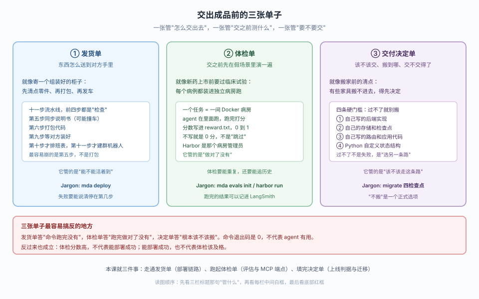
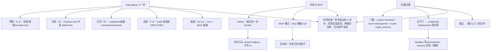

# 第 9 课：部署、评估与收口

> 所属阶段：阶段 3《运行与交付》｜ 水平：入门 ｜ 本课知识点：部署链路与 Context Hub 冲突、评估与 MCP 端点、上线判据、迁移清单与决策树
> 故事情节：课 7 解决了"谁在调用我、该信哪一句"，课 8 解决了"消息怎么进得来、到点怎么自己跑、停下来怎么问人"；本课把这些能力打包、送出去、验证过、并决定"要不要搬到托管"
> 📖 结论已按官方文档核对（核对于 2026-10 ｜ 来源：`/langsmith/python/managed-deep-agents-deploy`、`-cli`、`-context-hub`、`-evals`、`-mcp-endpoint`、`-migrate` 及其 JavaScript 对应页）＋ 本机实测（`managed-deepagents 0.9.5` / Python 3.12）

## 🎯 本课目标

- 复述 `mda deploy` 的十一步流水线，能凭报错信息定位失败发生在哪一步
- 起一个 Harbor 评估工作区、运行并查看结果，把部署好的 agent 暴露成 MCP 工具
- 用迁移四门槛判断一个现有 agent 能不能搬，过不了时给出替代路线

---

## 第一幕：起源与场景引入

前两课让 agent 有了"身份判断"和"入口能力"，但它还只是跑在你本机的进程。本课是生产化的最后一步：把代码打包送出去、送之前演一遍、以及决定这件事到底该不该做。

运维把三件事推到你面前：

```text
任务 A：把本地跑通的 agent 部署到云端，让它真能被别人用。
任务 B：部署之前，先在几个标准题目里跑一遍，确认它真能做对。
任务 C：公司另一个项目组有个自建的 agent，问你能不能帮他们迁到托管。
```

三件事对应三个知识点：

| 任务 | 一句话本质 | 本课知识点 |
|:---:|---|---|
| A | 代码 → 托管部署，十一步流水线 | 知识点 1：部署链路与 Context Hub 冲突 |
| B | 部署前用隔离环境跑标准题打分 | 知识点 2：评估与 MCP 端点 |
| C | 判断"该不该搬、能不能搬、往哪搬" | 知识点 3：上线判据、迁移清单与决策树 |

> 📌 **一句话本质**：部署把代码变成线上地址，评估把"跑没跑完"变成"做对没有"，迁移把"能不能搬"变成"该不该搬"。三者共同决定"交付"两个字。

> ⚖️ **处境对照**：裸 LangGraph 里没有"部署"这个概念——你写的是一个进程里的 graph，要自己找地方跑、自己配环境变量、自己写 webhook 把请求接进来、自己想办法验证它对不对。MDA 用一条命令把"打包、上传、构建、装配、再验证"全部承接，但它也把这些步骤简化为一个黑盒——所以你必须知道那黑盒里到底有哪几步，否则部署失败时你不知道去哪查。

---

## 第二幕：认知冲突

这里有三句"看起来对、结果错"的话，正好对应第三幕三个知识点：

**第一句：`mda deploy` 失败了，重跑一遍就行。**

```text
└  Context Hub instructions.md and skills/ changed since the last MDA sync.
   Re-run with --context-strategy overwrite or --context-strategy keep-hub.
```

```text
期望：重跑就过
实际：不带 --context-strategy 就永远撞同一堵墙——默认会给 No（保留 Hub 版本）并跳过同步，
      而不是帮你做选择。CI 里连提示都没有，直接失败。
```

**第二句：`mda build` 成功了，说明我的定义没问题。**

```text
error: agent.py: Remove `checkpointer` from define_deep_agent(...).
             MDA provides the checkpointer automatically.
```

```text
期望：build 过了就没问题
实际：build 确实会 import 并校验静态入口——残留的 checkpointer 在 build 就报。
      但工厂入口不被 import，函数体里的参数要到运行时（mda dev）才暴露。
```

**第三句：迁移就是把入口文件换掉。**

```text
期望：把 create_deep_agent 换成 define_deep_agent 就行
实际：四个参数被显式拒绝，而且两条会"静默出事"：
      - 声明 sandbox/ 会让 permissions 被清空，源码直接置 []，build 不提示
      - memory 挂载的是空树，旧内容不会迁过来

要逐条处理，否则部署上了才发现权限全没了或记忆全空
```

三个反例各自的教训：

1. **Context Hub 冲突不会自己消失**——它需要你明确表态：overwrite（用本地的盖掉 Hub）还是 keep-hub（保留 Hub 的）。重跑不会帮你选。
2. **`build` 对定义不是零检查，但对工厂是零检查**——静态入口在 build 就被把关，工厂函数体要到运行时才暴露问题。
3. **迁移的坑不在"能报错的参数"，在"不报错但静默改变行为"的部分**——sandbox 清权限、memory 挂空树，都不给你提示。

> ⚠️ 第二幕的两个反例都来自本机实测，具体复现过程见第四幕实验一、二、三、四。

---

## 第三幕：层层揭示

### 一眼全局图（进入细节前先看一眼）



> 看图：先看三栏标题那句"管什么"。发货单答"东西送没送到"（部署），体检单答"做对了没有"（评估），决定单答"该不该走这条路"（迁移）。看每栏白框里的关键动作，最后看底部红框：命令退出码是 0 不等于 agent 有用，体检分数高也不等于能部署成功。

### 本课地图（分几步走）

| 步 | 这一步要解决什么（人话） | 对应知识点 |
|:--:|------------------------|-----------|
| 1 | 走通十一步流水线，报错时能说出"停在第几步" | 知识点 1：部署链路与 Context Hub 冲突 |
| 2 | 起评估工作区、跑一个任务、把 agent 暴露成 MCP 工具 | 知识点 2：评估与 MCP 端点 |
| 3 | 用四条门槛判断"该不该搬"，过不了走替代路线 | 知识点 3：上线判据、迁移清单与决策树 |

---

### 知识点 1：部署链路与 Context Hub 冲突

> 🧭 第 1/3 步｜承接：第一幕任务 A → 本步：拆解十一步流水线，定位最容易失败的第 5 步
> 本知识点关键点：十一步三段划分、预检全在本地、Context Hub 冲突默认 No、--no-wait 跳过装配、密钥只认 .env

#### 一句话定义

`mda deploy` 把代码优先项目编译成一个托管 LangGraph 应用，把部署专属上下文同步到 Context Hub，上传编译源码并触发 LangSmith 托管部署构建。官方原话：

> Deploying a Managed Deep Agent compiles a code-first project into a managed LangGraph app, syncs deploy-owned context to Context Hub, uploads the compiled source, and triggers a LangSmith hosted deployment build.

#### 直觉建立（类比）

把部署想象成寄一台组装好的柜子：

**清点**（前四步预检）：货主在你家先检查——目录对不对、快递单号有没有、要带哪些钥匙、柜子装没装好。**全部发生在货物出门之前。**

**打包**（第五六步）：先把说明书同步到仓库（可能和别人撞版），再把柜子零件原样拆下来装箱。**-**
**发货与收货确认**（第七到九步）：找收货点、装车发运、等对方说"收到且装好了"。
**后续服务**（第十、十一步）：排班表（cron）、装群机器人。

#### 核心原理

##### 十一步流水线（官方 CLI 参考）

官方把 `mda deploy` 的步骤列得非常清楚，本课按三个阶段归并，方便你"对上号"：

| 阶段 | 步骤 | 动作 | 报错形态（实测/文档） |
|:---:|:---:|---|---|
| A 预检 | 1 | 校验目录、加载 agent 入口 | `error: agent `name` is required` |
| A 预检 | 2 | 解析 LangSmith API key、可选 workspace ID | `No LangSmith API key found...` |
| A 预检 | 3 | 收集非保留 `.env` 值为托管密钥 | 静默收集，不报错 |
| A 预检 | 4 | 校验模型提供方 key 可用 | `The agent model ... requires OPENAI_API_KEY in .../.env` |
| B 同步打包 | 5 | 把部署专属 context 同步到 Context Hub | `Context Hub ... changed since the last MDA sync` |
| B 同步打包 | 6 | 编译到 `.mda/build`，抽取 schedules/ 与 channels/ | 静态入口残留参数在此报错 |
| C 远程构建 | 7 | 创建或找到同名托管部署 | 默认交互询问、`-y` 覆盖 |
| C 远程构建 | 8 | 归档、上传、触发远程构建 | `BUILD_FAILED` / `DEPLOY_FAILED` |
| C 远程构建 | 9 | 轮询直到 DEPLOYED（默认 1800 秒） | `--no-wait` 直接退出 |
| C 装配 | 10 | 为 schedules 同步 LangSmith cron | `--no-wait` 跳过 |
| C 装配 | 11 | 装配声明过的 Slack 通道 | 需要授权时交互，`--no-wait` 不能用 |

> 排障时先问"停在第几步"，再问"这一步读的是哪份文件"：第 5 步看 Hub，第 6 步看 `.mda/build` 产物，第 8 步打开部署 URL 看 revision 日志。

##### 最容易撞的墙：Context Hub 冲突

Context Hub 里同时存着 `instructions.md` 和 `skills/` 两份副本：一份是项目里你的、一份是部署时同步过去的。谁赢取决于冲突怎么解：

- 交互式：**默认 No（保留 Hub 版本）并跳过该段同步**，不是帮你选。
- 非交互（CI）：**直接失败**，必须带 `--context-strategy`。
- 只重跑 `mda deploy`：会反复撞同一堵墙。

```bash
# 明确表态：用本地的覆盖 Hub 里改过的
uv run mda deploy --context-strategy overwrite

# 明确表态：保留 Hub 里的人工修改，跳到下一步
uv run mda deploy --context-strategy keep-hub
```

> 另一个隐形的墙：同时有人改 Context Hub repo，同步时提交冲突 → deploy 失败，重跑即可。
> 还有：`--no-wait` 会跳过 cron 同步，因为它等不到 DEPLOYED。

##### 密钥只走 `.env`（实测修正官方文档）

官方 deploy 文档写“模型 key 可从 `.env`、shell 环境或工作区密钥取得”；migrate 文档却写“shell 里 export 的不会被读取”。针对这个矛盾，实测证明 **migrate 文档是对的**：

```text
实验：把 OPENAI_API_KEY 只 export 进 shell，不写进 .env
      → error: The agent model 'openai:gpt-5.5' requires OPENAI_API_KEY in /tmp/mda-probe/.../.env
实验：同一 key 写进 .env
      → 预检通过，走到下一步（假 key 403：Forbidden）
```

**所以**：模型 key 放 `.env`、或工作区密钥；shell 环境变量只在「deploy 时转发成该部署的密钥」这个意义上有用，不能作为预检依据。

##### 构建产物里有什么（实测）

`mda build` 把项目根目录整个拷贝进 `.mda/build`，排除的只有 `.env`/`.env.*`：

```text
.mda/build/
├── agent.py / _mda_entry.py / _mda_auth.py / _mda_http.py（生成的包装）
├── langgraph.json
├── instructions.md
├── identity.py / pyproject.toml
└── 外加你项目根目录里其它的所有文件  ← 会原样带走

langgraph.json 里关键字段：
  "graphs": { "research-assistant": "./_mda_entry.py:agent" }
  "env": ".env"            # 配置文件里写了，但 .env 本身不在产物里
  "auth": { "path": "./_mda_auth.py:auth", ... }
```

⚠️ 结论：项目根目录不要放任何不想上线的东西（密钥文件、临时脚本、私人文档）。`mda deploy` 会把它们一并上传。

#### 常见误区

| 误区 | 为什么错 | 正解 |
|---|---|---|
| 部署失败重跑就行 | Context Hub 冲突需要你明确表态，重跑默认还是 No | 带 `--context-strategy overwrite` 或 `keep-hub` |
| `build` 过了定义就没问题 | 静态入口会被 import+断言，但工厂入口不被调用 | 工厂体里的参数要 mda dev 才暴露 |
| shell 里 export 的 key 能部署 | 实测只有 .env 能过预检 | 模型 key 放进 `.env` 或工作区密钥 |
| `--no-wait` 只影响等待 | 它跳过 cron 同步，且 Slak 通道不能用 | 有 slack 通道就别用 `--no-wait` |
| `.env` 会自动排除干净 | 只排除 `.env` 与 `.env.*`，其它文件原样带走 | 项目根目录只放要上线的东西 |

---

### 知识点 2：评估与 MCP 端点

> 🧭 第 2/3 步｜承接：第一幕任务 B → 本步：起评估工作区、跑一个任务、把 agent 暴露成 MCP 工具
> 本知识点关键点：Harbor 每任务一间 Docker、判分只认 reward.txt/json、init 非交互、MCP 端点是 /mcp 且无状态

#### 一句话定义

评估与 MCP 是两个方向相反、但都在回答"这 agent 能不能用"的问题：

> Managed Deep Agents evals are Harbor tasks... Harbor runs the managed agent against each task in an isolated environment and records the result.
>
> The Agent Server exposes the agent as an MCP tool... Any MCP client that supports the Streamable HTTP transport can call the deployed agent as a tool.

**评估**=在隔离房里演一遍看对没对；**MCP 端点**=把部署好的 agent 本身变成一个可被别处调用的工具。

#### 直觉建立（类比）

体检分两部分：第一部分是把 agent 送进独立病房（Harbor 的 Docker 环境）做标准测试，每个病例是一间房、跑完给 0 到 1 的评分；第二部分是把 agent 变成一个"对外接口"（MCP 端点），让别的系统像调用一个普通工具一样调它，就像把一个实习生培训成能接单的标准服务。

#### 核心原理

##### 评估：Harbor 一题一病房

评估的所有配置都从 `mda evals init`（生成两个目录）和 `evals/` 手工任务目录组成：

```text
my-agent/
├── evals/
│   ├── harbor-job.json          # 你的，init 只在缺失时写；之后改都保留
│   └── <task>/
│       ├── Task.md              # 给人看的规格，先评审这份
│       ├── instruction.md       # 念给 agent 听的任务描述
│       ├── task.toml            # 题目配置
│       ├── environment/
│       │   └── Dockerfile       # 这间病房怎么搭
│       └── tests/
│           ├── test.sh          # 跑完怎么判
│           └── <verifier>       # 判分脚本，写 reward
└── .mda/evals/                  # 生成的，别手改
    ├── runtime.json
    └── harbor-adapter/
```

**判分只认两个出口**（实测）：

```text
/logs/verifier/reward.txt      # 数字 0..1
/logs/verifier/reward.json     # JSON 里的数字指标

不写 = 0 分，不是"跳过"
```

**实际跑一条命令**（官方给的、按项目生成的）：

```bash
HARBOR_LANGSMITH_DATASET=mda-<project>-evals \
PYTHONPATH=.mda/evals/harbor-adapter \
uv run --env-file .env --python 3.12 --with 'harbor[langsmith]==0.21.0' harbor run \
  --config evals/harbor-job.json --yes \
  --plugin mda_harbor.job_plugin:MDAJobPlugin \
  --plugin mda_harbor.langsmith_plugin:LangSmithPlugin
```

跑完用 `harbor view .mda/evals/jobs` 看结果。有 `LANGSMITH_API_KEY` 时，LangSmith 插件会把 runs 记进 `HARBOR_LANGSMITH_DATASET` 指定的数据集 —— 这就是追历史的钩子。

> `mda evals init -i` 会把手动交接给"能安装技能的 AI 编码代理"（dcode / Claude Code / Codex / Cursor），并运行 eval-engineering prompt。**实测：非终端环境必须省略 `-i`**，否则报错 `error: coding-agent handoff requires a terminal`。

##### MCP 端点：把 agent 变成工具

MCP 端点是出向的：**它把部署好的 agent 暴露成一个 MCP 工具**，让别的 assistant/agent 不经过你的 API 直接委托任务。它和 MCP 连接器（入向，把远端工具装进 agent）方向相反，两者可以同时用。

```text
端点 URL：<部署 API URL>/mcp
跨区 URL：<部署 dashboard 的 API URL> 拼接 /mcp
本地 dev： http://127.0.0.1:2024/mcp    ← 实测可用，/v1/mcp 是 404
```

**实测：本地 dev 的 /mcp 免凭证**，它授予每个调用者无作用域本地服务身份——所以任何本机进程都能调，但这也意味着它没有任何身份校验能力。真正的部署才校验凭证。

**认证**：用部署的 identity 配置同款凭证。

| 身份模式 | Header |
|---|---|
| LangSmith API key（默认） | `x-api-key: <LANGSMITH_API_KEY>` |
| Supabase | `Authorization: Bearer <access_token>` |

失败响应三种：

```text
401 {"detail":"missing x-api-key"}        # 没带凭证
403 {"detail":"API key is forbidden"}     # key 无效/撤销/过期
403 {"detail":"API key tenant mismatch"}  # key 有效但属于别的 workspace
```

**注册到 Claude Code**（CLI 命令对 Python/TS 工程一致）：

```bash
claude mcp add --transport http research-assistant \
  <DEPLOYMENT_API_URL>/mcp \
  --header "x-api-key: $LANGSMITH_API_KEY"
```

**用代码调用这个 MCP 工具**（Python 与 TypeScript 的调用方式并无本质差异，本质都是委托给 streamable-http 端点；下面以 Python 的 fastmcp 读取工具为例）：

::: code-group

```python [Python]
import os

from fastmcp.client import Client
from fastmcp.client.transports import StreamableHttpTransport
from langchain.mcp import MCPAdapter

async with MCPAdapter(
    Client(
        StreamableHttpTransport(
            os.environ["DEPLOYMENT_API_URL"] + "/mcp",
            headers={"x-api-key": os.environ["LANGSMITH_API_KEY"]},
        )
    )
) as adapter:
    tools = await adapter.list_tools()
    # 在这个 adapter 里，tools 会被包装成 LangChain 工具交给模型调用
```

```typescript [TypeScript]
// 使用 @modelcontextprotocol/sdk 的 streamable-http 客户端
import { Client } from "@modelcontextprotocol/sdk/client/index.js";
import {
  StreamableHTTPClientTransport,
} from "@modelcontextprotocol/sdk/client/streamableHttp.js";

const transport = new StreamableHTTPClientTransport(
  `${process.env.DEPLOYMENT_API_URL}/mcp`,
  { headers: { "x-api-key": process.env.LANGSMITH_API_KEY } },
);
const client = new Client({ name: "probe", version: "1" });
await client.connect(transport);
const tools = await client.listTools();
```

:::

> 两种语言的调用都遵循同一个约定：工具名是 agent 的 `name`，`messages` 传一个字符串（实测，不是消息数组）；凭证放 Header。所谓"给另一个 agent 委托工作"，本质上就是让它把这个工具和其它工具一起放进自己的工具列表。

**实测工具暴露形态**：工具名 = agent 的 `name`（`research-assistant`},
描述 = "Tool based on the <name> assistant"，inputSchema 里 `messages` 是1234一个字符串，不是消息数组。

```json
{"jsonrpc":"2.0","id":2,"result":{"tools":[{
  "name":"research-assistant",
  "description":"Tool based on the research-assistant assistant",
  "inputSchema":{...,"properties":{"messages":{"type":"string","description":"The user message to send to the agent."},...},"required":["messages"]}
}]}}
```

**无状态是这个端点最重要的语义**（官方 + 实测一致）：

> Agent Server MCP requests are stateless: separate calls do not share thread state.

两次独立调用不共享话题状态。要跨调用保留信息，只能开持久记忆——**但它对所有调用方共享**：不要在一个被多个客户端共用的部署里开，否则甲的记忆会被乙读到。

##### 三方向对照（别再搞混）

```
MCP 端点  出： 把 agent 本身暴露成工具，让别的客户端调它
MCP 连接器 入： 把远端 MCP 服务器里的工具装进 agent
通道      入： 接外部消息、能启动运行、能回话；不提供工具
```

判断口诀：MCP 连接器和通道都是"往里装"，通道还会"叫醒"agent；MCP 端点是"往外露"，把 agent 变成可以被委托的独立服务。

#### 常见误区

| 误区 | 为什么错 | 正解 |
|---|---|---|
| 不写 verifier 就不打分 | 不写评判脚本就是 0 分 | 判分脚本必须写到两个固定路径之一 |
| `-i` 在 CI 也能用 | 需要终端交互，报 `requires a terminal` | 非交互省略 `-i` |
| MCP 端点无状态 = 没有记忆 | 是有记忆可选：持久记忆对所有调用方共享 | 多客户端共用部署别开记忆 |
| MCP 连接器和通道一样 | 连接器只给工具，不启动运行、不负责回话 | 看"会不会叫醒 agent" |
| 工具体现为消息数组 | 实测 inputSchema 的 `messages` 是字符串 | 按字符串传用户消息 |

---

### 知识点 3：上线判据、迁移清单与决策树

> 🧭 第 3/3 步｜承接：第一幕任务 C → 本步：用四条门槛判断"该不该搬"，过不了走替代路线
> 本知识点关键点：四道硬门槛、TS 唯一例外、sandbox 清权限与 memory 空树两条静默事故、上线三判据

#### 一句话定义

迁移是一道四选一的判断题：四条硬门槛都"否"就直接搬；任何一条"是"就走替代路线。Microsoft 官方的表把两边的差异列得非常清楚：

| | Deep Agents | Managed Deep Agents |
| - | - | - |
| **Hosting** | 你用自己的进程/容器跑 | LangSmith 托管在 Agent Server |
| **Filesystem and shell** | 任意 backend，自己配 | 一个托管 sandbox，声明在文件里 |
| **Memory across conversations** | 自己建存储和接线 | 一个共享 memory 树，加个文件即开 |
| **Third-party access** | 自己给每个用户备凭据和存 | connections 持工作区密钥并跑 OAuth |
| **Chat surfaces** | 自己写集成 | channels 连接 Slack 等 |
| **Scheduled runs** | 自己跑 scheduler | schedules 跑托管 cron |
| **Code around the agent** | 自己写，包括路由和应用代码 | 只托管 agent；要路由用 LangSmith Deployment |

标题是"Move from Deep Agents to Managed Deep Agents"，但结论恰恰是"大多数农夫不走"——这值得记住：**这个文档的最终价值是让你判断"不搬"**。

#### 直觉建立（类比）

搬家前要清点家具，四件东西搬不进去，遇到任何一件就得先停下来换方案：

- 自己焊的柜子（自定义 backend）：新家只提供一种规格的柜子，你的装不下。
- 原木的镶花地板（自定义 store / checkpointer）：新家自带地板，你的拆不走。
- 带阁楼的房子（自定义路由/应用代码）：新家只是普通公寓，没有阁楼给你。
- Python 的定制窗户（自定义 state_schema）：新家窗户只有标准尺寸；但 TypeScript 那间房有定制窗户（defineDeepAgent 接受 stateSchema）。

**四件都搬得进 → 直接搬；有一件不行 → 不是"迁移失败"，是"这个家本来就不适合你"。**

#### 核心原理

##### 四道硬门槛（官方四 case + 实测拒绝文案）

**逐条问**，遇到任何一条"是"就停：

1. **自定义 BackendProtocol 实现** — 托管运行时拥有 backend，且只提供一种选择（托管 sandbox / 无沙箱时的线程级状态）。没有 `options` 让别的 backend 进来。**SDK 实测**：传 `backend=...` → `TypeError: Remove 'backend' from define_deep_agent(...). Configure the sandbox in sandbox/.`
2. **自己的 store / checkpointer** — 线程、run、持久化来自 Agent Server。依赖特定 store 的逻辑要挪进工具或中间件。**实测**：`store=...` → `Remove 'store' from define_deep_agent(...). MDA provides the store automatically.`；`checkpointer=...` → 同款。
3. **自定义应用路由/代码** — 托管只托管 agent，不托管 web 应用。要自定义路由就用 LangSmith Deployment。**这是替代路线，不是给迁移者用的回溯**。
4. **Python 自定义 state_schema** — `define_deep_agent` 不接受；**TypeScript 的 `defineDeepAgent` 接受**。**实测**：`state_schema=...` → `TypeError: Remove 'state_schema' from define_deep_agent(...). Custom state schemas are not supported in Python.`

四条都"否" → 工具、中间件、子 agent 原样带走，只有入口文件和三份文件需要搬家。

##### 参数搬家落点（实测拒绝文案 + 官方表）

| `create_deep_agent` 参数 | 落点 | 注意 |
|---|---|---|
| `system_prompt` | `instructions.md` | 删掉参数，把文本搬进文件 |
| `skills` | `skills/<name>/SKILL.md` | 删掉参数；静态 agent 用 skills/ 目录 |
| `memory` | 根目录 `memory.py` 导出 `define_memory(scope="agent")` | 空树！旧内容要手动搬 |
| `backend` | `sandbox/` oflife declare `define_sandbox(...)` | 声明后 permissions 被清空 |
| `permissions` | 仍是参数 | 声明 sandbox 时静默置 `[]` |
| `store` / `checkpointer` | 删掉 | 运行时自有 |
| `state_schema` | 无对应 | TS 才有 story |

**换入口文件**——两端都只动 `agent.py` / `agent.ts` 这一个文件（脚本化做法与手写并无差别，教程从项目生成，这里给出手写等价版本）：

::: code-group

```python [Python]
# agent.py（迁移后）
from managed_deepagents import define_deep_agent

from tools.search import internet_search

agent = define_deep_agent(
    name="research-assistant",        # 必填静态字符串：图 ID + 默认部署名
    model="openai:gpt-5.5",
    tools=[internet_search],
    # system_prompt 已删 → instructions.md
    # skills 已删 → skills/research/SKILL.md
)
# 若有 memory：根目录新增 memory.py 导出 define_memory(scope="agent")
# backend 删掉；此前用 sandbox_backend 时，根目录新增 sandbox/__init__.py
```

```typescript [TypeScript]
// agent.ts（迁移后）——defineDeepAgent 的签名差异仅一处
import { defineDeepAgent } from "managed-deepagents";

import { internetSearch } from "./tools/search.js";

export const agent = defineDeepAgent({
  name: "research-assistant",
  model: "openai:gpt-5.5",
  tools: [internetSearch],
  // systemPrompt 已删 → instructions.md
  // skills 已删 → skills/ 目录
  // 与 Python 唯一差异：TS 可传 stateSchema，Python 不能
});
```

:::

> 两种语言唯一的实质差异就是最后一行注释：**TS 的 `defineDeepAgent` 接受 `stateSchema`，Python 的 `define_deep_agent` 不接受**。其余搬家动作（删 system_prompt/skills/memory/backend，留 tools/middleware/subagents/permissions/cache/debug）完全一样。

##### 两条会"静默出事"的坑（实测确认 source 级）

**坑一：声明 sandbox/ 会清空 permissions。** 官方有个清晰的 WARNING：

> Declaring a sandbox clears `permissions`. A filesystem permission rule disables the sandbox `execute` tool, so the runtime drops the rules rather than the shell.

实测源码 `runtime.py:1126-113ussummarize`：`if sandbox_backend is not None: merged["permissions"] = []`——**没有任何提示**。所以：要沙箱的 agent 不能靠 permissions 限制文件系统，靠"你给它哪些工具"。这正是课 7 说的"按运行选配置"里那个"沙箱与权限互斥"的结论。

**坑二：memory 挂载的是空树。** 官方 WARNING：

> `define_memory` mounts an empty memory tree. Content from the files the old `memory` parameter pointed at does not transfer... move anything the agent still needs into `instructions.md` or a skill before deleting those files.

实测：根目录有 `memory.py` 就挂树，没有就当没开；树里没内容，旧得自己搬。

#### 常见误区

| 误区 | 为什么错 | 正解 |
|---|---|---|
| 迁移="能不能搬"由 build 决定 | build 可能放过（工厂入口），也可能静默改行为 | 先跑四门槛，再处理 sandbox 清权限与 memory 空树 |
| `sandbox/` 声明只是加个文件 | 它同时让 permissions 消失，无提示 | 沙箱 agent 用"工具白名单"而非 permissions |
| memory 一开就有内容 | 挂的是空树 | 旧内容手动搬进 instructions.md 或 skill |
| Python 不能用自定义 state_schema | 4 个参数都被显式拒绝，但 TS 可以 | Python 用别的建模状态；TS 的 defineDeepAgent 接受 stateSchema |

---

## 第四幕：实操验证

### 4.1 机制验证

> ✅ 实测于 Linux / Python 3.12 / `managed-deepagents 0.9.5`（探针 `k9/base`）

**实验一：部署十一步的失败形态**

用假 key 跑 `mda deploy`，逐条看产物：

```text
无 LANGSMITH_API_KEY
  → error: No LangSmith API key found. Set LANGSMITH_API_KEY in the environment or in /tmp/mda-probe/k9/base/.env, or run interactively to sign in with your browser

模型 key 只在 shell（不写入 .env）
  → error: The agent model 'openai:gpt-5.5' requires OPENAI_API_KEY in /tmp/mda-probe/k9/base/.env

模型 key 在 .env（假 key）
  → 通过预检，走到远程：Forbidden (HTTP 403)   ← 说明已开始真正的网络请求
```

**结论**：预检四步全部发生在任何上传之前；模型 key 只认 `.env`（或工作区密钥），shell 导出无效——与 migrate 文档一致，与 deploy 文档有出入。

**实验二：`build` 对静态入口 vs 工厂入口的检查差异**

```text
静态入口 agent.py 有 checkpointer=object()
  → build: error: agent.py: Remove `checkpointer` from define_deep_agent(...). MDA provides the checkpointer automatically.
  → dev:   同一错误

静态入口 agent.py 有 skills=[]
  → build: error: agent.py: Remove `skills` from define_deep_agent(...). Use a factory entrypoint to select skills per run...
  → dev:   同一错误

工厂入口（agent = make_agent，体内有 skills + 未知参数 trace=False）
  → build: ◇ Managed app compiled（放过）
  → dev:   服务正常启动（未知参数怎么处理还不知道）
```

**结论**：`build` 会 import 并校验静态入口，但完全跳过工厂函数体。migrate 文档说的"build 不检查定义调用"对工厂入口成立、对静态入口不成立——残留参数其实在 build 阶段就会报出来。真正的坑是工厂入口里的参数，要等 `mda dev` 才暴露。

**实验三：`.env`/`.env.*` 不进产物，其它文件原样带走**

```text
项目根目录：agent.py identity.py instructions.md pyproject.toml .env .env.local stray.txt notes/x.md
mda build 后 .mda/build 内容：
  ... agent.py identity.py instructions.md notes stray.txt langgraph.json ...
  不含 .env / .env.local / .gitignore

langgraph.json 里仍写 "env": ".env"（配置引用，文件本身不在）
```

**结论**：密钥文件被排除，但 `stray.txt`、`notes/` 这类**无关文件原样被上传**。项目根目录只放要上线的东西。

**实验四：sandbox 声明清空 permissions（源码级）**

```text
agent.py 有 permissions=[{"path": "/workspace/**", "mode": "deny"}]
项目根新增 sandbox/__init__.py（define_sandbox(...)）

build：◇ Managed app compiled（无任何权限相关提示）
_runtime 源码：if sandbox_backend is not None: merged["permissions"] = []
```

**结论**：声明 sandbox 时，permissions 被静默置空。这是"会静默出事"的第一类坑：不报错、不提示，但行为变了。

**实验五：`mda evals init` 的非交互行为**

```text
带 -i（非终端）→ error: coding-agent handoff requires a terminal; omit `-i` to disable it
不带 -i         → 生成 evals/harbor-job.json + .mda/evals/{runtime.json, harbor-adapter/}
                → 终端打印要交给编码代理的 prompt
```

读生成的文件，harbor-job.json 的实测默认值：

```json
"n_attempts": 1, "n_concurrent_trials": 1,
"environment": { "type": "docker" },
"agents": [ { "import_path": "mda_harbor.agent:ManagedDeepAgent", ... } ],
"env": { 22 个 provider 变量透传 }
```

**结论**：`-i` 需要终端；生成的 job 文件是用户所有的，re-init 不会覆盖你的改动。判分脚本必须写到 `/logs/verifier/reward.txt|json`，不写 = 0。

**实验六：本地 /mcp 端点探测**

```text
POST http://127.0.0.1:2024/mcp  （免凭证 initialize）
  → 200 {"serverInfo":{"name":"LangGraph","version":"0.16.0rc5"}}

POST http://127.0.0.1:2024/v1/mcp
  → 404

tools/list
  → [{"name":"research-assistant","description":"Tool based on the research-assistant assistant",
       "inputSchema":{...,"required":["messages"]},...}]
```

**结论**：本地 `/mcp` 免凭证可用（给无作用域本地服务身份）、`/v1/mcp` 不存在；工具名 = agent name，`messages` 是字符串不是数组。

### 4.2 应用实战（入口）

> 📌 本课**不配独立实战篇**。原因是部署与评估的每一步都要真花云端资源：`mda deploy` 需要 LangSmith 账号与模型额度，`mda evals init` 起的 Harbor 工作区要真跑一轮才有数字，迁移判断更依赖线上真实负载。这些在本教程的可复现边界之外（见各篇的 `⚠️ 未实测` 标注），写成实战会变成不可验证的清单。
>
> 就近的动手替代：4.1 的六个实验已把三个知识点压到可本地判定的形态——建议至少亲手跑实验一（`build` 对静态入口做校验、对工厂入口零校验）、实验三（产物内容与密钥排除）、实验五（本地 `/mcp` 免凭证且工具名 = agent name）。
>
> 「该不该迁到托管」这个判断题已有完整交付物：[结课项目 设计决策.md](../../../projects/值班研究助手/设计决策.md) 的决策 3 给了四门槛复盘，可直接拿自己的项目套。

---

## 第五幕：体系收束

三个知识点串起来是一条生产链：

> **部署**把"能跑的代码"变成"在线的地址"——它回答"东西送到没有"
> **评估**在部署前用隔离环境验证"做对没有"——它回答"能不能送"
> **迁移**判断"这代码该不该走这条生产链"——它回答"要不要送"

三者共用一条纪律，课 7 已经立过、这里再强调：**压力测试、评估和迁移的结论都不来自命令行退出码。** `mda build` 出口 0 只代表"编译通过"，不代表 agent 有用；`harbor run` 满分只代表"这种题能过"，不代表部署能成功；`mda deploy` 成功只代表"这地址活着"，不代表迁移是对的选择。

所以课 9 的判断句长这样：

```text
deploy 失败          → 先问停在第几步：预检看 .env / 第 5 步看 Hub / 第 8 步看 revision 日志
评估结果            → 判分只认 reward.txt|json，不写 = 0
迁移这四个参数       → 显式拒绝，且拒绝文案已告诉你怎么办
sandbox 声明        → permissions 会静默消失，靠工具白名单
memory 挂载         → 是空树，旧内容要手动搬
MCP 端点            → 无状态；多人共用别开共享记忆
```

**一句话收束**：交付不是一个命令，是一组判断——送没送到、做对没有、该不该送。三句话都要答，缺一不可。

---

## 🐞 常见误区

| # | 误区 | 正解 |
|---|---|---|
| 1 | 部署失败重跑就行 | Context Hub 冲突要你表态：overwrite / keep-hub |
| 2 | build 过了定义就干净 | 静态入口被校验，工厂入口不被调用 |
| 3 | shell export 的 key 能部署 | 只有 .env 或工作区密钥能过预检 |
| 4 | --no-wait 只是不等 | 跳过 cron 同步，Slack 通道也不能用 |
| 5 | .env 会自动排除干净 | 只排除 .env 与 .env.*，其它原样带走 |
| 6 | 不写判分脚本 = 跳过 | 是 0 分 |
| 7 | evals init -i 在 CI 能用 | 需要终端，非交互要省略 -i |
| 8 | MCP 端点 = 有记忆 | 无状态；持久记忆对所有调用方共享 |
| 9 | MCP 连接器 = 通道 | 连接器只给工具，不启动运行不负责回话 |
| 10 | 迁移由 build 决定 | 四门槛先跑：自定义 backend / store+checkpointer / 自定义路由 / Python state_schema |
| 11 | sandbox 只是加个文件 | 它同时让 permissions 静默置空 |
| 12 | memory 一开就有内容 | 挂的是空树，旧内容要手动搬 |

## 与过时说法的对照

| 过时/错误说法 | 现在的正解 | 来源 |
|---|---|---|
| "shell 导出的模型 key 能部署" | 只有 .env 或工作区密钥能过预检（实测） | 本机实验一 + migrate 文档 |
| "mda build 不检查定义调用" | 静态入口会被 import+断言；工厂入口才不被调用 | 本机实验二 |
| "Context Hub 冲突重新部署就没了" | 默认 No 保留 Hub 版本，需显式 --context-strategy | 官方 context-hub 页 |
| "--no-wait 只是不等" | 同时跳过 cron 同步，Slack 通道禁止使用 | 官方 CLI 参考 |
| "一个部署支持多个 Slack 通道" | 文档说一个；实测 build 与导入期都放行两个（云端才限） | 课 8 实验五 |
| "MCP 端点会自动带记忆" | 无状态；持久记忆可选且对所有调用方共享 | 官方 mcp-endpoint 页 + 实测 |

## 一图总结



## 课后小测

<details>
<summary>Q1：部署失败报 `Context Hub instructions.md ... changed since the last MDA sync`，重跑 mda deploy 会怎么样？</summary>

**还是失败。** 默认保留 Hub 版本并跳过同步，重跑不会帮你选。必须带 `--context-strategy overwrite`（用本地的盖住 Hub）或 `keep-hub`（保留 Hub，跳过这段）。CI 里没有提示，直接失败。

</details>

<details>
<summary>Q2：`mda build` 成功后，agent.py 里一个残留的 `checkpointer` 参数会何时暴露？</summary>

**build 阶段就会暴露。** 静态入口会被 import 并逐个断言，残留参数在 build 就报 `Remove 'checkpointer' from ...`。真正 build 发现不了的是工厂入口（agent = 函数）体内的参数——那要等 `mda dev`。

</details>

<details>
<summary>Q3：Harbor 任务里判分脚本写了两版路径 reward.txt 和 reward.json，哪个算数？</summary>

**都算，看 verifier 写哪个。** 官方认这两个固定出口；都不写就是 0 分，不是跳过。reward.txt 放一个数字，reward.json 放数值 metrics。

</details>

<details>
<summary>Q4：多客户端共用一个部署，且开了持久 memory，会有什么问题？</summary>

**甲的记忆会被乙读到。** 持久记忆对所有调用方共享（官方原话）。MCP 请求本身无状态，但一旦开 memory，就相当于给所有人一个共用笔记本。共用部署别开。

</details>

<details>
<summary>Q5：Python 项目里 `define_deep_agent(state_schema=...)` 会怎样？</summary>

**构建/运行时报 `TypeError: Remove 'state_schema' from define_deep_agent(...). Custom state schemas are not supported in Python.`** 但 TypeScript 的 `defineDeepAgent` 接受 stateSchema——这是迁移文档明确标注的唯一跨语言例外。

</details>

<details>
<summary>Q6：一个 agent 声明了 sandbox/，它的 permissions 会怎样？</summary>

**被静默清空。** 源码里 `if sandbox_backend is not None: merged["permissions"] = []`，没有任何提示。因为文件系统权限规则会禁用沙箱的 execute 工具，运行时干脆丢规则。沙箱 agent 用"工具白名单"而非 permissions 来限制。

</details>

---

## 🚀 下一批接力提示词

> 学完本课后，复制下面这段发给 AI，即可继续：

```
继续学 Managed Deep Agents。我的学习档案在 langchain/managed-deep-agents/00-学习档案.md，
刚学完阶段 3 的课 9《部署、评估与收口》的三个知识点
（部署链路与 Context Hub 冲突、评估与 MCP 端点、上线判据与迁移决策树）。阶段 3 已完成，
请读取阶段 4 大纲（如果存在）或各总览文件的后续章节，讲解下一个知识点。
```

## 🧭 课程导航

⬅️ **上一课**：[课 8：通道与调度](./08-通道与调度.md)

🎉 **全部 9 课已学完**：[学习路径总览](../../../01-学习路径总览.md) ｜ [课程手册](../../../final-课程手册.md) ｜ [实战经验](../../../08-实战经验.md) ｜ [排障速查](../../../09-排障速查手册.md)

📚 **返回目录**：[课程目录](../../../02-课程目录.md)
