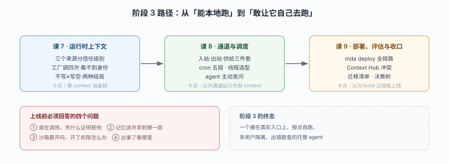

# 阶段 3：运行与交付

> 所属课程：Managed Deep Agents ｜ 故事章节：「让它自己跑，且跑对」 ｜ 上一阶段：[阶段 2](../2-能力声明/overview.md)

## 🎯 本阶段目标

- 让 agent 在真实场景里跑起来：接消息渠道、按 cron 自跑、在运行时做正确的权限判断
- 掌握"三个来源、三种信任级别"这条安全主线：`context` 是应用数据，`principal` 才是已验证身份
- 走完部署链路并建立上线判据，同时具备"该不该迁过来"的判断力

## 📍 学习重点

- **三源分离**：`context`（客户端传入，不可信）、`server_info.principal`（身份提供方验过）、`channel`（渠道入口验过）——把 `context` 当鉴权依据是本节要根治的错误
- **工厂必须幂等**：每次运行、每次恢复、每次重试、甚至读 schema 都会调用工厂，工厂里做副作用会导致状态错乱
- **通道运行没有 context**：运行时会在校验前剥掉投递数据，所以 `context` 为 `None` 是设计而非 bug
- **部署是十一条步骤的流水线**：哪一步会失败、失败长什么样、Context Hub 冲突怎么解
- **上线判据**：不是"能部署"就算完，要过评估、要有日志、要能回滚

## ✅ 必须掌握的知识点

| 知识点 | 所属课 | 学完应能 |
|--------|--------|----------|
| 三源分离 | 课 7 | 对着一段判断代码说出该信哪个字段，并解释为什么 |
| 工厂的幂等约束 | 课 7 | 列出四条约束，指出一个违反幂等的写法并改对 |
| 按运行选配置 | 课 7 | 用工厂为不同租户选指令/技能/沙箱，说清省略与清除的差别 |
| 通道三件套 | 课 8 | 说清通道的入站/出站/供给三部分，配出 Slack 入口 |
| 调度与线程策略 | 课 8 | 写 cron 声明，判断该用临时线程还是持久线程 |
| 主动中断与问答 | 课 8 | 设计"agent 发表单、用户填、运行继续"的闭环 |
| 部署链路 | 课 9 | 复述部署步骤，定位失败发生在哪一步 |
| 评估与 MCP 端点 | 课 9 | 起一个 Harbor 评估工作区，把 agent 暴露成 MCP 端点 |
| 上线判据与迁移 | 课 9 | 用迁移清单判断四类"迁不过去"的情况，给出替代路线 |

## 🗺️ 本阶段路径图

> 看图：课 7 是安全地基（谁在调用、该信什么），课 8 是入口扩展（消息渠道 + 定时触发），课 9 是交付（部署、评估、以及"不迁"这个选项）。顺序不能换——不懂三源分离就接渠道，会把群聊消息当成可信身份。

## 本阶段产出

- [x] `lessons/07-运行时上下文.md`
- [x] `lessons/08-通道与调度.md`
- [x] `lessons/09-部署评估与收口.md`

> 课 7 已含 16 个实验与三张配图（三源入口图 / 工厂四次调用图 / 三态语义图），并在正文中标出与官方文档不一致的两处：静态字面量扫描的真实边界、读 schema 路径的运行时缺 `context`。
> 课 8 已含 7 个实验与三张配图（三门口入口图 / HTTP 三回调与状态码图 / 调度线程命运图 / 主动中断闭环图），并在正文中标出与官方文档不一致的三处：Slack 通道路由带 `/v1` 前缀、`thread_id` 校验发生在形状检查而非映射阶段、两个 Slack 通道在 build 与导入期都会被放行。
> 课 9 已含 6 个实验与四张配图（三张单子入口图 / 部署十一步流水线图 / 评估与 MCP 端点图 / 迁移四门槛决策树图），并在正文中标出与官方文档不一致的两处：模型 key 只认 `.env` 不认 shell（deploy 文档兜底写错）、`build` 对静态入口会校验（migrate 文档谓"不检查定义调用"只对工厂入口成立）。

## 🎉 阶段 3 完成

三课已落盘：课 7（安全地基）→ 课 8（入口扩展）→ 课 9（交付与决策），覆盖本阶段九条必须掌握知识点。下一步进入阶段 4（如有）或应用实战配套。
