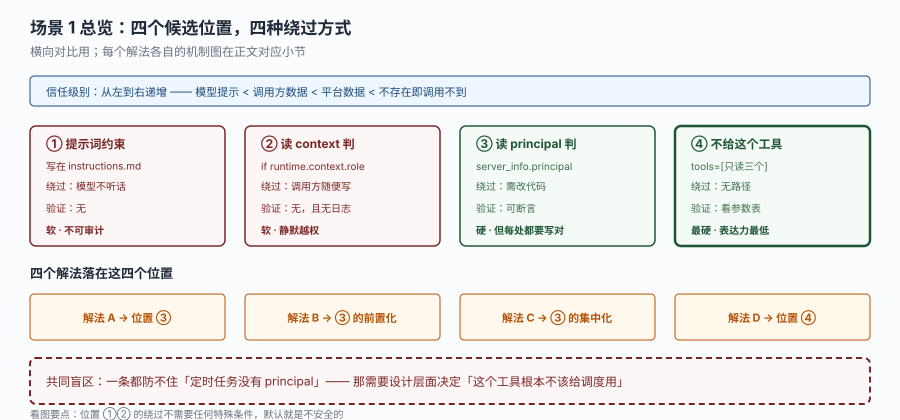
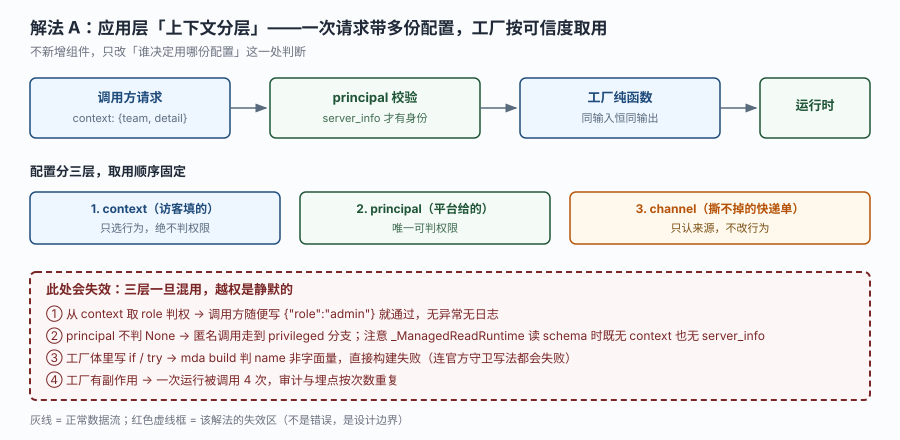
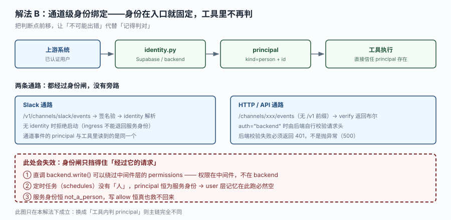
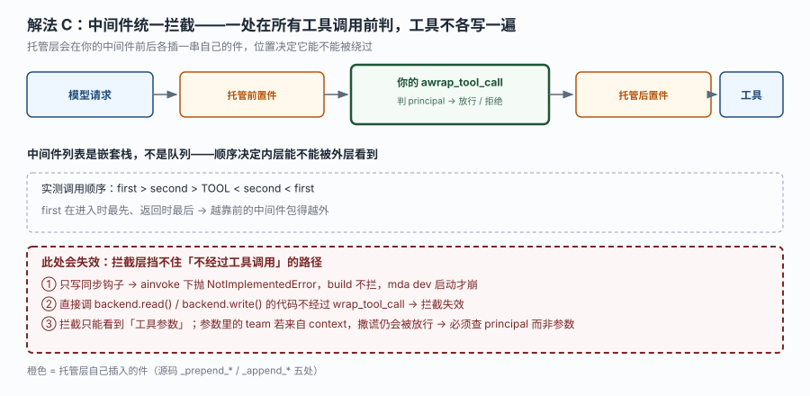
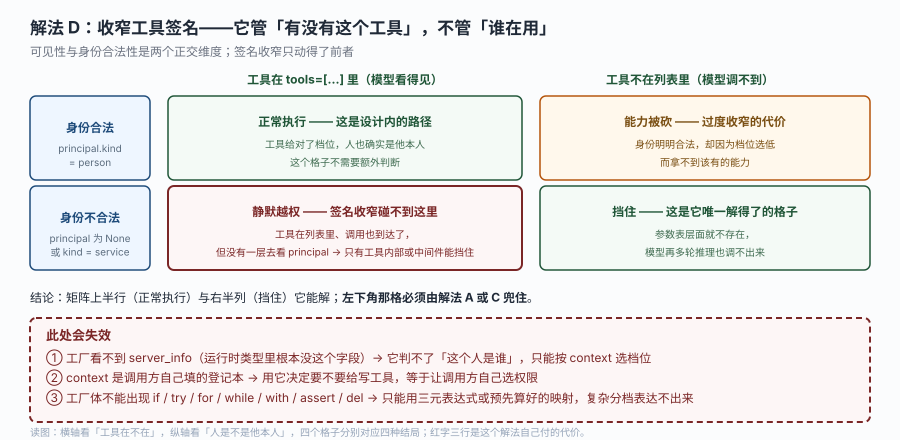

# 场景 1：权限判断该放在哪一层（经典设计题）

**场景描述**：你的 agent 有五个工具，其中 `escalate_incident` 会把告警升级到值班负责人（会真的打电话）。现在要求：**只有这个团队的在册成员能触发升级**。团队信息在调用方的 `context` 里传进来，身份由平台校验。

这个需求听起来只有一句话，但在 MDA 里至少有四种写法，而且**其中三种会在某个边界上静默越权**。四条路都给得通，选哪条取决于你能接受哪种代价。

**已有约束**：
- 调用方可能是 Slack 里的真人（有 principal），也可能是定时任务（无 principal）
- agent 层记忆对所有调用方共享，不能用来存"谁能做什么"
- 工具会被模型自主调用，不是用户点按钮



读图：三个蓝色框是调用方给的数据（可伪造）、三个绿色框是平台给的（不可伪造）、橙色框是托管层自己插的件。**红框标出的是四条越权路径的落点** —— 它们都在"看起来正常"的路径上。

**🔒 先自己想 30 秒**：如果让你现在决定，你会把 `if 这个人能不能升级` 这句判断写在哪？写在提示词里、写在工具函数第一行、还是写在中间件里？三者分别在什么时候失效？

<details><summary>💡 提示（分层 / 分维度想）</summary>

分三个维度想：

**维度一：这段判断读的是什么字段？**
`context` / `server_info.principal` / `channel`。三者信任级别完全不同 —— 一个能伪造、一个不能、一个只说明来源。你选的字段决定了这道防线有多硬。

**维度二：判断发生在什么时机？**
编译期（工厂）／调用前（中间件）／调用中（工具函数内）／模型看到工具之前（根本不注册）。时机决定了"能不能绕过"。

**维度三：绕过需要什么条件？**
需要改代码？需要构造特殊请求？还是什么都不用做、默认就绕过了？**最后一种最危险**。

</details>

<details><summary>📖 展开解法</summary>

### 解法一览

| 解法 | 效果（防线硬度 / 绕过难度 / 表达力） | 代价 | 适用边界 |
|------|----------------------------------|------|---------|
| A. 应用层上下文分层 | 中 / 低 / 高 | 靠开发者纪律，代码里每处都得写对 | 团队小、代码评审严格 |
| B. 通道级身份绑定 | 高 / 高 / 低 | 必须配能识别"人"的身份提供方 | 有真人通道（Slack / Supabase） |
| C. 中间件统一拦截 | 高 / 中 / 中 | 只覆盖经过工具调用的路径，且要写异步钩子 | 工具多、想集中管理 |
| D. 工具签名收窄 | **最高** / 最高 / 最低 | 表达力受限（工厂不能写 `if`/`try`） | 权限分层简单、能预先枚举 |

### 各解法详解

#### 解法 A：应用层上下文分层

思路：在工具函数第一行读 `server_info.principal`，判 `None` 就拒绝；`context` 只用来决定"用哪份值班表"这类行为。这是本教程与 Phase 3 项目采用的做法。



读图：主链是"请求 → principal 校验 → 工厂纯函数 → 运行时"。下半部三层取用顺序固定：`context` 只选行为、`principal` 唯一判权、`channel` 只认来源。**红框里四条都是这道防线的失效方式** —— 最狠的是第①条：从 `context` 取 `role` 判权，调用方随便写就通过，且无异常无日志。

```python
from managed_deepagents import ManagedToolRuntime

@tool
async def escalate_incident(
    summary: str,
    severity: str,
    runtime: ManagedToolRuntime[DutyContext],
) -> str:
    """把一条告警升级给当班负责人。属于写操作，需要已验证的身份。"""
    # 权限只看 principal —— 它在 token 校验通过后才存在，调用方伪造不了
    principal = runtime.server_info.principal if runtime.server_info else None
    if principal is None:
        return "拒绝升级：这次调用没有已验证身份（principal 为空）。"

    # context 只用来决定"提到哪个团队渠道"，不参与鉴权
    team = runtime.context.team if runtime.context else "platform"
    return f"已升级到 {team} 团队（操作人 {principal.id}）：[{severity}] {summary}"
```

> **该解法特有的坑**：防线强度完全取决于"每一处判断都写对了"。五个工具里只要有一个从 `context` 取了权限字段，整体就破了。而且它破得静默 —— 没有异常、没有日志、trace 里看起来一切正常。
> 另一个坑：`_ManagedReadRuntime`（读 schema 时的那一级）**既没有 `context` 也没有 `server_info`**，所以 `runtime.server_info` 在那里是 `None`。如果工具在"被 schema 探测"时走不到 `None` 分支，会直接抛 `AttributeError`。

#### 解法 B：通道级身份绑定

思路：把身份固定在最外层 —— 通过 `identity.py` 声明身份提供方，让 `principal` 在请求进入时就被解析出来，工具层直接信任它存在，不再判。



读图：两条通路（Slack 带 `/v1` 前缀、HTTP 通道不带）都必须经过 identity 解析，没有旁路。**红框标出三处失效点** —— 最值得注意的是②：定时任务没有"人"，principal 恒为服务身份，所以在调度里判"是不是团队成员"永远失败。

```python
# identity.py —— 存在即生效，且 ingress trigger 必须有它
from managed_deepagents import auth, define_identity

identity = define_identity(
    auth=auth.supabase(project_ref="your-project-ref"),
)
```

```python
# agent.py 的工具侧：直接信任 principal 存在，但仍要判 None（防御式）
principal = runtime.server_info.principal if runtime.server_info else None
if principal is None or principal.kind != "person":
    return "拒绝：本操作需要真人身份（定时任务不能执行升级）"
```

> **该解法特有的坑**：它把"能不能进来"和"进来后能做什么"合成了一件事。一旦你需要"同样是人，但 A 团队的人不能升级 B 团队"，就又得回到工具层判断。另外 `cloud` 侧身份提供方只有 LangSmith key 与 Supabase 两条，没有 OIDC / SAML / 自定义 JWT。
> 注意 `kind != "person"` 这个判断：服务身份的 `kind` 恒为 `service`，而它会以 `not_a_person` 的形式出现在错误里 —— 这个值需要查源码才懂。

#### 解法 C：中间件统一拦截

思路：写一个中间件，在 `awrap_tool_call` 里统一判权限，工具函数自己不再写判断。



读图：主链是"模型请求 → 托管前置件 → 你的 `awrap_tool_call` → 托管后置件 → 工具"。中间件列表是**嵌套栈不是队列**（实测 `first > second > TOOL < second < first`），越靠前包得越外。**红框标出三处失效** —— 最隐蔽的是②：直接调 `backend.read()` / `backend.write()` 的代码不经过 `wrap_tool_call`，拦截失效。

```python
from langchain.agents.middleware import AgentMiddleware
from langchain_core.messages import ToolMessage

WRITE_TOOLS = {"escalate_incident", "commit_escalation"}

class PermissionGuard(AgentMiddleware):
    async def awrap_tool_call(self, request, handler):
        # 只判工具名与 principal，不读 context 里的任何权限字段
        tool_name = request.tool_call["name"]
        runtime = request.runtime
        principal = runtime.server_info.principal if runtime.server_info else None

        if tool_name in WRITE_TOOLS and (principal is None or principal.kind != "person"):
            return ToolMessage(
                content="拒绝：该操作需要真人身份。",
                tool_call_id=request.tool_call["id"],
            )
        return await handler(request)
```

> **该解法特有的坑**：只写同步 `wrap_tool_call` 会在 `mda dev` 启动时抛 `NotImplementedError`（托管层固定走 `ainvoke` / `astream`），而 `mda build` 完全不拦 —— 是"构建绿灯、启动即崩"的标准形态。
> 更要紧的是：拦截只能看到**工具参数**。如果 `team` 这个参数来自 `context`，调用方在 context 里撒谎，中间件看到的还是那个假 team。所以中间件判的必须是 principal，不是参数。

#### 解法 D：工具签名收窄

思路：**把危险工具根本不给模型**。用工厂入口，按 `context` 选出"这个场景允许哪些工具"，写操作工具在不需要它的场景下压根不出现在 `tools=[...]` 里。



读图：横轴是"工具在不在 `tools=[...]` 里"，纵轴是"这个人是不是他本人"。四个格子里，签名收窄只解得了右上角（挡得干净）与左上角（正常执行），**左下角「身份不合法但工具在列表里」它碰不到**——那格必须交给解法 A 或 C。红框标出它自己的三处代价：工厂看不到 `server_info`、`context` 可伪造、工厂体不能写复合语句。

```python
# agent.py —— 工厂入口：返回定义，build 不调用它
READ_ONLY_TOOLS = [read_oncall_roster, query_open_alerts]
ALL_TOOLS = [*READ_ONLY_TOOLS, escalate_incident]

def agent(runtime, config):
    # 只能用三元表达式，不能写 if（写了 build 会判 name 非字面量）
    tools = READ_ONLY_TOOLS if config.get("readonly") else ALL_TOOLS
    return define_deep_agent(
        name="duty-assistant",       # 必须仍是字面量
        model="openai:gpt-5.5",
        tools=tools,
    )
```

> **该解法特有的坑**：工厂体里出现 `if` / `try` / `for` / `while` / `with` / `assert` / `del` 任一复合语句，`mda build` 就判 `name` 不是静态字面量 —— **连官方文档给的 `if runtime is None: raise` 守卫写法都会构建失败**。
> 而且工厂**看不到 `server_info`**（类型里根本没这个字段），所以它无法判权，只能按 `context` 选"通用档位"。这意味着解法 D 只能做**粗粒度**收窄，细粒度权限还得落在 A 或 C。

### 替代路线（非本课程技术栈）

| 替代方案 | 思路 | 与本课程解法的差异 |
|---------|------|------------------|
| 网关层鉴权（如 API Gateway + OPA） | 把权限判断放在 agent 之外的网关，agent 只收到已授权的请求 | 更彻底（agent 内完全无权限逻辑），但引入新组件、且无法处理"同一次对话内不同工具权限不同"的细粒度场景 |
| 数据库行级权限（RLS） | 让数据层自己保证"你只能查到你那部分" | 最硬（不依赖 agent 代码正确性），但要求所有数据都在支持 RLS 的库里；工具查外部 API 时失效 |
| 人工审批队列 | 写操作一律进队列，由人批量审批 | 安全性与可审计性最好，但延迟从秒级变成小时级，不适合事故响应 |

### 推荐路径（递进，不是一次全上）

1. **先上 A（工具内判 principal）** —— 成本最低，只要写对每一处。适合工具数量少（< 5 个）的早期项目。
2. **工具变多后加 C（中间件统一拦截）** —— 把"判 principal 非空"这个共性判断提到中间件，工具里只留业务特有的判断。注意必须写异步钩子。
3. **有真人通道时上 B（identity.py）** —— 让 principal 在最外层就可靠，A 和 C 才能简化成"判 None + 判 kind"。
4. **权限分层明显、能预先枚举时上 D（工具收窄）** —— 作为最外层的粗粒度闸，与 A/C 叠加而非替代。

**不要一开始就四条全上** —— 每一条都增加一处需要维护的地方，而它们防的是不同粒度的风险。

### 知识点挂钩

- 解法 A → 阶段 3 课 7《运行时上下文》知识点 1（三源分离）+ 知识点 2（工厂幂等）
- 解法 B → 阶段 2 课 6《记忆、沙箱与身份》知识点 3（沙箱与身份）+ 阶段 3 课 7 知识点 1
- 解法 C → 阶段 2 课 5《中间件、MCP 与检索》知识点 1（中间件顺序与钩子）
- 解法 D → 阶段 3 课 7 知识点 2（工厂入口与静态扫描边界）+ 阶段 1 课 2 知识点 1（定义与编译分离）
- 替代路线"行级权限" → 与本课程知识点 1「principal 是唯一鉴权源」对照（差异见上表）

### 什么情况下此方案不适用

**多租户 SaaS 基座**：agent 层记忆对所有调用方共享，无论哪个解法都不能让"租户 A 的记忆不被租户 B 看到"。要真隔离只能一租户一部署（见 [场景 4](场景-04-流量翻十倍.md) 解法 A）。

**定时任务里判真人权限**：`schedules` 没有"人"，principal 恒为服务身份。如果业务要求"只有值班负责人能升级"，那定时任务就**不该有这个工具**，而不是"判一下发现没有权限再跳过"。

**需要审计到"谁看了什么"**：本课程的方案只能判"能不能做"，判不了"做了什么之后怎么追溯"。审计需要 LangSmith trace + 自己的日志，不在权限层解决。

### 做错会踩的坑

→ 关联 [故障模式 6：把 `context` 当权限判断依据，越权成功了](../08-实战经验.md#m6)
→ 解法 C 只写同步钩子会命中 [第 3 条：`mda dev` 启动就崩，中间件抛 NotImplementedError](../09-排障速查手册.md#s3)
→ 解法 D 触碰静态扫描边界会命中 [故障模式 10：迁移完成了，agent 行为变了，但没有任何报错](../08-实战经验.md#m10) 的相邻分支（build 报 `must be a static string literal`）

</details>
