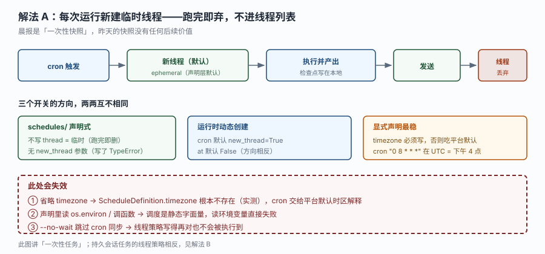
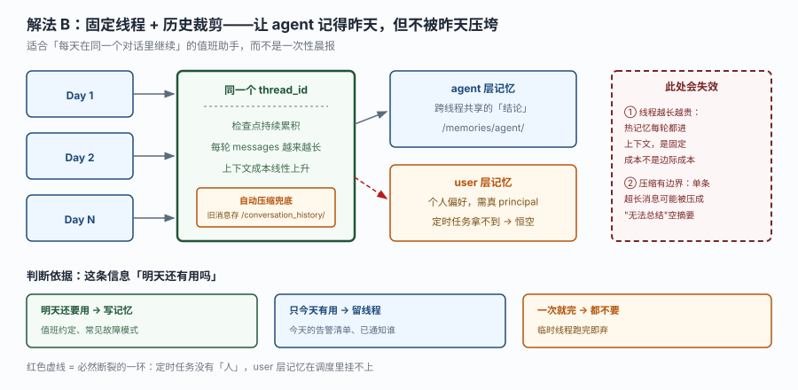
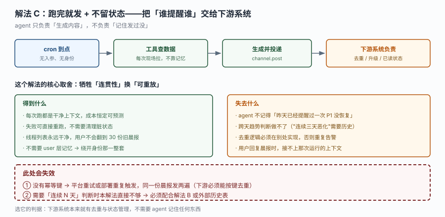

# 场景 2：定时任务的线程该临时还是持久

**场景描述**：你要做一个工作日的早八点值班晨报。内容：各团队谁在值班、当前未恢复的告警按 P1 → P2 排序。现在有三个需求变体，**每个变体对应的线程策略不同**：

- 变体 1：就是每天一份快照，看完就完
- 变体 2：值班人会在 Slack 里追问"这条 P1 昨天就有了吧？"，希望 agent 记得昨天
- 变体 3：希望它能说出"这个指标连续三天恶化"

大多数人第一反应是"持久化更聪明"，但在 MDA 里这个选择直接决定了**成本曲线**和**能不能挂上 user 记忆**两件事。

**已有约束**：
- `schedules/` 里的所有值必须是静态字面量（不能读环境变量）
- 定时任务执行时没有"人"，principal 恒为服务身份
- 热记忆（agent 层）每轮都进上下文，是固定成本

**🔒 先自己想 30 秒**：三个变体分别该用哪种线程策略？如果选"持久"，第三天的上下文里会有什么？它的成本是"每天一次"还是"每天累加"？

<details><summary>💡 提示（分层 / 分维度想）</summary>

**维度一：这条信息的生命周期**
今天有用、明天还有用、还是一次性？只有"明天还有用"的才值得留下来。

**维度二：留下来的是"消息"还是"结论"**
线程留的是逐条消息（越来越长），记忆留的是提炼后的结论（长度可控）。同一个"记得昨天"的需求，用线程实现和用记忆实现，成本差一个数量级。

**维度三：谁来回看**
只有 agent 自己看 → 可以放进记忆；人也要翻 → 得留在线程里；没人看 → 什么都不留。

</details>

<details><summary>📖 展开解法</summary>

### 解法一览

| 解法 | 效果（成本可预测性 / 跨天连贯性 / 实现复杂度 / 用户可见性） | 代价 | 适用边界 |
|------|---------------------------------------------------|------|---------|
| A. 每次新建临时线程 | 高 / 无 / 低 / 低 | 完全不记得昨天 | 纯快照型晨报（变体 1） |
| B. 固定线程 + 历史裁剪 | 低 / 高 / 中 / 高 | 成本随天数线性上升，需要压缩兜底 | 用户会追问、需要翻旧账（变体 2、3） |
| C. 无状态投递 + 下游去重 | 高 / 无 / 低 / 中 | 连贯性全部外包，跨天判断做不了 | 下游本来就有状态管理 |

### 各解法详解

#### 解法 A：每次新建临时线程

思路：`schedules/` 里只写 `cron` 与 `prompt`，**不写 `thread`** —— 声明层的默认命运就是临时话题，跑完即弃，不进话题列表。



读图：主链是"cron 触发 → 新线程 → 执行 → 发送 → 线程丢弃"。下半部三个框分别是两套 API 与一条硬要求 —— **声明层没有 `new_thread` 参数**（写了 `TypeError`），临时线程靠"不写 `thread`"表达；`cron`/`at` 相反的默认值只属于运行时创建那条路。**红框三处都是"写了但没生效"**：省略 `timezone` 时该字段根本不存在（实测确认），调度声明读环境变量直接失败，`--no-wait` 让线程策略压根执行不到。

```python
from managed_deepagents import define_schedule

schedule = define_schedule(
    cron="0 8 * * 1-5",           # 工作日早八点
    timezone="Asia/Shanghai",     # 必须显式写：省略时吃平台默认时区
    prompt=(
        "生成今天的值班晨报：先确认各团队谁在值班，再列出当前未恢复告警，"
        "按 P1 → P2 排序。只写查到的内容，没查到就说没查到。"
    ),
)
# 不写 thread 就是 ephemeral（每次新话题、跑完即删）—— 声明层的默认命运
```

> **该解法特有的坑**：`new_thread` 这个参数**只存在于运行时创建路径**（`runtime.schedules.create`），声明层 `define_schedule` 里没有它，写了直接 `TypeError`。而运行时那条路的两个默认值**方向相反**：`cron` 默认 `new_thread=True`、`at` 默认 `False`。两套 API 混着记，最容易把"一次性任务"写成复用旧线程，让它带着上一次的上下文乱答。
> 另一个坑：省略 `timezone` 不是"跟随用户"，而是"交给平台按默认时区解释"。团队在上海、平台按 UTC，早八点的晨报会变成下午四点 —— 而且没有任何提示。

#### 解法 B：固定线程 + 历史裁剪

思路：在声明层写 `thread={"mode": "persistent", "id": "<预先建好的话题 UUID>"}`，让每天的运行汇入同一条话题继续；同时接受"上下文会累积"这个代价，靠自动压缩兜底。运行时创建的话对应的是 `new_thread=False` —— 两套 API 别混。



读图：左边 Day 1 → Day 2 → Day N 都汇入同一个 `thread_id`，检查点持续累积、`messages` 越来越长、上下文成本线性上升。中间靠"自动压缩兜底"把旧消息存进 `/conversation_history/`。**红框标出两处失效**：热记忆每轮都付是固定成本（不是边际成本）；单条超长消息可能被压成"无法总结"的空摘要。

```python
schedule = define_schedule(
    cron="0 8 * * 1-5",
    timezone="Asia/Shanghai",
    # 声明层没有 new_thread 这个参数（写它会直接 TypeError）。
    # 持久话题只能这样指定，且 id 必须是事先手工建好的话题 UUID。
    thread={"mode": "persistent", "id": "11111111-1111-1111-1111-111111111111"},
    prompt=(
        "生成今天的值班晨报。先读 /memories/agent/ 里的历史结论，"
        "再看今天的数据：如果是昨天已有的问题，注明「持续第 N 天」。"
    ),
)
```

> **该解法特有的坑**：这张图里红色虚线画的是"user 层记忆"那条 —— 定时任务没有"人"，principal 恒为服务身份（`not_a_person`），所以**在调度里挂不上 user 层记忆**。想要"按人区分的记忆"，只能走真人通道（Slack 对话），不能靠定时任务。
> 第二个坑：线程越长，热记忆的每轮成本被乘的次数越多。热记忆是**固定成本 × 轮数**，不是一次性的。

#### 解法 C：无状态投递 + 下游去重

思路：agent 只负责"生成并投递"，不负责"记住发过没"。去重、升级、已读状态全部交给下游系统（工单系统 / 告警平台）。



读图：主链是"cron → 工具现场查数据 → 生成并投递 → 下游负责去重"。中间左右两栏是取舍：得到干净上下文与恒定成本，失去跨天连贯性。**红框两处**：没有幂等键时平台重试会重复发；需要"连续 N 天"判断时本解法直接不够用。

```python
schedule = define_schedule(
    cron="0 8 * * 1-5",
    timezone="Asia/Shanghai",
    prompt=(
        "生成今天的值班晨报并投递。所有数据现场查，不要依赖历史对话。"
        "投递时必须带上 idempotency_key = 今天日期 + 'morning-digest'，"
        "让下游系统能识别重复投递。"
    ),
)
```

> **该解法特有的坑**：它的安全性完全依赖下游。如果下游没有去重能力，平台重试一次就发两遍 —— 而 `channel.post` 本身不带幂等语义。
> 更根本的限制：它做不了"连续三天恶化"这类判断，因为 agent 手里没有任何历史。要这类能力，数据必须来自**外部历史表**（工具去查），不是来自记忆。

### 替代路线（非本课程技术栈）

| 替代方案 | 思路 | 与本课程解法的差异 |
|---------|------|------------------|
| 外部调度器 + 无状态 HTTP 调用（如 Airflow / cron + Lambda） | 调度完全在平台外，每次调用 deployment 的 MCP 端点，不依赖平台 cron | 调度能力更强（依赖编排、重试策略、回填），但失去 `mda deploy` 一站式；且需要自己管幂等 |
| 事件驱动（告警平台 webhook 触发） | 不按时间跑，按"有新告警"触发 | 时效性最好（秒级），但无法回答"现在整体状况如何"这类周期性汇总需求 |
| 数据仓库侧定时物化视图 | 晨报内容由 SQL 预计算好，agent 只做"翻译成人话" | 成本最低（模型只跑一轮），跨天对比天然支持；但要求数据都在仓里，且失去"临时追问"的灵活性 |

### 推荐路径（递进，不是一次全上）

1. **先上 A（临时线程）** —— 成本最低、最可预测，覆盖 80% 的"定时汇总"需求。
2. **用户开始追问时才上 B（持久线程）** —— 但先评估：追问的频率高吗？如果一天只有一两次，用"临时线程 + 记忆里存结论"更便宜。
3. **需要严格去重或跨系统协同时上 C（无状态 + 下游幂等）** —— 这通常意味着 agent 只是整条链路的一环，不是状态中心。

**判据一句话**：这一天的对话，明天还有人会翻吗？没有 → A；有 → B；但只需要"结论"不需要"过程" → A + 记忆。

### 知识点挂钩

- 解法 A → 阶段 3 课 8《通道与调度》知识点 2（调度参数与默认值）+ 阶段 2 课 6 知识点 2（热冷记忆）
- 解法 B → 阶段 3 课 8 知识点 2 + 阶段 2 课 6 知识点 1（双记忆层与 principal）
- 解法 C → 阶段 3 课 8 知识点 2 + 阶段 3 课 9《部署、评估与收口》知识点 3（MCP 端点与外部调用）
- 替代路线"数据仓库侧物化" → 与本课程知识点 2「调度是静态字面量」对照（差异见上表）

### 什么情况下此方案不适用

**需要"连续 N 天"判断**：解法 A 与 C 都做不了。要么上 B（线程里有历史），要么让工具去查外部历史表 —— 后者更可靠，因为线程历史会被压缩掉。

**多团队独立晨报**：一个部署只有一个 agent 入口和一套 schedules。要按团队分开跑，得拆多个部署（见 [场景 4](场景-04-流量翻十倍.md)），或者在一个 prompt 里循环所有团队（但那样每次都要等全部完成）。

**晨报要发给"具体某个人"**：`schedules` 没有 principal，`channel.post` 只能发到渠道，发不到"私聊某人" —— 那是 user 层能力的范围，调度里挂不上。

### 做错会踩的坑

→ 关联 [故障模式 10：迁移完成了，agent 行为变了，但没有任何报错](../08-实战经验.md#m10)
→ 时区省略 + `--no-wait` 跳过 cron 同步会命中 [第 17 条：部署后 cron 不跑，或跑在错误时区](../09-排障速查手册.md#s17)
→ 解法 B 里想在调度中用 user 层记忆会命中 [故障模式 5：用户私有记忆永远是空的](../08-实战经验.md#m5)（user 记忆恒为空）

</details>
