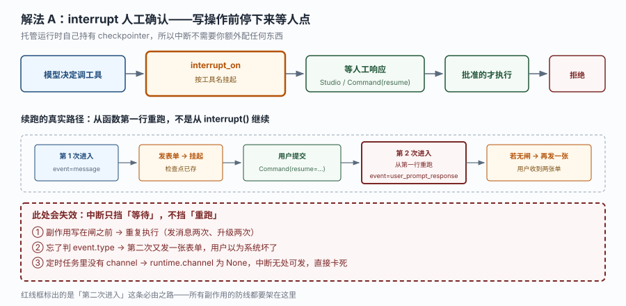
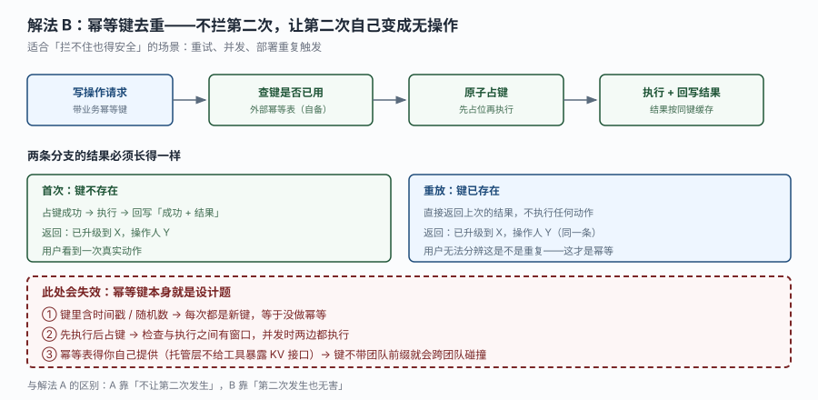
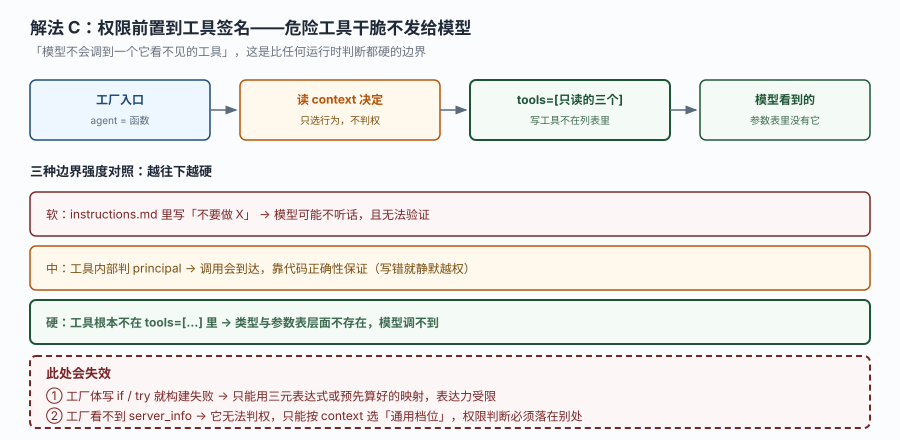

# 场景 3：写操作的重复执行怎么防

**场景描述**：agent 有个 `escalate_incident` 工具，会调用值班系统 API 真的把人叫醒。现在有三种会触发重复的路径，**它们的原因完全不同**：

- 路径 1：走 interrupt 审批，用户点完提交，agent 又弹一张表单（用户点两次 = 叫醒两次）
- 路径 2：模型在一次运行里连续调了两次同一个工具（它"忘了"自己刚调过）
- 路径 3：`channel.post` 发出去了，但平台重试或部署重复触发，同一条消息发了两遍

三条路径需要三套不同的防线。**只用一套挡不住全部三条** —— 这是本场景最容易漏的地方。

**已有约束**：
- 中断续跑是**从函数第一行重跑**，不是从 `interrupt()` 继续
- 托管运行时持有 checkpointer，中断不需要你额外配
- `context` 可伪造，不能作为幂等键的来源

**🔒 先自己想 30 秒**：三条路径里，哪一条"加个 if 就能挡"？哪一条必须靠外部存储？如果你只能做一件事，做哪件收益最大？

<details><summary>💡 提示（分层 / 分维度想）</summary>

**维度一：重复发生在哪一层**
同一次运行内（模型重复调）／跨运行（重试、部署重复）／跨人（两个值班人同时点）。三层的可见范围完全不同 —— 运行时看不见跨运行的东西。

**维度二：你防的是"调用"还是"效果"**
防调用 = 不让工具被执行第二次；防效果 = 执行了也无害。后者更可靠，因为它不依赖调用方行为。

**维度三：幂等键从哪来**
如果键里含 `time / 随机数 / context 里的字段`，等于没做。键必须是"业务上同一件事"的唯一标识。

</details>

<details><summary>📖 展开解法</summary>

### 解法一览

| 解法 | 效果（挡路径 1 / 挡路径 2 / 挡路径 3 / 实现复杂度） | 代价 | 适用边界 |
|------|------------------------------------------------|------|---------|
| A. interrupt 审批 + event 类型闸 | 高 / 低 / 无 / 低 | 只挡"人会重复提交"，挡不住模型自主重复 | 有人参与的写操作 |
| B. 幂等键去重 | 高 / 高 / 高 / 中 | 需要外部存储 + 键的设计 | 所有写操作，尤其是自动触发的 |
| C. 工具签名收窄 | 中 / 中 / 无 / 低 | 表达力受限，只能做粗粒度 | 危险工具能预先枚举 |

### 各解法详解

#### 解法 A：interrupt 审批 + event 类型闸

思路：用 `interrupt_on` 把写操作挂起等人工确认。**关键是闸门**：续跑时判断 `channel.event["type"]`，是 `user_prompt_response` 就不再发表单。



读图：上排是主链（模型决定调工具 → `interrupt_on` 挂起 → 等人工 → 批准的才执行 / 拒绝）。中间那排画的是"第二次进入"这条必由之路：**第 2 次进入时从第一行重跑，若不设闸就再发一张单**。红框三处：副作用写在闸之前、忘了判 event.type、定时任务里没有 channel 直接卡死。

```python
from managed_deepagents import define_deep_agent
from tools.duty import escalate_incident

agent = define_deep_agent(
    name="duty-assistant",
    model="openai:gpt-5.5",
    tools=[escalate_incident],
    interrupt_on={"escalate_incident": True},   # 按工具名挂起
)
```

```python
from langgraph.types import interrupt
from langsmith import uuid7

@tool(parse_docstring=True)
async def escalate_incident(summary: str, runtime: ManagedDeepAgentRuntime) -> str:
    """Ask the on-call owner to approve escalating an incident.

    Args:
        summary: One-line incident summary shown on the approval card.
    """
    channel = runtime.channel
    if channel is None or channel.provider != "slack":
        return "审批卡只在 Slack 通道可用。"

    correlation_id = str(uuid7())
    # 续跑时工具会再执行一遍：第一次是 message 事件，续跑时变成 user_prompt_response。
    # 只在这道闸之后贴单，否则用户会看到两张一样的审批卡。
    if channel.event["type"] != "user_prompt_response":
        await post_approval_form(channel.raw_event, summary, correlation_id)

    response = interrupt({"correlation_id": correlation_id, "summary": summary})
    return f"审批结果：{response['action']}（{summary}）"
```

> **该解法特有的坑**：`interrupt_on` 只挡"等待"，不挡"重跑"。所有有副作用的动作（发消息、写库、调外部 API）都必须在闸之后。官方文档那句"续跑从 `interrupt()` 之后继续"说的是 LangGraph 的概念模型，实际执行是**整个函数重跑** —— 这个差别是这张图存在的唯一理由。
> 另一个坑：定时任务里 `runtime.channel` 是 `None`，中断无处可发 → 直接卡死。所以 `interrupt_on` 的工具不该出现在纯调度场景里。

#### 解法 B：幂等键去重

思路：不拦第二次，让第二次自己变成无操作。每次写操作带一个业务幂等键，先原子占键再执行，结果按键缓存。



读图：主链是"写请求（带键）→ 查键 → 原子占键 → 执行 + 回写结果"。下半部两条分支的结果必须**长得一样**：首次返回"已升级到 X，操作人 Y"，重放返回同一条 —— 用户无法分辨是不是重复，这才叫幂等。红框三处：键含时间戳等于没做、先执行后占键有并发窗口、键不带租户前缀会跨租户碰撞。

```python
from dataclasses import dataclass

@dataclass
class DutyContext:
    team: str = "platform"

# 幂等表由你自己注入（值班系统的库 / Redis / 业务 API 均可）。
# 托管层没有给工具暴露 get/put 型的 KV 接口：记忆只能走内置的
# read_file / edit_file / write_file，runtime.backend 也只覆盖沙箱、碰不到 Context Hub。
@tool
async def escalate_incident(
    summary: str,
    severity: str,
    incident_id: str,          # 业务幂等键：同一条告警永远是同一个 id
    runtime: ManagedToolRuntime[DutyContext],
) -> str:
    """升级一条告警。incident_id 是幂等键，同一条告警重复调用只生效一次。"""
    principal = runtime.server_info.principal if runtime.server_info else None
    if principal is None:
        return "拒绝：本次调用没有已验证身份。"

    # 键必须带租户 / 团队前缀，否则两个团队的同一个 incident_id 会撞在一起
    key = f"{runtime.context.team}:{incident_id}"
    existing = await idempotency_table.get(key)
    if existing:
        return existing["result"]             # 重放：返回上次结果，不执行任何动作

    # 原子占键（先占位，再执行）—— 这一步必须由存储侧保证原子性
    claimed = await idempotency_table.put_if_absent(key, {"result": "处理中"})
    if not claimed:
        return (await idempotency_table.get(key))["result"]   # 并发下的后到者

    result = f"已升级到 {runtime.context.team}（操作人 {principal.id}）：[{severity}] {summary}"
    await idempotency_table.put(key, {"result": result})
    return result
```

> **该解法特有的坑**：幂等键本身就是设计题。用 `incident_id` 是对的（同一条告警永远是同一个 id），用"时间戳 + summary"就错了（措辞一变就是新键）。
> 第二个坑：`get` 后 `put` 不是原子的，必须用 `put_if_absent` / CAS 这类条件写，否则两个并发请求会同时通过检查。**存哪儿也得你自己定** —— 托管平台不提供这张表，用记忆文件当键存储还会踩到"记忆按层隔离、跨层即跨信任域"这条边界。

#### 解法 C：工具签名收窄

思路：把写操作拆成两个工具 —— `prepare_escalation`（只读，生成待升级内容）和 `commit_escalation`（写，只在特定场景下注册）。**模型看不到的工具，它调不到**。



读图：上半部是工厂入口按 `context` 选出工具列表，写工具不在列表里时模型的参数表里根本没有它。下半部三档边界强度：提示词（软）→ 工具内判断（中）→ 不在列表里（硬）。红框标出这个解法自己的代价：工厂不能写 `if`/`try`，且工厂看不到 `server_info`。

```python
READ_ONLY = [read_oncall_roster, query_open_alerts]
FULL = [*READ_ONLY, prepare_escalation, commit_escalation]

def agent(runtime, config):
    # 三元表达式代替 if：工厂体里出现 if 会被判 name 非字面量
    return define_deep_agent(
        name="duty-assistant",
        model="openai:gpt-5.5",
        tools=FULL if config.get("allow_write") else READ_ONLY,
    )
```

> **该解法特有的坑**：它挡的是"根本不该有写能力的场景"（如只读报表、公开查询），**挡不住"有写能力但重复调用"**。所以它必须与 B 叠加，不能替代 B。
> 再者，`config` 是调用方可控的（`context` 可伪造）—— 用它决定要不要给写工具，等于让调用方自己选权限。要安全，只能让它选"档位"（只读 / 完整），而完整档位内部仍需 principal 判断。

### 替代路线（非本课程技术栈）

| 替代方案 | 思路 | 与本课程解法的差异 |
|---------|------|------------------|
| 分布式锁（Redis SETNX / etcd lease） | 对同一个 `incident_id` 加锁，拿不到锁就等待或拒绝 | 并发安全性最强，但需要额外组件；且锁有 TTL，长任务容易锁提前释放 |
| 事务性发件箱（Outbox pattern） | 写操作先落本地事务，再由后台任务投递 | 保证"一定发一次"，适合强一致场景；但要维护投递表与补偿逻辑 |
| 人工审批队列（工单系统） | 写操作一律进工单，由人批量处理 | 可审计性最好，但延迟从秒级变成小时级 |

### 推荐路径（递进，不是一次全上）

1. **先上 B（幂等键）** —— 收益最大，因为它同时挡住三条路径里的两条（模型重复调、平台重试）。
2. **有人参与时加 A（interrupt + event 闸）** —— 提供"人能拦一下"的能力。注意闸必须在副作用之前。
3. **需要区分"只读场景 / 完整场景"时上 C（工具收窄）** —— 作为最外层粗粒度闸。

**顺序的理由**：B 防的是"重复发生也无害"，这是最鲁棒的；A 防的是"人不小心点两次"；C 防的是"根本不该有这个能力"。后两者都假设调用方行为可预测，而 B 不假设。

### 知识点挂钩

- 解法 A → 阶段 3 课 8《通道与调度》知识点 3（agent-owned interrupt 与续跑语义）
- 解法 B → 阶段 3 课 9 知识点 3（MCP 端点幂等）+ 阶段 2 课 6 知识点 1（agent 层记忆的共享边界）
- 解法 C → 阶段 3 课 7《运行时上下文》知识点 2（工厂入口与静态扫描边界）
- 替代路线"事务性发件箱" → 与本课程解法 B 对照（差异见上表）

### 什么情况下此方案不适用

**写操作本身就是"越多越好"**：比如"每次调用都记一条日志"。这类不需要幂等，加了反而丢失信息。

**没有任何天然业务键**：如果写操作是"给这个用户发一条随机推荐"，没有 `incident_id` 这样的天然唯一标识，就得自己造键（比如 `用户id + 内容hash`）—— 但那时键的设计就变成了业务决策，不是技术问题。

**跨系统事务**：幂等键只能保证"这次写操作不重复"，保证不了"升级成功但通知失败了怎么回滚"。那需要 saga 或补偿事务，超出本课程范围。

### 做错会踩的坑

→ 关联 [故障模式 8：用户收到两张一模一样的审批单](../08-实战经验.md#m8)
→ 解法 B 把共享记忆当键存储却不加租户前缀，会踩到共享记忆的信任边界（[08-实战经验.md](../08-实战经验.md#m5) 故障模式 5 与第五章均交代：记忆按层隔离，跨层共享即跨信任域）
→ 解法 C 触碰静态扫描边界会命中 [第 1 条：`mda build` 报 name 必须是静态字符串](../09-排障速查手册.md#s1)

</details>
