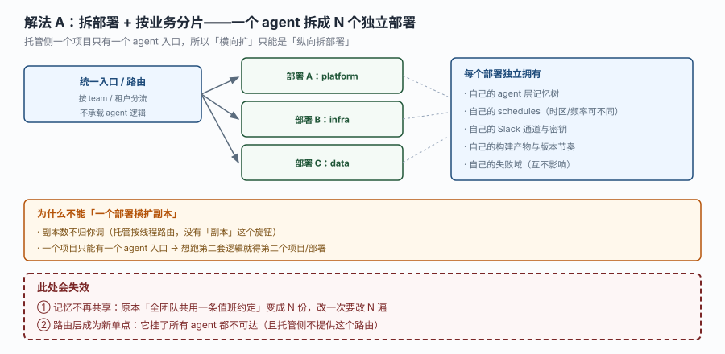
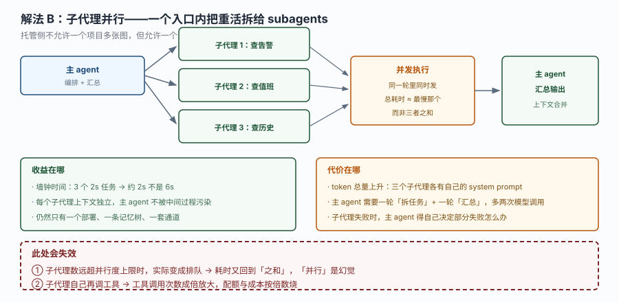
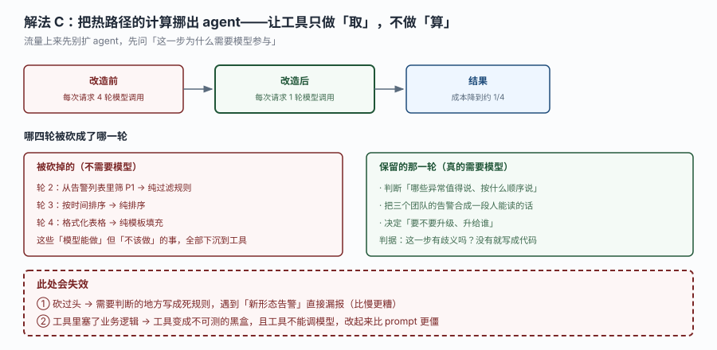

# 场景 4：流量翻 10 倍怎么扛（规模压力题）

**场景描述**：你的值班助手现在每天被叫 200 次，多是值班人随手问一句。三个月后公司所有团队都用上了，**每天 2000 次**，而且集中在早晚两个高峰（各 400 次/小时，约 0.11 QPS，但会突发到 20 个并发）。

现在暴露的问题不是"算不动"，而是：
- 早高峰时单次响应从 4 秒涨到 25 秒
- 月账单涨了 12 倍（比流量涨得更多）
- 某个团队的 agent 在跑长任务时，其他团队的问题要排队

这里有个容易误判的点：**MDA 没有"副本数"这个旋钮**。你调不了横向扩展 —— 所以"扛"的办法和常规服务完全不同。

**已有约束**：
- 一个项目只有一个 agent 入口（不能一个项目放多张图）
- 一个线程一个沙箱，沙箱不能跨线程共享
- agent 层记忆对所有调用方共享（不是每团队一份）
- 托管层是 CLI 优先，没有公开的 create / invoke REST 面

**🔒 先自己想 30 秒**：既然不能加副本，那"扩"只能怎么扩？你第一反应是拆部署、加子代理、还是先砍掉不必要的模型调用？三者的成本与风险差在哪？

<details><summary>💡 提示（分层 / 分维度想）</summary>

**维度一：先判断瓶颈在哪**
是模型调用次数多（成本）、单次调用慢（延迟）、还是长任务占住了资源（隔离）？三种瓶颈对应三种完全不同的解法。

**维度二：能砍的先砍**
"流量翻 10 倍"里，有多少次调用是**根本不需要模型**的？能不能让工具直接返回结果？

**维度三：扩的粒度**
按团队拆（部署数增加）／按任务拆（子代理并行）／按时间拆（错峰调度）。前三者的失效方式完全不同。

</details>

<details><summary>📖 展开解法</summary>

### 解法一览

| 解法 | 效果（延迟改善 / 成本改善 / 隔离性 / 运维复杂度） | 代价 | 适用边界 |
|------|--------------------------------------------|------|---------|
| A. 拆部署 + 按业务分片 | 高 / 中 / **最高** / 高 | 记忆不再共享、路由层成新单点 | 团队间业务差异大、需要强隔离 |
| B. 子代理并行 | 中 / **负**（成本上升） / 中 / 低 | token 总量上升 | 单次任务里有多个可并行的独立子任务 |
| C. 热路径计算下沉 | 高 / **最高** / 低 / 中 | 砍过头会漏判 | 多数请求是"取数 + 格式化" |

### 各解法详解

#### 解法 A：拆部署 + 按业务分片

思路：一个 agent 拆成 N 个独立部署，每个部署服务一个团队。用一层很薄的统一入口按 team 分流。



读图：上层是统一入口（不承载 agent 逻辑），下接三个独立部署（platform / infra / data），每个部署独立拥有自己的记忆树、schedules、通道、构建产物与失败域。橙框说明为什么不能"一个部署横扩副本"。**红框两处**：记忆不再共享（改一次要改 N 遍）、路由层成为新单点。

```bash
# 每个团队一个项目目录，各自独立部署
mda deploy --project ./teams/platform
mda deploy --project ./teams/infra
mda deploy --project ./teams/data
```

```python
# 统一入口（自己的服务，不在托管侧）：只做分流，不做 agent 逻辑
ROUTES = {"platform": "https://platform-agent.example/v1", 
          "infra": "https://infra-agent.example/v1",
          "data": "https://data-agent.example/v1"}

def route(team: str) -> str:
    # 未注册的团队直接拒绝，不要 fallback 到某个默认 agent（会串数据）
    if team not in ROUTES:
        raise ValueError(f"未知团队 {team}")
    return ROUTES[team]
```

> **该解法特有的坑**：记忆从"一份"变成"N 份"。原本"全团队共用一条值班约定"的做法失效 —— 改一次要改 N 遍。可行做法是把共享约定放进每个项目的 `instructions.md`（跟着代码走，一次提交改全部），而不是放进记忆。
> 第二个坑：路由层是新的单点故障，而托管侧**不提供这个路由**。它得你自己运维 —— 这意味着"托管"省下的运维成本有一部分又回来了。

#### 解法 B：子代理并行

思路：在一次运行内把独立子任务分给多个子代理，并行执行。总耗时 ≈ 最慢那个，而不是三者之和。



读图：主 agent 拆出三个子代理（查告警 / 查值班 / 查历史），并发执行后汇总。左侧列出收益（墙钟时间、上下文隔离、仍只有一个部署），右侧列出代价（token 上升、多两轮模型调用、部分失败要处理）。**红框两处**：子代理数超过并行上限时实际在排队；子代理自己再调工具 → 工具调用次数成倍放大。

```python
from managed_deepagents import define_deep_agent
from tools.duty import read_oncall_roster, query_open_alerts

agent = define_deep_agent(
    name="duty-assistant",
    model="openai:gpt-5.5",
    tools=[read_oncall_roster, query_open_alerts],
    subagents=[
        {
            "name": "alert-scout",
            "description": "只负责查询当前未恢复告警，不做判断",
            "tools": [query_open_alerts],
        },
        {
            "name": "roster-scout",
            "description": "只负责查询各团队当前值班人",
            "tools": [read_oncall_roster],
        },
    ],
)
```

> **该解法特有的坑**：它改善的是**墙钟延迟**，不是**总成本** —— token 总量会上升，因为每个子代理都有自己的 system prompt 与上下文。如果瓶颈是成本而不是延迟，这个解法是负收益。
> 第二个坑：并行度有上限。子代理数远超上限时实际变成排队，耗时又回到"之和"—— 那时"并行"是幻觉。

#### 解法 C：热路径计算下沉

思路：别扩 agent，先问"这一步为什么需要模型参与"。把筛选、排序、格式化这些"模型能做但不该做"的事下沉到工具，模型只保留真正需要判断的那一轮。



读图：左边改造前每次请求 4 轮模型调用，右边改造后 1 轮，成本降到约 1/4。中间两栏分别是"被砍掉的（不需要模型）"与"保留的那一轮（真的需要模型）"。红框两处：砍过头会漏判新形态告警；工具里塞业务逻辑会变成不可测黑盒。

```python
@tool
def rank_alerts(team: str) -> str:
    """按 P1 → P2 排序后返回，已过滤掉已恢复的。纯规则，不需要模型参与。"""
    rows = fetch_open_alerts(team)                 # 内部调告警系统
    open_rows = [r for r in rows if not r["resolved"]]
    ordered = sorted(open_rows, key=lambda r: (r["level"], -r["duration_min"]))
    if not ordered:
        return f"团队 {team} 当前没有未恢复告警。"
    # 格式化也在工具里做完，模型只负责"怎么讲这件事"
    return "\n".join(f"[{r['level']}] {r['name']}（已持续 {r['duration_min']} 分钟）" 
                     for r in ordered)
```

> **该解法特有的坑**：砍过头比太慢更糟。筛选规则写死以后，遇到"新型告警级别"（比如 P0）直接漏掉 —— 而且不报错。所以要留一条"未识别级别 → 原样上报"的兜底分支，让模型看到原始数据自己判断。
> 第二个坑：工具里不能调模型。所以"需要判断的事"不能下沉 —— 下沉的只能是**确定性计算**。

### 替代路线（非本课程技术栈）

| 替代方案 | 思路 | 与本课程解法的差异 |
|---------|------|------------------|
| 自建 LangGraph Server + K8s HPA | 回到自托管，用副本数横向扩 | 扩展性最强（真正能加副本），但失去托管省下的全部运维；且需要自己管 checkpointer / store |
| 前置缓存层（Redis 缓存工具结果） | 同样的查询在 TTL 内直接返回缓存 | 成本降幅最大（重复查询几乎免费），但引入缓存一致性问题；且 agent 的"判断"部分仍要跑 |
| 消息队列削峰（请求排队异步处理） | 高峰期请求进队列，慢慢消费 | 保护后端不过载，但把"同步问答"变成"异步通知"，交互体验变化大 |

### 推荐路径（递进，不是一次全上）

1. **先上 C（热路径下沉）** —— 零新增组件，只改工具；通常能砍掉 50%–75% 的模型调用。
2. **有并行子任务时上 B（子代理）** —— 改善延迟，但要接受成本上升。只在高频路径上用。
3. **团队间需要强隔离时上 A（拆部署）** —— 最后手段，因为运维复杂度增加最多、且记忆要重新组织。

**顺序的理由**：C 是纯收益（降成本 + 降延迟），B 是交换（延迟换成本），A 是权衡（隔离换运维）。

### 知识点挂钩

- 解法 A → 阶段 1 课 2《托管的是什么》知识点 1（一个项目一个入口）+ 阶段 2 课 6 知识点 1（记忆共享边界）
- 解法 B → 阶段 2 课 4《指令、技能与工具》知识点 3（工具注册）+ 阶段 1 课 2 的 subagents 委派
- 解法 C → 阶段 2 课 4 知识点 3 + 阶段 2 课 6 知识点 2（热记忆成本结构）
- 替代路线"自建 + HPA" → 与本课程知识点 1「托管不给副本旋钮」对照（差异见上表）

### 什么情况下此方案不适用

**流量大到需要真横向扩展**：MDA 现阶段没有副本数概念，一个部署扛不住就是扛不住。这时该退回自建 LangGraph Server（本课程 1.2 节的四门槛里第 1、2 条会命中）。

**请求之间强依赖**（"接着上次那个继续说"）：拆部署会把线程打断。要么保持单部署接受排队，要么把状态显式存进外部存储。

**需要跨团队共享一条记忆**：拆部署后记忆天然隔离。要共享只能靠"每个项目都带同一份 instructions.md"或"外部共享存储"，前者跟着代码走更可靠。

### 做错会踩的坑

→ 关联 [故障模式 1：工具写好了、文件也在，模型却说"我没有这个工具"](../08-实战经验.md#m1)
→ 解法 C 的工具若声明了 `sandbox/`，会命中 [故障模式 4：文件权限规则写了，但完全不生效](../08-实战经验.md#m4)（权限被静默清空）
→ 拆部署后每个项目都要重过 [三、上线 Checklist](../08-实战经验.md#checklist)

</details>
